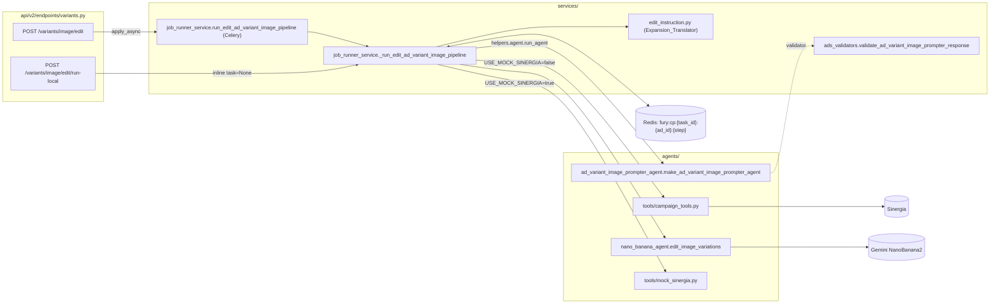
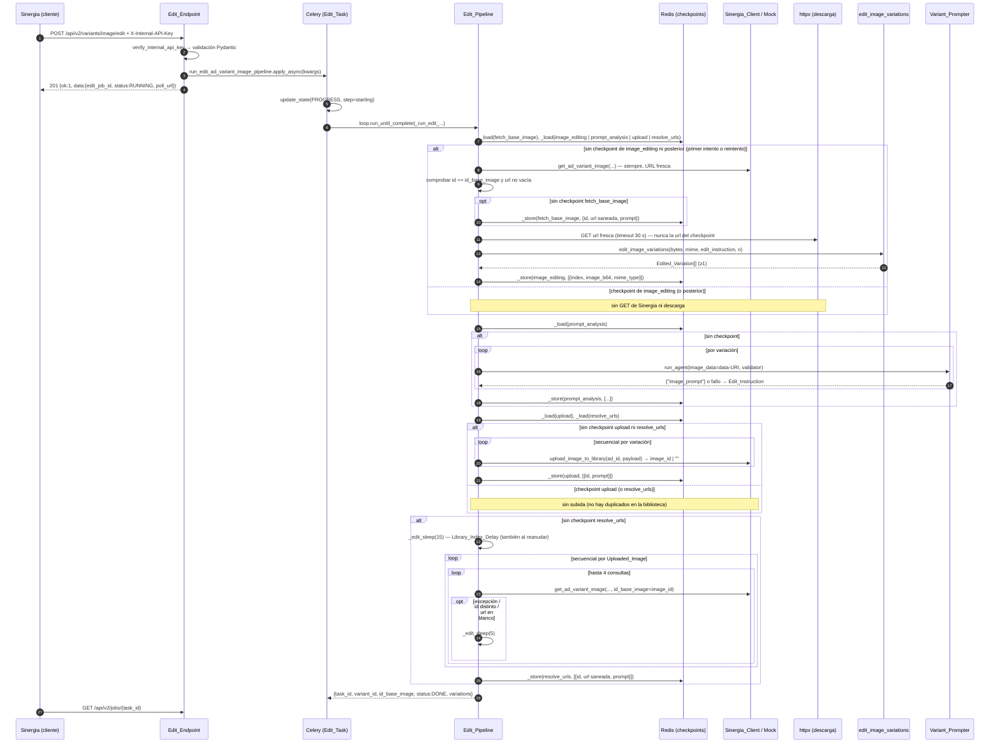
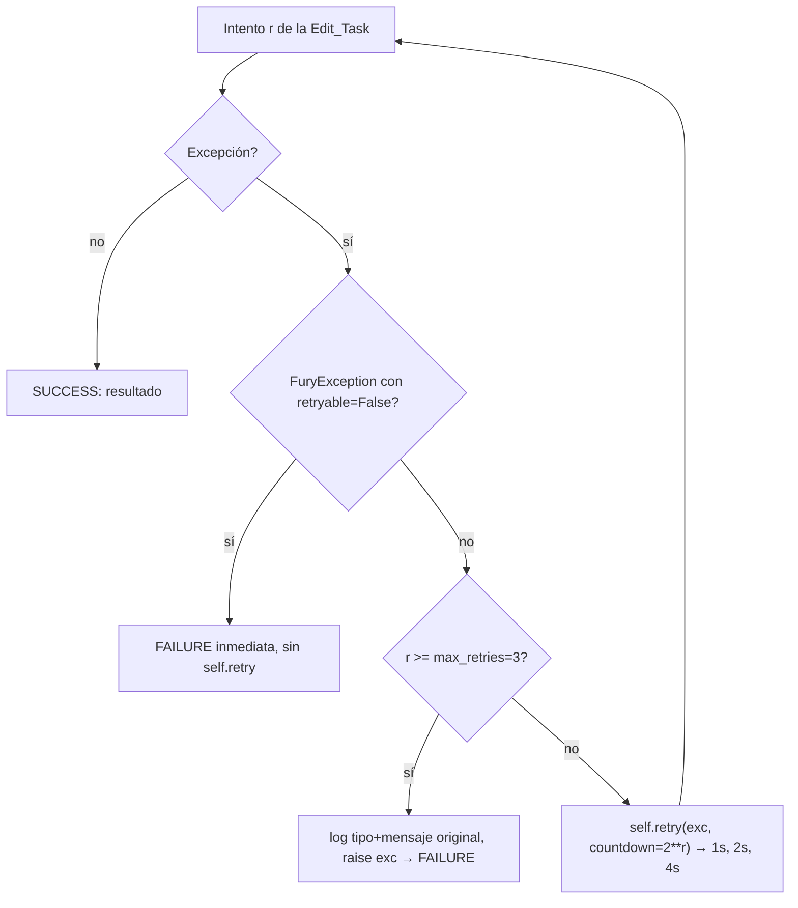

# Design Document — ad-variant-image-edit-pipeline

## Overview

Este diseño añade a Fury un pipeline asíncrono que edita la imagen base de una variante de anuncio y registra N variaciones editadas en la biblioteca de imágenes de Sinergia. El flujo es:

1. `POST /api/v2/variants/image/edit` valida el `AdVariantImageEditCreate`, autentica con `verify_internal_api_key` y encola `run_edit_ad_variant_image_pipeline`.
2. La tarea Celery ejecuta `_run_edit_ad_variant_image_pipeline` en un event loop dedicado. La corrutina recorre seis pasos, cinco de ellos con checkpoint en Redis: `fetch_base_image` → `download` (sin checkpoint propio) → `image_editing` → `prompt_analysis` → `upload` → `resolve_urls`.
3. La expansión/zoom se traduce a texto de forma determinista (`services/edit_instruction.py`), se concatena con `custom_prompt` y se envía junto al binario original a NanoBanana2 mediante la nueva `edit_image_variations`.
4. El nuevo agente `ad_variant_image_prompter` describe cada variación (salida JSON `{"image_prompt": ...}` validada por `validate_ad_variant_image_prompter_response`); si falla, se usa la Edit_Instruction como prompt.
5. Cada variación se sube secuencialmente con la función existente `upload_image_to_library(ad_id, payload)`, que devuelve solo el `image_id`. El checkpoint `upload` guarda `[{id, prompt}]` sin `url`, así que un reintento nunca vuelve a subir.
6. `resolve_urls` espera 15 s (`_LIBRARY_INDEX_DELAY_S`) a que la biblioteca indexe las imágenes y obtiene la `url` de cada una con `get_ad_variant_image(..., id_base_image=<image_id>)`, con hasta 3 reintentos de 5 s por imagen. El job devuelve `{task_id, variant_id, id_base_image, status: "DONE", variations: [{id, url, prompt}]}`.

Es un pipeline nuevo y aislado: no modifica `generate_images_from_prompts`, `_run_phase1` ni los pipelines de persona, por lo que no necesita flag `USE_*` (coherente con la introducción de los requisitos). Las únicas modificaciones a código compartido son aditivas (nuevas funciones, nuevas subclases de `FuryException`, nuevas rutas) salvo el cambio mínimo en `jobs.py` aprobado en D3 (Decisión confirmada 8), el saneado de una línea de log de `upload_image_to_library` (D15) y los ids únicos del `upload_image_to_library` de Mock_Sinergia (D13). La doble extensión del nombre de archivo en la biblioteca se corrige solo en el helper privado `_variation_image_name` del pipeline (D17), sin tocar `upload_image_to_library` ni Sinergia. `core/auth.py` no se modifica (D1, Decisión confirmada 7).

### Fuentes revisadas

Diseño basado en la lectura del código real de `fury/app`: `api/v2/endpoints/variants.py`, `persona_images.py`, `jobs.py`, `api/v2/router.py`, `main.py`, `services/job_runner_service.py`, `services/persona_job_runner_service.py` (STEP 3/4 de `_run_edit_persona_main_image_pipeline` y la tarea `run_edit_persona_main_image_pipeline`), `services/celery_app.py`, `agents/nano_banana_agent.py`, `agents/edit_prompter_agent.py`, `agents/persona_prompter_agent.py`, `agents/tools/campaign_tools.py`, `agents/tools/mock_sinergia.py`, `agents/guards/safety_guard.py`, `services/ads_validators.py`, `services/persona_validators.py`, `schemas/pipeline_schemas.py`, `schemas/persona_schemas.py`, `core/exceptions.py`, `core/auth.py`, `core/config.py`, `core/validation.py`, `core/adk_config.py`, `helpers/agent.py`, `tests/*.py`, y `sinergia/app/v2/resources/service.py` para el contrato de Sinergia. Versiones instaladas en `fury/app/env`: FastAPI 0.121.1, Celery 5.6.2, Pydantic 2.12.5, httpx 0.28.1. Últimas versiones publicadas en PyPI (consultadas con `pip index versions`): pytest 9.1.1, hypothesis 6.168.5.

### Hallazgos clave de la investigación

- `_cp_key(task_id, ad_id, step)` en `job_runner_service.py` produce `fury:cp:{task_id}:{ad_id}:{step}`; `_store` serializa con `json.dumps` (solo valores JSON) y `_CHECKPOINT_TTL = 7200`. Los binarios deben guardarse como texto base64.
- `_strip_signed_urls` solo actúa sobre cadenas que **empiezan** por `http` y contienen `?` con marcadores `X-Amz-`, `Signature=`, `GoogleAccessId=` o `Key-Pair-Id=`; devuelve la URL sin query. No limpia URLs embebidas en textos (mensajes de excepción), así que se necesita un helper adicional para texto libre.
- `generate_images_from_prompts` usa `gemini-3.1-flash-image-preview` (NanoBanana2) vía `google.genai`, con `HttpOptions(timeout=_gen_timeout_s * 1000)`, `asyncio.wait_for(..., timeout=_gen_timeout_s + 15)`, AFC deshabilitado y `_image_semaphore()` acotado por `IMAGE_GEN_MAX_CONCURRENCY`. **No** detecta rate limits: la detección existente vive en `helpers/agent.py` (`_is_rate_limit_error`, marcadores `429`, `resource_exhausted`, etc.).
- `settings.IMAGE_GEN_MAX_CONCURRENCY` (default 2) y `settings.IMAGE_GEN_TIMEOUT_SECONDS` (default 120) existen en `core/config.py`. No están documentadas en `env.example` (no se añaden settings nuevas en este diseño, así que no es bloqueante).
- `run_agent(agent, user_id, message_text, image_data=None, image_mime_type=None, validator=None, initial_state=None)` acepta un data-URI y devuelve texto o `ValidationResult.data` si el validador lo aporta.
- Las funciones existentes de `campaign_tools.py` para imágenes de persona capturan excepciones y devuelven `{}`/`""`. `get_ad_variant_image` debe **propagar** (Req 4.4), por lo que no se copia literalmente.
- `campaign_tools.upload_image_to_library(ad_id: int, image_data: dict) -> str` (existente, usada también por `generate_images_from_prompts`) hace `POST /api/v2/service/hiluca/ad/{ad_id}/image/upload` con `{"image": image_data}` y devuelve `data.image_id` o `""`. **Captura todas las excepciones** y devuelve `""`, así que el pipeline no puede depender de excepciones: un `""` o un valor no `str` es un fallo de esa variación. La subida es del anuncio, no de la variante. Además tiene un `logger.debug` que vuelca los primeros 100 caracteres de `image_data` (con un data-URI, ~78 caracteres de base64; con una URL, la query firmada) y un `logger.info` con la respuesta de Sinergia (solo `{ok, data: {image_id}}`, sin datos sensibles).
- En Sinergia, `UploadImageFuryUseCase` exige en `image` las claves `image_data`, `image_name` y `mime_type`, acepta el prefijo `data:<mime>;base64,`, sube el binario mediante un webhook de n8n y devuelve solo `{image_id}`. El nombre de archivo final es `image_name` + extensión derivada del MIME; `image_prompt` no se persiste hoy.
- `mock_sinergia.upload_image_to_library` devuelve siempre el mismo id constante (`"IMG_fdbc2e54-..."`). `mock_sinergia.get_ad_variant_image` devuelve `{"id": id_base_image, ...}`, es decir, hace eco del id recibido, lo que sirve tal cual para `resolve_urls`.
- El código actual de `_run_edit_ad_variant_image_pipeline` ya importa `upload_image_to_library as upload_image_to_library_tool` y la llama como `await upload_image_to_library_tool(ad_id, payload)`, pero sigue leyendo `resp.get("image_id")`/`resp.get("url")` como si fuera un `dict`. Como el retorno es `str`, **todas las subidas se dan por fallidas hoy** y el job termina siempre en `VariationUploadFailedError` (D14).
- `celery_app` usa `task_serializer="json"`, `result_serializer="json"`, `task_acks_late=True`, `task_soft_time_limit=900`, `task_time_limit=960`, `task_reject_on_worker_lost=False`.

### Discrepancias detectadas entre requisitos y código

| # | Requisito | Realidad del código | Decisión de diseño | Estado |
|---|---|---|---|---|
| D1 | 2.3 / 13.21: cabecera ausente → HTTP 401 o 403; clave inválida → 401; clave no configurada → 503 | `_api_key_header = APIKeyHeader(name="X-Internal-API-Key", auto_error=True)`; en FastAPI 0.121.1 `APIKeyHeader.check_api_key` lanza **403** `"Not authenticated"` si falta la cabecera. Clave incorrecta da 401; clave no configurada da 503. | No se modifica `core/auth.py`. Ambos endpoints usan `Depends(verify_internal_api_key)` tal cual. Las pruebas aceptan `{401, 403}` para cabecera ausente, exigen 401 para clave inválida y 503 para clave no configurada. | **Resuelta** (Decisión confirmada 7). Ya no es una decisión abierta. |
| D2 | 12.3: 500 con `{"ok":0,"message":{code,text},"details"}` | `general_exception_handler` en `main.py` devuelve `ok` y `message` pero **no** `details`. Los run-local actuales envuelven todo en `HTTPException(500, detail=str(exc))`, lo que además filtraría el mensaje original. | El Run_Local_Endpoint no usa `HTTPException(500)`. Relanza `FuryException` tal cual (la renderiza `fury_exception_handler`) y convierte cualquier otra excepción en `EditPipelineInternalError` (`code="INTERNAL_ERROR"`, `details={"task_id", "error_type"}`), que también es `FuryException`. `main.py` no se toca. | Decisión de diseño (sin cambios). |
| D3 | 10.7: `GET /jobs/{task_id}` devuelve el resultado completo solo para este pipeline | `jobs.py`, en estado `SUCCESS`, devuelve `"result": "Ok"` (el `info` está comentado). | Cambio mínimo en `jobs.py`: si `info` es un `dict` cuyas claves son exactamente `AD_VARIANT_IMAGE_EDIT_RESULT_KEYS`, se devuelve `"result": info`. Los demás pipelines conservan `"Ok"` byte a byte. | **Resuelta** (Decisión confirmada 8). Cambio aprobado. |
| D4 | 4.8 / 5.1 / 5.4 / 11.8 / 13.23: en todo reintento que necesite descargar, refrescar la URL con `get_ad_variant_image`; 12.4: el checkpoint guarda la URL sin firma | La URL que devuelve Sinergia es una URL S3 prefirmada (`X-Amz-Expires=3600`, ver mocks). Sin la query la descarga falla con 403, y además caduca antes que el checkpoint (7200 s). | El checkpoint `fetch_base_image` guarda `{id, url saneada, prompt}` y nunca se usa su `url` para descargar. Si no existe checkpoint de `image_editing` ni de un paso posterior, el pipeline **siempre** llama a `get_ad_variant_image` (primer intento o reintento), revalida `id == id_base_image` y descarga desde la URL fresca, sin reescribir el checkpoint `fetch_base_image` si ya existía. Si existe checkpoint de `image_editing` (o posterior), no se invocan ni el GET de Sinergia ni la descarga. | **Resuelta** (Decisión confirmada 9). Alineada con los requisitos; ya no es una desviación. |
| D5 | 13.22: ningún checkpoint contiene data-URI completos; 7.11/8.10 exigen guardar las variaciones | Las Edited_Variation son imágenes; deben persistir para reanudar. | En `image_editing` y `prompt_analysis` las imágenes se guardan como `image_b64` (base64 puro, sin el prefijo `data:<mime>;base64,`) más `mime_type`. El data-URI se reconstruye en memoria solo para `run_agent` y para el `payload` de subida. 12.6 solo prohíbe binarios en el checkpoint de `fetch_base_image`, que no contiene imagen. | Decisión de diseño (sin cambios). |
| D6 | 12.8: subclases de `FuryException` picklables | `FuryException.__init__` llama `super().__init__(self.message)`; el pickle por defecto reconstruye con `cls(*args)` = `cls(message)` y luego restaura `__dict__`. Funciona solo si la subclase acepta `message` como único posicional. Celery con backend JSON reconstruye la excepción como `cls(*exc_message)`. | Las nuevas subclases tienen firma `__init__(self, message: str, details: dict[str, Any] \| None = None)`, `code`/`status_code`/`step`/`retryable` como atributos de clase y un `__reduce__` explícito `(cls, (message, details))`. | Decisión de diseño (sin cambios). |
| D7 | 11.6: capturar `MaxRetriesExceededError` en el 4.º intento | En Celery 5.6, `Task.retry(exc=exc)` con reintentos agotados relanza `exc`, no `MaxRetriesExceededError`; el `except MaxRetriesExceededError` del patrón actual nunca se ejecuta en ese caso. | La tarea comprueba `self.request.retries >= self.max_retries` **antes** de llamar a `self.retry`, loguea tipo y mensaje original y relanza `exc`. Se mantiene además el `except MaxRetriesExceededError` defensivo. | Decisión de diseño (sin cambios). |
| D8 | 3 (user story): run-local "sin Redis ni Celery" | `_store`/`_load` llaman a Redis sin protección; `_run_phase1` en run-local también necesita Redis. | Wrappers `_edit_cp_load` / `_edit_cp_store` sobre `_load`/`_store`. Con `task is None` (run-local) toleran errores de conexión a Redis (warning y se comporta como "sin checkpoint"). Con Celery los errores se propagan y son reintentables. | Decisión de diseño (sin cambios). |
| D9 | 4.2 / 4.10: ruta de Sinergia `.../variant/{variant_id}/image/{id_base_image}` | No existe todavía en `sinergia/app/v2/resources/service.py` (solo las de buyer_persona y `/hiluca/ad/<id_ad>/image/upload`). | Dependencia externa implementada en una spec separada. Esta spec solo la consume desde `campaign_tools.py` y usa Mock_Sinergia en local y en pruebas. Se asume el sobre `{"data": {...}}` usado por los demás endpoints de servicio, con `id`/`url`/`prompt`; el cliente tolera también la respuesta sin sobre. La ruta `POST .../variant/{variant_id}/image/upload` ya no se consume (D11). | **Resuelta / fuera de alcance — spec de Sinergia** (Decisión confirmada 10). Esta spec depende de ella. |
| D11 | 9.1: subida específica de variante (`upload_ad_variant_image_from_edit`) | El usuario decide reutilizar `upload_image_to_library(ad_id, image_data) -> str` (ruta existente `/hiluca/ad/{ad_id}/image/upload`). | Se eliminan `upload_ad_variant_image_from_edit` de `campaign_tools.py` y `mock_sinergia.py`. El payload actual (`image_data`, `image_name` sin extensión de imagen y con sufijo `_{index}` (D17), `mime_type`, `image_prompt`) ya cumple lo que exige Sinergia (`image_data`, `image_name`, `mime_type`) y se mantiene. Fury sigue enviando `image_prompt`; el usuario actualizará Sinergia manualmente, fuera de esta spec, para que lo persista (A5). | **Resuelta** (Decisión confirmada 11; A5 resuelto / fuera de alcance). |
| D12 | 10.3: `url` de cada variación | `upload_image_to_library` devuelve solo el `image_id`. | Paso nuevo `resolve_urls`: espera de 15 s y `get_ad_variant_image(..., id_base_image=image_id)` por imagen, con reintentos acotados (§11). | **Resuelta** (Decisiones confirmadas 12 y 13). |
| D13 | 9.6, Property 7, Property 11: `image_id` distintos | `mock_sinergia.upload_image_to_library` devuelve un id constante. En `run-local` con mock, todas las variaciones tendrían el mismo `id`, contra Req 10.6. | Opción (b): el mock pasa a devolver un id único por invocación con un contador (`f"IMG_mock_{ad_id}_{n}"`). Ningún código ni prueba depende del valor constante (comprobado con búsqueda en `fury/app`). Las pruebas del pipeline siguen usando fakes, no el mock. Se descarta (a) (dejar el mock y relajar la unicidad) porque dejaría `run-local` en modo mock violando Req 10.6. | **Resuelta** (supuesto A4 confirmado): el mock compartido devuelve ids únicos `IMG_mock_{ad_id}_{n}`. |
| D14 | 9.3 / 9.7: retorno de la subida | El código actual lee `resp.get("image_id")`/`resp.get("url")` sobre un `str`, así que toda subida se considera fallida. | El pipeline acepta `resp` solo si es `str` no vacío tras `strip`; mantiene el `try/except` por si el mock o una versión futura lanzan. Lo corrige la tarea 15.12. | Bug conocido, a corregir. |
| D15 | 12.6 / 12.9 / Property 18: nada de base64 en logs | `upload_image_to_library` hace `logger.debug(... image_data[:100])`. | Cambio mínimo en esa línea: se loguean solo las claves, el tipo del valor (`data-uri:<mime>`, `url`, `text`) y la longitud. No cambia la firma, la petición ni el retorno, así que los demás llamadores no se ven afectados (tarea 15.2, Property 21). | Riesgo conocido, a corregir. |
| D16 | 14.3: la `url` se resuelve por la ruta de variante | La subida asocia la imagen al **anuncio**; `get_ad_variant_image` consulta `{base}/variant/{variant_id}/image/{id}`. | Se asume que Sinergia devuelve la imagen recién subida bajo esa ruta de variante. Si no, todas las URL_Resolution fallan y el job termina en `VariationUrlResolutionError` tras los reintentos. | **Resuelta / fuera de alcance — spec de Sinergia** (A1, Decisión confirmada 10): la spec de Sinergia que implementa `get_ad_variant_image` también cubre devolver por la ruta de variante las imágenes subidas con `POST .../ad/{ad_id}/image/upload`. Esta spec depende de ella. |
| D17 | 9.5 / 9.12 / 9.13: nombre de archivo de cada variación | `UploadImageFuryUseCase` (`sinergia/app/v2/use_cases/image_library.py`) construye **siempre** el nombre como `image["image_name"] + mimetypes.guess_extension(mime_type)` (`.jpg` si es desconocido). Hoy `_variation_image_name("banner.png", 1)` devuelve `banner_1.png` y el archivo final es `banner_1.png.png`. Los pipelines de persona ya envían nombres sin extensión. | Se resuelve en Fury sin tocar código compartido (`upload_image_to_library` ni Sinergia): `_variation_image_name` elimina del final como máximo una extensión de `_IMAGE_NAME_EXTENSIONS` (sin distinguir mayúsculas) y añade `_{index}`; si el stem quedara vacío, conserva el nombre completo. La extensión final la decide Sinergia a partir del MIME real (`banner.jpg` con `image/png` → `banner_1.png`). Efecto secundario aceptado: la descripción de la biblioteca (`"{ad} - {image_name}"`) muestra `banner_1` sin extensión. (§11, Property 22.) | **Resuelta** (Decisión confirmada 15). |
| D10 | 8.3: adjuntar safety guards | `edit_prompter_agent.py` los tiene comentados y usa un modelo sin prefijo (`gemini-3.1-flash-image-preview`), contra la regla del steering. | El nuevo agente adjunta ambos guards y usa `LiteLlm(model=cfg["model"])` con `fallback_model="gemini/gemini-2.5-flash"`. El guard solo escanea texto, no `inline_data`, así que la imagen no lo dispara; el mensaje nunca incluye URLs firmadas. | Decisión de diseño (sin cambios). |

## Architecture

### Ubicación de los componentes



### Secuencia del pipeline



### Reintentos



Notas de diseño:

- Orquestación en código, sin LLM orquestador (steering). La única llamada a LLM es el Variant_Prompter, y su fallo nunca tumba el job.
- Contexto "assemble-once": el pipeline obtiene la Base_Image y construye la Edit_Instruction; el agente tiene `tools=[]`.
- La expansión/zoom se aplica solo vía texto; no se usa Pillow ni se redimensiona el binario (Req 6.11).

## Components and Interfaces

### 1. Schemas (`schemas/pipeline_schemas.py`)

Se añaden al módulo existente del dominio de ads (Req 1.9). Se usa `from enum import Enum` y `field_validator` / `model_validator` de Pydantic v2.

```python
class ExpandZoomOption(str, Enum):
    """Opción de expansión/zoom-out. Valor == nombre (Req 1.8). Case-sensitive."""
    TOP = "TOP"
    BOTTOM = "BOTTOM"
    LEFT = "LEFT"
    RIGHT = "RIGHT"
    ZOOM_2X = "ZOOM_2X"
    ZOOM_1_5X = "ZOOM_1_5X"
    ZOOM_1_25X = "ZOOM_1_25X"


class AdVariantImageEditCreate(BaseModel):
    """Edit_Request — payload de POST /variants/image/edit (y /run-local)."""
    brand_id: int = Field(..., ge=1)
    campaign_id: int = Field(..., ge=1)
    ad_id: int = Field(..., ge=1)
    channel_id: int = Field(..., ge=1)
    variant_id: int = Field(..., ge=1)
    image_name: str = Field(..., min_length=1, max_length=255)
    id_base_image: str = Field(..., min_length=1, max_length=255)
    n_variations: int = Field(..., ge=1, le=10)
    custom_prompt: str | None = Field(None, max_length=2000)
    expand_zoom_option: ExpandZoomOption | None = None

    @field_validator("image_name", "id_base_image", mode="before")
    @classmethod
    def _strip_required(cls, v: Any) -> Any:
        # Recorte antes de min_length/max_length: "   " → "" → 422 (Req 1.7, 1.12).
        return v.strip() if isinstance(v, str) else v

    @field_validator("custom_prompt", mode="before")
    @classmethod
    def _normalize_custom_prompt(cls, v: Any) -> Any:
        # "" o solo espacios → None (Req 1.12). max_length se mide tras el recorte.
        if isinstance(v, str):
            v = v.strip()
            return v or None
        return v

    @model_validator(mode="after")
    def _require_prompt_or_option(self) -> "AdVariantImageEditCreate":
        if self.custom_prompt is None and self.expand_zoom_option is None:
            raise ValueError(
                "Se requiere custom_prompt, expand_zoom_option o ambos"
            )
        return self


class AdVariantImageEditJobData(BaseModel):
    edit_job_id: str
    status: Literal["RUNNING"] = "RUNNING"
    poll_url: str


class AdVariantImageEditJobResponse(BaseModel):
    ok: int = 1
    data: AdVariantImageEditJobData


class RegisteredVariant(BaseModel):
    id: str = Field(..., min_length=1)
    url: str = Field(..., min_length=1)
    prompt: str = Field(..., min_length=1)


class AdVariantImageEditResult(BaseModel):
    task_id: str
    variant_id: int
    id_base_image: str
    status: Literal["DONE"] = "DONE"
    variations: list[RegisteredVariant] = Field(..., min_length=1)


AD_VARIANT_IMAGE_EDIT_RESULT_KEYS: frozenset[str] = frozenset(
    {"task_id", "variant_id", "id_base_image", "status", "variations"}
)
```

Notas:

- Pydantic valida el `Enum` por valor exacto: `"top"` o `"ZOOM_3X"` dan 422 con `loc=["body","expand_zoom_option"]` (Req 1.5). Los enteros en modo lax aceptan `"5"` y rechazan `"abc"` (Req 1.6).
- El error del `model_validator` se reporta con `loc=["body"]` y el mensaje literal, suficiente para Req 1.4.
- FastAPI resuelve primero las dependencias (`Security(_api_key_header)` → `verify_internal_api_key`) y después acumula los errores de body. Por eso la autenticación precede al 422 (Req 2.3) para cualquier JSON bien formado. Excepción conocida: un cuerpo que no es JSON parseable da 422 antes de la autenticación, porque FastAPI lee el body antes de resolver dependencias. Se documenta y no se cubre en las pruebas de precedencia.

### 2. Endpoints (`api/v2/endpoints/variants.py`)

Se registran en el router existente (`prefix="/variants"`), así que no hace falta tocar `api/v2/router.py`.

```python
from core.exceptions import FuryException, EditJobEnqueueError, EditPipelineInternalError
from schemas.pipeline_schemas import (
    AdVariantImageEditCreate, AdVariantImageEditJobResponse, AdVariantImageEditJobData,
)
from services.job_runner_service import (
    run_edit_ad_variant_image_pipeline, _run_edit_ad_variant_image_pipeline,
)


@router.post("/image/edit", status_code=201, response_model=AdVariantImageEditJobResponse)
async def create_ad_variant_image_edit(
    body: AdVariantImageEditCreate,
    _: str = Depends(verify_internal_api_key),
) -> AdVariantImageEditJobResponse:
    """Encola la edición de la imagen base de una variante (Req 2)."""
    kwargs = body.model_dump(mode="json")  # 10 claves; expand_zoom_option → str | None
    try:
        task = run_edit_ad_variant_image_pipeline.apply_async(kwargs=kwargs)
    except Exception as exc:
        logger.error(f"[enqueue] edit job enqueue failed: {type(exc).__name__}")
        raise EditJobEnqueueError(
            "No se pudo encolar el job de edición",
            details={"variant_id": body.variant_id, "id_base_image": body.id_base_image},
        )
    task_id = str(task.id)
    return AdVariantImageEditJobResponse(
        ok=1,
        data=AdVariantImageEditJobData(
            edit_job_id=task_id, status="RUNNING", poll_url=f"/api/v2/jobs/{task_id}",
        ),
    )


@router.post("/image/edit/run-local", status_code=200)
async def run_ad_variant_image_edit_local(
    body: AdVariantImageEditCreate,
    _: str = Depends(verify_internal_api_key),
) -> dict[str, Any]:
    """DEV-ONLY. Ejecuta el pipeline inline (sin Celery). 404 si DEBUG=false."""
    if not settings.DEBUG:
        raise HTTPException(status_code=404, detail="Not found")
    task_id = str(uuid.uuid4())
    try:
        result = await _run_edit_ad_variant_image_pipeline(
            task=None, task_id=task_id, **body.model_dump(mode="json"),
        )
    except FuryException:
        raise  # fury_exception_handler → {"ok":0,"message":{code,text},"details"} (Req 12.2)
    except Exception as exc:
        # Req 12.3: sin traza, sin str(exc) (podría contener URLs firmadas).
        raise EditPipelineInternalError(
            "Error interno ejecutando el pipeline de edición",
            details={"task_id": task_id, "error_type": type(exc).__name__},
        )
    return {"ok": 1, "data": result}
```

Orden de rechazo resultante en run-local: autenticación (401/403/503) → validación (422) → `DEBUG` (404) → ejecución. Cumple Req 3.2–3.4: la auth se evalúa siempre, el 422 no ejecuta nada y con `DEBUG=False` nunca se ejecuta el pipeline.

Cada petición válida produce un `apply_async` independiente; Celery genera un `task_id` UUID nuevo por llamada (Req 2.7). No se usa `idempotency_key`.

### 3. Expansion_Translator (`services/edit_instruction.py`)

Módulo determinista nuevo, sin dependencias de red ni LLM, con su `tests/test_edit_instruction.py` (patrón de `services/territory_assignment.py`). Los textos van en inglés porque son el prompt que recibe el modelo, igual que el resto de prompts de NanoBanana en el código.

```python
"""Deterministic translation of ExpandZoomOption → NanoBanana2 edit instruction.

Part of the ad-variant image-edit pipeline (services/job_runner_service.py).
Pure functions: no LLM, no randomness, no clock, no request context (Req 6.5).
"""
from schemas.pipeline_schemas import ExpandZoomOption

_PRESERVE_CLAUSE = (
    "Keep the exact original aspect ratio of the base image. "
    "Do not modify, move, recolor or remove any existing content of the base image; "
    "it may only be scaled down uniformly to make room. "
    "The new content must continue the existing scene seamlessly."
)

EXPANSION_INSTRUCTIONS: dict[ExpandZoomOption, str] = {
    ExpandZoomOption.TOP: (
        "Expand the image upward: generate new content only on the top side, "
        "above the current top edge. Do not add content on the bottom, left or right sides. "
        + _PRESERVE_CLAUSE
    ),
    ExpandZoomOption.BOTTOM: (
        "Expand the image downward: generate new content only on the bottom side, "
        "below the current bottom edge. Do not add content on the top, left or right sides. "
        + _PRESERVE_CLAUSE
    ),
    ExpandZoomOption.LEFT: (
        "Expand the image to the left: generate new content only on the left side, "
        "beyond the current left edge. Do not add content on the top, bottom or right sides. "
        + _PRESERVE_CLAUSE
    ),
    ExpandZoomOption.RIGHT: (
        "Expand the image to the right: generate new content only on the right side, "
        "beyond the current right edge. Do not add content on the top, bottom or left sides. "
        + _PRESERVE_CLAUSE
    ),
    ExpandZoomOption.ZOOM_2X: (
        "Zoom out symmetrically by a factor of 2, centered: the current image must occupy "
        "the central 1/2 of the width and height, and new content must be generated on all "
        "four sides (top, bottom, left and right). " + _PRESERVE_CLAUSE
    ),
    ExpandZoomOption.ZOOM_1_5X: (
        "Zoom out symmetrically by a factor of 1.5, centered: the current image must occupy "
        "the central 1/1.5 of the width and height, and new content must be generated on all "
        "four sides (top, bottom, left and right). " + _PRESERVE_CLAUSE
    ),
    ExpandZoomOption.ZOOM_1_25X: (
        "Zoom out symmetrically by a factor of 1.25, centered: the current image must occupy "
        "the central 1/1.25 of the width and height, and new content must be generated on all "
        "four sides (top, bottom, left and right). " + _PRESERVE_CLAUSE
    ),
}


def translate_expand_zoom_option(option: ExpandZoomOption | str) -> str:
    """Return the fixed instruction for `option`. Raises ValueError for unknown values."""
    return EXPANSION_INSTRUCTIONS[ExpandZoomOption(option)]


def build_edit_instruction(
    expand_zoom_option: ExpandZoomOption | str | None,
    custom_prompt: str | None,
) -> str:
    """Edit_Instruction (Req 6.6–6.9).

    - only option  → translation
    - only prompt  → custom_prompt (already normalized by the schema)
    - both         → translation + " " + custom_prompt
    Raises ValueError if both are None/empty (the schema prevents it upstream).
    """
```

`custom_prompt` se usa tal cual llega tras la normalización del schema (Req 6.7). La corrutina no vuelve a recortarlo; el Celery task recibe ya el valor normalizado de `model_dump`.

### 4. Image_Editor (`agents/nano_banana_agent.py`)

Función nueva, sin tocar `generate_images_from_prompts` ni `make_nano_banana_agent` (Req 7.2). Reutiliza `_image_semaphore()` y el patrón HL-2630 de timeouts y AFC deshabilitado.

```python
NANO_BANANA2_MODEL = "gemini-3.1-flash-image-preview"  # mismo modelo que generate_images_from_prompts
_EDIT_RATE_LIMIT_BACKOFF_S: tuple[int, ...] = (1, 2, 4)  # Req 7.4


def _is_image_rate_limit_error(exc: BaseException) -> bool:
    """429 / RESOURCE_EXHAUSTED. Combina google.genai.errors.APIError.code == 429
    con los marcadores de helpers.agent._is_rate_limit_error."""


async def _call_nano_banana2_edit(
    client: Any, image_bytes: bytes, mime_type: str, edit_instruction: str, timeout_s: int,
) -> tuple[bytes, str] | None:
    """Una solicitud a NanoBanana2. Devuelve (bytes, mime) o None si no hay imagen.

    contents = [Part.from_bytes(data=image_bytes, mime_type=mime_type),
                Part.from_text(text=edit_instruction)]
    config = GenerateContentConfig(response_modalities=["IMAGE"],
             automatic_function_calling=AutomaticFunctionCallingConfig(disable=True))
    Sin image_config.aspect_ratio: la relación de aspecto la fija la Edit_Instruction
    y la imagen de entrada (Req 6.11). asyncio.wait_for(asyncio.to_thread(...),
    timeout=timeout_s + 15) como respaldo del timeout HTTP del cliente.
    Punto de inyección para las pruebas (monkeypatch del atributo del módulo).
    """


async def edit_image_variations(
    base_image_bytes: bytes,
    base_mime_type: str,
    edit_instruction: str,
    n_variations: int,
    *,
    task_id: str = "-",
    sleep: Callable[[float], Awaitable[None]] = asyncio.sleep,
) -> list[dict[str, Any]]:
    """Genera hasta `n_variations` ediciones de la imagen base (Req 7).

    Returns:
        Lista ordenada por `index` (1-based) de Edited_Variation:
        {"index": int, "image_b64": str, "mime_type": str}. Las variaciones fallidas
        se omiten; la lista puede estar vacía. Nunca lanza por un fallo de variación.
    Raises:
        ValueError si n_variations no está en 1..10 o el binario está vacío.
    """
```

Comportamiento:

- `timeout_s = max(10, settings.IMAGE_GEN_TIMEOUT_SECONDS)` y `genai.Client(http_options=HttpOptions(api_version="v1alpha", timeout=timeout_s * 1000))`, creado una vez por llamada (Req 7.6).
- Se lanzan `n_variations` corrutinas con `asyncio.gather(..., return_exceptions=True)`. Cada **intento** adquiere `_image_semaphore()` y lo libera antes del `sleep` de backoff, así que las esperas no ocupan cupo y nunca hay más de `IMAGE_GEN_MAX_CONCURRENCY` solicitudes en curso (Req 7.3).
- Rate limit: hasta 3 reintentos de esa variación con `sleep(1)`, `sleep(2)`, `sleep(4)`. Si el 4.º intento falla por rate limit, la variación se da por fallida (Req 7.4, 7.5). `sleep` es inyectable para pruebas sin espera real (Req 13.10).
- Cualquier otro error, `asyncio.TimeoutError` o respuesta sin `inline_data` → variación fallida sin reintento. Log `logger.warning(f"[{task_id}] NanoBanana2 edit v{index} failed: {type(exc).__name__}")`, sin binarios (Req 7.7).
- Éxito: `image_b64 = base64.b64encode(bytes).decode()`, `mime_type = inline_data.mime_type or "image/png"`, que debe empezar por `image/` (si no, se trata como "sin imagen").
- Se loguea por variación solo índice, MIME y tamaño en bytes.

### 5. Variant_Prompter (`agents/ad_variant_image_prompter_agent.py`)

```python
"""AdVariantImagePrompter — describe una variación editada de imagen de anuncio.

Ad-variant image-edit pipeline, paso prompt_analysis
(services/job_runner_service._run_edit_ad_variant_image_pipeline). Sin tools:
recibe la imagen y el contexto ensamblado por el pipeline (assemble-once).
"""
from google.adk.agents import Agent
from google.adk.models.lite_llm import LiteLlm
from core.config import settings
from core.adk_config import get_agent_config_from_langfuse
from agents.guards import safety_guard_before_model, safety_guard_after_model

_FALLBACK_MODEL = "gemini/gemini-2.5-flash"  # conserva el prefijo de proveedor

_FALLBACK_INSTRUCTION = """\
You are the Image Analyst for Fury's ad-variant image editing pipeline.
You receive ONE edited advertising image, the edit instruction that produced it,
and (if available) the prompt of the original base image.
Describe what is actually visible in the image: subject, product, setting,
composition, lighting, colors and mood, in 2-5 sentences, in English.
Only describe visible content; do not invent brands, claims or text.
Comply with Meta advertising policies.
Return ONLY a JSON object, with no markdown and no extra text:
{"image_prompt": "<description, max 2000 characters>"}
"""


def make_ad_variant_image_prompter_agent(custom_prompt: str | None = None) -> Agent:
    """Lazy factory — crea un Agent nuevo con la config actual de Langfuse."""
    cfg = get_agent_config_from_langfuse(
        "fury.ad_variant_image_prompter",
        _FALLBACK_INSTRUCTION,
        fallback_model=_FALLBACK_MODEL,
        cache_ttl_seconds=settings.LANGFUSE_CACHE_TTL_SECONDS,
    )
    instruction = cfg["instruction"]
    if custom_prompt:
        instruction += (
            f"\n\nCUSTOM DIRECTIVE: {custom_prompt}\n"
            "It may refocus the description but never changes the JSON-only output format."
        )
    return Agent(
        model=LiteLlm(model=cfg["model"]),
        name="ad_variant_image_prompter",
        description="Describes an edited ad image as {\"image_prompt\": str} for the Sinergia library.",
        instruction=instruction,
        tools=[],
        before_model_callback=safety_guard_before_model,
        after_model_callback=safety_guard_after_model,
    )
```

El pipeline llama a la factory sin `custom_prompt`: el `custom_prompt` del usuario ya forma parte de la Edit_Instruction incluida en el mensaje.

### 6. Prompter_Validator (`services/ads_validators.py`)

```python
AD_VARIANT_IMAGE_PROMPT_MAX_CHARS = 2000


def validate_ad_variant_image_prompter_response(response: str) -> ValidationResult:
    """Valida la respuesta del agente ad_variant_image_prompter (Req 8.5, 8.6).

    Acepta solo un objeto JSON con `image_prompt: str`, no vacío tras strip y de como
    máximo 2000 caracteres (medidos tras strip). Tolera fences ```json``` alrededor
    del objeto (mismo criterio que _parse_json_response), pero no texto libre.
    data = dict parseado con image_prompt ya recortado.
    error_code ∈ {"EMPTY_RESPONSE", "INVALID_JSON", "NOT_AN_OBJECT", "MISSING_FIELD",
                  "INVALID_TYPE", "EMPTY_FIELD", "TOO_LONG"}.
    """
```

Ejemplos de mensajes de error: `"Response is not valid JSON"`, `"Response JSON is not an object"`, `"Missing field 'image_prompt'"`, `"'image_prompt' must be a string"`, `"'image_prompt' is empty"`, `"'image_prompt' exceeds 2000 characters (2153)"`.

### 7. Sinergia_Client (`agents/tools/campaign_tools.py`)

```python
def _ad_variant_base_path(
    brand_id: int, campaign_id: int, ad_id: int, channel_id: int, variant_id: int,
) -> str:
    return (
        f"/api/v2/service/hiluca/brand/{brand_id}/campaign/{campaign_id}"
        f"/ad/{ad_id}/channel/{channel_id}/variant/{variant_id}"
    )


async def get_ad_variant_image(
    brand_id: int, campaign_id: int, ad_id: int, channel_id: int, variant_id: int,
    image_name: str, id_base_image: str,
) -> dict[str, Any]:
    """GET {base}/image/{id_base_image} vía _sinergia_get (X-Service-API-Key, timeout 15 s).

    Returns: exactamente {"id": str, "url": str, "prompt": str}, tomados de `data`
    (o del cuerpo si no hay sobre). Campos ausentes/null → "" (prompt siempre str).
    Raises: httpx.HTTPError / ValueError (cuerpo no dict). No captura: Req 4.4.
    `image_name` se acepta por paridad de firma con el contrato; no se envía.
    """


async def upload_image_to_library(ad_id: int, image_data: dict) -> str:
    """EXISTENTE (compartida con generate_images_from_prompts). No cambia su contrato:
    POST /api/v2/service/hiluca/ad/{ad_id}/image/upload con {"image": image_data}
    vía _sinergia_post (X-Service-API-Key, timeout 15 s).

    Returns: data.image_id, o "" si falta. Captura TODA excepción y devuelve "".
    Único cambio (D15, Req 12.9): la línea logger.debug deja de volcar
    image_data[:100] y pasa a loguear solo claves, tipo y longitud.
    """
```

`upload_ad_variant_image_from_edit` se **elimina** (D11). `_ad_variant_base_path`, `_unwrap_sinergia_body` y `_as_str` se conservan porque los usa `get_ad_variant_image`. `get_ad_variant_image` no cambia: el pipeline la reutiliza para la Base_Image y para cada URL_Resolution (Req 4.11).

Cambio mínimo del log de `upload_image_to_library` (D15):

```python
def _describe_image_data(value: Any) -> str:
    """'data-uri:image/png len=123456' | 'url len=210' | 'text len=12' | 'none'.
    Nunca incluye el contenido ni la query de una URL."""

logger.debug(
    f"upload_image_to_library request ad_id={ad_id} image_keys={list(image_data.keys())} "
    f"image_data={_describe_image_data(image_data.get('image_data'))}"
)
```

`_sinergia_get` / `_sinergia_post` no se modifican. `_sinergia_post` loguea en error `response=text[:2000]` (comportamiento existente); se acepta porque es la respuesta de Sinergia y no el payload, y queda fuera de este feature. El `logger.info(... data=json.dumps(data))` de `upload_image_to_library` tampoco se toca: la respuesta solo contiene `{ok, data: {image_id}}`.

### 8. Mock_Sinergia (`agents/tools/mock_sinergia.py`)

Mismas firmas exactas (verificadas con `inspect.signature` en las pruebas, Req 13.18).

```python
_MOCK_AD_VARIANT_BASE_IMAGE_URL = (
    "https://hiluca-assets-dev.s3.us-east-2.amazonaws.com/mock/ad_variant_base.png"
    "?X-Amz-Credential=MOCK&X-Amz-Security-Token=MOCK&X-Amz-Signature=MOCK"
)
_mock_library_upload_counter = itertools.count(1)  # sustituye a _mock_ad_variant_upload_counter


async def get_ad_variant_image(
    brand_id: int, campaign_id: int, ad_id: int, channel_id: int, variant_id: int,
    image_name: str, id_base_image: str,
) -> dict[str, Any]:
    """Mock determinista: {"id": id_base_image, "url": <URL firmada mock>, "prompt": <texto fijo>}.
    Sin cambios: el eco de id_base_image hace que cada URL_Resolution se acepte
    a la primera (Req 14.13)."""


async def upload_image_to_library(ad_id: int, image_data: dict) -> str:
    """Mock (modificado, D13): devuelve f"IMG_mock_{ad_id}_{n}" con n creciente por
    proceso, distinto en cada invocación (Req 9.6). Conserva el print existente de
    las claves de image_data."""
```

`upload_ad_variant_image_from_edit` se elimina del mock (D11). El cambio a ids únicos afecta a todos los pipelines que usan el mock (`generate_images_from_prompts`); ningún código ni prueba depende del id constante. Confirmado por el usuario (A4, D13 resuelta).

La URL mock está firmada a propósito para ejercitar `_strip_signed_urls` y la obtención de una URL fresca en cada intento que descarga (D4). `USE_MOCK_SINERGIA` solo simula Sinergia: la descarga del binario sigue usando `httpx`, así que en desarrollo local la URL mock debe ser accesible o hay que parchear `_download_base_image`. Las pruebas siempre lo parchean.

### 9. Excepciones (`core/exceptions.py`)

```python
class AdVariantImageEditError(FuryException):
    """Base de errores del pipeline de edición de imagen de variante.

    Atributos de clase: code, status_code, step, retryable. __reduce__ explícito para
    que pickle (Celery) conserve clase, message, code, status_code y details (Req 12.8).
    `args == (message,)`, compatible con la reconstrucción del backend JSON de Celery.
    """
    code: str = "AD_VARIANT_IMAGE_EDIT_ERROR"
    status_code: int = 500
    step: str = ""
    retryable: bool = True

    def __init__(self, message: str, details: dict[str, Any] | None = None):
        super().__init__(message=message, code=type(self).code,
                         status_code=type(self).status_code, details=details)

    def __reduce__(self):
        return (self.__class__, (self.message, self.details))
```

| Clase | `code` | `status_code` | `step` | `retryable` | Causa |
|---|---|---|---|---|---|
| `BaseImageFetchError` | `AD_VARIANT_BASE_IMAGE_FETCH_FAILED` | 502 | `fetch_base_image` | sí | Red/timeout/no-2xx/cuerpo inválido en `get_ad_variant_image` (Req 4.4) |
| `BaseImageMismatchError` | `AD_VARIANT_BASE_IMAGE_ID_MISMATCH` | 409 | `fetch_base_image` | **no** | `id` devuelto ≠ `id_base_image` (Req 4.9) |
| `BaseImageUrlMissingError` | `AD_VARIANT_BASE_IMAGE_URL_MISSING` | 422 | `download` | **no** | `url` ausente, `None` o en blanco (Req 5.3) |
| `BaseImageDownloadError` | `AD_VARIANT_BASE_IMAGE_DOWNLOAD_FAILED` | 502 | `download` | sí | Red, timeout 30 s, no-2xx, 0 bytes, `Content-Type` no `image/` (Req 5.4, 5.5) |
| `ImageEditingFailedError` | `AD_VARIANT_IMAGE_EDITING_FAILED` | 502 | `image_editing` | sí | `edit_image_variations` devuelve `[]` (Req 7.9, 7.10) |
| `VariationUploadFailedError` | `AD_VARIANT_IMAGE_UPLOAD_FAILED` | 502 | `upload` | sí | Fallan todas las subidas (Req 9.8) |
| `VariationUrlResolutionError` (subclase de `VariationUploadFailedError`) | `AD_VARIANT_IMAGE_URL_RESOLUTION_FAILED` | 502 | `resolve_urls` | sí | Ninguna Uploaded_Image obtiene `url` tras los reintentos (Req 14.7) |
| `EditJobEnqueueError` | `AD_VARIANT_IMAGE_EDIT_ENQUEUE_FAILED` | 503 | `enqueue` | n/a | `apply_async` lanza (Req 2.5) |
| `EditPipelineInternalError` | `INTERNAL_ERROR` | 500 | `""` | n/a | Excepción no-Fury en run-local (Req 12.3) |

**Por qué una clase nueva para `resolve_urls`.** Reutilizar `VariationUploadFailedError` tal cual violaría Req 12.1 (`code` distinto por causa) y confundiría al operador: el `details.step == "upload"` sugeriría que las imágenes no llegaron a la biblioteca cuando sí están subidas, y el reintento no vuelve a subir. Con `VariationUrlResolutionError` el `code` y el `step` identifican la causa real, y al ser subclase de `VariationUploadFailedError` cualquier `except VariationUploadFailedError` existente la sigue capturando, lo que respeta la indicación de que el fallo total de resolución es un `VariationUploadFailedError` reintentable. Hereda `__reduce__` y la firma `(message, details)`, así que cumple Req 12.8 sin código extra.

`details` de los errores de pipeline contiene siempre `task_id`, `id_base_image` y `step`, más `cause` (texto saneado con `_redact_text`, máx. 300 caracteres) cuando aplica; `BaseImageMismatchError` añade `expected_id` y `received_id`.

Helper de clasificación en `job_runner_service.py`:

```python
def _is_retryable_edit_error(exc: BaseException) -> bool:
    """False solo para AdVariantImageEditError con retryable=False. Cualquier otra
    excepción (incluida SoftTimeLimitExceeded o errores de Redis) es reintentable,
    igual que en run_pipeline_phase1."""
    return not (isinstance(exc, AdVariantImageEditError) and not exc.retryable)
```

### 10. Celery task (`services/job_runner_service.py`)

`job_runner_service` ya está en `celery_app.include`, así que no hay que tocar `celery_app.py`.

```python
@celery_app.task(
    name="services.job_runner_service.run_edit_ad_variant_image_pipeline",
    bind=True,
    max_retries=3,
)
def run_edit_ad_variant_image_pipeline(
    self,
    brand_id: int,
    campaign_id: int,
    ad_id: int,
    channel_id: int,
    variant_id: int,
    image_name: str,
    id_base_image: str,
    n_variations: int,
    custom_prompt: str | None = None,
    expand_zoom_option: str | None = None,
) -> dict[str, Any]:
    task_id = self.request.id
    logger.info(f"[{task_id}] ▶ EditAdVariantImage start — variant={variant_id} "
                f"base_image={id_base_image} n={n_variations} option={expand_zoom_option}")
    self.update_state(state="PROGRESS", meta={
        "step": "starting", "variant_id": variant_id, "id_base_image": id_base_image,
    })
    try:
        loop = asyncio.new_event_loop()
        asyncio.set_event_loop(loop)
        try:
            result = loop.run_until_complete(_run_edit_ad_variant_image_pipeline(
                self, task_id, brand_id, campaign_id, ad_id, channel_id, variant_id,
                image_name, id_base_image, n_variations, custom_prompt, expand_zoom_option,
            ))
        finally:
            try:
                loop.run_until_complete(loop.shutdown_asyncgens())
            except Exception as sg_exc:
                logger.warning(f"[{task_id}] shutdown_asyncgens error (ignored): {sg_exc}")
            loop.close()
            asyncio.set_event_loop(None)
        logger.info(f"[{task_id}] EditAdVariantImage complete")
        return result
    except Exception as exc:
        from celery.exceptions import MaxRetriesExceededError
        msg = _redact_text(str(exc))
        attempt = self.request.retries + 1
        if not _is_retryable_edit_error(exc):
            logger.error(f"[{task_id}] EditAdVariantImage non-retryable failure "
                         f"(attempt {attempt}): {type(exc).__name__}: {msg}")
            raise
        if self.request.retries >= self.max_retries:
            logger.error(f"[{task_id}] Max retries ({self.max_retries}) exhausted. "
                         f"Original: {type(exc).__name__}: {msg}")
            raise
        logger.warning(f"[{task_id}] EditAdVariantImage failed (attempt {attempt}), "
                       f"retrying in {2 ** self.request.retries}s: {type(exc).__name__}: {msg}")
        try:
            raise self.retry(exc=exc, countdown=2 ** self.request.retries)
        except MaxRetriesExceededError:  # defensivo, ver D7
            logger.error(f"[{task_id}] Max retries exhausted. {type(exc).__name__}: {msg}")
            raise exc
```

La traza completa (`traceback.format_exc()`) no se loguea en este pipeline. Los mensajes de excepción de httpx incluyen la URL de la petición, que puede estar firmada; todo texto de excepción pasa por `_redact_text`.

### 11. Edit_Pipeline (`services/job_runner_service.py`)

```python
@observe(name="fury.ad_variant_image_edit_pipeline")
async def _run_edit_ad_variant_image_pipeline(
    task,
    task_id: str,
    brand_id: int,
    campaign_id: int,
    ad_id: int,
    channel_id: int,
    variant_id: int,
    image_name: str,
    id_base_image: str,
    n_variations: int,
    custom_prompt: str | None = None,
    expand_zoom_option: str | None = None,
) -> dict[str, Any]:
    """Pipeline de edición de imagen de variante (code-driven, con checkpoints).

    Pasos: fetch_base_image → download → image_editing → prompt_analysis → upload
           → resolve_urls → done.
    """
    # Imports perezosos (Req 11.12)
    from agents.ad_variant_image_prompter_agent import make_ad_variant_image_prompter_agent
    from agents.nano_banana_agent import edit_image_variations
    from services.ads_validators import validate_ad_variant_image_prompter_response
    from services.edit_instruction import build_edit_instruction
    if settings.USE_MOCK_SINERGIA:
        from agents.tools.mock_sinergia import (
            get_ad_variant_image, upload_image_to_library as upload_image_to_library_tool,
        )
    else:
        from agents.tools.campaign_tools import (
            get_ad_variant_image, upload_image_to_library as upload_image_to_library_tool,
        )
    ...
```

Helpers privados nuevos en el mismo módulo:

```python
_EDIT_STEPS: tuple[str, ...] = (
    "fetch_base_image", "image_editing", "prompt_analysis", "upload", "resolve_urls",
)
_EDIT_PROGRESS_STEPS: tuple[str, ...] = (
    "fetch_base_image", "download", "image_editing", "prompt_analysis", "upload",
    "resolve_urls", "done",
)
_BASE_IMAGE_DOWNLOAD_TIMEOUT_S = 30  # Req 5.1 (constante, no setting nuevo)
_LIBRARY_INDEX_DELAY_S = 15          # Req 14.1 — indexado de la biblioteca de Sinergia
_RESOLVE_URL_RETRIES = 3             # Req 14.5 — reintentos adicionales por imagen
_RESOLVE_URL_RETRY_DELAY_S = 5       # Req 14.5 — espera entre consultas

# Edit_Sleep (Req 14.2): se invoca SIEMPRE como `_edit_sleep(...)` resuelto en el
# módulo en tiempo de llamada, nunca capturado en un default de parámetro, para que
# las pruebas lo parcheen (`job_runner_service._edit_sleep = fake`) sin esperas reales.
_edit_sleep: Callable[[float], Awaitable[None]] = asyncio.sleep

async def _resolve_variation_url(
    get_ad_variant_image, *, task_id: str, brand_id: int, campaign_id: int, ad_id: int,
    channel_id: int, variant_id: int, image_name: str, image_id: str,
) -> tuple[str | None, int, str]:
    """URL_Resolution con reintentos acotados (Req 14.3–14.5).

    Hasta 1 + _RESOLVE_URL_RETRIES consultas; antes de cada repetición
    `await _edit_sleep(_RESOLVE_URL_RETRY_DELAY_S)` (no tras la última).
    Acepta solo dict con id == image_id y url str no vacía tras strip.
    Returns: (url sin modificar | None, consultas realizadas, última causa saneada).
    Nunca lanza: las excepciones de get_ad_variant_image se convierten en causa.
    """

def _edit_cp_load(task, task_id: str, ad_id: int, step: str) -> Any: ...
def _edit_cp_store(task, task_id: str, ad_id: int, step: str, value: Any) -> None:
    """_store(_cp_key(task_id, ad_id, step), value, ex=_CHECKPOINT_TTL). Ver D8."""

async def _download_base_image(url: str, task_id: str) -> tuple[bytes, str]:
    """httpx.AsyncClient(timeout=30, follow_redirects=True).get(url).
    Acepta 2xx ∧ len(body) ≥ 1 ∧ (Content-Type ausente ∨ empieza por "image/").
    MIME = Content-Type sin parámetros, en minúsculas; "image/png" si falta.
    Lanza _DownloadRejected(cause) en cualquier otro caso. Loguea
    [{task_id}] download url=<_strip_signed_urls(url)> → <bytes> bytes <mime> | cause."""

def _redact_text(text: str) -> str:
    """Saneado para texto libre (mensajes de excepción, causas):
    - URLs http(s) embebidas → _strip_signed_urls(url)
    - data:<mime>;base64,<...> → data:<mime>;base64,<redacted N chars>
    - valores de settings.SINERGIA_SERVICE_API_KEY y FURY_INTERNAL_API_KEY → "***"
    Trunca a 300 caracteres."""

def _to_data_uri(image_b64: str, mime_type: str) -> str: ...
_IMAGE_NAME_EXTENSIONS: tuple[str, ...] = (".png", ".jpg", ".jpeg", ".webp", ".gif")  # D17, Req 9.12

def _variation_image_name(image_name: str, index: int) -> str:
    """Variation_Image_Name (Req 9.5, 9.12, 9.13, D17).

    Elimina del final como máximo UNA extensión de _IMAGE_NAME_EXTENSIONS
    (comparación sin distinguir mayúsculas) y añade f"_{index}" (1-based).
    Sinergia añade después la extensión derivada del MIME real, así que el
    archivo final tiene una única extensión. Cualquier otro sufijo con punto
    se conserva. Si el stem quedara vacío (image_name == ".png"), no se
    elimina nada.

    'banner.png', 1    → 'banner_1'      (archivo final 'banner_1.png')
    'banner.JPG', 2    → 'banner_2'
    'banner.jpg', 1    → 'banner_1'      (con MIME image/png → 'banner_1.png')
    'banner', 3        → 'banner_3'
    'promo v1.2', 1    → 'promo v1.2_1'
    'photo.tar.png', 1 → 'photo.tar_1'
    '.png', 1          → '.png_1'        (stem vacío: se conserva el nombre)
    """
    lowered = image_name.lower()
    for ext in _IMAGE_NAME_EXTENSIONS:
        if lowered.endswith(ext) and len(image_name) > len(ext):
            return f"{image_name[: -len(ext)]}_{index}"
    return f"{image_name}_{index}"
def _extract_image_prompt(raw: Any) -> str | None:
    """Acepta str JSON o dict ya parseado (vía _parse_json_response). Devuelve
    image_prompt recortado si es str no vacío y ≤ 2000 caracteres; si no, None."""
```

Lógica por paso (`_progress(step, detail)` llama a `task.update_state(state="PROGRESS", meta={"step", "detail"})` si `task` no es `None` y siempre loguea `[{task_id}] → {step} {detail}`. Se emite para los siete pasos de `_EDIT_PROGRESS_STEPS` en orden aunque se omitan por checkpoint, con `detail="checkpoint"` o `detail="skipped"`, Req 11.11):

1. **Edit_Instruction.** `edit_instruction = build_edit_instruction(expand_zoom_option, custom_prompt)`. Es pura, así que es idéntica en cada reintento (Req 6.9) y no necesita checkpoint.
2. **fetch_base_image.** Se leen con `_edit_cp_load` los checkpoints `fetch_base_image`, `image_editing`, `prompt_analysis`, `upload` y `resolve_urls`. `needs_download = ` ninguno de `image_editing`, `prompt_analysis`, `upload` o `resolve_urls` existe.
   - Si `needs_download` es `True` (primer intento o cualquier reintento que deba descargar): se llama **siempre** a `get_ad_variant_image(...)`, exista o no checkpoint de `fetch_base_image` (Req 4.8, 11.8). Cualquier excepción → `BaseImageFetchError` (retryable) con `cause=_redact_text(...)`. Si `base["id"] != id_base_image` → `BaseImageMismatchError` sin checkpoint (Req 4.9). Si `url` está en blanco → `BaseImageUrlMissingError` sin checkpoint ni descarga (Req 5.3). Si todo es correcto, la URL fresca se mantiene solo en memoria (`live_url`) y, **solo si no existía** checkpoint de `fetch_base_image`, se guarda `{"id", "url": _strip_signed_urls(url), "prompt"}`; si existía, no se reescribe. El `prompt` que se usa después es el de la respuesta fresca. Log de la Base_Image saneada (Req 4.7).
   - Si `needs_download` es `False`: no se llama a `get_ad_variant_image` (Req 4.8, 13.16). El `prompt` base se toma del checkpoint de `fetch_base_image`; si faltara (solo posible por expulsión en Redis, porque la duración máxima del job es inferior al TTL), se usa `""` y se loguea un warning.
3. **download.** Solo si `needs_download`. Descarga desde `live_url`, la URL fresca devuelta en este mismo intento; la `url` del checkpoint nunca se usa para descargar (Req 5.1, 13.23). Un único intento por intento de Celery: `_DownloadRejected` o excepción httpx → `BaseImageDownloadError` (retryable, `details.cause`). El reintento de Celery vuelve al paso 2 y obtiene otra URL fresca (Req 5.4).
4. **image_editing.** Solo si `needs_download` (si existe checkpoint de `image_editing`, se reutiliza; si solo existen checkpoints posteriores, se reanuda desde el último presente): `edit_image_variations(bytes, mime, edit_instruction, n_variations, task_id=task_id)`. Si devuelve `[]` → `ImageEditingFailedError` sin checkpoint (Req 7.9). Si no, `_edit_cp_store(... "image_editing", variations)` antes de seguir (Req 7.11).
5. **prompt_analysis.** Si no hay checkpoint: se crea el agente una vez y, por cada Edited_Variation en orden, se llama a `_run_agent(agent, f"ad_variant_{variant_id}_edit_{task_id}_v{index}", message, image_data=_to_data_uri(...), image_mime_type=mime, validator=validate_ad_variant_image_prompter_response)`. `message` incluye la Edit_Instruction y `Base image prompt: {base['prompt'] or 'not available'}`. Si `_extract_image_prompt` devuelve `None` o `_run_agent` lanza (incluida `AgentValidationError`), se usa `prompt=edit_instruction`, `prompt_source="fallback"` y un warning `[{task_id}] prompter v{index} fallback: {type(exc).__name__}` (Req 8.9). Se guarda el checkpoint con la misma longitud que la entrada (Req 8.10, 8.12).
6. **upload.** Si existe el checkpoint `resolve_urls`, se emite `upload` con `detail="skipped"` y no se sube nada. Si existe el checkpoint `upload`, se emite `detail="checkpoint"` y se reutilizan sus Uploaded_Image con **0** llamadas a `upload_image_to_library_tool` (Req 9.11). Si no existe ninguno, se recorren las variaciones analizadas **secuencialmente** (`for`, sin `gather`). Por cada una: `payload = {"image_data": data_uri, "image_name": _variation_image_name(image_name, index), "mime_type": mime, "image_prompt": prompt}` y `resp = await upload_image_to_library_tool(ad_id, payload)` dentro de `try/except` (la función real nunca lanza, pero el mock o una versión futura podrían). Se acepta solo si `isinstance(resp, str) and resp.strip()`; en otro caso (incluido `""`), o si la llamada lanza, se loguea `[{task_id}] upload v{index} failed: <causa saneada>` y se pasa a la siguiente (Req 9.7). Si ninguna tiene éxito → `VariationUploadFailedError` sin checkpoint `upload` (Req 9.8). Si alguna tiene éxito, `_edit_cp_store(... "upload", [{"id": resp.strip(), "prompt": prompt}, ...])` en el orden del editor y **antes** de empezar `resolve_urls` (Req 9.10).
7. **resolve_urls.** Si existe el checkpoint `resolve_urls`, se emite `detail="checkpoint"` y `registered` es su valor (Req 14.9). Si no:
   - `await _edit_sleep(_LIBRARY_INDEX_DELAY_S)` una sola vez, **también** cuando se reanuda desde el checkpoint `upload` (Req 14.1, 14.10). Repetir la espera al reanudar es barato (15 s frente a un reintento de Celery) y seguro: no hay forma de saber cuánto tiempo pasó desde la subida si el worker cayó, y garantiza que la biblioteca haya indexado.
   - Por cada Uploaded_Image, en orden y secuencialmente: `url, attempts, cause = await _resolve_variation_url(get_ad_variant_image, ..., image_name=image_name, image_id=item["id"])`. `image_name` es el del Edit_Request (sin sufijo); `get_ad_variant_image` no lo envía a Sinergia.
   - Con `url`: `registered.append({"id": item["id"], "url": url, "prompt": item["prompt"]})` y log `[{task_id}] resolve_urls {id} → {_strip_signed_urls(url)} (attempts={attempts})`. Sin `url`: log `[{task_id}] resolve_urls {id} omitted after {attempts} attempts: {cause}` y se continúa (Req 14.6).
   - `registered == []` → `VariationUrlResolutionError` (`details.step == "resolve_urls"`, `cause = f"0/{n} urls resolved"`), sin checkpoint `resolve_urls`; el checkpoint `upload` queda intacto para el reintento (Req 14.7).
   - Si no, `_edit_cp_store(... "resolve_urls", _strip_signed_urls(registered))` (Req 14.8).
8. **done.** Se construye `AdVariantImageEditResult(...)` con `registered` y se devuelve `model_dump(mode="json")`.

El cuerpo del POST es `{"image": payload}` (lo construye `upload_image_to_library`); la Variation_Image_Name (sin extensión de imagen y con sufijo `_{index}`) va dentro de `payload["image_name"]` (Req 9.2, 9.5, 9.12). Sinergia le añade la extensión derivada de `mime_type`, por lo que el archivo final tiene una sola extensión (D17).

**Nombre de variación (D17).** `_IMAGE_NAME_EXTENSIONS` es una constante de dominio, no un setting. El helper es puro y no depende del MIME: la extensión del archivo final la decide Sinergia a partir del contenido real, de modo que `banner.jpg` con una variación `image/png` acaba como `banner_1.png`. Solo se elimina una extensión (`photo.png.png` → `photo.png_1`, caso residual aceptado) y se compara sin distinguir mayúsculas. Como el `image_name` del Edit_Request llega recortado y no vacío (Req 1.7, 1.12), el único caso de stem vacío es un nombre formado solo por la extensión (`.png` → `.png_1`). Los índices son únicos dentro del job, así que los nombres también. Efecto secundario aceptado: la descripción de la biblioteca (`"{ad} - {image_name}"`) muestra `banner_1` sin extensión.

**Presupuesto de tiempo de `resolve_urls` (riesgo conocido y aceptado, Decisión confirmada 16; ver "Riesgos aceptados" en Error Handling).** Mejor caso: 15 s + n × (latencia GET). Peor caso: 15 s + n × (4 × 15 s de timeout de `_sinergia_get` + 3 × 5 s) = 15 + 75·n s, es decir, 765 s con n = 10, que sumado a la edición puede superar `task_soft_time_limit=900`. No es un problema de corrección: `SoftTimeLimitExceeded` es reintentable y el checkpoint `upload` evita volver a subir, así que el reintento solo repite `resolve_urls`. Si en producción se observa, la alternativa es resolver las URLs en paralelo con un semáforo pequeño; se deja fuera de este cambio para mantener la secuencialidad y logs ordenados.

### 12. Jobs endpoint (`api/v2/endpoints/jobs.py`)

Cambio mínimo y aditivo aprobado en D3 (Decisión confirmada 8):

```python
from schemas.pipeline_schemas import AD_VARIANT_IMAGE_EDIT_RESULT_KEYS

if state == "SUCCESS":
    payload: Any = "Ok"
    if isinstance(info, dict) and frozenset(info) == AD_VARIANT_IMAGE_EDIT_RESULT_KEYS:
        payload = info  # Req 10.7 — solo el pipeline de edición de imagen de variante
    return {"ok": 1, "data": {"task_id": task_id, "status": "DONE", "result": payload}}
```

En `FAILURE`, `str(info)` es el `message` de la excepción original. Celery reconstruye la subclase con `cls(*exc_message)` porque `args == (message,)`, lo que cumple Req 11.6.

## Data Models

### Edit_Request (kwargs de la tarea)

`AdVariantImageEditCreate.model_dump(mode="json")`:

```json
{
  "brand_id": 12, "campaign_id": 34, "ad_id": 56, "channel_id": 1, "variant_id": 789,
  "image_name": "summer_banner.png", "id_base_image": "6f1c...-uuid",
  "n_variations": 3, "custom_prompt": "Add warm sunset light", "expand_zoom_option": "ZOOM_1_5X"
}
```

### Base_Image

- Retorno de `get_ad_variant_image`: `{"id": str, "url": str, "prompt": str}`.
- Checkpoint `fetch_base_image`: `{"id": str, "url": str (sin query de firma), "prompt": str}`. Sin binarios. Se escribe una sola vez (primer intento que obtiene la Base_Image) y no se reescribe en los reintentos. Su `url` es informativa: nunca se usa para descargar, porque sin firma no es descargable y la Signed_URL caduca (D4).
- URL de descarga: siempre la devuelta por el `get_ad_variant_image` del intento en curso; vive solo en memoria.

### Edited_Variation (retorno de `edit_image_variations` y checkpoint `image_editing`)

```json
[{"index": 1, "image_b64": "<base64 puro>", "mime_type": "image/png"},
 {"index": 3, "image_b64": "<base64 puro>", "mime_type": "image/jpeg"}]
```

`index` es 1-based según la posición de la solicitud original. Los huecos indican variaciones fallidas. La lista se ordena por `index`.

### Analyzed variation (checkpoint `prompt_analysis`)

```json
[{"index": 1, "image_b64": "...", "mime_type": "image/png",
  "prompt": "A sunlit terrace ...", "prompt_source": "agent"},
 {"index": 3, "image_b64": "...", "mime_type": "image/jpeg",
  "prompt": "<Edit_Instruction>", "prompt_source": "fallback"}]
```

### Upload payload (por variación)

`payload` que el pipeline pasa a `upload_image_to_library(ad_id, payload)`; la función lo envuelve como `{"image": payload}`:

```json
{"image": {"image_data": "data:image/png;base64,...", "image_name": "summer_banner_1",
           "mime_type": "image/png", "image_prompt": "A sunlit terrace ..."}}
```

Retorno: `"IMG_..."` (`image_id`) o `""` si falla. Con `image_name="summer_banner.png"` en el Edit_Request, la variación 1 se envía como `summer_banner_1` y Sinergia guarda el archivo `summer_banner_1.png` (D17).

### Uploaded_Image (checkpoint `upload`)

```json
[{"id": "IMG_9f2...", "prompt": "A sunlit terrace ..."},
 {"id": "IMG_77a...", "prompt": "<Edit_Instruction>"}]
```

Exactamente `{id, prompt}`, sin `url` (Req 9.10). Basta con su existencia para que ningún reintento vuelva a subir (Req 9.11).

### URL_Resolution (por Uploaded_Image)

Llamada: `get_ad_variant_image(brand_id, campaign_id, ad_id, channel_id, variant_id, image_name, id_base_image=<id>)`. Respuesta aceptada: `{"id": <id>, "url": "<no vacía>", "prompt": ...}`; el `prompt` de esta respuesta se ignora, porque el de la variación viene del Variant_Prompter.

### Registered_Variant (checkpoint `resolve_urls` y `variations` del resultado)

`{"id": <image_id de upload_image_to_library>, "url": <url de get_ad_variant_image>, "prompt": str}`. En el checkpoint la `url` pasa por `_strip_signed_urls` (Req 12.4). Si el job termina devolviendo desde el checkpoint `resolve_urls` (solo si el worker cae entre `_store` y `return`), la URL puede llegar sin firma. Es un caso residual aceptado; si Sinergia devuelve URLs de biblioteca no firmadas, no hay diferencia.

### Resultado final

```json
{"task_id": "c0ffee...", "variant_id": 789, "id_base_image": "6f1c...-uuid", "status": "DONE",
 "variations": [{"id": "img_1", "url": "https://...", "prompt": "..."}]}
```

### Claves y TTL de checkpoint

| Paso | Clave Redis | Valor | Se guarda cuando |
|---|---|---|---|
| `fetch_base_image` | `fury:cp:{task_id}:{ad_id}:fetch_base_image` | Base_Image saneada `{id, url, prompt}` | `id` coincide, `url` no vacía y no existía ya (no se reescribe en reintentos) |
| `image_editing` | `fury:cp:{task_id}:{ad_id}:image_editing` | Edited_Variation[] (base64) | ≥ 1 variación |
| `prompt_analysis` | `fury:cp:{task_id}:{ad_id}:prompt_analysis` | Analyzed[] (base64) | siempre que termina el paso |
| `upload` | `fury:cp:{task_id}:{ad_id}:upload` | Uploaded_Image[] `{id, prompt}` (sin `url`) | ≥ 1 subida OK, antes de `resolve_urls` |
| `resolve_urls` | `fury:cp:{task_id}:{ad_id}:resolve_urls` | Registered_Variant[] `{id, url saneada, prompt}` | ≥ 1 `url` resuelta, antes de `done` |

TTL `_CHECKPOINT_TTL = 7200` en todos. `download` no tiene checkpoint: su salida es el binario, que solo vive en memoria y se materializa en `image_editing`. Volumen estimado: hasta 10 imágenes de 1–3 MB en base64 (~1.33×) ≈ 13–40 MB por clave en `image_editing` y otro tanto en `prompt_analysis`, durante un máximo de 2 h. Es aceptable para la instancia Redis compartida con el volumen esperado, pero conviene vigilarlo. Si crece, una alternativa es eliminar `image_b64` de `prompt_analysis` y leerlo de `image_editing`, a costa de acoplar dos claves.

## Correctness Properties

*A property is a characteristic or behavior that should hold true across all valid executions of a system-essentially, a formal statement about what the system should do. Properties serve as the bridge between human-readable specifications and machine-verifiable correctness guarantees.*

El pipeline encaja bien con PBT. Casi toda su lógica (validación del schema, composición de la instrucción, clasificación de descargas y errores, contabilidad de variaciones, reanudación por checkpoints, saneado) es determinista y se ejerce en memoria con fakes de Sinergia, httpx, NanoBanana2, el agente y Redis. Tras la reflexión del prework se consolidaron los criterios redundantes: los de forma del resultado (10.x), contabilidad de subidas y resoluciones (9.4–9.9, 14.3, 14.4, 14.11) y fallback del prompter (8.7–8.12) forman una única invariante end-to-end; todos los criterios de checkpoint (4.8, 7.11, 7.12, 8.11, 9.10, 9.11, 11.7–11.11, 14.8–14.10) forman una única propiedad de reanudación; y la dinámica de reintentos y esperas de `resolve_urls` (14.1, 14.2, 14.5–14.7) se aísla en la Property 20, porque la Property 11 solo genera fallos permanentes de resolución. La regla de nombre de variación (9.5, 9.12, 9.13) se verifica como función pura en la Property 22; la Property 11 solo comprueba que el pipeline usa ese helper para cada `payload`. Los criterios sobre dominios finitos y pequeños (los 7 valores de `ExpandZoomOption`, las clases de excepción) se cubren con pruebas exhaustivas de ejemplo, no con PBT.

### Property 1: El schema acepta exactamente los payloads válidos

*For any* payload JSON generado (campos presentes o ausentes, enteros en rango y fuera de rango, cadenas vacías, de solo espacios o con longitudes en torno a 255/256 y 2000/2001 tras el recorte, valores arbitrarios de `expand_zoom_option` incluidas variantes en minúsculas, y valores no convertibles), `AdVariantImageEditCreate.model_validate(payload)` tiene éxito si y solo si un predicado de referencia escrito en la prueba lo considera válido: los 8 obligatorios presentes y convertibles, IDs ≥ 1, `n_variations` ∈ [1, 10], `image_name`/`id_base_image` con 1–255 caracteres tras recortar, `custom_prompt` ≤ 2000 tras recortar, `expand_zoom_option` ∈ los 7 valores exactos o `None`, y al menos uno entre `custom_prompt` no en blanco y `expand_zoom_option`. Cuando falla, cada campo culpable aparece en `loc` del error (o `loc=["body"]` con el mensaje "custom_prompt, expand_zoom_option o ambos").

**Validates: Requirements 1.1, 1.2, 1.3, 1.4, 1.5, 1.6, 1.7, 1.10, 1.11, 13.14**

### Property 2: Normalización de cadenas idempotente

*For any* payload válido, el modelo resultante tiene `image_name == raw.strip()`, `id_base_image == raw.strip()` y `custom_prompt == (raw.strip() or None)`. Volver a validar `model_dump(mode="json")` produce un modelo igual (idempotencia).

**Validates: Requirements 1.12**

### Property 3: Composición determinista de la Edit_Instruction

*For any* combinación `(option, prompt)` con `option ∈ ExpandZoomOption ∪ {None}` y `prompt` igual a una cadena no vacía ya normalizada o `None`, excluyendo `(None, None)`, `build_edit_instruction(option, prompt)` es igual a `translate(option)` si `prompt is None`, a `prompt` si `option is None` y a `translate(option) + " " + prompt` si ambos existen. Dos invocaciones con la misma entrada devuelven cadenas idénticas carácter a carácter. `(None, None)` lanza `ValueError`.

**Validates: Requirements 6.5, 6.6, 6.7, 6.8, 6.9, 13.3, 13.4, 13.5**

### Property 4: El encolado preserva el request

*For any* `AdVariantImageEditCreate` válido enviado al Edit_Endpoint con clave válida (task falso cuyo `apply_async` devuelve un `id` aleatorio), `apply_async` se invoca exactamente una vez con `kwargs` igual a `model_dump(mode="json")` (10 claves, `expand_zoom_option` como `str` o `None`). La respuesta es 201 con `data == {"edit_job_id": id, "status": "RUNNING", "poll_url": f"/api/v2/jobs/{id}"}` y `ok == 1`.

**Validates: Requirements 1.1, 2.1, 2.2, 13.20**

### Property 5: La autenticación precede a todo

*For any* cuerpo JSON (válido o inválido), cualquier valor de `settings.DEBUG` y cualquier cabecera ausente o con valor distinto de `FURY_INTERNAL_API_KEY`, tanto el Edit_Endpoint como el Run_Local_Endpoint responden con un rechazo de autenticación (401 para clave incorrecta; 401 o 403 para cabecera ausente, sin modificar `core/auth.py`, D1), y `apply_async` y `_run_edit_ad_variant_image_pipeline` se invocan 0 veces.

**Validates: Requirements 2.3, 3.2, 13.21**

### Property 6: El cliente de Sinergia normaliza la respuesta

*For any* respuesta 2xx de Sinergia, con o sin sobre `data`, con claves extra y con `id`/`url`/`prompt` presentes, ausentes o `null`, `get_ad_variant_image` devuelve un dict cuyas claves son exactamente `{"id", "url", "prompt"}`, todas `str`, con `prompt == ""` cuando falta o es `null`. (La parte de upload se elimina: `upload_image_to_library` es código existente cuyo contrato `str` se cubre con ejemplos y con la Property 21.)

**Validates: Requirements 4.3**

### Property 7: Mocks de Sinergia deterministas y únicos

*For any* tupla de argumentos válida (incluido cualquier `id_base_image`, como los `image_id` de la URL_Resolution), el `get_ad_variant_image` de Mock_Sinergia devuelve dos veces el mismo dict, con `id == id_base_image` y `url` no vacía. *For any* número k ≥ 1 de invocaciones del `upload_image_to_library` mock dentro del proceso, con `ad_id` e `image_data` arbitrarios, los k valores devueltos son `str` no vacíos y distintos.

**Validates: Requirements 4.6, 9.6, 14.13**

### Property 8: Guardas no reintentables de la Base_Image

*For any* `id_base_image` y cualquier Base_Image devuelta cuyo `id` sea distinto, el pipeline lanza `BaseImageMismatchError` (`retryable=False`, `details` con `expected_id` y `received_id`). *For any* Base_Image cuya `url` falte, sea `None` o esté compuesta solo de espacios, lanza `BaseImageUrlMissingError` (`retryable=False`, `details.step == "download"`, `details.id_base_image`). En ambos casos no se guarda checkpoint de `fetch_base_image` y la descarga, el Image_Editor, el prompter y la subida se invocan 0 veces.

**Validates: Requirements 4.9, 5.3, 11.5, 13.7**

### Property 9: Clasificación de la descarga

*For any* respuesta HTTP simulada (status 100–599, cuerpo de 0–N bytes, `Content-Type` ausente o arbitrario, incluidos parámetros como `; charset=`) o error de transporte/timeout, `_download_base_image` devuelve `(body, mime)` si y solo si `200 ≤ status < 300`, `len(body) ≥ 1` y `Content-Type` falta o empieza por `image/`. En ese caso `body` es idéntico al recibido y `mime` es el `Content-Type` sin parámetros o `"image/png"` si falta. En cualquier otro caso el pipeline lanza `BaseImageDownloadError` reintentable con `details.step == "download"` y una `cause` no vacía, y el Image_Editor se invoca 0 veces.

**Validates: Requirements 5.2, 5.4, 5.5, 13.6**

### Property 10: Contabilidad de solicitudes del Image_Editor

*For any* `n ∈ [1, 10]`, cualquier límite de concurrencia `c ∈ [1, 4]` y cualquier guion de resultados por variación (éxito; k ∈ [1, 4] rate limits seguidos de éxito; error genérico; timeout; respuesta sin imagen), `edit_image_variations`:
- (a) devuelve, ordenadas por `index`, exactamente las variaciones cuyo guion termina en éxito dentro de los intentos permitidos, cada una con `image_b64` no vacío y `mime_type` que empieza por `image/`;
- (b) realiza `1 + min(k, 3)` llamadas para una variación con k rate limits y 1 llamada para errores no rate limit;
- (c) invoca `sleep` con la secuencia `[1, 2, 4][:min(k, 3)]` para esa variación;
- (d) nunca tiene más de `c` llamadas en curso a la vez;
- (e) nunca lanza.

**Validates: Requirements 7.1, 7.3, 7.4, 7.5, 7.7, 13.10**

### Property 11: Invariante end-to-end del resultado

*For any* `n ∈ [1, 10]`, cualquier subconjunto propio F_gen de variaciones que fallan en el editor (|F_gen| < n), cualquier subconjunto F_pr de variaciones cuyo prompter lanza o es rechazado por el validador, cualquier subconjunto F_up de variaciones cuya subida lanza, devuelve `""` o devuelve un valor no `str`, y cualquier subconjunto F_res de las subidas OK cuyas 4 URL_Resolution fallan (dejando al menos una variación subida y resuelta), el pipeline con fakes (Edit_Sleep simulada) cumple:
- el editor recibe bytes idénticos al cuerpo descargado y la Edit_Instruction exacta;
- `run_agent` se invoca una vez por Edited_Variation;
- `upload_image_to_library` se invoca exactamente una vez por variación analizada, nunca de forma concurrente, con el `ad_id` del request y con un `payload` de claves exactas `{image_data, image_name, mime_type, image_prompt}`, `image_data` con forma `data:<mime>;base64,...` y `image_name` únicos por variación, cada uno igual a `_variation_image_name(request.image_name, index)`: termina en `_{index}` (índice 1-based de la Edited_Variation) y no conserva la Image_Name_Extension final del `image_name` del request (con el fixture `banner.png`, `banner_{index}`);
- la URL_Resolution se invoca solo con `id_base_image` igual a algún `image_id` devuelto por el fake de subida, nunca con un id de F_up, y todas después de la última subida;
- el resultado tiene exactamente las claves `{task_id, variant_id, id_base_image, status, variations}` y `status == "DONE"`;
- `len(variations) == n − |F_gen| − |F_up| − |F_res|`, con `subidas + omitidas_en_subida == analizadas` y `registradas + omitidas_en_resolución == subidas`;
- cada elemento tiene exactamente `{id, url, prompt}` como `str` no vacíos; `id` es el devuelto por el fake de subida, `url` la devuelta por el fake de `get_ad_variant_image` para ese `id`, en el orden del editor y sin `id` repetidos;
- `prompt` es el `image_prompt` recortado del fake del agente o la Edit_Instruction para las variaciones de F_pr;
- el resultado serializado no contiene `"data:"` ni base64 de las imágenes.

**Validates: Requirements 4.11, 6.10, 6.11, 7.8, 8.7, 8.8, 8.9, 8.10, 8.12, 9.4, 9.5, 9.7, 9.9, 9.12, 10.1, 10.2, 10.3, 10.4, 10.5, 10.6, 10.8, 14.3, 14.4, 14.6, 14.11, 13.3, 13.9, 13.11, 13.12, 13.19**

### Property 12: Fallos totales por paso

*For any* `n ∈ [1, 10]`:
- si todas las variaciones fallan en el editor, el pipeline lanza `ImageEditingFailedError` (reintentable, `details.step == "image_editing"`), no existe checkpoint `image_editing` y el prompter y la subida se invocan 0 veces;
- si todas las subidas fallan (cualquier mezcla de excepción, `""` y no `str`), lanza `VariationUploadFailedError` (reintentable, `details.step == "upload"`), no existe checkpoint `upload`, sí existe el de `prompt_analysis` con n' entradas y la Edit_Sleep y la URL_Resolution se invocan 0 veces;
- si todas las subidas tienen éxito pero fallan todas las URL_Resolution, lanza `VariationUrlResolutionError` (reintentable, `isinstance` de `VariationUploadFailedError`, `details.step == "resolve_urls"`), existe el checkpoint `upload` con una entrada por subida OK y no existe el de `resolve_urls`.

**Validates: Requirements 7.9, 7.10, 9.8, 14.7, 13.8, 13.13, 13.28**

### Property 13: Reanudación por checkpoints equivalente

*For any* prefijo S de la secuencia `[fetch_base_image, image_editing, prompt_analysis, upload, resolve_urls]` con checkpoint precargado (con valores coherentes generados a partir de una ejecución de referencia; los prefijos son los únicos estados alcanzables porque los checkpoints se escriben en orden con el mismo TTL), con fakes cuyas URL_Resolution se aceptan a la primera:
- si `image_editing ∈ S`, `get_ad_variant_image` con el `id_base_image` del request y la descarga se invocan 0 veces; si no (`S ∈ {∅, {fetch_base_image}}`), esa llamada se invoca exactamente 1 vez y la descarga 1 vez;
- el editor se invoca 0 veces si `image_editing ∈ S`, el agente 0 veces si `prompt_analysis ∈ S` y `upload_image_to_library` 0 veces si `upload ∈ S` (sin duplicados en la biblioteca);
- si `resolve_urls ∈ S`, la Edit_Sleep y la URL_Resolution se invocan 0 veces; si no, la Edit_Sleep se invoca exactamente 1 vez con 15 (también si `upload ∈ S`) y la URL_Resolution 1 vez por Uploaded_Image;
- si `fetch_base_image ∈ S`, no hay ningún `_store` sobre la clave de `fetch_base_image`; si `upload ∈ S`, no hay ningún `_store` sobre la clave de `upload`;
- los pasos fuera de S se ejecutan;
- el resultado es igual al de la ejecución sin checkpoints con los mismos fakes, salvo la `url` saneada si `resolve_urls ∈ S`;
- cada `_store` usa la clave `fury:cp:{task_id}:{ad_id}:{step}` con `ex == 7200` y `step` en los 5 pasos de `_EDIT_STEPS`; el valor de `upload` tiene elementos con claves exactas `{id, prompt}`;
- la secuencia de `meta.step` emitida vía `update_state` es exactamente `["fetch_base_image", "download", "image_editing", "prompt_analysis", "upload", "resolve_urls", "done"]`.

**Validates: Requirements 4.7, 4.8, 7.11, 7.12, 8.11, 9.10, 9.11, 11.7, 11.8, 11.9, 11.10, 11.11, 14.1, 14.8, 14.9, 14.10, 13.16, 13.26, 13.27, 13.30**

### Property 14: Oráculo del Prompter_Validator y de la extracción

*For any* cadena (texto arbitrario, JSON no objeto, objetos con o sin `image_prompt`, con `image_prompt` de cualquier tipo JSON, en blanco o de longitud 0–2100), `validate_ad_variant_image_prompter_response(s).is_valid` es `True` si y solo si `s` es un objeto JSON con `image_prompt` `str` cuya longitud tras `strip` está en [1, 2000]. Si es válido, `data["image_prompt"] == image_prompt.strip()`; si no, `errors` no está vacío. Para todo `image_prompt` válido, `_extract_image_prompt` devuelve el mismo valor tanto si recibe el texto JSON como el dict ya parseado.

**Validates: Requirements 8.5, 8.6, 8.8, 13.17**

### Property 15: Política de reintentos de la tarea

*For any* excepción lanzada por la corrutina (subclases de `AdVariantImageEditError` reintentables y no reintentables, incluida `VariationUrlResolutionError`, `Exception` genéricas) y cualquier `retries ∈ [0, 3]`, la tarea (con `self.retry` y `update_state` simulados):
- relanza la excepción sin invocar `self.retry` si no es reintentable;
- invoca `self.retry(exc=exc, countdown=2 ** retries)` exactamente una vez si es reintentable y `retries < 3`;
- con `retries == 3`, loguea el tipo y el mensaje original y relanza la misma instancia sin llamar a `self.retry`;
- en todos los casos emite antes `update_state(state="PROGRESS", meta={"step": "starting", "variant_id", "id_base_image"})` y cierra el loop.

**Validates: Requirements 4.4, 5.4, 7.9, 9.8, 11.2, 11.3, 11.4, 11.5, 11.6, 14.7**

### Property 16: Round-trip de pickle de las excepciones

*For any* subclase de `AdVariantImageEditError`, cualquier `message` `str` y cualquier `details` JSON, `pickle.loads(pickle.dumps(e))` conserva la clase, `message`, `code`, `status_code` y `details`, y `type(e)(*e.args)` (reconstrucción del backend JSON de Celery) conserva clase y `message`.

**Validates: Requirements 12.8**

### Property 17: Mapeo de errores del Run_Local_Endpoint

*For any* subclase de `FuryException` con `message` y `details` arbitrarios lanzada por la corrutina simulada (con `DEBUG=True` y clave válida), el Run_Local_Endpoint responde con `exc.status_code` y cuerpo `{"ok": 0, "message": {"code": exc.code, "text": exc.message}, "details": exc.details}`. *For any* excepción no-Fury cuyo mensaje contenga URLs firmadas, data-URI o claves, responde 500 con `{"ok": 0, "message": {"code": "INTERNAL_ERROR", "text": ...}, "details": {"task_id", "error_type"}}`, sin ninguna subcadena del mensaje original ni traza.

**Validates: Requirements 3.7, 12.2, 12.3**

### Property 18: Nada sensible en logs, checkpoints ni details

*For any* ejecución del pipeline con fakes que devuelven URLs firmadas (`X-Amz-Credential`, `X-Amz-Security-Token`, `X-Amz-Signature`) tanto para la Base_Image como en cada URL_Resolution, imágenes arbitrarias, un `SINERGIA_SERVICE_API_KEY` aleatorio y fallos inyectados en cualquier paso, incluidas URL_Resolution que lanzan con mensajes que contienen esas URLs y data-URI:
- ninguna línea de log capturada, ningún valor guardado vía `_store` (incluidos `upload` y `resolve_urls`) y ningún `details` de excepción contiene los parámetros de firma, la subcadena `;base64,` seguida de datos, ni el valor de la clave;
- cada línea de log emitida por el pipeline empieza por `[{task_id}]`.

*For any* texto, `_redact_text(text)` no contiene marcadores de firma, payloads base64 de data-URI ni las claves configuradas.

**Validates: Requirements 4.7, 5.6, 7.7, 9.7, 12.4, 12.5, 12.6, 12.10, 14.6, 13.22**

### Property 19: El reintento descarga siempre desde una URL fresca

*For any* checkpoint precargado de `fetch_base_image` (con `url` saneada arbitraria) sin checkpoint de `image_editing` ni posterior, y *for any* respuesta del fake de `get_ad_variant_image` en ese intento (URL firmada fresca generada, distinta de la del checkpoint, e `id` igual o distinto de `id_base_image`), contando solo las llamadas a `get_ad_variant_image` con el `id_base_image` del request (las de URL_Resolution usan los `image_id` del fake de subida y se excluyen):
- `get_ad_variant_image` se invoca exactamente 1 vez;
- si el `id` coincide, la descarga se invoca exactamente 1 vez y con la URL fresca, nunca con la `url` del checkpoint, y el `prompt` entregado al agente es el de la respuesta fresca;
- si el `id` no coincide, se lanza `BaseImageMismatchError` no reintentable y la descarga y el editor se invocan 0 veces;
- en ambos casos el valor del checkpoint `fetch_base_image` queda igual al precargado (sin `_store` sobre esa clave).

Con un guion de k ∈ [1, 3] intentos de Celery cuya descarga falla antes de un éxito, cada intento invoca `get_ad_variant_image` (con el `id_base_image` del request) una vez y descarga desde la URL devuelta en ese mismo intento.

**Validates: Requirements 4.8, 4.9, 5.1, 5.4, 11.8, 13.23**

### Property 20: Resolución de URLs con reintentos acotados

*For any* lista de 1–10 Uploaded_Image con `id` distintos precargada como checkpoint `upload` (sin checkpoint `resolve_urls`), y *for any* guion por `id` de 1–6 resultados de la URL_Resolution (excepción con mensaje arbitrario que puede contener URLs firmadas, valor no dict, `id` distinto, `url` ausente o en blanco, o respuesta válida con `url` arbitraria no vacía), el pipeline con Edit_Sleep simulada cumple:
- `upload_image_to_library` se invoca 0 veces;
- la primera llamada a la Edit_Sleep es `15`, ocurre una sola vez y antes de la primera URL_Resolution;
- para cada `id`, el número de URL_Resolution es `min(p, 4)`, donde `p` es la posición 1-based del primer resultado válido del guion (o ∞ si no hay), todas con `id_base_image == id` y el resto de argumentos del request, y nunca hay una 5.ª;
- la secuencia completa de esperas es `[15] + [5] * Σ(consultas_id − 1)`, sin espera tras la última consulta de cada `id`;
- un `id` aparece en `variations` si y solo si su guion tiene un resultado válido en las 4 primeras posiciones, con la `url` de ese resultado sin modificar y el `prompt` del checkpoint, en el orden del checkpoint;
- `registradas + omitidas == len(uploaded)` y cada omitida produce una línea de log `[{task_id}]` con su `id` y el número de consultas;
- si ninguna se resuelve, se lanza `VariationUrlResolutionError` (reintentable, `details.step == "resolve_urls"`), no hay `_store` de `resolve_urls` y el checkpoint `upload` queda igual; si alguna se resuelve, el checkpoint `resolve_urls` es igual a `variations` con las `url` tras `_strip_signed_urls`.

**Validates: Requirements 14.1, 14.2, 14.3, 14.4, 14.5, 14.6, 14.7, 14.8, 14.10, 14.11, 9.11, 13.24, 13.25, 13.26, 13.28**

### Property 21: El log de `upload_image_to_library` no filtra contenido

*For any* `ad_id`, cualquier `image_data` de `upload_image_to_library` cuyo valor `image_data` sea un data-URI (`data:<mime>;base64,<base64 arbitrario de 1–5000 caracteres>`), una Signed_URL con parámetros `X-Amz-*` arbitrarios o un texto arbitrario, y cualquier comportamiento de `_sinergia_post` simulado (respuesta con `data.image_id` arbitrario, respuesta sin `image_id` o excepción), ninguna línea de log capturada a nivel DEBUG o superior contiene el payload base64 (ninguna subcadena de 16 o más caracteres del base64 generado), ni los valores de los parámetros de firma; y el valor devuelto es `data.image_id` si existe, `""` si falta o si `_sinergia_post` lanza (contrato existente intacto).

**Validates: Requirements 9.2, 9.3, 12.9, 13.29**

### Property 22: Nombre de variación sin extensión de imagen

Sea `E = _IMAGE_NAME_EXTENSIONS` y sea `stem(s)` = `s[:-len(e)]` si existe `e ∈ E` tal que `s.lower().endswith(e)` y `len(s) > len(e)`, o `s` en otro caso. *For any* cadena `s` (incluidas cadenas con puntos, espacios, Unicode y sufijos con punto que no son de imagen), cualquier `index ∈ [1, 10]` y cualquier `j ∈ [1, 10]` con `j ≠ index`:
- `_variation_image_name(s, index) == stem(s) + f"_{index}"` (en particular termina en `_{index}`);
- *for any* `base` no vacía que no termina en ninguna `e ∈ E` (sin distinguir mayúsculas) y *for any* `e ∈ E` con cualquier combinación de mayúsculas y minúsculas, `_variation_image_name(base + e, index) == _variation_image_name(base, index) == base + f"_{index}"`: el resultado nunca es `base + e + f"_{index}"` (sin doble extensión) y un nombre sin Image_Name_Extension queda intacto (stem idempotente: `stem(base) == base`);
- para esos mismos `base` y `e`, y cualquier MIME `m` de imagen con `mimetypes.guess_extension(m)` definido, `_variation_image_name(base + e, index) + mimetypes.guess_extension(m)` termina en una única extensión conocida (la del MIME) precedida de `_{index}`;
- si `s.lower() ∈ E` (stem vacío), el resultado es `s + f"_{index}"`;
- `_variation_image_name(s, index) != _variation_image_name(s, j)` (índices distintos → nombres distintos).

**Validates: Requirements 9.5, 9.12, 9.13, 13.31, 13.32**

## Error Handling

### Matriz de errores

| Paso | Condición | Excepción / efecto | Reintento Celery | Checkpoint | Pasos siguientes | HTTP en run-local |
|---|---|---|---|---|---|---|
| endpoint | Cabecera ausente | `HTTPException` 403 (`APIKeyHeader` con `auto_error=True`; `core/auth.py` no se modifica, las pruebas aceptan 401 o 403, D1) | n/a | — | no se encola | 401/403 |
| endpoint | Clave incorrecta | `HTTPException` 401 | n/a | — | no se encola | 401 |
| endpoint | `FURY_INTERNAL_API_KEY` vacía | `HTTPException` 503 | n/a | — | no se encola | 503 |
| endpoint | Payload inválido | `RequestValidationError` 422 | n/a | — | no se encola | 422 |
| run-local | `DEBUG=False` | `HTTPException` 404 | n/a | — | no se ejecuta | 404 |
| endpoint | `apply_async` lanza | `EditJobEnqueueError` 503 | n/a | — | — | n/a |
| fetch_base_image | Red/timeout 15 s/no-2xx/JSON inválido | `BaseImageFetchError` 502 | sí (1, 2, 4 s) | no se guarda | no | 502 |
| fetch_base_image | `id` ≠ `id_base_image` | `BaseImageMismatchError` 409 | **no** | no se guarda | no | 409 |
| download | `url` ausente/`None`/en blanco | `BaseImageUrlMissingError` 422 | **no** | no se guarda | no | 422 |
| download | Red/timeout 30 s/no-2xx/0 bytes/`Content-Type` no `image/` | `BaseImageDownloadError` 502 | sí; cada reintento vuelve a llamar a `get_ad_variant_image` (URL fresca, revalida `id`) y descarga de nuevo (D4) | `fetch_base_image` se conserva, no se reescribe | no | 502 |
| image_editing | Rate limit en una variación | reintento local 1/2/4 s (máx. 3) | — | — | sí | — |
| image_editing | Error/timeout/sin imagen en una variación | variación omitida + warning | — | — | sí, con el resto | — |
| image_editing | 0 variaciones | `ImageEditingFailedError` 502 | sí | no se guarda | no | 502 |
| prompt_analysis | `run_agent` lanza / `AgentValidationError` / sin `image_prompt` | fallback a Edit_Instruction + warning | — | se guarda | sí | — |
| upload | Una subida lanza o `upload_image_to_library` devuelve `""` / no `str` | variación omitida + error log | no | — | sí | — |
| upload | Fallan todas | `VariationUploadFailedError` 502 | sí, reutiliza `prompt_analysis` | `upload` no se guarda | no | 502 |
| resolve_urls | Una URL_Resolution lanza / no dict / `id` distinto / `url` en blanco | hasta 3 repeticiones con `_edit_sleep(5)` | — | — | sí | — |
| resolve_urls | Una Uploaded_Image agota las 4 consultas | variación omitida + error log saneado | no | — | sí, con el resto | — |
| resolve_urls | Ninguna Uploaded_Image se resuelve | `VariationUrlResolutionError` 502 | sí; el reintento **no** vuelve a subir, repite la espera de 15 s y la resolución | `upload` se conserva; `resolve_urls` no se guarda | no | 502 |
| cualquiera | Redis caído (Celery) | excepción de redis-py | sí | — | no | — |
| cualquiera | Redis caído (run-local) | warning; se continúa sin checkpoint (D8) | — | — | sí | — |
| cualquiera | `SoftTimeLimitExceeded` (900 s) | se propaga | sí (como en phase1) | los guardados persisten | no | — |
| run-local | Excepción no-Fury | `EditPipelineInternalError` 500 | n/a | — | — | 500 |

Tras agotar los reintentos (4.º intento), la tarea queda en `FAILURE` y `GET /api/v2/jobs/{task_id}` devuelve `{"ok": 0, "data": {"status": "FAILED", "error": <message original>, ...}}`.

### Riesgos aceptados

- **Presupuesto de tiempo de `resolve_urls` (Decisión confirmada 16).** El peor caso es 15 + 75·n s (≈ 765 s con n = 10), que junto con la descarga, la edición, el análisis y la subida puede superar `task_soft_time_limit=900`. El usuario lo acepta por ahora, sin cambios en los requisitos. Mitigación existente: `SoftTimeLimitExceeded` es reintentable y el checkpoint `upload` evita volver a subir, así que el reintento solo repite `resolve_urls`. Si se observa en producción, la alternativa es resolver las URLs en paralelo con un semáforo pequeño o reducir el timeout de la URL_Resolution (cambio futuro, fuera de esta spec).
- **Dependencia externa de la spec de Sinergia (D9, D16).** Si la ruta de variante no se publica o no devuelve las imágenes subidas al anuncio, todas las URL_Resolution fallan y el job termina en `VariationUrlResolutionError`. Se cubre en la spec de Sinergia.
- **Nombre de variación (D17).** La descripción de la biblioteca muestra el nombre sin extensión (`banner_1`), y un nombre con doble extensión de imagen en el request (`photo.png.png`) solo pierde la última (`photo.png_1`). Ambos efectos se aceptan.

### Logging y seguridad

- Logger `get_logger(__name__)` de `core.logging`. Todas las líneas del pipeline, la tarea, `edit_image_variations` y `_download_base_image` empiezan por `[{task_id}]`. `edit_image_variations` recibe `task_id` como argumento solo para el log.
- Las URLs se loguean siempre tras `_strip_signed_urls`. Los mensajes de excepción y las causas pasan por `_redact_text`. No se loguea `traceback.format_exc()` en este pipeline, porque las trazas de httpx incluyen la URL completa de la petición.
- Las imágenes se identifican solo por `index`, `mime_type` y tamaño en bytes. Nunca se loguean `image_b64` ni data-URI. El payload de subida se loguea solo como lista de claves.
- `X-Internal-API-Key`, `X-Service-API-Key` y el token de `sinergia_auth.get_token()` no se loguean ni se guardan. `_redact_text` además enmascara sus valores si aparecieran en un mensaje de error.
- Autenticación: ambos endpoints usan `Depends(verify_internal_api_key)` (comparación en tiempo constante). No se añade ninguna ruta sin autenticar. `GET /jobs/{task_id}` ya está protegido.
- El mensaje al Variant_Prompter no incluye URLs (solo la imagen inline, la Edit_Instruction y el `prompt` base), lo que evita que el safety guard bloquee por `\bcredential` y que se filtren credenciales al LLM.
- Las `url` de la URL_Resolution se loguean y guardan tras `_strip_signed_urls`, y las causas de las consultas fallidas pasan por `_redact_text` (Req 12.10). El log de depuración de `upload_image_to_library` deja de volcar `image_data[:100]` (D15, Req 12.9).
- No hay settings nuevas. Las constantes de dominio (timeout de descarga de 30 s, backoff 1/2/4, máximos de longitud, `_LIBRARY_INDEX_DELAY_S = 15`, `_RESOLVE_URL_RETRIES = 3`, `_RESOLVE_URL_RETRY_DELAY_S = 5`) son `UPPER_SNAKE` en su módulo, coherente con Req 12.7: lo que se lee de configuración (`IMAGE_GEN_MAX_CONCURRENCY`, `IMAGE_GEN_TIMEOUT_SECONDS`, `USE_MOCK_SINERGIA`, `DEBUG`, `FURY_INTERNAL_API_KEY`) sale de `settings`. Si se quisiera parametrizar el timeout de descarga, se añadiría `AD_VARIANT_BASE_IMAGE_DOWNLOAD_TIMEOUT_SECONDS: int = 30` a `core/config.py` y `env.example`.

## Testing Strategy

### Enfoque dual

- **Pruebas de propiedades (Hypothesis)**: cubren las Properties 1–22 sobre la lógica pura y el pipeline con fakes en memoria.
- **Pruebas unitarias de ejemplo**: cubren los casos concretos que exige el Requisito 13 (escenarios con `n_variations=3`, payloads inválidos concretos, 404 con `DEBUG=False`), los dominios finitos (7 traducciones, tabla de excepciones), los smoke (firmas, decorador de la tarea, factory del agente) y la integración entre endpoint y `jobs.py`.
- **Validación con LLM/Gemini real**: fuera de la suite. El host de desarrollo puede estar geobloqueado para Gemini (steering), así que la verificación real de NanoBanana2 y del Variant_Prompter (incluido que LiteLLM pase la imagen inline al modelo) se hace en dev/QAS con `USE_MOCK_SINERGIA=true` y `POST /api/v2/variants/image/edit/run-local`.

### Dependencias de prueba

`pytest` y `hypothesis` no están en `requirements.txt` y no deben entrar en la imagen de producción. Se propone `fury/app/requirements-dev.txt` con versiones exactas:

```text
# Dev/test only — NOT installed by the Dockerfile.
-r requirements.txt
pytest==9.1.1
hypothesis==6.168.5
```

Instalación local: `pip install -r requirements-dev.txt`. Las pruebas usan `fastapi.testclient.TestClient` (ya disponible vía FastAPI + httpx 0.28.1) y `httpx.MockTransport` para la descarga. No se añade `pytest-asyncio`: las corrutinas se ejecutan con `asyncio.run(...)` dentro de funciones `test_*` síncronas, así que funcionan igual con pytest y con `python -m`.

Para que los módulos que no usan Hypothesis sigan siendo ejecutables sin dev-deps, las pruebas de propiedades viven en módulos separados (`test_*_properties.py`) que importan `hypothesis` directamente.

### Módulos de prueba (`fury/app/tests/`)

| Módulo | Contenido | Properties / Req |
|---|---|---|
| `_edit_pipeline_fakes.py` | Helpers compartidos (no es `test_*`): `FakeRedis` en memoria con registro de `set(key, value, ex)`, fakes de Sinergia (`FakeGetAdVariantImage`, que distingue la llamada de Base_Image de las URL_Resolution por `id_base_image` y admite guiones por `image_id`; `FakeUploadImageToLibrary(ad_id, image_data) -> str` con ids únicos por defecto y guiones de `""`, no `str` y excepciones), `FakeSleep` que registra los segundos solicitados y retorna sin esperar (parcheado como `job_runner_service._edit_sleep`), descarga, `edit_image_variations` y `run_agent` con guiones, `FakeTask` (`update_state`/`retry`/`request.retries`), sink de loguru que captura líneas, guard de red y context manager `patched_pipeline(...)` que hace monkeypatch de los atributos de módulo y lo deshace | 13.2 |
| `test_edit_instruction.py` | 7 traducciones exactas, no vacías y distintas; cláusulas de aspect ratio y no modificación; lado o factor nombrado; composición en los 3 casos | 6.1–6.9, 13.4, 13.5 |
| `test_edit_instruction_properties.py` | Property 3 | 6.5–6.9 |
| `test_ad_variant_image_edit_schemas.py` | `ExpandZoomOption` exacto; casos concretos válidos e inválidos | 1.8, 1.9 |
| `test_ad_variant_image_edit_schemas_properties.py` | Properties 1, 2 | 1.x |
| `test_ad_variant_image_prompter_validator.py` | Casos de 13.17; factory: `tools == []`, guards, nombre Langfuse, modelo con prefijo (parcheando `get_agent_config_from_langfuse`) | 8.1–8.6, 13.17 |
| `test_ad_variant_image_prompter_validator_properties.py` | Property 14 | 8.5, 8.6, 8.8 |
| `test_ad_variant_sinergia_tools.py` | Path exacto de `get_ad_variant_image` en `_sinergia_get` (parcheado) y propagación de excepciones; `upload_image_to_library`: path `/hiluca/ad/{ad_id}/image/upload`, body `{"image": image_data}`, retorno `data.image_id` / `""` y `""` ante excepción; `inspect.signature` mock == real para `get_ad_variant_image` y `upload_image_to_library`; ausencia de `upload_ad_variant_image_from_edit`; Properties 6, 7 y 21 | 4.1–4.6, 9.1–9.3, 9.6, 12.9, 13.18, 13.29 |
| `test_nano_banana_edit_variations.py` | Rate limit seguido de éxito → 2 llamadas (13.10); timeout `max(10, setting)`; `generate_images_from_prompts` con la firma intacta; Property 10 (parcheando `_call_nano_banana2_edit` y `sleep`) | 7.1–7.7 |
| `test_ad_variant_image_edit_pipeline.py` | Escenarios 13.3, 13.5–13.13, 13.16, 13.24–13.28, 13.30 y 13.32 (sin doble extensión: `payload["image_name"] == "banner_1"`; los asserts que esperaban `banner_N.png` pasan a `banner_N`); reutilización de `prompt_analysis` tras fallo total de subida; reintento con checkpoint `fetch_base_image` y sin `image_editing`: `get_ad_variant_image` 1 vez y descarga con la URL fresca, no con la del checkpoint (13.23, D4); progreso en orden | 4.x, 5.x, 7.x–11.x, 13.23 |
| `test_ad_variant_image_edit_pipeline_properties.py` | Properties 8, 9, 11, 12, 13, 18, 19 | 13.19, 13.22, 13.23 |
| `test_ad_variant_image_edit_resolve_urls_properties.py` | Property 20 (módulo nuevo, separado para no colisionar con el anterior) | 14.x, 13.24–13.26, 13.28 |
| `test_ad_variant_image_edit_helpers.py` | Casos de ejemplo de `_variation_image_name` (13.31): `banner.png`→`banner_1`, `banner.JPG`→`banner_2`, `banner`→`banner_3`, `promo v1.2`→`promo v1.2_1`, `photo.tar.png`→`photo.tar_1`, `.png`→`.png_1`, cada extensión de `_IMAGE_NAME_EXTENSIONS` en minúsculas/mayúsculas/mezcla; nombre final simulado `name + mimetypes.guess_extension("image/png") == "banner_1.png"` también para `banner.jpg` (módulo nuevo, sin Hypothesis) | 9.5, 9.12, 9.13, 13.31 |
| `test_ad_variant_image_edit_helpers_properties.py` | Property 22 (módulo nuevo, separado para no colisionar con `test_ad_variant_image_edit_pipeline_properties.py`) | 9.5, 9.12, 9.13 |
| `test_ad_variant_image_edit_task.py` | Decorador (`name`, `max_retries=3`, sin sobrescribir `acks_late`/`soft_time_limit`), Property 15 invocando la tarea de forma síncrona con `task.push_request(id=..., retries=r)` / `pop_request()`, `retry` y `update_state` parcheados en la instancia de la tarea y la corrutina sustituida por un fake, Property 16, tabla de códigos únicos y `status_code` en [400, 599] | 11.1–11.6, 12.1, 12.8 |
| `test_ad_variant_image_edit_endpoints.py` | `TestClient(app)` con `FURY_INTERNAL_API_KEY` parcheada: 201 (13.20), cada payload inválido de 13.14 → 422 sin `apply_async`, 503 sin clave configurada, `apply_async` que lanza → 503 sin `edit_job_id`, dos requests → dos IDs, 404 con `DEBUG=False` (13.15), run-local 200, `jobs.py` devuelve el resultado (10.7) y sigue devolviendo `"Ok"` para otros dicts; Properties 4, 5, 17 | 2.x, 3.x, 10.7, 12.2, 12.3, 13.14, 13.15, 13.20, 13.21 |

### Aislamiento sin red ni LLM (Req 13.2)

- El guard de red de `_edit_pipeline_fakes` parchea `httpx.AsyncClient.send`, `httpx.Client.send` y `socket.socket.connect` para lanzar `AssertionError("unmocked network call")`. Las descargas se resuelven con `httpx.MockTransport` inyectado al parchear `_download_base_image`, o bien parcheando la clase de cliente usada.
- `_run_agent` se parchea en `services.job_runner_service` y `edit_image_variations` en `agents.nano_banana_agent`. Las imports perezosas leen el atributo en tiempo de llamada, así que basta con parchear el módulo.
- `_store`/`_load` se parchean en `services.job_runner_service` con `FakeRedis`. `settings.USE_MOCK_SINERGIA`, `DEBUG` y `FURY_INTERNAL_API_KEY` se parchean con `setattr` y se restauran en `finally`.
- Importar `services.job_runner_service` carga `celery_app` y `langfuse` sin conectar (patrón ya usado por `tests/test_parse_json_response.py`).

### Configuración de Hypothesis

- Cada property test usa `@settings(max_examples=100, deadline=None)` como mínimo. El `deadline=None` se debe a que `TestClient` y `asyncio.run` tienen latencias variables.
- Cada Property se implementa con **un único** test de propiedad, etiquetado con un comentario:
  `# Feature: ad-variant-image-edit-pipeline, Property 11: Invariante end-to-end del resultado`
- Generadores clave: `st.sampled_from(ExpandZoomOption) | st.none()`; cadenas de solo espacios (`st.text(alphabet=" \t\n\r\u00a0", ...)`); longitudes en la frontera (`st.integers(250, 260)`, `st.integers(1995, 2005)`); `st.sets(st.integers(1, n))` para F_gen/F_pr/F_up con `assume` de "al menos una OK"; guiones del editor como `st.lists(st.one_of(...))`; URLs firmadas construidas con `st.text` en los valores de `X-Amz-*`.
- Ejecución dual: en el bloque `if __name__ == "__main__":` de cada módulo se recorren las funciones `test_*` y se llaman sin argumentos. Las funciones decoradas con `@given` ejecutan su búsqueda completa al llamarse directamente, así que `PYTHONPATH=. python -m tests.<módulo>` y `PYTHONPATH=. pytest tests/` ejecutan exactamente lo mismo (Req 13.1).

### Comandos (desde `fury/app`)

```bash
pip install -r requirements-dev.txt
PYTHONPATH=. pytest tests/
PYTHONPATH=. python -m tests.test_edit_instruction
PYTHONPATH=. python -m tests.test_ad_variant_image_edit_pipeline_properties
```

### Verificación pendiente fuera de la suite

- Comportamiento real de NanoBanana2 con imagen y texto de expansión: que respete la relación de aspecto y el lado indicado. No es verificable sin Gemini; se valida a ojo en dev/QAS.
- Integración con la ruta real `GET .../variant/{variant_id}/image/{id}` de Sinergia (D9): se implementa en una spec separada y queda fuera del alcance de esta. Aquí se prueba con Mock_Sinergia; la forma real del sobre (`id`/`url`/`prompt`) se comprueba en dev cuando esa spec la publique.
- A1 / D16 (resuelto / fuera de alcance — spec de Sinergia): que esa ruta de variante devuelva las imágenes subidas con `upload_image_to_library` (asociadas al anuncio) lo cubre la spec de Sinergia. Esta spec depende de ella; la comprobación contra Sinergia real se hace cuando se publique.
- A2 (confirmado): 15 s bastan para que el webhook de n8n indexe las imágenes. Conviene observar igualmente en dev/QAS cuántas URL_Resolution necesitan reintento.
- A5 (resuelto / fuera de alcance): la persistencia de `image_prompt` en Sinergia la añade el usuario manualmente. El nombre de archivo final con una sola extensión (D17) se puede comprobar en dev/QAS en la biblioteca del anuncio.
