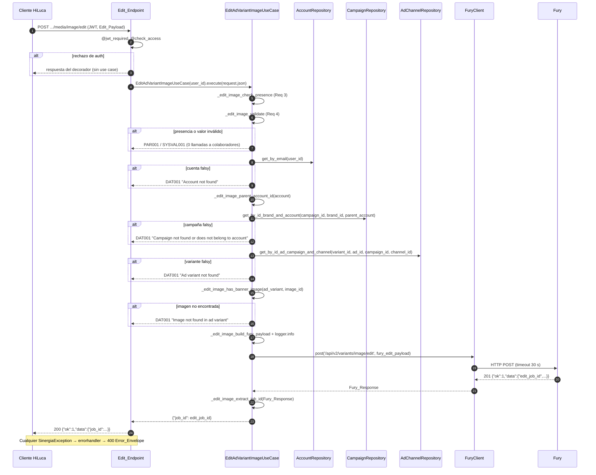

# Design Document

## Overview

Este diseño añade a Sinergia el punto de entrada del pipeline de edición de imágenes de variantes de Fury:

```
POST /api/v2/application/hiluca/brand/campaign/ad/channel/media/image/edit
```

El endpoint recibe el Edit_Payload, delega en `EditAdVariantImageUseCase`, que valida presencia y valores (replicando `AdVariantImageEditCreate` de Fury), comprueba la pertenencia de cuenta → campaña → variante → imagen y encola el job con `FuryClient.post('/api/v2/variants/image/edit', ...)`. La respuesta de éxito es `{"ok": 1, "data": {"job_id": <edit_job_id>}}`.

Piezas nuevas (no se crean repositorios ni se modifican `FuryClient` ni las excepciones):

| Pieza | Archivo | Tipo de cambio |
|---|---|---|
| Constantes de módulo `EDIT_IMAGE_*` | `sinergia/app/v2/use_cases/ad.py` | Nuevas |
| Helpers privados de módulo `_edit_image_*` | `sinergia/app/v2/use_cases/ad.py` | Funciones nuevas |
| `EditAdVariantImageUseCase` | `sinergia/app/v2/use_cases/ad.py` | Clase nueva + ampliación de imports |
| `EditAdVariantImageStruct` (modelo Swagger) | `sinergia/app/v2/resources/ad.py` | Modelo nuevo |
| `HilucaResourceAdChannelMediaImageEdit` (Resource) | `sinergia/app/v2/resources/ad.py` | Clase nueva + import |
| Unit_Test_Suite | `sinergia/tests/v2/unit/use_cases/test_edit_ad_variant_image_use_case.py` | Archivo nuevo |

### Hallazgos del código que condicionan el diseño

- `ad.py` (use cases) ya define `logging.basicConfig(level=logging.INFO)` y `logger = logging.getLogger(__name__)`, e importa `AccountRepository`, `CampaignRepository`, `AdChannelRepository`, `FuryClient`, `DataNotFoundException` y `ParametersNotFoundException`. Solo falta añadir `IncorrectValidationException`, `FuryException` y `SinergiaException` (para el `except` del Req 9.5) al import de `app.exceptions.base`, y `from typing import Any, Dict, List, Optional` (Req 2.5).
- `GenerateAnAdVariantUseCase` resuelve la Parent_Account con `account['attributes']['parent_account']['data']['id'] if ... else account['id']`, que lanza `KeyError`/`TypeError` si falta `attributes` o `parent_account`. El Req 5.3 exige una resolución tolerante, así que se extrae a un helper defensivo.
- `GenerateAnAdVariantUseCase` envuelve `fury_client.post` en `try/except Exception` y relanza `e`. Aquí se separa: `SinergiaException` se relanza tal cual (Req 9.5) y el resto se convierte en `FuryException` (Req 9.6).
- `FuryClient.post` convierte `requests.exceptions.RequestException` (incluidos timeout de 30 s, HTTP 4xx/5xx por `raise_for_status()` y, en `requests` ≥ 2.27, `JSONDecodeError`) en `FuryException("Failed to POST /api/v2/variants/image/edit")`. Registra con su propio logger (`app.tools.fury`), que no cuenta para Req 2.4.
- `SinergiaException.__init__(code, text)` guarda `self.code` y `self.text`; `IncorrectValidationException(text, errors=None)` usa `SYSVAL001`. El `errorhandler(SinergiaException)` de `v2_blueprint` responde HTTP 400 con el Error_Envelope.
- `AdChannelRepository.get_by_id_ad_campaign_and_channel(ad_channel_id, ad_id, campaign_id, channel_id)` y `CampaignRepository.get_by_id_brand_and_account(campaign_id, brand_id, account_id)` ya existen y devuelven `None` si no hay datos.
- En `resources/ad.py` hay nombres de clase Resource duplicados (`HilucaResourceAdChannelVariantGenerate`, `HilucaResourceAdChannelVariantSelect`, `HilucaResourceAdChannelAttributesSave`). Los nombres nuevos `HilucaResourceAdChannelMediaImageEdit` y `EditAdVariantImageStruct` no existen en el archivo (comprobado con grep).
- No hay `RESTPLUS_VALIDATE` ni `validate=True` en Sinergia: `@v2_api.expect(model)` solo documenta y no valida. Toda la validación vive en el caso de uso (Req 1.8).
- En Flask 1.1.2, `request.json` devuelve `None` si el `Content-Type` no es JSON; con JSON malformado, Werkzeug lanza `BadRequest`, que atiende `app_errorhandler(400)` antes de llegar al Resource. El primer caso llega al caso de uso como `payload=None` (Req 3.1).
- Fury (`pipeline_schemas.py`): `AdVariantImageEditCreate` define IDs `int ≥ 1`, `image_name`/`id_base_image` recortados de 1 a 255, `n_variations` 1–10, `custom_prompt` normalizado (`""`/espacios → `None`) con máximo 2000, y `ExpandZoomOption` con 7 valores sensibles a mayúsculas. `AdVariantImageEditJobResponse` = `{"ok": 1, "data": {"edit_job_id": str, "status": "RUNNING", "poll_url": str}}`.
- Las pruebas existentes (`test_get_ad_variant_image.py`) usan un fixture `repos(mocker)` que parchea las clases en el módulo del caso de uso y configura `return_value`, y `hypothesis` con `@settings(..., suppress_health_check=[HealthCheck.function_scoped_fixture])`. Se sigue el mismo estilo.

### Decisiones de diseño

- **D1. Helpers privados de módulo.** La validación, la resolución de la Parent_Account, la búsqueda de imagen, la construcción del Fury_Edit_Payload y la extracción del `edit_job_id` son funciones de módulo con prefijo `_edit_image_`. El prefijo evita colisiones en un `ad.py` ya grande, mantiene `execute` como orquestador y permite probar los helpers puros con propiedades sin mocks. `ad.py` ya usa este patrón (`_preserve_pinned_format`).
- **D2. Dos pasadas de validación.** Primero presencia de las 8 Required_Fields (Req 3), luego valores en el orden del Req 4.7. Así un campo ausente siempre gana a uno inválido (Req 3.5), y el orden queda garantizado por construcción al iterar tuplas constantes.
- **D3. `_edit_image_fail(exc)`.** Un helper único registra `logger.error(<texto>)` y devuelve la excepción para `raise`. Garantiza exactamente un `logger.error` por excepción propia (Req 2.4) sin repetir código.
- **D4. Valid_Integer explícito.** `isinstance(v, int) and not isinstance(v, bool)`. Rechaza `True`, `5.0` y `"5"` (decisión 7).
- **D5. Valores normalizados en un diccionario interno.** `_edit_image_validate` devuelve un `Dict[str, Any]` con los valores ya listos (IDs e `n_variations` sin tocar, `image_name`/`image_id` recortados, `custom_prompt` normalizado, `expand_zoom_option` o `None`). Los pasos posteriores usan solo ese diccionario (Req 4.9).
- **D6. Lookups sin transformar.** Los IDs ya son `int` validados; se pasan tal cual a los repositorios (Req 6.1, 7.1).
- **D7. `try/except` acotado a `fury_client.post`.** La extracción del `edit_job_id` queda fuera del `try`, de modo que su `FuryException` no se reinterpreta.
- **D8. `enum` de `expand_zoom_option` en Swagger (confirmado por el usuario).** Los 7 valores se declaran como `enum` en `EditAdVariantImageStruct` solo como documentación; flask_restplus no valida (sin `RESTPLUS_VALIDATE`/`validate=True`). Los literales se duplican intencionadamente en `resources/ad.py` para no acoplar el resource a las constantes del caso de uso, que sigue siendo la única fuente de validación.

## Architecture

```mermaid
flowchart LR
    UI[HiLuca UI] -->|POST + JWT| R[HilucaResourceAdChannelMediaImageEdit<br/>resources/ad.py]
    R -->|@jwt_required + @check_access| UC[EditAdVariantImageUseCase<br/>use_cases/ad.py]
    UC --> AR[AccountRepository<br/>get_by_email]
    UC --> CR[CampaignRepository<br/>get_by_id_brand_and_account]
    UC --> ACR[AdChannelRepository<br/>get_by_id_ad_campaign_and_channel]
    UC --> FC[FuryClient<br/>post]
    AR --> S[(Strapi)]
    CR --> S
    ACR --> S
    FC -->|POST /api/v2/variants/image/edit| F[(Fury)]
```

Dependencias en un único sentido, según `structure.md`: `resources` → `use_cases` → `repository` / `app/tools`.

### Secuencia



## Components and Interfaces

### 1. Constantes de módulo en `use_cases/ad.py` (Req 2.6)

Se declaran tras `logger = logging.getLogger(__name__)`:

```python
EDIT_IMAGE_FURY_ENDPOINT = '/api/v2/variants/image/edit'
EDIT_IMAGE_ID_FIELDS = ('brand_id', 'campaign_id', 'ad_id', 'channel_id', 'variant_id')
EDIT_IMAGE_STRING_FIELDS = ('image_name', 'image_id')
EDIT_IMAGE_REQUIRED_FIELDS = EDIT_IMAGE_ID_FIELDS + EDIT_IMAGE_STRING_FIELDS + ('n_variations',)
EDIT_IMAGE_EXPAND_ZOOM_OPTIONS = ('TOP', 'BOTTOM', 'LEFT', 'RIGHT', 'ZOOM_2X', 'ZOOM_1_5X', 'ZOOM_1_25X')
EDIT_IMAGE_MIN_ID = 1
EDIT_IMAGE_MIN_VARIATIONS = 1
EDIT_IMAGE_MAX_VARIATIONS = 10
EDIT_IMAGE_MAX_STRING_LENGTH = 255
EDIT_IMAGE_MAX_PROMPT_LENGTH = 2000
```

`EDIT_IMAGE_REQUIRED_FIELDS` reproduce exactamente el orden del Glosario: `brand_id`, `campaign_id`, `ad_id`, `channel_id`, `variant_id`, `image_name`, `image_id`, `n_variations`. Los textos de error se construyen a partir de estas constantes (p. ej. `', '.join(EDIT_IMAGE_EXPAND_ZOOM_OPTIONS)` produce `TOP, BOTTOM, LEFT, RIGHT, ZOOM_2X, ZOOM_1_5X, ZOOM_1_25X`), por lo que los literales no se repiten en el código.

### 2. Helpers privados de módulo (Req 2.1, 2.4, 3, 4, 5.3, 8, 9.2, 9.7)

```python
def _edit_image_fail(exc: SinergiaException) -> SinergiaException:
    """Registra exc.text con logger.error una sola vez y devuelve exc para `raise`."""

def _edit_image_is_missing(value: Any) -> bool:
    """True si value es None o un str con value.strip() == ''. Todo lo demás está presente."""

def _edit_image_is_valid_int(value: Any) -> bool:
    """isinstance(value, int) and not isinstance(value, bool)."""

def _edit_image_normalize_prompt(value: Any) -> Optional[str]:
    """Normalized_Custom_Prompt: value.strip() o None si queda vacío; None si value es None.
    Solo se llama con None o str (la validación de tipo va antes)."""

def _edit_image_check_presence(payload: Any) -> None:
    """Req 3. Lanza ParametersNotFoundException('Payload is required') si payload no es dict,
    o '<campo> is required' para el primer campo de EDIT_IMAGE_REQUIRED_FIELDS con
    Missing_Value (clave ausente → payload.get(campo) is None)."""

def _edit_image_validate(payload: Dict[str, Any]) -> Dict[str, Any]:
    """Req 4. Aplica los criterios 4.1 a 4.6 en el orden de 4.7 y devuelve los valores
    normalizados: IDs y n_variations sin tocar, image_name e image_id recortados,
    custom_prompt = Normalized_Custom_Prompt, expand_zoom_option o None."""

def _edit_image_parent_account_id(account: Dict[str, Any]) -> Any:
    """Req 5.3. attributes.parent_account.data.id si attributes, parent_account y data son
    dict no vacíos y data contiene 'id'; en otro caso account['id']."""

def _edit_image_has_banner_image(ad_variant: Any, image_id: str) -> bool:
    """Req 8.1–8.3. Banner_Images = ad_variant['attributes']['media_images_banner'] si
    ad_variant y attributes son dict y media_images_banner es list; si no, [].
    True si algún elemento es dict, contiene 'image_id' y item['image_id'] == image_id."""

def _edit_image_build_fury_payload(values: Dict[str, Any]) -> Dict[str, Any]:
    """Req 9.2–9.3. Devuelve exactamente las 10 claves del Fury_Edit_Payload,
    con id_base_image = values['image_id']."""

def _edit_image_extract_job_id(response: Any) -> str:
    """Req 9.4, 9.7. Devuelve response['data']['edit_job_id'] sin modificar si response es
    dict, data es dict y edit_job_id es str con strip() != ''. Si no, lanza
    FuryException('Fury response does not contain edit_job_id') vía _edit_image_fail."""
```

Detalle de `_edit_image_validate` (orden del Req 4.7; cada fallo es `raise _edit_image_fail(IncorrectValidationException(<texto>))`):

1. Para cada campo de `EDIT_IMAGE_ID_FIELDS`: si no `_edit_image_is_valid_int(v)` o `v < EDIT_IMAGE_MIN_ID` → `'<campo> must be an integer greater than or equal to 1'`.
2. Para `image_name` e `image_id`: si no `isinstance(v, str)` o `len(v.strip()) > EDIT_IMAGE_MAX_STRING_LENGTH` → `'<campo> must be a string of at most 255 characters'`.
3. `n_variations`: si no Valid_Integer o fuera de `[EDIT_IMAGE_MIN_VARIATIONS, EDIT_IMAGE_MAX_VARIATIONS]` → `'n_variations must be an integer between 1 and 10'`.
4. `custom_prompt = payload.get('custom_prompt')`: si no es `None` ni `str` → error; si `_edit_image_normalize_prompt` supera `EDIT_IMAGE_MAX_PROMPT_LENGTH` → `'custom_prompt must be a string of at most 2000 characters'`.
5. `expand_zoom_option = payload.get('expand_zoom_option')`: si no es `None` y no (`isinstance(v, str)` y `v in EDIT_IMAGE_EXPAND_ZOOM_OPTIONS`) → `'expand_zoom_option must be one of: TOP, BOTTOM, LEFT, RIGHT, ZOOM_2X, ZOOM_1_5X, ZOOM_1_25X'`. La comprobación `isinstance` evita que un valor no hashable (lista, dict) lance `TypeError` en `in`.
6. Si el prompt normalizado es `None` y `expand_zoom_option` es `None` → `'custom_prompt or expand_zoom_option is required'`.

Nota sobre el orden: el Req 4.7 lista `image_name` e `image_id` antes de `n_variations`, igual que el Glosario. Los mensajes de los pasos 2 y 3 se construyen con `EDIT_IMAGE_MAX_STRING_LENGTH`, `EDIT_IMAGE_MIN_VARIATIONS` y `EDIT_IMAGE_MAX_VARIATIONS` vía f-string.

### 3. `EditAdVariantImageUseCase` (Req 2, 5, 6, 7, 8, 9)

```python
class EditAdVariantImageUseCase():
    def __init__(self, user_id: str) -> None:
        self.user_id = user_id
        self.account_repo = AccountRepository()
        self.campaign_repo = CampaignRepository()
        self.ad_channel_repo = AdChannelRepository()
        self.fury_client = FuryClient()

    def execute(self, payload: Dict[str, Any]) -> Dict[str, str]:
        _edit_image_check_presence(payload)
        values = _edit_image_validate(payload)

        account = self.account_repo.get_by_email(self.user_id)
        if not account:
            raise _edit_image_fail(DataNotFoundException('Account not found'))
        parent_account_id = _edit_image_parent_account_id(account)

        campaign = self.campaign_repo.get_by_id_brand_and_account(
            values['campaign_id'], values['brand_id'], parent_account_id)
        if not campaign:
            raise _edit_image_fail(DataNotFoundException('Campaign not found or does not belong to account'))

        ad_variant = self.ad_channel_repo.get_by_id_ad_campaign_and_channel(
            values['variant_id'], values['ad_id'], values['campaign_id'], values['channel_id'])
        if not ad_variant:
            raise _edit_image_fail(DataNotFoundException('Ad variant not found'))

        if not _edit_image_has_banner_image(ad_variant, values['image_id']):
            raise _edit_image_fail(DataNotFoundException('Image not found in ad variant'))

        fury_edit_payload = _edit_image_build_fury_payload(values)
        prompt = values['custom_prompt']
        logger.info(
            f"Enqueuing image edit for variant_id: {values['variant_id']}, "
            f"image_id: {values['image_id']}, n_variations: {values['n_variations']}, "
            f"expand_zoom_option: {values['expand_zoom_option']}, "
            f"custom_prompt_length: {len(prompt) if prompt else 0}")
        try:
            response = self.fury_client.post(EDIT_IMAGE_FURY_ENDPOINT, fury_edit_payload)
        except SinergiaException:
            raise
        except Exception as e:
            raise _edit_image_fail(FuryException('Failed to enqueue image edit job in Fury')) from e
        return {'job_id': _edit_image_extract_job_id(response)}
```

- Las excepciones de `get_by_email`, del Campaign_Lookup y del Variant_Lookup no se capturan: se propagan con la misma instancia (Req 5.4, 6.4, 7.3).
- En el camino 9.6 la FuryException creada lleva `from e` para conservar la causa en trazas, y `_edit_image_fail` hace la única llamada a `logger.error`.
- El mensaje de `logger.info` solo incluye la longitud del prompt, nunca su texto (Req 9.8).

### 4. Endpoint en `resources/ad.py` (Req 1)

Import ampliado:

```python
from app.v2.use_cases.ad import (SelectAdUseCase, DeleteAdUseCase, GenerateAnAdVariantUseCase,
    GenerateAllAdVariantUseCase, AbyssaleVisualEditUseCase, PinFormatAdVariantUseCase,
    UnpinFormatAdVariantUseCase, EditAdVariantImageUseCase)
```

Modelo, tras `UnpinFormatAdVariantStruct`:

```python
EditAdVariantImageStruct = v2_api.model('EditAdVariantImageStruct', {
    'brand_id': fields.Integer(),
    'campaign_id': fields.Integer(),
    'ad_id': fields.Integer(),
    'channel_id': fields.Integer(),
    'variant_id': fields.Integer(),
    'image_name': fields.String(),
    'image_id': fields.String(),
    'n_variations': fields.Integer(),
    'custom_prompt': fields.String(),
    'expand_zoom_option': fields.String(
        enum=['TOP', 'BOTTOM', 'LEFT', 'RIGHT', 'ZOOM_2X', 'ZOOM_1_5X', 'ZOOM_1_25X'])
})
```

Decisión confirmada por el usuario (D8): el `enum` se mantiene en el modelo Swagger solo como documentación. flask_restplus no lo valida, porque no hay `RESTPLUS_VALIDATE` ni `validate=True`. Los literales se duplican a propósito en `resources/ad.py` para no acoplar el resource a las constantes del caso de uso; el caso de uso sigue siendo la única fuente de validación.

Resource, al final del archivo:

```python
@ad_ns.route('/hiluca/brand/campaign/ad/channel/media/image/edit')
@v2_api.expect(secureHeader)
class HilucaResourceAdChannelMediaImageEdit(ProxySecureResource):

    @ad_ns.doc('Edit an Ad Variant Image')
    @v2_api.expect(EditAdVariantImageStruct)
    @jwt_required
    @check_access([ROLE_HILUCA_ADMIN], FUNCTION_FUNNEL_FLOW, ACTION_UPDATE)
    def post(self):
        security_credentials = self.checkCredentials()
        user_id = security_credentials['username']
        payload = request.json
        data = EditAdVariantImageUseCase(user_id).execute(payload)
        return {'ok': 1, 'data': data}, 200
```

Sin `try/except`; las `SinergiaException` llegan al `errorhandler` de `v2_blueprint` (Req 1.7, 1.8).

## Data Models

### Edit_Payload (entrada, `request.json`)

| Clave | Obligatoria | Tipo aceptado | Regla |
|---|---|---|---|
| `brand_id`, `campaign_id`, `ad_id`, `channel_id`, `variant_id` | Sí | `int` (no `bool`) | ≥ 1 |
| `image_name` | Sí | `str` | 1–255 tras `strip()` |
| `image_id` | Sí | `str` | 1–255 tras `strip()` |
| `n_variations` | Sí | `int` (no `bool`) | 1–10 |
| `custom_prompt` | No | `str` o `None` | ≤ 2000 tras `strip()`; vacío → `None` |
| `expand_zoom_option` | No | `str` o `None` | uno de los 7 ExpandZoomOption_Values, exacto |
| (otras claves) | — | — | Se ignoran |

Al menos uno de `custom_prompt` (normalizado) o `expand_zoom_option` debe ser no `None`.

Ejemplo:

```json
{
  "brand_id": 1, "campaign_id": 10, "ad_id": 20, "channel_id": 30, "variant_id": 50,
  "image_name": "banner-1", "image_id": "img-abc", "n_variations": 3,
  "custom_prompt": "Cambia el fondo a azul", "expand_zoom_option": "ZOOM_1_5X"
}
```

### Valores normalizados (interno, salida de `_edit_image_validate`)

`Dict[str, Any]` con las 10 claves del Edit_Payload: IDs e `n_variations` sin cambios, `image_name` e `image_id` recortados, `custom_prompt` = Normalized_Custom_Prompt, `expand_zoom_option` = valor recibido o `None`.

### Ad_Variant (Strapi, `get_by_id_ad_campaign_and_channel`)

```json
{"id": 50, "attributes": {"media_images_banner": [{"name": "banner-1", "image_id": "img-abc"}, ...]}}
```

Solo se lee `attributes.media_images_banner[*].image_id`.

### Fury_Edit_Payload (salida a Fury)

```json
{
  "brand_id": 1, "campaign_id": 10, "ad_id": 20, "channel_id": 30, "variant_id": 50,
  "image_name": "banner-1", "id_base_image": "img-abc", "n_variations": 3,
  "custom_prompt": "Cambia el fondo a azul", "expand_zoom_option": "ZOOM_1_5X"
}
```

Exactamente estas 10 claves, sin `image_id`. `custom_prompt` y `expand_zoom_option` pueden ser `null`; Fury los acepta como `Optional`.

### Fury_Response (`AdVariantImageEditJobResponse`)

```json
{"ok": 1, "data": {"edit_job_id": "f3c1...", "status": "RUNNING", "poll_url": "/api/v2/jobs/f3c1..."}}
```

Solo se lee `data.edit_job_id`.

### Respuestas HTTP de Sinergia

- Éxito (200): `{"ok": 1, "data": {"job_id": "f3c1..."}}`.
- Error (400): `{"ok": 0, "message": {"code": "<code>", "text": "<text>"}}`.

## Correctness Properties

*A property is a characteristic or behavior that should hold true across all valid executions of a system-essentially, a formal statement about what the system should do. Properties serve as the bridge between human-readable specifications and machine-verifiable correctness guarantees.*

Reflexión previa: los criterios de orden (3.4, 3.5, 4.7) y de cero invocaciones (4.8) se integran en las propiedades de validación en lugar de ir aparte; los criterios de argumentos de los lookups (6.1, 7.1), de construcción del payload (4.9, 9.1–9.3) y de logging (9.8) se agrupan en un único invariante de mapeo, que además es el que exige el Req 10.13. Los criterios de cuenta/campaña/variante falsy o con excepción (5.2, 5.4, 6.2, 6.4, 7.2, 7.3, 9.5, 9.6) no varían con la entrada y quedan como pruebas de ejemplo.

### Property 1: Invariante de mapeo del Edit_Payload válido

*For any* Edit_Payload válido (IDs y `n_variations` en rango, `image_name`/`image_id` con espacios arbitrarios alrededor y ≤ 255 caracteres tras recortar, `custom_prompt` ausente/`None`/espacios/texto ≤ 2000 tras recortar, `expand_zoom_option` ausente/`None`/uno de los 7 valores, al menos uno de los dos no vacío, y claves extra arbitrarias), `execute` invoca `CampaignRepository.get_by_id_brand_and_account(campaign_id, brand_id, parent_account)` y `AdChannelRepository.get_by_id_ad_campaign_and_channel(variant_id, ad_id, campaign_id, channel_id)` con los valores sin transformar, invoca `FuryClient.post` una vez con `'/api/v2/variants/image/edit'` y un Fury_Edit_Payload con exactamente las 10 claves, `id_base_image == image_id.strip()`, `image_name == image_name.strip()`, `custom_prompt` igual al Normalized_Custom_Prompt, `expand_zoom_option` igual al recibido o `None`, sin clave `image_id`; y ningún argumento de `logger.info` contiene el texto del `custom_prompt` cuando éste tiene al menos 20 caracteres.

**Validates: Requirements 4.9, 6.1, 7.1, 9.1, 9.2, 9.3, 9.8**

### Property 2: Los parámetros obligatorios ausentes se rechazan en orden y sin acceder a datos

*For any* `payload` que no es `dict`, `execute` lanza ParametersNotFoundException (`PAR001`, `Payload is required`); y *for any* Edit_Payload válido en el que un subconjunto no vacío de Required_Fields se sustituye por un Missing_Value (clave ausente, `None`, `""` o una cadena formada solo por espacios en blanco), aunque además otros campos tengan valores inválidos, `execute` lanza ParametersNotFoundException con el texto `<campo> is required` del primer campo ausente según el orden del Glosario, con cero invocaciones de AccountRepository, CampaignRepository, AdChannelRepository y FuryClient.

**Validates: Requirements 3.1, 3.2, 3.3, 3.4, 3.5, 4.8**

### Property 3: Los valores inválidos se rechazan en orden y sin acceder a datos

*For any* Edit_Payload válido en el que un subconjunto no vacío de campos se sustituye por un valor inválido presente (IDs: no Valid_Integer o < 1, incluidos `True`, floats y cadenas numéricas; `n_variations`: no Valid_Integer o fuera de 1–10; `image_name`/`image_id`: no `str` o > 255 tras recortar; `custom_prompt`: no `str` ni `None`, o > 2000 tras recortar; `expand_zoom_option`: cualquier valor no `None` distinto de los 7 exactos), o en el que ni `custom_prompt` normalizado ni `expand_zoom_option` tienen valor, `execute` lanza IncorrectValidationException (`SYSVAL001`) con el texto exacto del primer incumplimiento en el orden del Req 4.7, con cero invocaciones de AccountRepository, CampaignRepository, AdChannelRepository y FuryClient.

**Validates: Requirements 3.3, 3.6, 4.1, 4.2, 4.3, 4.4, 4.5, 4.6, 4.7, 4.8**

### Property 4: Resolución tolerante de la Parent_Account

*For any* cuenta con `id` y cualquier forma de `attributes` (ausente, `None`, no `dict`, `dict` con `parent_account` ausente, `None`, no `dict`, vacío, o con `data` ausente, `None`, no `dict`, vacío, sin `id` o con `id`), `_edit_image_parent_account_id` no lanza excepción y devuelve `attributes.parent_account.data.id` si y solo si `attributes`, `parent_account` y `data` son `dict` no vacíos y `data` contiene `id`; en otro caso devuelve `account['id']`.

**Validates: Requirements 5.3**

### Property 5: Búsqueda de imagen equivalente al oráculo

*For any* valor de Ad_Variant (incluidos `attributes` ausente, `None` o no `dict`, y `media_images_banner` ausente, `None`, no lista o lista de elementos arbitrarios: dicts con o sin `image_id`, `image_id` de tipo `str` o `int`, y elementos que no son dict) y *for any* `image_id`, `_edit_image_has_banner_image` no lanza excepción y devuelve lo mismo que `any(isinstance(it, dict) and 'image_id' in it and it['image_id'] == image_id for it in banner_images)`, con Banner_Images = `[]` cuando no hay lista válida.

**Validates: Requirements 8.1, 8.2, 8.3**

### Property 6: Extracción del edit_job_id equivalente al oráculo

*For any* Fury_Response (valores no `dict`, `dict` sin `data`, `data` no `dict`, `edit_job_id` ausente, `None`, no `str`, solo espacios o `str` arbitrario con contenido), `_edit_image_extract_job_id` devuelve `response['data']['edit_job_id']` sin modificar cuando es un `str` con `strip() != ""` y, en cualquier otro caso, lanza FuryException (`FURY001`) con el texto `Fury response does not contain edit_job_id`.

**Validates: Requirements 9.4, 9.7**

## Error Handling

Todas las excepciones son subclases de `SinergiaException` y el `errorhandler` de `v2_blueprint` las convierte en HTTP 400 con el Error_Envelope. Las que crea el caso de uso pasan por `_edit_image_fail` (una llamada a `logger.error` con el texto).

| # | Condición | Excepción | Código | Texto exacto | Req |
|---|---|---|---|---|---|
| 1 | `payload` no es `dict` (incluido `None`) | ParametersNotFoundException | `PAR001` | `Payload is required` | 3.1 |
| 2 | Primera Required_Field con Missing_Value | ParametersNotFoundException | `PAR001` | `<campo> is required` | 3.2, 3.4 |
| 3 | ID_Field no Valid_Integer o < 1 | IncorrectValidationException | `SYSVAL001` | `<campo> must be an integer greater than or equal to 1` | 4.1 |
| 4 | `image_name`/`image_id` no `str` o > 255 tras `strip()` | IncorrectValidationException | `SYSVAL001` | `<campo> must be a string of at most 255 characters` | 4.3 |
| 5 | `n_variations` no Valid_Integer o fuera de 1–10 | IncorrectValidationException | `SYSVAL001` | `n_variations must be an integer between 1 and 10` | 4.2 |
| 6 | `custom_prompt` no `str`/`None` o > 2000 tras `strip()` | IncorrectValidationException | `SYSVAL001` | `custom_prompt must be a string of at most 2000 characters` | 4.4 |
| 7 | `expand_zoom_option` no `None` y fuera de los 7 valores exactos | IncorrectValidationException | `SYSVAL001` | `expand_zoom_option must be one of: TOP, BOTTOM, LEFT, RIGHT, ZOOM_2X, ZOOM_1_5X, ZOOM_1_25X` | 4.5 |
| 8 | Prompt normalizado `None` y `expand_zoom_option` ausente/`None` | IncorrectValidationException | `SYSVAL001` | `custom_prompt or expand_zoom_option is required` | 4.6 |
| 9 | `get_by_email` devuelve falsy | DataNotFoundException | `DAT001` | `Account not found` | 5.2 |
| 10 | Campaign_Lookup devuelve falsy | DataNotFoundException | `DAT001` | `Campaign not found or does not belong to account` | 6.2 |
| 11 | Variant_Lookup devuelve falsy | DataNotFoundException | `DAT001` | `Ad variant not found` | 7.2 |
| 12 | Ningún banner coincide con `image_id` | DataNotFoundException | `DAT001` | `Image not found in ad variant` | 8.2 |
| 13 | `FuryClient.post` lanza excepción no `SinergiaException` | FuryException | `FURY001` | `Failed to enqueue image edit job in Fury` | 9.6 |
| 14 | Fury_Response sin `data.edit_job_id` válido | FuryException | `FURY001` | `Fury response does not contain edit_job_id` | 9.7 |
| 15 | Repositorios lanzan excepción | La misma instancia (p. ej. `StrapiException`) | Original | Original | 5.4, 6.4, 7.3 |
| 16 | `FuryClient.post` lanza `SinergiaException` (p. ej. `FuryException("Failed to POST /api/v2/variants/image/edit")`) | La misma instancia | Original (`FURY001`) | Original | 9.5 |

Filas 15 y 16: el caso de uso no las crea, así que no llama a `logger.error` (Req 2.4). Las filas 3–8 siguen el orden de evaluación del Req 4.7 (IDs, `image_name`, `image_id`, `n_variations`, `custom_prompt`, `expand_zoom_option`, regla combinada).

Fuera del caso de uso: los rechazos de `@jwt_required`/`@check_access` devuelven la respuesta propia de esos decoradores (401 de JWT o `NotAccessException` → 401), y un JSON malformado lo atiende `app_errorhandler(400)` antes del Resource.

## Testing Strategy

### Ubicación y ejecución

- Archivo único: `sinergia/tests/v2/unit/use_cases/test_edit_ad_variant_image_use_case.py`, sin `conftest.py` nuevo (Req 10.1).
- Comando, desde `sinergia/`: `venv/bin/python -m pytest tests/v2/unit/use_cases/test_edit_ad_variant_image_use_case.py -q`. Objetivo: 0 fallos, 0 errores, 0 omitidas, < 60 s (Req 10.3).
- Dependencias: solo `pytest-mock==3.14.0` e `hypothesis==6.112.2`, ya fijadas en `requirements-test.txt`.
- Todas las funciones de prueba con `-> None` (Req 10.4).

### Aislamiento

Fixture `collaborators(mocker)` en el propio archivo, siguiendo el estilo de `test_get_ad_variant_image.py`:

```python
@pytest.fixture
def collaborators(mocker):
    account_cls = mocker.patch('app.v2.use_cases.ad.AccountRepository')
    campaign_cls = mocker.patch('app.v2.use_cases.ad.CampaignRepository')
    ad_channel_cls = mocker.patch('app.v2.use_cases.ad.AdChannelRepository')
    fury_cls = mocker.patch('app.v2.use_cases.ad.FuryClient')
    logger = mocker.patch('app.v2.use_cases.ad.logger')
    account_cls.return_value.get_by_email.return_value = {'id': 7, 'attributes': {'parent_account': {'data': None}}}
    campaign_cls.return_value.get_by_id_brand_and_account.return_value = {'id': 10}
    ad_channel_cls.return_value.get_by_id_ad_campaign_and_channel.return_value = {
        'id': 50, 'attributes': {'media_images_banner': [{'name': 'banner-1', 'image_id': 'img-abc'}]}}
    fury_cls.return_value.post.return_value = {
        'ok': 1, 'data': {'edit_job_id': 'job-1', 'status': 'RUNNING', 'poll_url': '/api/v2/jobs/job-1'}}
    return SimpleNamespace(account=account_cls, campaign=campaign_cls, ad_channel=ad_channel_cls,
                           fury=fury_cls, logger=logger)
```

- Helper `_payload(**overrides)` que parte de un `VALID_PAYLOAD` y permite eliminar claves con un centinela `MISSING`.
- Helper `_assert_not_called_after(step, collaborators)` que comprueba `assert_not_called()` en los colaboradores posteriores al paso fallido (Req 10.10).
- Los helpers puros (`_edit_image_parent_account_id`, `_edit_image_has_banner_image`, `_edit_image_extract_job_id`) se importan directamente de `app.v2.use_cases.ad` para las propiedades 4–6. `_edit_image_extract_job_id` usa el logger de módulo, así que esas pruebas también parchean `logger`.

### Pruebas de propiedad (hypothesis)

Cada propiedad es una única prueba con `@settings(max_examples=100, deadline=None, suppress_health_check=[HealthCheck.function_scoped_fixture])` y un comentario de trazabilidad:

```python
# Feature: edit-ad-variant-image-use-case, Property 1: Invariante de mapeo del Edit_Payload válido
```

| Propiedad | Prueba | Generadores principales |
|---|---|---|
| 1 | `test_property_valid_payload_maps_to_fury_payload` (Req 10.13) | `st.integers(1, 10**9)` para IDs; `st.integers(1, 10)`; texto con `st.text(min_size=1, max_size=255).filter(lambda s: s.strip())` envuelto en espacios aleatorios; `custom_prompt` de `st.one_of(MISSING, None, whitespace, text ≤ 2000)`; `expand_zoom_option` de `st.sampled_from` + `None`/ausente; `assume` de al menos uno de los dos; `st.dictionaries` de claves extra que no colisionen. Antes de cada ejemplo se reinician los mocks (`reset_mock()`) y se configura el banner con el `image_id` recortado generado. |
| 2 | `test_property_missing_required_fields_rejected_in_order` | Subconjunto no vacío de `EDIT_IMAGE_REQUIRED_FIELDS` vía `st.sets(st.sampled_from(...), min_size=1)`; Missing_Value de `st.one_of(MISSING, None, st.text(alphabet=' \t\n\r\x0b\x0c'))`; opcionalmente campos inválidos en los no ausentes; rama con `payload` no dict (`st.none()`, `st.lists`, `st.text`, `st.integers`). |
| 3 | `test_property_invalid_values_rejected_in_order` | Subconjunto no vacío de campos y, para cada uno, un generador de valores inválidos (`st.booleans()`, `st.floats()`, `st.integers(max_value=0)`, cadenas numéricas no vacías, textos > 255/2000 tras recortar, `expand_zoom_option` de `st.text().filter(lambda s: s not in EDIT_IMAGE_EXPAND_ZOOM_OPTIONS)`); el mensaje esperado se calcula con un oráculo que recorre el orden del Req 4.7. Incluye la rama "ni prompt ni option". |
| 4 | `test_property_parent_account_resolution` | `st.recursive`/`st.one_of` para formas de `attributes`, `parent_account` y `data` (ausente, `None`, no dict, `{}`, con/sin `id`). |
| 5 | `test_property_banner_image_lookup_matches_oracle` | Listas de `st.one_of(dicts con image_id str/int, dicts sin image_id, st.integers(), st.text(), st.none())`; formas inválidas de `attributes` y `media_images_banner`; `image_id` a veces tomado de un elemento existente para forzar coincidencias. |
| 6 | `test_property_extract_job_id_matches_oracle` | `st.one_of` de no dicts, dicts sin `data`, `data` no dict, `edit_job_id` de `st.one_of(st.none(), st.integers(), st.text())`. |

### Pruebas de ejemplo (unitarias)

- **Constructor (Req 10.14):** `user_id` en `self.user_id`; las 4 clases parcheadas con `assert_called_once_with()`; tras `execute`, siguen con `call_count == 1`; `get_by_email.assert_called_once_with(user_id)`.
- **Camino feliz (Req 10.5):** resultado `== {'job_id': 'job-1'}`; `post.assert_called_once_with('/api/v2/variants/image/edit', expected)` con `expected` literal de 10 claves, `id_base_image` presente e `image_id` ausente.
- **Presencia (Req 10.6):** `pytest.mark.parametrize` sobre las 8 Required_Fields × {`None`, `""`, `"   "`, ausente}, y `payload` en {`None`, `[]`, `"x"`}; verifica `code == 'PAR001'`, texto exacto y `_assert_not_called_after('validation')`.
- **Valores (Req 10.7):** parametrizado con la lista exacta del Req 10.7 (5 ID_Fields × {`0`, `-1`, `True`, `1.0`, `"5"`}; `n_variations` {`0`, `11`, `True`, `"5"`}; 256 caracteres y `123` para `image_name`/`image_id`; 2001 caracteres y `123` para `custom_prompt`; `"top"`, `"ZOOM_3X"`, `" TOP"`, `""` para `expand_zoom_option`; `custom_prompt` {`None`, `""`, `"   "`} sin option); verifica `SYSVAL001` y texto exacto.
- **Límites válidos (Req 10.8):** IDs `1`; `n_variations` `1` y `10`; 255 caracteres con espacios alrededor; prompt de 2000 tras recortar; cada uno de los 7 valores del enum. Todos devuelven `{'job_id': 'job-1'}`.
- **Cuenta, campaña, variante, imagen (Req 10.9, 10.10):** `return_value` `None`/`{}` y `side_effect = StrapiException('boom')` (`excinfo.value is exc`) para cada repositorio; Banner_Images vacía, ausente, `None`, `"x"` y sin coincidencia (incluido `image_id` `5` int frente a `"5"`); `attributes` `None`. Cada caso verifica los `assert_not_called` posteriores.
- **Parent_Account (Req 10.11):** cuenta con `parent_account.data = {'id': 99}` → Campaign_Lookup recibe `99`; con `data = None` → recibe `7`.
- **Fury (Req 10.12):** `side_effect = FuryException('Failed to POST ...')` → misma instancia (`is`); `side_effect = RuntimeError()` → FuryException `Failed to enqueue image edit job in Fury`; respuestas `None`, `[]`, `{}`, `{'data': {}}`, `{'data': {'edit_job_id': None}}`, `{'data': {'edit_job_id': 123}}`, `{'data': {'edit_job_id': '   '}}` → `Fury response does not contain edit_job_id`; `' abc '` se devuelve sin recortar.
- **Logging (Req 10.15):** en cada camino de error propio, `logger.error.call_count == 1` y el texto de la excepción aparece en su argumento; en los caminos propagados (filas 15 y 16), `logger.error.assert_not_called()`; en el camino feliz con un `custom_prompt` ≥ 20 caracteres, `logger.info.call_count == 1` y ningún argumento lo contiene.

### Fuera del Unit_Test_Suite

- Endpoint (Req 1.1–1.8): revisión de código; prueba de integración opcional en `tests/v2/integration/` con el cliente de Flask y el caso de uso parcheado.
- Estructura del módulo (Req 2.1, 2.5, 2.6): revisión de código y `venv/bin/python -c "import app.v2.use_cases.ad"` desde `sinergia/`.
