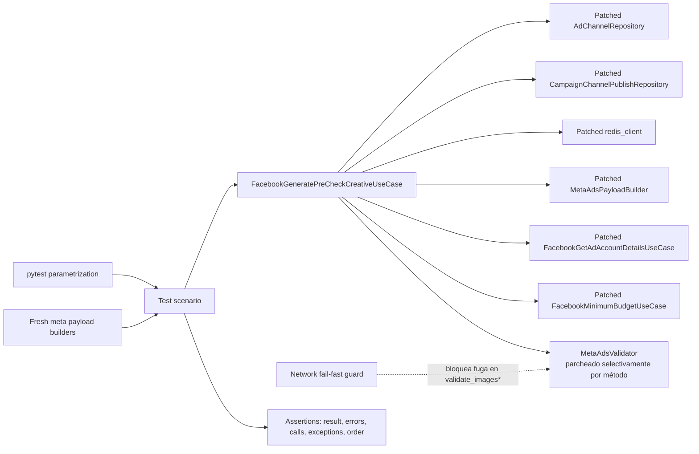

# Design Document: Facebook Generate Pre-Check Creative Tests

## Overview

Este diseño define una suite pytest de caracterización para `FacebookGeneratePreCheckCreativeUseCase` (`app/v2/use_cases/meta_ads.py`, líneas 1215-1584) y para el subconjunto de `FacebookTestCreativeUploadUseCase` (líneas 920-1214) que esa subclase invoca por herencia: `__init__`, `_get_decoded_access_token` y `_build_meta_payload`. La suite verifica el contrato observable actual, incluidas las particularidades ya presentes en el código (reutilización del slug `assets-budget-error` para fallos de URL, ausencia de errores cuando un STANDARD carece de `link_data`, `TypeError` al final de `execute()` si `objective` no está en `META_ODAX_CTA_MAPPING`, `AttributeError` en el constructor si `complete_campaign_data=None`). No se corrige ningún comportamiento discutible; se fija para detectar regresiones.

**Ubicación obligatoria:** conforme a `sinergia/.kiro/steering/structure.md`, la suite se implementa en `tests/v2/unit/use_cases/test_facebook_generate_pre_check_creative.py`, dentro del árbol `sinergia/`. No se crean archivos de prueba en `app/`, ni se modifica `app/v2/use_cases/meta_ads.py`, `app/v2/use_cases/facebook_validator_service.py`, ni los repositorios de Strapi.

### Hallazgos de investigación que informan el diseño

- `FacebookGeneratePreCheckCreativeUseCase.__init__` instancia `AdChannelRepository()` y `CampaignChannelPublishRepository()` directamente; ambos heredan de `StrapiClient` (`app/tools/strapi.py`). El parche debe aplicarse sobre los símbolos ya importados por `meta_ads.py`: `app.v2.use_cases.meta_ads.AdChannelRepository` y `app.v2.use_cases.meta_ads.CampaignChannelPublishRepository`, **antes** de construir el caso de uso.
- `redis_client` se importa a nivel de módulo (`from app import redis_client`) dentro de `meta_ads.py`. Para aislar `_get_decoded_access_token`, el parche debe aplicarse sobre `app.v2.use_cases.meta_ads.redis_client`, no sobre el objeto `app.redis_client` original.
- `_build_meta_payload` instancia `MetaAdsPayloadBuilder` directamente (importado desde `facebook_validator_service`); el parche debe aplicarse sobre `app.v2.use_cases.meta_ads.MetaAdsPayloadBuilder`.
- `_get_account_details` y `_get_minimum_budget` instancian `FacebookGetAdAccountDetailsUseCase()` y `FacebookMinimumBudgetUseCase()` respectivamente, ambas clases definidas en el mismo módulo `meta_ads.py`. Se parchean también sobre `app.v2.use_cases.meta_ads.<Clase>`.
- `MetaAdsValidator` se usa como clase directamente importada (no instanciada) dentro de `execute()`. Sus métodos son `@staticmethod`/`@classmethod`, por lo que pueden parchearse individualmente vía `patch.object(MetaAdsValidator, 'nombre_metodo', ...)` o `patch('app.v2.use_cases.meta_ads.MetaAdsValidator.nombre_metodo', ...)`. Los métodos `validate_images_precheck` y `validate_images` realizan `requests.get` real; toda prueba que ejercite código DYNAMIC con imágenes o STANDARD con `image_url` debe parchear estos dos métodos o evitar poblar dichos campos para no requerir su ejecución real.
- `SinergiaException` (base de `NotAccessException`, `PermissionDeniedException`, etc., en `app/exceptions/base.py`) resuelve `self.text` con `flask_babel.gettext(self.code)` **solo cuando** el parámetro `text` es `None`. Todas las excepciones relevantes para esta suite (`NotAccessException`, `PermissionDeniedException`, `ParametersNotFoundException`, `RateLimitExceededException`, `RESTClientException`, `DataNotFoundException`) son construidas por el código bajo prueba **siempre con un `text` explícito** (verificado línea por línea en `meta_ads.py` 1236-1259), por lo que `gettext` nunca se invoca en el camino ejercitado por esta suite. Esto significa que **no se requiere contexto de aplicación Flask** para esta suite; se confirma en tiempo de implementación con una prueba de humo si aparece una dependencia inesperada.
- El proyecto no tiene `tests/conftest.py`. Esta suite no lo crea: no hay necesidad de fixtures Flask compartidas para el código alcanzable.
- El entorno local (`sinergia/venv`, Python 3.8.x) ya tiene `pytest==8.3.5` y `hypothesis==6.112.2` instalados y declarados en `requirements-test.txt` (agregado por la suite `funnel-flow-validator-tests`); esta especificación no requiere Hypothesis como obligatorio, pero puede reutilizar la dependencia ya fijada si se agrega alguna prueba de propiedad opcional.
- El patrón de mocking estándar del proyecto (visto en `tests/v2/unit/use_cases/test_pin_format_ad_variant.py`) es decorar el método de test con `@patch('app.v2.use_cases.<modulo>.<Clase>')` en orden inverso a los parámetros del método, y configurar `mock_cls.return_value.<metodo>.return_value` / `.side_effect`.

Referencias técnicas: [pytest fixtures](https://docs.pytest.org/en/stable/how-to/fixtures.html), [pytest parametrization](https://docs.pytest.org/en/stable/how-to/parametrize.html), [`unittest.mock`](https://docs.python.org/3/library/unittest.mock.html).

### Objetivos de diseño

1. Aislar totalmente Strapi (vía sus dos repositorios), Redis, la Graph API de Facebook y cualquier solicitud HTTP real de `MetaAdsValidator`.
2. Verificar cada rama de `execute()` (DYNAMIC, STANDARD, tipo desconocido, ad sin creativo, bloque de creación) con datos mínimos.
3. Caracterizar explícitamente las inconsistencias actuales del código (slug duplicado, default de iteración inconsistente, `TypeError` al final de `execute`, `AttributeError` en el constructor) como comportamiento esperado, no como bugs a corregir.
4. Verificar con precisión los efectos secundarios sobre los dos repositorios (argumentos exactos, orden, cantidad de llamadas).
5. Mantener builders que producen estructuras nuevas en cada llamada, evitando forma mutable compartida entre pruebas.
6. Hacer determinista el orden de errores, llamadas y resultados.

### Fuera de alcance

- Implementar la suite (se realiza en la fase de tasks, no en este documento).
- Modificar código productivo en `app/`.
- Corregir las inconsistencias caracterizadas (slug `assets-budget-error` duplicado, iteración con y sin default, `TypeError` de `valid_ctas`, `AttributeError` del constructor).
- Pruebas de integración contra Strapi, Redis o la Graph API reales.
- Cobertura exhaustiva de `FacebookTestCreativeUploadUseCase.execute()` (el método `execute` de la clase padre no es invocado por `FacebookGeneratePreCheckCreativeUseCase` y queda fuera de alcance salvo los tres métodos heredados listados en el Overview).

## Architecture

La suite sigue una arquitectura de puertos y dobles alrededor de la unidad bajo prueba. `FacebookGeneratePreCheckCreativeUseCase` es el núcleo; sus puertos externos directos son `AdChannelRepository`, `CampaignChannelPublishRepository`, `redis_client`, `MetaAdsPayloadBuilder`, `FacebookGetAdAccountDetailsUseCase`, `FacebookMinimumBudgetUseCase` y `MetaAdsValidator`. Los builders entregan payloads de Meta nuevos por invocación; los tests observan retornos, excepciones y llamadas a los dobles.



### Límites de prueba

- **Unidad orquestada con dobles completos:** `execute()` en sus escenarios de flujo (obtención de token, payload, cuenta, presupuesto) — se sustituyen `AdChannelRepository`, `CampaignChannelPublishRepository`, `redis_client`, `MetaAdsPayloadBuilder`, `FacebookGetAdAccountDetailsUseCase`, `FacebookMinimumBudgetUseCase`.
- **Unidad orquestada con `MetaAdsValidator` real o parcialmente parcheado:** los escenarios de validación DYNAMIC/STANDARD ejecutan los métodos reales de `MetaAdsValidator` cuando son seguros (sin red: `is_unique_texts`, `is_valid_length`, `validate_cta`, `is_valid_amount`, `is_valid_link_url`, `validate_assets_amount`) y parchean únicamente `validate_images_precheck`/`validate_images` para evitar red real, o bien omiten poblar `url`/`image_url` para que esos validadores no ejecuten ninguna solicitud (dado que ambos hacen `if not img_url: continue`/`if not img_url: continue` respectivamente en su bucle interno).
- **Unidad aislada por método:** `_get_decoded_access_token`, `_build_meta_payload`, `_get_account_details`, `_get_minimum_budget`, `_save_creative_to_publish`, `_save_campaign_channel_publish` se prueban también de forma directa, invocándolos sobre una instancia construida con dobles.
- **No integración:** ninguna prueba abre sockets, usa credenciales reales, ni toca Strapi/Redis/Graph API reales.

### Organización propuesta del archivo

`tests/v2/unit/use_cases/test_facebook_generate_pre_check_creative.py` se ordenará por clases descriptivas, sin estado de clase compartido:

1. `TestConstructorAndInheritedState` — Requirement 2.
2. `TestGetDecodedAccessToken` — Requirement 3.
3. `TestBuildMetaPayload` — Requirement 4.
4. `TestGetAccountDetails` — Requirement 5.
5. `TestGetMinimumBudget` — Requirement 6.
6. `TestExecuteMissingCreative` — Requirement 7.
7. `TestExecuteDynamicBranch` — Requirement 8.
8. `TestExecuteStandardBranch` — Requirement 9.
9. `TestExecuteCreationBlock` — Requirement 10.
10. `TestExecuteAggregationAndStatus` — Requirement 11.
11. `TestExecutePersistenceSideEffects` — Requirement 12.
12. `TestExecuteCombinedScenarios` — Requirement 13.

Los nombres de test serán únicos, con prefijo `test_`, describiendo condición y resultado esperado. Se usará `pytest.mark.parametrize` con `ids` semánticos para las matrices de códigos de error de `_get_account_details` (Requirement 5) y de slugs DYNAMIC/STANDARD (Requirements 8-9).

### Estrategia de trazabilidad

Cada prueba incluye en su docstring o comentario una referencia `Requirements X.Y`. Las matrices de parametrización agrupan criterios que ejercitan la misma forma de ejecución, con un `id` legible por caso (por ejemplo `error-code-190-not-access`, `error-code-200-permission-denied`).

| Bloque | Requisitos principales | Evidencia |
|---|---|---|
| Aislamiento e infraestructura | 1.1-1.9 | ubicación del archivo, parches exactos, ausencia de red y de Flask |
| Construcción y estado heredado | 2.1-2.5 | atributos exactos, instanciación de repos, `AttributeError` con `None` |
| Token y payload | 3.1-4.4 | llamadas exactas a Redis/Builder, envoltura de excepciones |
| Cuenta y presupuesto mínimo | 5.1-6.4 | matriz de códigos de error, conversión de centavos, `DataNotFoundException` |
| Ad sin creativo | 7.1-7.3 | agregación `ok`, no invocación de validadores, `AttributeError` en `creatives` cuando es `ads[0]` |
| Rama DYNAMIC | 8.1-8.14 | llamadas exactas a `MetaAdsValidator`, mutación directa de `asset_feed`/`cta` propios de la prueba, `ok` |
| Rama STANDARD | 9.1-9.9 | llamadas exactas y continuación tras fallo, `ok` (sin canal de mutación observable), caso sin `link_data` |
| Bloque de creación | 10.1-10.5 | mutación de `page_id`, `ok` agregado (el `Resultado_de_Ad` detallado no es observable), `execution-error` como `ok=0` |
| Agregación y estado | 11.1-11.3 | `ok` derivado de `has_errors`, código HTTP constante `200` |
| Persistencia | 12.1-12.9 | llamadas exactas a ambos repositorios, `TypeError` en `ad_sets`/`valid_ctas` |
| Escenarios combinados | 13.1-13.3 | `ok` agregado y aserciones de llamada por-ad (13.2), orden en `creatives` (13.3) |
| Calidad | 14.1-14.8 | nombres únicos, builders frescos, ejecución aislada y repetible |

## Components and Interfaces

### 1. Builders de payload frescos

Funciones puras del módulo de prueba que devuelven diccionarios/listas nuevos en cada llamada, sin defaults mutables compartidos:

- `make_campaign_data_dict(**overrides) -> CampaignDataDict-like dict`: valores por defecto razonables para `ad_account_id`, `page_id`, `objective`, `optimization_goal`, `lead_gen_form_id=None`, `whatsapp_number_id=None`.
- `make_asset_feed_spec(**overrides) -> dict`: `images=[]`, `bodies=[]`, `titles=[]`, `descriptions=[]`, `call_to_action_types=[]`, `link_urls=[]`, `ad_channel_id=0`, sobreescribibles.
- `make_object_story_spec(**overrides) -> dict`: `link_data=None` por defecto, sobreescribible con un `make_link_data(...)`.
- `make_link_data(**overrides) -> dict`: `call_to_action=None`, `image_url=None`, `name=None`, `message=None`.
- `make_ad_creative(asset_feed_spec=ABSENT, object_story_spec=ABSENT, name="Creative", **overrides) -> dict`: usa un centinela privado `ABSENT` para distinguir "omitir clave" de "clave presente con `None`".
- `make_ad(ad_creative=ABSENT, name="Ad", **overrides) -> dict`.
- `make_ad_set(ads=None, daily_budget=100, name="AdSet", **overrides) -> dict`: `ads` por defecto es una lista nueva vacía si `None`.
- `make_meta_payload(ad_sets=None, campaign_name="Campaign", **overrides) -> dict`: construye `{"campaign": {"name": ..., "ad_sets": [...]}}`.
- `make_ad_account_info(currency="USD", **overrides) -> dict`.
- `make_minimum_budget_response(currency="USD", min_daily_budget_imp=1000, **overrides) -> dict`: construye `{"data": [{"currency": ..., "min_daily_budget_imp": ...}]}`.

### 2. Fixture `use_case_factory`

Fixture local de alcance función que parchea `app.v2.use_cases.meta_ads.AdChannelRepository` y `app.v2.use_cases.meta_ads.CampaignChannelPublishRepository`, construye una instancia nueva de `FacebookGeneratePreCheckCreativeUseCase` por invocación y entrega:

```text
use_case_factory(campaign_id="campaign-1", user_id="user-1", complete_campaign_data=None, creative_type="DYNAMIC")
    -> (use_case, mock_ad_channel_repo_instance, mock_campaign_publish_repo_instance)
```

Si el llamador no provee `complete_campaign_data`, la fixture usa `make_campaign_data_dict()` para evitar el `AttributeError` caracterizado en Requirement 2.5, salvo en la prueba dedicada a ese criterio, que construye el caso de uso directamente sin la fixture.

### 3. Helper `patch_execute_dependencies`

Context manager o fixture que aplica de forma conjunta los parches de `redis_client`, `MetaAdsPayloadBuilder`, `FacebookGetAdAccountDetailsUseCase` y `FacebookMinimumBudgetUseCase` sobre `app.v2.use_cases.meta_ads`, exponiendo los `MagicMock` de cada uno para configurar `return_value`/`side_effect` por escenario. Se usa en todas las pruebas que ejercitan `execute()` de punta a punta.

### 4. Helper `deny_network` (guard opcional)

Fixture `autouse=True` de alcance función que sustituye `requests.sessions.Session.request` por una función que lanza `AssertionError("network access is forbidden in unit tests")`. Actúa como defensa adicional junto con el diseño de los builders (que evitan poblar `url`/`image_url` salvo que el escenario también parchee `validate_images_precheck`/`validate_images`).

### 5. Aserciones auxiliares

- `assert_ok(response, expected_ok)`: compara el `ok` agregado (0 o 1) de la Respuesta_Final, que es el único canal observable de éxito/fallo por-ad cuando no existe un canal de mutación más específico.
- `assert_mutations_present(obj, *keys)` / `assert_mutations_absent(obj, *keys)`: comprueban la presencia o ausencia de claves de mutación de éxito (por ejemplo `unique_titles`, `daily_budget_valid`, `link_url_valid`, `cta['valid']`) directamente sobre los diccionarios `asset_feed`/`cta` propios de la prueba, tras invocar `execute()`.
- `assert_validator_calls(mock_validator_method, expected_calls)`: compara la secuencia completa de llamadas (argumentos posicionales y nombrados) sobre un método parcheado de `MetaAdsValidator`, en orden, sin tolerar extras ni faltantes; se usa para demostrar tanto la ejecución con los argumentos correctos como la continuación de la iteración tras un fallo.

## Data Models

Modelos de prueba, no clases productivas nuevas.

### `AdResultEntry`

```text
{
  "ad_name": str,
  "status": "Created" | "Failed",
  "errors": list[{"slug": str, "message": str}]   # solo presente cuando status == "Failed"
}
```

**Nota de observabilidad:** `AdResultEntry` describe la forma de cada elemento de la lista local `results` dentro de `execute()`, usada únicamente para explicar el comportamiento interno del código bajo prueba. `results` **no** forma parte de la Respuesta_Final (a diferencia de `FacebookTestCreativeUploadUseCase.execute()`, cuya clase padre sí retorna `results` como `data`): en `FacebookGeneratePreCheckCreativeUseCase.execute()`, `results` se usa exclusivamente para calcular `has_errors = any(item.get('status') == 'Failed' for item in results)`, que a su vez determina `ok`. Ninguna prueba puede inspeccionar un `AdResultEntry` individual (su `slug`/`message` concreto) a través del valor de retorno de `execute()`; solo puede observarse el efecto agregado en `ok`.

### `FinalResponse`

```text
(
  {
    "ok": 0 | 1,
    "data": {
      "campaign": {"name", "channel_name", "creatives_no", "objective", "optimization_goal", "mode"},
      "creatives": list[CreativeToPublish],
      "valid_ctas": list[str],
      "account_config": {"currency"}
    }
  },
  200
)
```

### `CreativeToPublish`

Ver el diccionario completo listado en Requirement 12.6; todos los campos se leen desde `asset_feed_spec` del primer ad de cada ad set, con defaults `False`/`0`/`[]` cuando faltan.

## Error Handling

La suite distingue tres categorías de resultado, sin mezclarlas:

1. **Errores de negocio esperados dentro de `results` (por-ad, DYNAMIC/STANDARD/ad sin creativo):** `results` es una lista **local** a `execute()` y **no forma parte de la Respuesta_Final** que el método retorna (a diferencia de la clase padre `FacebookTestCreativeUploadUseCase.execute()`, que sí retorna `results` como `data`). Por lo tanto ningún `slug`/`message` individual de `results` es observable inspeccionando el valor de retorno de `execute()`. Existen dos canales de observabilidad reales, y las pruebas deben apoyarse exclusivamente en ellos:
   - **Aserciones de llamadas a los dobles (mock call assertions):** argumentos exactos, cantidad de llamadas y orden/continuación de llamadas sobre `MetaAdsValidator` (y otros dobles), que demuestran qué validación se ejecutó, con qué datos, y si la iteración continuó tras un fallo.
   - **Mutación directa de objetos anidados propiedad de la prueba:** en la rama DYNAMIC, las asignaciones de éxito (`asset_feed['unique_titles']`, `asset_feed['unique_bodies']`, `asset_feed['unique_descriptions']`, `cta['valid']` por entrada de CTA, `asset_feed['min_daily_budget']`/`asset_feed['daily_budget_valid']`, `asset_feed['link_url_valid']`) se aplican in-place sobre los mismos diccionarios que la prueba construye y pasa dentro del payload simulado (vía `MetaAdsPayloadBuilder.build_meta_payload.return_value`). Como los diccionarios de Python se pasan por referencia y el código productivo nunca los copia, la prueba puede inspeccionar esos mismos objetos después de llamar a `execute()` para confirmar la presencia o ausencia de cada asignación, sin depender del valor de retorno. La rama STANDARD **no** ofrece ningún canal de mutación equivalente: ninguna de sus tres validaciones (`validate_cta`, `validate_images`, `validate_assets_amount`) asigna nada a `link_data`/`story_spec`/`asset_feed`, por lo que el único canal disponible para STANDARD es `ok` combinado con las aserciones de llamada.
   - Además de estos dos canales, `ok` (agregado desde `has_errors`) y las secciones `creatives`/`campaign`/`valid_ctas`/`account_config` de `data` son observables directamente, y deben usarse como señal de fallo/éxito por-ad cuando no exista un canal de mutación más específico.
   - **Riesgo de `AttributeError` en la construcción de `creatives`:** el bucle que construye `creatives` lee incondicionalmente `ads_to_publish.get('adCreative')` seguido de `ad_creative.get('asset_feed_spec', {})` sin verificar que `ad_creative` sea verdadero. Si el primer ad (`ads[0]`) de un `ad_set` tiene `adCreative` ausente/falsy (el escenario de Requirement 7), `execute()` propaga un `AttributeError` no controlado al llegar a este bucle, después de que `_save_campaign_channel_publish` ya se ejecutó. Esto se caracteriza como comportamiento actual (Requirement 7.3), no como una corrección pendiente, y condiciona cómo deben construirse los escenarios de Requirement 10 que combinan ads `Failed` y `Created`.
2. **Excepciones productivas caracterizadas:** `AttributeError` (constructor con `None`; construcción de `creatives` cuando `ads[0].adCreative` es falsy), `NotAccessException`, `PermissionDeniedException`, `ParametersNotFoundException`, `RateLimitExceededException`, `RESTClientException`, `DataNotFoundException`, `StrapiException`, `TypeError` (ad_sets ausente, `valid_ctas` con objetivo no soportado). Se verifican con `pytest.raises`, comprobando tipo y mensaje relevante, sin capturarlas dentro de la implementación de prueba.
3. **Fallos del arnés de prueba:** una llamada inesperada a un doble, una fuga de red o un argumento no configurado en un `side_effect` debe producir un `AssertionError` diagnóstico, no un resultado de negocio silencioso.

### Matriz de códigos de error de `_get_account_details`

Requirement 5 se implementa como matriz parametrizada: para cada código (`190`, `200`, `100`, `613`, código no mapeado, `error` ausente), se configura `FacebookGetAdAccountDetailsUseCase().execute.return_value = ({"error": {"code": codigo, "message": "..."}}, 400)` y se compara tipo de excepción y mensaje exacto.

### Slug duplicado `assets-budget-error`

Requirement 8.11 y 8.13 caracterizan que **tanto** el fallo de comparación de presupuesto **como** el fallo de construcción de URL producen internamente el mismo `slug="assets-budget-error"`, aunque ese slug no sea observable desde la Respuesta_Final. Dado que ambos fallos comparten el mismo `except Exception`, la única forma observable de distinguirlos es por la presencia/ausencia combinada de `asset_feed['daily_budget_valid']` y `asset_feed['link_url_valid']` en los objetos propios de la prueba: el fallo de presupuesto deja `min_daily_budget` presente pero `daily_budget_valid` ausente (la asignación de `min_daily_budget` ocurre en la línea anterior a la comparación que lanza), mientras que el fallo de URL deja `daily_budget_valid` presente (si el presupuesto es válido en ese escenario) pero `link_url_valid` ausente. La suite no oculta ni normaliza esta duplicación interna: la prueba de URL debe dejar un comentario explícito señalando que se trata del comportamiento actual, no de un error de la prueba.

### Inconsistencia de default en `ad_sets`

Requirement 12.4 se implementa con un escenario donde `meta_payload['campaign']` no define la clave `ad_sets` en absoluto. La primera iteración (`campaign_data.get('ad_sets', [])`) usa el default `[]` y no falla; `_save_campaign_channel_publish` se invoca; la segunda iteración (`for i, ad_set_to_publish in enumerate(campaign_data.get('ad_sets'))`, sin default) retorna `None` y `enumerate(None)` lanza `TypeError`. La prueba verifica que `save_or_update` fue llamado exactamente una vez antes de la excepción.

## Testing Strategy

### Pruebas unitarias de ejemplo y borde

Se usan para:

- construcción y estado heredado, incluido el `AttributeError` con `complete_campaign_data=None`;
- llamadas exactas a Redis, `MetaAdsPayloadBuilder`, `FacebookGetAdAccountDetailsUseCase`, `FacebookMinimumBudgetUseCase`;
- matriz completa de códigos de error de `_get_account_details`;
- cada ruta de error DYNAMIC (por mutación directa presente/ausente de `asset_feed`/`cta`) y STANDARD (por `ok` y continuación de llamadas), incluida la duplicación intencional interna de `assets-budget-error` y el caso sin error para STANDARD sin `link_data`;
- bloque de creación: mutación de `page_id`, resultado `Created` exacto, `execution-error`;
- agregación `ok`/código HTTP;
- efectos secundarios exactos sobre ambos repositorios, incluidas las dos inconsistencias de `TypeError` (ad_sets, valid_ctas);
- escenarios combinados con múltiples ad sets/ads para verificar independencia y orden.

La parametrización agrupa entradas equivalentes (por ejemplo la matriz de códigos de error), pero cada rama con `continue`, mutación distinta o excepción propia conserva un test separado para que la rama observada sea inequívoca.

### Pruebas basadas en propiedades (opcional)

No son obligatorias para esta especificación (ver `requirements.md`, sección Testing Strategy). Si se añade alguna, debe declarar explícitamente `Feature: facebook-generate-pre-check-creative-tests, Property N: ...` en un comentario, usar `hypothesis==6.112.2` (ya fijado en `requirements-test.txt`) y `@settings(max_examples=100, deadline=None)`.

### Aislamiento y mocks

- Parches obligatorios sobre símbolos de `app.v2.use_cases.meta_ads`: `AdChannelRepository`, `CampaignChannelPublishRepository`, `redis_client`, `MetaAdsPayloadBuilder`, `FacebookGetAdAccountDetailsUseCase`, `FacebookMinimumBudgetUseCase`.
- Parches selectivos sobre `MetaAdsValidator.validate_images_precheck` / `MetaAdsValidator.validate_images` únicamente cuando el escenario deba ejercitar código de imágenes; en el resto de escenarios se evita poblar `url`/`image_url` para no requerir red.
- Tecnología base: `unittest.mock.MagicMock` y `patch`, siguiendo el patrón ya usado en `test_pin_format_ad_variant.py`.
- Ninguna credencial real, base de datos, Strapi, Redis, ni Graph API de Facebook.
- Ninguna app Flask, `app_context`, ni `tests/conftest.py` nuevo, salvo que la implementación descubra una dependencia real de Flask no identificada en este diseño (en cuyo caso se debe volver a `requirements.md` antes de añadir infraestructura).

### Determinismo y estado compartido

Todas las fixtures son de alcance función. Los builders devuelven estructuras nuevas y no usan argumentos por defecto mutables. Los `side_effect` de los dobles no dependen de iteradores globales compartidos entre pruebas.

### Criterios de aceptación de la suite

- El archivo objetivo se recopila sin importar servicios externos.
- Cero pruebas `skipped` y cero `xfail` usados para esconder comportamiento.
- Cada criterio de `requirements.md` está referenciado en al menos una prueba o parámetro.
- Las llamadas externas están simuladas; ninguna prueba realiza una solicitud HTTP real.
- El resultado final es cero `failed`, cero `skipped` y cero errores de colección/ejecución.
- `app/v2/use_cases/meta_ads.py` y el resto de producción permanecen sin cambios.

### Comandos de validación

```bash
./venv/bin/python -m pytest --collect-only -q tests/v2/unit/use_cases/test_facebook_generate_pre_check_creative.py
./venv/bin/python -m pytest -q -ra tests/v2/unit/use_cases/test_facebook_generate_pre_check_creative.py
```

Ambos comandos se ejecutan desde el directorio `sinergia/`, en modo no interactivo y sin watch.
