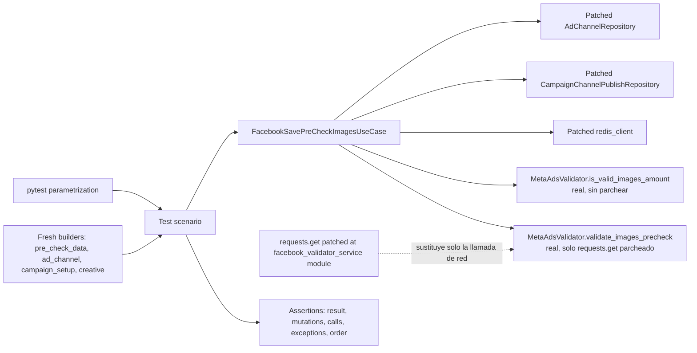

# Design Document: Facebook Save Pre-Check Images Tests

## Overview

Este diseño define una suite pytest de caracterización para `FacebookSavePreCheckImagesUseCase` (`app/v2/use_cases/meta_ads.py`, líneas ~2028-2073) y para el subconjunto de su superclase directa `FacebookSavePreCheckBaseUseCase` (líneas ~1951-2027) que esa subclase invoca por herencia: el constructor, `_get_ad_channel`, `_get_campaign_setup`, `_set_channel_id` y `_build_response`. `FacebookSavePreCheckBaseUseCase` hereda a su vez de `FacebookGeneratePreCheckCreativeUseCase` (cubierta por su propia suite en `facebook-generate-pre-check-creative-tests`), de la que se usa transitivamente el constructor (instanciación de `ad_channel_repository`/`campaign_publish_repository`) y `_save_creative_to_publish`; y de `FacebookTestCreativeUploadUseCase`, de la que se usa `_get_decoded_access_token`.

La suite verifica el contrato observable actual, incluidas las particularidades ya presentes en el código: `FacebookSavePreCheckBaseUseCase.__init__` siempre invoca al constructor padre con `complete_campaign_data={}` (un diccionario vacío, no `None`), lo que produce `None` silencioso en los atributos heredados en lugar del `AttributeError` que se caracteriza para `complete_campaign_data=None` en el spec de referencia; el default mutable `pre_check_data: PreCheckDataDict = {}` en la firma del constructor; los distintos comportamientos ante estructuras `creative`/`ads` malformadas (`IndexError`, `AttributeError`, o ejecución sin error según el nivel de ausencia); y el pass-through transparente del bloque `try/except Exception as e: raise e`. No se corrige ningún comportamiento discutible; el objetivo es fijar el comportamiento actual para detectar regresiones.

**Ubicación obligatoria:** conforme a `sinergia/.kiro/steering/structure.md`, la suite se implementa en `tests/v2/unit/use_cases/test_facebook_save_pre_check_images.py`, dentro del árbol `sinergia/`. Todo artefacto de esta especificación (`requirements.md`, este `design.md`, y el `tasks.md` que se generará en la siguiente fase) reside en `sinergia/.kiro/specs/facebook-save-pre-check-images-tests/`. No se crean archivos de prueba en `app/`, ni se modifica `app/v2/use_cases/meta_ads.py`, `app/v2/use_cases/facebook_validator_service.py`, `app/v2/repository/ad_channel.py`, `app/v2/repository/campaign_channel_publish.py`, ni ningún otro archivo de producción.

### Hallazgos de investigación que informan el diseño

- El encadenamiento de constructores es: `FacebookSavePreCheckImagesUseCase.__init__(user_id, pre_check_images_data)` → `FacebookSavePreCheckBaseUseCase.__init__(user_id, pre_check_data)` → `super().__init__(pre_check_data.get('campaign_id'), user_id, {})` (tres argumentos posicionales: `campaign_id`, `user_id`, `complete_campaign_data={}`) → `FacebookGeneratePreCheckCreativeUseCase.__init__(campaign_id, user_id, complete_campaign_data={}, creative_type='')`, que instancia `AdChannelRepository()`/`CampaignChannelPublishRepository()` y delega en `FacebookTestCreativeUploadUseCase.__init__`. Como `complete_campaign_data` es siempre `{}` (verdadero para `.get()`, falsy para el operador ternario `if complete_campaign_data else None`), todos los atributos derivados de él (`ad_account_id`, `page_id`, `objective`, `optimization_goal`, `lead_gen_form_id`, `whatsapp_number_id`, `billing_event`, `channel_id`) quedan en `None` sin excepción, a diferencia del `AttributeError` que se produce con `complete_campaign_data=None` (caracterizado en el spec de referencia para `FacebookGeneratePreCheckCreativeUseCase`, pero no alcanzable aquí porque esta clase nunca pasa `None`).
- El parche debe aplicarse sobre los símbolos ya importados en `app.v2.use_cases.meta_ads`: `AdChannelRepository`, `CampaignChannelPublishRepository`, `redis_client`. Parchear los módulos originales (`app.v2.repository.ad_channel.AdChannelRepository`, etc.) no tendría efecto porque `meta_ads.py` ya tiene su propia referencia importada al momento de la carga del módulo.
- A diferencia del spec de referencia (`facebook-generate-pre-check-creative-tests`), donde `MetaAdsValidator` se sustituye casi por completo, aquí el Requirement 7 exige ejercitar el comportamiento **real** (no simulado) de `MetaAdsValidator.is_valid_images_amount` (función pura, sin red, cuenta `len(images)` contra `ASSET_MAX_AMOUNTS['images'] == 10`, ver `app/v2/use_cases/facebook_validator_service.py` línea ~40-43 y ~381-385) y de `MetaAdsValidator.validate_images_precheck` (con red, ver líneas ~248-280). Por tanto el punto de aislamiento de red correcto no es parchear `MetaAdsValidator` en sí, sino parchear `requests.get` (usado directamente dentro de `validate_images_precheck`, no vía `Session.request`) en el espacio de nombres del módulo donde se ejecuta: `app.v2.use_cases.facebook_validator_service.requests.get`. Esto permite que la lógica real de `validate_images_precheck` (incluyendo su manejo de `img_url` ausente, su bloque `try/except requests.exceptions.RequestException`, y su asignación in-place de `valid`/`error`) se ejecute sin abrir sockets.
- `is_valid_images_amount` no depende de red ni de `requests`; se ejercita siempre con su implementación real, sin necesidad de ningún parche, para los tres límites exigidos por el Requirement 7 (0, 10, 11 imágenes).
- `_set_channel_id` lee `ad_channel.get('attributes', {}).get('channel_ref', {}).get('data', {}).get('id', 0)`: cada `.get(clave, {})` intermedio absorbe la ausencia de esa clave con un diccionario vacío nuevo, por lo que ninguna combinación de niveles ausentes produce excepción; solo el valor final usa `0` como default explícito.
- `_get_campaign_setup` se invoca con `(self.campaign_id, self.channel_id)`, y `self.channel_id` solo tiene su valor definitivo después de que `_set_channel_id` corrió dentro de `execute()`; antes de eso vale `None` (heredado del constructor del bisabuelo). El orden de `execute()` importa para que la prueba capture el `channel_id` correcto en la aserción de llamada.
- `execute()` no repite el patrón `campaign_publish_repository.save_or_update` del spec de referencia: aquí `_save_creative_to_publish` (heredado del abuelo) invoca `ad_channel_repository.update(ad_channel_id, {'channel_creative': creative})` una sola vez, con `ad_channel_id` extraído de `creative.get('ads')[0].get('adCreative', {}).get('asset_feed_spec', {}).get('ad_channel_id', 0)` — nótese que esta línea usa `creative.get('ads')` **sin** segundo argumento de default, a diferencia de `creative.get('ads', [])` usado dentro del bloque de validación de `execute()`. Esta asimetría es la base del Requirement 13.4: invocar `_save_creative_to_publish` de forma aislada con `creative` sin la clave `ads` debe producir `TypeError` (`None[0]`), mientras que alcanzarlo desde `execute()` nunca lo expone porque el bloque de validación ya falló antes con `IndexError` sobre el mismo `creative` (Requirement 11.1).
- `_build_response` lee `ads_to_publish.get('adCreative')` **sin** default (a diferencia del `.get('adCreative', {})` usado dentro del bloque de validación de `execute()`), por lo que invocarlo de forma aislada con `adCreative` ausente o `None` propaga `AttributeError` al encadenar `.get('asset_feed_spec', {})` sobre `None`. Esta asimetría entre el bloque de validación (tolerante) y `_build_response` (intolerante) es la base de los Requirements 14.7-14.8 y solo es observable invocando el método directamente, no a través de `execute()`.
- `SinergiaException` (base de `DataNotFoundException`, usada por `_get_ad_channel`/`_get_campaign_setup`) solo invoca `flask_babel.gettext` cuando `text is None`. Ambos usos en el código bajo prueba pasan siempre un `text` explícito (`"Creative not found!"` y el f-string de `_get_campaign_setup`), por lo que `gettext` nunca se invoca en el camino ejercitado. **No se requiere contexto de aplicación Flask ni `tests/conftest.py` nuevo** para esta suite; se confirmará en tiempo de implementación con una prueba de humo, igual que en el spec de referencia.
- El proyecto no tiene `tests/conftest.py`; esta suite no lo crea.
- El entorno de `sinergia` ya tiene `pytest==8.3.5` y `hypothesis==6.112.2` declarados en `requirements-test.txt` (ver spec de referencia); no se requiere agregar ninguna dependencia nueva para esta suite.
- El patrón de mocking estándar del proyecto (`tests/v2/unit/use_cases/test_pin_format_ad_variant.py`, `facebook-generate-pre-check-creative-tests/design.md`) es `unittest.mock.patch`/`MagicMock` sobre los símbolos importados en `app.v2.use_cases.meta_ads`, con fixtures de alcance función y builders que devuelven estructuras nuevas por invocación.

Referencias técnicas: [pytest fixtures](https://docs.pytest.org/en/stable/how-to/fixtures.html), [pytest parametrization](https://docs.pytest.org/en/stable/how-to/parametrize.html), [`unittest.mock`](https://docs.python.org/3/library/unittest.mock.html), [`requests` exceptions](https://requests.readthedocs.io/en/latest/api/#exceptions).

### Objetivos de diseño

1. Aislar Strapi (vía los dos repositorios heredados) y Redis; no aislar `MetaAdsValidator.is_valid_images_amount` (pura, sin red) ni la lógica interna de `validate_images_precheck` (solo su llamada de red se sustituye).
2. Verificar cada método propio y heredado invocado por `FacebookSavePreCheckImagesUseCase` con datos mínimos: constructor, `_get_ad_channel`, `_get_campaign_setup`, `_set_channel_id`, `_validate_images_dynamic`, `_validate_images_standard`, `_build_response`, `_save_creative_to_publish`, `_get_decoded_access_token`, `execute()`.
3. Caracterizar explícitamente las particularidades actuales (Datos_de_Campaña_Vacíos, default mutable de la firma, asimetrías `.get(..., {})` vs `.get(...)` sin default entre `execute()`/`_save_creative_to_publish`/`_build_response`, pass-through de excepciones) como comportamiento esperado, no como bugs a corregir.
4. Verificar con precisión los efectos secundarios sobre `ad_channel_repository`/`campaign_publish_repository` (argumentos exactos, cantidad de llamadas, identidad de objetos).
5. Ejercitar el comportamiento real de `is_valid_images_amount` en sus tres límites (0, 10, 11) y de `validate_images_precheck` con un fallo de red simulado, sin abrir sockets reales.
6. Mantener builders que producen estructuras nuevas en cada llamada, evitando estado mutable compartido entre pruebas, salvo en la prueba dedicada a demostrar deliberadamente el default mutable de producción (Requirement 2.10).
7. Hacer determinista el orden de llamadas, mutaciones y resultados.

### Fuera de alcance

- Implementar la suite (se realiza en la fase de tasks).
- Modificar código productivo en `app/`.
- Corregir las particularidades caracterizadas (Datos_de_Campaña_Vacíos, default mutable, asimetrías de `.get()`, pass-through de excepciones).
- Pruebas de integración contra Strapi, Redis o la Graph API reales.
- Cobertura de métodos de `FacebookGeneratePreCheckCreativeUseCase`/`FacebookTestCreativeUploadUseCase` no invocados transitivamente por `FacebookSavePreCheckImagesUseCase` (por ejemplo `_build_meta_payload`, `_get_account_details`, `execute()` del abuelo/bisabuelo); esos quedan cubiertos por la suite `facebook-generate-pre-check-creative-tests`.
- Property-based testing obligatorio (ver justificación en Testing Strategy).

## Architecture

La suite sigue la misma arquitectura de puertos y dobles que el spec de referencia, adaptada a los puertos externos directos de `FacebookSavePreCheckImagesUseCase`: `AdChannelRepository`, `CampaignChannelPublishRepository` y `redis_client` se sustituyen; `MetaAdsValidator.is_valid_images_amount` y `MetaAdsValidator.validate_images_precheck` se ejecutan con su lógica real, con solo la llamada `requests.get` interna de esta última sustituida por un doble.



### Límites de prueba

- **Unidad orquestada con dobles de infraestructura:** `execute()` de punta a punta — se sustituyen `AdChannelRepository`, `CampaignChannelPublishRepository`, `redis_client` sobre `app.v2.use_cases.meta_ads`.
- **Unidad orquestada con validadores reales:** los escenarios de la rama DYNAMIC (Requirement 7) ejecutan `is_valid_images_amount` sin ningún parche, y `validate_images_precheck` con su lógica completa, parcheando únicamente `requests.get` en `app.v2.use_cases.facebook_validator_service` para simular éxito/fallo de red sin tocar la red real.
- **Unidad aislada por método:** `_get_ad_channel`, `_get_campaign_setup`, `_set_channel_id`, `_validate_images_dynamic`, `_validate_images_standard`, `_build_response`, `_save_creative_to_publish`, `_get_decoded_access_token` se prueban también de forma directa, invocándolos sobre una instancia construida con dobles, incluyendo invocaciones deliberadamente aisladas de `_save_creative_to_publish` (Requirement 13.4) y `_build_response` (Requirements 14.7-14.8) con estructuras que `execute()` nunca dejaría alcanzar de forma natural.
- **No integración:** ninguna prueba abre sockets, usa credenciales reales, ni toca Strapi/Redis/Graph API reales.

### Organización propuesta del archivo

`tests/v2/unit/use_cases/test_facebook_save_pre_check_images.py` se ordenará por clases descriptivas, sin estado de clase compartido:

1. `TestConstructorAndInheritedState` — Requirement 2.
2. `TestGetAdChannel` — Requirement 3.
3. `TestGetCampaignSetup` — Requirement 4.
4. `TestSetChannelId` — Requirement 5.
5. `TestExecuteOrchestrationAndShortCircuit` — Requirement 6.
6. `TestValidateImagesDynamic` — Requirement 7.
7. `TestDynamicBranchMissingAssetFeed` — Requirement 8.
8. `TestValidateImagesStandard` — Requirement 9.
9. `TestUnknownCampaignMode` — Requirement 10.
10. `TestMalformedCreativeStructures` — Requirement 11.
11. `TestExceptionPassThrough` — Requirement 12.
12. `TestSaveCreativeToPublish` — Requirement 13.
13. `TestBuildResponse` — Requirement 14.

Los nombres de test serán únicos, con prefijo `test_`, describiendo condición y resultado esperado. Se usará `pytest.mark.parametrize` con `ids` semánticos para la matriz de límites de `is_valid_images_amount` (0/10/11) y para la matriz de niveles de ausencia en `_set_channel_id`/estructuras malformadas.

### Estrategia de trazabilidad

Cada prueba incluye en su docstring o comentario una referencia `Requirements X.Y`.

| Bloque | Requisitos principales | Evidencia |
|---|---|---|
| Aislamiento e infraestructura | 1.1-1.8 | ubicación del archivo, parches exactos, ausencia de red y de Flask |
| Construcción y estado heredado | 2.1-2.10 | atributos exactos, Datos_de_Campaña_Vacíos, default mutable, `None` explícito |
| Obtención del Ad_Channel | 3.1-3.4 | argumentos exactos, identidad, `DataNotFoundException`, cortocircuito |
| Obtención del Campaign_Setup | 4.1-4.4 | argumentos exactos, identidad, `DataNotFoundException`, orden respecto a `_get_ad_channel`/`_set_channel_id` |
| Asignación de `channel_id` | 5.1-5.3 | extracción anidada, default `0` por nivel, orden dentro de `execute()` |
| Orquestación y cortocircuito | 6.1-6.6 | orden exacto, `NotAccessException`, no invocación de pasos posteriores tras cada fallo |
| Rama DYNAMIC | 7.1-7.10 | llamadas reales a `is_valid_images_amount`/`validate_images_precheck`, límites 0/10/11, fallo de red simulado |
| DYNAMIC sin Asset_Feed_Spec | 8.1-8.3 | no invocación de validadores, continuación sin error |
| Rama STANDARD | 9.1-9.4 | no-op, ausencia de mutación, continuación sin error |
| Modo desconocido | 10.1-10.2 | ninguna validación, continuación sin mutación |
| Estructuras malformadas | 11.1-11.4 | `IndexError`, `AttributeError` con `adCreative=None`, ausencia de excepción con `{}`/ausente |
| Pass-through de excepciones | 12.1-12.2 | tipo y mensaje idénticos, equivalencia documentada |
| Persistencia | 13.1-13.4 | argumentos exactos de `update`, defaults por nivel, `TypeError` en invocación aislada |
| Construcción de la respuesta | 14.1-14.8 | claves completas, defaults, unión de `link_urls`, mutación reflejada, `AttributeError` en invocación aislada |
| Calidad | 15.1-15.7 | nombres únicos, datos mínimos, builders frescos, aserciones exactas, repetibilidad |

## Components and Interfaces

### 1. Builders de payload frescos

Funciones puras del módulo de prueba que devuelven diccionarios/listas nuevos en cada llamada, sin defaults mutables compartidos (excepto en la prueba dedicada al Requirement 2.10, que ejercita deliberadamente el default de producción):

- `make_pre_check_images_data(**overrides) -> dict`: valores por defecto mínimos para `campaign_id`, `adset_id`, `ad_id`, `adchannel_id`, listas nuevas vacías para `images`, `bodies`, `titles`, `descriptions`, `call_to_action_types`, `locations`, `daily_budget=0`, `proposal_url=''`, todos sobreescribibles.
- `make_image_entry(url="https://example.test/img.jpg", **overrides) -> dict`: entrada de imagen `{"url": ...}` más claves adicionales; permite `url=None`/omitir `url` para los escenarios que no deben disparar red.
- `make_ad_channel(channel_ref_id=1, channel_creative=ABSENT, **overrides) -> dict`: construye `{"attributes": {"channel_ref": {"data": {"id": channel_ref_id}}, "channel_creative": ...}}`, con un centinela privado `ABSENT` para omitir claves intermedias y ejercitar cada nivel de ausencia del Requirement 5.2 por separado.
- `make_campaign_setup(meta_campaign_mode="DYNAMIC", **overrides) -> dict`: construye `{"attributes": {"meta_campaign_mode": ...}}`, sobreescribible para omitir la clave o dejarla en `None`/cadena vacía (Requirement 10).
- `make_asset_feed_spec(**overrides) -> dict`: `images=[]`, `bodies=[]`, `titles=[]`, `descriptions=[]`, `call_to_action_types=[]`, `link_urls=[]`, `ad_channel_id=0`, sobreescribibles; usada como valor de `asset_feed_spec` dentro de `make_ad_creative`.
- `make_object_story_spec(**overrides) -> dict`: diccionario libre para la rama STANDARD (no-op), típicamente vacío o con claves arbitrarias para confirmar que no se muta.
- `make_ad_creative(asset_feed_spec=ABSENT, object_story_spec=ABSENT, **overrides) -> dict`: usa `ABSENT` para distinguir "clave omitida" de "clave presente con `None`" (Requirements 8.3 vs 8.1, y 11.2 vs 11.4).
- `make_ad(ad_creative=ABSENT, ad_id="ad-1", **overrides) -> dict`.
- `make_creative(name="Creative", ads=None, proposal_locations=ABSENT, **overrides) -> dict`: construye `{"name", "id", "daily_budget", "ads": [...], "proposal_locations": ...}`; `ads` por defecto es una lista nueva con un `make_ad()` si no se provee explícitamente `None`/`[]` para los escenarios de Requirement 11.1.

### 2. Fixture `use_case_factory`

Fixture local de alcance función, análoga a la del spec de referencia pero adaptada a la firma de dos argumentos de `FacebookSavePreCheckImagesUseCase`:

```text
use_case_factory(user_id="user-1", pre_check_images_data=None)
    -> (use_case, mock_ad_channel_repo_instance, mock_campaign_publish_repo_instance)
```

Internamente parchea `app.v2.use_cases.meta_ads.AdChannelRepository` y `app.v2.use_cases.meta_ads.CampaignChannelPublishRepository`, y construye una instancia nueva de `FacebookSavePreCheckImagesUseCase(user_id, pre_check_images_data)` por invocación. Si el llamador no provee `pre_check_images_data`, la fixture usa `make_pre_check_images_data()` (con valores explícitos), de modo que la prueba dedicada al default mutable (Requirement 2.10) sea la única que construye instancias directamente, sin la fixture, omitiendo el argumento a propósito.

### 3. Helper `patch_redis_client`

Fixture/context manager que parchea `app.v2.use_cases.meta_ads.redis_client` y expone el `MagicMock` para configurar `.get.return_value`/`.get.side_effect`, usado por las pruebas de `_get_decoded_access_token` y por los escenarios de `execute()` que verifican el cortocircuito ante token ausente (Requirement 6.2).

### 4. Helper `patch_image_fetch`

Context manager/fixture que parchea `app.v2.use_cases.facebook_validator_service.requests.get` (no `MetaAdsValidator` en sí), permitiendo configurar por escenario:
- Un `MagicMock` cuyo `.raise_for_status()` no lanza y cuyo `.content`/`.headers` simulan una imagen válida (para escenarios de éxito de `validate_images_precheck` que no son el foco de esta suite pero deben no fallar).
- Un `side_effect` que lanza `requests.exceptions.RequestException` (o una subclase como `requests.exceptions.ConnectionError`), para el escenario de fallo de red del Requirement 7.9, verificando que `validate_images_precheck` captura esa excepción específica (no genérica) y produce `valid=False`, `error="Could not fetch image"` sobre la entrada, sin abrir un socket real.

Ninguna prueba de esta suite necesita simular contenido de imagen real (dimensiones, aspecto) porque el Requirement 7 se limita a los conteos (`is_valid_images_amount`) y al fallo de red (`validate_images_precheck`); no se exige cobertura de las ramas de aspecto/tamaño de imagen de `validate_images_precheck`, que ya están fuera del comportamiento propio de `FacebookSavePreCheckImagesUseCase`.

### 5. Helper `deny_network` (guard opcional)

Fixture `autouse=True` de alcance función que sustituye `requests.sessions.Session.request` por una función que lanza `AssertionError("network access is forbidden in unit tests")`, como defensa adicional para cualquier escenario donde `patch_image_fetch` no esté activo pero una entrada de imagen tenga `url` verdadero por descuido. Coexiste con `patch_image_fetch`: cuando este último está activo, `requests.get` ya está sustituido antes de llegar a `Session.request`, por lo que el guard no interfiere con los escenarios que sí quieren ejercitar `validate_images_precheck`.

### 6. Aserciones auxiliares

- `assert_exception_type_and_message(exc_info, expected_type, expected_message)`: compara `type(exc_info.value) is expected_type` y `str(exc_info.value) == expected_message`, usada de forma uniforme en `_get_ad_channel`, `_get_campaign_setup`, el pass-through (Requirement 12), y las estructuras malformadas (Requirement 11).
- `assert_repository_called_once_with(mock_method, *args)`: envoltura sobre `assert_called_once_with` con mensaje diagnóstico explícito, usada para `get_by_campaign_and_ad_channel_id`, `get_by_campaign_id_and_channel_id`, y `update`.
- `assert_no_validator_calls(mock_is_valid_images_amount, mock_validate_images_precheck)`: confirma que ninguno de los dos validadores fue invocado, usada en los Requirements 8, 9.4 y 10.

## Data Models

Modelos de prueba, no clases productivas nuevas.

### `PreCheckImagesData` (forma del builder `make_pre_check_images_data`)

```text
{
  "campaign_id": Any, "adset_id": Any, "ad_id": Any, "adchannel_id": Any,
  "images": list[dict], "bodies": list, "titles": list, "descriptions": list,
  "call_to_action_types": list, "daily_budget": int, "proposal_url": str,
  "locations": list
}
```

### `AdChannel` (forma del builder `make_ad_channel`)

```text
{
  "attributes": {
    "channel_ref": {"data": {"id": Any}},
    "channel_creative": Creative
  }
}
```

### `CampaignSetup` (forma del builder `make_campaign_setup`)

```text
{"attributes": {"meta_campaign_mode": "DYNAMIC" | "STANDARD" | str | None}}
```

### `Creative` / `AdCreative` / `AssetFeedSpec`

```text
Creative = {"name": str, "id": Any, "daily_budget": Any, "ads": list[Ad], "proposal_locations": list}
Ad = {"id": Any, "adCreative": AdCreative | None | ABSENT}
AdCreative = {"asset_feed_spec": AssetFeedSpec | None | ABSENT, "object_story_spec": dict | None | ABSENT}
AssetFeedSpec = {"images": list[dict], "bodies": list, "titles": list, "descriptions": list,
                  "call_to_action_types": list, "link_urls": list[{"website_url": str}],
                  "ad_channel_id": Any, "images_valid_amount": bool, ...defaults según Requirement 14.3}
```

### `PreCheckResponse` (forma retornada por `_build_response`/`execute()`)

Ver el diccionario completo listado en Requirement 14.1 del `requirements.md`; todas las claves se leen desde `asset_feed_spec` del primer ad del `creative`, con los defaults documentados en Requirement 14.3.

## Correctness Properties

*A property is a characteristic or behavior that should hold true across all valid executions of a system-essentially, a formal statement about what the system should do. Properties serve as the bridge between human-readable specifications and machine-verifiable correctness guarantees.*

`FacebookSavePreCheckImagesUseCase` y la mayoría de los métodos heredados que invoca son código de orquestación con efectos secundarios y ramas condicionales discretas, no funciones puras de dominio amplio donde una propiedad universal aporte más señal que un conjunto acotado de ejemplos, casos límite y matrices parametrizadas; por eso no se define un conjunto completo de propiedades para toda la feature (justificación completa en la subsección "Por qué no se incluye un conjunto completo de Correctness Properties" dentro de Testing Strategy). Sin embargo, `MetaAdsValidator.is_valid_images_amount` —invocada por `_validate_images_dynamic` en la rama DYNAMIC (Requirement 7)— sí es una función pura, sin efectos secundarios ni red, cuyo contrato depende únicamente de la longitud de la lista recibida. Esa invariante se declara a continuación como una propiedad única y **opcional** (no obligatoria para esta especificación, consistente con `requirements.md` → Testing Strategy → Property-Based Tests).

### Property 1: is_valid_images_amount es verdadero si y solo si la cantidad de imágenes está en [1, 10]

*Para cualquier* lista `images` de longitud arbitraria (por ejemplo, entre 0 y 20 elementos, con contenido de cada elemento irrelevante para el resultado), `is_valid_images_amount(images) == (1 <= len(images) <= 10)`.

**Validates: Requirements 7.5, 7.6, 7.7**

Esta propiedad es opcional: la matriz parametrizada de límites (0/10/11) ya descrita en "Estrategia para los límites de `is_valid_images_amount`" cubre los mismos requisitos con ejemplos concretos. Si se implementa en la fase de tasks, debe seguir el formato `Feature: facebook-save-pre-check-images-tests, Property 1: is_valid_images_amount es verdadero si y solo si la cantidad de imágenes está en [1, 10]` como comentario del test, usando `hypothesis==6.112.2` con `@settings(max_examples=100, deadline=None)`, tal como se indica en Testing Strategy.

## Error Handling

La suite distingue tres categorías de resultado, sin mezclarlas:

1. **Excepciones de negocio caracterizadas como comportamiento actual:** `DataNotFoundException` (`_get_ad_channel` con mensaje fijo, `_get_campaign_setup` con mensaje interpolado), `NotAccessException` (token ausente), `IndexError` (creative sin ads), `AttributeError` (adCreative `None` explícito, tanto dentro de `execute()` como al invocar `_build_response` de forma aislada), `TypeError` (invocación aislada de `_save_creative_to_publish` con `ads` ausente). Se verifican con `pytest.raises`, comprobando tipo exacto y mensaje exacto (`str(exc_info.value)`), sin capturarlas dentro de la implementación de prueba.
2. **Pass-through transparente (Requirement 12):** el bloque `try/except Exception as e: raise e` que envuelve la extracción de `asset_feed`/`story_spec` y la invocación de las ramas de validación no transforma ninguna excepción. La suite lo verifica de una sola manera indirecta y suficiente: forzando una excepción conocida dentro del bloque (reutilizando el escenario de `AttributeError` del Requirement 11.2, que ya se origina dentro de ese `try`) y comprobando que `type(exc_info.value)` y `str(exc_info.value)` coinciden exactamente con los que se observarían si el bloque `try/except` no existiera. No se necesita duplicar la lógica completa de `execute()`: basta con un único escenario end-to-end donde la excepción se origina dentro del `try`, más un comentario en el test explicando por qué `raise e` sin transformación es observacionalmente equivalente a la ausencia del bloque (a diferencia de un patrón de envoltura como `raise NuevaExcepcion(str(e))`).
3. **Continuación sin error (no-ops caracterizados):** rama STANDARD (no-op siempre), DYNAMIC con `asset_feed` falsy, modo de campaña desconocido, y las combinaciones de `adCreative={}`/ausente que no propagan excepción. Se verifican por la ausencia de invocación a los dobles de validación (`assert_not_called()`) y por la continuación observable de `execute()` hacia `_save_creative_to_publish`/`_build_response` sin mutación de `asset_feed_spec`/`object_story_spec`.

### Estrategia para los límites de `is_valid_images_amount` (Requirement 7.5-7.7)

Se implementa como matriz parametrizada sin ningún parche sobre `MetaAdsValidator.is_valid_images_amount`: se construye `self.images` con `0`, `10` y `11` entradas mínimas (por ejemplo `[{} for _ in range(n)]`, ya que el conteo no depende del contenido de cada entrada, solo de `len(images)`), se invoca `_validate_images_dynamic` sobre un `asset_feed` fresco, y se compara `asset_feed['images_valid_amount']` contra `False`, `True`, `False` respectivamente. Estas entradas vacías no disparan `validate_images_precheck` hacia red real porque cada entrada carece de `url` (`if not img_url: continue`), por lo que no requieren `patch_image_fetch`.

### Estrategia para el fallo de red simulado de `validate_images_precheck` (Requirement 7.9)

Se activa `patch_image_fetch` con un `side_effect` de `requests.exceptions.RequestException` sobre `app.v2.use_cases.facebook_validator_service.requests.get`. Se invoca `_validate_images_dynamic` con `self.images = [make_image_entry(url="https://example.test/img.jpg")]`. Se verifica que la misma entrada de la lista queda mutada in-place con `valid=False` y `error="Could not fetch image"`, y que ni `_validate_images_dynamic` ni `execute()` propagan excepción, confirmando que `validate_images_precheck` nunca lanza por sí misma. No se ejercitan las ramas de tamaño/aspecto de imagen (fuera de alcance del Requirement 7, que solo pide el camino de fallo de red y los límites de cantidad).

### Estrategia para estructuras malformadas (Requirement 11)

Cada nivel se prueba con un escenario `execute()` de punta a punta independiente, reutilizando `use_case_factory` y `patch_redis_client` para llegar hasta el punto de fallo, y comprobando además qué dobles fueron o no invocados antes de la excepción (según el orden real del código, no un orden asumido):

| Escenario | `creative['ads']` | `adCreative` | Resultado esperado |
|---|---|---|---|
| 11.1 | ausente o `[]` | — | `IndexError` en `creative.get('ads', [])[0]` |
| 11.2 | `[ad]` | `None` explícito | `AttributeError` en `.get('asset_feed_spec')` sobre `None` |
| 11.3 | `[ad]` | `{}` | sin excepción; `asset_feed`/`story_spec` en `None`; continúa |
| 11.4 | `[ad]` | clave ausente en `ad` | sin excepción (mismo resultado que 11.3), porque el bloque de validación usa `.get('adCreative', {})` con default |

### Estrategia para invocaciones aisladas (Requirements 13.4 y 14.7-14.8)

`_save_creative_to_publish` y `_build_response` se invocan directamente sobre una instancia de `FacebookSavePreCheckImagesUseCase` construida vía `use_case_factory` (sin pasar por `execute()`), con un `creative` construido a mano que expone la asimetría de default (`ads` ausente para `_save_creative_to_publish`; `adCreative` ausente o `None` para `_build_response`). El docstring de cada prueba documenta explícitamente por qué ese escenario no es alcanzable de forma natural desde `execute()` (porque el bloque de validación previo, con su propio `.get(..., {})`/`.get(..., [])`, ya habría fallado o ya habría normalizado la ausencia antes de llegar a ese punto).

### Estrategia para el default mutable de la firma (Requirement 2.10)

Prueba dedicada, sin usar `use_case_factory` (que siempre provee `pre_check_images_data` explícito): se instancian dos objetos `FacebookSavePreCheckBaseUseCase(user_id="u1")` y `FacebookSavePreCheckBaseUseCase(user_id="u2")` **sin** el segundo argumento en ninguna de las dos invocaciones (ambos parcheando `AdChannelRepository`/`CampaignChannelPublishRepository` vía `use_case_factory`-equivalente manual o parches inline), se muta `instancia_1.images.append(...)`, y se verifica si `instancia_2.images` refleja o no ese cambio. El resultado (compartido o no) se documenta en un comentario junto a la aserción, como caracterización, sin proponer corrección — Python evalúa el valor default de una firma una sola vez por definición de función, por lo que se espera que ambas instancias compartan el mismo objeto lista si el valor por defecto de `PreCheckDataDict = {}` se usa como fuente para `.get('images', [])`; la prueba deja constancia del resultado observado en tiempo de implementación en lugar de asumirlo de antemano.

## Testing Strategy

### Por qué no se incluye un conjunto completo de Correctness Properties

`FacebookSavePreCheckImagesUseCase` y los métodos heredados que invoca son código de orquestación con efectos secundarios (llamadas a repositorios parcheados, mutación in-place de diccionarios) y ramas condicionales discretas (DYNAMIC/STANDARD/desconocido, niveles de ausencia de claves), no funciones puras con un espacio de entrada amplio donde una propiedad universal aporte más señal que un conjunto acotado de ejemplos y casos límite. De los puntos con variación de entrada verdaderamente amplia, `is_valid_images_amount` sobre el tamaño de una lista sí es una función pura apta para una propiedad, y se declara como Property 1 (opcional) más arriba; el fallo/éxito de red de `validate_images_precheck` no lo es (depende de un doble de red, no de una invariante pura) y queda cubierto por un escenario de fallo de red dedicado, más legible y igual de efectivo que una propiedad de Hypothesis para ese caso. Por lo tanto, siguiendo la guía de "cuándo NO usar PBT" (operaciones de orquestación con dependencias externas parcheadas, comportamiento dominado por ramas discretas), esta especificación no obliga a implementar property-based testing y se apoya principalmente en pruebas unitarias de ejemplo, borde y matrices parametrizadas, consistente con lo ya declarado en `requirements.md` (sección Testing Strategy → Property-Based Tests).

### Pruebas unitarias de ejemplo y borde

Se usan para:

- construcción y estado heredado, incluidas Datos_de_Campaña_Vacíos, el default mutable, y el `AttributeError` con `pre_check_images_data=None` explícito;
- `_get_ad_channel`/`_get_campaign_setup`/`_set_channel_id`: argumentos exactos, identidad, excepciones con mensaje exacto, orden dentro de `execute()`;
- orquestación completa de `execute()`: orden de pasos, cortocircuito ante cada fallo, ramas DYNAMIC/STANDARD/desconocida;
- matriz de límites de `is_valid_images_amount` (0/10/11) con la implementación real;
- fallo de red simulado de `validate_images_precheck` con la implementación real, solo `requests.get` parcheado;
- estructuras malformadas de `creative`/`ads`/`adCreative` (matriz de 4 niveles);
- pass-through de excepciones (un escenario end-to-end suficiente, más el comentario de equivalencia);
- persistencia vía `_save_creative_to_publish`, incluida la invocación aislada que expone el `TypeError`;
- construcción de la respuesta vía `_build_response`, incluidas las invocaciones aisladas que exponen el `AttributeError`.

### Pruebas basadas en propiedades

No son obligatorias para esta especificación (ver justificación arriba y `requirements.md`). Si en la fase de implementación se identifica una invariante pura de dominio amplio no prevista en este diseño, puede añadirse como prueba de propiedad opcional adicional, declarando explícitamente `Feature: facebook-save-pre-check-images-tests, Property N: ...` en un comentario, usando `hypothesis==6.112.2` (ya fijado en `requirements-test.txt`) y `@settings(max_examples=100, deadline=None)`; no es un requisito de esta especificación.

### Aislamiento y mocks

- Parches obligatorios sobre símbolos de `app.v2.use_cases.meta_ads`: `AdChannelRepository`, `CampaignChannelPublishRepository`, `redis_client`.
- Parche selectivo sobre `app.v2.use_cases.facebook_validator_service.requests.get` únicamente en los escenarios de la rama DYNAMIC que deban ejercitar la lógica real de `validate_images_precheck`; `is_valid_images_amount` nunca se parchea.
- Tecnología base: `unittest.mock.MagicMock`/`patch`, siguiendo el patrón ya usado en `test_pin_format_ad_variant.py` y en la suite de referencia.
- Ninguna credencial real, base de datos, Strapi, Redis, ni Graph API de Facebook.
- Ninguna app Flask, `app_context`, ni `tests/conftest.py` nuevo, salvo que la implementación descubra una dependencia real de Flask no identificada en este diseño (en cuyo caso se debe volver a `requirements.md` antes de añadir infraestructura).

### Determinismo y estado compartido

Todas las fixtures son de alcance función. Los builders devuelven estructuras nuevas y no usan argumentos por defecto mutables compartidos entre pruebas, con la única excepción deliberada y documentada del Requirement 2.10.

### Criterios de aceptación de la suite

- El archivo objetivo se recopila sin importar servicios externos.
- Cero pruebas `skipped` y cero `xfail` usados para esconder comportamiento.
- Cada criterio de `requirements.md` está referenciado en al menos una prueba o parámetro.
- Ninguna prueba realiza una solicitud HTTP real; la llamada de red interna de `validate_images_precheck` siempre está parcheada cuando se ejercita.
- El resultado final es cero `failed`, cero `skipped` y cero errores de colección/ejecución.
- `app/v2/use_cases/meta_ads.py`, `app/v2/use_cases/facebook_validator_service.py`, `app/v2/repository/ad_channel.py`, `app/v2/repository/campaign_channel_publish.py` y el resto de producción permanecen sin cambios.

### Comandos de validación

```bash
./venv/bin/python -m pytest --collect-only -q tests/v2/unit/use_cases/test_facebook_save_pre_check_images.py
./venv/bin/python -m pytest -q -ra tests/v2/unit/use_cases/test_facebook_save_pre_check_images.py
```

Ambos comandos se ejecutan desde el directorio `sinergia/`, en modo no interactivo y sin watch.
