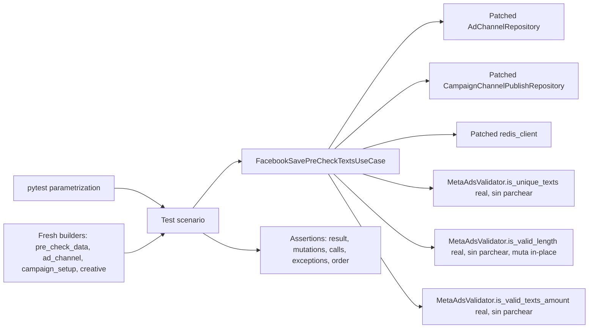

# Design Document: Facebook Save Pre-Check Texts Tests

## Overview

Este diseño define una suite pytest de caracterización para `FacebookSavePreCheckTextsUseCase` (`app/v2/use_cases/meta_ads.py`, líneas ~2076-2133) y para el subconjunto de su superclase directa `FacebookSavePreCheckBaseUseCase` (líneas ~1951-2027) que esa subclase invoca por herencia: el constructor, `_get_ad_channel`, `_get_campaign_setup`, `_set_channel_id` y `_build_response`. `FacebookSavePreCheckBaseUseCase` hereda a su vez de `FacebookGeneratePreCheckCreativeUseCase` (cubierta por su propia suite en `facebook-generate-pre-check-creative-tests`), de la que se usa transitivamente el constructor (instanciación de `ad_channel_repository`/`campaign_publish_repository`) y `_save_creative_to_publish`; y de `FacebookTestCreativeUploadUseCase`, de la que se usa `_get_decoded_access_token`.

La suite verifica el contrato observable actual, incluidas las particularidades ya presentes en el código: `FacebookSavePreCheckBaseUseCase.__init__` siempre invoca al constructor padre con `complete_campaign_data={}` (un diccionario vacío, no `None`); el default mutable `pre_check_data: PreCheckDataDict = {}` en la firma del constructor; los distintos comportamientos ante estructuras `creative`/`ads` malformadas; y el pass-through transparente del bloque `try/except Exception as e: raise e`. A diferencia de `FacebookSavePreCheckImagesUseCase` (Caso_de_Uso_Hermano), `FacebookSavePreCheckTextsUseCase` no delega la validación DYNAMIC a métodos propios (`_validate_images_dynamic`/`_validate_images_standard`): toda la lógica de validación de `titles`, `bodies` y `descriptions` está inline dentro de `execute()`, y la rama STANDARD es un `pass` explícito sin ningún método a invocar. No se corrige ningún comportamiento discutible; el objetivo es fijar el comportamiento actual para detectar regresiones.

**Ubicación obligatoria:** conforme a `sinergia/.kiro/steering/structure.md`, la suite se implementa en `tests/v2/unit/use_cases/test_facebook_save_pre_check_texts.py`, dentro del árbol `sinergia/`. Todo artefacto de esta especificación (`requirements.md`, este `design.md`, y el `tasks.md` que se generará en la siguiente fase) reside en `sinergia/.kiro/specs/facebook-save-pre-check-texts-tests/`. No se crean archivos de prueba en `app/`, ni se modifica `app/v2/use_cases/meta_ads.py`, `app/v2/use_cases/facebook_validator_service.py`, `app/v2/repository/ad_channel.py`, `app/v2/repository/campaign_channel_publish.py`, ni ningún otro archivo de producción.

### Hallazgos de investigación que informan el diseño

- El encadenamiento de constructores es idéntico al del Caso_de_Uso_Hermano: `FacebookSavePreCheckTextsUseCase.__init__(user_id, pre_check_texts_data)` → `FacebookSavePreCheckBaseUseCase.__init__(user_id, pre_check_data)` → `super().__init__(pre_check_data.get('campaign_id'), user_id, {})` → `FacebookGeneratePreCheckCreativeUseCase.__init__(campaign_id, user_id, complete_campaign_data={}, creative_type='')`, que instancia `AdChannelRepository()`/`CampaignChannelPublishRepository()` y delega en `FacebookTestCreativeUploadUseCase.__init__`. Como `complete_campaign_data` es siempre `{}`, todos los atributos derivados de él (`ad_account_id`, `page_id`, `objective`, `optimization_goal`, `lead_gen_form_id`, `whatsapp_number_id`, `billing_event`, `channel_id`) quedan en `None` sin excepción.
- El parche debe aplicarse sobre los símbolos ya importados en `app.v2.use_cases.meta_ads`: `AdChannelRepository`, `CampaignChannelPublishRepository`, `redis_client`. Parchear los módulos originales no tendría efecto porque `meta_ads.py` ya tiene su propia referencia importada al momento de la carga del módulo.
- A diferencia del spec de referencia de Images (donde el punto de aislamiento de red correcto es parchear `requests.get` dentro de `facebook_validator_service`), aquí **ningún** método de `MetaAdsValidator` invocado por `FacebookSavePreCheckTextsUseCase` realiza solicitudes de red: `is_unique_texts` (líneas ~332-340), `is_valid_length` (líneas ~343-354) e `is_valid_texts_amount` (líneas ~387-393) son funciones puras que solo operan sobre listas/dicts en memoria. Por tanto, los tres se ejercitan siempre con su implementación real, sin ningún parche, y no se requiere ningún helper equivalente a `patch_image_fetch`.
- `is_valid_length(type, texts)` no retorna ningún valor útil (`None` implícito); su efecto observable es **mutar in-place** cada dict de `texts`, asignando `text['valid_length'] = valid` según `len(text.get('text', ''))` comparado contra `TEXT_ASSET_MAX_LENGTH.get(type, 255)`. El valor de retorno de la llamada se descarta en el código bajo prueba (`MetaAdsValidator.is_valid_length('titles', self.titles)` no asigna el resultado a ninguna variable), por lo que la suite debe verificar la mutación de las entradas de `self.titles`/`self.bodies`/`self.descriptions`, no un valor de retorno.
- `TEXT_ASSET_MAX_LENGTH = {"titles": 255, "bodies": 1024, "descriptions": 255, "title": 255, "body": 1024, "description": 255}` (`facebook_validator_service.py`, líneas ~31-38): el límite de `bodies` (1024) es distinto del límite de `titles`/`descriptions` (255), por lo que la suite debe cubrir ambos límites por separado y con un caso que distinga los dos (un texto de longitud ~300 sería inválido para `titles`/`descriptions` pero válido para `bodies`).
- `ASSET_MAX_AMOUNTS = {'images': 10, 'titles': 5, 'bodies': 5, 'descriptions': 5, 'call_to_action_types': 5}` (líneas ~40-46): los tres campos de texto comparten el mismo límite de cantidad (5), a diferencia de `images` (10). Los límites relevantes para la matriz parametrizada de cada campo son, por tanto, 0/5/6 (en lugar de 0/10/11 como en Images).
- `is_unique_texts(texts)` (líneas ~332-340) recibe una lista de strings (no de dicts): el código bajo prueba la invoca con una lista de comprensión `[t.get('text') for t in self.titles]` (y análogamente para `bodies`/`descriptions`), no con la lista de dicts misma. Internamente filtra valores falsy (`texts = [t for t in texts if t]`) antes de comparar `len(texts) != len(set(texts))`; por tanto una lista vacía, o una lista donde todos los `text` son `None`/`""`, produce `True` (sin duplicados), y las entradas con `text` ausente/vacío quedan excluidas de la comparación de unicidad sin producir excepción.
- **No hay métodos `_validate_texts_dynamic`/`_validate_texts_standard` propios de `FacebookSavePreCheckTextsUseCase`** (a diferencia de `_validate_images_dynamic`/`_validate_images_standard` en el Caso_de_Uso_Hermano): toda la lógica de la rama DYNAMIC (3 campos × 3 llamadas a `MetaAdsValidator` + 1 sobreescritura de clave, más 2 asignaciones de `unique_*`) está inline dentro de `execute()`, dentro del mismo bloque `try` que extrae `asset_feed`/`story_spec`. La rama STANDARD es literalmente `pass` (sin invocar nada). Esto implica que la suite **no puede** aislar la validación de un campo invocando un método directamente: todos los escenarios de validación de texto deben ejercitarse a través de `execute()` completo (con los repositorios y Redis parcheados vía `use_case_factory`/`patch_redis_client`).
- El orden exacto de las 9 llamadas a `MetaAdsValidator` dentro de la rama DYNAMIC es: `is_unique_texts(titles)` → `is_valid_length('titles', ...)` → `is_valid_texts_amount('titles', ...)` → (asignación de `asset_feed['titles']`) → `is_unique_texts(bodies)` → `is_valid_length('bodies', ...)` → `is_valid_texts_amount('bodies', ...)` → (asignación de `asset_feed['bodies']`) → `is_unique_texts(descriptions)` → `is_valid_length('descriptions', ...)` → `is_valid_texts_amount('descriptions', ...)` → (asignación de `asset_feed['descriptions']`). La suite debe verificar este orden con un registro compartido entre los tres métodos parcheados, en lugar de asumir el orden textual del código.
- `_set_channel_id` lee `ad_channel.get('attributes', {}).get('channel_ref', {}).get('data', {}).get('id', 0)`: cada `.get(clave, {})` intermedio absorbe la ausencia de esa clave con un diccionario vacío nuevo, por lo que ninguna combinación de niveles ausentes produce excepción; solo el valor final usa `0` como default explícito. Idéntico al comportamiento ya caracterizado para el Caso_de_Uso_Hermano.
- `_get_campaign_setup` se invoca con `(self.campaign_id, self.channel_id)`, y `self.channel_id` solo tiene su valor definitivo después de que `_set_channel_id` corrió dentro de `execute()`.
- `_save_creative_to_publish` (heredado del abuelo) invoca `ad_channel_repository.update(ad_channel_id, {'channel_creative': creative})` una sola vez, con `ad_channel_id` extraído de `creative.get('ads')[0].get('adCreative', {}).get('asset_feed_spec', {}).get('ad_channel_id', 0)` — esta línea usa `creative.get('ads')` **sin** segundo argumento de default, a diferencia de `creative.get('ads', [])` usado dentro del bloque de validación de `execute()`. Idéntica asimetría a la ya caracterizada para el Caso_de_Uso_Hermano (base del Requirement 16.4).
- `_build_response` lee `ads_to_publish.get('adCreative')` **sin** default, por lo que invocarlo de forma aislada con `adCreative` ausente o `None` propaga `AttributeError`. Idéntica asimetría a la ya caracterizada para el Caso_de_Uso_Hermano (base de los Requirements 17.7-17.8).
- `SinergiaException` (base de `DataNotFoundException`, usada por `_get_ad_channel`/`_get_campaign_setup`) solo invoca `flask_babel.gettext` cuando `text is None`. Ambos usos en el código bajo prueba pasan siempre un `text` explícito, por lo que `gettext` nunca se invoca en el camino ejercitado. **No se requiere contexto de aplicación Flask ni `tests/conftest.py` nuevo** para esta suite; se confirmará en tiempo de implementación con una prueba de humo, igual que en el spec de referencia.
- El proyecto no tiene `tests/conftest.py`; esta suite no lo crea.
- El entorno de `sinergia` ya tiene `pytest==8.3.5` y `hypothesis==6.112.2` declarados en `requirements-test.txt`; no se requiere agregar ninguna dependencia nueva para esta suite.
- El patrón de mocking estándar del proyecto (`tests/v2/unit/use_cases/test_facebook_save_pre_check_images.py`, `tests/v2/unit/use_cases/test_pin_format_ad_variant.py`) es `unittest.mock.patch`/`MagicMock` sobre los símbolos importados en `app.v2.use_cases.meta_ads`, con fixtures de alcance función y builders que devuelven estructuras nuevas por invocación. Los builders, la fixture `use_case_factory`, el helper `patch_redis_client`, el sentinela `ABSENT` y los helpers de aserción de `test_facebook_save_pre_check_images.py` se reutilizan como plantilla de estilo exacta, adaptando únicamente los campos específicos de esta clase (sin necesidad de `patch_image_fetch` ni de simular imágenes reales con `PIL`).

Referencias técnicas: [pytest fixtures](https://docs.pytest.org/en/stable/how-to/fixtures.html), [pytest parametrization](https://docs.pytest.org/en/stable/how-to/parametrize.html), [`unittest.mock`](https://docs.python.org/3/library/unittest.mock.html).

### Objetivos de diseño

1. Aislar Strapi (vía los dos repositorios heredados) y Redis; no aislar ninguno de los tres métodos de `MetaAdsValidator` usados (`is_unique_texts`, `is_valid_length`, `is_valid_texts_amount`), todos puros y sin red.
2. Verificar cada método propio y heredado invocado por `FacebookSavePreCheckTextsUseCase` con datos mínimos: constructor, `_get_ad_channel`, `_get_campaign_setup`, `_set_channel_id`, la validación inline de `titles`/`bodies`/`descriptions` dentro de `execute()`, `_build_response`, `_save_creative_to_publish`, `_get_decoded_access_token`, `execute()`.
3. Caracterizar explícitamente las particularidades actuales (Datos_de_Campaña_Vacíos, default mutable de la firma, asimetrías `.get(..., {})` vs `.get(...)` sin default, pass-through de excepciones, ausencia de métodos `_validate_texts_*` propios) como comportamiento esperado, no como bugs a corregir.
4. Verificar con precisión los efectos secundarios sobre `ad_channel_repository`/`campaign_publish_repository` (argumentos exactos, cantidad de llamadas, identidad de objetos) y sobre las 9 llamadas a `MetaAdsValidator` (argumentos exactos y orden).
5. Ejercitar el comportamiento real de los tres validadores de texto en sus límites relevantes (longitud 255/1024, cantidad 0/5/6, unicidad con y sin duplicados, texto ausente/vacío).
6. Mantener builders que producen estructuras nuevas en cada llamada, evitando estado mutable compartido entre pruebas, salvo en la prueba dedicada a demostrar deliberadamente el default mutable de producción (Requirement 2.10).
7. Hacer determinista el orden de llamadas, mutaciones y resultados.

### Fuera de alcance

- Implementar la suite (se realiza en la fase de tasks).
- Modificar código productivo en `app/`.
- Corregir las particularidades caracterizadas (Datos_de_Campaña_Vacíos, default mutable, asimetrías de `.get()`, pass-through de excepciones, ausencia de métodos `_validate_texts_*` propios).
- Pruebas de integración contra Strapi, Redis o la Graph API reales.
- Cobertura de métodos de `FacebookGeneratePreCheckCreativeUseCase`/`FacebookTestCreativeUploadUseCase` no invocados transitivamente por `FacebookSavePreCheckTextsUseCase`; esos quedan cubiertos por la suite `facebook-generate-pre-check-creative-tests`.
- Cobertura de `FacebookSavePreCheckImagesUseCase` (Caso_de_Uso_Hermano) o de sus métodos propios (`_validate_images_dynamic`/`_validate_images_standard`); esos ya están cubiertos por `facebook-save-pre-check-images-tests` y solo se usan aquí como referencia de estilo.
- Cobertura de `MetaAdsValidator.validate_text` (método distinto de `is_valid_length`, no invocado por esta clase) ni de `MetaAdsValidator.is_valid_amount`/`is_valid_images_amount`/`is_valid_ctas_amount` (no invocados por esta clase).
- Property-based testing obligatorio (ver justificación en Testing Strategy).

## Architecture

La suite sigue la misma arquitectura de puertos y dobles que el spec de referencia de Images, adaptada a que aquí no existe un punto de aislamiento de red: `AdChannelRepository`, `CampaignChannelPublishRepository` y `redis_client` se sustituyen; `MetaAdsValidator.is_unique_texts`, `is_valid_length` e `is_valid_texts_amount` se ejecutan siempre con su lógica real, sin ningún parche.



### Límites de prueba

- **Unidad orquestada con dobles de infraestructura:** `execute()` de punta a punta — se sustituyen `AdChannelRepository`, `CampaignChannelPublishRepository`, `redis_client` sobre `app.v2.use_cases.meta_ads`.
- **Unidad orquestada con validadores reales:** todos los escenarios de la rama DYNAMIC (Requirements 7-10) ejecutan `is_unique_texts`, `is_valid_length` e `is_valid_texts_amount` sin ningún parche; dado que no hay un método `_validate_texts_dynamic` propio, estos escenarios se ejercitan siempre a través de `execute()` completo, no de forma aislada.
- **Unidad aislada por método:** `_get_ad_channel`, `_get_campaign_setup`, `_set_channel_id`, `_build_response`, `_save_creative_to_publish`, `_get_decoded_access_token` se prueban también de forma directa, invocándolos sobre una instancia construida con dobles, incluyendo invocaciones deliberadamente aisladas de `_save_creative_to_publish` (Requirement 16.4) y `_build_response` (Requirements 17.7-17.8) con estructuras que `execute()` nunca dejaría alcanzar de forma natural.
- **No integración:** ninguna prueba abre sockets, usa credenciales reales, ni toca Strapi/Redis/Graph API reales.

### Organización propuesta del archivo

`tests/v2/unit/use_cases/test_facebook_save_pre_check_texts.py` se ordenará por clases descriptivas, sin estado de clase compartido:

1. `TestConstructorAndInheritedState` — Requirement 2.
2. `TestGetAdChannel` — Requirement 3.
3. `TestGetCampaignSetup` — Requirement 4.
4. `TestSetChannelId` — Requirement 5.
5. `TestExecuteOrchestrationAndShortCircuit` — Requirement 6.
6. `TestDynamicBranchTitlesValidation` — Requirement 7.
7. `TestDynamicBranchBodiesValidation` — Requirement 8.
8. `TestDynamicBranchDescriptionsValidation` — Requirement 9.
9. `TestDynamicBranchCallOrderAndContinuation` — Requirement 10.
10. `TestDynamicBranchMissingAssetFeed` — Requirement 11.
11. `TestStandardBranchNoOp` — Requirement 12.
12. `TestUnknownCampaignMode` — Requirement 13.
13. `TestMalformedCreativeStructures` — Requirement 14.
14. `TestExceptionPassThrough` — Requirement 15.
15. `TestSaveCreativeToPublish` — Requirement 16.
16. `TestBuildResponse` — Requirement 17.

Los nombres de test serán únicos, con prefijo `test_`, describiendo condición y resultado esperado. Se usará `pytest.mark.parametrize` con `ids` semánticos para las tres matrices de límites de `is_valid_texts_amount` (0/5/6, una por campo) y para la matriz de niveles de ausencia en `_set_channel_id`/estructuras malformadas.

### Estrategia de trazabilidad

Cada prueba incluye en su docstring o comentario una referencia `Requirements X.Y`.

| Bloque | Requisitos principales | Evidencia |
|---|---|---|
| Aislamiento e infraestructura | 1.1-1.8 | ubicación del archivo, parches exactos, ausencia de red real, ausencia de Flask |
| Construcción y estado heredado | 2.1-2.10 | atributos exactos, Datos_de_Campaña_Vacíos, default mutable, `None` explícito |
| Obtención del Ad_Channel | 3.1-3.4 | argumentos exactos, identidad, `DataNotFoundException`, cortocircuito |
| Obtención del Campaign_Setup | 4.1-4.4 | argumentos exactos, identidad, `DataNotFoundException`, orden respecto a `_get_ad_channel`/`_set_channel_id` |
| Asignación de `channel_id` | 5.1-5.3 | extracción anidada, default `0` por nivel, orden dentro de `execute()` |
| Orquestación y cortocircuito | 6.1-6.6 | orden exacto, `NotAccessException`, no invocación de pasos posteriores tras cada fallo |
| Validación DYNAMIC de `titles` | 7.1-7.10 | llamadas reales a los tres validadores, límites 0/5/6, duplicados, texto vacío/largo |
| Validación DYNAMIC de `bodies` | 8.1-8.6 | llamadas reales, límite de longitud 1024 distinto de `titles`/`descriptions` |
| Validación DYNAMIC de `descriptions` | 9.1-9.5 | llamadas reales, límites 0/5/6 |
| Orden entre campos y continuación | 10.1-10.2 | orden exacto de las 9 llamadas, continuación hacia persistencia/respuesta |
| DYNAMIC sin Asset_Feed_Spec | 11.1-11.3 | no invocación de ningún validador, continuación sin error |
| Rama STANDARD | 12.1-12.3 | no-op explícito (`pass`, sin método propio), ausencia de mutación, continuación sin error |
| Modo desconocido | 13.1-13.2 | ninguna validación, continuación sin mutación |
| Estructuras malformadas | 14.1-14.4 | `IndexError`, `AttributeError` con `adCreative=None`, ausencia de excepción con `{}`/ausente |
| Pass-through de excepciones | 15.1-15.2 | tipo y mensaje idénticos, equivalencia documentada |
| Persistencia | 16.1-16.4 | argumentos exactos de `update`, defaults por nivel, `TypeError` en invocación aislada |
| Construcción de la respuesta | 17.1-17.8 | claves completas, defaults, unión de `link_urls`, mutación reflejada, `AttributeError` en invocación aislada |
| Calidad | 18.1-18.7 | nombres únicos, datos mínimos, builders frescos, aserciones exactas, repetibilidad |

## Components and Interfaces

### 1. Builders de payload frescos

Funciones puras del módulo de prueba que devuelven diccionarios/listas nuevos en cada llamada, sin defaults mutables compartidos (excepto en la prueba dedicada al Requirement 2.10, que ejercita deliberadamente el default de producción). Reutilizan el mismo sentinela `ABSENT` y el mismo patrón que `test_facebook_save_pre_check_images.py`:

- `make_pre_check_texts_data(**overrides) -> dict`: valores por defecto mínimos para `campaign_id`, `adset_id`, `ad_id`, `adchannel_id`, listas nuevas vacías para `images`, `bodies`, `titles`, `descriptions`, `call_to_action_types`, `locations`, `daily_budget=0`, `proposal_url=''`, todos sobreescribibles.
- `make_text_entry(text="Sample text", **overrides) -> dict`: entrada de texto `{"text": ...}` más claves adicionales; permite `text=None`/`text=""`/omitir `text` para los escenarios de unicidad/longitud que deben tolerar valores vacíos.
- `make_ad_channel(channel_ref_id=1, channel_creative=ABSENT, **overrides) -> dict`: idéntico al builder de la suite de Images — construye `{"attributes": {"channel_ref": {"data": {"id": channel_ref_id}}, "channel_creative": ...}}`, con `ABSENT` para omitir claves intermedias y ejercitar cada nivel de ausencia del Requirement 5.2 por separado.
- `make_campaign_setup(meta_campaign_mode="DYNAMIC", **overrides) -> dict`: idéntico al builder de la suite de Images — construye `{"attributes": {"meta_campaign_mode": ...}}`, sobreescribible para omitir la clave o dejarla en `None`/cadena vacía (Requirement 13).
- `make_asset_feed_spec(**overrides) -> dict`: `titles=[]`, `bodies=[]`, `descriptions=[]`, `images=[]`, `call_to_action_types=[]`, `link_urls=[]`, `ad_channel_id=0`, sobreescribibles; usada como valor de `asset_feed_spec` dentro de `make_ad_creative`.
- `make_object_story_spec(**overrides) -> dict`: diccionario libre para la rama STANDARD (no-op), típicamente vacío o con claves arbitrarias para confirmar que no se muta.
- `make_ad_creative(asset_feed_spec=ABSENT, object_story_spec=ABSENT, **overrides) -> dict`: idéntico al builder de la suite de Images — usa `ABSENT` para distinguir "clave omitida" de "clave presente con `None`" (Requirements 11.3 vs 11.1, y 14.2 vs 14.4).
- `make_ad(ad_creative=ABSENT, ad_id="ad-1", **overrides) -> dict`.
- `make_creative(name="Creative", ads=None, proposal_locations=ABSENT, **overrides) -> dict`: idéntico al builder de la suite de Images — construye `{"name", "id", "daily_budget", "ads": [...], "proposal_locations": ...}`; `ads` por defecto es una lista nueva con un `make_ad()` si no se provee explícitamente `None`/`[]` para los escenarios de Requirement 14.1.

### 2. Fixture `use_case_factory`

Fixture local de alcance función, análoga a la del spec de referencia pero adaptada a la firma de dos argumentos de `FacebookSavePreCheckTextsUseCase`:

```text
use_case_factory(user_id="user-1", pre_check_texts_data=None)
    -> (use_case, mock_ad_channel_repo_instance, mock_campaign_publish_repo_instance)
```

Internamente parchea `app.v2.use_cases.meta_ads.AdChannelRepository` y `app.v2.use_cases.meta_ads.CampaignChannelPublishRepository`, y construye una instancia nueva de `FacebookSavePreCheckTextsUseCase(user_id, pre_check_texts_data)` por invocación. Si el llamador no provee `pre_check_texts_data`, la fixture usa `make_pre_check_texts_data()` (con valores explícitos), de modo que la prueba dedicada al default mutable (Requirement 2.10) sea la única que construye instancias directamente, sin la fixture, omitiendo el argumento a propósito.

### 3. Helper `patch_redis_client`

Fixture/context manager idéntico al de la suite de Images: parchea `app.v2.use_cases.meta_ads.redis_client` y expone el `MagicMock` para configurar `.get.return_value`/`.get.side_effect`, usado por las pruebas de `_get_decoded_access_token` y por los escenarios de `execute()` que verifican el cortocircuito ante token ausente (Requirement 6.2).

### 4. Helper `patch_text_validators` (registro de orden entre campos)

A diferencia de la suite de Images (que no necesita registrar orden entre validadores distintos porque cada rama invoca métodos propios separados), esta suite necesita verificar el **orden exacto** de las 9 llamadas a `MetaAdsValidator` repartidas en 3 campos (Requirement 10.1). Se implementa un context manager/fixture `patch_text_validators()` que:

- Parchea `app.v2.use_cases.meta_ads.MetaAdsValidator.is_unique_texts`, `.is_valid_length` e `.is_valid_texts_amount` con dobles que delegan a la implementación real (por ejemplo `unittest.mock.Mock(wraps=<implementación real>)`), de forma que la lógica real y sus efectos secundarios (mutación in-place de `is_valid_length`, valores de retorno reales) sigan ejecutándose, mientras cada `Mock` registra su invocación.
- Comparte una única lista `call_order` donde cada uno de los tres dobles añade una tupla `(nombre_del_metodo, args)` en el momento de su invocación, permitiendo aserciones de secuencia exacta entre los tres métodos y los tres campos.
- Se usa únicamente en las pruebas del Requirement 10.1 (orden exacto); el resto de los escenarios de los Requirements 7-9 no necesitan este helper y pueden invocar `execute()` con los validadores completamente reales y sin parchear, verificando solo el resultado observable (mutaciones de `asset_feed`/`self.titles`/`self.bodies`/`self.descriptions`) sin inspeccionar el orden de llamadas.

### 5. Helper `deny_network` (guard opcional)

Fixture `autouse=True` de alcance función, idéntica en propósito a la de la suite de Images, que sustituye `requests.sessions.Session.request` por una función que lanza `AssertionError("network access is forbidden in unit tests")`. Se incluye como defensa adicional aunque, a diferencia de la suite de Images, ninguna ruta de código alcanzable por `FacebookSavePreCheckTextsUseCase` realiza solicitudes HTTP; su ausencia no sería un defecto, pero su inclusión mantiene la consistencia de estilo con la suite hermana y protege contra una futura regresión que introdujera accidentalmente una llamada de red en este archivo de prueba.

### 6. Aserciones auxiliares

- `assert_exception_type_and_message(exc_info, expected_type, expected_message)`: idéntica a la de la suite de Images — compara `type(exc_info.value) is expected_type` y `str(exc_info.value) == expected_message`, usada de forma uniforme en `_get_ad_channel`, `_get_campaign_setup`, el pass-through (Requirement 15), y las estructuras malformadas (Requirement 14).
- `assert_repository_called_once_with(mock_method, *args)`: idéntica a la de la suite de Images — envoltura sobre `assert_called_once_with` con mensaje diagnóstico explícito, usada para `get_by_campaign_and_ad_channel_id`, `get_by_campaign_id_and_channel_id`, y `update`.
- `assert_no_text_validator_calls(mock_is_unique_texts, mock_is_valid_length, mock_is_valid_texts_amount)`: análoga a `assert_no_validator_calls` de la suite de Images pero para los tres validadores de texto; confirma que ninguno de los tres fue invocado, usada en los Requirements 11, 12.1/12.3 y 13.

## Data Models

Modelos de prueba, no clases productivas nuevas.

### `PreCheckTextsData` (forma del builder `make_pre_check_texts_data`)

```text
{
  "campaign_id": Any, "adset_id": Any, "ad_id": Any, "adchannel_id": Any,
  "images": list, "bodies": list[dict], "titles": list[dict], "descriptions": list[dict],
  "call_to_action_types": list, "daily_budget": int, "proposal_url": str,
  "locations": list
}
```

### `TextEntry` (forma del builder `make_text_entry`, elemento de `titles`/`bodies`/`descriptions`)

```text
{"text": str | None | ""}
```
Tras `is_valid_length`, cada entrada queda mutada in-place con la clave adicional `"valid_length": bool`.

### `AdChannel` (forma del builder `make_ad_channel`)

```text
{
  "attributes": {
    "channel_ref": {"data": {"id": Any}},
    "channel_creative": Creative
  }
}
```

### `CampaignSetup` (forma del builder `make_campaign_setup`)

```text
{"attributes": {"meta_campaign_mode": "DYNAMIC" | "STANDARD" | str | None}}
```

### `Creative` / `AdCreative` / `AssetFeedSpec`

```text
Creative = {"name": str, "id": Any, "daily_budget": Any, "ads": list[Ad], "proposal_locations": list}
Ad = {"id": Any, "adCreative": AdCreative | None | ABSENT}
AdCreative = {"asset_feed_spec": AssetFeedSpec | None | ABSENT, "object_story_spec": dict | None | ABSENT}
AssetFeedSpec = {"images": list, "bodies": list[TextEntry], "titles": list[TextEntry], "descriptions": list[TextEntry],
                  "call_to_action_types": list, "link_urls": list[{"website_url": str}],
                  "ad_channel_id": Any, "unique_titles": bool, "titles_valid_amount": bool,
                  "unique_bodies": bool, "bodies_valid_amount": bool,
                  "unique_descriptions": bool, "descriptions_valid_amount": bool, ...defaults según Requirement 17.3}
```

### `PreCheckResponse` (forma retornada por `_build_response`/`execute()`)

Ver el diccionario completo listado en Requirement 17.1 del `requirements.md`; todas las claves se leen desde `asset_feed_spec` del primer ad del `creative`, con los defaults documentados en Requirement 17.3.

## Correctness Properties

*A property is a characteristic or behavior that should hold true across all valid executions of a system-essentially, a formal statement about what the system should do. Properties serve as the bridge between human-readable specifications and machine-verifiable correctness guarantees.*

`FacebookSavePreCheckTextsUseCase` y la mayoría de los métodos heredados que invoca son código de orquestación con efectos secundarios y ramas condicionales discretas (DYNAMIC/STANDARD/desconocido, niveles de ausencia de claves), no funciones puras de dominio amplio donde una propiedad universal aporte más señal que un conjunto acotado de ejemplos, casos límite y matrices parametrizadas; por eso no se define un conjunto completo de propiedades para toda la feature (misma justificación que en el spec de referencia de Images, ver subsección "Por qué no se incluye un conjunto completo de Correctness Properties" en Testing Strategy). Sin embargo, dos de los tres validadores estáticos invocados —`MetaAdsValidator.is_valid_texts_amount` y `MetaAdsValidator.is_unique_texts`— sí son funciones puras cuyo contrato depende únicamente de la longitud/composición de la lista recibida, sin efectos secundarios ni dependencias externas. Esas invariantes se declaran a continuación como propiedades **opcionales** (no obligatorias para esta especificación, consistente con `requirements.md` → Testing Strategy → Property-Based Tests).

### Property 1: is_valid_texts_amount es verdadero si y solo si la cantidad de textos está en [1, 5]

*Para cualquier* `type` en `{"titles", "bodies", "descriptions"}` y cualquier lista `texts` de longitud arbitraria (por ejemplo, entre 0 y 15 elementos, con contenido de cada elemento irrelevante para el resultado), `is_valid_texts_amount(type, texts) == (1 <= len(texts) <= 5)`.

**Validates: Requirements 7.5, 7.6, 7.7, 8.5, 9.5**

### Property 2: is_unique_texts es verdadero si y solo si los textos no vacíos no tienen duplicados

*Para cualquier* lista `texts` de strings (incluyendo `None`/`""` como valores posibles de cada elemento), sea `textos_filtrados = [t for t in texts if t]`; entonces `is_unique_texts(texts) == (len(textos_filtrados) == len(set(textos_filtrados)))`.

**Validates: Requirements 7.8, 7.9**

Ambas propiedades son opcionales: las matrices parametrizadas de límites (0/5/6 por campo) y los escenarios concretos de duplicados/valores vacíos ya descritos en "Estrategia para los límites y la unicidad de los validadores de texto" cubren los mismos requisitos con ejemplos concretos. Si se implementan en la fase de tasks, deben seguir el formato `Feature: facebook-save-pre-check-texts-tests, Property N: <descripción>` como comentario del test, usando `hypothesis==6.112.2` con `@settings(max_examples=100, deadline=None)`, tal como se indica en Testing Strategy.

## Error Handling

La suite distingue tres categorías de resultado, sin mezclarlas:

1. **Excepciones de negocio caracterizadas como comportamiento actual:** `DataNotFoundException` (`_get_ad_channel` con mensaje fijo, `_get_campaign_setup` con mensaje interpolado), `NotAccessException` (token ausente), `IndexError` (creative sin ads), `AttributeError` (adCreative `None` explícito, tanto dentro de `execute()` como al invocar `_build_response` de forma aislada), `TypeError` (invocación aislada de `_save_creative_to_publish` con `ads` ausente). Se verifican con `pytest.raises`, comprobando tipo exacto y mensaje exacto (`str(exc_info.value)`), sin capturarlas dentro de la implementación de prueba.
2. **Pass-through transparente (Requirement 15):** el bloque `try/except Exception as e: raise e` que envuelve la extracción de `asset_feed`/`story_spec` y la validación inline de textos no transforma ninguna excepción. La suite lo verifica de una sola manera indirecta y suficiente: forzando una excepción conocida dentro del bloque (reutilizando el escenario de `AttributeError` del Requirement 14.2, que ya se origina dentro de ese `try`) y comprobando que `type(exc_info.value)` y `str(exc_info.value)` coinciden exactamente con los que se observarían si el bloque `try/except` no existiera. No se necesita duplicar la lógica completa de `execute()`: basta con un único escenario end-to-end donde la excepción se origina dentro del `try`, más un comentario en el test explicando por qué `raise e` sin transformación es observacionalmente equivalente a la ausencia del bloque.
3. **Continuación sin error (no-ops caracterizados):** rama STANDARD (no-op siempre, `pass` explícito), DYNAMIC con `asset_feed` falsy, modo de campaña desconocido, y las combinaciones de `adCreative={}`/ausente que no propagan excepción. Se verifican por la ausencia de invocación a los tres validadores de texto (`assert_no_text_validator_calls`) y por la continuación observable de `execute()` hacia `_save_creative_to_publish`/`_build_response` sin mutación de `asset_feed_spec`/`object_story_spec`.

### Estrategia para los límites y la unicidad de los validadores de texto (Requirements 7, 8, 9)

Se implementa como tres matrices parametrizadas independientes (una por campo: `titles`, `bodies`, `descriptions`), cada una ejercitada a través de `execute()` completo (no hay método aislado que invocar), sin ningún parche sobre `MetaAdsValidator`:

- **Cantidad:** se construye el campo correspondiente con `0`, `5` y `6` entradas mínimas con `text` único y no vacío (por ejemplo `[make_text_entry(text=f"t{i}") for i in range(n)]`), se invoca `execute()` con `meta_campaign_mode="DYNAMIC"` y `asset_feed` verdadero, y se compara `asset_feed['<campo>_valid_amount']` contra `False`, `True`, `False` respectivamente, usando el comportamiento real de `is_valid_texts_amount`.
- **Unicidad:** se construye el campo con dos entradas de `text` idéntico (verdadero, no vacío) para verificar `unique_<campo>=False`, y con entradas de `text` todos distintos (o con algunas entradas de `text` ausente/vacío mezcladas con únicas) para verificar `unique_<campo>=True`, usando el comportamiento real de `is_unique_texts` sobre la lista de comprensión `[t.get('text') for t in self.<campo>]`.
- **Longitud:** se construye una entrada con `text` de longitud mayor al máximo del campo (256 para `titles`/`descriptions`, 1025 para `bodies`) para verificar `valid_length=False` mutado in-place sobre esa entrada de `self.<campo>`, y una entrada con `text` de longitud dentro del máximo para verificar `valid_length=True`, usando el comportamiento real de `is_valid_length`. Un caso adicional (Requirement 8.6) usa un texto de longitud ~300 para demostrar que es inválido para `titles`/`descriptions` (límite 255) pero válido para `bodies` (límite 1024), construyendo dos escenarios `execute()` independientes con el mismo texto en campos distintos.

Ninguna de estas entradas requiere aislamiento de red porque ninguno de los tres validadores de texto lo necesita.

### Estrategia para el orden exacto de las 9 llamadas (Requirement 10.1)

Se activa el helper `patch_text_validators()` (ver Components and Interfaces → 4), que envuelve los tres métodos estáticos con dobles que delegan a la implementación real mientras registran orden. Se invoca `execute()` una sola vez con los tres campos (`titles`, `bodies`, `descriptions`) no vacíos y con `asset_feed` verdadero en modo DYNAMIC, y se verifica que el registro de orden contiene exactamente la secuencia de 9 tuplas `(nombre_método, campo)` en el orden documentado en los Hallazgos de investigación. Este es el único escenario de la suite que necesita el helper `patch_text_validators`; todos los demás escenarios de los Requirements 7-9 usan los validadores completamente reales sin envoltura de registro.

### Estrategia para estructuras malformadas (Requirement 14)

Idéntica a la estrategia ya validada en la suite de Images, adaptada a que la ausencia de excepción se confirma verificando que ninguno de los tres validadores de texto fue invocado (en lugar de los validadores de imagen):

| Escenario | `creative['ads']` | `adCreative` | Resultado esperado |
|---|---|---|---|
| 14.1 | ausente o `[]` | — | `IndexError` en `creative.get('ads', [])[0]` |
| 14.2 | `[ad]` | `None` explícito | `AttributeError` en `.get('asset_feed_spec')` sobre `None` |
| 14.3 | `[ad]` | `{}` | sin excepción; `asset_feed`/`story_spec` en `None`; continúa |
| 14.4 | `[ad]` | clave ausente en `ad` | sin excepción (mismo resultado que 14.3), porque el bloque de validación usa `.get('adCreative', {})` con default |

### Estrategia para invocaciones aisladas (Requirements 16.4 y 17.7-17.8)

`_save_creative_to_publish` y `_build_response` se invocan directamente sobre una instancia de `FacebookSavePreCheckTextsUseCase` construida vía `use_case_factory` (sin pasar por `execute()`), con un `creative` construido a mano que expone la asimetría de default (`ads` ausente para `_save_creative_to_publish`; `adCreative` ausente o `None` para `_build_response`). El docstring de cada prueba documenta explícitamente por qué ese escenario no es alcanzable de forma natural desde `execute()`.

### Estrategia para el default mutable de la firma (Requirement 2.10)

Idéntica a la estrategia ya validada en la suite de Images: se instancian dos objetos `FacebookSavePreCheckBaseUseCase(user_id="u1")` y `FacebookSavePreCheckBaseUseCase(user_id="u2")` **sin** el segundo argumento en ninguna de las dos invocaciones (parcheando `AdChannelRepository`/`CampaignChannelPublishRepository` inline), se muta `instancia_1.titles.append(...)`, y se verifica si `instancia_2.titles` refleja o no ese cambio. El resultado se documenta en un comentario junto a la aserción, como caracterización, sin proponer corrección.

## Testing Strategy

### Por qué no se incluye un conjunto completo de Correctness Properties

`FacebookSavePreCheckTextsUseCase` y los métodos heredados que invoca son código de orquestación con efectos secundarios (llamadas a repositorios parcheados, mutación in-place de diccionarios y de las propias entradas de `self.titles`/`self.bodies`/`self.descriptions`) y ramas condicionales discretas (DYNAMIC/STANDARD/desconocido, niveles de ausencia de claves), no funciones puras con un espacio de entrada amplio donde una propiedad universal aporte más señal que un conjunto acotado de ejemplos y casos límite. De los puntos con variación de entrada verdaderamente amplia, `is_valid_texts_amount` sobre el tamaño de una lista e `is_unique_texts` sobre la composición de una lista sí son funciones puras aptas para una propiedad, y se declaran como Property 1 y Property 2 (ambas opcionales) más arriba; `is_valid_length` muta in-place y su contrato depende de la longitud de cada `text` individual más que de una invariante de conjunto amplio, por lo que se cubre mejor con los ejemplos concretos de límite (255/1024) ya descritos que con una propiedad adicional. Por lo tanto, siguiendo la misma guía de "cuándo NO usar PBT" aplicada en el spec de referencia de Images, esta especificación no obliga a implementar property-based testing y se apoya principalmente en pruebas unitarias de ejemplo, borde y matrices parametrizadas, consistente con lo ya declarado en `requirements.md` (sección Testing Strategy → Property-Based Tests).

### Pruebas unitarias de ejemplo y borde

Se usan para:

- construcción y estado heredado, incluidas Datos_de_Campaña_Vacíos, el default mutable, y el `AttributeError` con `pre_check_texts_data=None` explícito;
- `_get_ad_channel`/`_get_campaign_setup`/`_set_channel_id`/`_build_response`: argumentos exactos, identidad, excepciones con mensaje exacto, orden dentro de `execute()`;
- orquestación completa de `execute()`: orden de pasos, cortocircuito ante cada fallo, ramas DYNAMIC/STANDARD/desconocida;
- tres matrices de límites de `is_valid_texts_amount` (0/5/6, una por campo) con la implementación real;
- escenarios de unicidad (con y sin duplicados, con entradas vacías) y de longitud (por encima/dentro del máximo, con el máximo distinto de `bodies` respecto a `titles`/`descriptions`) con la implementación real;
- registro de orden exacto de las 9 llamadas a `MetaAdsValidator` mediante `patch_text_validators`;
- estructuras malformadas de `creative`/`ads`/`adCreative` (matriz de 4 niveles);
- pass-through de excepciones (un escenario end-to-end suficiente, más el comentario de equivalencia);
- persistencia vía `_save_creative_to_publish`, incluida la invocación aislada que expone el `TypeError`;
- construcción de la respuesta vía `_build_response`, incluidas las invocaciones aisladas que exponen el `AttributeError`.

### Pruebas basadas en propiedades

No son obligatorias para esta especificación (ver justificación arriba y `requirements.md`). Si en la fase de implementación se identifica una invariante pura de dominio amplio no prevista en este diseño, puede añadirse como prueba de propiedad opcional adicional, declarando explícitamente `Feature: facebook-save-pre-check-texts-tests, Property N: ...` en un comentario, usando `hypothesis==6.112.2` (ya fijado en `requirements-test.txt`) y `@settings(max_examples=100, deadline=None)`; no es un requisito de esta especificación.

### Aislamiento y mocks

- Parches obligatorios sobre símbolos de `app.v2.use_cases.meta_ads`: `AdChannelRepository`, `CampaignChannelPublishRepository`, `redis_client`.
- Ningún parche sobre `MetaAdsValidator.is_unique_texts`, `is_valid_length` ni `is_valid_texts_amount` en los escenarios de ejemplo/borde (Requirements 7-9, 11-13); únicamente el escenario dedicado al orden exacto (Requirement 10.1) los envuelve para registrar llamadas sin alterar su comportamiento real.
- Tecnología base: `unittest.mock.MagicMock`/`Mock`/`patch`, siguiendo el patrón ya usado en `test_facebook_save_pre_check_images.py` y `test_pin_format_ad_variant.py`.
- Ninguna credencial real, base de datos, Strapi, Redis, ni Graph API de Facebook.
- Ninguna app Flask, `app_context`, ni `tests/conftest.py` nuevo, salvo que la implementación descubra una dependencia real de Flask no identificada en este diseño (en cuyo caso se debe volver a `requirements.md` antes de añadir infraestructura).

### Determinismo y estado compartido

Todas las fixtures son de alcance función. Los builders devuelven estructuras nuevas y no usan argumentos por defecto mutables compartidos entre pruebas, con la única excepción deliberada y documentada del Requirement 2.10.

### Criterios de aceptación de la suite

- El archivo objetivo se recopila sin importar servicios externos.
- Cero pruebas `skipped` y cero `xfail` usados para esconder comportamiento.
- Cada criterio de `requirements.md` está referenciado en al menos una prueba o parámetro.
- Ninguna prueba realiza una solicitud HTTP real (aunque ninguna ruta de código bajo prueba la requiere, el guard `deny_network` permanece activo como defensa).
- El resultado final es cero `failed`, cero `skipped` y cero errores de colección/ejecución.
- `app/v2/use_cases/meta_ads.py`, `app/v2/use_cases/facebook_validator_service.py`, `app/v2/repository/ad_channel.py`, `app/v2/repository/campaign_channel_publish.py` y el resto de producción permanecen sin cambios.

### Comandos de validación

```bash
./venv/bin/python -m pytest --collect-only -q tests/v2/unit/use_cases/test_facebook_save_pre_check_texts.py
./venv/bin/python -m pytest -q -ra tests/v2/unit/use_cases/test_facebook_save_pre_check_texts.py
```

Ambos comandos se ejecutan desde el directorio `sinergia/`, en modo no interactivo y sin watch.
