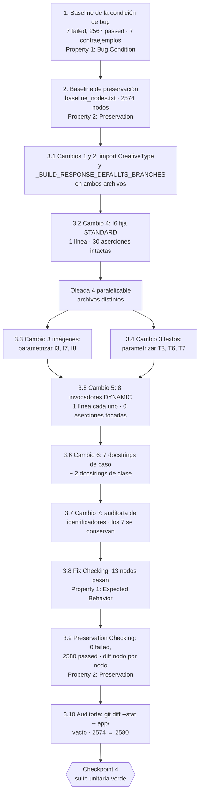

# Implementation Plan: Realineamiento de `TestBuildResponse` tras el cambio de despacho por modo

## Introduction

**Ubicación obligatoria:** este documento reside en `sinergia/.kiro/specs/facebook-save-pre-check-unit-tests-fix/tasks.md` y describe cambios **exclusivamente dentro del árbol `sinergia/`**, la aplicación Flask independiente ubicada en `sinergia/` dentro del monorepo `docker-deploy`, con su propio virtualenv en `sinergia/venv` y sus propios specs/steering en `sinergia/.kiro/`. Toda ruta de archivo del proyecto mencionada en las tareas siguientes se expresa con el segmento `sinergia/` explícito. Única excepción: los argumentos de línea de comandos de `pytest`, que son relativos al directorio de trabajo `sinergia/`; cada bloque de comando declara ese directorio de trabajo en un comentario.

## Overview

### Objetivo del plan

Realinear los siete nodos de `TestBuildResponse` que quedaron contradichos por el commit `be390b56` (HL-2496), que sustituyó el despacho de `FacebookSavePreCheckBaseUseCase._build_response` —de la *forma* del `adCreative` (`object_story_spec or not asset_feed_spec`) al modo *declarado* de la campaña (`self.creative_type`, `sinergia/app/v2/use_cases/meta_ads.py:2533`)—. Esos nodos invocan `_build_response` de forma directa y aislada, sin atravesar `execute()`, de modo que `_set_creative_type` nunca corre y `self.creative_type` conserva el `''` del constructor: se toma siempre la rama DYNAMIC y las aserciones heredadas de la heurística anterior fallan.

**El defecto está en las pruebas, no en el código productivo.** El arreglo consiste en hacer explícito el modo en todo nodo que invoca `_build_response` directamente: parametrizar sobre ambas ramas los seis casos de valores por defecto, fijar STANDARD en el caso de la tabla de mapeo, y fijar DYNAMIC —sin tocar ninguna aserción— en los ocho invocadores directos que hoy pasan por omisión. Los siete cambios concretos, con sus diffs y sus números de línea exactos, están en la sección *Fix Implementation* de `design.md`; las tareas siguientes no los reinventan, los ejecutan.

Meta final verificable: `0 failed` en `tests/v2/unit` con **2580** casos recolectados (desde 2574) y `git diff --stat -- app/` **vacío**.

### Alcance: exactamente 2 archivos, ambos de prueba

| Archivo | Naturaleza | Región acotada |
|---|---|---|
| `sinergia/tests/v2/unit/use_cases/test_facebook_save_pre_check_images.py` | modificado | el `import` de la línea 29, la constante de parametrización insertada antes de `class TestBuildResponse` (2844), el docstring de clase (2845–2899) y los nodos I1–I8 |
| `sinergia/tests/v2/unit/use_cases/test_facebook_save_pre_check_texts.py` | modificado | el `import` de la línea 33, la constante insertada antes de `class TestBuildResponse` (4172), el docstring de clase (4173–4207) y los nodos T1–T7 |

**Ningún archivo bajo `sinergia/app/` se modifica** (cláusula 2.9). No se crea, elimina, renombra ni mueve ningún archivo. No se crea `sinergia/tests/v2/unit/use_cases/conftest.py`: la decisión de diseño lo rechaza expresamente (hoy no existe ningún `conftest.py` bajo `tests/`) y su creación activaría el protocolo de desviación. Tampoco se modifica ningún builder ni fixture compartido (`make_ad_creative`, `make_asset_feed_spec`, `make_object_story_spec`, `make_link_data`, `make_ad`, `make_creative`, `use_case_factory`, el centinela `ABSENT`), conforme a la cláusula 3.7.

**Protocolo de desviación.** Si al ejecutar cualquier tarea se determina que el realineamiento exige tocar un tercer archivo, o que una aserción obsoleta no puede realinearse sin cambiar el código productivo, la implementación **debe abstenerse**: la cláusula 2.10 prohíbe eliminar el caso o marcarlo `xfail`/`skip`, y el hallazgo se escala al usuario como ambigüedad de alcance no resuelta (riesgo R5 de `design.md`).

### Orden del plan

El orden es el recomendado por la sección *Orden de ejecución* de `design.md`, con la captura del baseline por delante:

1. **Tarea 1** — baseline de la condición de bug: los contraejemplos ya existen y son exactamente los 7 fallos. No se escriben pruebas exploratorias nuevas.
2. **Tarea 2** — baseline de preservación nodo por nodo, para poder diferenciar con precisión después.
3. **Tarea 3** — los cambios: import y constante → I6 (un solo nodo, verificación más rápida) → los seis casos de defaults → los ocho DYNAMIC (la comprobación de preservación más sensible, de ahí su posición tardía: cualquier cambio de resultado le es atribuible sin ambigüedad) → documental → Fix Checking → Preservation Checking → auditoría de `app/`.
4. **Tarea 4** — checkpoint final.

### Obligatorio vs. opcional

Todas las sub-tareas son de **implementación obligatoria** y ninguna lleva el postfijo `*`. Este bugfix **no introduce pruebas basadas en propiedades nuevas**: conforme a las secciones *Property-Based Tests* y *Preservation Checking* de `design.md`, el dominio de verificación es el conjunto finito y enumerable de nodos de pytest, y la comparación nodo por nodo es exhaustiva sobre ese dominio, por lo que una generación aleatoria no aportaría garantía adicional. Las propiedades Hypothesis ya existentes en las dos suites (`test_property_is_valid_images_amount_iff_length_in_1_to_10`, `test_property_is_valid_texts_amount_true_iff_count_in_1_to_5`, `test_property_is_unique_texts_true_iff_no_duplicates_among_nonempty`) entran en el alcance de preservación como cualquier otro nodo y deben seguir pasando sin cambios.

## Tasks

- [x] 1. Capturar el baseline de la condición de bug y documentar los contraejemplos
  - **Property 1: Bug Condition** - Los 7 nodos desalineados fallan por tomar la rama DYNAMIC con `creative_type == ''`
  - **IMPORTANTE**: esta tarea se ejecuta ANTES de aplicar cualquier cambio
  - **CRÍTICO**: los 7 nodos DEBEN FALLAR sobre el código sin arreglar; el fallo confirma que la condición de bug se cumple
  - **NO intentar arreglar los tests ni el código en esta tarea**: los fallos son el resultado esperado y son el material de diagnóstico
  - **OBJETIVO**: surfacing de contraejemplos. Los contraejemplos ya existen y son exactamente los 7 fallos del baseline, así que **no se escribe ninguna prueba exploratoria nueva** (sección *Exploratory Bug Condition Checking* de `design.md`)
  - **Enfoque PBT acotado**: la condición de bug `isBugCondition(X)` recorre un dominio finito y enumerable —los nodos recolectados por pytest—, por lo que la propiedad se instancia de forma exhaustiva sobre los 7 nodos concretos que la satisfacen en lugar de generarse al azar
  - Ejecutar, desde el directorio `sinergia/`:
    ```bash
    # cwd: sinergia/
    venv/bin/python -m pytest tests/v2/unit -q
    ```
  - **RESULTADO ESPERADO**: `7 failed, 2567 passed` sobre 2574 casos recolectados (esto es correcto: prueba que el bug existe)
  - Documentar que los 7 nodos fallidos son exactamente los del Inventario de `design.md`: I3, I6, I7, I8 en `test_facebook_save_pre_check_images.py` y T3, T6, T7 en `test_facebook_save_pre_check_texts.py`
  - Documentar los contraejemplos por grupo, conforme a las cláusulas 1.1–1.4:
    - Grupo A, cláusulas 1.1/1.2/1.3 (6 nodos, `assertsStandardMaxAmountDefaults`): `AssertionError: assert 0 == 1` en la primera aserción de `images_max_amount`, en `test_facebook_save_pre_check_images.py:3079`, `:3446`, `:3514` y `test_facebook_save_pre_check_texts.py:4417`, `:4606`, `:4663`
    - Grupo B, cláusula 1.4 (1 nodo, `assertsStandardMappingTable`): `AssertionError: assert 0 == 'channel-7-7'` en `test_facebook_save_pre_check_images.py:3347`, porque `adchannel_id` se resuelve desde `asset_feed_spec` en lugar de `object_story_spec`; las 29 aserciones restantes de la tabla de mapeo quedan sin evaluar
  - Confirmar la causa raíz ya establecida en *Hypothesized Root Cause* de `design.md`, sin re-hipotetizar: `''` no es `'STANDARD'` ⇒ rama `else` ⇒ extracción DYNAMIC; el estado `creative_type == ''` es **inalcanzable en producción** porque los seis `execute()` de pre-check llaman `_set_creative_type`, que aborta con `ValueError` ante cualquier modo fuera de `{"DYNAMIC", "STANDARD"}`
  - Marcar la tarea completa cuando el baseline está ejecutado y los 7 contraejemplos documentados
  - _Requirements: 1.1, 1.2, 1.3, 1.4, 2.10_

- [x] 2. Capturar el baseline de preservación nodo por nodo (ANTES de aplicar el arreglo)
  - **Property 2: Preservation** - Todo nodo que no cumple la condición de bug conserva su resultado
  - **IMPORTANTE**: metodología de observación primero. Se registra el comportamiento **real** de la suite sin arreglar, no el supuesto
  - Observar sobre el código sin arreglar: los 2567 nodos que pasan en `tests/v2/unit`, incluidos los 8 invocadores directos DYNAMIC (I1, I2, I4, I5, T1, T2, T4, T5), que aciertan la rama **por omisión** porque `''` y `'DYNAMIC'` son indistinguibles para el despacho
  - Observar que los 4 nodos de `TestBuildResponse` que atraviesan `execute()` obtienen el modo vía `_set_creative_type` y pasan hoy (`..._images.py:3153`, `:3223`, `..._texts.py:4487`)
  - Observar que `TestUnsupportedMetaCampaignModeRaisesValueError` asevera `use_case.creative_type == ""` (`..._images.py:2285`, `..._texts.py:3636`) y pasa hoy
  - Capturar los artefactos de comparación, desde el directorio `sinergia/`:
    ```bash
    # cwd: sinergia/
    venv/bin/python -m pytest tests/v2/unit -q --no-header -rN > /tmp/baseline_summary.txt
    venv/bin/python -m pytest tests/v2/unit --collect-only -q | sort > /tmp/baseline_nodes.txt
    ```
  - Registrar el tiempo de ejecución observado (orden de 51–53 s) como referencia de la cláusula 3.11
  - **Enfoque de verificación**: la preservación se demuestra por **comparación exhaustiva** del conjunto completo de nodos contra `/tmp/baseline_nodes.txt` y `/tmp/baseline_summary.txt`, no por muestreo. El dominio es finito y enumerable, de modo que la comparación nodo por nodo es una verificación total, más fuerte que cualquier generación aleatoria; por eso este bugfix no añade pruebas basadas en propiedades nuevas
  - **RESULTADO ESPERADO**: los artefactos quedan escritos y `/tmp/baseline_nodes.txt` contiene 2574 identificadores de nodo (esto confirma la línea base a preservar)
  - Marcar la tarea completa cuando los dos artefactos existen y el recuento de 2574 nodos está confirmado
  - _Requirements: 3.1, 3.2, 3.3, 3.4, 3.5, 3.6, 3.7, 3.8, 3.9, 3.10, 3.11_

- [x] 3. Realineamiento de `TestBuildResponse` con el despacho por `self.creative_type`

  - [x] 3.1 Aplicar el Cambio 1 (import de `CreativeType`) y el Cambio 2 (constante de parametrización) en ambos archivos
    - En `sinergia/tests/v2/unit/use_cases/test_facebook_save_pre_check_images.py`, línea 29, y en `sinergia/tests/v2/unit/use_cases/test_facebook_save_pre_check_texts.py`, línea 33: ampliar el import ya existente a `from app.v2.use_cases.facebook_validator_service import CreativeType, MetaAdsValidator`
    - El módulo de origen se elige por consistencia con las otras cuatro suites que ya importan `CreativeType` de ahí y con el propio código productivo (`meta_ads.py:23`); es un `Enum`, nunca se parchea, así que la elección no tiene efecto observable. Hoy `CreativeType` aparece en estos dos archivos solo dentro de docstrings y literales de mensaje de error, de modo que no hay colisión de nombres (riesgo R6)
    - Insertar la constante `_BUILD_RESPONSE_DEFAULTS_BRANCHES` **inmediatamente antes** de `class TestBuildResponse` (línea 2844 en imágenes, 4172 en textos), con los dos `pytest.param` y los `id=` explícitos `"dynamic-max-amount-0"` y `"standard-max-amount-1"`, y con el docstring completo transcrito en el Cambio 2 de `design.md`
    - Los `id=` explícitos satisfacen la cláusula 2.7: cada parametrización es distinguible por su `id` de pytest y nombra la rama efectivamente ejercitada
    - **No** crear ningún `conftest.py` y **no** ampliar la firma de `use_case_factory`: ambas opciones fueron evaluadas y rechazadas en la tabla de decisión de `design.md`
    - Verificar que la recolección sigue funcionando:
      ```bash
      # cwd: sinergia/
      venv/bin/python -m pytest \
        tests/v2/unit/use_cases/test_facebook_save_pre_check_images.py \
        tests/v2/unit/use_cases/test_facebook_save_pre_check_texts.py \
        --collect-only -q | tail -3
      ```
    - _Requirements: 2.7, 2.9, 3.7_

  - [x] 3.2 Aplicar el Cambio 4: fijar STANDARD en el nodo de la tabla de mapeo (I6)
    - En `test_facebook_save_pre_check_images.py`, insertar `use_case.creative_type = CreativeType.STANDARD.value` **inmediatamente después** de la línea 3340 (`use_case, _, _ = use_case_factory()`) de `test_direct_isolated_call_reflects_pre_annotated_standard_link_data_per_mapping_table`
    - **Ninguna de las 30 aserciones de la tabla de mapeo se modifica**, incluida `adchannel_id == 'channel-7-7'` y los cinco `*_max_amount == 1` de las líneas 3371–3375, que ya son correctos bajo STANDARD. La caracterización clave por clave de `design.md` confirma que la respuesta real las reproduce todas
    - Este nodo **no** se parametriza sobre DYNAMIC: su `creative` lleva `object_story_spec` y carece de `asset_feed_spec` por diseño, así que bajo DYNAMIC toda la tabla colapsa a los defaults y la parametrización sería un duplicado degenerado de los casos de defaults
    - Verificación dirigida de un solo nodo:
      ```bash
      # cwd: sinergia/
      venv/bin/python -m pytest \
        "tests/v2/unit/use_cases/test_facebook_save_pre_check_images.py::TestBuildResponse::test_direct_isolated_call_reflects_pre_annotated_standard_link_data_per_mapping_table" -v
      ```
    - _Bug_Condition: `isBugCondition(X)` con `assertsStandardMappingTable(X)` — Grupo B, 1 nodo_
    - _Expected_Behavior: `expectedBehavior(result)` — `outcome == PASSED`, nunca `SKIPPED`/`XFAIL`/`XPASS`/`ERROR`, con `productionSourceUnchanged() == TRUE`_
    - _Preservation: Preservation Requirements de `design.md` — las 30 aserciones existentes se conservan sin modificación_
    - _Requirements: 1.4, 2.4, 2.5, 2.9, 2.10_

  - [x] 3.3 Aplicar el Cambio 3 en `test_facebook_save_pre_check_images.py`: parametrizar los tres casos de defaults (I3, I7, I8)
    - Aplicar el patrón uniforme del Cambio 3 de `design.md` a los tres nodos, en los sitios exactos: decorador antes de las líneas 3047 (I3), 3387 (I7) y 3461 (I8); asignación tras las líneas 3070, 3425 y 3493; aserciones a parametrizar en 3079–3083, 3446–3450 y 3514–3518
    - Añadir `@pytest.mark.parametrize("creative_type, expected_max_amount", _BUILD_RESPONSE_DEFAULTS_BRANCHES)` sobre el `def`, y los dos parámetros al final de la firma, después de `use_case_factory`
    - Insertar `use_case.creative_type = creative_type` **inmediatamente después** de `use_case, _, _ = use_case_factory()`, nunca después de la invocación de `_build_response` (riesgo R1: la colocación tardía sería un no-op y la parametrización STANDARD fallaría de forma ruidosa)
    - Sustituir **solo** el bloque de cinco `*_max_amount` por `== expected_max_amount`. Todas las demás aserciones se conservan literalmente: listas vacías, indicadores `False`, `min_daily_budget == 0`, `proposal_url == ''`, `adchannel_id == 0`, `set(response.keys()) == self.EXPECTED_RESPONSE_KEYS`, `name`/`adset_id`/`ad_id`/`daily_budget` y `proposal_locations == []`. Respaldo: las dos ramas coinciden en 25 de las 30 claves para las tres formas de `adCreative` de estos casos
    - Conservar intactas las aserciones de forma de entrada que preceden a la invocación, en particular `assert "adCreative" not in creative["ads"][0]` en I8
    - No reordenar nada: en este archivo la línea de `use_case_factory()` aparece tras la construcción del `creative`, y ese orden local se respeta
    - _Bug_Condition: `isBugCondition(X)` con `assertsStandardMaxAmountDefaults(X)` — Grupo A, 3 de los 6 nodos_
    - _Expected_Behavior: `expectedBehavior(result)` — ambas parametrizaciones pasan; `*_max_amount == 0` bajo DYNAMIC y `== 1` bajo STANDARD_
    - _Preservation: Preservation Requirements de `design.md` — 25 claves invariantes y conjunto de claves idéntico en ambas ramas_
    - _Requirements: 1.1, 1.2, 1.3, 2.1, 2.2, 2.3, 2.5, 2.9, 2.10_

  - [x] 3.4 Aplicar el Cambio 3 en `test_facebook_save_pre_check_texts.py`: parametrizar los tres casos de defaults (T3, T6, T7)
    - Mismo patrón uniforme que la tarea 3.3, en los sitios exactos: decorador antes de las líneas 4368 (T3), 4561 (T6) y 4621 (T7); asignación tras las líneas 4397, 4589 y 4645; aserciones a parametrizar en 4417–4421, 4606–4610 y 4663–4667
    - En este archivo la línea `use_case, _, _ = use_case_factory()` precede a la construcción del `creative`; la asignación va inmediatamente después de ella y **no se reordena** nada
    - Conservar intacta `assert "adCreative" not in ad` en T7 y la aserción de conjunto de claves de T6/T7
    - La parametrización STANDARD de estos tres nodos es hoy **la única cobertura de la rama STANDARD de `_build_response` en este archivo**, porque este Caso_de_Uso nunca puebla `object_story_spec`
    - _Bug_Condition: `isBugCondition(X)` con `assertsStandardMaxAmountDefaults(X)` — Grupo A, los otros 3 nodos_
    - _Expected_Behavior: `expectedBehavior(result)` — ambas parametrizaciones pasan; `*_max_amount == 0` bajo DYNAMIC y `== 1` bajo STANDARD_
    - _Preservation: Preservation Requirements de `design.md` — 25 claves invariantes y conjunto de claves idéntico en ambas ramas_
    - _Requirements: 1.1, 1.2, 1.3, 2.1, 2.2, 2.3, 2.5, 2.9, 2.10_

  - [x] 3.5 Aplicar el Cambio 5: declarar DYNAMIC en los ocho invocadores directos que ya pasan (I1, I2, I4, I5, T1, T2, T4, T5)
    - Insertar `use_case.creative_type = CreativeType.DYNAMIC.value` inmediatamente después de `use_case, _, _ = use_case_factory()` en las líneas 2950, 3009, 3118 y 3147 de `test_facebook_save_pre_check_images.py`, y 4255, 4343, 4449 y 4474 de `test_facebook_save_pre_check_texts.py`
    - **Ni una aserción cambia** en estos ocho nodos: una línea por caso y cero cambios de aserción, lo que satisface la cláusula 3.2 en su lectura más literal
    - El resultado no puede cambiar: `'' != 'STANDARD'` y `'DYNAMIC' != 'STANDARD'` producen la misma rama y la misma salida (verificado empíricamente en `design.md`). Si alguno cambiara de resultado, indicaría que el caso dependía de algo más que la rama y sería un hallazgo a escalar bajo la cláusula 2.10 (riesgo R4)
    - Esta sub-tarea se ejecuta **después** de 3.2–3.4 precisamente para poder atribuirle sin ambigüedad cualquier cambio de resultado
    - Valor: tras el cambio, ningún nodo de `TestBuildResponse` depende del valor inicial del constructor, lo que elimina la fragilidad latente que produjo este bugfix
    - _Preservation: Preservation Requirements de `design.md` — cláusula 3.2 en su lectura literal; 8 nodos que pasan hoy y deben seguir pasando con sus aserciones intactas_
    - _Requirements: 2.5, 2.9, 3.2_

  - [x] 3.6 Aplicar el Cambio 6: reescribir los siete docstrings de caso y los dos docstrings de clase
    - Corregir los siete docstrings de caso conforme a la tabla del Cambio 6 de `design.md`: I3 (3048–3066), I7 (3390–3422), I8 (3464–3489), T3 (4369–4396), T6 (4564–4588), T7 (4624–4644) e I6 (3276–3309)
    - Resolver la contradicción interna de I3 y T3: hoy enuncian los defaults DYNAMIC («`0` for each of the five `*_max_amount` values») mientras la aserción exige `1`. Pasan a describir el despacho por `self.creative_type` y a enunciar los defaults **por rama**: `0` bajo DYNAMIC (lookup en `asset_feed_spec`), `1` bajo STANDARD (literal)
    - En I7, I8, T6 y T7, sustituir los párrafos que razonan sobre `if object_story_spec or not asset_feed_spec:`: la normalización `ads_to_publish.get('adCreative') or {}` sigue evitando el `AttributeError` —intención principal de esos casos— y la rama la determina ahora `self.creative_type`, fijado por la parametrización. Conservar en I7 la referencia a la autorización de cambio de comportamiento del spec hermano, y en I8/T7 la equivalencia observable «clave ausente ≡ clave presente con `None`», que ahora se asevera en ambas ramas
    - En T3, conservar la observación de fondo del bloque «Note on `*_max_amount == 1` (not `0`)» —esta suite nunca puebla `object_story_spec`— reescrita en términos del despacho por modo declarado
    - En I6, añadir un párrafo corto que declare el modo del que depende toda la tabla de mapeo y por qué no se parametriza sobre DYNAMIC
    - Actualizar los dos docstrings de clase (`..._images.py:2845–2899`, `..._texts.py:4173–4207`), que embeben una copia literal de `_build_response` **anterior** a `be390b56`: sin el bloque de despacho, sin la normalización `or {}`, con `ad_creative = ads_to_publish.get('adCreative')` y con `u.get('website_url')` donde el código vigente tiene `u.get('website_url', '')`. Se llevan a la forma vigente, con el `if self.creative_type == CreativeType.STANDARD.value:` y un resumen de ambas ramas
    - Regla transversal: ninguna reescritura menciona `object_story_spec or not asset_feed_spec` salvo, si acaso, para señalarlo como expresión retirada en `be390b56`
    - Cambio exclusivamente documental: no puede alterar ningún `outcome`
    - _Requirements: 2.6, 2.9_

  - [x] 3.7 Aplicar el Cambio 7: auditar los identificadores de caso
    - Recorrer los siete nombres de la tabla del Cambio 7 de `design.md` y confirmar que ninguno afirma nada sobre la rama ni sobre los `*_max_amount`, de modo que el antecedente `IF` de la cláusula 2.7 no se activa para el nombre del caso y **los siete se conservan**
    - Confirmar que la exigencia de distinguibilidad por `id` de pytest queda cubierta por los `id=` explícitos de la tarea 3.1
    - No renombrar ninguna clase: `TestBuildResponse` describe con exactitud el método bajo prueba
    - Si tras el realineamiento algún identificador resultara contradictorio, renombrarlo para reflejar la rama efectivamente ejercitada
    - _Requirements: 2.7_

  - [x] 3.8 Verificar que los nodos de la condición de bug ahora pasan (Fix Checking)
    - **Property 1: Expected Behavior** - Los 7 nodos desalineados pasan sin tocar el código productivo
    - **IMPORTANTE**: re-ejecutar los MISMOS nodos de la tarea 1; **no** escribir pruebas nuevas. Los nodos de la tarea 1 codifican el comportamiento esperado, y su paso confirma que se satisface
    - Ejecutar:
      ```bash
      # cwd: sinergia/
      # Los 13 nodos resultantes de los 7 casos desalineados (6 × 2 ramas + I6)
      venv/bin/python -m pytest \
        "tests/v2/unit/use_cases/test_facebook_save_pre_check_images.py::TestBuildResponse" \
        "tests/v2/unit/use_cases/test_facebook_save_pre_check_texts.py::TestBuildResponse" \
        -v

      # Verificación dirigida de que ambas parametrizaciones existen y pasan
      venv/bin/python -m pytest \
        tests/v2/unit/use_cases/test_facebook_save_pre_check_images.py \
        tests/v2/unit/use_cases/test_facebook_save_pre_check_texts.py \
        -v -k "max_amount"
      ```
    - **RESULTADO ESPERADO**: los 12 nodos parametrizados aparecen con sus `id` `dynamic-max-amount-0` y `standard-max-amount-1`, y los 13 pasan (confirma que el bug está arreglado). Ninguno reporta `skipped`, `xfail` ni `xpass`
    - Confirmar que ningún caso fue eliminado, marcado `skip`/`xfail` ni relajado (cláusula 2.10)
    - _Requirements: 2.1, 2.2, 2.3, 2.4, 2.5, 2.6, 2.7, 2.10_

  - [x] 3.9 Verificar que los nodos preservados siguen pasando (Preservation Checking)
    - **Property 2: Preservation** - Todo nodo alineado conserva su resultado
    - **IMPORTANTE**: re-ejecutar los MISMOS nodos de la tarea 2 y comparar contra sus artefactos; **no** escribir pruebas nuevas
    - Ejecutar los pasos 1 a 5 del plan de verificación de `design.md`:
      ```bash
      # cwd: sinergia/
      # 1. Suite de alcance completa: 0 failed y 2580 recolectados
      venv/bin/python -m pytest tests/v2/unit -q

      # 2. Diferencia nodo por nodo contra el baseline: solo deben aparecer los 12
      #    nodos parametrizados sustituyendo a los 6 originales
      venv/bin/python -m pytest tests/v2/unit --collect-only -q | sort > /tmp/after_nodes.txt
      diff /tmp/baseline_nodes.txt /tmp/after_nodes.txt

      # 3. Los otros cuatro casos de uso de pre-check, intactos (3.5)
      venv/bin/python -m pytest \
        tests/v2/unit/use_cases/test_facebook_save_pre_check_ctas.py \
        tests/v2/unit/use_cases/test_facebook_save_pre_check_budget.py \
        tests/v2/unit/use_cases/test_facebook_save_pre_check_proposal_url.py \
        tests/v2/unit/use_cases/test_facebook_save_pre_check_locations.py -q

      # 4. Las tres suites con referencias a _build_response en otras clases o dobles (3.6)
      venv/bin/python -m pytest \
        tests/v2/unit/use_cases/test_facebook_launch_campaign.py \
        tests/v2/unit/use_cases/test_facebook_get_launch_campaign_creatives.py \
        tests/v2/unit/use_cases/test_funnel_flow_validator.py -q

      # 5. Las clases que aseveran el '' del constructor siguen pasando (3.4)
      venv/bin/python -m pytest \
        tests/v2/unit/use_cases/test_facebook_save_pre_check_images.py \
        tests/v2/unit/use_cases/test_facebook_save_pre_check_texts.py \
        -q -k "UnsupportedMetaCampaignMode"
      ```
    - **RESULTADO ESPERADO**: `0 failed, 2580 passed` (confirma ausencia de regresiones). El `diff` del paso 2 muestra **exclusivamente** la sustitución de los 6 nodos originales por sus 12 parametrizaciones, y nada más
    - Verificar los seis casos de preservación concretos de `design.md`: los 8 invocadores directos DYNAMIC siguen pasando con sus aserciones literalmente intactas; los 4 nodos que atraviesan `execute()` siguen obteniendo el modo vía `_set_creative_type` sin fijación manual; `TestUnsupportedMetaCampaignModeRaisesValueError` sigue aseverando `use_case.creative_type == ""`; ningún nodo dispara `deny_network` (una fuga se manifestaría como `AssertionError: Network access is forbidden in this unit test suite`) y los repositorios siguen sustituidos por dobles con `redis_client` parcheado; las aserciones de identidad por referencia del objeto `creative` y de recuento de instanciaciones siguen cumpliéndose; el tiempo de ejecución se mantiene en el orden de 51–53 s
    - Confirmar que ningún builder ni fixture compartido fue modificado, y que ninguna prueba realiza acceso real a Strapi, a Redis ni a la red
    - _Requirements: 3.1, 3.2, 3.3, 3.4, 3.5, 3.6, 3.7, 3.8, 3.9, 3.11_

  - [x] 3.10 Auditar que el código productivo no cambió y cerrar el recuento de nodos
    - Ejecutar el paso 6 del plan de verificación:
      ```bash
      # cwd: sinergia/
      git diff --stat -- app/        # debe ser vacío
      git status --porcelain -- app/  # debe ser vacío
      ```
    - Confirmar el recuento de la cláusula 2.8: los casos recolectados en `tests/v2/unit` pasan de **2574 a 2580** (`2574 − 6 + 12 = 2580`), con `failed` de 7 a 0 y `passed` de 2567 a 2580
    - Confirmar que el conjunto de archivos modificados es **exactamente** `sinergia/tests/v2/unit/use_cases/test_facebook_save_pre_check_images.py` y `sinergia/tests/v2/unit/use_cases/test_facebook_save_pre_check_texts.py`, sin archivos nuevos, eliminados, renombrados ni movidos
    - Confirmar que no se creó ningún `conftest.py` bajo `tests/`
    - Si `tests/v2` o la suite completa `tests/` se ejecutan, sus fallos preexistentes y ajenos deben comportarse exactamente igual que hoy, ni corregidos ni agravados: `test_pin_format_ad_variant_integration.py::TestPinFormatAdVariantEndToEndWorkflow::test_end_to_end_pin_format_workflow_persists_pinned_state` y los fallos y errores de `tests/v1/`. **No** son criterio de aceptación
    - _Requirements: 2.8, 2.9, 3.10_

- [x] 4. Checkpoint - Ensure all tests pass
  - Ensure all tests pass, ask the user if questions arise.

## Notes

- **Ninguna tarea de este plan modifica el código productivo.** Las tareas 3.1 a 3.7 escriben únicamente en los dos archivos de prueba; las tareas 1, 2, 3.8, 3.9 y 3.10 solo ejecutan comandos de verificación. La tarea 3.10 audita activamente que `git diff --stat -- app/` está vacío (cláusula 2.9).
- Ninguna sub-tarea lleva el postfijo `*`: no hay tareas opcionales. Este bugfix **no añade pruebas basadas en propiedades nuevas** ni pruebas unitarias nuevas, conforme a las secciones *Unit Tests*, *Property-Based Tests* e *Integration Tests* de `design.md`. Los 12 nodos resultantes de la parametrización sí amplían la cobertura efectiva en un punto: la rama STANDARD de `_build_response` pasa a estar ejercitada en `test_facebook_save_pre_check_texts.py`, que hoy no la ejercita en absoluto.
- Las tareas 1 y 2 son de **observación previa** y deben ejecutarse antes de tocar una sola línea: la tarea 1 registra los 7 contraejemplos (que deben FALLAR) y la tarea 2 los artefactos `/tmp/baseline_summary.txt` y `/tmp/baseline_nodes.txt` (2574 nodos), sin los cuales el `diff` nodo por nodo de la tarea 3.9 es inviable.
- **El orden interno de la tarea 3 no es arbitrario.** 3.1 habilita todo lo demás; 3.2 toca un solo nodo y da la verificación más rápida; 3.3 y 3.4 son independientes entre sí porque escriben en archivos distintos; 3.5 va deliberadamente después para que cualquier cambio de resultado en los 8 nodos DYNAMIC le sea atribuible sin ambigüedad; 3.6 y 3.7 son documentales y no pueden alterar ningún `outcome`.
- **`_build_response` es correcto y no se toca.** El nuevo despacho por modo declarado es estrictamente más correcto que la heurística anterior, que podía enrutar un anuncio STANDARD con `asset_feed_spec` presente hacia la extracción DYNAMIC. El estado `creative_type == ''` es inalcanzable en producción porque los seis `execute()` de pre-check llaman `_set_creative_type`, que aborta con `ValueError` ante cualquier modo fuera de `{"DYNAMIC", "STANDARD"}`.
- Los riesgos R1 a R6 de `design.md` están materializados en el reparto de tareas: R1 (asignación tardía) en las tablas de sitios exactos de 3.3 y 3.4; R2 (fuga de estado) es nula porque cada caso construye instancia nueva vía `use_case_factory`; R3 (interferencia con `TestUnsupportedMetaCampaignModeRaisesValueError`) se verifica en el paso 5 de 3.9; R4 (los 8 DYNAMIC cambian de resultado) en la posición tardía de 3.5 y en la verificación de 3.9; R5 (aserción irrealineable) activa el protocolo de desviación de la cláusula 2.10; R6 (colisión del import) se descarta en 3.1.
- El checkpoint (tarea 4) es un punto de sincronización, no una tarea de código: por eso no aparece en el Task Dependency Graph.

## Task Dependency Graph

```json
{
  "waves": [
    { "id": 0, "tasks": ["1"] },
    { "id": 1, "tasks": ["2"] },
    { "id": 2, "tasks": ["3.1"] },
    { "id": 3, "tasks": ["3.2"] },
    { "id": 4, "tasks": ["3.3", "3.4"] },
    { "id": 5, "tasks": ["3.5"] },
    { "id": 6, "tasks": ["3.6"] },
    { "id": 7, "tasks": ["3.7"] },
    { "id": 8, "tasks": ["3.8"] },
    { "id": 9, "tasks": ["3.9"] },
    { "id": 10, "tasks": ["3.10"] }
  ]
}
```

Visualización del mismo grafo. Las tareas dentro de la caja de la oleada 4 son paralelizables porque escriben en archivos distintos; el resto es secuencial por las razones expuestas en las Notes.


