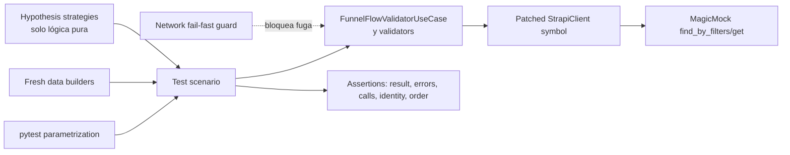

# Design Document: Funnel Flow Validator Tests

## Overview

Este diseño define una suite pytest de caracterización para `app/v2/use_cases/funnel_flow_validator.py`. La suite verificará el contrato observable actual de `FunnelFlowValidatorUseCase`, sus validadores concretos y los validadores agregados sin modificar el código productivo. El objetivo no es corregir comportamientos discutibles —por ejemplo, la propagación actual de `TypeError`, `AttributeError` y `UnboundLocalError`— sino fijarlos explícitamente para detectar regresiones.

La implementación futura se ubicará en `tests/v2/unit/use_cases/test_funnel_flow_validator.py`, respetando la separación del proyecto: las pruebas de la capa `use_cases` permanecerán en la capa unitaria y sustituirán toda dependencia de infraestructura. No se crearán pruebas en `app/`, no se invocarán recursos Flask y no se cambiará `app/v2/use_cases/funnel_flow_validator.py`.

### Hallazgos de investigación que informan el diseño

- `FunnelFlowValidatorUseCase.__init__` construye `StrapiClient` directamente; por ello el parche debe aplicarse sobre el símbolo ya importado por el módulo bajo prueba, `app.v2.use_cases.funnel_flow_validator.StrapiClient`, **antes** de construir el caso de uso.
- `execute` solo usa `find_by_filters` y `get`; ambos pueden quedar contenidos por un único `MagicMock` con `side_effect` basado en endpoint. No hay repositorios adicionales alcanzables en el flujo actual.
- Aunque el módulo importa `requests`, no lo usa directamente. El bloqueo del constructor de `StrapiClient` y las aserciones sobre el doble impiden llegar a `StrapiClient._make_request`; un guard de red adicional puede parchear `requests.sessions.Session.request` para fallar de inmediato ante una fuga accidental.
- El módulo no usa `Flask`, `current_app`, `request`, `g` ni extensiones Flask. Las pruebas son puras y no requieren aplicación ni contexto Flask.
- No existe `tests/conftest.py`. Crear uno solo para esta suite introduciría alcance global innecesario; las fixtures se mantendrán en el módulo de pruebas. Si en el futuro una prueba realmente requiriera Flask, primero se volvería a revisar si ya existe una fixture compartida.
- El proyecto no tiene `pytest.ini` ni `pyproject.toml`; los comandos deben indicar de forma explícita la ruta del archivo de prueba.
- El entorno local inspeccionado dispone de pytest 8.3.5, pero no de `pytest-mock` ni Hypothesis. El aislamiento base utilizará `unittest.mock.MagicMock` y `patch`, disponibles en Python, junto con fixtures y parametrización nativas de pytest. Para las propiedades de lógica pura se selecciona Hypothesis, que deberá declararse como dependencia de test fijada y compatible con Python 3.8 antes de implementar dichas pruebas.

Referencias técnicas relevantes: [pytest fixtures](https://docs.pytest.org/en/stable/how-to/fixtures.html), [pytest parametrization](https://docs.pytest.org/en/stable/how-to/parametrize.html), [`unittest.mock`](https://docs.python.org/3/library/unittest.mock.html) y [Hypothesis](https://hypothesis.readthedocs.io/en/latest/).

### Objetivos de diseño

1. Aislar totalmente Strapi, red, repositorios, APIs y estado persistente.
2. Probar cada validador como unidad pura con datos mínimos.
3. Caracterizar la orquestación y el mapeo con respuestas Strapi realistas pero pequeñas.
4. Mantener una relación explícita entre cada prueba o grupo parametrizado y los criterios de aceptación.
5. Evitar datos mutables compartidos mediante builders que crean objetos nuevos en cada invocación.
6. Hacer deterministas el orden de errores, las llamadas y los resultados.

### Fuera de alcance

- Implementar la suite o sus helpers.
- Modificar código productivo, configuración o `.config.kiro`.
- Corregir excepciones o decisiones de negocio actuales.
- Hacer pruebas reales contra Strapi, Flask, bases de datos o APIs.
- Convertir `tests/test_storage_service.py`, que es un script externo, en parte de esta suite.

## Architecture

La suite sigue una arquitectura de puertos y dobles alrededor de la unidad bajo prueba. El caso de uso y los validadores son el núcleo; el constructor de Strapi es el único puerto externo directo del módulo. Los builders entregan estructuras nuevas y los tests observan retornos, excepciones, estado y llamadas.



### Límites de prueba

- **Unidad pura:** `ChannelValidator`, `AdsStructureValidator`, `AudiencesValidator`, `ExperimentsValidator`, `AdsContentValidator`, `_get_max_length_allowed`, `_run_validator` y `_build_response`.
- **Unidad orquestada:** `FunnelFlowValidatorUseCase.execute` con `StrapiClient` completamente simulado. Se permite ejecutar los validadores reales para los escenarios end-to-end internos.
- **Agregación aislada:** `SummaryContentValidator`, `ReviewContentValidator` y `LaunchPadContentValidator`, reemplazando sus cinco validadores dependientes con dobles para atribuir cada código a una única dependencia.
- **No integración:** ninguna prueba abre sockets, crea Flask, usa credenciales o toca servicios persistentes.

### Organización propuesta del archivo

`tests/v2/unit/use_cases/test_funnel_flow_validator.py` se ordenará por clases descriptivas, sin depender de estado de clase:

1. `TestUseCaseInitialization`
2. `TestUseCaseHelpers`
3. `TestExecuteOrchestration`
4. `TestExecuteAlternateAndFailureFlows`
5. `TestChannelValidator`
6. `TestAdsStructureValidator`
7. `TestAudiencesValidator`
8. `TestExperimentsValidator`
9. `TestAdsContentValidator`
10. `TestAggregateValidators`
11. `TestPropertyContracts`

Las clases solo agrupan nombres; no tendrán `setup_class`, atributos mutables ni orden implícito. Los nombres serán únicos, comenzarán por `test_` y describirán condición y resultado. La parametrización reducirá duplicación sin ocultar la intención; se usarán `ids` semánticos como `none`, `empty-list`, `non-list`, `summary-channel-failure` o `formats-missing-visual-url`.

### Estrategia de trazabilidad

Cada prueba incluirá en su docstring o comentario una referencia `Requirements X.Y`. Las tablas de parametrización agruparán criterios que ejercitan la misma rama, conservando un `id` por condición. Las pruebas de propiedades incluirán además la etiqueta obligatoria `Feature: funnel-flow-validator-tests, Property N: ...`.

La cobertura se organizará por estos bloques:

| Bloque | Requisitos principales | Evidencia |
|---|---|---|
| Aislamiento e infraestructura | 1.1–1.10 | constructor parcheado, guard de red, ausencia de Flask y llamadas exactas |
| Estado y helpers | 2.1–2.14 | igualdad exacta, identidad, orden y parametrización de límites |
| Orquestación exitosa | 3.1–3.13 | respuestas mínimas de Strapi, argumentos exactos y estructura consolidada |
| Alternativas y excepciones | 4.1–4.15 | omisión de llamadas, filtrado tolerante y propagación por identidad |
| Validadores básicos | 5.1–5.23 | matrices parametrizadas por tipo/valor y excepciones actuales |
| Contenido de ads | 6.1–6.31 | builders mínimos por rama, metadatos y orden exactos |
| Agregados y respuesta | 7.1–7.12 | dobles de dependencias y matriz de prefijos/códigos |
| Calidad | 8.1–8.8 | builders frescos, nombres únicos, ejecución aislada y repetible |

## Components and Interfaces

### 1. Fixture `mock_strapi_client`

Fixture local de función que aplica `patch("app.v2.use_cases.funnel_flow_validator.StrapiClient")`, configura el valor retornado como `MagicMock(spec=StrapiClient)` y entrega tanto el constructor como la instancia. El orden de uso será:

1. activar el parche;
2. construir `FunnelFlowValidatorUseCase`;
3. configurar `find_by_filters`/`get`;
4. ejecutar;
5. verificar llamadas y que el constructor real nunca se alcanzó.

La especificación del mock limita errores tipográficos en los métodos. Para escenarios sencillos se utilizarán `return_value`; para orquestación, una función `side_effect(endpoint, ...)` devolverá datos por endpoint y fallará ante endpoints inesperados.

### 2. Fixture `use_case_factory`

Factory local que depende de `mock_strapi_client` y construye una instancia nueva por invocación:

```text
use_case_factory(campaign_id="campaign-1")
    -> (use_case, strapi_mock, constructor_mock)
```

No almacenará instancias entre pruebas. El parche estará activo antes de cada construcción, satisfaciendo el aislamiento del constructor directo.

### 3. Fixture `deny_network`

Fixture `autouse=True` y de alcance función que sustituye el punto bajo de requests por una función que lanza `AssertionError("network access is forbidden in unit tests")`. Sirve como defensa adicional, no como sustituto del mock de Strapi. No bloqueará llamadas locales legítimas porque esta suite no debe hacer ninguna.

### 4. Builders de datos frescos

Serán funciones puras en el módulo de prueba, no constantes mutables ni fixtures de sesión. Cada llamada construirá listas y diccionarios nuevos:

- `make_funnel_flow(flow_id=1)`
- `make_channel(channel_id=10, name="Search")`
- `make_raw_ad(ad_id=100, name="Ad", redirect_url="https://example.test")`
- `make_raw_ad_set(ad_set_id=20, ads=None, project_id="project-1", name="Ad Set")`
- `make_raw_audience(audience_id=30, ad_set_id=20, preferred=1, ...)`
- `make_raw_experiment(experiment_id=40, ad_set_id=20, ...)`
- `make_raw_ad_channel(channel_record_id=50, ad_id=100, selected=True, ...)`
- `make_consolidated_ad(...)`
- `make_consolidated_ad_set(...)`
- `make_valid_selected_channel(...)`
- `make_valid_ads_context(...)`

El valor `None` en parámetros que representan colecciones significará “usar valor válido por defecto”, y un centinela privado distinguirá “campo omitido” de “campo presente con `None`”. Esto permite alcanzar ramas distintas sin mutar objetos compartidos.

### 5. Configurador `configure_strapi_scenario`

Helper que recibe mapas de respuestas para `find_by_filters` y `get`. Su `side_effect` validará la firma y devolverá una estructura nueva o la instancia configurada según lo que requiera el criterio. Para `_fetch_bulk` se conservará intencionadamente el mismo objeto de `data` para comprobar identidad con `is`.

### 6. Aserciones auxiliares

Helpers pequeños y sin lógica productiva:

- `assert_error(error, code, metadata=ABSENT)` comprueba código, presencia/ausencia exacta de metadata y campos exigidos.
- `assert_state_steps(response, expected_steps)` verifica cantidad, orden, unicidad y ausencia de extras.
- `assert_endpoint_call(mock, endpoint, expected_params)` compara endpoint y diccionario completo.

No se crearán abstracciones que reconstruyan el algoritmo del sistema; las expectativas permanecerán visibles en los tests para evitar pruebas tautológicas.

### 7. Matrices parametrizadas

Se parametrizarán solo escenarios con la misma forma de ejecución y aserción:

- valores `None`, vacíos, tipo inválido y válidos de los validadores básicos;
- entradas `0`, `1`, `49`, `50`, `51` de `_get_max_length_allowed`;
- campos de medios `elements`, `images_banner`, `formats` y sus formas inválidas;
- prefijos `SUM`, `REV`, `LAUNCH` frente a las cinco dependencias;
- endpoints que propagan excepciones;
- combinaciones CTA/no CTA y mayúsculas/minúsculas;
- errores `ADS_07_01`/`ADS_07_02`.

Los escenarios con `continue`, `break`, acumulación u orden diferente tendrán pruebas separadas para que la rama observada sea inequívoca.

### 8. Estrategias Hypothesis

Hypothesis se limitará a funciones y transformaciones en memoria:

- enteros no negativos para el límite de longitud;
- secuencias de ad sets con ads válidos/invalidos para acumulación de `ADS_STRUCT_02`;
- secuencias de audiencias y experimentos para la regla existencial;
- subconjuntos de dependencias fallidas para los validadores agregados;
- identificadores únicos y relaciones conocidas/desconocidas para verificar pertenencia en la consolidación.

No se generarán ejecuciones que llamen a Strapi real. En propiedades de `execute`, el `MagicMock` responderá en memoria y el número de ejemplos se mantendrá en 100 como mínimo.

## Data Models

Los modelos siguientes describen contratos de datos de prueba, no nuevas clases productivas.

### `StateEntry`

```text
{
  "step": one of channel|ads_structure|audiences|ads_experiment|ads|summary|review|launchpad,
  "completed": bool,
  "errors": list[ValidationError],
  "message": optional str
}
```

`message` existe en el estado inicial, pero `_run_validator` reemplaza la entrada completa y lo elimina para las etapas ejecutadas. Las pruebas no normalizarán esa diferencia.

### `ValidationError`

```text
{
  "message": str,
  "code": str,
  "metadata": optional dict[str, Any]
}
```

La ausencia de `metadata` es distinta de `metadata={}` y se comprobará de forma explícita.

### `StrapiScenario`

```text
{
  "funnel-flows": {"data": list[RawFunnelFlow]},
  "funnel-flow-channels": {"data": list[RawChannel]},
  "ad-sets": {"data": list[RawAdSet]},
  "audience-audiences": {"data": list[RawAudience]},
  "experiment-experiments": {"data": list[RawExperiment]},
  "ad-channels": {"data": list[RawAdChannel]}
}
```

Las respuestas conservan la forma de Strapi consumida por el código real: relaciones bajo `attributes.<relation>.data`. Los builders omitirán todo campo no leído por la rama concreta.

### `ConsolidatedAdSet`

```text
{
  "id": Any,
  "name": Any,
  "media_platform_project_id": Any,
  "ads": list[ConsolidatedAd],
  "audiences": list[ConsolidatedAudience],
  "experiments": list[ConsolidatedExperiment]
}
```

### `ConsolidatedAd`

```text
{
  "id": Any,
  "attributes": {
    "name": Any,
    "ad_channels": list[ConsolidatedAdChannel],
    "url": Any
  }
}
```

### `ConsolidatedAdChannel`

```text
{
  "channel_id": Any,
  "channel_name": Any,
  "media": {
    "template_id": Any,
    "elements": Any,
    "images_banner": Any,
    "formats": Any
  },
  "channel_attributes": Any,
  "url": Any,
  "selected": Any
}
```

### `AggregateDependencyResult`

```text
{
  "channel": bool,
  "ads_structure": bool,
  "audiences": bool,
  "ads_experiment": bool,
  "ads": bool
}
```

Este modelo alimentará dobles cuyos `validate_completion` devuelven `(completed, [])`. El orden canónico de claves coincide con el orden de evaluación del código y determina el orden de errores agregados.

## Correctness Properties

*A property is a characteristic or behavior that should hold true across all valid executions of a system-essentially, a formal statement about what the system should do. Properties serve as the bridge between human-readable specifications and machine-verifiable correctness guarantees.*

**Property reflection**

El prework identificó propiedades candidatas por criterio y luego se eliminaron redundancias. Los cinco casos de fallo individual de cada validador agregado quedan subsumidos por una única propiedad sobre todos los subconjuntos de dependencias. Los límites explícitos `0`, `1`, `49`, `50` y `51` permanecen como ejemplos de borde, mientras una sola propiedad cubre la fórmula matemática usada tanto por `_get_max_length_allowed` como por elementos. La pertenencia, exclusión de referencias desconocidas y preservación de campos de audiencias, experimentos y canales se consolidan en una propiedad de partición/proyección sobre un grafo generado. Las ramas de control concretas (`continue`, `break` y excepciones actuales) no se fuerzan dentro de propiedades generales: se mantienen como pruebas de ejemplo o borde para evitar generadores ambiguos.

### Property 1: El despacho conserva contexto y resultado

**For any** clave registrada, objeto de contexto, indicador booleano y lista de errores, `_run_validator` debe entregar al validador exactamente el mismo objeto de contexto y reemplazar la entrada de estado por `completed` igual al indicador y `errors` igual a la misma lista.

**Validates: Requirements 2.7, 2.8**

### Property 2: La respuesta normaliza estados en orden canónico

**For any** mapa de estado con las ocho etapas canónicas, cualquier combinación de ausencia de `completed` o `errors`, y cualquier objeto de datos consolidado, `_build_response` debe producir una sola entrada por etapa en orden canónico, completar únicamente los defaults ausentes y conservar por identidad los datos consolidados.

**Validates: Requirements 2.10, 2.11, 2.12, 7.12**

### Property 3: El margen de longitud está acotado por veinte por ciento y diez

**For all** enteros no negativos `n`, `_get_max_length_allowed(n)` debe ser exactamente `n + min(ceil(n * 0.2), 10)`; por tanto, el incremento nunca es negativo ni supera diez.

**Validates: Requirements 2.13, 2.14, 6.24**

### Property 4: Las consultas indexadas cubren cada identificador una sola vez

**For any** secuencia no vacía de identificadores únicos de funnel flows, ad sets y ads, `execute` debe construir para cada consulta aplicable exactamente una clave `$in` indexada por identificador, sin omisiones ni duplicados, y añadir los valores constantes `populate` y `pagination[pageSize]` requeridos por el endpoint.

**Validates: Requirements 3.2, 3.3, 3.4, 3.5, 3.6**

### Property 5: La consolidación particiona relaciones y preserva proyecciones

**For any** grafo válido generado de ad sets, ads, audiencias, experimentos y canales, cada relación cuyo padre sea conocido debe aparecer exactamente una vez y solo bajo ese padre; toda relación con padre desconocido debe quedar excluida; y todos los campos proyectados por el caso de uso deben conservar sus valores de entrada sin alteración.

**Validates: Requirements 3.7, 3.8, 3.9, 3.10, 3.11, 3.12, 3.13, 4.6, 4.7, 4.8**

### Property 6: Una lista de canales no vacía siempre es válida

**For any** lista no vacía de valores de canal, `ChannelValidator.validate_completion` debe devolver `completed=True` y una lista de errores vacía, independientemente del contenido de los elementos.

**Validates: Requirements 5.3**

### Property 7: Los errores de estructura corresponden a los ad sets inválidos

**For any** lista no vacía de ad sets, `AdsStructureValidator` debe producir exactamente un `ADS_STRUCT_02` por cada ad set cuyo campo `ads` no sea una lista no vacía, en el mismo orden de entrada y con el nombre correspondiente; si ninguno es inválido debe completar sin errores.

**Validates: Requirements 5.5, 5.6, 5.7**

### Property 8: La audiencia preferida determina la validez por ad set

**For any** lista no vacía de ad sets con colecciones iterables de audiencias, cada ad set con al menos una audiencia cuyo `preferred_audience.preferred` sea `1` no debe aportar error, y cada ad set no vacío sin esa audiencia debe aportar exactamente un `AUD_03` en orden; los ad sets sin audiencias se cubren con `AUD_02` en las pruebas de ejemplo.

**Validates: Requirements 5.10, 5.11, 5.12, 5.13**

### Property 9: Un experimento verdadero determina la validez por ad set

**For any** lista no vacía de ad sets con colecciones iterables no vacías de experimentos, cada ad set con al menos un valor verdadero no debe aportar error y cada ad set compuesto solo por valores falsos debe aportar exactamente un `EXP_03` en orden; los ad sets sin experimentos se cubren con `EXP_02` en las pruebas de ejemplo.

**Validates: Requirements 5.18, 5.19, 5.20, 5.21**

### Property 10: Los límites de atributos se aplican salvo para CTA

**For any** atributo de canal con nombre distinto de CTA, máximo no negativo y payload más largo que ese máximo, `AdsContentValidator` debe producir un `ADS_05_02` con longitudes y nombre exactos; **for any** combinación de mayúsculas y minúsculas de `CTA`, el mismo exceso no debe producir `ADS_05_02`.

**Validates: Requirements 6.17, 6.18**

### Property 11: Los errores de medios corresponden al subconjunto inválido

**For any** subconjunto no vacío de `elements`, `images_banner` y `formats` marcado como ausente, `None`, no-lista o lista vacía, manteniendo válidos los demás campos, `AdsContentValidator` debe producir exactamente un `ADS_07` por campo inválido en el orden canónico de recorrido y continuar evaluando los campos restantes.

**Validates: Requirements 6.19, 6.20**

### Property 12: El exceso de payload de elemento usa el límite derivado

**For any** `original_payload` no vacío y payload cuya longitud sea mayor que el límite de la Property 3, `AdsContentValidator` debe producir exactamente el `ADS_08_02` atribuible a ese elemento con `payload_length`, `max_allowed_length`, `element_name`, anuncio y canal exactos, siempre que el resto del contexto sea válido.

**Validates: Requirements 6.25**

### Property 13: Todo contexto de anuncio válido completa sin errores

**For any** contexto generado que satisfaga audiencias, proyecto, ads, URL, canal seleccionado, atributos, payloads, medios, formatos e intención, `AdsContentValidator` debe devolver `completed=True` y exactamente cero errores.

**Validates: Requirements 6.29**

### Property 14: Las infracciones independientes se acumulan de forma estable

**For any** secuencia de ad sets y ads con un subconjunto de infracciones independientes que no active `continue`, `break` ni excepción, `AdsContentValidator` debe devolver un error por cada infracción aplicable y conservar el orden de evaluación incluso al concatenar varios ad sets o ads.

**Validates: Requirements 6.30, 6.31**

### Property 15: Los agregados reflejan exactamente las dependencias fallidas

**For any** subconjunto de las cinco dependencias y para cada clase `SummaryContentValidator`, `ReviewContentValidator` y `LaunchPadContentValidator`, el resultado debe estar completo si y solo si el subconjunto de fallos está vacío; de lo contrario debe contener exactamente un error con `metadata={}` por dependencia fallida, con el prefijo de la clase y en orden canal, estructura, audiencias, experimentos y ads.

**Validates: Requirements 7.1, 7.2, 7.3, 7.4, 7.5, 7.6, 7.7, 7.8, 7.9, 7.10, 7.11**

## Error Handling

La suite distinguirá tres categorías de fallo y no las mezclará:

1. **Errores de validación esperados:** se comprueban como datos retornados. Cada escenario afirma `completed`, cantidad exacta, código, presencia o ausencia de `metadata`, contenido exacto de metadatos y orden cuando hay acumulación.
2. **Excepciones productivas caracterizadas:** `TypeError`, `AttributeError` y `UnboundLocalError` forman parte del comportamiento actual descrito por los requisitos. Se verifican con `pytest.raises` sin capturarlas ni transformarlas. Los fallos inyectados en Strapi se verifican por identidad (`exc_info.value is sentinel_exception`) para demostrar propagación sin envoltura.
3. **Fallos del arnés de prueba:** un endpoint inesperado, una fuga de red o una llamada adicional debe lanzar `AssertionError` con diagnóstico del endpoint/argumentos. Estos fallos indican una prueba o regresión de aislamiento, no un resultado de negocio.

### Matriz de fallos de obtención

Los criterios 4.10–4.15 se implementarán como matriz parametrizada de fase de fallo. Cada caso configurará todas las respuestas previas mínimas y hará que solo la operación objetivo lance una instancia sentinel. La prueba comprobará:

- mismo tipo e identidad de excepción;
- ausencia de respuesta exitosa;
- ausencia de llamadas a fases posteriores;
- llamadas previas exactamente una vez con argumentos completos.

### Mapeo tolerante de relaciones

Para el criterio 4.9 se proporcionará primero un diccionario cuya forma anidada provoque una excepción dentro del bloque `try` del mapeo y después una relación válida. La aserción se hará sobre el resultado consolidado: la relación defectuosa no aparece y la posterior sí. No se afirmarán logs porque no forman parte del contrato funcional y acoplarían la suite al texto de logging.

### Diagnóstico de errores acumulados

Las aserciones compararán listas de códigos completas en vez de usar pertenencia parcial. Para errores repetidos se compararán pares `(code, metadata)` en orden. Así se detectan duplicados, omisiones y cambios de control de flujo. Los builders asignarán nombres e IDs únicos y legibles para que un fallo identifique inmediatamente el objeto afectado.

## Testing Strategy

La estrategia es dual: pruebas unitarias de ejemplo para ramas concretas y pruebas basadas en propiedades para invariantes con espacios amplios. Ambas se ejecutan sin servicios externos.

### Pruebas unitarias de ejemplo y borde

Se usarán para:

- contratos iniciales y orden fijo de estados/validadores;
- llamadas exactas a mocks y conservación de identidad;
- flujo mínimo exitoso y cortes tempranos;
- ausencia de datos y omisión de endpoints;
- cada código de error y sus metadatos;
- cada `continue`, `break` o excepción actual;
- límites explícitos `0`, `1`, `49`, `50`, `51`;
- `visual_id`/`visual_url` vacíos individual y simultáneamente;
- propagación de fallos desde cada endpoint;
- frescura de builders mediante dos invocaciones, identidades diferentes y mutación aislada.

La parametrización agrupará entradas equivalentes, pero cada rama con continuación o interrupción distinta conservará un test separado. Los escenarios usarán únicamente los campos leídos antes de llegar a la rama objetivo, salvo un contexto válido mínimo que evite errores colaterales.

### Pruebas basadas en propiedades

Se selecciona **Hypothesis for Python**; no se implementarán generadores aleatorios propios. Hypothesis no está instalado actualmente, por lo que la fase de implementación deberá declararlo como dependencia exclusiva de test con una versión exacta compatible con Python 3.8. Este documento no modifica dependencias.

Cada una de las 15 propiedades tendrá **un único test de propiedad**, no varios, con al menos 100 ejemplos:

```python
# Feature: funnel-flow-validator-tests, Property N: <texto de la propiedad>
@settings(max_examples=100, deadline=None)
@given(...)
def test_property_...(...):
    ...
```

`deadline=None` evita falsos fallos por velocidad desigual del entorno, no oculta errores funcionales. Las estrategias limitarán tamaños para mantener la suite rápida y producirán valores Unicode/ASCII, enteros pequeños, listas vacías/no vacías y subconjuntos según el dominio. Se evitarán `assume` excesivos mediante estrategias constructivas válidas. Los ejemplos reducidos por Hypothesis deberán seguir siendo legibles gracias a IDs y builders simples.

Las propiedades 4 y 5 ejecutan orquestación, pero todas las dependencias estarán simuladas en memoria; no son pruebas de servicios externos. El resto ejercita funciones o validadores puros. Los casos de excepción deliberada se mantienen fuera de PBT cuando pocas entradas concretas expresan mejor el contrato.

### Aislamiento y mocks

- Parche obligatorio: `app.v2.use_cases.funnel_flow_validator.StrapiClient`.
- Tecnología base: `unittest.mock.MagicMock` y `patch`; no se presupone `pytest-mock` porque no está instalado.
- `spec=StrapiClient` para limitar la interfaz simulada.
- `side_effect` por endpoint que falla ante consultas inesperadas.
- guard de red `autouse` de alcance función.
- ninguna credencial, variable de entorno remota, repositorio real, base de datos o API.
- ninguna app Flask, `app_context`, cliente HTTP Flask ni `tests/conftest.py` para esta suite.

Si durante la implementación apareciera una referencia real a Flask en una ruta alcanzable, se deberá volver a requisitos antes de ampliar infraestructura: primero se revisará si existe una fixture compartida y solo entonces se propondrá `tests/conftest.py`. Con el código actual, añadirlo sería injustificado.

### Cobertura por componente

| Componente | Tipo principal | Riesgos cubiertos |
|---|---|---|
| Constructor/estado | ejemplo | orden, defaults, lista de validadores |
| `_fetch_bulk` | ejemplo | llamada, fallback, identidad |
| `_run_validator` | ejemplo + propiedad | despacho, reemplazo, validador ausente |
| `_build_response` | ejemplo + propiedad | defaults, orden, unicidad, identidad |
| `execute` | ejemplo + propiedad con mocks | queries, cortes, consolidación, propagación |
| Validadores básicos | parametrización + propiedad | tipos, existenciales, cardinalidad, metadatos |
| `AdsContentValidator` | ejemplos de rama + propiedades | límites, medios, acumulación, control de flujo |
| Validadores agregados | matriz + propiedad | prefijos, subconjuntos, orden, metadata |
| Infraestructura de suite | smoke | colección, cero red, repetibilidad |

### Determinismo y estado compartido

Todas las fixtures tendrán alcance función. Los builders devolverán copias estructuralmente nuevas y no usarán listas/dicts como argumentos por defecto. Los `side_effect` no consumirán iteradores globales; cuando sea necesario observar una secuencia, se creará dentro de la prueba. Los tests no dependerán del orden de colección ni del estado dejado por otra prueba.

Hypothesis registra semilla y ejemplo reducido al fallar. No se fijará una semilla global en ejecución normal, porque reduciría exploración; los fallos serán reproducibles con el blob/comando reportado por la librería. La suite seguirá siendo determinista respecto al contrato, aunque explore ejemplos diferentes.

### Criterios de aceptación de la suite

La implementación se considerará válida solo si:

- el archivo objetivo recopila sin importar servicios externos;
- no hay pruebas omitidas (`skipped`) ni `xfail` usados para esconder comportamiento;
- todas las propiedades ejecutan al menos 100 ejemplos;
- cada criterio de `requirements.md` aparece referenciado en al menos una prueba, parámetro o property tag;
- las llamadas externas están simuladas y el guard de red no detecta fugas;
- el resultado final es cero `failed`, cero `skipped` y cero errores de colección/ejecución;
- `app/v2/use_cases/funnel_flow_validator.py` y el resto de producción permanecen sin cambios.

### Comandos de validación no interactivos

Desde `/home/lvalero/Proyectos/HiLuca/docker-deploy/sinergia`:

```bash
# Verificar colección y nombres únicos sin ejecutar casos
./venv/bin/python -m pytest --collect-only -q tests/v2/unit/use_cases/test_funnel_flow_validator.py

# Ejecutar únicamente la suite diseñada, sin modo watch
./venv/bin/python -m pytest -q -ra tests/v2/unit/use_cases/test_funnel_flow_validator.py

# Confirmar repetibilidad con dos órdenes hash distintos
PYTHONHASHSEED=1 ./venv/bin/python -m pytest -q -ra tests/v2/unit/use_cases/test_funnel_flow_validator.py
PYTHONHASHSEED=777 ./venv/bin/python -m pytest -q -ra tests/v2/unit/use_cases/test_funnel_flow_validator.py
```

No se usarán servidores de desarrollo, watchers ni procesos interactivos. Si Hypothesis todavía no está disponible al implementar, se instalará primero la dependencia de test fijada mediante el mecanismo de dependencias acordado por el proyecto; no se omitirán las pruebas de propiedades.

### Riesgos y decisiones

- **Acoplamiento a comportamiento defectuoso:** es intencional porque la suite caracteriza el código actual. Una corrección futura deberá cambiar primero requisitos/diseño y después ajustar las pruebas.
- **Suite grande:** se controla con builders composicionales, matrices parametrizadas y propiedades consolidadas, no con helpers que oculten expectativas.
- **Mock excesivo:** `execute` utiliza validadores reales en escenarios de orquestación; solo se simula el límite externo. Los agregados sí reemplazan dependencias internas para atribuir códigos con precisión.
- **Costo PBT:** tamaños pequeños y mocks en memoria permiten 100 ejemplos por propiedad sin servicios ni esperas.
- **Compatibilidad Python 3.8:** antes de implementar se fijará una versión de Hypothesis compatible; no se elegirá un rango abierto.

Si durante la implementación se descubre una dependencia Flask real, un contrato de Strapi distinto o una contradicción entre los criterios y el código observable, se debe volver a clarificación de requisitos antes de cambiar este diseño o el código productivo.
