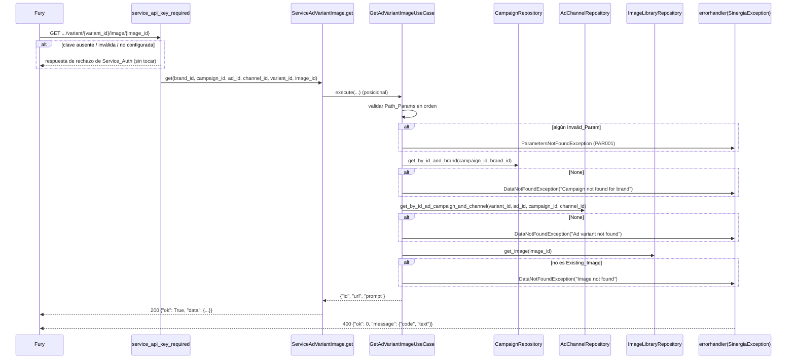

# Design Document

## Overview

Este diseño añade a Sinergia la ruta de servicio que Fury ya consume desde `fury/app/agents/tools/campaign_tools.py::get_ad_variant_image`:

```
GET /api/v2/service/hiluca/brand/{brand_id}/campaign/{campaign_id}/ad/{ad_id}/channel/{channel_id}/variant/{variant_id}/image/{image_id}
```

La respuesta de éxito es `{"ok": True, "data": {"id", "url", "prompt"}}`. Fury lee esas tres claves de `data` y las convierte a `str`, así que el contrato encaja sin cambios en Fury.

Piezas nuevas:

| Pieza | Archivo | Tipo de cambio |
|---|---|---|
| `ServiceAdVariantImage` (Resource) | `sinergia/app/v2/resources/service.py` | Clase nueva + import |
| `GetAdVariantImageUseCase` + helpers privados de módulo | `sinergia/app/v2/use_cases/image_library.py` | Clase y funciones nuevas + 2 imports |
| `CampaignRepository.get_by_id_and_brand` | `sinergia/app/v2/repository/campaign.py` | Método nuevo |
| `AdChannelRepository.get_by_id_ad_campaign_and_channel` | `sinergia/app/v2/repository/ad_channel.py` | Método nuevo |
| Unit_Test_Suite | `sinergia/tests/v2/unit/use_cases/test_get_ad_variant_image.py` | Archivo nuevo |
| `pytest-mock` fijado | `sinergia/requirements-test.txt` | Línea nueva, ya aplicada (ver Decisión D5) |

### Hallazgos del código que condicionan el diseño

- `GetProductImagesUseCase` instancia los repositorios en `__init__` y valida con `if not x` + `logger.error` + `raise`. Se sigue el mismo patrón.
- `image_library.py` ya define `logging.basicConfig(level=logging.INFO)` y `logger = logging.getLogger(__name__)`, e importa `DataNotFoundException` y `ParametersNotFoundException`. Se reutilizan (Req 2.5).
- `ad.py` ya usa una función privada de módulo (`_preserve_pinned_format`) que las pruebas importan directamente. Se aplica la misma idea a los helpers de validación.
- `StrapiClient._make_request` y `ImageLibraryClient._make_request` no llaman a `raise_for_status()`: devuelven `response.json()` incluso con 4xx/5xx y solo lanzan `StrapiException` / `ImageLibraryException` ante `RequestException` (red o timeout de 30 s). Por eso un `image_id` inexistente llega al caso de uso como un `dict` de error sin `url`, y la comprobación de existencia debe ser estructural (Req 6.2).
- Los repositorios existentes usan `if not response or not response.get('data') or len(response.get('data')) == 0: return None`. Esta expresión ya cubre `None`, falsy, sin `data`, `data: null` y lista vacía (Req 4.5, 5.5).
- `errorhandler(SinergiaException)` de `v2_blueprint` responde 400 con `{"ok": 0, "message": {"code", "text"}}`. `app_errorhandler(404)` responde `{"ok": 0, "message": {"code": "E404", ...}}` cuando la ruta no casa (Req 1.7).
- El conversor `<int:...>` de Werkzeug (Flask 1.1.2) solo acepta dígitos sin signo. Un segmento negativo o no numérico no casa con la ruta y se responde 404 sin tocar el Resource. Los enteros negativos solo pueden llegar al caso de uso en llamadas directas (pruebas), y ahí son válidos (Req 3.10).
- `pytest-mock==3.14.0` ya está fijado en `requirements-test.txt` (junto a `hypothesis==6.112.2`) e instalado en `venv/` (comprobado: pytest-mock 3.14.0, pytest 8.3.5). Las pruebas existentes usan `unittest.mock.patch`, pero Req 7.2 y `tech.md` piden `pytest-mock`; ver D5.

### Decisiones de diseño

- **D1. Helpers privados de módulo.** `_is_invalid_param`, `_is_existing_image` y `_extract_prompt` son funciones de módulo con prefijo `_`. Mantienen `execute` corto, no añaden métodos públicos a la clase (Req 2.1) y permiten pruebas de propiedad sin mocks.
- **D2. Validación ordenada con tabla.** `execute` recorre una tupla `(valor, mensaje)` en el orden fijado por Req 3.7 y lanza en el primer inválido. Evita seis bloques `if` casi idénticos y garantiza el orden por construcción.
- **D3. Sin recorte de `image_id`.** `strip()` solo se usa para decidir si es inválido; el valor original se pasa a `get_image` y a `id` (Req 3.11).
- **D4. Un solo `logger.error` por camino de error.** Cada rama de error hace exactamente una llamada a `logger.error` del logger de módulo justo antes de `raise`. Los logs que emiten `StrapiClient` o `ImageLibraryClient` usan otros loggers y no cuentan. En las excepciones propagadas (Strapi, Image_Library) el caso de uso no registra nada: no las captura.
- **D5. Dependencia `pytest-mock` (confirmada y ya aplicada).** `pytest-mock==3.14.0` (compatible con Python 3.8 y pytest 8.3.5) ya está añadido a `requirements-test.txt` e instalado en `venv/`. Es la única dependencia nueva y la piden explícitamente Req 7.2 y `tech.md`.
- **D6. No se valida pertenencia de la imagen.** Solo existencia (Req 6.4). La coherencia de la jerarquía se garantiza con los dos lookups previos.

## Architecture

```mermaid
flowchart LR
    Fury[Fury<br/>campaign_tools.get_ad_variant_image] -->|GET + X-Service-API-Key| R[ServiceAdVariantImage<br/>resources/service.py]
    R -->|@service_api_key_required| UC[GetAdVariantImageUseCase<br/>use_cases/image_library.py]
    UC --> CR[CampaignRepository<br/>get_by_id_and_brand]
    UC --> ACR[AdChannelRepository<br/>get_by_id_ad_campaign_and_channel]
    UC --> ILR[ImageLibraryRepository<br/>get_image]
    CR --> S[(Strapi<br/>campaigns)]
    ACR --> S2[(Strapi<br/>ad-channels)]
    ILR --> IL[(Image Library<br/>images/:id)]
```

Dependencias en un único sentido, según `structure.md`: `resources` → `use_cases` → `repository` → `app/tools`.

### Secuencia



`StrapiException` (STRAPI001) e `ImageLibraryException` (IMG001) se propagan sin captura desde los repositorios y también acaban en `errorhandler(SinergiaException)` → 400.

## Components and Interfaces

### 1. `CampaignRepository.get_by_id_and_brand` (Req 4.1, 4.5)

```python
def get_by_id_and_brand(self, campaign_id, brand_id):
    """Get a campaign by ID and brand ID."""
    params = {
        'filters[id][$eq]': campaign_id,
        'filters[brand_ref][id][$eq]': brand_id
    }
    response = self.get(self.content_type, params)
    if not response or not response.get('data') or len(response.get('data')) == 0:
        return None
    return response.get('data')[0]
```

Mismo estilo que `get_by_id_brand_and_account`, sin el filtro de `account_ref`. Petición resultante:

```
GET {STRAPI_URL}/api/campaigns?filters[id][$eq]={campaign_id}&filters[brand_ref][id][$eq]={brand_id}
```

### 2. `AdChannelRepository.get_by_id_ad_campaign_and_channel` (Req 5.1, 5.5, 5.6)

```python
def get_by_id_ad_campaign_and_channel(self, ad_channel_id: int, ad_id: int, campaign_id: int, channel_id: int):
    """Get an ad channel by ID, ad ID, campaign ID, and channel ID."""
    params = {
        'filters[id][$eq]': ad_channel_id,
        'filters[ad_ref2][id][$eq]': ad_id,
        'filters[ad_ref2][ad_set_ref2][funnel_flow_ref][campaign_ref][id][$eq]': campaign_id,
        'filters[channel_ref][id][$eq]': channel_id
    }
    response = self.get(self.content_type, params)
    if not response or not response.get('data') or len(response.get('data')) == 0:
        return None
    return response.get('data')[0]
```

Strapi combina los filtros de nivel raíz con AND, así que un ad-channel que no cumpla alguno devuelve `data: []` → `None` (Req 5.6). La ruta de campaña es la misma que usa `get_by_campaign_and_ad_channel_id`. Sin `populate`: el caso de uso no lee campos del ad-channel.

### 3. Helpers privados en `image_library.py`

```python
def _is_invalid_param(value: Any) -> bool:
    """Invalid_Param: None, '', solo espacios en blanco o el entero 0. '0' es válido."""
    if not value:
        return True
    if isinstance(value, str) and not value.strip():
        return True
    return False


def _is_existing_image(record: Any) -> bool:
    """Existing_Image: dict no vacío con 'url' de tipo str no vacía ni solo espacios."""
    if not isinstance(record, dict) or not record:
        return False
    url = record.get('url')
    return isinstance(url, str) and bool(url.strip())


def _extract_prompt(record: Dict[str, Any]) -> str:
    """image_prompt si es str (incluida ''); en otro caso ''."""
    prompt = record.get('image_prompt')
    return prompt if isinstance(prompt, str) else ''
```

Notas:

- `if not value` cubre `None`, `""`, `0` (y también `False`, que no puede llegar por la ruta). `"0"` es truthy y tiene contenido tras `strip()`, así que es válido.
- `str.strip()` sin argumentos elimina espacios, tabuladores y saltos de línea, como pide el Glosario.
- Requiere añadir `from typing import Any, Dict` (sintaxis compatible con Python 3.8, Req 2.6). Req 2.5 lo permite de forma explícita.

### 4. `GetAdVariantImageUseCase` (Req 2, 3, 4, 5, 6)

```python
from typing import Any, Dict

from app.v2.repository.campaign import CampaignRepository
from app.v2.repository.ad_channel import AdChannelRepository


class GetAdVariantImageUseCase():
    def __init__(self):
        self.campaign_repository = CampaignRepository()
        self.ad_channel_repository = AdChannelRepository()
        self.image_library_repository = ImageLibraryRepository()

    def execute(self, brand_id: int, campaign_id: int, ad_id: int,
                channel_id: int, variant_id: int, image_id: str) -> Dict[str, str]:
        # Req 3.1-3.9: orden fijo, se lanza en el primer inválido
        required = (
            (brand_id, 'Brand Id is required'),
            (campaign_id, 'Campaign Id is required'),
            (ad_id, 'Ad Id is required'),
            (channel_id, 'Channel Id is required'),
            (variant_id, 'Variant Id is required'),
            (image_id, 'Image Id is required'),
        )
        for value, message in required:
            if _is_invalid_param(value):
                logger.error(message)
                raise ParametersNotFoundException(message)

        # Req 4.2-4.7
        campaign = self.campaign_repository.get_by_id_and_brand(campaign_id, brand_id)
        if campaign is None:
            logger.error(f"Campaign not found for brand: campaign_id={campaign_id} brand_id={brand_id}")
            raise DataNotFoundException('Campaign not found for brand')

        # Req 5.2-5.7
        ad_channel = self.ad_channel_repository.get_by_id_ad_campaign_and_channel(
            variant_id, ad_id, campaign_id, channel_id)
        if ad_channel is None:
            logger.error(
                f"Ad variant not found: variant_id={variant_id} ad_id={ad_id} "
                f"campaign_id={campaign_id} channel_id={channel_id}")
            raise DataNotFoundException('Ad variant not found')

        # Req 6.1-6.4
        image = self.image_library_repository.get_image(image_id)
        if not _is_existing_image(image):
            logger.error(f"Image not found: image_id={image_id}")
            raise DataNotFoundException('Image not found')

        # Req 6.5-6.10
        return {
            'id': image_id,
            'url': image['url'],
            'prompt': _extract_prompt(image),
        }
```

Puntos clave:

- La comprobación es `is None` (no `if not`) en los dos lookups, para que cualquier valor distinto de `None` continúe (Req 4.6). Los repositorios ya normalizan "sin datos" a `None`.
- Los mensajes de log contienen el texto de la excepción (`Campaign not found for brand`, `Ad variant not found`, `Image not found`) y los identificadores de la búsqueda (Req 2.4). En la validación, el mensaje es exactamente el texto de la excepción.
- `get_image(image_id)` se llama con un único argumento posicional y sin `url_expiry` (Req 6.1).
- No hay `try/except`: `StrapiException` e `ImageLibraryException` se propagan como la misma instancia (Req 4.7, 5.7, 6.3).
- `image_id` es `str` por el conversor `<string:...>`, así que `id` es `str`. `url` es `str` por `_is_existing_image`, y `prompt` por `_extract_prompt` (Req 6.10).

### 5. `ServiceAdVariantImage` en `service.py` (Req 1)

```python
from app.v2.use_cases.image_library import GetProductImagesUseCase, UploadImageFuryUseCase, GetAdVariantImageUseCase

# ---------------------------------------------------------------------------
# Image Library - Get an Ad Variant Image
# ---------------------------------------------------------------------------

@service_ns.route('/hiluca/brand/<int:brand_id>/campaign/<int:campaign_id>/ad/<int:ad_id>/channel/<int:channel_id>/variant/<int:variant_id>/image/<string:image_id>')
class ServiceAdVariantImage(Resource):

    @service_api_key_required
    def get(self, brand_id, campaign_id, ad_id, channel_id, variant_id, image_id):
        data = GetAdVariantImageUseCase().execute(brand_id, campaign_id, ad_id, channel_id, variant_id, image_id)
        return {'ok': True, 'data': data}, 200
```

- Se amplía el import existente de `app.v2.use_cases.image_library` en lugar de añadir otro.
- Solo define `get`, sin lógica ni acceso a repositorios (Req 1.1, 1.8).
- `@service_api_key_required` envuelve `get`, así que el rechazo ocurre antes de instanciar el caso de uso (Req 1.2, 1.3).
- Sin `try/except`: las `SinergiaException` llegan al `errorhandler` (Req 1.6).

## Data Models

No hay modelos ni tablas nuevas. Estructuras que intervienen:

### Path_Params

| Nombre | Tipo (desde la ruta) | Conversor |
|---|---|---|
| `brand_id` | `int` | `<int:...>` |
| `campaign_id` | `int` | `<int:...>` |
| `ad_id` | `int` | `<int:...>` |
| `channel_id` | `int` | `<int:...>` |
| `variant_id` | `int` | `<int:...>` (id del ad-channel) |
| `image_id` | `str` | `<string:...>` (sin `/`) |

### Respuesta de Strapi (lookups)

```json
{"data": [{"id": 123, "attributes": {"...": "..."}}], "meta": {"pagination": {"...": "..."}}}
```

Ante un error de Strapi (4xx/5xx) la forma típica es `{"data": null, "error": {...}}`, que el repositorio normaliza a `None`.

### Image_Record (`ImageLibraryRepository.get_image`)

Éxito (claves relevantes; el resto se ignora):

```json
{"imageId": "abc", "url": "https://...presigned...", "image_prompt": "a red car", "metadata": {"...": "..."}}
```

Imagen inexistente: cuerpo JSON de error sin `url` (por ejemplo `{"detail": "Image not found"}`), que no es Existing_Image.

### Variant_Image_Response

```python
{"id": str, "url": str, "prompt": str}  # exactamente estas tres claves
```

| Clave | Origen |
|---|---|
| `id` | `image_id` recibido en `execute`, sin modificar |
| `url` | `Image_Record["url"]`, sin modificar |
| `prompt` | `Image_Record["image_prompt"]` si es `str`; si no, `""` |

### Mapeo de errores

| Situación | Excepción | Código | Texto | HTTP |
|---|---|---|---|---|
| Path_Param inválido | `ParametersNotFoundException` | `PAR001` | `<Param> Id is required` | 400 |
| Campaña no encontrada para la marca | `DataNotFoundException` | `DAT001` | `Campaign not found for brand` | 400 |
| Variante no encontrada | `DataNotFoundException` | `DAT001` | `Ad variant not found` | 400 |
| Imagen inexistente | `DataNotFoundException` | `DAT001` | `Image not found` | 400 |
| Fallo de red/timeout con Strapi | `StrapiException` | `STRAPI001` | texto del cliente | 400 |
| Fallo de red/timeout con Image_Library | `ImageLibraryException` | `IMG001` | texto del cliente | 400 |
| Segmento numérico no válido en URL | — (no casa la ruta) | `E404` | `Path not Found!` | 404 |
| Clave de servicio rechazada | — (Service_Auth) | la de Service_Auth | la de Service_Auth | la de Service_Auth |

## Correctness Properties

*A property is a characteristic or behavior that should hold true across all valid executions of a system-essentially, a formal statement about what the system should do. Properties serve as the bridge between human-readable specifications and machine-verifiable correctness guarantees.*

El caso de uso es lógica pura una vez mockeados sus tres repositorios, así que PBT aplica a la validación de parámetros, al paso de argumentos y al mapeo de la respuesta. Los criterios del endpoint (Req 1) y de los repositorios (4.1, 4.5, 5.1, 5.5, 5.6) son cableado o configuración y quedan fuera, como fija Req 7.5.

Reflexión sobre redundancia del prework:

- 3.1 a 3.8 describen la misma regla (primer inválido en orden, PAR001, cero llamadas). Se agrupan en la Propiedad 1.
- 3.10, 3.11, 4.2, 5.2 y 6.1 hablan de que los valores válidos llegan sin transformar a cada colaborador. Se agrupan en la Propiedad 2.
- 6.4 a 6.10 son facetas del mismo invariante de salida. 6.10 las subsume en la Propiedad 4, que además comprueba el valor exacto de cada clave.
- 6.2 se mantiene aparte (Propiedad 3) porque explora el espacio de registros que no son Existing_Image.
- 2.4/3.9 (logging), 4.3/4.4, 4.6, 4.7, 5.3/5.4, 5.7 y 6.3 son casos concretos y se cubren con ejemplos.

### Property 1: Los Path_Params inválidos se rechazan en orden y sin acceder a datos

*For any* 6-tupla de Path_Params en la que al menos una posición contiene un Invalid_Param (`None`, `""`, `0` o cualquier cadena formada solo por espacios, tabuladores o saltos de línea), `execute` SHALL lanzar `ParametersNotFoundException` con código `PAR001` y el texto correspondiente a la primera posición inválida en el orden `brand_id`, `campaign_id`, `ad_id`, `channel_id`, `variant_id`, `image_id`, y SHALL no invocar ningún método de CampaignRepository, AdChannelRepository ni ImageLibraryRepository.

**Validates: Requirements 3.1, 3.2, 3.3, 3.4, 3.5, 3.6, 3.7, 3.8**

### Property 2: Los Path_Params válidos llegan sin transformar a cada colaborador

*For any* 6-tupla de Path_Params válidos (enteros distintos de `0`, incluidos negativos, en las cinco primeras posiciones, y un `image_id` `str` con al menos un carácter que no sea espacio en blanco, incluidos `"0"` y cadenas con espacios al principio o al final), con los tres lookups devolviendo valores de éxito, `execute` SHALL no lanzar `ParametersNotFoundException` y SHALL invocar, en este orden y una sola vez cada uno, `get_by_id_and_brand(campaign_id, brand_id)`, `get_by_id_ad_campaign_and_channel(variant_id, ad_id, campaign_id, channel_id)` y `get_image(image_id)` con exactamente esos argumentos posicionales y sin argumentos por nombre.

**Validates: Requirements 3.10, 3.11, 4.2, 5.2, 6.1**

### Property 3: Los registros que no son Existing_Image producen "Image not found"

*For any* valor devuelto por `get_image` que no sea Existing_Image (`None`, cualquier valor que no sea `dict`, `{}`, `dict` sin `url`, `dict` con `url` que no es `str`, o `url` vacía o formada solo por espacios en blanco, con cualquier conjunto de claves adicionales), `execute` SHALL lanzar `DataNotFoundException` con código `DAT001` y texto exacto `Image not found`.

**Validates: Requirements 6.2**

### Property 4: La respuesta es exactamente {id, url, prompt} con valores str derivados del registro

*For any* `image_id` válido y *for any* Existing_Image con claves adicionales arbitrarias y con `image_prompt` ausente, `None`, `str` (incluida `""`) o de cualquier otro tipo, `execute` SHALL devolver un `dict` cuyo conjunto de claves es exactamente `{"id", "url", "prompt"}`, con `id == image_id`, `url == record["url"]` (idéntica, sin recortar), `prompt == record["image_prompt"]` si es `str` y `prompt == ""` en otro caso, siendo los tres valores `str`.

**Validates: Requirements 6.4, 6.5, 6.6, 6.7, 6.8, 6.9, 6.10**

## Error Handling

- **Validación (PAR001).** Primer Invalid_Param en orden → `logger.error(<texto>)` + `ParametersNotFoundException(<texto>)`. Nunca se toca un repositorio.
- **Datos no encontrados (DAT001).** Campaña `None`, variante `None` o imagen no existente → un `logger.error` con el texto y los identificadores de la búsqueda + `DataNotFoundException(<texto>)`. Cada caso cortocircuita los pasos siguientes.
- **Fallos de infraestructura.** `StrapiException` (STRAPI001) e `ImageLibraryException` (IMG001) los lanzan los clientes ante `RequestException` (red o timeout de 30 s) y ya los registran en sus propios loggers. El caso de uso no los captura, así que se propaga la misma instancia y no se duplica el log.
- **Errores HTTP de Image_Library sin fallo de red.** Como `ImageLibraryClient` no llama a `raise_for_status()`, un 404/500 llega como un `dict` sin `url` y termina en `Image not found` (DAT001). Un 500 de Image_Library se reporta como "no encontrada". Es una limitación conocida del cliente existente y queda fuera del alcance.
- **Errores HTTP de Strapi sin fallo de red.** `{"data": null, "error": ...}` se normaliza a `None` en el repositorio y se reporta como "no encontrado" (DAT001), igual que en el resto de repositorios.
- **Respuesta HTTP.** Toda `SinergiaException` termina en `errorhandler(SinergiaException)` de `v2_blueprint` → 400 `{"ok": 0, "message": {"code", "text"}}`. Las URL con segmentos numéricos no válidos no casan la ruta → 404 `E404`. El rechazo de Service_Auth se devuelve sin modificar.
- **Excepciones no de dominio** (por ejemplo, un `TypeError` inesperado) no se capturan y siguen el manejo 500 existente.

## Testing Strategy

### Ubicación y ejecución

- Archivo único: `sinergia/tests/v2/unit/use_cases/test_get_ad_variant_image.py`. Sin `conftest.py` ni fixtures nuevos fuera de ese archivo (Req 7.1).
- Comando: `venv/bin/python -m pytest tests/v2/unit/use_cases/test_get_ad_variant_image.py -q` desde `sinergia/`. Objetivo: 0 fallos, 0 errores, 0 omitidas, sin red, < 60 s (Req 7.3).
- Requisito previo: `pytest-mock==3.14.0` fijado en `requirements-test.txt` e instalado en `venv/` (D5, ya aplicado).
- Todas las funciones de prueba anotadas con `-> None` (Req 7.4).
- Comprobación adicional de Req 2.6: `venv/bin/python -c "import app.v2.use_cases.image_library"`.

### Aislamiento

Fixture local del archivo que parchea las tres clases en el módulo del caso de uso antes de instanciarlo (Req 7.2):

```python
@pytest.fixture
def repos(mocker):
    campaign_cls = mocker.patch('app.v2.use_cases.image_library.CampaignRepository')
    ad_channel_cls = mocker.patch('app.v2.use_cases.image_library.AdChannelRepository')
    image_cls = mocker.patch('app.v2.use_cases.image_library.ImageLibraryRepository')
    campaign_cls.return_value.get_by_id_and_brand.return_value = {'id': 10}
    ad_channel_cls.return_value.get_by_id_ad_campaign_and_channel.return_value = {'id': 50}
    image_cls.return_value.get_image.return_value = {'url': 'https://img/x.png', 'image_prompt': 'p'}
    return campaign_cls, ad_channel_cls, image_cls
```

En las pruebas de propiedad, la fixture se crea una vez por función y se reconfigura en cada ejemplo con `reset_mock()` y nuevos `return_value`. Por eso se usa `suppress_health_check=[HealthCheck.function_scoped_fixture]`, igual que en `test_pin_format_ad_variant.py`.

El logging se comprueba con `mocker.patch('app.v2.use_cases.image_library.logger')` y `logger.error.call_count == 1`.

### Pruebas de propiedad (hypothesis)

- Librería: `hypothesis==6.112.2` (ya en `requirements-test.txt`). No se implementa PBT a mano.
- Configuración en cada prueba: `@settings(max_examples=100, deadline=None, suppress_health_check=[HealthCheck.function_scoped_fixture])` (Req 7.7).
- Cada propiedad se implementa con una sola prueba, etiquetada con un comentario en el formato `# Feature: get-ad-variant-image-use-case, Property {n}: {texto}`.

| Propiedad | Prueba | Generadores principales |
|---|---|---|
| 1 | `test_property_invalid_params_rejected_in_order` | 6-tupla válida + conjunto no vacío de posiciones a invalidar; inválidos de `st.sampled_from([None, '', 0]) \| st.text(alphabet=' \t\n\r', min_size=1)` |
| 2 | `test_property_valid_params_forwarded_unchanged` | `st.integers().filter(lambda x: x != 0)` ×5; `image_id` = `st.text(min_size=1).filter(lambda s: s.strip())` con padding opcional de espacios, más `"0"` como ejemplo explícito (`@example`) |
| 3 | `test_property_non_existing_image_raises_not_found` | `st.one_of(st.none(), st.integers(), st.lists(...), st.text(), st.just({}), dict sin url, dict con url no str, dict con url de solo espacios)` |
| 4 | `test_property_response_keys_and_types` | `url` = texto con contenido no blanco; claves extra con `st.dictionaries(st.text().filter(lambda k: k not in ('url', 'image_prompt')), st.one_of(st.none(), st.integers(), st.text(), st.lists(st.integers())))` (incluida una clave `id` distinta de `image_id`); `image_prompt` ausente / `None` / `st.text()` / `st.integers()` / listas / dicts |

La prueba de la Propiedad 4 es la `test_property_response_keys_and_types` que pide la tabla de trazabilidad para 6.10.

### Pruebas de ejemplo (unitarias)

Siguen la tabla de trazabilidad de requirements.md y cubren lo que no cubren las propiedades:

| Criterio | Prueba |
|---|---|
| 2.2 | `test_init_instantiates_repositories` |
| 2.3 | `test_execute_uses_injected_repositories_only` |
| 2.4, 3.9 | `test_errors_are_logged_once_before_raising` (parametrizada: parámetro inválido, campaña, variante, imagen) |
| 3.1 – 3.6 | `test_invalid_param_raises_parameters_not_found` (parametrizada por parámetro × `None`, `""`, `"   "`, `"\t\n"`, `0`) |
| 3.7 | `test_validation_reports_first_invalid_param_in_order` |
| 3.8 | `test_invalid_param_does_not_call_repositories` |
| 3.10 | `test_valid_edge_values_pass_validation` |
| 3.11 | `test_image_id_is_not_trimmed` |
| 4.2 | `test_success_calls_campaign_lookup_with_campaign_and_brand` |
| 4.3, 4.4 | `test_campaign_not_found_raises_and_short_circuits` |
| 4.6 | `test_campaign_found_continues_to_variant_lookup` |
| 4.7 | `test_campaign_lookup_exception_propagates` |
| 5.2 | `test_success_calls_variant_lookup_with_expected_args` |
| 5.3, 5.4 | `test_variant_not_found_raises_and_short_circuits` |
| 5.7 | `test_variant_lookup_strapi_exception_propagates` |
| 6.1, 6.4 | `test_success_calls_get_image_once` |
| 6.2 | `test_image_not_found_raises_data_not_found` |
| 6.3 | `test_image_library_exception_propagates` |
| 6.5 – 6.8 | `test_success_returns_id_url_prompt` |
| 6.9 | `test_missing_or_null_image_prompt_returns_empty_string` |

Las pruebas de error comprueban la clase de la excepción y su texto exacto (Req 7.6). Las de propagación comprueban además que es la misma instancia (`exc_info.value is original`).

### Fuera del Unit_Test_Suite

- Req 1.1 – 1.8 (endpoint): revisión de código. Opcionalmente, una prueba de integración en `tests/v2/integration/` con el cliente de pruebas Flask que cubra: sin cabecera → rechazo; segmento `-1` → 404; caso de uso mockeado → 200 con Success_Envelope; caso de uso que lanza `DataNotFoundException` → 400 con `DAT001`.
- Req 2.1, 2.5, 2.6: revisión de código e importación del módulo con `venv/bin/python`.
- Req 4.1, 4.5, 5.1, 5.5, 5.6: revisión de código frente a los fragmentos de este diseño.
