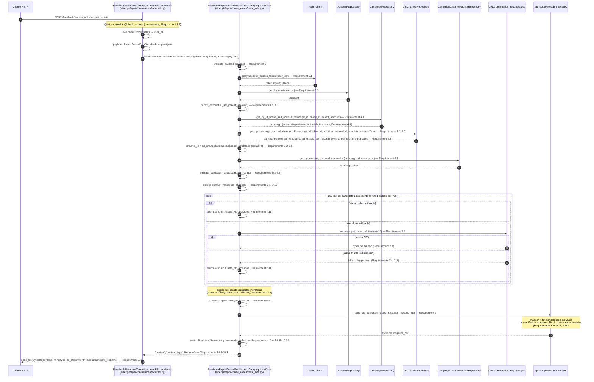
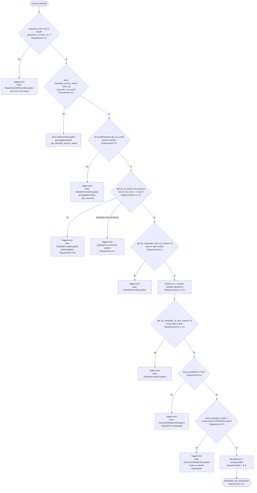

# Design Document: Meta Ads Export Assets Post-Launch Campaign

## Introduction

**Ubicación obligatoria (Requirement 1.1):** este documento reside en `sinergia/.kiro/specs/meta-ads-export-assets-post-launch-campaign/design.md` y describe cambios **exclusivamente dentro del árbol `sinergia/`**, la aplicación Flask independiente ubicada en `sinergia/` dentro del monorepo `docker-deploy`, con su propio virtualenv en `sinergia/venv` y sus propios specs/steering en `sinergia/.kiro/`. Los cuatro archivos afectados son:

| Archivo | Naturaleza del cambio | Región acotada |
|---|---|---|
| `sinergia/app/v2/use_cases/meta_ads.py` | modificado | únicamente el cuerpo de la clase `FacebookExportAssetsPostLaunchCampaignUseCase` (más los `import` permitidos por Requirement 1.3) |
| `sinergia/app/v2/resources/external.py` | modificado | únicamente el cuerpo del método `post()` de `FacebookResourceCampaignLaunchExportAssets` |
| `sinergia/app/v2/repository/ad_channel.py` | modificado | únicamente la firma y el cuerpo del método `get_by_campaign_and_ad_channel_id` de `AdChannelRepository`, más su constante de parámetros de población (Requirements 5.7, 5.8) |
| `sinergia/tests/v2/unit/use_cases/test_facebook_export_assets_post_launch_campaign.py` | nuevo | archivo completo |

Conteo final exigido por Requirement 1.2: **3 modificados, 1 nuevo, 0 eliminados/renombrados/movidos**.

### Problema

Un `Ad_Creative` de Meta Ads en modo `STANDARD` acepta exactamente **una** imagen, **un** título, **un** cuerpo, **una** descripción y **un** CTA. El flujo de pre-check y lanzamiento STANDARD (`FacebookGeneratePreCheckCreativeUseCase`, `FacebookSavePreCheck*UseCase`, `FacebookLaunchCampaignUseCase`, todos en `sinergia/app/v2/use_cases/meta_ads.py`) toma el asset fijado (`pinned`) o el primer elemento de cada categoría y publica solo ese. El resto de los assets que el equipo creativo produjo y guardó en el registro `ad-channels` de Strapi (campos `media_formats` y `channel_attributes`) queda sin publicar y, hoy, sin forma de recuperarse desde la interfaz.

Además, `FacebookExportAssetsPostLaunchCampaignUseCase.execute()` tiene hoy el cuerpo `pass`, y su `__init__` contiene la línea `self.brand_repository = BrandRepository()` que produce un `NameError` en tiempo de instanciación porque `BrandRepository` no está importado en `sinergia/app/v2/use_cases/meta_ads.py`. El endpoint es, en la práctica, inutilizable.

### Solución

Implementar `execute()` como una cadena de cinco pre-validaciones secuenciales (payload → token/cuenta → campaña → ad-channel → campaign-setup) seguida de dos filtros de solo lectura sobre el Ad_Channel_de_Exportación (Imágenes_Excedentes y Textos_Excedentes) y un empaquetado ZIP en memoria. El Caso_de_Uso retorna un diccionario de tres claves (`content`/`content_type`/`filename`) y el Recurso_de_Exportación lo convierte en una descarga binaria con `send_file`. El flujo es de **solo lectura** respecto a Strapi y **no toca la Graph API de Meta**.

El valor de `filename` se deriva de los **nombres legibles** de la jerarquía campaña/ad-set/ad/canal, no de sus identificadores (Requirement 10.4). Los tres nombres que no están ya en memoria se obtienen **poblando relaciones en la consulta de `ad-channels` que el flujo ya emite**, mediante un parámetro opcional aditivo en `AdChannelRepository.get_by_campaign_and_ad_channel_id` (Requirement 5.7), de modo que el total de consultas de lectura a Strapi permanece en cuatro.

Toda la lógica nueva vive en `FacebookExportAssetsPostLaunchCampaignUseCase` distribuida entre `execute()` y métodos privados aditivos de la misma clase, sin introducir clases nuevas en `sinergia/app/v2/use_cases/meta_ads.py` (NFR Code Architecture and Modularity).

### Decisiones ya acordadas y reflejadas en este diseño

1. `sinergia/app/v2/resources/external.py` está en alcance, acotado al cuerpo de `post()` (Requirement 10).
2. `self.brand_repository = BrandRepository()` se elimina; `brand_id` se consume solo como filtro de búsqueda (Requirement 11).
3. Dentro de `payloads`, `id == 0` es el asset base publicado; `id != 0` son los excedentes (Requirement 8).
4. La ausencia total de excedentes es un resultado válido, con dos desenlaces distinguibles: ZIP sin entradas cuando no existe ningún candidato a excedente ni ningún Texto_Excedente (Requirement 9.13), y ZIP con exactamente una entrada `manifest.txt` cuando existían candidatos pero ninguno de sus binarios llegó al paquete (Requirement 9.14). Ambos con HTTP 200 (Requirement 10.11).
5. La incompletitud del paquete se señaliza al cliente mediante la entrada `manifest.txt` en la raíz del Paquete_ZIP, que lista los identificadores de los Assets_No_Incluidos: su presencia señala paquete incompleto, su ausencia señala paquete completo (Requirements 9.9, 9.10 y 9.11).
6. **Corrección posterior a la primera implementación.** El nombre del archivo pasa de `assets_{campaign_id}_{adchannel_id}.zip` a `assets_{campaign_name}_{ad_set_name}_{ad_name}_{channel_name}.zip` (Requirement 10.4), con cuatro decisiones asociadas: los tres nombres nuevos se obtienen poblando relaciones en la consulta de `ad-channels` ya existente, con un parámetro opcional aditivo y 0 consultas adicionales (Requirement 5.7); el nombre de la campaña se lee del registro ya resuelto (Requirement 4.6); cada nombre se sanea de forma independiente por transliteración a ASCII y lista blanca (Requirement 10.12); un nombre ausente produce el componente vacío y **nunca** el identificador correspondiente (Requirement 10.13); y los cuatro componentes vacíos colapsan el nombre a `assets.zip` (Requirement 10.14).

---

## Overview

`FacebookExportAssetsPostLaunchCampaignUseCase.execute(payload)` ejecuta, en este orden estricto y sin retroceso (Requirement 6.8):

1. **Validación del Payload_de_Exportación** (Requirement 2). Cinco claves obligatorias. Falla → `ParametersNotFoundException`, cero llamadas de red.
2. **Token de Meta y Cuenta_Padre** (Requirement 3). `_get_decoded_access_token()` y `_get_parent_account()`, ya existentes y preservados sin cambios. Fallan → `NotAccessException` / `DataNotFoundException`.
3. **Campaña** (Requirement 4). `CampaignRepository.get_by_id_brand_and_account(campaign_id, brand_id, parent_account)`. Falla → `DataNotFoundException` indistinguible para los tres motivos posibles.
4. **Ad_Channel_de_Exportación y Channel_ID** (Requirement 5). `AdChannelRepository.get_by_campaign_and_ad_channel_id(campaign_id, adset_id, ad_id, adchannel_id, populate_names=True)` y lectura del camino anidado `attributes.channel_ref.data.id` con default `0`. La misma respuesta trae pobladas las relaciones de nombre de las que salen tres de los cuatro componentes del nombre del archivo (Requirements 5.7-5.10).
5. **Campaign_Setup, publicación y modo** (Requirement 6). `CampaignChannelPublishRepository.get_by_campaign_id_and_channel_id(campaign_id, channel_id)`, luego `meta_published is True` y `meta_campaign_mode == CreativeType.STANDARD.value`. Fallan → `DataNotFoundException` / `IncorrectValidationException`.
6. **Recopilación de Imágenes_Excedentes y de Assets_No_Incluidos** (Requirement 7). Filtro sobre `media_formats` leyendo únicamente `id`, `visual_url` y `pinned` (Requirement 7.10), más una descarga HTTP GET por imagen con `timeout=10`. Los fallos de descarga **degradan parcialmente**: se registran, se omite el asset y el flujo continúa. En el mismo recorrido se acumula, en orden de aparición, el identificador de cada Asset_No_Incluido (Requirement 7.11): todo candidato a excedente —elemento `dict` con `pinned` distinto de `True`— cuyo binario no llegó al paquete, sea porque su `visual_url` no es utilizable, porque la descarga retornó un código distinto de 200, o porque la descarga lanzó.
7. **Recopilación de Textos_Excedentes** (Requirement 8). Filtro sobre `channel_attributes`/`payloads` para las cuatro Categorías_de_Texto.
8. **Empaquetado del Paquete_ZIP** (Requirement 9). `BytesIO` + `zipfile.ZipFile` con `ZIP_DEFLATED`: imágenes bajo `images/`, un `.txt` en la raíz por Categoría_de_Texto no vacía, y la entrada `manifest.txt` en la raíz **si y solo si** el conjunto de Assets_No_Incluidos no está vacío (Requirements 9.9, 9.11).
9. **Nombre del archivo** (Requirements 10.4, 10.12-10.15). Los cuatro Nombres_de_Origen se sanean de forma independiente —`NFKD`, descarte de diacríticos y de todo carácter sin equivalencia ASCII, lista blanca `[A-Za-z0-9._-]`, colapso de `_` repetidos, recorte de extremos y tope de 60 caracteres— y se interpolan en ese orden. Un nombre ausente da el componente vacío, nunca el identificador (Requirement 10.13); los cuatro vacíos colapsan a `assets.zip` (Requirement 10.14).
10. **Resultado_de_Exportación** (Requirement 10.1-10.4). `{'content': bytes, 'content_type': 'application/zip', 'filename': 'assets_{campaign_name}_{ad_set_name}_{ad_name}_{channel_name}.zip'}`.

El Recurso_de_Exportación (`sinergia/app/v2/resources/external.py`) traduce ese diccionario a `send_file(BytesIO(content), mimetype=..., as_attachment=True, attachment_filename=...)`.

### Frontera de errores: abortar vs. degradar

Este es el eje conceptual del diseño y conviene fijarlo antes de leer el resto:

- **Las cinco pre-validaciones (Requirements 2-6) abortan.** La primera que falla lanza su excepción, ninguna validación posterior se evalúa, ninguna consulta posterior a Strapi se emite y ninguna descarga se inicia.
- **Los fallos de descarga (Requirements 7.4-7.6) no abortan.** Se registran con `logger.error`, se omite ese único asset y el flujo continúa. Nunca convierten una exportación en un error HTTP.
- **La degradación parcial sí se señaliza al cliente (Requirements 7.11, 9.9-9.11).** Cada candidato a excedente cuyo binario no llegó al paquete acumula su identificador en el conjunto de Assets_No_Incluidos, y ese conjunto se materializa como la entrada `manifest.txt` del Paquete_ZIP. La contrapartida que antes vivía solo en el log del servidor queda así cerrada: el usuario que descarga el paquete puede distinguir un paquete completo (sin `manifest.txt`) de uno parcial (con `manifest.txt`) sin acceso a los logs. El diagnóstico del *motivo* sigue viviendo exclusivamente en el log (Requirements 7.4, 7.5), porque el manifest lleva solo identificadores.
- **Las estructuras degradadas (Requirements 7.7, 7.8, 8.5-8.8, 8.10, 8.11) no abortan.** Producen un conjunto vacío o la omisión de un elemento, con `logger.warning` donde el requisito lo exige, y el flujo continúa hasta retornar un Resultado_de_Exportación válido (posiblemente con un ZIP sin entradas conforme al Requirement 9.13, o con solo `manifest.txt` conforme al Requirement 9.14).

---

## Architecture

### Flujo completo (diagrama de secuencia)



### Cadena de pre-validaciones (diagrama de flujo con la excepción de cada rama)



La precedencia de `V7` sobre `V8` es normativa (Requirement 6.6): un Campaign_Setup con `meta_published=False` **y** `meta_campaign_mode='DYNAMIC'` produce exactamente una `IncorrectValidationException`, la de publicación ausente, y la comprobación de modo no se evalúa.

---

## Components and Interfaces

Todos los métodos siguientes son **aditivos** dentro de `FacebookExportAssetsPostLaunchCampaignUseCase` (`sinergia/app/v2/use_cases/meta_ads.py`). No se introduce ninguna clase nueva en ese archivo (NFR Code Architecture and Modularity). Las anotaciones de tipo son explícitas conforme a `sinergia/.kiro/steering/tech.md`.

### Imports requeridos

La cabecera de `sinergia/app/v2/use_cases/meta_ads.py` recibe **dos** cambios, ambos acotados al bloque de imports existente al inicio del archivo, antes de la primera definición de clase:

1. **Se añaden** tres sentencias nuevas, autorizadas por el Requirement 1.3:

```python
import re
import unicodedata
import zipfile
```

`re` y `unicodedata` son los dos módulos que exige el saneamiento del Requirement 10.12: `unicodedata.normalize('NFKD', ...)` y `unicodedata.combining(...)` para la transliteración a ASCII, y `re.sub(...)` para la lista blanca de caracteres y el colapso de `_` repetidos.

2. **Se modifica** la línea 13, la sentencia `from typing import ...` ya existente, añadiendo a su lista de nombres importados exactamente los dos nombres `Set` y `Tuple`, autorizado por los Requirements 1.9 y 1.10:

```python
# antes
from typing import List, TypedDict, Any, Dict, Optional
# después
from typing import List, TypedDict, Any, Dict, Optional, Set, Tuple
```

Verificación contra la cabecera real del archivo (líneas 1-24 de `sinergia/app/v2/use_cases/meta_ads.py`):

| Necesidad | Estado en la cabecera actual | Acción |
|---|---|---|
| `zipfile` | ausente | **se añade** (autorizado explícitamente por Requirement 1.3) |
| `re.sub` (lista blanca y colapso de `_` del Requirement 10.12) | **ausente** de la cabecera | **se añade** `import re` (autorizado por Requirement 1.3) |
| `unicodedata.normalize` / `unicodedata.combining` (transliteración a ASCII del Requirement 10.12) | **ausente** de la cabecera | **se añade** `import unicodedata` (autorizado por Requirement 1.3) |
| `os.path.splitext` | `import os` ya presente en la línea 3; `os.path` es un submódulo que `os` importa por sí mismo | ninguna. **No** se añade `import os.path`: sería redundante |
| `BytesIO` | `from io import BytesIO` ya presente | ninguna |
| `urllib.parse.urlsplit` | `import urllib.parse` ya presente | ninguna |
| `requests.get` | `import requests` ya presente | ninguna |
| `logger`, `CreativeType` | ya disponibles en el módulo | ninguna |
| `List`, `Dict`, `Any`, `Optional`, `TypedDict` | `from typing import List, TypedDict, Any, Dict, Optional` ya presente | ninguna: los cinco nombres se conservan con su grafía y su orden relativo actuales (Requirement 1.10) |
| `Tuple`, `Set` | **ausentes** de esa línea de `typing` | **se añaden** a la sentencia `from typing import ...` existente (autorizado por los Requirements 1.9 y 1.10) |

**Nota sobre el alcance de la modificación de `typing`.** La línea resultante conserva los cinco nombres previos con su grafía y su orden relativo, conserva la forma `from typing import ...`, y añade exactamente los dos nombres `Set` y `Tuple`: 0 nombres eliminados, 0 renombrados, 0 sustituciones por otra forma de import y 0 nombres añadidos distintos de esos dos (Requirement 1.10). La modificación cuenta dentro del alcance del Requirement 1.2 **sin incrementar el conteo de archivos**, que permanece en 3 modificados + 1 nuevo, y constituye la única excepción a la obligación de preservación de imports del Requirement 1.6 y del Requirement 11.5. La auditoría del diff exigida por el Requirement 1.11 debe acreditar que esa es la **única** línea modificada fuera de las tres regiones acotadas del Requirement 1.2 y de las sentencias `import re`, `import unicodedata` e `import zipfile` añadidas conforme al Requirement 1.3, y que el número de sentencias `import` de `BrandRepository` en el archivo permanece en 0.

El proyecto corre **Python 3.8.10** (verificado con `./venv/bin/python --version` desde `sinergia/`), motivo por el cual las anotaciones usan los genéricos de `typing` (`Tuple[...]`, `Set[str]`) y no los genéricos incorporados subscritos (`tuple[...]`, `set[...]`), que no son válidos en anotaciones en tiempo de ejecución en esa versión.

En `sinergia/app/v2/resources/external.py` no se requiere ningún import nuevo: `send_file` y `BytesIO` ya están importados en la cabecera (`from flask import send_file`, `from io import BytesIO`), tal como los usan hoy `ExcelExportResource` y `ExcelBulkExportResource`. En `sinergia/app/v2/repository/ad_channel.py` tampoco se requiere ninguno: el cambio del Requirement 5.7 solo añade claves a un diccionario de parámetros ya existente.

### Firmas de los métodos

```python
class FacebookExportAssetsPostLaunchCampaignUseCase():

    _REQUIRED_PAYLOAD_KEYS = ('campaign_id', 'brand_id', 'ad_id', 'adset_id', 'adchannel_id')

    _TEXT_CATEGORY_FILENAMES = {
        'primary_text': 'primary_texts.txt',
        'headline': 'headlines.txt',
        'description': 'descriptions.txt',
        'cta': 'ctas.txt',
    }

    _IMAGE_DOWNLOAD_TIMEOUT = 10
    _DEFAULT_IMAGE_EXTENSION = '.jpg'
    _ZIP_IMAGES_PREFIX = 'images/'
    _MANIFEST_FILENAME = 'manifest.txt'

    # --- Nombre del archivo (Requirements 10.4, 10.12-10.14) ---
    _FILENAME_PREFIX = 'assets'
    _FILENAME_EXTENSION = '.zip'
    _FILENAME_SEPARATOR = '_'
    _FILENAME_EMPTY_FALLBACK = 'assets.zip'
    _FILENAME_COMPONENT_MAX_LENGTH = 60
    _FILENAME_FORBIDDEN_CHARACTERS = re.compile(r'[^A-Za-z0-9._-]')
    _FILENAME_UNDERSCORE_RUN = re.compile(r'_{2,}')
    _FILENAME_COMPONENT_LABELS = ('campaign_name', 'ad_set_name', 'ad_name', 'channel_name')

    # --- Ya existentes; se preservan sin cambios (Requirement 3.5) ---
    def _get_decoded_access_token(self) -> str: ...
    def _get_account(self) -> Dict[str, Any]: ...
    def _get_parent_account(self) -> Any: ...

    # --- Nuevos, aditivos ---
    def _validate_payload(self, payload: ExportAssetsDataDict) -> None:
        """Requirement 2.3/2.4: primera operación de execute(). Lanza
        ParametersNotFoundException si payload no es dict, o si alguna de las
        cinco claves está ausente, es None o es cadena vacía. No consulta
        Strapi, no invoca la Graph API y no descarga binarios."""

    def _get_campaign(self, campaign_id: Any, brand_id: Any, parent_account: Any) -> Dict[str, Any]:
        """Requirement 4: una única invocación de
        self.campaign_repository.get_by_id_brand_and_account. Lanza
        DataNotFoundException indistinguible para campaña inexistente, marca
        distinta y cuenta distinta (Requirement 4.5). Propaga sin sustituir
        cualquier excepción del repositorio (Requirement 4.4). El registro
        retornado es la comprobación de existencia/pertenencia y, además, la
        única fuente del Nombre_de_Origen de la campaña: execute() lee de él
        exclusivamente attributes.name (Requirement 4.6)."""

    def _get_ad_channel(self, campaign_id: Any, adset_id: Any, ad_id: Any, adchannel_id: Any) -> Dict[str, Any]:
        """Requirement 5.1/5.2: una única invocación de
        self.ad_channel_repository.get_by_campaign_and_ad_channel_id con los
        cuatro identificadores en orden posicional y populate_names=True
        (Requirement 5.7), de modo que la respuesta traiga pobladas las
        relaciones de nombre del Requirement 5.8 sin consultas adicionales.
        Lanza DataNotFoundException si el valor retornado es falsy."""

    def _resolve_channel_id(self, ad_channel: Dict[str, Any]) -> int:
        """Requirements 5.3/5.5: replica el patrón de lectura de
        FacebookSavePreCheckBaseUseCase._set_channel_id, con default 0 en
        cualquier nivel ausente o no-dict, sin lanzar excepción."""

    def _get_validated_campaign_setup(self, campaign_id: Any, channel_id: int) -> Dict[str, Any]:
        """Requirement 6: resuelve el Campaign_Setup (invocación emitida
        incluso con channel_id == 0, Requirement 6.1), valida
        meta_published is True (Requirement 6.4) y luego
        meta_campaign_mode == CreativeType.STANDARD.value (Requirement 6.5),
        en ese orden (Requirement 6.6)."""

    def _collect_surplus_images(self, ad_channel: Dict[str, Any]) -> Tuple[List[Dict[str, Any]], List[str]]:
        """Requirement 7: recorre media_formats una sola vez y retorna una
        tupla de dos elementos:

          [0] List[Dict[str, Any]] — descriptores de las Imágenes_Excedentes
              descargadas con éxito, en el orden de aparición de
              media_formats (Requirement 9.16). Cada descriptor tiene la
              forma {'entry_name': str, 'content': bytes}.
          [1] List[str] — identificadores de los Assets_No_Incluidos, en el
              mismo orden de aparición de media_formats (Requirement 7.11).

        Lee de cada elemento únicamente id, visual_url y pinned
        (Requirement 7.10). Nunca lanza por un fallo de descarga individual
        (Requirements 7.4-7.6) ni por una estructura degradada
        (Requirements 7.7, 7.8)."""

    def _download_image(self, visual_url: str) -> Optional[bytes]:
        """Requirements 7.2-7.5: una única petición HTTP GET con
        timeout=10 y un máximo de 1 intento. Retorna los bytes del cuerpo
        cuando el código de estado es 200; retorna None (tras logger.error)
        cuando el código es distinto de 200 o cuando la petición lanza."""

    def _collect_surplus_texts(self, ad_channel: Dict[str, Any]) -> Dict[str, List[str]]:
        """Requirement 8: retorna un diccionario Categoría_de_Texto → lista
        de textos excedentes, preservando el orden de aparición, los
        duplicados y la concatenación entre atributos de la misma categoría
        (Requirements 8.3, 8.9). Nunca lanza por una estructura degradada."""

    def _build_zip_package(
        self,
        images: List[Dict[str, Any]],
        texts: Dict[str, List[str]],
        not_included_ids: List[str],
    ) -> bytes:
        """Requirements 9.1, 9.6-9.15 y 10.2: construye el Paquete_ZIP en
        memoria con ZIP_DEFLATED y retorna la totalidad de los bytes del
        búfer leídos después de cerrar el archivo ZIP. Escribe la entrada
        manifest.txt en la raíz si y solo si not_included_ids no está vacío
        (Requirements 9.9, 9.11), derivándola exclusivamente de ese
        argumento y con cero lecturas de Atributos_de_Canal
        (Requirement 9.12)."""

    @staticmethod
    def _derive_image_extension(visual_url: str) -> str:
        """Requirement 9.3: extensión del último segmento del componente de
        ruta de la URL, descartando cadena de consulta y fragmento;
        '.jpg' cuando ese segmento no contiene extensión."""

    @staticmethod
    def _disambiguate_entry_name(entry_name: str, used_names: Set[str]) -> str:
        """Requirement 9.5: inserta el sufijo _{n} inmediatamente antes de
        la extensión, comenzando en n=1 e incrementando mientras el nombre
        resultante siga presente en used_names. Activación defensiva: los
        id de media_formats son nombres de formato únicos dentro de una
        misma lista, por lo que no se espera con los datos de producción."""

    @staticmethod
    def _read_nested_name(node: Any, *keys: str) -> Any:
        """Requirements 5.9, 5.10: recorre una ruta de claves anidadas y
        retorna None en cuanto un nivel está ausente o su valor no es un
        dict, sin lanzar AttributeError ni TypeError. Es el mismo criterio
        defensivo de _resolve_channel_id, con None —y no 0— como default,
        porque aquí el default alimenta el componente vacío del
        Requirement 10.13 y no una consulta a Strapi."""

    @classmethod
    def _sanitize_filename_component(cls, raw_name: Any) -> str:
        """Requirements 10.12, 10.13: retorna el Nombre_Saneado de raw_name,
        o la cadena vacía cuando raw_name no es una instancia de str o queda
        vacío tras el saneamiento. Nunca lanza y nunca sustituye el valor por
        un identificador."""

    def _resolve_filename_components(
        self,
        campaign: Dict[str, Any],
        ad_channel: Dict[str, Any],
    ) -> Tuple[str, str, str, str]:
        """Requirements 4.6, 5.9, 5.10, 10.12, 10.13, 10.15: lee los cuatro
        Nombres_de_Origen —campaign.attributes.name y las tres rutas
        anidadas del Ad_Channel_de_Exportación—, los sanea de forma
        independiente y retorna los cuatro Nombres_Saneados en el orden
        campaña, ad-set, ad, canal. Emite un único logger.warning por
        invocación cuando al menos uno queda vacío (Requirement 10.15)."""

    def _build_export_filename(self, components: Tuple[str, str, str, str]) -> str:
        """Requirements 10.4, 10.14: retorna
        'assets_{campaign_name}_{ad_set_name}_{ad_name}_{channel_name}.zip',
        o 'assets.zip' cuando los cuatro componentes son la cadena vacía."""

    def execute(self, payload: ExportAssetsDataDict) -> Dict[str, Any]:
        """Requirement 2.1: único argumento, sin parámetros adicionales ni
        opcionales. Orquesta los métodos anteriores en el orden de
        Requirement 6.8 y retorna el Resultado_de_Exportación."""
```

### Cuerpo de `execute()` (orquestación)

```python
def execute(self, payload: ExportAssetsDataDict) -> Dict[str, Any]:
    # Requirement 2.4: primera operación, antes de cualquier llamada de red.
    self._validate_payload(payload)

    campaign_id = payload['campaign_id']
    brand_id = payload['brand_id']
    adset_id = payload['adset_id']
    ad_id = payload['ad_id']
    adchannel_id = payload['adchannel_id']

    # Requirement 3.1: token antes de resolver cuenta/campaña/descargas.
    # Requirement 3.6: el valor retornado no se registra ni se propaga.
    self._get_decoded_access_token()

    # Requirements 3.3, 3.7, 3.8.
    parent_account = self._get_parent_account()

    # Requirements 4.1-4.6: comprobación de existencia y pertenencia; el
    # registro se conserva porque de él sale el Nombre_de_Origen de la
    # campaña, y de él NO se lee ningún otro atributo (Requirement 4.6).
    campaign = self._get_campaign(campaign_id, brand_id, parent_account)

    # Requirements 5.1-5.3, 5.7: la misma consulta trae pobladas las
    # relaciones de nombre del ad-set, del ad y del canal.
    ad_channel = self._get_ad_channel(campaign_id, adset_id, ad_id, adchannel_id)
    channel_id = self._resolve_channel_id(ad_channel)

    # Requirement 6.
    self._get_validated_campaign_setup(campaign_id, channel_id)

    # Requirements 7, 8, 9.
    images, not_included_ids = self._collect_surplus_images(ad_channel)
    texts = self._collect_surplus_texts(ad_channel)
    content = self._build_zip_package(images, texts, not_included_ids)

    # Requirements 10.4, 10.12-10.15: cuatro Nombres_Saneados, ninguno de
    # ellos derivado de un identificador del Payload_de_Exportación.
    filename = self._build_export_filename(
        self._resolve_filename_components(campaign, ad_channel)
    )

    # Requirements 10.1-10.4.
    return {
        'content': content,
        'content_type': 'application/zip',
        'filename': filename,
    }
```

Observaciones de trazabilidad:

- **Requirement 2.5**: los cinco valores se leen del payload y se pasan a los repositorios *tal cual*, sin `int()`, `str()` ni `strip()`. Tras la corrección del Requirement 10.4 ninguno de los cinco participa ya en el valor de `filename`, de modo que el número de conversiones a cadena de esos valores dentro de `execute()` es 0.
- **Requirement 2.6**: `user_id` nunca se lee del payload; `_get_decoded_access_token()` y `_get_account()` usan `self.user_id` asignado por el constructor.
- **Requirement 4.6**: el valor retornado por `_get_campaign` se asigna a `campaign` con un único propósito, leer `attributes.name` para el nombre del archivo. Ningún otro atributo se lee, el registro no se pasa como argumento a las consultas de los Requirements 5 y 6, y no aparece en el Resultado_de_Exportación. La consulta al tipo de contenido `campaigns` sigue siendo una sola: el nombre sale del registro ya en memoria, no de una lectura nueva.
- **Requirement 6.8**: el orden textual del cuerpo *es* la garantía de secuencia; no hay ningún `try/except` envolvente que permita continuar tras un fallo de pre-validación.
- **Requirements 7.11, 9.9, 9.12**: los identificadores de los Assets_No_Incluidos se obtienen por desempaquetado **posicional** del segundo elemento de la tupla que retorna `_collect_surplus_images`, y viajan hasta `_build_zip_package` como el tercer argumento, sin pasar por `_collect_surplus_texts`. Esto materializa la exigencia del Requirement 9.12 de que `manifest.txt` se derive exclusivamente del conjunto de Assets_No_Incluidos y no sea una Categoría_de_Texto: el mapeo del Requirement 9.6 solo se aplica al segundo argumento, y `manifest.txt` no figura en `_TEXT_CATEGORY_FILENAMES`.
- **Un solo recorrido de `media_formats`**: las Imágenes_Excedentes y los Assets_No_Incluidos se acumulan en la misma iteración, no en dos pasadas. Es lo que hace posible garantizar que el identificador reportado en `manifest.txt` y el `{id}` del nombre de entrada se derivan de la misma expresión (Requirements 7.11, 9.4).
- **Requirements 4.3, 5.4, 6.7, 11.3**: cero instanciaciones de repositorios dentro de `execute()`. Se usan exclusivamente `self.campaign_repository`, `self.ad_channel_repository` y `self.campaign_channel_publish_repository`, creados en `__init__`.

### Saneamiento del constructor (Requirement 11)

El `__init__` actual contiene seis asignaciones, una de las cuales (`self.brand_repository = BrandRepository()`) produce un `NameError` porque `BrandRepository` no está importado en `sinergia/app/v2/use_cases/meta_ads.py`. El `__init__` resultante conserva **exactamente cinco** atributos de instancia (Requirement 11.2), la firma de un único parámetro posicional, y nada más:

```python
class FacebookExportAssetsPostLaunchCampaignUseCase():
    def __init__(self, user_id: str):
        self.user_id = user_id
        self.account_repository = AccountRepository()
        self.campaign_channel_publish_repository = CampaignChannelPublishRepository()
        self.ad_channel_repository = AdChannelRepository()
        self.campaign_repository = CampaignRepository()
```

- **Requirement 11.1**: la línea `self.brand_repository = BrandRepository()` se elimina; `brand_repository` queda sin definir (no se sustituye por `None`).
- **Requirement 11.3**: el cuerpo se limita a las cinco asignaciones. Cero consultas a Strapi, cero accesos a Redis y cero peticiones HTTP durante la construcción. Los constructores de los cuatro repositorios solo inicializan `StrapiClient` y fijan su `content_type`, sin emitir tráfico (verificado en `sinergia/app/v2/repository/account.py`, `campaign.py`, `ad_channel.py`, `campaign_channel_publish.py`).
- **Requirement 11.4**: `brand_id` se consume únicamente como segundo argumento de `CampaignRepository.get_by_id_brand_and_account`. No existe ninguna consulta al tipo de contenido `brands` en todo `execute()`.
- **Requirement 11.5**: cero sentencias `import` de `BrandRepository` en el archivo; los cuatro imports de repositorio ya presentes en la cabecera se preservan sin cambios.
- **Requirement 11.6**: `user_id` no se valida en `__init__`. Un `self.user_id` vacío se manifiesta más tarde como `NotAccessException` desde `_get_decoded_access_token()` (la clave Redis `facebook_access_token:` sin sufijo no existe), no en el momento de la instanciación.

### Cambio en el Recurso_de_Exportación (Requirement 10)

El `post()` actual de `FacebookResourceCampaignLaunchExportAssets` (`sinergia/app/v2/resources/external.py`) termina en `return {'ok': 1, 'data': data}, 200`, incompatible con un flujo binario. El cuerpo propuesto preserva verbatim la construcción del payload, la obtención del `user_id` y la invocación del Caso_de_Uso (Requirement 10.8), y reemplaza únicamente la sentencia de retorno (Requirement 10.7):

```python
@external_ns.route('/facebook/launch/publish/export_assets')
@external_ns.expect(secureHeader)
class FacebookResourceCampaignLaunchExportAssets(ProxySecureResource):

    @external_ns.doc('Export Assets Post-Publish Campaign To Meta - STANDARD')
    @v2_api.expect(LaunchCampaignExportAssetsStruct)
    @jwt_required
    @check_access([ROLE_HILUCA_ADMIN], FUNCTION_CAMPAIGN_LAUNCHPAD, ACTION_CREATE)
    def post(self):
        security_credentials = self.checkCredentials()
        user_id = security_credentials['username']
        payload = request.json or {}
        payload: ExportAssetsDataDict = {
            'brand_id': payload.get('brand_id'),
            'campaign_id': payload.get('campaign_id'),
            'adset_id': payload.get('adset_id'),
            'ad_id': payload.get('ad_id'),
            'adchannel_id': payload.get('adchannel_id')
        }

        data = FacebookExportAssetsPostLaunchCampaignUseCase(user_id).execute(payload)

        buffer_zip = BytesIO(data['content'])
        buffer_zip.seek(0)
        return send_file(
            buffer_zip,
            mimetype=data['content_type'],
            as_attachment=True,
            attachment_filename=data['filename']
        )
```

- **Requirement 10.5**: `BytesIO` posicionado en el desplazamiento 0 mediante `seek(0)`, `mimetype` desde `content_type`, `as_attachment=True`, `attachment_filename` desde `filename`. El resultado es HTTP 200 con `Content-Type: application/zip` y `Content-Disposition: attachment; filename=...`.
- **Requirement 10.6**: se usa `attachment_filename`, **no** `download_name`. `sinergia/requirements.txt` declara `Flask==1.1.2` y `Werkzeug==0.15.5`; `download_name` fue introducido en Flask 2.0. Este es exactamente el mismo argumento que ya usan `ExcelExportResource` y `ExcelBulkExportResource` en el mismo archivo, y `HilucaResourceBinaryObjectGet` en `sinergia/app/v2/resources/utils.py`.
- **Requirement 10.9**: no hay `try/except` en el cuerpo. Las ocho excepciones definidas en los Requirements 2.3, 3.2, 3.4, 4.2, 5.2, 6.2, 6.4 y 6.5 se propagan al manejador de errores global ya existente de la aplicación; `send_file` no se invoca y no se emite ningún byte del Paquete_ZIP.
- **Requirement 10.10**: `BytesIO(data['content'])` no transforma, recodifica, trunca ni recomprime los bytes; `send_file` los entrega tal cual.
- **Requirement 1.6**: la ruta, los decoradores `@jwt_required`/`@check_access`, el modelo `LaunchCampaignExportAssetsStruct` y el tipo `ExportAssetsDataDict` se preservan sin una sola línea modificada.
- El shadowing de la variable `payload` (primero `request.json or {}`, luego el diccionario tipado) se preserva tal como está hoy: Requirement 10.8 exige preservar esa construcción, y este diseño no la "corrige" porque hacerlo excedería la región acotada por Requirement 1.2.

---

### Cambio en `AdChannelRepository` (Requirements 5.7, 5.8)

Es el tercer archivo en alcance: `sinergia/app/v2/repository/ad_channel.py`, acotado al método `get_by_campaign_and_ad_channel_id`. El cambio es **aditivo y con valor por defecto inerte**, de modo que los consumidores ya existentes del método —`FacebookSavePreCheckBaseUseCase._get_ad_channel` y `FacebookPublishCampaignUseCase._get_ad_channel`, ambos en `sinergia/app/v2/use_cases/meta_ads.py`— no cambian de comportamiento (Requirement 5.7).

```python
_NAME_POPULATE_PARAMS = {
    'populate[ad_ref2][fields][0]': 'name',
    'populate[ad_ref2][populate][ad_set_ref2][fields][0]': 'name',
    'populate[channel_ref][fields][1]': 'name',
}

def get_by_campaign_and_ad_channel_id(
    self, campaign_id: int, adset_id: int, ad_id: int, adchannel_id: int,
    populate_names: bool = False,
):
    """Get an ad channel by campaign ID, ad set ID, ad ID, and ad channel ID."""
    params = {
        'filters[id][$eq]': adchannel_id,
        'filters[ad_ref2][id][$eq]': ad_id,
        'filters[ad_ref2][ad_set_ref2][id][$eq]': adset_id,
        'filters[ad_ref2][ad_set_ref2][funnel_flow_ref][campaign_ref][id][$eq]': campaign_id,
        'populate[channel_ref][fields][0]': 'id'
    }

    if populate_names:
        params.update(self._NAME_POPULATE_PARAMS)

    ...  # el resto del cuerpo se preserva sin cambios
```

Cuatro decisiones de esta forma concreta:

1. **Notación de objeto, no de lista.** El método ya usa `populate[channel_ref][fields][0]`. `StrapiClient._make_request` entrega el diccionario `params` directamente a `requests`, que serializa cada clave tal cual, así que añadir además `params['populate'] = [...]` produciría en la misma URL una clave `populate` escalar y varias claves `populate[...]` anidadas: al deserializarlas, Strapi encuentra dos formas incompatibles para la misma clave. Las tres adiciones usan por tanto la misma notación de objeto ya presente.
2. **`fields`, no populate completo.** Se pobla exclusivamente el campo `name` de cada relación. La respuesta no crece con atributos que el Caso_de_Uso no lee, y el `id` de `channel_ref` del que depende el Requirement 5.3 se conserva en el índice `0` del mismo `fields`.
3. **`ad_set_ref2` anidada dentro de `ad_ref2`.** El `ad-set` no es una relación directa de `ad-channels`: se alcanza a través de `ad_ref2`, exactamente el mismo camino que ya recorren los filtros del método. De ahí `populate[ad_ref2][populate][ad_set_ref2]`.
4. **Un parámetro booleano, no una lista de entidades.** Una lista de rutas de población obligaría al Caso_de_Uso a conocer los nombres de relación de Strapi (`ad_ref2`, `ad_set_ref2`, `channel_ref`), que son detalle de la capa de repositorio. El booleano mantiene ese conocimiento donde corresponde y hace imposible que un llamador pida una población inválida.

Forma de la respuesta con `populate_names=True`, de la que salen tres de los cuatro componentes del nombre del archivo:

```json
{
  "id": 77,
  "attributes": {
    "media_formats": [ "..." ],
    "channel_attributes": [ "..." ],
    "channel_ref": { "data": { "id": 1, "attributes": { "name": "facebook" } } },
    "ad_ref2": {
      "data": {
        "attributes": {
          "name": "Ad Retargeting 01",
          "ad_set_ref2": { "data": { "attributes": { "name": "AdSet Prospecting" } } }
        }
      }
    }
  }
}
```

## Data Models

### `ExportAssetsDataDict` (ya existente, sin cambios — Requirement 1.6)

Definido en `sinergia/app/v2/use_cases/meta_ads.py`:

```python
class ExportAssetsDataDict(TypedDict):
    brand_id: int
    campaign_id: int
    adset_id: int
    ad_id: int
    adchannel_id: int
```

Nótese que `TypedDict` no valida en tiempo de ejecución: el Recurso_de_Exportación construye el diccionario con `payload.get(...)`, por lo que cualquier clave ausente en `request.json` llega como `None`. De ahí que la validación explícita del Requirement 2.3 sea imprescindible y no redundante.

### `media_formats` — forma tal como la devuelve Strapi

`media_formats` **es** un campo JSON plano del tipo de contenido `ad-channels`, declarado como `"media_formats": { "type": "json" }` en el esquema de Strapi. En Strapi v4 el parámetro `populate` solo afecta a relaciones y componentes, de modo que un campo `json` se devuelve **siempre** dentro de `attributes` sin necesidad de poblarlo. Esto queda confirmado contra el esquema (ver OQ-4, RESUELTA) y es coherente con los consumidores en producción `pin_format_ad_variant` y los demás de `sinergia/app/v2/use_cases/ad.py`, que lo leen tras invocaciones de repositorio sin ningún `populate`. Forma del dato:

**Datos de producción verificados.** El mantenedor aportó el valor real de `media_formats` de un `ad-channel` de producción. El ejemplo siguiente es ese dato, literal (solo reformateado), y es la referencia que fija los fixtures de la Suite_de_Pruebas:

```json
[
  {"id": "facebook-post", "uid": "45124a95-21da-11f1-b0d8-0293afdb0cd1", "unit": "px", "width": 1200, "errors": [], "height": 1200, "pinned": false, "visual_id": "12271afc-a8c8-4a0f-a5c9-6999ec76cee9", "visual_url": "https://production-banners.s3-eu-west-1.amazonaws.com/c7f8a281-b153-43cd-a45a-a669890ceaf9/12271afc-a8c8-4a0f-a5c9-6999ec76cee9.jpeg", "preview_url": "https://production-banners.s3-eu-west-1.amazonaws.com/templates/c7f8a281-b153-43cd-a45a-a669890ceaf9/c87c1252-4d41-45b9-84b8-2b5f8d92f56b.png"},
  {"id": "instagram-portrait", "uid": "a7f4e3fd-1953-4ebd-ba08-3df78d075044", "unit": "px", "width": 1080, "errors": [], "height": 1350, "pinned": true, "visual_id": "c46eaade-94b4-468f-9e1f-62d493f0def3", "visual_url": "https://production-banners.s3-eu-west-1.amazonaws.com/c7f8a281-b153-43cd-a45a-a669890ceaf9/c46eaade-94b4-468f-9e1f-62d493f0def3.jpeg", "preview_url": "https://production-banners.s3-eu-west-1.amazonaws.com/templates/c7f8a281-b153-43cd-a45a-a669890ceaf9/c87c1252-4d41-45b9-84b8-2b5f8d92f56b-instagram-portrait.png"},
  {"id": "instagram-story", "uid": "7da903d1-0d3c-4ccd-a4d2-b478ebb8f6f4", "unit": "px", "width": 1080, "errors": [], "height": 1920, "pinned": false, "visual_id": "bb5ea12f-67a6-4024-a4aa-24ace40dcb88", "visual_url": "https://production-banners.s3-eu-west-1.amazonaws.com/c7f8a281-b153-43cd-a45a-a669890ceaf9/bb5ea12f-67a6-4024-a4aa-24ace40dcb88.jpeg", "preview_url": "https://production-banners.s3-eu-west-1.amazonaws.com/templates/c7f8a281-b153-43cd-a45a-a669890ceaf9/c87c1252-4d41-45b9-84b8-2b5f8d92f56b-instagram-story.png"}
]
```

Encajado en el Ad_Channel_de_Exportación completo:

```python
ad_channel = {
    'id': 77,
    'attributes': {
        'media_formats': [ ... el valor de arriba ... ],
        'channel_attributes': [ ... ],
        'channel_ref': {'data': {'id': 3}},
        'channel_creative': { ... },
    },
}
```

Este dato real tiene **tres consecuencias directas sobre el diseño**:

1. **`id` es el nombre del formato como cadena**, no un entero. Las entradas del Paquete_ZIP quedan por tanto legibles y autoexplicativas: `images/facebook-post.jpeg`, `images/instagram-story.jpeg`. El mismo valor es el identificador que se reporta en `manifest.txt` cuando ese formato es un Asset_No_Incluido, con lo que el manifest también es legible sin necesidad de consultar Strapi.
2. **La extensión derivada real es `.jpeg`**, no `.jpg`: las `visual_url` de producción terminan en `.jpeg`. El default `.jpg` del Requirement 9.3 solo se activa cuando el último segmento del componente de ruta no contiene extensión, situación que no aparece en este dato. El diseño **no** normaliza `.jpeg` a `.jpg`: Requirement 9.3 exige tomar la extensión tal como figura en la URL.
3. **Los `id` de formato son únicos dentro de una misma lista** (`facebook-post`, `instagram-portrait`, `instagram-story`). La desambiguación del Requirement 9.5 es por tanto **defensiva** y no se espera activar con los datos actuales; el propio criterio lo anota. La Suite_de_Pruebas la ejercita con un fixture construido a propósito (Requirement 12.14).

El diseño lee de cada elemento **únicamente** `id`, `visual_url` y `pinned` (Requirement 7.10). Las claves auxiliares `uid`, `unit`, `width`, `height`, `errors`, `visual_id` y `preview_url` se ignoran y no se exportan; en particular, **el binario de `preview_url` no se descarga ni se empaqueta**, aunque sea una URL de imagen perfectamente válida. Requirements 7.7/7.8 cubren las variantes degradadas: `media_formats` ausente, `None` o no-lista; y elementos que no son `dict`.

Nótese que las `visual_url` son URLs del bucket S3 `production-banners`. Esto es lo que motiva la restricción de contenido de `manifest.txt` del Requirement 9.10 (solo identificadores, cero URLs) y el NFR Security correspondiente: ver la decisión (g).

> Nota: `MetaAdsPayloadBuilder.build_asset_feed_spec` (en `sinergia/app/v2/use_cases/facebook_validator_service.py`, fuera de alcance de esta especificación) contempla adicionalmente la variante `media_formats` como `dict` con una clave `formats`. Esta especificación **no** replica esa variante: Requirement 7.7 exige tratar todo valor que no sea una instancia de `list` como conjunto vacío con `logger.warning`, y un `dict` no es una `list`. La decisión es deliberada y se registra en Open Questions.

### `channel_attributes` / `payloads` — forma tal como la devuelve Strapi

También un campo JSON plano de `ad-channels`, declarado como `"channel_attributes": { "type": "json" }` en el esquema de Strapi y por tanto devuelto siempre dentro de `attributes`, sin `populate` (confirmado contra el esquema; ver OQ-4, RESUELTA). Forma del dato (consistente con `SaveAdsVariantsFuryUseCase._build_channel_attributes` en `sinergia/app/v2/use_cases/ad_set.py` y con el consumo en `MetaAdsPayloadBuilder.build_asset_feed_spec`):

```python
'channel_attributes': [
    {
        'name': 'primary_text',
        'payloads': [
            {'id': 0, 'payload': 'Cuerpo publicado en Meta'},      # asset base → NO excedente
            {'id': 1, 'payload': 'Cuerpo alternativo A'},          # Texto_Excedente
            {'id': 2, 'payload': 'Cuerpo alternativo B'},          # Texto_Excedente
        ],
    },
    {'name': 'headline',    'payloads': [{'id': 0, 'payload': 'Título publicado'}, {'id': 1, 'payload': 'Título alterno'}]},
    {'name': 'description', 'payloads': [{'id': 0, 'payload': 'Descripción publicada'}, {'id': 1, 'payload': 'Descripción alterna'}]},
    {'name': 'cta',         'payloads': [{'id': 0, 'payload': 'Comprar ahora'}, {'id': 1, 'payload': 'Más información'}]},
]
```

El default `[{'id': 0, 'payload': ''}]` que produce `_build_channel_attributes` cuando una variante no aporta payloads confirma la convención acordada: **`id == 0` es el asset base**, `id != 0` son los excedentes (Requirement 8.2).

### Mapeo Categoría_de_Texto → nombre de archivo (Requirement 9.6)

| `name` en `channel_attributes` | Nombre de la entrada en el Paquete_ZIP |
|---|---|
| `primary_text` | `primary_texts.txt` |
| `headline` | `headlines.txt` |
| `description` | `descriptions.txt` |
| `cta` | `ctas.txt` |

La comparación de `name` es sensible a mayúsculas y minúsculas y sin normalización de espacios (Requirement 8.1): `'Primary_Text'`, `'PRIMARY_TEXT'` y `' primary_text '` **no** coinciden y su atributo se omite sin registrar error (Requirement 8.8).

### Descriptor interno de Imagen_Excedente descargada

Estructura intermedia, no expuesta al exterior, producida por `_collect_surplus_images` y consumida por `_build_zip_package`:

```python
{
    'entry_name': 'images/facebook-post.jpeg',  # ya desambiguado (Requirement 9.5)
    'content': b'...',                          # bytes del cuerpo de la respuesta HTTP
}
```

La desambiguación ocurre durante la recopilación, en el orden de aparición de `media_formats`, lo que hace determinista la asignación de sufijos (Requirement 9.16).

### Conjunto interno de Assets_No_Incluidos

Estructura intermedia, no expuesta al exterior, producida por `_collect_surplus_images` en el mismo recorrido que los descriptores de imagen y consumida por `_build_zip_package` para escribir `manifest.txt`:

```python
['instagram-story', 'facebook-post', '3']
```

Una `List[str]` de identificadores, en el orden de aparición de los elementos dentro de `media_formats` (Requirements 7.11, 9.10). El tercer elemento del ejemplo ilustra el caso del Requirement 9.4 aplicado al manifest: un elemento sin clave `id`, o con `id` igual a `None`, se reporta con la representación en cadena de su **índice de base cero dentro de `media_formats` completa** (incluyendo los elementos `pinned` y los no-`dict`), no con su posición entre los excedentes.

Lo que **no** entra en este conjunto:

| Elemento de `media_formats` | ¿Asset_No_Incluido? | Motivo |
|---|---|---|
| no es `dict` | **no** | no es candidato a excedente (Requirement 7.8) |
| `pinned is True` | **no** | es el asset publicado, no un excedente esperado |
| `pinned` distinto de `True`, `visual_url` no utilizable | **sí** | candidato cuyo binario no llegó al paquete |
| `pinned` distinto de `True`, descarga con código ≠ 200 | **sí** | ídem |
| `pinned` distinto de `True`, descarga que lanzó | **sí** | ídem |
| `pinned` distinto de `True`, descarga con código 200 | **no** | su binario **sí** llegó, como entrada `images/...` |

Las dos últimas filas y la cuarta son la razón de la invariante de complementariedad de la Property 12: todo candidato a excedente aparece **exactamente una vez**, o como entrada `images/...` o como línea de `manifest.txt`, nunca en ambos y nunca en ninguno.

### Contenido de la entrada `manifest.txt` (Requirements 9.9, 9.10)

Para el conjunto del ejemplo anterior, el contenido de la entrada, decodificado en UTF-8, es exactamente:

```
instagram-story
facebook-post
3
```

Sin carácter `\n` final, con `\n` como único separador entre líneas consecutivas: la misma convención de escritura que los cuatro `.txt` de Categoría_de_Texto (Requirement 9.7), aplicada por remisión explícita del Requirement 9.10. Cero apariciones de la `visual_url`, del código de estado HTTP, del motivo del fallo y de cualquier marca temporal.

### Resultado_de_Exportación (Requirements 10.1-10.4)

```python
{
    'content': b'PK\x03\x04...',                        # bytes, len() > 0 incluso sin entradas
    'content_type': 'application/zip',                  # minúsculas, sin parámetros
    'filename': 'assets_Black_Friday_2025_AdSet_Prospecting_Ad_Retargeting_01_facebook.zip',
}
```

Exactamente tres claves, sin ninguna adicional y sin envolverse en otra estructura.

**Nota sobre el patrón replicado (Requirement 10.1).** `GetBinaryObject.execute` en `sinergia/app/v2/use_cases/utils.py` retorna hoy únicamente `{'content': ..., 'content_type': ...}` — dos claves, no tres — y su consumidor `HilucaResourceBinaryObjectGet` (`sinergia/app/v2/resources/utils.py`) hace `send_file(buffer, mimetype=response['content_type'])` sin `as_attachment` ni nombre de archivo. Lo que este diseño replica de `GetBinaryObject` es el **patrón estructural**: el Caso_de_Uso retorna un diccionario con los bytes y su tipo MIME, y la capa de recurso es la única que construye la respuesta HTTP. La tercera clave `filename` es una extensión de ese patrón, tomada del otro patrón binario ya presente en `sinergia/app/v2/resources/external.py`: `ExcelManagerUseCase.export_to_excel` retorna `(excel_data, filename, status_code)` y su recurso hace `send_file(..., as_attachment=True, attachment_filename=filename)`. El diseño combina ambos: forma de diccionario de `GetBinaryObject`, más el nombre de archivo de `ExcelManagerUseCase`, expresado como una tercera clave del mismo diccionario en lugar de como un elemento de una tupla.

### Estructura interna del Paquete_ZIP (Requirements 9.2, 9.6, 9.9, 9.15)

**Caso 1: paquete parcial.** Ad_Channel_de_Exportación con seis `media_formats` —uno `pinned` (`instagram-portrait`), uno sin `visual_url` utilizable (`linkedin-square`), uno cuya descarga falla con código ≠ 200 (`twitter-post`), y tres excedentes descargables con éxito, dos de ellos compartiendo `id` y extensión— y las cuatro Categorías_de_Texto no vacías:

```
assets_Black_Friday_2025_AdSet_Prospecting_Ad_Retargeting_01_facebook.zip
├── images/
│   ├── facebook-post.jpeg         ← media_formats[0], visual_url .../12271afc-....jpeg
│   ├── instagram-story.jpeg       ← media_formats[2], visual_url .../bb5ea12f-....jpeg
│   └── instagram-story_1.jpeg     ← media_formats[5], mismo id y extensión → sufijo _1 (Requirement 9.5)
├── manifest.txt                   ← ['linkedin-square', 'twitter-post'], uno por línea (Requirements 9.9, 9.10)
├── primary_texts.txt              ← payloads de primary_text con id != 0, unidos por \n
├── headlines.txt
├── descriptions.txt
└── ctas.txt
```

**Caso 2: paquete sin ningún binario recuperado (Requirement 9.14).** Ad_Channel_de_Exportación con al menos dos candidatos a excedente cuyas descargas fallan todas, cero Textos_Excedentes, y opcionalmente un elemento `pinned`:

```
assets_123_77.zip
└── manifest.txt                   ← exactamente 1 entrada; namelist() == ['manifest.txt']
```

**Caso 3: paquete sin entradas (Requirement 9.13).** Los tres conjuntos vacíos —cero candidatos a excedente, cero Textos_Excedentes, cero Assets_No_Incluidos—, por ejemplo un `media_formats` cuyos únicos elementos son `pinned is True`, o un `media_formats` ausente o no-lista (Requirement 7.7):

```
assets_Black_Friday_2025_AdSet_Prospecting_Ad_Retargeting_01_facebook.zip
    (0 entradas; namelist() == [])
```

Los tres casos se entregan con código de estado 200 (Requirement 10.11).

Invariantes estructurales:

- Las entradas de imagen residen **exclusivamente** bajo el prefijo `images/`; no hay subdirectorios anidados dentro de `images/`.
- Las entradas de texto —los cuatro `.txt` de Categoría_de_Texto y `manifest.txt`— residen **exclusivamente** en la raíz; ninguno de sus nombres contiene el carácter `/`, y hay 0 entradas de texto bajo el prefijo `images/` (Requirement 9.15).
- `manifest.txt` **no es una Categoría_de_Texto**: no figura en `_TEXT_CATEGORY_FILENAMES` y el mapeo del Requirement 9.6 produce 0 entradas con ese nombre (Requirement 9.12). Ningún valor de `name` de Atributos_de_Canal puede provocar su escritura ni alterar su contenido.
- La presencia de `manifest.txt` es la única señal de incompletitud del paquete; su ausencia señala que todo candidato a excedente llegó como entrada `images/...` (Requirement 9.11).
- No se crean entradas de directorio explícitas para `images/`: `zipfile` no las requiere y `ZipFile.namelist()` de un paquete construido así no incluye la entrada `images/` por sí sola. Esto es relevante para las aserciones de los Requirements 12.4 y 12.7, que comparan la lista de nombres contra un conjunto exacto de seis nombres.
- Si no hay ninguna Imagen_Excedente descargada, el prefijo `images/` no aparece en absoluto. El paquete queda entonces con `manifest.txt` como única entrada (Requirement 9.14) o completamente sin entradas (Requirement 9.13), según si hubo o no candidatos a excedente.

---

## Algoritmos clave

### 1. Derivación de la extensión desde `visual_url` (Requirement 9.3)

```python
@staticmethod
def _derive_image_extension(visual_url: str) -> str:
    # urllib.parse.urlsplit descarta la cadena de consulta (.query) y el
    # fragmento (.fragment), dejando solo el componente de ruta (.path).
    path = urllib.parse.urlsplit(visual_url).path
    last_segment = path.rsplit('/', 1)[-1]
    _, extension = os.path.splitext(last_segment)
    return extension if extension else FacebookExportAssetsPostLaunchCampaignUseCase._DEFAULT_IMAGE_EXTENSION
```

Comportamiento sobre los cuatro casos exigidos por Requirement 12.13:

| `visual_url` | `.path` | último segmento | resultado |
|---|---|---|---|
| `https://cdn.example/a/img.jpg` | `/a/img.jpg` | `img.jpg` | `.jpg` |
| `https://cdn.example/a/img.png` | `/a/img.png` | `img.png` | `.png` |
| `https://cdn.example/a/img.png?v=2&t=1` | `/a/img.png` | `img.png` | `.png` |
| `https://cdn.example/a/img` | `/a/img` | `img` | `.jpg` (default) |

Y sobre la URL de producción real, que es la forma que el algoritmo verá en la práctica:

| `visual_url` | último segmento | resultado |
|---|---|---|
| `https://production-banners.s3-eu-west-1.amazonaws.com/c7f8a281-.../12271afc-a8c8-4a0f-a5c9-6999ec76cee9.jpeg` | `12271afc-a8c8-4a0f-a5c9-6999ec76cee9.jpeg` | `.jpeg` |

Es decir: el nombre de entrada real es `images/facebook-post.jpeg`. El `{id}` viene del elemento de `media_formats` y la extensión de la URL; el UUID del último segmento de la URL **no** forma parte del nombre de entrada.

Casos adicionales cubiertos por la misma implementación: `.../img.png#seccion` → `.png` (el fragmento nunca llega a `.path`); `.../img.PNG` → `.PNG` (no se normaliza la capitalización, porque Requirement 9.3 no lo pide); `.../.gitignore` → `''` según `os.path.splitext`, que trata los archivos que empiezan por punto como sin extensión, y por tanto el default `.jpg` (comportamiento consistente con "cuando dicho segmento no contenga una extensión").

`os.path.splitext` se elige sobre un `rsplit('.', 1)` manual precisamente por ese tratamiento correcto de los nombres que empiezan por punto y de los segmentos sin punto.

### 2. Desambiguación de nombres de entrada (Requirement 9.5)

```python
@staticmethod
def _disambiguate_entry_name(entry_name: str, used_names: Set[str]) -> str:
    if entry_name not in used_names:
        return entry_name

    base, extension = os.path.splitext(entry_name)
    suffix = 1
    candidate = f"{base}_{suffix}{extension}"
    while candidate in used_names:
        suffix += 1
        candidate = f"{base}_{suffix}{extension}"
    return candidate
```

El sufijo se inserta **inmediatamente antes de la extensión**, no al final del nombre: `images/img.jpeg` → `images/img_1.jpeg`, nunca `images/img.jpeg_1`. El incremento comienza en `1` y avanza mientras el nombre siga colisionando, de modo que N imágenes con el mismo `id` y la misma extensión producen `img.jpeg`, `img_1.jpeg`, ..., `img_{N-1}.jpeg`. Requirement 12.14 fija exactamente este comportamiento para N=2. Con los datos de producción, en los que los `id` de formato son únicos dentro de una misma lista, este método retorna siempre su argumento sin modificar.

### 3. Selección, descarga y acumulación de Assets_No_Incluidos (Requirements 7.1-7.11, 9.2, 9.4, 9.16)

```python
def _collect_surplus_images(self, ad_channel: Dict[str, Any]) -> Tuple[List[Dict[str, Any]], List[str]]:
    media_formats = ad_channel.get('attributes', {}).get('media_formats')

    # Requirement 7.7: ausente, None o no-lista → AMBOS conjuntos vacíos + warning.
    if not isinstance(media_formats, list):
        logger.warning(
            f"media_formats is not a list for ad_channel; treating surplus images "
            f"and not-included assets as empty. type={type(media_formats).__name__}"
        )
        return [], []

    collected: List[Dict[str, Any]] = []
    not_included_ids: List[str] = []
    used_names: Set[str] = set()

    for index, media_format in enumerate(media_formats):
        # Requirement 7.8: elemento no-dict se omite sin registrar error.
        # NO es un Asset_No_Incluido: no es candidato a excedente.
        if not isinstance(media_format, dict):
            continue

        # Requirement 7.1: pinned distinto de True (comparación por identidad,
        # de modo que 'True', 1 y truthy arbitrarios NO cuentan como fijados).
        # Un elemento pinned is True NO es un Asset_No_Incluido: es el asset
        # publicado, no un excedente esperado por el usuario.
        if media_format.get('pinned') is True:
            continue

        # A partir de aquí, el elemento ES un candidato a excedente: o su
        # binario acaba como entrada images/..., o su identificador acaba en
        # manifest.txt. Nunca ambos, nunca ninguno (Property 12).

        # Requirements 7.10, 9.2, 9.4, 7.11: el identificador se deriva UNA
        # SOLA VEZ y ANTES de la bifurcación por causa, de modo que el {id}
        # del nombre de entrada y el identificador reportado en manifest.txt
        # provengan literalmente de la misma expresión y no puedan divergir.
        # El índice es el de media_formats COMPLETA (no el índice entre
        # excedentes), incluidos los elementos pinned y los no-dict.
        raw_id = media_format.get('id')
        entry_id = str(raw_id) if raw_id is not None else str(index)

        visual_url = media_format.get('visual_url')
        # Requirement 7.1: str con al menos 1 carácter tras strip().
        # Causa 1 de Asset_No_Incluido: visual_url no utilizable.
        if not isinstance(visual_url, str) or len(visual_url.strip()) < 1:
            not_included_ids.append(entry_id)
            continue

        content = self._download_image(visual_url)
        # Requirements 7.4, 7.5: fallo → ya registrado por _download_image.
        # Causas 2 y 3 de Asset_No_Incluido: status != 200, o excepción.
        if content is None:
            not_included_ids.append(entry_id)
            continue

        extension = self._derive_image_extension(visual_url)
        entry_name = f"{self._ZIP_IMAGES_PREFIX}{entry_id}{extension}"
        # Requirement 9.5.
        entry_name = self._disambiguate_entry_name(entry_name, used_names)
        used_names.add(entry_name)

        collected.append({'entry_name': entry_name, 'content': content})

    # Requirement 7.9: el número de omitidas es el tamaño del conjunto de
    # Assets_No_Incluidos, no solo el de los fallos de descarga.
    logger.info(
        f"Surplus images downloaded: {len(collected)}, skipped: {len(not_included_ids)}"
    )
    return collected, not_included_ids
```

Puntos de trazabilidad no obvios:

- **El identificador se calcula antes de la bifurcación por causa.** Es el punto más fácil de errar de todo el diseño: si se derivara dos veces (una para el nombre de entrada y otra en cada rama de fallo) las dos expresiones podrían divergir, y `manifest.txt` reportaría un identificador que no corresponde al que habría tenido la entrada `images/...`. Al calcularse una sola vez, en un único lugar, la regla del Requirement 9.4 y la de la definición de Asset_No_Incluido del Glossary son **la misma línea de código**, y la consistencia entre ambos usos es estructural.
- **Los elementos `pinned is True` y los que no son `dict` no se reportan.** Los dos `continue` que los descartan están **antes** del cálculo del identificador, precisamente para que no puedan acabar en `not_included_ids`. Requirement 12.21 fija esta garantía por prueba: el identificador del elemento fijado no debe aparecer en el contenido de `manifest.txt`.
- **Solo se leen `id`, `visual_url` y `pinned`** (Requirement 7.10). Ninguna otra clave del elemento se consulta: `uid`, `unit`, `width`, `height`, `errors`, `visual_id` y `preview_url` no aparecen en el código. En particular **`preview_url` no se descarga**, aunque sea una URL de imagen válida y esté presente en todos los elementos de producción.
- **`pinned` se compara con `is True`**, no por truthiness. Un `media_format` con `pinned='True'` (la cadena, que es lo que `MetaAdsPayloadBuilder.build_asset_feed_spec` produce hacia `asset_feed_spec.images`, aunque ese código está fuera de alcance) **sí** es un candidato a excedente, porque Requirement 7.1 exige "cuyo valor de `pinned` sea distinto de `True`" y la Glossary define Imagen_Excedente y Asset_No_Incluido en esos mismos términos.
- **El orden de `not_included_ids` es el de aparición en `media_formats`** (Requirements 7.11, 9.10), porque el `append` ocurre dentro del mismo bucle `enumerate`. Requirement 12.19 lo fija por prueba con dos causas distintas mezcladas.
- **No se registra el número de candidatos descartados por el predicado de selección** separadamente: Requirement 7.9 pide descargadas y omitidas, y define omitidas como el tamaño del conjunto de Assets_No_Incluidos.

```python
def _download_image(self, visual_url: str) -> Optional[bytes]:
    try:
        # Requirement 7.2: una única petición, timeout 10 s, 1 solo intento
        # (sin bucle de reintentos, sin Session con retry adapter).
        response = requests.get(visual_url, timeout=self._IMAGE_DOWNLOAD_TIMEOUT)
    except Exception as e:
        # Requirement 7.5: incluye Timeout, ConnectionError y cualquier otro
        # fallo de la biblioteca HTTP.
        logger.error(f"Error downloading surplus image from {visual_url}: {e}")
        return None

    if response.status_code != 200:
        # Requirement 7.4.
        logger.error(
            f"Error downloading surplus image from {visual_url}: status {response.status_code}"
        )
        return None

    # Requirement 7.3: se conserva el cuerpo sin inspeccionar tamaño ni formato.
    # Deliberadamente NO se abre con PIL.Image (fuera de alcance).
    return response.content
```

Se usa `requests.get` con `timeout=10`, replicando el patrón exacto ya presente en `sinergia/app/v2/use_cases/meta_ads.py` (`FacebookPublishCampaignUseCase.upload_image`, `FacebookLaunchCampaignUseCase._upload_image` y `S3ImageProxyUseCase.execute` todos hacen `requests.get(url, timeout=10)`). La captura es `except Exception` y no `except requests.exceptions.RequestException` porque Requirement 7.5 exige omitir la imagen y continuar ante *cualquier* excepción de la descarga, y porque es el patrón ya establecido por los tres métodos hermanos citados.

### 4. Selección de Textos_Excedentes (Requirement 8)

```python
def _collect_surplus_texts(self, ad_channel: Dict[str, Any]) -> Dict[str, List[str]]:
    collected: Dict[str, List[str]] = {category: [] for category in self._TEXT_CATEGORY_FILENAMES}

    channel_attributes = ad_channel.get('attributes', {}).get('channel_attributes')

    # Requirement 8.6: ausente, None o no-lista → las cuatro categorías vacías.
    if not isinstance(channel_attributes, list):
        logger.warning(
            f"channel_attributes is not a list for ad_channel; treating surplus texts as empty. "
            f"type={type(channel_attributes).__name__}"
        )
        return collected

    for attribute in channel_attributes:
        # Requirement 8.11: no-dict, sin 'name', name None o no-str → omitir sin error.
        if not isinstance(attribute, dict):
            continue
        name = attribute.get('name')
        if not isinstance(name, str):
            continue
        # Requirements 8.1, 8.8: comparación exacta contra las cuatro categorías.
        if name not in self._TEXT_CATEGORY_FILENAMES:
            continue

        payloads = attribute.get('payloads')
        # Requirement 8.7: payloads ausente, None o no-lista → categoría vacía,
        # se continúa con el siguiente atributo.
        if not isinstance(payloads, list):
            continue

        for item in payloads:
            # Requirement 8.5: elemento no-dict → omitir.
            if not isinstance(item, dict):
                continue

            # Requirements 8.2, 8.10: id presente y distinto de 0 y '0'.
            item_id = item.get('id')
            if item_id is None:
                logger.warning(f"Skipping payload without id in channel_attribute '{name}'")
                continue
            if item_id == 0 or item_id == '0':
                continue

            # Requirement 8.4: payload ausente, None, no-str, o blanco tras strip.
            text = item.get('payload')
            if not isinstance(text, str) or len(text.strip()) < 1:
                continue

            # Requirements 8.3, 8.9: se conserva el valor SIN strip, en orden de
            # aparición, con duplicados, concatenando categorías repetidas.
            collected[name].append(text)

    return collected
```

Puntos de trazabilidad no obvios:

- **`item_id == 0` también excluye `False`**, porque en Python `False == 0`. Requirement 8.2 define el excedente como "`id` presente y no es igual a `0` ni a `'0'`", y `False == 0` es verdadero, por lo que un `id=False` queda correctamente excluido bajo una lectura literal del criterio.
- **La condición de exclusión de `payload` usa `strip()` para decidir**, pero el valor que se conserva es el **original sin recortar** (Requirement 8.3: "sin recortes ni normalización de espacios"). Esta asimetría es deliberada y es exactamente lo que piden los Requirements 8.3 y 8.4 en conjunto.
- **La concatenación de categorías duplicadas** (Requirement 8.9) es automática: `collected[name].append(text)` acumula sobre la misma lista, y el bucle exterior recorre `channel_attributes` en orden de aparición, con lo que el orden resultante es "orden de los atributos, y dentro de cada uno, orden de sus `payloads`".
- **`collected` se inicializa con las cuatro categorías como listas vacías**, no como un `defaultdict`. Así `_build_zip_package` puede iterar el mapeo de forma determinista sin depender de qué categorías aparecieron.

### 5. Empaquetado del Paquete_ZIP (Requirements 9.1, 9.6-9.15, 10.2)

```python
def _build_zip_package(
    self,
    images: List[Dict[str, Any]],
    texts: Dict[str, List[str]],
    not_included_ids: List[str],
) -> bytes:
    buffer = BytesIO()

    # Requirement 9.1: en memoria, ZIP_DEFLATED, sin archivos temporales.
    with zipfile.ZipFile(buffer, mode='w', compression=zipfile.ZIP_DEFLATED) as zip_file:
        # Requirements 9.15, 9.16: imágenes bajo images/, en el orden de
        # aparición de media_formats (ya fijado por _collect_surplus_images).
        for image in images:
            zip_file.writestr(image['entry_name'], image['content'])

        # Requirements 9.6, 9.7, 9.8, 9.15: un .txt en la RAÍZ por categoría
        # NO vacía.
        for category, filename in self._TEXT_CATEGORY_FILENAMES.items():
            category_texts = texts.get(category, [])
            if not category_texts:
                continue  # Requirement 9.8.
            # Requirement 9.7: '\n' como separador ENTRE elementos, sin salto
            # final, codificado en UTF-8.
            zip_file.writestr(filename, '\n'.join(category_texts).encode('utf-8'))

        # Requirements 9.9, 9.10, 9.11, 9.12, 9.15: manifest.txt en la raíz si
        # y solo si hay Assets_No_Incluidos, derivado EXCLUSIVAMENTE de
        # not_included_ids (cero lecturas de Atributos_de_Canal), con la misma
        # convención de escritura que los .txt de categoría.
        if not_included_ids:
            zip_file.writestr(
                self._MANIFEST_FILENAME,
                '\n'.join(not_included_ids).encode('utf-8')
            )

    if not images and not any(texts.values()):
        if not_included_ids:
            # Requirement 9.14: el paquete queda con manifest.txt como única
            # entrada.
            logger.info(
                f"No surplus assets could be packaged; returning a ZIP package with "
                f"manifest.txt only. not_included={len(not_included_ids)}"
            )
        else:
            # Requirement 9.13: los TRES conjuntos vacíos → ZIP sin entradas.
            logger.info("No surplus assets found; returning an empty ZIP package")

    # Requirement 10.2: la totalidad del búfer, leída DESPUÉS de cerrar el
    # ZipFile (el bloque `with` escribe el End Of Central Directory al salir).
    return buffer.getvalue()
```

Puntos de trazabilidad no obvios:

- **`manifest.txt` se escribe dentro del mismo bloque `with`, después de los `.txt` de categoría.** El orden de escritura no es normativo para las entradas de texto (el Requirement 9.16 solo fija el orden de las entradas de imagen), pero escribirlo al final mantiene el `namelist()` estable y predecible, lo que facilita las comparaciones exactas de lista ordenada de los Requirements 12.4 y 12.21.
- **La condición del manifest es `if not_included_ids:`, no un conteo separado.** Una lista vacía es falsy, con lo que la omisión del Requirement 9.11 y la escritura del Requirement 9.9 son las dos ramas de la misma expresión. No hay ningún camino en el que se escriba un `manifest.txt` de contenido vacío.
- **`manifest.txt` se deriva solo de `not_included_ids`** (Requirement 9.12). El diccionario `texts` no participa en su construcción, y `_TEXT_CATEGORY_FILENAMES` no contiene el valor `manifest.txt`, de modo que ningún Atributo_de_Canal puede provocar una colisión de nombre con él.
- **La condición del `logger.info` distingue los Requirements 9.13 y 9.14.** El bloque exterior (`not images and not any(texts.values())`) identifica "ninguna imagen y ningún texto"; la bifurcación interior separa entonces el caso de los tres conjuntos vacíos (ZIP sin entradas) del caso en que había candidatos pero ninguno llegó (ZIP con solo `manifest.txt`). Ambos criterios exigen literalmente un registro mediante `logger.info`, y son estados distintos que merecen mensajes distintos.
- **`buffer.getvalue()` se invoca fuera del bloque `with`.** Esto no es un detalle de estilo: `ZipFile.close()` es lo que escribe el registro de fin de directorio central. Leer el búfer dentro del `with` produciría bytes de un ZIP incompleto que `zipfile.ZipFile` no podría abrir. Requirement 10.2 lo exige explícitamente ("leído después de cerrar el archivo ZIP").
- **`getvalue()` en lugar de `seek(0)` + `read()`**: `getvalue()` retorna la totalidad del búfer independientemente de la posición actual, lo que satisface "su longitud en bytes sea igual a la longitud total del búfer" sin depender de un reposicionamiento previo.
- **Un ZIP sin entradas no está vacío en bytes.** El registro de fin de directorio central de un ZIP sin entradas ocupa 22 bytes, por lo que `len(content) > 0` se cumple trivialmente (Requirement 10.2) y `zipfile.ZipFile(BytesIO(content)).namelist() == []` (Requirement 9.13). Ambas condiciones son simultáneamente satisfacibles y no hay conflicto entre ellas.
- **`'\n'.join(...)` produce exactamente N-1 separadores para N elementos**, sin salto final, que es literalmente lo que piden el Requirement 9.7 para los `.txt` de categoría y el Requirement 9.10 para `manifest.txt`. La codificación se hace con `.encode('utf-8')` explícito en ambos casos, en lugar de dejar que `writestr` infiera la codificación, para que la garantía de UTF-8 sea del diseño y no del comportamiento por defecto de la biblioteca.
- **`writestr` con `compress_type` heredado**: al no pasar `compress_type` por entrada, cada `ZipInfo` hereda el `ZIP_DEFLATED` del `ZipFile`, que es lo que Requirement 9.1 exige y lo que una prueba puede verificar leyendo `infolist()[i].compress_type`.

---

### 6. Saneamiento de los Nombres_de_Origen y construcción del nombre del archivo (Requirements 10.4, 10.12-10.15)

```python
@classmethod
def _sanitize_filename_component(cls, raw_name: Any) -> str:
    # Requirement 10.13: todo lo que no sea str da el componente vacío, y
    # en ningún caso se sustituye por un identificador del payload.
    if not isinstance(raw_name, str):
        return ''

    # (a) + (b): NFKD, descarte de combinantes y de todo carácter sin
    # equivalencia ASCII. 'Campaña Otoño' -> 'Campana Otono'.
    decomposed = unicodedata.normalize('NFKD', raw_name)
    ascii_only = ''.join(
        character for character in decomposed
        if not unicodedata.combining(character)
    ).encode('ascii', 'ignore').decode('ascii')

    # (c) + (d): lista blanca y colapso de '_' repetidos.
    whitelisted = cls._FILENAME_FORBIDDEN_CHARACTERS.sub('_', ascii_only)
    collapsed = cls._FILENAME_UNDERSCORE_RUN.sub('_', whitelisted)

    # (e) + (f): recorte de extremos, tope de 60 y recorte del final que el
    # truncamiento pudiera dejar expuesto.
    trimmed = collapsed.strip('_.')
    return trimmed[:cls._FILENAME_COMPONENT_MAX_LENGTH].rstrip('_.')
```

Tabla de saneamiento, con los casos que el Requirement 12.26 exige cubrir:

| Nombre_de_Origen | Nombre_Saneado | Paso decisivo |
|---|---|---|
| `Black Friday 2025` | `Black_Friday_2025` | (c) el espacio no está en la lista blanca |
| `Campaña Otoño` | `Campana_Otono` | (b) `ñ` y `ó` se descomponen y pierden el diacrítico |
| `promo/2025` | `promo_2025` | (c) el separador de ruta se reemplaza, no se conserva |
| `promo\ninyectada` | `promo_inyectada` | (c) el salto de línea se reemplaza: no puede partir la cabecera |
| `a  ##  b` | `a_b` | (d) la secuencia de `_` resultante colapsa en uno |
| `__promo__` | `promo` | (e) recorte de `_` y `.` en los extremos |
| `A` × 80 | `A` × 60 | (f) tope de 60 caracteres |
| `Кампания` | *(cadena vacía)* | (b) ningún carácter tiene equivalencia ASCII → Requirement 10.13 |
| `None` / `123` / `[]` | *(cadena vacía)* | no es `str` → Requirement 10.13 |

```python
def _resolve_filename_components(self, campaign, ad_channel):
    raw_names = (
        # Requirement 4.6: única lectura de un atributo de la campaña.
        campaign.get('attributes', {}).get('name')
        if isinstance(campaign, dict) else None,
        # Requirements 5.9, 5.10: tres rutas anidadas, None en cuanto un
        # nivel falta o no es dict.
        self._read_nested_name(
            ad_channel, 'attributes', 'ad_ref2', 'data', 'attributes',
            'ad_set_ref2', 'data', 'attributes', 'name',
        ),
        self._read_nested_name(
            ad_channel, 'attributes', 'ad_ref2', 'data', 'attributes', 'name',
        ),
        self._read_nested_name(
            ad_channel, 'attributes', 'channel_ref', 'data', 'attributes', 'name',
        ),
    )

    components = tuple(
        self._sanitize_filename_component(raw_name) for raw_name in raw_names
    )

    # Requirement 10.15: un único logger.warning por invocación, nombrando
    # los componentes vacíos.
    empty_labels = [
        label
        for label, component in zip(self._FILENAME_COMPONENT_LABELS, components)
        if not component
    ]
    if empty_labels:
        logger.warning(
            f"Export filename components resolved empty: {', '.join(empty_labels)}"
        )

    return components


def _build_export_filename(self, components):
    # Requirement 10.14: los cuatro vacíos colapsan a 'assets.zip'.
    if not any(components):
        return self._FILENAME_EMPTY_FALLBACK

    # Requirements 10.4, 10.13: plantilla literal, con el componente vacío
    # en su posición cuando su nombre falta.
    return '{prefix}{sep}{body}{extension}'.format(
        prefix=self._FILENAME_PREFIX,
        sep=self._FILENAME_SEPARATOR,
        body=self._FILENAME_SEPARATOR.join(components),
        extension=self._FILENAME_EXTENSION,
    )
```

Desenlaces del nombre, con los cuatro componentes ya saneados:

| Componentes (campaña, ad-set, ad, canal) | `filename` | Criterio |
|---|---|---|
| `Black_Friday`, `Prospecting`, `Retargeting_01`, `facebook` | `assets_Black_Friday_Prospecting_Retargeting_01_facebook.zip` | 10.4 |
| `Black_Friday`, `''`, `Retargeting_01`, `facebook` | `assets_Black_Friday__Retargeting_01_facebook.zip` | 10.13 — dos `_` consecutivos marcan el hueco, sin exponer `adset_id` |
| `''`, `''`, `''`, `facebook` | `assets____facebook.zip` | 10.13 |
| `''`, `''`, `''`, `''` | `assets.zip` | 10.14 |

**Por qué el hueco se ve y el identificador no.** El Requirement 10.13 fija la cadena vacía como componente de reserva en lugar del identificador correspondiente del Payload_de_Exportación. La consecuencia visible —dos `_` consecutivos— es deliberada: el cliente percibe que falta un nombre, y el `campaign_id`, el `adset_id`, el `ad_id` y el `adchannel_id` no salen del servidor por esta vía. El colapso a `assets.zip` del Requirement 10.14 evita el caso degenerado `assets____.zip`, que no aportaría información alguna.

**Por qué el colapso de `_` no borra los huecos.** El colapso del paso (d) se aplica **dentro** de cada componente, antes de unirlos. La unión posterior con `_` es la que produce los `_` dobles de un componente vacío, y esa secuencia no se vuelve a colapsar: es precisamente la señal de posición que el Requirement 10.13 pide preservar.

## Correctness Properties

*Una propiedad es una característica o comportamiento que debe cumplirse en todas las ejecuciones válidas del sistema: esencialmente, un enunciado formal sobre lo que el sistema debe hacer. Las propiedades sirven de puente entre la especificación legible por humanos y las garantías de corrección verificables por máquina.*

**Carácter no obligatorio de las pruebas basadas en propiedades.** Conforme a la sección *Property-Based Tests* de `requirements.md`, esta especificación **no exige** un conjunto de propiedades con Hypothesis. El comportamiento es de orquestación y de transformación de datos ya almacenados (una cadena secuencial de pre-validaciones, dos filtros sobre listas y un empaquetado ZIP), verificable por ejemplo concreto y por matrices parametrizadas, que es lo que el Requirement 12 exige literalmente. Las propiedades enumeradas a continuación cumplen dos funciones:

1. **Documentar las invariantes observables** que la implementación debe preservar, de modo que quien lea el código sepa qué no puede romper.
2. **Ofrecer un catálogo opcional**: si durante la implementación se decide reforzar la suite, `hypothesis==6.112.2` ya está disponible en `sinergia/requirements-test.txt` y estas propiedades son directamente implementables. Cada una indica también su cobertura mínima obligatoria por ejemplo/matriz, que **sí** es exigida por el Requirement 12.

Las propiedades siguientes son el resultado del análisis de testabilidad de los criterios y de una reflexión de consolidación que eliminó las redundancias (por ejemplo, los nueve criterios de filtrado de texto del Requirement 8 se consolidan en una única propiedad de subsecuencia filtrada, que los implica a todos).

### Property 1: Correspondencia exacta entre Imágenes_Excedentes descargadas y entradas `images/`

*Para toda* lista `media_formats` compuesta por elementos arbitrarios (diccionarios y no-diccionarios en cualquier proporción, con `pinned` en `{True, False, None, 'True', 1, ausente}` y `visual_url` en `{cadena válida, cadena vacía, cadena de solo espacios, no-cadena, None, ausente}`), y *para toda* asignación de éxito o fallo a la descarga de cada URL, el conjunto de entradas del Paquete_ZIP cuyo nombre comienza con `images/` tiene exactamente tantos elementos como elementos de `media_formats` que son `dict`, cuyo `pinned` no es idénticamente `True`, cuya `visual_url` es una `str` con al menos 1 carácter tras `strip()`, y cuya descarga retornó código 200.

**Validates: Requirements 7.1, 7.4, 7.5, 7.7, 7.8, 9.15**

*Cobertura mínima obligatoria:* Requirements 12.4, 12.7, 12.8 y 12.12 (matriz de estructuras degradadas).

### Property 2: Round-trip de binarios con degradación parcial

*Para toda* combinación de éxitos y fallos de descarga sobre un conjunto de Imágenes_Excedentes, `execute()` retorna un Resultado_de_Exportación sin lanzar ninguna excepción, y el contenido almacenado en cada entrada `images/...` del Paquete_ZIP es igual **byte a byte** al binario retornado por la descarga de su `visual_url` correspondiente, para cualquier secuencia de bytes arbitraria (no necesariamente un formato de imagen válido).

**Validates: Requirements 7.3, 7.6**

*Cobertura mínima obligatoria:* Requirements 12.6 y 12.8.

### Property 3: Cada `.txt` es la subsecuencia filtrada y concatenada de sus `payloads`

*Para toda* lista `channel_attributes` con nombres arbitrarios (las cuatro categorías exactas, variantes de capitalización, con espacios, y valores no reconocidos), con atributos repetidos de la misma categoría, y *para toda* lista `payloads` con elementos arbitrarios (`id` en `{0, '0', False, None, ausente, entero, cadena}` y `payload` en `{cadena, cadena vacía, cadena de espacios, no-cadena, None, ausente}`), el contenido del archivo `.txt` de cada categoría, decodificado en UTF-8 y dividido por `'\n'`, es **exactamente igual** a la subsecuencia de los valores de `payload` de los elementos que son `dict`, cuyo `id` está presente y es distinto de `0` y `'0'`, y cuyo `payload` es una `str` no vacía tras `strip()`, tomados en el orden de aparición de los atributos y, dentro de cada uno, en el orden de aparición de sus `payloads`, preservando los duplicados y sin recortar los espacios de los valores conservados.

**Validates: Requirements 8.1, 8.2, 8.3, 8.4, 8.5, 8.8, 8.9, 8.10, 8.11, 9.7**

*Cobertura mínima obligatoria:* Requirements 12.5, 12.7 y 12.12.

### Property 4: Correspondencia entre categorías no vacías y archivos presentes

*Para todo* subconjunto de las cuatro Categorías_de_Texto con al menos un Texto_Excedente, el conjunto de nombres de entrada del Paquete_ZIP que **no** comienzan con `images/` es exactamente igual al conjunto de nombres de archivo mapeados desde esas categorías según el mapeo `primary_text → primary_texts.txt`, `headline → headlines.txt`, `description → descriptions.txt`, `cta → ctas.txt`, y ninguno de ellos contiene el carácter `/`.

**Validates: Requirements 8.6, 8.7, 9.6, 9.8, 9.12, 9.15**

*Cobertura mínima obligatoria:* Requirements 12.4, 12.11 y 12.12.

### Property 5: Nombrado, unicidad y determinismo de las entradas del Paquete_ZIP

*Para toda* lista de Imágenes_Excedentes descargadas con éxito, con identificadores y extensiones derivadas arbitrarias (incluidos identificadores repetidos, ausentes y `None`), todos los nombres de entrada del Paquete_ZIP son distintos entre sí, su cardinalidad es igual al número de imágenes descargadas con éxito **más** el número de Categorías_de_Texto no vacías **más** 1 cuando el conjunto de Assets_No_Incluidos no está vacío (y más 0 cuando está vacío), cada nombre de imagen se ajusta a `images/{id}{extension}` (o a su variante desambiguada `images/{id}_{n}{extension}` con `n >= 1`), donde `{id}` es la representación en cadena del `id` del elemento o su índice de base cero dentro de `media_formats` completa cuando el `id` está ausente o es `None`; y *para todo* Ad_Channel_de_Exportación, dos invocaciones equivalentes de `execute()` producen el mismo `namelist()` en el mismo orden.

**Validates: Requirements 9.2, 9.4, 9.5, 9.9, 9.11, 9.16**

*Cobertura mínima obligatoria:* Requirements 12.4, 12.13, 12.14, 12.18 y 12.20.

### Property 6: Contrato total del Resultado_de_Exportación en los tres desenlaces

*Para todo* Ad_Channel_de_Exportación, el Resultado_de_Exportación tiene exactamente el conjunto de claves `{'content', 'content_type', 'filename'}`; `content` es una instancia de `bytes` de longitud mayor que 0 que se abre sin error con `zipfile.ZipFile`; `content_type` es exactamente `'application/zip'`; y `filename` es exactamente `assets_{campaign_name}_{ad_set_name}_{ad_name}_{channel_name}.zip` construido con los cuatro Nombres_Saneados conforme a los Requirements 10.12-10.14. Esto se cumple en los **tres** desenlaces posibles, sin que ninguno lance excepción: (a) paquete con al menos una entrada de imagen o de texto; (b) paquete sin entradas, cuando los tres conjuntos están vacíos, con `namelist()` igual a la lista vacía; y (c) paquete con exactamente una entrada igual a `manifest.txt`, cuando no hay imágenes descargadas ni textos pero el conjunto de Assets_No_Incluidos no está vacío.

**Validates: Requirements 9.1, 9.13, 9.14, 10.1, 10.2, 10.3, 10.4**

*Cobertura mínima obligatoria:* Requirements 12.11, 12.15 y 12.21.

### Property 7: La primera pre-validación incumplida determina la excepción y detiene el flujo

*Para todo* par de fallos inyectados simultáneamente en dos etapas distintas de la cadena de pre-validaciones (payload, token, cuenta, campaña, ad-channel, campaign-setup, publicación, modo), `execute()` lanza la excepción correspondiente a la etapa **más temprana** de las dos según el orden numérico de los Requirements 2, 3, 4, 5 y 6, y el doble de prueba asociado a la etapa más tardía registra exactamente cero invocaciones. Adicionalmente, en todos los casos el doble de prueba de la descarga HTTP registra exactamente cero invocaciones y no se construye ningún Paquete_ZIP.

**Validates: Requirements 2.3, 2.4, 3.1, 3.2, 3.4, 4.2, 5.2, 5.6, 6.2, 6.6, 6.8**

*Cobertura mínima obligatoria:* Requirements 12.9 y 12.10.

### Property 8: Comparación estricta de `meta_published` y `meta_campaign_mode`

*Para todo* valor de `meta_published` que no sea idénticamente el booleano `True` (incluidos la clave ausente, `None`, `False`, `1`, `'True'`, `'true'` y cualquier otro valor truthy), `execute()` lanza `IncorrectValidationException` y el doble de descarga registra cero invocaciones. Y *para todo* valor de `meta_campaign_mode` que no sea exactamente igual a `CreativeType.STANDARD.value` en una comparación sensible a mayúsculas y sin normalización de espacios (incluidos `None`, `''`, `'standard'`, `' STANDARD '` y `CreativeType.DYNAMIC.value`), con `meta_published` idénticamente `True`, `execute()` lanza `IncorrectValidationException` y el doble de descarga registra cero invocaciones.

**Validates: Requirements 6.3, 6.4, 6.5**

*Cobertura mínima obligatoria:* Requirement 12.9 (dos de los ocho escenarios de fallo).

### Property 9: Paso transparente de los identificadores del Payload_de_Exportación

*Para todo* Payload_de_Exportación válido, los valores de las cinco claves llegan a los repositorios sin conversión de tipo ni normalización: `get_by_id_brand_and_account` recibe `(campaign_id, brand_id, parent_account)`, `get_by_campaign_and_ad_channel_id` recibe `(campaign_id, adset_id, ad_id, adchannel_id)` y `get_by_campaign_id_and_channel_id` recibe `(campaign_id, channel_id)`, con los valores exactamente como estaban en el payload. Adicionalmente, *para toda* colección de claves adicionales añadidas al payload, el Resultado_de_Exportación es idéntico al que produce el payload sin ellas.

**Validates: Requirements 2.2, 2.5, 2.6, 4.1, 5.1, 6.1**

*Cobertura mínima obligatoria:* Requirement 12.16.

### Property 10: El Channel_ID se resuelve sin lanzar y con default `0` en cualquier nivel ausente

*Para todo* Ad_Channel_de_Exportación en el que cualquiera de las claves `attributes`, `channel_ref`, `data` o `id` esté ausente, o en el que su valor asociado no sea un diccionario, la resolución del Channel_ID produce el valor `0` sin lanzar excepción, y la consulta del Campaign_Setup se emite igualmente con ese `0` como segundo argumento.

**Validates: Requirements 5.3, 5.5, 6.1**

*Cobertura mínima obligatoria:* Requirement 12.9 (escenario de Campaign_Setup no encontrado).

### Property 11: No filtración del token de acceso

*Para todo* valor de token almacenado en Redis, ese valor (en su forma decodificada) no está contenido en ninguna de las tres claves del Resultado_de_Exportación ni en el contenido de ninguna entrada del Paquete_ZIP.

**Validates: Requirements 3.6**

*Cobertura mínima obligatoria:* Requirement 12.17.

### Property 12: Complementariedad exacta entre `manifest.txt` y las entradas `images/`

*Para toda* lista `media_formats` compuesta por elementos arbitrarios, y *para toda* asignación de éxito o fallo a la descarga de cada `visual_url`, sean **M** el conjunto de identificadores reportados como líneas de `manifest.txt` (vacío cuando la entrada está ausente) e **I** el conjunto de identificadores derivados de los nombres de las entradas cuyo nombre comienza con `images/`. Entonces **M** e **I** son **disjuntos**, y su unión es **exactamente** el conjunto de identificadores de los elementos de `media_formats` que son instancias de `dict` y cuyo `pinned` no es idénticamente `True`, donde el identificador de cada elemento es la representación en cadena de su `id`, o su índice de base cero dentro de `media_formats` completa cuando el `id` está ausente o es `None`.

Corolarios que esta propiedad garantiza y que ninguna otra cubre:

- El manifest no miente **por exceso**: ningún identificador reportado corresponde a un binario que sí llegó al paquete, ni a un elemento `pinned is True`, ni a un elemento que no es `dict`.
- El manifest no miente **por defecto**: todo candidato a excedente cuyo binario falta está reportado, con independencia de cuál de las tres causas lo provocó.
- La cardinalidad de la unión es invariante frente a la asignación de éxitos y fallos: mover una descarga de éxito a fallo traslada su identificador de **I** a **M** sin alterar la unión.

**Validates: Requirements 7.1, 7.8, 7.10, 7.11, 9.9, 9.10, 9.11**

*Cobertura mínima obligatoria:* Requirements 12.18, 12.19, 12.20, 12.21 y 12.22.

---

### Property 13: El nombre del archivo no expone identificadores y es siempre un nombre de archivo seguro

**Enunciado.** Para cualquier combinación de los cuatro Nombres_de_Origen —incluidos valores ausentes, `None`, de tipos distintos de `str`, con espacios, con diacríticos, con separadores de ruta, con caracteres de control y de longitud arbitraria—, el valor de la clave `filename` del Resultado_de_Exportación cumple simultáneamente: (a) 0 apariciones de la representación en cadena de `campaign_id`, `brand_id`, `adset_id`, `ad_id` y `adchannel_id`; (b) 0 caracteres fuera del conjunto `[A-Za-z0-9._-]`; (c) termina en `.zip`; y (d) es igual a `assets.zip` si y solo si los cuatro Nombres_Saneados son la cadena vacía.

**Por qué importa.** (a) es la exigencia explícita del Requirement 10.13: el cliente no debe poder inferir identificadores internos de Strapi a partir del nombre del archivo descargado. (b) es la garantía de seguridad del NFR: ese valor viaja en la cabecera `Content-Disposition`, de modo que un salto de línea permitiría inyección de cabecera y un `/` o un `..` permitirían que el cliente escribiera fuera del directorio de descarga elegido. (c) y (d) fijan la forma total del nombre en los dos desenlaces posibles.

**Estrategia.** Generar los cuatro Nombres_de_Origen como `one_of(none(), integers(), lists(text()), text())` con `text()` sobre un alfabeto que incluya explícitamente espacios, `/`, `\`, `\n`, `\x00`, diacríticos y caracteres no latinos; ejecutar `execute()` con el resto del fixture en su forma nominal; y comprobar las cuatro condiciones sobre `result['filename']`. La condición (d) requiere comparar contra el resultado de aplicar el saneamiento de forma independiente en la propia prueba, no contra una constante.

**Validates: Requirements 10.4, 10.12, 10.13, 10.14**

*Cobertura mínima obligatoria:* Requirements 12.25, 12.26 y 12.27.

---

## Error Handling

### Tabla de condiciones de fallo

Las ocho primeras filas **abortan** el flujo. Las restantes producen **degradación parcial** o un conjunto vacío, y el flujo continúa hasta retornar un Resultado_de_Exportación válido.

| # | Condición | Excepción | Log | Efecto sobre el flujo | Requirement |
|---|---|---|---|---|---|
| 1 | `payload` no es `dict`, o alguna de las cinco claves está ausente / es `None` / es `''` | `ParametersNotFoundException` | `logger.error` con el nombre de cada clave ausente o inválida | **Aborta.** Cero consultas a Strapi, cero accesos a Redis, cero descargas | 2.3, 2.4 |
| 2 | Clave Redis `facebook_access_token:{user_id}` ausente, expirada o vacía | `NotAccessException` (propagada desde `_get_decoded_access_token`) | el ya emitido por el método existente | **Aborta.** Cero consultas a Strapi, cero descargas | 3.2 |
| 3 | `AccountRepository.get_by_email` no retorna cuenta | `DataNotFoundException` (propagada desde `_get_account`) | `logger.error` con el `user_id` (ya emitido por el método existente) | **Aborta.** No se resuelve la campaña, cero descargas | 3.4 |
| 4 | `get_by_id_brand_and_account` retorna `None`, un no-`dict`, o un `dict` sin claves | `DataNotFoundException` | `logger.error` con `campaign_id`, `brand_id` y Cuenta_Padre | **Aborta.** No se resuelve el Ad_Channel ni el Campaign_Setup, cero descargas, no se construye ZIP | 4.2, 4.5 |
| 5 | `get_by_id_brand_and_account` **lanza** una excepción | la excepción **original**, sin sustituirla | `logger.error` | **Aborta.** No se repite la consulta, no se resuelve el Ad_Channel | 4.4 |
| 6 | `get_by_campaign_and_ad_channel_id` retorna un valor falsy | `DataNotFoundException` | `logger.error` con los cuatro identificadores consultados | **Aborta.** No se asigna Channel_ID, no se resuelve el Campaign_Setup, cero descargas | 5.2, 5.6 |
| 7 | `get_by_campaign_id_and_channel_id` retorna falsy o un no-`dict` | `DataNotFoundException` | `logger.error` con `campaign_id` y Channel_ID | **Aborta.** No se leen `media_formats` ni `channel_attributes`, cero descargas, no se construye ZIP | 6.2 |
| 8a | `meta_published` no es idénticamente `True` | `IncorrectValidationException` | `logger.error` con `campaign_id` | **Aborta.** Cero descargas, no se construye ZIP, no se actualiza ningún registro de Strapi. **Se evalúa antes que 8b** | 6.4, 6.6 |
| 8b | `meta_campaign_mode` distinto exacto de `CreativeType.STANDARD.value` | `IncorrectValidationException` | `logger.error` con el valor de modo leído | **Aborta.** Cero descargas, no se construye ZIP | 6.5 |
| 9 | `media_formats` ausente, `None` o no-`list` | ninguna | `logger.warning` | **Continúa.** Conjunto de imágenes **y** conjunto de Assets_No_Incluidos vacíos, por lo que **no** se escribe `manifest.txt`; se pasa a los textos | 7.7 |
| 10 | Elemento de `media_formats` no es `dict` | ninguna | ninguno (explícitamente sin error) | **Continúa.** Se omite ese elemento. **No** es un Asset_No_Incluido: no se reporta en `manifest.txt` | 7.8 |
| 11a | Elemento con `pinned is True` | ninguna | ninguno | **Continúa.** Es el asset publicado, no un excedente. **No** es un Asset_No_Incluido: no se reporta en `manifest.txt` | 7.1 |
| 11b | Elemento con `pinned` distinto de `True` y `visual_url` no-`str` / vacía tras `strip()` | ninguna | ninguno | **Continúa (degradación parcial).** No es Imagen_Excedente; **sí** es Asset_No_Incluido: su identificador se acumula para `manifest.txt` (causa 1) | 7.1, 7.11, 9.9 |
| 12 | Descarga con código de estado distinto de 200 | ninguna | `logger.error` con `visual_url` y el código | **Continúa (degradación parcial).** Se omite esa imagen del ZIP y su identificador se acumula para `manifest.txt` (causa 2) | 7.4, 7.6, 7.11, 9.9 |
| 13 | Descarga lanza excepción (timeout, DNS, conexión, cualquier otra) | ninguna | `logger.error` con `visual_url` y la excepción | **Continúa (degradación parcial).** Se omite esa imagen del ZIP y su identificador se acumula para `manifest.txt` (causa 3) | 7.5, 7.6, 7.11, 9.9 |
| 14 | `channel_attributes` ausente, `None` o no-`list` | ninguna | `logger.warning` | **Continúa.** Las cuatro categorías quedan vacías; se pasa al empaquetado | 8.6 |
| 15 | `payloads` de un atributo ausente, `None` o no-`list` | ninguna | ninguno | **Continúa.** Esa categoría queda vacía; se pasa al siguiente atributo | 8.7 |
| 16 | Elemento de `channel_attributes` no-`dict`, sin `name`, o `name` `None`/no-`str` | ninguna | ninguno (explícitamente sin error) | **Continúa.** Se omite ese elemento | 8.11 |
| 17 | `name` no coincide con ninguna de las cuatro categorías | ninguna | ninguno (explícitamente sin error) | **Continúa.** Se omite ese atributo | 8.8 |
| 18 | Elemento de `payloads` no-`dict` | ninguna | ninguno | **Continúa.** Se omite | 8.5 |
| 19 | Elemento de `payloads` sin clave `id`, o `id` es `None` | ninguna | `logger.warning` | **Continúa.** Se omite | 8.10 |
| 20 | Elemento de `payloads` con `id == 0` o `id == '0'` | ninguna | ninguno | **Continúa.** Es el asset base publicado; se omite | 8.2 |
| 21 | `payload` ausente, `None`, no-`str`, o blanco tras `strip()` | ninguna | ninguno | **Continúa.** Se omite | 8.4 |
| 22a | Sin ninguna Imagen_Excedente descargada, sin ningún Texto_Excedente y **sin** ningún Asset_No_Incluido | ninguna | `logger.info` ("empty ZIP package") | **Continúa.** Se retorna un Paquete_ZIP con 0 entradas y HTTP 200 | 9.13, 10.11 |
| 22b | Sin ninguna Imagen_Excedente descargada, sin ningún Texto_Excedente, **con** al menos un Asset_No_Incluido | ninguna | `logger.info` ("manifest.txt only") | **Continúa.** Se retorna un Paquete_ZIP con exactamente 1 entrada, `manifest.txt`, y HTTP 200 | 9.14, 10.11 |

### Notas de manejo de errores

- **No existe ningún `try/except` envolvente en `execute()`.** Las excepciones de las filas 1-8b se propagan directamente al Recurso_de_Exportación y de ahí al manejador de errores global de la aplicación (Requirement 10.9). El único `try/except` del diseño está en `_download_image`, deliberadamente acotado a una única petición HTTP.
- **La fila 5 es la única que propaga una excepción de tipo ajeno.** El patrón `logger.error(...)` seguido de `raise` (re-lanzamiento sin argumento, no `raise e`) preserva el tipo, el mensaje, los atributos y el traceback original de la excepción del repositorio, satisfaciendo Requirement 4.4 ("sin sustituirla por otra excepción").
- **Las filas 4 y 8 son indistinguibles por diseño, no por descuido.** Requirement 4.5 exige que campaña inexistente, marca distinta y cuenta distinta produzcan la misma `DataNotFoundException` con un mensaje indistinguible. Esto ya está garantizado a nivel de repositorio: `CampaignRepository.get_by_id_brand_and_account` aplica los tres filtros en una única consulta y retorna `None` en todos los casos, sin informar cuál falló. El Caso_de_Uso solo debe evitar introducir una distinción que hoy no existe (por ejemplo, una segunda consulta por `campaign_id` a secas para diferenciar los casos), y este diseño no la introduce (Requirement 4.3: cero consultas adicionales a `campaigns`).
- **El token nunca aparece en un mensaje de log ni de excepción.** El valor retornado por `_get_decoded_access_token()` se descarta inmediatamente en `execute()` (se invoca por su efecto de validación, no por su valor) y ninguna cadena de formato del diseño lo interpola (Requirement 3.6). Es importante notar que el token no es necesario para ninguna operación posterior: la exportación no llama a la Graph API y las descargas de binarios usan URLs ya almacenadas en Strapi. La invocación existe puramente como puerta de autenticación.
- **`logger.warning` vs. `logger.error`.** El diseño respeta literalmente el nivel que cada criterio exige: `warning` para las estructuras degradadas de las filas 9, 14 y 19; `error` para todos los fallos que abortan y para los fallos de descarga individuales (filas 12 y 13); `info` para el cierre del recorrido de imágenes (Requirement 7.9) y para los dos desenlaces sin assets empaquetados (filas 22a y 22b). Las filas 10, 11a, 11b, 15, 16, 17, 18, 20 y 21 no registran nada, porque sus criterios dicen explícitamente "sin registrar un error" o simplemente no exigen registro. Nótese en particular que la **fila 11b no registra nada** pese a ser una causa de Asset_No_Incluido: ningún criterio exige registro para una `visual_url` no utilizable, y su señalización al usuario se produce por la vía del `manifest.txt`, no por la del log.
- **El manifest señaliza, el log diagnostica.** Las tres causas de Asset_No_Incluido (filas 11b, 12 y 13) convergen en el mismo efecto observable por el cliente: una línea en `manifest.txt` con el identificador del formato. La distinción entre ellas —código de estado recibido, tipo de excepción, `visual_url` implicada— vive exclusivamente en el log del servidor de las filas 12 y 13, y está deliberadamente excluida del paquete (Requirement 9.10 y NFR Security). Ver la decisión (g).

---

## Testing Strategy

### Enfoque dual

- **Pruebas por ejemplo y por matriz parametrizada (obligatorias):** cubren la totalidad de los 29 criterios del Requirement 12. Son el mecanismo principal, porque el comportamiento es de orquestación y de transformación determinista sobre estructuras concretas.
- **Pruebas basadas en propiedades (opcionales):** las 12 propiedades de la sección anterior son implementables con `hypothesis==6.112.2`, ya declarado en `sinergia/requirements-test.txt`. Si se añaden, cada una usa `@settings(max_examples=100, deadline=None)` como mínimo y su docstring declara literalmente `Feature: meta-ads-export-assets-post-launch-campaign, Property N: <enunciado>`, siguiendo el patrón ya presente en `sinergia/tests/v2/unit/use_cases/test_facebook_save_pre_check_images.py` (que incluye una property test opcional con esa misma convención de etiquetado). **No son un requisito de esta especificación.**

### Ubicación

Archivo único, nuevo (Requirements 1.4, 12.1):

```
sinergia/tests/v2/unit/use_cases/test_facebook_export_assets_post_launch_campaign.py
```

La ubicación respeta la convención de `sinergia/.kiro/steering/structure.md` (`sinergia/tests/v2/unit/use_cases/` para las pruebas unitarias de la capa de servicio). Nótese que `sinergia/tests/conftest.py` **no existe** hoy, pese a estar mencionado en `structure.md`: la suite hermana `test_facebook_save_pre_check_images.py` funciona como prueba unitaria pura, sin contexto de aplicación Flask ni de petición, y esta suite hará lo mismo. Si durante la implementación se descubriera que alguna excepción requiere contexto Flask (por ejemplo, si `flask_babel.gettext` se alcanzara fuera de un contexto de aplicación), la implementación **debe detenerse y reportarlo** en lugar de crear un `conftest.py`, porque eso excedería la restricción de un único archivo nuevo del Requirement 1.2. La evidencia disponible indica que no ocurrirá: las cuatro excepciones que este diseño lanza (`ParametersNotFoundException`, `NotAccessException`, `DataNotFoundException`, `IncorrectValidationException`) se construyen siempre con un argumento `text` explícito, y `SinergiaException.__init__` solo invoca `gettext` cuando `text is None`.

### Sustitución de las seis dependencias externas (Requirement 12.2)

Los puntos de parcheo son los del **espacio de nombres desde el cual el Caso_de_Uso resuelve cada dependencia**, exactamente el mismo mecanismo (`unittest.mock.patch` sobre la ruta de import del módulo consumidor) que usa la suite hermana:

| # | Dependencia | Punto de parcheo | Momento de resolución |
|---|---|---|---|
| 1 | `CampaignRepository` | `app.v2.use_cases.meta_ads.CampaignRepository` | constructor (`__init__`) |
| 2 | `AdChannelRepository` | `app.v2.use_cases.meta_ads.AdChannelRepository` | constructor (`__init__`) |
| 3 | `CampaignChannelPublishRepository` | `app.v2.use_cases.meta_ads.CampaignChannelPublishRepository` | constructor (`__init__`) |
| 4 | `AccountRepository` | `app.v2.use_cases.meta_ads.AccountRepository` | constructor (`__init__`) |
| 5 | Cliente Redis del token | `app.v2.use_cases.meta_ads.redis_client` | durante `execute()` |
| 6 | Descarga HTTP de binarios | `app.v2.use_cases.meta_ads.requests.get` | durante `execute()` |

Los cuatro repositorios se parchean **antes de construir el Caso_de_Uso**, porque se instancian en `__init__`; de ahí que la fábrica de instancias sea una fixture y no un simple `pytest.fixture` de valor. `redis_client` y `requests.get` se parchean con un context manager alrededor de la invocación de `execute()`, igual que `patch_redis_client()` y `patch_image_fetch()` en la suite hermana.

Garantía de cero tráfico real (Requirement 12.2): **cero peticiones de red, cero conexiones a Redis y cero peticiones a Strapi** en la totalidad de los casos. Se refuerza con una fixture local `deny_network(monkeypatch)` con `autouse=True` a nivel de función, que sustituye `requests.sessions.Session.request` por una función que lanza `AssertionError`, replicando literalmente el mecanismo de defensa adicional ya presente en `test_facebook_save_pre_check_images.py`. Esta fixture vive en el propio archivo de pruebas, no en un `conftest.py`.

### Fixtures y funciones constructoras (Requirement 12.3)

Todas las constructoras retornan **en cada invocación un diccionario nuevo con listas nuevas**, sin argumentos por defecto mutables, de modo que ningún caso comparta estado con otro y el resultado sea independiente del orden de ejecución. Se replica el patrón de la suite hermana, incluido el sentinel privado `ABSENT` que distingue "clave omitida" de "clave presente con valor `None`" — distinción imprescindible para los Requirements 7.7/7.8/8.5/8.6/8.7/8.10/8.11 y 9.4, donde ausencia y `None` son escenarios formalmente distintos.

| Constructora | Propósito | Parámetros relevantes |
|---|---|---|
| `make_export_payload(**overrides)` | Payload_de_Exportación completo con las cinco claves | permite `ABSENT` por clave para Requirement 12.9 |
| `make_account(parent_account_id=ABSENT, account_id=1)` | cuenta con o sin `parent_account.data.id` | Requirements 3.7, 3.8 |
| `make_campaign(**overrides)` | registro de campaña mínimo (`{'id': ...}`) | Requirement 4.6: deliberadamente sin atributos |
| `make_media_format(format_id='facebook-post', visual_url=None, pinned=False, **overrides)` | un elemento de `media_formats` con **forma de producción** | `id`/`visual_url`/`pinned` con soporte de `ABSENT`; incluye por defecto las claves auxiliares reales |
| `make_channel_attribute(name='primary_text', payloads=None, **overrides)` | un elemento de `channel_attributes` | `payloads` fresco por invocación |
| `make_text_payload(payload_id=1, text='...')` | un elemento de `payloads` | `id`/`payload` con soporte de `ABSENT` |
| `make_ad_channel(channel_ref_id=1, media_formats=None, channel_attributes=None, **overrides)` | Ad_Channel_de_Exportación completo | `**overrides` al nivel superior para omitir `attributes` |
| `make_campaign_setup(meta_published=True, meta_campaign_mode='STANDARD', **overrides)` | Campaign_Setup | `**overrides` al nivel superior para omitir `attributes` |

| Fixture / helper | Propósito |
|---|---|
| `use_case_factory` | parchea los cuatro repositorios, construye el Caso_de_Uso y retorna `(use_case, mock_account_repo, mock_campaign_repo, mock_ad_channel_repo, mock_campaign_publish_repo)` |
| `patch_redis_client()` | context manager sobre `app.v2.use_cases.meta_ads.redis_client`, con `.get.return_value` configurable |
| `patch_image_download(responses)` | context manager sobre `app.v2.use_cases.meta_ads.requests.get`, con un `side_effect` que despacha por URL y permite `status_code != 200` o `requests.exceptions.Timeout` por URL |
| `deny_network` | fixture `autouse=True` de defensa contra fugas de red |
| `read_zip(content)` | helper que abre `BytesIO(content)` con `zipfile.ZipFile` y retorna `(namelist, {name: bytes})` |
| `assert_exception_type(exc_info, expected_type)` | verifica **solo** el tipo, nunca el texto del mensaje (Requirement 12.9 lo prohíbe explícitamente) |

`patch_image_download` retorna **un binario distinto por cada `visual_url`** (por ejemplo, derivado de la propia URL), de modo que un intercambio de contenidos entre entradas del ZIP haga fallar la prueba (Requirement 12.6).

**`make_media_format` reproduce la forma de producción.** Los valores por defecto se derivan del dato real citado en Data Models, no de placeholders sintéticos:

```python
def make_media_format(format_id='facebook-post', visual_url=None, pinned=False, **overrides):
    if visual_url is None:
        visual_url = (
            'https://production-banners.s3-eu-west-1.amazonaws.com/'
            'c7f8a281-b153-43cd-a45a-a669890ceaf9/'
            '12271afc-a8c8-4a0f-a5c9-6999ec76cee9.jpeg'
        )
    media_format = {
        # Las tres claves que el Caso_de_Uso lee (Requirement 7.10).
        'id': format_id,
        'visual_url': visual_url,
        'pinned': pinned,
        # Las siete claves auxiliares reales, que el Caso_de_Uso debe IGNORAR.
        'uid': '45124a95-21da-11f1-b0d8-0293afdb0cd1',
        'unit': 'px',
        'width': 1200,
        'height': 1200,
        'errors': [],
        'visual_id': '12271afc-a8c8-4a0f-a5c9-6999ec76cee9',
        'preview_url': (
            'https://production-banners.s3-eu-west-1.amazonaws.com/templates/'
            'c7f8a281-b153-43cd-a45a-a669890ceaf9/'
            'c87c1252-4d41-45b9-84b8-2b5f8d92f56b.png'
        ),
    }
    # ABSENT elimina la clave; cualquier otro valor la sobrescribe.
    ...
    return media_format
```

Tres consecuencias para las pruebas:

1. La extensión derivada por defecto es `.jpeg`, con lo que el nombre de entrada esperado del flujo principal es `images/facebook-post.jpeg`. Las aserciones de nombre de los Requirements 12.4, 12.6 y 12.7 usan esa forma.
2. Las siete claves auxiliares están **siempre presentes**, lo que hace que toda prueba del flujo principal ejercite implícitamente el Requirement 7.10: si la implementación leyera `preview_url` y descargara su binario, `patch_image_download` registraría una invocación de más y las aserciones de conteo de los Requirements 12.8 y 12.16 fallarían. Una prueba dedicada verifica adicionalmente que ninguna URL de `preview_url` figura entre los argumentos de las invocaciones de descarga, y que ninguna de las siete claves aparece en el contenido de ninguna entrada del Paquete_ZIP.
3. Las `visual_url` por defecto apuntan al bucket `production-banners`, lo que permite que la prueba del Requirement 9.10 verifique de forma significativa que ningún fragmento de URL de S3 aparece en el contenido de `manifest.txt`.

`read_zip(content)` ya cubre la lectura de `manifest.txt`: retorna `(namelist, {name: bytes})`, y las pruebas del manifest hacen `contents['manifest.txt'].decode('utf-8')` y lo comparan por igualdad exacta de cadena contra los identificadores esperados unidos por `'\n'`. No se añade ningún helper específico; sí un par de ayudas triviales de legibilidad:

| Helper adicional | Propósito |
|---|---|
| `image_entries(namelist)` | filtra los nombres que comienzan con `'images/'`, para las aserciones de conteo de los Requirements 12.7, 12.8 y 12.18 |
| `manifest_lines(contents)` | retorna `contents['manifest.txt'].decode('utf-8').split('\n')` cuando la entrada está presente, o `None` cuando está ausente, de modo que la distinción presencia/ausencia del Requirement 9.11 sea explícita en la aserción |

### Mapeo de los 29 criterios del Requirement 12 a grupos de casos de prueba

| Criterio | Clase / grupo de casos | Contenido |
|---|---|---|
| 12.1 | *(estructura del archivo)* | archivo único y nuevo en la ruta indicada |
| 12.2 | `deny_network` + `use_case_factory` + los dos context managers | los seis puntos de parcheo; aserción de cero tráfico real |
| 12.3 | `TestBuildersIndependence` | smoke test de que dos invocaciones de cada constructora producen objetos distintos y que mutar uno no afecta al otro |
| 12.4 | `TestMainFlow::test_zip_namelist_matches_expected_six_entries` | 2 imágenes descargables + 4 categorías → comparación **exacta** de la lista ordenada de 6 nombres (`images/{id}.jpeg` ×2 + los cuatro `.txt`). Al ser el conjunto de Assets_No_Incluidos vacío en este fixture, la comparación exacta confirma de paso que `manifest.txt` **no** figura |
| 12.5 | `TestMainFlow::test_txt_contents_match_expected_joined_texts` | los cuatro `.txt` decodificados en UTF-8, comparados por igualdad exacta de cadena, sin `\n` inicial ni final |
| 12.6 | `TestMainFlow::test_image_bytes_match_downloaded_binaries` | binario distinto por URL; igualdad byte a byte por entrada |
| 12.7 | `TestSurplusFiltering` | (a) `pinned=True` no produce entrada y el conteo de `images/` iguala el de no fijados —con un fixture en el que **todas** las descargas de los no fijados tienen éxito, de modo que el conjunto de Assets_No_Incluidos sea vacío y la igualdad de conteos se cumpla; (b) el texto con `id == 0` no está en su `.txt` y el archivo contiene exactamente los de `id != 0` |
| 12.8 | `TestPartialDownloadFailures` | 3 imágenes, una con status ≠ 200; y 3 imágenes, una con `requests.exceptions.Timeout`. En ambos: 3 invocaciones de descarga, 2 entradas `images/`, `manifest.txt` presente en la raíz con contenido UTF-8 igual **por comparación exacta de cadena** al identificador del único formato fallido, y `execute()` sin lanzar |
| 12.9 | `TestPreValidationFailures` | 8 casos parametrizados por escenario de fallo; se verifica **solo el tipo** de excepción y cero invocaciones de la descarga |
| 12.10 | `TestPreValidationShortCircuits` | 3 casos de corte: campaña falla → `AdChannelRepository` con 0 invocaciones; ad-channel falla → `CampaignChannelPublishRepository` con 0; token ausente → `AccountRepository` y `CampaignRepository` con 0 |
| 12.11 | `TestEmptyPackage` | fixture con **cero** candidatos a excedente y cero Textos_Excedentes, de modo que los tres conjuntos estén vacíos: sin excepción, `content` `bytes` no vacío, ZIP válido, `namelist() == []` (Requirement 9.13) |
| 12.12 | `TestDegradedStructures` | 5 casos parametrizados (Requirements 7.7, 7.8, 8.5, 8.6, 8.7), cada uno con su `namelist` esperado, **incluyendo o excluyendo `manifest.txt`** según lo determinen los Requirements 9.9 y 9.11 para ese fixture (p. ej. `media_formats` no-lista → sin manifest; elemento no-`dict` → sin manifest para ese elemento) |
| 12.13 | `TestExtensionDerivation` | 4 imágenes con `.jpg`, `.png`, `.png?query`, y sin extensión → `.jpg`, `.png`, `.png`, `.jpg` |
| 12.14 | `TestNameDisambiguation` | 2 imágenes con el mismo `id` y extensión → `['images/{id}.jpg', 'images/{id}_1.jpg']`, cada una con su propio binario |
| 12.15 | `TestExportResultContract` | conjunto exacto de tres claves; `content_type == 'application/zip'`; `filename` igual a `assets_{campaign_name}_{ad_set_name}_{ad_name}_{channel_name}.zip` construido con los cuatro Nombres_de_Origen del fixture |
| 12.16 | `TestRepositoryInvocations` | los cuatro repositorios con exactamente una invocación y los argumentos derivados del fixture; una invocación de descarga por Imagen_Excedente |
| 12.17 | `TestTokenNotLeaked` | el token simulado no está contenido en el Resultado_de_Exportación ni en el contenido de ninguna entrada del ZIP |
| 12.18 | `TestManifest::test_single_failed_download_is_reported` | 3 candidatos a excedente, status ≠ 200 en exactamente uno: `manifest.txt` presente en la raíz, contenido UTF-8 igual por comparación exacta al identificador de ese único formato, sin `\n` inicial ni final (Requirements 9.9, 9.10) |
| 12.19 | `TestManifest::test_two_causes_are_reported_in_media_formats_order` | fixture que combina un elemento cuya descarga lanza y un elemento no fijado con `visual_url` no utilizable: contenido de `manifest.txt` igual por comparación exacta a los **dos** identificadores unidos por `'\n'` en el orden de aparición dentro de `media_formats` |
| 12.20 | `TestManifest::test_manifest_absent_when_all_downloads_succeed` | flujo principal con status 200 para todas: el nombre `manifest.txt` **no** está en el `namelist()` (Requirement 9.11) |
| 12.21 | `TestManifest::test_manifest_only_package` | ≥2 elementos no fijados con descarga fallida, 1 elemento `pinned=True`, cero Textos_Excedentes: `namelist()` igual por comparación exacta a `['manifest.txt']`, el identificador del elemento fijado **no** contenido en `manifest.txt`, y `execute()` sin lanzar (Requirement 9.14) |
| 12.22 | `TestManifest::test_missing_id_is_reported_by_global_index` | Asset_No_Incluido cuyo elemento carece de `id` o tiene `id=None`: el identificador reportado es la representación en cadena de su **índice de base cero dentro de `media_formats` completa**, con un fixture en el que ese índice difiere de la posición entre excedentes (p. ej. precedido por un elemento `pinned` y uno no-`dict`) |
| 12.23 | *(criterio agregado)* | al menos un caso por cada criterio de este Requirement 12; cero pruebas marcadas como `skip` o `xfail` |
| 12.24 | *(criterio de ejecución)* | ver el comando de validación más abajo |
| 12.25 | `TestExportFilename::test_filename_interpolates_the_four_names` | los cuatro Nombres_de_Origen ya limpios y distintos entre sí → comparación **exacta** con `assets_{campaign_name}_{ad_set_name}_{ad_name}_{channel_name}.zip`, más 0 apariciones de la representación en cadena de los cinco identificadores del payload |
| 12.26 | `TestFilenameSanitization` | matriz parametrizada de las nueve filas de la tabla de saneamiento del algoritmo 6: espacios, diacríticos, `/`, salto de línea, `_` repetidos, extremos, tope de 60, sistema no latino y valor no-`str`; en cada caso `filename` comparado por igualdad exacta con el valor esperado del caso, más las cuatro comprobaciones estructurales (sin espacios, sin `/` ni `\`, sin caracteres de control, ASCII puro) |
| 12.27 | `TestFilenameMissingComponents` | 4 casos, uno por posición, con el Nombre_de_Origen ausente / `None` / no-`str` / vacío tras saneamiento: componente vacío en su posición, 0 apariciones del identificador asociado a esa posición, y `execute()` sin lanzar; más el caso de los cuatro ausentes → `filename == 'assets.zip'` (Requirement 10.14) |
| 12.28 | `TestNamePopulationWiring` | (a) `get_by_campaign_and_ad_channel_id` con exactamente una invocación, los cuatro identificadores posicionales del Requirement 5.1 y el parámetro de población activado; (b) 3 casos, uno por ruta del Requirement 5.9, con una clave intermedia degradada en cada nivel → componente vacío sin excepción |
| 12.29 | `TestAdChannelRepositoryPopulateParams` | prueba del método **real** del repositorio con `StrapiClient.get` sustituido: con el parámetro por defecto, `params` igual por comparación exacta al diccionario de cinco claves previo a la corrección (prueba de no regresión para los consumidores existentes); con el parámetro activado, las tres claves de población de `name` presentes y la de `id` de `channel_ref` conservada |

Grupos adicionales que no corresponden a un criterio numerado del Requirement 12 pero que cubren criterios de los Requirements 2-11 no cubiertos por los anteriores:

| Clase / grupo | Criterios cubiertos |
|---|---|
| `TestConstructorSanitation` | 11.1 (sin `NameError`, `brand_repository` sin definir), 11.2 (`vars()` con exactamente cinco claves), 11.3 (cero invocaciones tras instanciar), 11.6 (`user_id` `None`/`''`) |
| `TestPayloadValidation` | 2.1 (firma), 2.2 (claves extra ignoradas), 2.3 (matriz clave × tipo de invalidez), 2.5 (paso sin conversión), 2.6 (`user_id` del constructor, no del payload) |
| `TestParentAccountResolution` | 3.5 (preservación de los tres métodos existentes), 3.7, 3.8 (con y sin `parent_account.data`) |
| `TestCampaignResolution` | 4.1 (`assert_called_once_with`), 4.3 (una sola instanciación, una sola consulta), 4.4 (`side_effect` propagado sin sustituir), 4.5 (tres escenarios con tipo y mensaje idénticos), 4.6 (campaña degenerada `{'id': 1}` en el flujo principal) |
| `TestChannelIdResolution` | 5.3 (valor leído), 5.4 (una sola instanciación), 5.5 (matriz de cuatro niveles de ausencia → `0`), 6.1 (consulta emitida con `channel_id == 0`) |
| `TestCampaignSetupValidation` | 6.3 (`attributes` ausente), 6.4 y 6.5 (matrices de valores rechazados, incluidos `1`/`'True'`/`'true'` y `'standard'`/`' STANDARD '`), 6.6 (precedencia: una única excepción), 6.7 (una sola instanciación), 6.9 (camino feliz) |
| `TestZipStructure` | 9.1 (`compress_type == ZIP_DEFLATED` en `infolist()`), 9.4 (índice base cero con `id` ausente, verificando que es el índice **global** en `media_formats`), 9.12 (`manifest.txt` no derivado de Atributos_de_Canal: un Atributo_de_Canal con `name='manifest'` o `name='manifest.txt'` no produce ninguna entrada de ese nombre), 9.15 (prefijos: 0 entradas de texto bajo `images/`), 9.16 (determinismo entre dos invocaciones equivalentes) |
| `TestExclusiveKeyReading` | 7.10 (las siete claves auxiliares se ignoran: `preview_url` no se descarga —cero invocaciones de descarga con esa URL— y ninguna de las siete aparece en el contenido de ninguna entrada del Paquete_ZIP) |
| `TestExportFilename` (extensión) | Property 13 por ejemplo: `filename` sin caracteres fuera de `[A-Za-z0-9._-]`, terminado en `.zip`, y con 0 apariciones de los cinco identificadores del payload en los cuatro desenlaces de la tabla del algoritmo 6 |
| `TestManifestComplementarity` | Property 12 por ejemplo: en un fixture con éxitos y fallos mezclados, el conjunto de identificadores de `manifest.txt` y el de las entradas `images/` son disjuntos y su unión iguala el conjunto de candidatos a excedente. Cubre además el NFR Security verificando 0 apariciones de `visual_url`, de fragmentos del bucket S3 y de códigos de estado HTTP en `manifest.txt` (Requirement 9.10) |

### Comando de validación (Requirement 12.24)

Ejecutado con el directorio de trabajo situado en `sinergia/` (imprescindible: sin `sinergia/tests/conftest.py` ni configuración de `pytest`, los imports absolutos de `app.*` solo resuelven cuando el directorio de trabajo es `sinergia/`), en modo no interactivo y sin watch. Los archivos objetivo, expresados con su ruta completa dentro del monorepo, son `sinergia/tests/v2/unit/use_cases/test_facebook_export_assets_post_launch_campaign.py` para los dos primeros comandos y el directorio `sinergia/tests/v2/unit/use_cases/` para el tercero:

```bash
# Directorio de trabajo: sinergia/
# Objetivo: sinergia/tests/v2/unit/use_cases/test_facebook_export_assets_post_launch_campaign.py
./venv/bin/python -m pytest --collect-only -q ./tests/v2/unit/use_cases/test_facebook_export_assets_post_launch_campaign.py
./venv/bin/python -m pytest -q -ra ./tests/v2/unit/use_cases/test_facebook_export_assets_post_launch_campaign.py
```

El primer comando confirma que la recolección no produce errores de importación; el segundo es el exigido literalmente por Requirement 12.24. Criterio de aceptación: **cero `failed`, cero `skipped`, cero errores de colección, y un número de `passed` igual al total recolectado**.

Adicionalmente, para verificar la no regresión del Requirement 1.6 (el resto de `sinergia/app/v2/use_cases/meta_ads.py` y de `sinergia/app/v2/resources/external.py` sin cambios de comportamiento), se ejecuta la suite completa de la capa de servicio, es decir el directorio `sinergia/tests/v2/unit/use_cases/`:

```bash
# Directorio de trabajo: sinergia/
# Objetivo: sinergia/tests/v2/unit/use_cases/
./venv/bin/python -m pytest -q -ra ./tests/v2/unit/use_cases/
```

Los argumentos de ruta de los tres comandos son relativos a ese directorio de trabajo; su equivalente completo dentro del monorepo es el indicado en el comentario de cada bloque. El Requirement 1.5 exceptúa expresamente de la obligación del segmento `sinergia/` a las rutas que figuran como argumentos de línea de comandos relativos al directorio de trabajo, siempre que el bloque de comando declare `sinergia/` como directorio de trabajo y reproduzca el comando completo, que es exactamente lo que hacen los tres bloques anteriores. Ver OQ-7 (CONFIRMADA).

### Lo que esta suite no cubre

El Requirement 12 no define ningún criterio de prueba para los Requirements 10.5, 10.6, 10.7, 10.9, 10.10 y 10.11, que describen el comportamiento de la capa Flask (`send_file`, `Content-Disposition`, propagación al manejador global, identidad de bytes en el cuerpo de la respuesta). Verificarlos requeriría un cliente de prueba Flask y, por tanto, un archivo de pruebas de recurso adicional, lo cual está prohibido por los Requirements 1.2 y 12.1.

**Decisión tomada (OQ-1, DECIDIDA).** El mantenedor ha decidido que la entrega binaria se verifica **manualmente** y que **no** se autoriza un segundo archivo de pruebas de recurso. Esta decisión sigue vigente: el cuarto archivo que la decisión (i) sumó al alcance es un repositorio, no un archivo de pruebas, de modo que el archivo de pruebas único del Requirement 12.1 se mantiene sin cambios. Esta verificación manual **forma parte del criterio de aceptación operativo de la implementación**, no es una laguna pendiente de decidir. La implementación no se considera completa hasta haberla ejecutado con éxito.

Comprobaciones manuales obligatorias, con una petición real al endpoint `POST /facebook/launch/publish/export_assets` sobre una campaña publicada en modo `STANDARD`:

1. El código de estado de la respuesta es `200`.
2. La cabecera `Content-Type` es `application/zip`.
3. La cabecera `Content-Disposition` es `attachment; filename=assets_{campaign_name}_{ad_set_name}_{ad_name}_{channel_name}.zip`, con los cuatro Nombres_Saneados de la campaña, del ad-set, del ad y del canal de la petición, y con 0 apariciones de los cinco identificadores del Payload_de_Exportación (Requirements 10.4, 10.12-10.14).
4. El cuerpo descargado se abre sin error como archivo ZIP y su `namelist()` coincide con las Imágenes_Excedentes, las Categorías_de_Texto no vacías y —si algún candidato a excedente no llegó— la entrada `manifest.txt` del Ad_Channel_de_Exportación usado.
5. El contenido de cada entrada `images/...` es idéntico al binario servido por su `visual_url`.
6. Una segunda petición sobre un Ad_Channel_de_Exportación sin ningún candidato a excedente ni Texto_Excedente devuelve `200` con un ZIP válido de 0 entradas (Requirements 9.13 y 10.11).
7. Una petición sobre una campaña no publicada, y otra sobre una campaña en modo distinto de `STANDARD`, devuelven el error del manejador global y **ningún** byte de ZIP (Requirement 10.9).

El alcance de esta laguna **no cambia** con la introducción de `manifest.txt`: la entrada es contenido del Paquete_ZIP y por tanto queda íntegramente cubierta por la Suite_de_Pruebas unitaria (Requirements 12.18 a 12.22). Lo único que sigue sin cobertura automatizada es la capa Flask. La comprobación manual 6 se amplía, eso sí, con una variante que verifica el desenlace del Requirement 9.14: una petición sobre un Ad_Channel_de_Exportación con candidatos a excedente cuyas URLs no responden debe devolver `200` con un ZIP de una sola entrada, `manifest.txt`.

---

## Decisiones de diseño y alternativas descartadas

### (a) Empaquetado en memoria, no en S3 ni en disco temporal

**Decisión.** El Paquete_ZIP se construye con `BytesIO` + `zipfile.ZipFile` y se entrega en el cuerpo de la respuesta HTTP (Requirement 9.1, y "Out of Scope: Persistencia del Paquete_ZIP en S3").

**Alternativas descartadas.**

- *Subir el ZIP a S3 y devolver una URL prefirmada.* Requeriría un cliente `boto3`, una convención de claves por cuenta (como la que valida `GetBinaryObject.parse_s3_url` en `sinergia/app/v2/use_cases/utils.py`), una política de expiración y una decisión sobre la limpieza de los objetos generados. Introduciría escritura donde la especificación es explícitamente de solo lectura, y añadiría una dependencia de infraestructura a un flujo que hoy no la necesita. También ampliaría el alcance más allá de los tres archivos del Requirement 1.2.
- *Escribir un archivo temporal en disco y servirlo con `send_file(path)`.* Añade gestión del ciclo de vida del archivo (borrado tras la respuesta, limpieza si el proceso muere a mitad), y en un despliegue con múltiples workers o contenedores efímeros el archivo temporal no aporta nada frente al búfer en memoria. `zipfile.ZipFile` acepta un objeto de tipo archivo indistintamente, así que el disco no simplifica el código.

**Justificación.** El caso de uso es una descarga puntual e inmediata de un paquete que el usuario ya solicitó; no hay ningún consumidor secundario ni necesidad de re-descarga diferida. El coste de memoria es acotado por el número de assets de un único creativo. La solución en memoria es la única de las tres que cabe en las dos regiones de código del Requirement 1.2.

### (b) Flujo síncrono, no delegado a Celery

**Decisión.** La exportación se ejecuta de forma síncrona en el hilo de la petición, como ya lo hace el endpoint hoy. `sinergia/app/v2/async_tasks/celery_tasks.py` no se modifica (queda fuera del alcance de esta especificación).

**Alternativa descartada.** Delegar en una tarea Celery (`export_facebook_assets.delay(...)`) siguiendo el patrón de `POST /facebook/launch/publish`, que hace `launch_facebook_campaign.delay(user_id, launch_data)` y responde `{'ok': 1, 'data': {'job_id': job.id}}`.

**Justificación.** El patrón asíncrono existe en el proyecto porque publicar una campaña en Meta implica una cascada de llamadas a la Graph API (campaña → adsets → subida de imágenes → creativos → ads) con rollback en caso de fallo, un flujo que puede tomar minutos. La exportación es cualitativamente distinta: cuatro lecturas a Strapi y N descargas de binarios acotadas a 10 segundos cada una. Además, el patrón asíncrono es **incompatible con la entrega binaria directa** que exige el Requirement 10: una tarea Celery obligaría al cliente a hacer polling de un `job_id` y luego una segunda petición para obtener los bytes, lo que a su vez exigiría persistir el paquete en algún lado, reintroduciendo la alternativa ya descartada en (a). Requirement 1.2 lo cierra: modificar `celery_tasks.py` sería un cuarto archivo.

**Riesgo residual asumido.** Un creativo con muchos assets excedentes cuyas URLs respondan lentamente puede mantener ocupado un worker de Flask hasta `10 s × N`. El NFR de Performance lo reconoce explícitamente al no fijar presupuesto de tiempo para el empaquetado ni cuota de cantidad. Ver (e).

### (c) Degradación parcial en las descargas, no aborto

**Decisión.** Un fallo de descarga individual (código ≠ 200 o excepción) registra el error, omite ese asset y continúa (Requirements 7.4-7.6).

**Alternativa descartada.** Lanzar una excepción ante el primer fallo de descarga, de modo que el usuario reciba un error HTTP en lugar de un paquete incompleto.

**Justificación.** La exportación es una operación de recuperación de trabajo ya realizado, no una operación transaccional. Si nueve de diez imágenes son descargables, entregar nueve es estrictamente mejor que entregar cero: el usuario obtiene valor inmediato y las URLs fallidas quedan registradas en el log para diagnóstico. Abortar convertiría un único asset con una URL caducada en un bloqueo total de la funcionalidad, y el usuario no tendría ninguna vía alternativa para recuperar los otros nueve. La asimetría con las pre-validaciones es deliberada y coherente: una pre-validación fallida significa que la petición **no debería haberse hecho** (campaña ajena, campaña no publicada, modo incorrecto), mientras que una descarga fallida significa que **un dato concreto no está disponible ahora**.

**La contrapartida está cerrada (OQ-5, resuelta con cambio funcional).** En la iteración anterior de este diseño quedaba una contrapartida asumida: el usuario no podía distinguir, desde el paquete descargado, entre "este creativo tenía tres imágenes excedentes" y "tenía cinco, dos no se pudieron descargar". El Requirement 7.9 la mitigaba solo parcialmente, registrando ambos conteos con `logger.info`, información que no llegaba al cliente. **Esa contrapartida ya no aplica**: la entrada `manifest.txt` la señaliza dentro del propio paquete (Requirements 7.11, 9.9-9.11).

### (c-bis) Señalización de incompletitud: presencia de `manifest.txt`, no cabecera HTTP ni inventario permanente

**Decisión.** El conjunto de Assets_No_Incluidos se materializa como una entrada `manifest.txt` en la raíz del Paquete_ZIP, escrita **si y solo si** el conjunto no está vacío. La presencia de la entrada *es* la señal de incompletitud; su ausencia *es* la señal de completitud (Requirement 9.11).

**Alternativas descartadas.**

- *Una cabecera HTTP personalizada* (por ejemplo `X-Export-Not-Included: instagram-story,facebook-post`). Se descarta porque **se pierde en el momento en que el usuario guarda el archivo en disco**, que es justo lo que hace una respuesta `as_attachment=True`: el navegador escribe el ZIP y descarta las cabeceras. La señal debe viajar *dentro* del artefacto que el usuario conserva, no en el sobre que lo transporta. Además obligaría a que el Caso_de_Uso retornara una cuarta clave o que el Recurso_de_Exportación leyera el ZIP para reconstruirla, ampliando el contrato de tres claves que fija el Requirement 10.1.
- *Un `manifest.txt` siempre presente con un inventario completo* (todos los formatos, marcando cuáles llegaron y cuáles no). Se descarta a favor de la presencia-como-señal por dos razones. Primero, simplicidad de la aserción: "¿está `manifest.txt` en el `namelist()`?" es una comprobación de una línea, tanto para una prueba como para un usuario que abre el ZIP, mientras que un inventario obliga a parsear el contenido para saber si el paquete está completo. Segundo, consistencia interna: el diseño ya omite los `.txt` de Categoría_de_Texto vacíos (Requirement 9.8) en lugar de escribirlos vacíos; aplicar la misma regla al manifest mantiene una única convención en todo el paquete —una entrada existe cuando tiene contenido que aportar—.
- *Reportar las tres causas en entradas separadas* (`manifest_unusable_url.txt`, `manifest_http_error.txt`, `manifest_exception.txt`). Descartada; ver la decisión (h).

### (d) `attachment_filename`, no `download_name`

**Decisión.** `send_file(..., as_attachment=True, attachment_filename=data['filename'])` (Requirement 10.6).

**Justificación.** No es una preferencia: es una restricción de versión. `sinergia/requirements.txt` declara `Flask==1.1.2` y `Werkzeug==0.15.5`. El argumento `download_name` fue introducido en Flask 2.0 como reemplazo de `attachment_filename`; en Flask 1.1.2, pasarlo produciría `TypeError: send_file() got an unexpected keyword argument 'download_name'`. El proyecto ya usa `attachment_filename` en tres sitios: `ExcelExportResource` y `ExcelBulkExportResource` en `sinergia/app/v2/resources/external.py`, y (sin él, solo con `mimetype`) `HilucaResourceBinaryObjectGet` en `sinergia/app/v2/resources/utils.py`. Se mantiene la consistencia con el código existente.

**Alternativa descartada.** Actualizar Flask/Werkzeug para poder usar `download_name`. Sería un cambio de dependencias con impacto en toda la aplicación (Flask 2.x rompe `flask_restplus`, que este proyecto usa extensivamente), radicalmente fuera del alcance de los tres archivos del Requirement 1.2.

### (e) Sin cuotas de tamaño ni de cantidad

**Decisión.** No se fija tamaño máximo por binario descargado, ni tamaño máximo del Paquete_ZIP, ni número máximo de Imágenes_Excedentes o Textos_Excedentes por categoría (sección "Out of Scope" de `requirements.md`).

**Justificación.** El volumen está acotado de forma natural por el dominio: los assets excedentes de un único creativo de un único `ad-channel`, producidos manualmente por un equipo creativo. Los formatos de medio típicos observados en el código (`instagram-portrait`, `facebook-post`, `linkedin-square`) son del orden de unidades, no de cientos. Y los textos son cadenas cortas sujetas a los límites de longitud de Meta (255/1024 caracteres). Introducir cuotas exigiría decidir el comportamiento al excederlas (¿truncar el paquete?, ¿lanzar una excepción?, ¿qué código de estado?), lo que son decisiones de producto que ningún criterio de aceptación respalda.

**Riesgo residual explícito.** Existen tres vectores de agotamiento de recursos, todos aceptados a sabiendas:

1. **Memoria.** Los binarios se acumulan en memoria dos veces: como `bytes` en los descriptores de `_collect_surplus_images`, y comprimidos dentro del `BytesIO` del ZIP. Un creativo con, por ejemplo, 50 imágenes de 10 MB consumiría del orden de 500 MB + el paquete comprimido, en el proceso del worker. No hay ninguna barrera que lo impida.
2. **Tiempo de respuesta.** `10 s × N` en el peor caso (todas las URLs no responsivas hasta agotar el timeout), con el worker de Flask ocupado durante todo ese periodo. Sin cuota de cantidad, N no está acotado por el diseño.
3. **Sin límite de tamaño por binario.** El `timeout=10` de `requests.get` es un tiempo límite de inactividad de la conexión, no un límite del tamaño total transferido; una URL que transmita datos lentamente pero sin pausas puede exceder los 10 segundos de pared sin disparar el timeout.

Si en producción se observa cualquiera de los tres, la mitigación natural (y el momento adecuado para introducirla) es una especificación posterior que fije las cuotas junto con su comportamiento al excederlas, o que reconsidere la decisión (b) hacia un flujo asíncrono con persistencia. Este diseño no las introduce unilateralmente.

### (f) Decisiones menores, registradas para trazabilidad

- **`pinned` se compara con `is True`** en lugar de por truthiness, y `meta_published` también (Requirements 7.1 y 6.4). La comparación por identidad es lo que ambos criterios exigen literalmente, y protege contra los valores `'True'`/`'true'`/`1` que otras partes del código sí producen (`MetaAdsPayloadBuilder.build_asset_feed_spec` asigna `"pinned": str(pinned)`).
- **La desambiguación de nombres ocurre durante la recopilación**, no durante el empaquetado. Así el determinismo del sufijo queda ligado al orden de `media_formats` (Requirement 9.16) y `_build_zip_package` recibe nombres ya finales, lo que lo mantiene como una función de escritura sin lógica de nombrado.
- **El identificador del asset se deriva una sola vez, antes de bifurcar por causa de fallo.** Es lo que garantiza que el `{id}` del nombre de entrada `images/...` y el identificador reportado en `manifest.txt` no puedan divergir (Requirements 9.4, 7.11). Ver el punto de trazabilidad correspondiente en el algoritmo 3.
- **`_collect_surplus_images` retorna una `Tuple[List[Dict[str, Any]], List[str]]` y `used_names` es un `Set[str]`**, que son las anotaciones naturales de ambas firmas: la tupla expresa que los dos elementos tienen tipos distintos (algo que un `Dict[str, List[Any]]` no captura) y el conjunto expresa que `used_names` es una colección de pertenencia sin orden. Los Requirements 1.9 y 1.10 autorizan expresamente añadir esos dos nombres a la sentencia `from typing import ...` ya existente de `sinergia/app/v2/use_cases/meta_ads.py`, con 0 nombres eliminados, 0 renombrados y 0 añadidos distintos de `Set` y `Tuple`. Se usan los genéricos de `typing` y no los builtins subscritos (`tuple[...]`, `set[...]`) porque el venv del proyecto es Python 3.8.10, donde estos últimos no son válidos en anotaciones en tiempo de ejecución. Ver OQ-8 (RESUELTA).
- **`manifest.txt` se escribe al final del bloque de escritura del ZIP**, después de los `.txt` de categoría, para que el `namelist()` sea estable y predecible en las comparaciones exactas de lista de los Requirements 12.4 y 12.21.
- **`os.path.splitext` en lugar de `rsplit('.', 1)`** para derivar la extensión, por su tratamiento correcto de los segmentos sin punto y de los nombres que empiezan por punto.
- **`urllib.parse.urlsplit` en lugar de `urlparse`** por ser suficiente (no se necesita el desglose de `params`) y por descartar `query` y `fragment` en el mismo paso, que es exactamente lo que pide Requirement 9.3.
- **`except Exception` en `_download_image`** en lugar de `except requests.exceptions.RequestException`, porque Requirement 7.5 pide omitir la imagen y continuar ante *cualquier* excepción de la descarga, y porque es el patrón ya establecido por `FacebookPublishCampaignUseCase.upload_image` y `FacebookLaunchCampaignUseCase._upload_image` en el mismo archivo.
- **`raise` sin argumento en lugar de `raise e`** al propagar la excepción del repositorio de campaña (Requirement 4.4), para preservar el traceback original. Nótese que el patrón `except Exception as e: raise e` aparece en varios `execute()` de las clases hermanas de `meta_ads.py`; aquí se prefiere el re-lanzamiento desnudo por ser estrictamente mejor y no estar acotado por ninguna restricción de no regresión (el método es nuevo).
- **`getvalue()` en lugar de `seek(0)` + `read()`** para extraer los bytes del búfer del ZIP, por no depender de la posición actual (Requirement 10.2).

### (g) El manifest lleva solo identificadores, nunca `visual_url` ni motivo

**Decisión.** El contenido de `manifest.txt` se limita a los identificadores de formato, uno por línea (Requirement 9.10). No incluye la `visual_url`, ni el código de estado HTTP recibido, ni el tipo de excepción, ni el motivo del fallo, ni marca temporal alguna.

**Justificación (NFR Security).** Las `visual_url` son URLs del bucket S3 `production-banners`, como confirma el dato de producción citado en Data Models. El Paquete_ZIP es un artefacto que el usuario descarga a su equipo y puede reenviar, adjuntar a un correo o compartir con terceros ajenos a la cuenta. Incluir esas URLs en él filtraría rutas de almacenamiento, la estructura de claves por cuenta (`{account-uuid}/{visual-uuid}.jpeg`), el nombre del bucket y su región, e incluso credenciales firmadas si en el futuro esas URLs pasaran a ser prefirmadas. El NFR Security lo exige explícitamente: cero apariciones de la `visual_url`, del token de acceso, de credenciales firmadas de S3 y de códigos de estado HTTP en el contenido del manifest.

El identificador de formato, en cambio, es un dato que el usuario ya conoce: es el nombre del formato que su propio equipo creativo definió (`facebook-post`, `instagram-story`), y es exactamente la información que necesita para saber **qué le falta**. La información que necesita para saber **por qué** le falta es de naturaleza operativa, no de usuario, y permanece en el log del servidor emitido conforme a los Requirements 7.4 y 7.5, donde sí hay contexto de infraestructura y control de acceso.

**Contrapartida aceptada.** Un usuario que ve `instagram-story` en el manifest no puede autodiagnosticar si la causa fue una URL vacía en Strapi o un fallo transitorio de S3, y debe escalarlo a quien tenga acceso a los logs. Es un intercambio deliberado de conveniencia por contención de la superficie de información.

### (h) Las tres causas se agrupan bajo un único término

**Decisión.** Las tres causas por las que el binario de un candidato a excedente no llega al paquete —`visual_url` no utilizable, código de estado ≠ 200, excepción en la descarga— se agrupan bajo el término único **Asset_No_Incluido** y producen líneas indistinguibles en `manifest.txt`.

**Justificación.** Desde la perspectiva del usuario que recibe el paquete, todo formato no fijado cuya imagen falta es lo mismo: un asset que esperaba y no recibió. La distinción técnica no cambia ninguna acción que él pueda tomar (en los tres casos su única vía es escalarlo o regenerar el asset), y su única función sería informativa. Agruparlas produce tres beneficios concretos: un contrato de salida más simple (una lista, no tres), una definición de identificador única que no puede divergir entre causas (ver el punto de trazabilidad sobre el cálculo del identificador antes de la bifurcación), y una invariante de complementariedad limpia y verificable —Property 12— que sería considerablemente más engorrosa de enunciar con tres conjuntos.

**Alternativa descartada.** Tres entradas separadas, o un `manifest.txt` con una columna de motivo. La primera multiplica las aserciones de las pruebas por tres sin aportar capacidad de decisión al usuario. La segunda choca de frente con la decisión (g): el motivo más informativo sería precisamente el código de estado HTTP, que el NFR Security excluye del paquete.

---

### (i) Nombre del archivo derivado de nombres poblados, no de identificadores ni de consultas nuevas

**Contexto.** La primera implementación nombraba el paquete `assets_{campaign_id}_{adchannel_id}.zip`. El solicitante pidió nombrarlo con los nombres legibles de la campaña, del ad-set y del ad, y planteó tres vías para obtener las dos entidades que el flujo no tenía en memoria.

**Alternativas evaluadas.**

1. **Dos consultas nuevas** a `AdSetRepository.get_by_id` y `AdRepository.get_by_id`. Descartada por tres motivos acumulativos: añade dos viajes de red a Strapi por exportación (el NFR Performance fija cuatro consultas de lectura por invocación); obliga a instanciar dos repositorios más en `__init__`, lo que contradice el Requirement 11.2 (exactamente cinco atributos de instancia); y duplica en el Caso_de_Uso el conocimiento de la jerarquía `ad → ad_set` que la consulta de `ad-channels` ya recorre en sus filtros.
2. **Una consulta nueva** a `AdRepository.get_by_id(ad_id, ['ad_set_ref2'])`, que trae los dos nombres a la vez y no requiere tocar ningún repositorio, porque ese método ya acepta `populate`. Descartada por menos margen: sigue añadiendo un viaje de red y un sexto atributo de instancia, y no aporta nada que la población de la consulta ya existente no dé.
3. **Población en la consulta ya existente** (elegida, Requirement 5.7). `get_by_campaign_and_ad_channel_id` ya filtra atravesando `ad_ref2 → ad_set_ref2 → funnel_flow_ref → campaign_ref`: las relaciones están en el camino de la consulta, poblarlas no añade ningún viaje. El coste es tocar un tercer archivo, `sinergia/app/v2/repository/ad_channel.py`, con un parámetro opcional cuyo valor por defecto deja intactos a los dos consumidores existentes del método.
4. **Nueva función en el repositorio** en lugar de un parámetro opcional. Descartada porque duplicaría los cuatro filtros de la consulta, que son la parte no trivial del método y la que fija la semántica de pertenencia del Requirement 5.1; dos copias divergirían.

**El nombre de la campaña no necesita nada de lo anterior.** `CampaignRepository.get_by_id_brand_and_account` no restringe `fields`, así que el registro que el Requirement 4.1 ya resuelve trae `attributes.name`. La única consecuencia es que el Requirement 4.6 pasa de "sin leer ninguno de sus atributos" a "leyendo exclusivamente `name`", y la prueba que lo caracterizaba con un `dict` instrumentado pasa de exigir 0 lecturas a exigir que la única leída sea `name`.

**El canal se añadió al nombre por desambiguación.** Con `adchannel_id` fuera del nombre, dos `ad-channels` del mismo `ad` —uno por canal— producirían nombres idénticos. `channel_ref` ya venía poblada en la consulta para el Requirement 5.3, de modo que añadir su `name` al mismo `fields` costaba una clave de consulta y resolvía la colisión. La unicidad global sigue sin garantizarse (dos jerarquías con los cuatro nombres iguales colisionan), y eso está declarado fuera de alcance: el nombre es una etiqueta de descarga, no un identificador.

**El componente de reserva es la cadena vacía, no el identificador.** Decisión explícita del solicitante. La alternativa natural —caer al `campaign_id`, `adset_id`, `ad_id` o `adchannel_id` cuando falta un nombre— se descartó porque expondría al cliente identificadores internos de Strapi, exactamente lo que la corrección buscaba evitar. El precio es un hueco visible (`assets_Campana__Ad_facebook.zip`), y el caso degenerado de los cuatro huecos se colapsa a `assets.zip` (Requirement 10.14).

**El saneamiento no es cosmético.** Los cuatro nombres son texto libre en Strapi y el valor viaja en la cabecera `Content-Disposition`. Sin saneamiento, un `\n` en el nombre de una campaña permitiría inyección de cabecera y un `/` o un `..` harían que el cliente escribiera fuera del directorio de descarga. La transliteración `NFKD` (`Campaña` → `Campana`) se prefirió a la lista blanca a secas (`Campa_a`) porque conserva legibilidad sin ceder nada en seguridad; el precio es que un nombre íntegramente no latino queda vacío, lo que está declarado fuera de alcance.

---

## Open Questions

Las siguientes cuestiones se detectaron al confrontar `requirements.md` con el código real. **Ninguna se ha resuelto silenciosamente**; todas están reflejadas en el diseño con la interpretación adoptada.

**Estado actual: cero cuestiones abiertas y ocho cerradas** (las ocho cerradas por el mantenedor).

| # | Asunto | Estado | Acción pendiente del mantenedor |
|---|---|---|---|
| OQ-1 | Los Requirements 10.5-10.11 se verifican manualmente | **DECIDIDA** (verificación manual) | ninguna |
| OQ-2 | El Requirement 10.1 describe `GetBinaryObject.execute` con tres claves, pero retorna dos | **CONFIRMADA** (patrón estructural, no literal) | ninguna |
| OQ-3 | `media_formats` como `dict` con clave `formats` no se soporta | **CONFIRMADA** (siempre `list`; el tratamiento es defensivo) | ninguna |
| OQ-4 | Presencia de `media_formats`/`channel_attributes` sin `populate` | **RESUELTA** (confirmada contra el esquema de Strapi) | ninguna |
| OQ-5 | El usuario no puede distinguir un paquete completo de uno parcial | **RESUELTA CON CAMBIO FUNCIONAL** (se añade `manifest.txt`) | ninguna |
| OQ-6 | El Requirement 4.5 es satisfecho por el repositorio, no por el Caso_de_Uso | **CONFIRMADA** (documentada para quien lea la prueba) | ninguna |
| OQ-7 | Tensión entre el Requirement 1.5 y el comando de validación | **CONFIRMADA** (el Requirement 1.5 se precisó con una excepción expresa) | ninguna |
| OQ-8 | `Tuple`/`Set` no estaban importados en la línea de `typing` | **RESUELTA** (autorizada su adición; Requirements 1.9, 1.10 y 1.11) | ninguna |

### OQ-1. Los Requirements 10.5-10.11 se verifican manualmente — DECIDIDA: verificación manual

**Observación.** El Requirement 10 define seis criterios sobre el comportamiento del Recurso_de_Exportación (10.5 la invocación de `send_file`, 10.6 el uso de `attachment_filename`, 10.7 el reemplazo del retorno JSON, 10.9 la propagación al manejador global, 10.10 la identidad de bytes en el cuerpo, 10.11 el 200 con ZIP vacío). El Requirement 12 no define **ningún** criterio de prueba para ellos, y el Requirement 12.1 establece que el archivo de pruebas de esta especificación es el único creado o modificado, mientras el Requirement 1.2 fija el conteo total en 2 modificados + 1 nuevo.

**Decisión del mantenedor.** Los Requirements 10.5-10.11 se verifican **manualmente**. **No** se autoriza un segundo archivo de pruebas de recurso, ni ningún cliente de prueba Flask, y los Requirements 1.4 y 12.1 no se ajustan. El conteo de archivos del Requirement 1.2 era entonces de 2 modificados + 1 nuevo; la decisión (i) lo elevó después a 3 modificados + 1 nuevo sin alterar en nada esta decisión, porque el archivo añadido es un repositorio y no un archivo de pruebas.

**Consecuencia asumida.** La entrega binaria no tiene cobertura automatizada. La verificación manual es **parte del criterio de aceptación operativo de la implementación**: la tarea correspondiente no se cierra hasta haberla ejecutado con éxito. Las siete comprobaciones concretas están enumeradas en la subsección *Lo que esta suite no cubre* de `## Testing Strategy`:

1. Código de estado `200`.
2. `Content-Type: application/zip`.
3. `Content-Disposition: attachment; filename=assets_{campaign_name}_{ad_set_name}_{ad_name}_{channel_name}.zip`.
4. El cuerpo se abre como ZIP y su `namelist()` coincide con los excedentes esperados.
5. Cada entrada `images/...` es idéntica byte a byte al binario de su `visual_url`.
6. Un Ad_Channel_de_Exportación sin excedentes devuelve `200` con un ZIP de 0 entradas (Requirement 10.11).
7. Campaña no publicada y campaña en modo distinto de `STANDARD` devuelven el error del manejador global sin emitir ningún byte de ZIP (Requirement 10.9).

**Acción pendiente del mantenedor.** Ninguna.

### OQ-2. Requirement 10.1 describe `GetBinaryObject.execute` con tres claves, pero retorna dos

**Observación.** El Requirement 10.1 exige un diccionario con exactamente las tres claves `content`, `content_type` y `filename`, "replicando el patrón de retorno binario ya establecido por `GetBinaryObject.execute` en `sinergia/app/v2/use_cases/utils.py`". El código real de ese método retorna `{'content': content, 'content_type': content_type}` — **dos** claves, sin `filename`.

**Interpretación adoptada.** El diseño toma la forma de diccionario y la separación de responsabilidades de `GetBinaryObject` (el Caso_de_Uso retorna bytes + tipo MIME; el recurso construye la respuesta), y añade `filename` tomándolo del otro patrón binario del proyecto, `ExcelManagerUseCase.export_to_excel` (que retorna la tupla `(excel_data, filename, status_code)` y cuyo recurso usa `attachment_filename=filename`). Las tres claves que exige el Requirement 10.1 se implementan tal cual; solo se aclara que el patrón replicado es estructural, no literal.

**Confirmación del mantenedor.** La interpretación adoptada es la intencionada. El Requirement 10.1 actualizado lo hace explícito: el patrón replicado es **estructural, no literal**, y la obligación verificable es el conjunto de las tres claves, no la reutilización del código de `GetBinaryObject.execute`.

**Acción pendiente del mantenedor.** Ninguna.

### OQ-3. `media_formats` como `dict` con clave `formats` no se soporta — CONFIRMADA: siempre `list`

**Observación.** `MetaAdsPayloadBuilder.build_asset_feed_spec` (`sinergia/app/v2/use_cases/facebook_validator_service.py`, fuera de alcance de esta especificación) contempla explícitamente dos formas de `media_formats`: una `list` de formatos, y un `dict` con una clave `formats` que contiene la lista. El Requirement 7.7 de esta especificación exige tratar todo valor que no sea instancia de `list` como conjunto vacío con `logger.warning`, y un `dict` no es una `list`.

**Consecuencia.** Si algún `ad-channel` en producción almacena `media_formats` en la forma de `dict`, esta exportación reportaría cero Imágenes_Excedentes para ese creativo, silenciosamente (solo con un `logger.warning`), en lugar de exportarlas.

**Confirmación del mantenedor con datos de producción.** `media_formats` es **siempre** una `list` de diccionarios. El mantenedor aportó el valor real de un `ad-channel` de producción —reproducido íntegro en la subsección de `media_formats` de `## Data Models`— que es una `list` de tres diccionarios con las claves `id`, `uid`, `unit`, `width`, `height`, `errors`, `pinned`, `visual_id`, `visual_url` y `preview_url`. La variante hipotética de un `dict` con clave `formats` **no existe** en los datos.

**Interpretación adoptada.** Se implementa literalmente el Requirement 7.7: solo `list`. El tratamiento de todo valor que no sea `list` como conjunto vacío con `logger.warning` es por tanto **puramente defensivo** y no una limitación funcional de la exportación, tal como lo registra ahora la sección *Out of Scope* de `requirements.md`. El resto de los consumidores de `media_formats` en `sinergia/app/v2/use_cases/ad.py` y `ad_set.py` también asumen exclusivamente `list` (`if not isinstance(media_formats, list)`), lo que confirma que la variante `dict` de `facebook_validator_service.py` es defensiva o histórica, no la forma real del dato.

**Consecuencia.** El escenario "esta exportación reportaría cero Imágenes_Excedentes silenciosamente para un creativo con `media_formats` en forma de `dict`" queda descartado: no hay creativos así. Nótese además que, con el manifest introducido por OQ-5, ese escenario tampoco produciría un `manifest.txt`: el Requirement 7.7 exige tratar como vacíos **ambos** conjuntos, de modo que un `media_formats` no-lista produce un ZIP sin entradas (Requirement 9.13) y no un ZIP con solo `manifest.txt`.

**Acción pendiente del mantenedor.** Ninguna.

### OQ-4. Presencia de `media_formats` y `channel_attributes` en la respuesta de `get_by_campaign_and_ad_channel_id` — RESUELTA

**Observación original.** `AdChannelRepository.get_by_campaign_and_ad_channel_id` incluye el parámetro `'populate[channel_ref][fields][0]': 'id'`, que puebla explícitamente **solo** la relación `channel_ref`. El diseño depende de que `media_formats` y `channel_attributes` lleguen de todas formas dentro de `attributes`.

**Confirmación contra el esquema.** El mantenedor ha verificado el esquema real del tipo de contenido `ad-channels`, donde ambos atributos están declarados como campos JSON planos:

```json
"media_formats": { "type": "json" },
"channel_attributes": { "type": "json" }
```

La fuente es `strapi-n8n/src/api/ad-channel/content-types/ad-channel/schema.json`. **Esa ruta queda fuera del árbol `sinergia/` y, por tanto, fuera del alcance de esta especificación (Requirement 1.7): se cita únicamente como evidencia documental del esquema y no es un archivo creado, modificado ni leído por la implementación.**

Dado que en Strapi v4 el parámetro `populate` solo afecta a relaciones y componentes, un atributo de tipo `json` se devuelve **siempre** dentro de `attributes`, con independencia de qué se pueble. Ambos campos llegan por tanto en la respuesta de `get_by_campaign_and_ad_channel_id` pese a que su único `populate` sea el de `channel_ref`. Esto es además coherente con los consumidores en producción que ya leen `ad_channel['attributes']['media_formats']` tras invocaciones sin ningún `populate` (`PinFormatAdVariantUseCase` y `UnpinFormatAdVariantUseCase` en `sinergia/app/v2/use_cases/ad.py`, vía `get_by_id_and_ad_and_channel(variant_id, ad_id, channel_id)` con `populate=None`), y con las pruebas unitarias que fijan ese comportamiento.

**Riesgo descartado.** La hipótesis de que `media_formats` o `channel_attributes` fueran *componentes* repetibles queda descartada. Con ella desaparece el riesgo de un **ZIP vacío silencioso** (HTTP 200 con 0 entradas y sin ningún error) originado por campos no poblados.

**Consecuencia sobre el alcance.** **No** hace falta modificar `sinergia/app/v2/repository/ad_channel.py` **por este motivo**: los parámetros actuales de `get_by_campaign_and_ad_channel_id` bastan para que `media_formats` y `channel_attributes` lleguen poblados. El protocolo de desviación de alcance del Requirement 1.8 **no se activa por este motivo**.

**Matiz añadido después, por la decisión (i).** Ese archivo **sí** acabó en alcance, por una razón distinta y posterior: poblar las **relaciones** `ad_ref2`, `ad_set_ref2` y `channel_ref` para leer sus `name` y construir el nombre del Paquete_ZIP (Requirements 5.7, 5.8). El conteo del Requirement 1.2 pasó entonces de 2 a **3 modificados + 1 nuevo**. La distinción importa: esta OQ-4 trata de campos `json` planos, que no requieren `populate`; la decisión (i) trata de relaciones, que sí lo requieren.

**Acción pendiente del mantenedor.** Ninguna.

### OQ-5. El usuario no puede distinguir un paquete completo de uno parcial — RESUELTA CON CAMBIO FUNCIONAL

**Observación original.** Por la decisión (c), los fallos de descarga se omitían silenciosamente desde la perspectiva del cliente. El Requirement 7.9 registra los conteos de descargadas y omitidas con `logger.info`, pero el Requirement 10.1 fija el Resultado_de_Exportación en exactamente tres claves, sin espacio para metadatos, y el Requirement 10.7 elimina la envoltura JSON `{'ok': 1, 'data': ...}` que podría haberlos transportado.

**Decisión del mantenedor: se añade la entrada `manifest.txt`.** Esta es la única de las siete cuestiones que introdujo un **cambio funcional** en la especificación, y está propagada a todo este documento. Los artefactos nuevos de `requirements.md` que la implementan son:

| Artefacto nuevo | Contenido |
|---|---|
| Glossary: **Asset_No_Incluido** | candidato a excedente (elemento `dict` con `pinned` distinto de `True`) cuyo binario no quedó como entrada del Paquete_ZIP, por `visual_url` no utilizable, por código de estado ≠ 200, o por excepción en la descarga. Su identificador es `str(id)` o el índice de base cero dentro de Formatos_de_Medio completa |
| Requirement 7.10 | lectura exclusiva de `id`, `visual_url` y `pinned`; `preview_url` no se descarga |
| Requirement 7.11 | acumulación del conjunto ordenado de identificadores de Assets_No_Incluidos durante el recorrido |
| Requirement 9.9 | se añade `manifest.txt` en la raíz cuando el conjunto no está vacío |
| Requirement 9.10 | contenido: un identificador por línea, `\n` entre elementos, sin salto final, UTF-8, en orden de aparición |
| Requirement 9.11 | se omite cuando el conjunto está vacío: presencia = incompleto, ausencia = completo |
| Requirement 9.12 | se deriva exclusivamente del conjunto de Assets_No_Incluidos; no es una Categoría_de_Texto |
| Requirement 9.13 | ZIP de 0 entradas si y solo si los **tres** conjuntos están vacíos |
| Requirement 9.14 | ZIP de exactamente 1 entrada, `manifest.txt`, cuando había candidatos pero ninguno llegó |
| Requirement 9.15 | invariante de ubicación: imágenes bajo `images/`, textos y manifest en la raíz |
| Requirement 10.11 | ambos desenlaces se entregan con código de estado 200 |
| Requirements 12.18-12.22 | cinco casos de prueba dedicados al manifest |

**Dónde está reflejado en este diseño.** Overview (paso 6 y frontera de errores), diagrama de secuencia de Architecture, firmas y `execute()` en Components and Interfaces, descriptor y árboles de ejemplo en Data Models, algoritmos 3 y 5, Properties 5, 6 y 12, filas 9-13 y 22a/22b de la tabla de Error Handling, mapeo de criterios y constructoras en Testing Strategy, y decisiones (c), (c-bis), (g) y (h).

**Alternativas descartadas.** La cabecera HTTP personalizada y el inventario permanente, con su justificación, están en la decisión (c-bis). La exclusión de `visual_url` y motivo, en la decisión (g). La agrupación de las tres causas, en la decisión (h).

**Acción pendiente del mantenedor.** Ninguna.

### OQ-6. Requirement 4.5 es satisfecho por el repositorio, no por el Caso_de_Uso — CONFIRMADA

**Observación.** El Requirement 4.5 exige que campaña inexistente, marca distinta y cuenta distinta produzcan una `DataNotFoundException` "con un mensaje indistinguible entre sí". Esto ya es cierto de forma estructural: `CampaignRepository.get_by_id_brand_and_account` aplica los tres filtros en una única consulta a Strapi y retorna `None` en los tres casos, sin informar cuál falló. El Caso_de_Uso no puede distinguirlos ni siquiera si quisiera.

**Consecuencia para las pruebas.** El caso de prueba correspondiente (los tres escenarios comparando tipo y mensaje) es una prueba de forma más que de sustancia: los tres fixtures son literalmente idénticos desde la perspectiva del Caso_de_Uso (`get_by_id_brand_and_account` retorna `None`). Se implementará de todas formas, porque el criterio lo pide y porque protege contra una regresión futura que introdujera una segunda consulta diferenciadora.

**Confirmación del mantenedor.** Ninguna acción. Se documenta para que quien lea la prueba entienda por qué los tres casos parecen redundantes.

**Acción pendiente del mantenedor.** Ninguna.

### OQ-7. Tensión entre el Requirement 1.5 y el Requirement 12.24 en los comandos de validación — CONFIRMADA

**Observación original.** El Requirement 1.5 exige que toda ruta del proyecto mencionada en este documento incluya literalmente el segmento `sinergia/`, "admitiendo 0 menciones sin dicho segmento". El Requirement 12.24 exige que la suite se valide mediante un comando ejecutado con `sinergia/` como directorio de trabajo, cuyo argumento de ruta es necesariamente relativo a ese directorio y por tanto **no puede** contener el segmento (`./tests/v2/unit/use_cases/...`, no `sinergia/tests/...`, que resolvería a `sinergia/sinergia/tests/...`).

**Por qué el comando no puede ejecutarse desde la raíz del monorepo.** No existe `sinergia/tests/conftest.py` ni ningún archivo de configuración de `pytest` en `sinergia/` (ni `pytest.ini`, ni `setup.cfg`, ni `tox.ini`). Los módulos bajo prueba usan imports absolutos del tipo `from app.v2.use_cases.meta_ads import ...`, que solo resuelven cuando `sinergia/` está en `sys.path`, lo que ocurre naturalmente cuando es el directorio de trabajo. Invocar `pytest` desde la raíz del monorepo con `sinergia/tests/...` como argumento fallaría en la colección con `ModuleNotFoundError: No module named 'app'`.

**Resolución: la tensión literal desaparece.** El mantenedor precisó el Requirement 1.5, que ahora **exceptúa expresamente** de la obligación del segmento `sinergia/` a "las rutas que figuran como argumentos de línea de comandos relativos al directorio de trabajo, siempre que el bloque de comando declare `sinergia/` como directorio de trabajo y reproduzca el comando completo". Los tres bloques de la subsección *Comando de validación* cumplen las dos condiciones: declaran el directorio de trabajo en un comentario y reproducen el comando íntegro, incluyendo además la ruta completa del objetivo dentro del monorepo. Se prioriza, como estaba previsto, que el comando sea **ejecutable y correcto**. Todas las demás menciones de rutas del proyecto en este documento (prosa, tablas, diagramas y docstrings) siguen incluyendo el segmento `sinergia/` de forma literal.

**Acción pendiente del mantenedor.** Ninguna.

### OQ-8. `Tuple` y `Set` no estaban importados en la línea de `typing` — RESUELTA: adición autorizada

**Observación.** Las firmas nuevas que exige el manifest son las que sacaron esto a la luz. `_collect_surplus_images` debe devolver dos colecciones (los descriptores de imagen y los identificadores de Assets_No_Incluidos), cuya anotación natural es `-> Tuple[List[Dict[str, Any]], List[str]]`. Y `_disambiguate_entry_name` recibe idealmente un `Set[str]`. Verificado contra la cabecera real de `sinergia/app/v2/use_cases/meta_ads.py`, la línea 13 de `typing` era:

```python
from typing import List, TypedDict, Any, Dict, Optional
```

**Ni `Tuple` ni `Set` figuraban en ella.** Añadirlos exige **modificar** esa línea, y el Requirement 1.3 solo autorizaba *añadir* sentencias `import` de `zipfile`, `io`, `os.path`, `urllib.parse` y `flask`, mientras el Requirement 1.6 exigía 0 líneas modificadas fuera de las dos regiones acotadas del Requirement 1.2 y de esos imports autorizados.

**Por qué la vía de los genéricos incorporados no sirve.** El proyecto corre **Python 3.8.10** (verificado con `./venv/bin/python --version` desde `sinergia/`). Las anotaciones con genéricos incorporados subscritos (`tuple[...]`, `set[...]`) requieren Python 3.9 o superior en tiempo de ejecución, o bien un `from __future__ import annotations` que sería a su vez una línea nueva no autorizada y que además debería ir en la primera línea del archivo. Esa restricción sigue vigente y es la razón por la que las anotaciones usan los genéricos de `typing`.

**Decisión del mantenedor: se autoriza la modificación de esa única línea.** La autorización está materializada en tres criterios nuevos de `requirements.md`, sin renumeración de los anteriores:

| Criterio | Contenido |
|---|---|
| Requirement 1.9 | autoriza añadir exactamente `Set` y `Tuple` a la sentencia `from typing import ...` existente, limitado a 1 línea del bloque de imports, contando dentro del alcance del Requirement 1.2 sin incrementar el conteo de archivos; declara esa sentencia como la **única excepción** a la obligación de preservación de imports del Requirement 1.6 y del Requirement 11.5 |
| Requirement 1.10 | acota la autorización: conserva los cinco nombres previos (`List`, `TypedDict`, `Any`, `Dict`, `Optional`) con su grafía y orden relativo, conserva la forma `from typing import ...`, y restringe los añadidos a exactamente esos dos nombres — 0 eliminados, 0 renombrados, 0 sustituciones por otra forma de import, 0 añadidos distintos de `Set` y `Tuple` |
| Requirement 1.11 | exige que la auditoría del diff acredite que esa es la única línea modificada fuera de las dos regiones acotadas, que conserva los cinco nombres previos, y que las sentencias `import` de `BrandRepository` permanecen en 0 |

**Firmas finales adoptadas por el diseño:**

- `_collect_surplus_images(self, ad_channel: Dict[str, Any]) -> Tuple[List[Dict[str, Any]], List[str]]`, con desempaquetado **posicional** en `execute()`: `images, not_included_ids = self._collect_surplus_images(ad_channel)`.
- `_disambiguate_entry_name(entry_name: str, used_names: Set[str]) -> str`, con `used_names` acumulado mediante `add` y comprobación de pertenencia O(1).

**El workaround anterior queda descartado.** Las formas `_collect_surplus_images(...) -> Dict[str, List[Any]]` con retorno `{'images': [...], 'not_included_ids': [...]}` y `used_names: List[str]` acumulado con `append` **no** se implementan. Fuera de esta entrada y del contraste de la decisión (f), ninguna otra parte del documento las menciona.

**El alcance no cambia por esta OQ.** Era entonces de **2 archivos modificados + 1 nuevo, 0 eliminados/renombrados/movidos** (Requirement 1.2), y la decisión (i) lo elevó después a 3 modificados + 1 nuevo por un motivo independiente. La modificación de la línea de `typing` es el segundo cambio de la cabecera de `sinergia/app/v2/use_cases/meta_ads.py`, junto a los `import` del Requirement 1.3, y el protocolo de desviación de alcance del Requirement 1.8 **no se activa por este motivo**.

**Acción pendiente del mantenedor.** Ninguna.
