# Implementation Plan: Meta Ads Export Assets Post-Launch Campaign

**Ubicación obligatoria (Requirements 1.1, 1.5):** este documento reside en `sinergia/.kiro/specs/meta-ads-export-assets-post-launch-campaign/tasks.md` y describe cambios **exclusivamente dentro del árbol `sinergia/`**, la aplicación Flask independiente ubicada en `sinergia/` dentro del monorepo `docker-deploy`, con su propio virtualenv en `sinergia/venv`. Toda ruta de archivo del proyecto mencionada en las tareas siguientes se expresa con el segmento `sinergia/` explícito; ninguna ruta es relativa a la raíz del monorepo `docker-deploy`. Única excepción, ahora amparada **expresamente** por el Requirement 1.5 revisado (OQ-7, CONFIRMADA): los argumentos de línea de comandos de `pytest` en la tarea 14, que son relativos al directorio de trabajo `sinergia/` y por tanto no pueden repetir ese segmento; cada bloque de comando declara en un comentario su directorio de trabajo y la ruta completa del objetivo con el segmento `sinergia/`.

## Overview

Este plan implementa `FacebookExportAssetsPostLaunchCampaignUseCase.execute()` (hoy un `pass`), sanea su `__init__` (hoy con un `NameError` latente) y convierte el retorno del endpoint `POST /facebook/launch/publish/export_assets` en una descarga binaria, siguiendo el diseño aprobado en `design.md`.

El Paquete_ZIP incluye, además de las Imágenes_Excedentes bajo `images/` y los `.txt` de Categoría_de_Texto en la raíz, una entrada `manifest.txt` **si y solo si** el conjunto de Assets_No_Incluidos no está vacío: su presencia señala un paquete incompleto y su ausencia un paquete completo (Requirements 9.9-9.12).

**Corrección posterior a la primera implementación (tarea 17).** Las tareas 1 a 14 se ejecutaron y cerraron con el nombre de archivo `assets_{campaign_id}_{adchannel_id}.zip`. El solicitante corrigió después ese contrato: el nombre pasa a `assets_{campaign_name}_{ad_set_name}_{ad_name}_{channel_name}.zip` (Requirement 10.4), derivado de los nombres legibles y no de los identificadores. La corrección **añade un tercer archivo productivo al alcance**, `sinergia/app/v2/repository/ad_channel.py`, y se implementa íntegramente en la **tarea 17**; las tareas 1 a 14 se conservan tal como se ejecutaron, y la re-ejecución de la suite y la re-auditoría de alcance se hacen en 17.5 y 17.6.

El orden es **incremental y test-driven**: cada bloque de lógica productiva queda cubierto por sus pruebas antes de pasar al siguiente, de modo que el plan sea validable en cada paso y no solo al final. Los métodos privados se prueban por invocación directa mientras `execute()` todavía no existe; los escenarios que requieren la orquestación completa (flujo principal, contrato de retorno, cortocircuitos, estructuras degradadas y manifest de extremo a extremo) se agrupan después de implementar `execute()`.

### Alcance: exactamente 4 archivos (Requirement 1.2)

| Archivo | Naturaleza | Región acotada |
|---|---|---|
| `sinergia/app/v2/use_cases/meta_ads.py` | modificado | solo el cuerpo de la clase `FacebookExportAssetsPostLaunchCampaignUseCase`, más **dos** cambios en el bloque de imports de la cabecera: las sentencias `import re`, `import unicodedata` e `import zipfile` añadidas conforme al Requirement 1.3 y la sentencia `from typing import ...` modificada para añadir `Set` y `Tuple` conforme a los Requirements 1.9 y 1.10 |
| `sinergia/app/v2/resources/external.py` | modificado | solo el cuerpo del método `post()` de `FacebookResourceCampaignLaunchExportAssets` |
| `sinergia/app/v2/repository/ad_channel.py` | modificado | solo la firma y el cuerpo del método `get_by_campaign_and_ad_channel_id` de `AdChannelRepository`, más la constante de clase con los parámetros de población de nombres (Requirements 5.7, 5.8) |
| `sinergia/tests/v2/unit/use_cases/test_facebook_export_assets_post_launch_campaign.py` | nuevo | archivo completo |

Conteo final exigido: **3 modificados, 1 nuevo, 0 eliminados/renombrados/movidos**.

**Protocolo de desviación de alcance (Requirement 1.8).** Si al ejecutar cualquier tarea se determina que el cambio necesario afecta a un archivo distinto de esos cuatro, la implementación **debe abstenerse de aplicarlo**, dejar los cuatro archivos en su estado previo a ese cambio y reportar al mantenedor una indicación de desviación de alcance que identifique el archivo afectado y el motivo. `sinergia/app/v2/repository/ad_channel.py` entró en alcance con la corrección del nombre del Paquete_ZIP (OQ-9), acotado al único método `get_by_campaign_and_ad_channel_id`; un segundo archivo de pruebas de recurso sigue **fuera** de alcance (OQ-1). El protocolo se conserva como salvaguarda genérica para cualquier cambio no previsto que afectara a un quinto archivo.

### Estado de las preguntas abiertas que afectaban al plan

**Las ocho cuestiones están cerradas y no queda ninguna abierta.** Las siete originales, más la octava detectada al propagar el cambio funcional del manifest, están resueltas o confirmadas por el mantenedor. Ninguna requiere acción pendiente y ninguna bloquea la ejecución del plan.

- **OQ-1 (Requirements 10.5-10.11 sin cobertura automatizada) — DECIDIDA: verificación manual.** El mantenedor decidió verificar esos criterios manualmente y **no** autorizar un segundo archivo de pruebas de recurso. Sigue vigente tras OQ-9: el cuarto archivo que esa corrección sumó al alcance es un repositorio, no un archivo de pruebas, de modo que el archivo único del Requirement 12.1 no cambia. La **tarea 15** es por tanto **obligatoria**, no bloqueada: forma parte del criterio de aceptación operativo de la implementación, e incluye ahora la comprobación del desenlace del Requirement 9.14 (petición sobre un creativo con candidatos a excedente cuyas URLs no responden → 200 con un ZIP de una sola entrada, `manifest.txt`).
- **OQ-2 (el Requirement 10.1 describe `GetBinaryObject.execute` con tres claves, pero retorna dos) — CONFIRMADA.** El patrón replicado es **estructural, no literal**: la obligación verificable es el conjunto de las tres claves `content`/`content_type`/`filename`, no la reutilización del código de `GetBinaryObject.execute` en `sinergia/app/v2/use_cases/utils.py`. Sin efecto sobre el plan más allá de la redacción de la tarea 11.1.
- **OQ-3 (`media_formats` con forma distinta de `list`) — CONFIRMADA con datos de producción.** `media_formats` es **siempre** una `list` de diccionarios, con `id` igual al nombre del formato como cadena (`facebook-post`, `instagram-portrait`, `instagram-story`) y `visual_url` del bucket `production-banners` terminadas en `.jpeg`. El tratamiento del Requirement 7.7 es puramente **defensivo**. Esto fija los valores por defecto de `make_media_format` (tarea 1.1) y los nombres de entrada esperados en las aserciones (`images/facebook-post.jpeg`, con extensión `.jpeg`).
- **OQ-4 (riesgo de ZIP vacío silencioso) — RESUELTA.** El mantenedor verificó el esquema real del tipo de contenido `ad-channels`, donde `media_formats` y `channel_attributes` están declarados como campos JSON planos (`"type": "json"`). La evidencia documental es `strapi-n8n/src/api/ad-channel/content-types/ad-channel/schema.json`, **ruta situada fuera del árbol `sinergia/` y por tanto fuera del alcance de esta especificación (Requirement 1.7): se cita únicamente como evidencia y no es un archivo creado, modificado ni leído por la implementación**. Como en Strapi v4 el parámetro `populate` solo afecta a relaciones y componentes, ambos campos llegan **siempre** dentro de `ad_channel['attributes']` pese a que el único `populate` de `get_by_campaign_and_ad_channel_id` sea el de `channel_ref`. Queda descartado el riesgo de un Paquete_ZIP sin entradas por campos no poblados y el protocolo de desviación de alcance del Requirement 1.8 **no se activa por este motivo**. Matiz añadido por OQ-9: `sinergia/app/v2/repository/ad_channel.py` **sí** se amplía, pero por una razón distinta y posterior —poblar las **relaciones** `ad_ref2`, `ad_set_ref2` y `channel_ref` para leer sus `name` (Requirements 5.7, 5.8)—, no por los campos `json` planos de los que trata esta OQ-4.
- **OQ-5 (el usuario no puede distinguir un paquete completo de uno parcial) — RESUELTA CON CAMBIO FUNCIONAL.** Es la única cuestión que introdujo comportamiento nuevo: la entrada `manifest.txt`. Afecta a las tareas 2.1 (constante `_MANIFEST_FILENAME`), 7.2 y 7.3 (acumulación y prueba del conjunto de Assets_No_Incluidos), 9.1 y 9.2 (escritura y prueba de la entrada), 11.1 (paso del tercer argumento), 11.3, 11.5 y 11.6 (escenarios de extremo a extremo), 15.1 (comprobación manual del Requirement 9.14) y 16.2 (Property 12 opcional).
- **OQ-6 (el Requirement 4.5 es satisfecho por el repositorio, no por el Caso_de_Uso) — CONFIRMADA.** Los tres escenarios de la tarea 4.2 son idénticos desde la perspectiva del Caso_de_Uso (`get_by_id_brand_and_account` retorna `None` en los tres). Se implementan de todas formas, como protección contra una regresión futura que introdujera una segunda consulta diferenciadora.
- **OQ-7 (forma de los comandos de validación) — CONFIRMADA.** El Requirement 1.5 se precisó con una excepción expresa para las rutas que figuran como argumentos de línea de comandos relativos al directorio de trabajo. Las tareas 14 y 15 solo siguen la convención de comentar directorio de trabajo y ruta completa.
- **OQ-8 (`Tuple` y `Set` no estaban importados en `sinergia/app/v2/use_cases/meta_ads.py`) — RESUELTA: adición autorizada.** La línea 13 del archivo era `from typing import List, TypedDict, Any, Dict, Optional`, sin `Tuple` ni `Set`, y el venv es Python 3.8.10, donde `tuple[...]` y `set[...]` subscritos no son válidos en anotaciones en tiempo de ejecución. El mantenedor **autorizó modificar esa única línea** para añadir exactamente `Set` y `Tuple`, autorización materializada en tres criterios nuevos de `requirements.md` sin renumerar los ocho anteriores: el Requirement 1.9 la autoriza y la declara la única excepción a la preservación de imports del Requirement 1.6 y del Requirement 11.5; el Requirement 1.10 la acota (conservar los cinco nombres previos con su grafía y orden relativo, conservar la forma `from typing import ...`, y 0 añadidos distintos de `Set` y `Tuple`); y el Requirement 1.11 exige que la auditoría del diff lo acredite. Las firmas finales adoptadas son `_collect_surplus_images(...) -> Tuple[List[Dict[str, Any]], List[str]]`, con desempaquetado **posicional** en `execute()`, y `_disambiguate_entry_name(entry_name: str, used_names: Set[str]) -> str`, con `used_names` acumulado mediante `add`. El workaround anterior (`-> Dict[str, List[Any]]` con claves `images`/`not_included_ids`, y `used_names: List[str]`) queda **descartado** y no se implementa. Afecta a las tareas 2.1, 6.1, 7.2, 7.3, 11.1 y 14.2. El alcance **no cambia por esta OQ**: era entonces de 2 archivos modificados + 1 nuevo, y OQ-9 lo elevó después a 3 modificados + 1 nuevo por un motivo independiente; el protocolo de desviación de alcance del Requirement 1.8 **no se activa por este motivo**. Sin acción pendiente del mantenedor.

- **OQ-9 (nombre del Paquete_ZIP derivado de identificadores, no de nombres legibles) — RESUELTA CON CAMBIO FUNCIONAL Y AMPLIACIÓN DE ALCANCE.** Detectada por el solicitante después de cerrar la tarea 14. El nombre pasa de `assets_{campaign_id}_{adchannel_id}.zip` a `assets_{campaign_name}_{ad_set_name}_{ad_name}_{channel_name}.zip` (Requirement 10.4). De las tres vías planteadas para obtener el `ad-set` y el `ad`, el solicitante eligió **poblar esas relaciones en la consulta de `ad-channels` ya existente** mediante un parámetro opcional aditivo en `AdChannelRepository.get_by_campaign_and_ad_channel_id` (Requirement 5.7): 0 consultas adicionales a Strapi, 0 repositorios nuevos en `__init__` y 0 consumidores existentes afectados, al coste de sumar `sinergia/app/v2/repository/ad_channel.py` al alcance, que pasa de **2 a 3 archivos modificados**. El `name` de la campaña sale del registro que el Requirement 4.1 ya resuelve, de modo que el Requirement 4.6 pasa de "sin leer ninguno de sus atributos" a "leyendo exclusivamente `name`". El solicitante decidió además que un nombre ausente produzca la **cadena vacía** y **nunca** el identificador correspondiente (Requirement 10.13), que los cuatro nombres se saneen por transliteración a ASCII y lista blanca antes de interpolarse (Requirement 10.12), y que los cuatro componentes vacíos colapsen a `assets.zip` (Requirement 10.14); el `name` del canal se añadió al nombre para desambiguar los `ad-channels` de un mismo `ad`, que sin él producirían nombres idénticos. Afecta a las tareas 14.2 (conteo de criterios y de archivos), 15.1 (comprobación manual de la cabecera `Content-Disposition`) y a la **tarea 17** completa, que es donde se implementa. Sin acción pendiente del mantenedor.

### Obligatorio vs. opcional

Las sub-tareas de prueba de las tareas 1-14 son de **implementación obligatoria** y por tanto **no** llevan el postfijo `*`: el Requirement 12 enumera esos escenarios como criterios de aceptación normativos de esta especificación, no como cobertura opcional de MVP.

Las sub-tareas de la **tarea 16 son OPCIONALES** y llevan el postfijo `*`: conforme a la sección *Property-Based Tests* de `requirements.md` y a la sección *Correctness Properties* de `design.md`, esta especificación **no exige** pruebas basadas en propiedades con Hypothesis. Pueden omitirse sin incumplir ningún criterio de aceptación.

## Tasks

- [x] 1. Crear el andamiaje del archivo de pruebas
  - [x] 1.1 Crear `sinergia/tests/v2/unit/use_cases/test_facebook_export_assets_post_launch_campaign.py` con el docstring de módulo, los imports (`pytest`, `zipfile`, `requests`, `BytesIO`, `unittest.mock.patch`/`MagicMock`, las cuatro excepciones de `app.exceptions.base`, `CreativeType` y `FacebookExportAssetsPostLaunchCampaignUseCase`), el sentinel privado `ABSENT` (clase `_AbsentSentinel` con `__repr__`) y las ocho funciones constructoras `make_export_payload`, `make_account`, `make_campaign`, `make_media_format`, `make_channel_attribute`, `make_text_payload`, `make_ad_channel` y `make_campaign_setup`
    - Cada constructora retorna **en cada invocación** un diccionario nuevo con listas nuevas, sin argumentos por defecto mutables, replicando el patrón de `sinergia/tests/v2/unit/use_cases/test_facebook_save_pre_check_images.py`
    - El sentinel `ABSENT` debe permitir distinguir "clave omitida" de "clave presente con valor `None`", distinción imprescindible para los Requirements 7.7, 7.8, 8.5, 8.6, 8.7, 8.10, 8.11 y 9.4
    - `make_media_format` debe reproducir la **forma de producción** confirmada por el mantenedor (OQ-3), tal como la fija la sección *Data Models* de `design.md`: firma `make_media_format(format_id='facebook-post', visual_url=None, pinned=False, **overrides)`, con una `visual_url` por defecto realista del bucket `production-banners` terminada en `.jpeg`, y con las **siete claves auxiliares reales siempre presentes** (`uid`, `unit`, `width`, `height`, `errors`, `visual_id`, `preview_url`) que el Caso_de_Uso debe ignorar conforme al Requirement 7.10
    - Consecuencia de esa forma: la extensión derivada por defecto es `.jpeg` (no `.jpg`) y el nombre de entrada esperado del flujo principal es `images/facebook-post.jpeg`. Las aserciones de nombre de las tareas 11.2, 11.3 y 11.6 usan esa forma
    - Consecuencia adicional: al estar `preview_url` siempre presente, toda prueba del flujo principal ejercita implícitamente el Requirement 7.10 (si la implementación la descargara, el doble de descarga registraría una invocación de más)
    - _Requirements: 7.10, 12.1, 12.3_
  - [x] 1.2 Añadir al mismo archivo las fixtures y helpers compartidos: la fixture `deny_network(monkeypatch)` con `autouse=True` a nivel de función (sustituye `requests.sessions.Session.request` por una función que lanza `AssertionError`), los context managers `patch_redis_client()` sobre `app.v2.use_cases.meta_ads.redis_client` y `patch_image_download(responses)` sobre `app.v2.use_cases.meta_ads.requests.get`, el helper `read_zip(content)` que abre `BytesIO(content)` con `zipfile.ZipFile` y retorna `(namelist, {name: bytes})`, y el helper `assert_exception_type(exc_info, expected_type)` que verifica **solo** el tipo y nunca el texto del mensaje
    - `patch_image_download` despacha por URL mediante `side_effect` y debe permitir configurar por URL un `status_code` distinto de 200 o una excepción `requests.exceptions.Timeout`, retornando **un binario distinto por cada `visual_url`** para que un intercambio de contenidos entre entradas del ZIP haga fallar las pruebas
    - Añadir los dos helpers de legibilidad que propone `design.md`: `image_entries(namelist)`, que filtra los nombres que comienzan con `'images/'`; y `manifest_lines(contents)`, que retorna `contents['manifest.txt'].decode('utf-8').split('\n')` cuando la entrada está presente y `None` cuando está ausente, de modo que la distinción presencia/ausencia del Requirement 9.11 sea explícita en la aserción
    - No se requiere ningún helper adicional para el manifest: `read_zip` ya retorna `(namelist, {name: bytes})`, y las pruebas comparan `contents['manifest.txt'].decode('utf-8')` por igualdad exacta de cadena
    - Añadir la prueba `TestBuildersIndependence`: dos invocaciones de cada constructora producen objetos distintos y mutar una no afecta a la otra
    - Ninguna prueba de esta sub-tarea construye todavía el Caso_de_Uso, porque su `__init__` produce hoy un `NameError` (se sanea en la tarea 2)
    - _Requirements: 12.2, 12.3_

- [x] 2. Sanear el constructor del Caso_de_Uso y añadir los imports
  - [x] 2.1 En `sinergia/app/v2/use_cases/meta_ads.py`, eliminar la línea `self.brand_repository = BrandRepository()` de `FacebookExportAssetsPostLaunchCampaignUseCase.__init__`, dejando exactamente las cinco asignaciones (`self.user_id`, `self.account_repository`, `self.campaign_channel_publish_repository`, `self.ad_channel_repository`, `self.campaign_repository`) y conservando la firma de un único parámetro posicional `user_id: str`; y aplicar los **dos** cambios autorizados al bloque de imports existente al inicio del archivo, antes de la primera definición de clase: añadir `import zipfile` y modificar la sentencia `from typing import ...` para incorporar `Set` y `Tuple`
    - No definir `brand_repository = None` como sustituto: el atributo debe quedar **sin definir** (Requirement 11.1)
    - No añadir ningún `import` de `BrandRepository` (Requirement 11.5); preservar sin cambios todas las demás sentencias `import` de la cabecera, es decir todas salvo el `import zipfile` añadido y la sentencia `from typing import ...` modificada, que son la única excepción autorizada (Requirements 1.9, 1.10)
    - `import os.path` **no es necesario**: `import os` ya está presente en la línea 3 de la cabecera y hace accesible `os.path.splitext`. `import zipfile` es la **única sentencia `import` nueva requerida**. `BytesIO`, `urllib.parse`, `requests`, `logger` y `CreativeType` ya están disponibles
    - **Modificar** la línea 13 `from typing import List, TypedDict, Any, Dict, Optional` para dejarla como `from typing import List, TypedDict, Any, Dict, Optional, Set, Tuple`, autorizado por los Requirements 1.9 y 1.10. Es el **segundo** de los dos cambios que recibe la cabecera, junto al `import zipfile`
    - Restricciones del Requirement 1.10 sobre esa modificación: conservar los cinco nombres previos (`List`, `TypedDict`, `Any`, `Dict`, `Optional`) con su grafía y su orden relativo actuales; conservar la forma `from typing import ...`; y añadir exactamente los dos nombres `Set` y `Tuple` y ninguno más — 0 nombres eliminados, 0 renombrados, 0 añadidos distintos de esos dos. **Prohibido** sustituir la sentencia por `import typing`, por `from typing import *` o por un import multilínea, y **prohibido** eliminar o reordenar los nombres existentes
    - Los genéricos de `typing` (`Tuple[...]`, `Set[...]`) y no los builtins subscritos (`tuple[...]`, `set[...]`) porque el venv del proyecto es Python 3.8.10, donde estos últimos no son válidos en anotaciones en tiempo de ejecución
    - Añadir en la clase las constantes `_REQUIRED_PAYLOAD_KEYS`, `_TEXT_CATEGORY_FILENAMES`, `_IMAGE_DOWNLOAD_TIMEOUT`, `_DEFAULT_IMAGE_EXTENSION`, `_ZIP_IMAGES_PREFIX` y `_MANIFEST_FILENAME = 'manifest.txt'` con los valores fijados en la sección *Components and Interfaces* de `design.md`
    - `_MANIFEST_FILENAME` **no** se añade a `_TEXT_CATEGORY_FILENAMES`: el Requirement 9.12 exige que `manifest.txt` no sea una Categoría_de_Texto y que el mapeo del Requirement 9.6 produzca 0 entradas con ese nombre
    - _Requirements: 1.3, 1.6, 1.9, 1.10, 9.12, 11.1, 11.2, 11.3, 11.5, 11.6_
  - [x] 2.2 Añadir a `sinergia/tests/v2/unit/use_cases/test_facebook_export_assets_post_launch_campaign.py` la fixture `use_case_factory` (parchea `app.v2.use_cases.meta_ads.AccountRepository`, `CampaignRepository`, `AdChannelRepository` y `CampaignChannelPublishRepository` **antes** de construir el Caso_de_Uso y retorna la instancia junto a los cuatro dobles) y la clase `TestConstructorSanitation`
    - Escenarios: instanciación sin `NameError` ni ninguna otra excepción; `brand_repository` no definido (`hasattr(...) is False`); `vars(use_case)` con exactamente las cinco claves esperadas; los cuatro dobles de repositorio con cero invocaciones tras la construcción (cero Strapi, cero Redis, cero HTTP); `user_id=None` y `user_id=''` construyen sin validar ni lanzar
    - _Requirements: 11.1, 11.2, 11.3, 11.6_

- [x] 3. Implementar y probar la validación del Payload_de_Exportación
  - [x] 3.1 Implementar `_validate_payload(self, payload: ExportAssetsDataDict) -> None` en `FacebookExportAssetsPostLaunchCampaignUseCase` (`sinergia/app/v2/use_cases/meta_ads.py`): registrar con `logger.error` el nombre de cada clave ausente o inválida y lanzar `ParametersNotFoundException` cuando `payload` no sea instancia de `dict`, o cuando alguna de las cinco claves de `_REQUIRED_PAYLOAD_KEYS` esté ausente, sea `None` o sea una cadena vacía
    - Sin consultar Strapi, sin invocar la Graph API y sin descargar ningún binario
    - _Requirements: 2.3_
  - [x] 3.2 Añadir la clase `TestPayloadValidation` a `sinergia/tests/v2/unit/use_cases/test_facebook_export_assets_post_launch_campaign.py`, invocando `_validate_payload` directamente: matriz parametrizada de clave × tipo de invalidez (ausente vía `ABSENT`, `None`, `''`) para las cinco claves, más `payload` no-`dict`; y el caso de payload válido con claves adicionales, que no lanza
    - _Requirements: 2.2, 2.3_

- [x] 4. Implementar y probar la cadena de pre-validaciones
  - [x] 4.1 Implementar `_get_campaign(self, campaign_id, brand_id, parent_account) -> Dict[str, Any]` en `sinergia/app/v2/use_cases/meta_ads.py`: una única invocación de `self.campaign_repository.get_by_id_brand_and_account(campaign_id, brand_id, parent_account)`; considerar resuelta la campaña solo si el valor es una instancia de `dict` con al menos una clave; en caso contrario `logger.error` con los tres valores empleados y `DataNotFoundException` con un mensaje **indistinguible** para los tres motivos posibles; si el repositorio lanza, `logger.error` y `raise` desnudo (sin `raise e`) para preservar tipo, mensaje y traceback originales
    - Sin instanciar ningún repositorio y sin ninguna consulta adicional al tipo de contenido `campaigns`
    - _Requirements: 4.1, 4.2, 4.3, 4.4, 4.5_
  - [x] 4.2 Añadir la clase `TestCampaignResolution`: `assert_called_once_with` de los tres argumentos posicionales tal como llegan del payload, sin conversión de tipo; los tres escenarios de fallo (`None`, no-`dict`, `dict` sin claves) verificando tipo **y** mensaje idénticos entre sí; propagación sin sustitución de una excepción inyectada con `side_effect`; y una campaña degenerada `{'id': 1}` que resuelve sin leer ningún atributo
    - _Requirements: 4.1, 4.2, 4.3, 4.4, 4.5, 4.6_
  - [x] 4.3 Implementar `_get_ad_channel(self, campaign_id, adset_id, ad_id, adchannel_id) -> Dict[str, Any]` y `_resolve_channel_id(self, ad_channel: Dict[str, Any]) -> int` en `sinergia/app/v2/use_cases/meta_ads.py`: el primero, una única invocación de `self.ad_channel_repository.get_by_campaign_and_ad_channel_id` con los cuatro identificadores en ese orden posicional, sin transformarlos, y `logger.error` + `DataNotFoundException` ante cualquier valor falsy; el segundo, la lectura anidada `attributes.channel_ref.data.id` con default `0` en cualquier nivel ausente o no-`dict`, sin lanzar, replicando el patrón de `FacebookSavePreCheckBaseUseCase._set_channel_id`
    - _Requirements: 5.1, 5.2, 5.3, 5.4, 5.5_
  - [x] 4.4 Añadir las clases `TestAdChannelResolution` y `TestChannelIdResolution`: `assert_called_once_with` de los cuatro argumentos; fallo parametrizado con `None` y `{}`; valor leído correctamente cuando el camino anidado está completo; y matriz de los cuatro niveles de ausencia (`attributes`, `channel_ref`, `data`, `id`) más los valores no-`dict` intermedios, todos resolviendo a `0` sin excepción
    - _Requirements: 5.1, 5.2, 5.3, 5.4, 5.5_
  - [x] 4.5 Implementar `_get_validated_campaign_setup(self, campaign_id, channel_id: int) -> Dict[str, Any]` en `sinergia/app/v2/use_cases/meta_ads.py`: una única invocación de `self.campaign_channel_publish_repository.get_by_campaign_id_and_channel_id(campaign_id, channel_id)`, emitida **también** cuando `channel_id` sea el default `0`; `logger.error` + `DataNotFoundException` ante falsy o no-`dict`; luego lectura de `meta_published` y `meta_campaign_mode` vía `.get('attributes', {})`; luego `IncorrectValidationException` si `meta_published is not True`, y **solo después** `IncorrectValidationException` si `meta_campaign_mode != CreativeType.STANDARD.value`
    - La precedencia publicación → modo es normativa: un Campaign_Setup con `meta_published=False` y modo `DYNAMIC` produce exactamente **una** excepción, la de publicación ausente, sin evaluar la comprobación de modo
    - Comparación por identidad para `meta_published` (rechaza `1`, `'True'`, `'true'`) y sensible a mayúsculas sin normalizar espacios para el modo (rechaza `'standard'`, `' STANDARD '`)
    - _Requirements: 6.1, 6.2, 6.3, 6.4, 6.5, 6.6, 6.7, 6.9_
  - [x] 4.6 Añadir la clase `TestCampaignSetupValidation`: `assert_called_once_with` incluida la variante con `channel_id == 0`; matriz de valores falsy y no-`dict` del registro; `attributes` ausente produciendo `None` en ambas lecturas sin excepción; matriz de valores rechazados de `meta_published` (ausente, `None`, `False`, `1`, `'True'`, `'true'`); matriz de valores rechazados de `meta_campaign_mode` (`None`, `''`, `'standard'`, `' STANDARD '`, `CreativeType.DYNAMIC.value`); el caso de precedencia con ambos inválidos; y el camino feliz sin ningún `logger.error`
    - _Requirements: 6.1, 6.2, 6.3, 6.4, 6.5, 6.6, 6.7, 6.9_
  - [x] 4.7 Añadir la clase `TestParentAccountResolution`, verificando que los tres métodos ya existentes `_get_decoded_access_token`, `_get_account` y `_get_parent_account` siguen retornando los mismos valores y lanzando los mismos tipos de excepción que antes de incorporar la exportación: token ausente/vacío en Redis → `NotAccessException`; cuenta no encontrada → `DataNotFoundException`; cuenta con `parent_account.data.id` → ese identificador; cuenta sin ese nodo → el `id` propio
    - _Requirements: 3.2, 3.4, 3.5, 3.7, 3.8_

- [x] 5. Checkpoint - cadena de pre-validaciones completa y probada
  - Ensure all tests pass, ask the user if questions arise.

- [x] 6. Implementar y probar los auxiliares de nombrado
  - [x] 6.1 Implementar los `staticmethod` `_derive_image_extension(visual_url: str) -> str` y `_disambiguate_entry_name(entry_name: str, used_names: Set[str]) -> str` en `sinergia/app/v2/use_cases/meta_ads.py`: el primero con `urllib.parse.urlsplit(...).path`, `rsplit('/', 1)[-1]` y `os.path.splitext`, devolviendo `_DEFAULT_IMAGE_EXTENSION` cuando el último segmento no contenga extensión; el segundo insertando el sufijo `_{n}` **inmediatamente antes de la extensión**, comenzando en `n=1` e incrementando mientras el candidato siga presente en `used_names`
    - `os.path.splitext` se elige sobre un `rsplit('.', 1)` manual por su tratamiento correcto de los segmentos sin punto y de los nombres que empiezan por punto
    - `used_names` se anota como `Set[str]` (nombre autorizado por los Requirements 1.9 y 1.10), lo que expresa que es una colección de pertenencia sin orden y hace la comprobación `candidate in used_names` de coste O(1)
    - Con los datos de producción confirmados (OQ-3), los `id` de formato son únicos dentro de una misma lista, así que la desambiguación es **defensiva** y no se espera activar: este método retornará normalmente su argumento sin modificar
    - _Requirements: 9.3, 9.5_
  - [x] 6.2 Añadir las clases `TestExtensionDerivation` y `TestNameDisambiguation`, invocando ambos `staticmethod` directamente: las cuatro URLs de la tabla de `design.md` (`.jpg`, `.png`, `.png` con cadena de consulta, y sin extensión → `.jpg`) más la URL real de producción terminada en `.jpeg`, y las variantes con fragmento y con capitalización preservada; y la desambiguación de 1, 2 y 3 colisiones sucesivas verificando `img.jpg` → `img_1.jpg` → `img_2.jpg`, nunca `img.jpg_1`
    - _Requirements: 9.3, 9.5_

- [x] 7. Implementar y probar la recopilación de Imágenes_Excedentes
  - [x] 7.1 Implementar `_download_image(self, visual_url: str) -> Optional[bytes]` en `sinergia/app/v2/use_cases/meta_ads.py`: una única `requests.get(visual_url, timeout=self._IMAGE_DOWNLOAD_TIMEOUT)` con un máximo de 1 intento (sin bucle de reintentos ni `Session` con retry adapter); `except Exception` → `logger.error` con la `visual_url` y la excepción, retornando `None`; código de estado distinto de 200 → `logger.error` con la `visual_url` y el código, retornando `None`; código 200 → `response.content` sin inspeccionar tamaño ni formato y sin abrirlo con `PIL`
    - _Requirements: 7.2, 7.3, 7.4, 7.5_
  - [x] 7.2 Implementar `_collect_surplus_images(self, ad_channel: Dict[str, Any]) -> Tuple[List[Dict[str, Any]], List[str]]` en `sinergia/app/v2/use_cases/meta_ads.py`, retornando una **tupla de dos elementos**: en la primera posición, la lista de descriptores `{'entry_name': str, 'content': bytes}` de las Imágenes_Excedentes descargadas con éxito; en la segunda, la lista de identificadores de los Assets_No_Incluidos, ambas en el orden de aparición de `media_formats`; `logger.warning` y `return [], []` cuando `media_formats` no sea instancia de `list`; `enumerate` sobre la lista **completa** omitiendo sin registrar error los elementos no-`dict` y los que tengan `pinned is True`; una llamada a `_download_image` por Imagen_Excedente, omitiendo del paquete las que retornen `None` y continuando; nombre de entrada `images/{id}{extension}` ya desambiguado contra `used_names`, anotado `Set[str]`, inicializado con `set()` y acumulado con `add`; `logger.info` final con el número de descargadas y de omitidas, siendo este último igual a `len(not_included_ids)`; y `return collected, not_included_ids` como retorno final
    - **Punto más fácil de errar de todo el plan (Requirements 7.11, 9.4).** El identificador del elemento se deriva **una sola vez y ANTES de la bifurcación por causa**: `raw_id = media_format.get('id')` y `entry_id = str(raw_id) if raw_id is not None else str(index)`, con `index` el índice de base cero **dentro de `media_formats` completa** (incluidos los elementos `pinned` y los no-`dict`). Así el `{id}` del nombre de entrada `images/...` y el identificador reportado en `manifest.txt` provienen **literalmente de la misma expresión** y no pueden divergir. Derivarlo dos veces, una por rama, es el error a evitar
    - Las **tres causas** de Asset_No_Incluido acumulan en `not_included_ids`: (a) `visual_url` no-`str` o vacía tras `strip()`; (b) descarga con código distinto de 200; (c) descarga que lanza. En los tres casos se hace `append(entry_id)` y se continúa
    - Los elementos con `pinned is True` y los que **no** son `dict` **NO** son Assets_No_Incluidos y **no** se reportan en `manifest.txt`: sus dos `continue` van **antes** del cálculo del identificador, precisamente para que no puedan acabar en `not_included_ids`
    - Lectura exclusiva de `id`, `visual_url` y `pinned` (Requirement 7.10): ninguna otra clave del elemento se consulta. En particular **`preview_url` no se descarga**, aunque sea una URL de imagen válida y esté presente en todos los elementos de producción; `uid`, `unit`, `width`, `height`, `errors` y `visual_id` tampoco se leen ni se exportan
    - `pinned` se compara con `is True`, no por truthiness: `pinned='True'`, `pinned=1` y otros truthy **sí** son candidatos a excedente
    - Un solo recorrido de `media_formats`: imágenes y Assets_No_Incluidos se acumulan en la misma iteración, no en dos pasadas. El orden de `not_included_ids` es el de aparición dentro de `media_formats`
    - **Nota de tipado (OQ-8, RESUELTA).** `Tuple` y `Set` están disponibles gracias a la modificación de la línea de `typing` que aplica la tarea 2.1, autorizada por los Requirements 1.9 y 1.10. Se usan los genéricos de `typing` y no los builtins subscritos porque el venv es Python 3.8.10. El docstring del método debe describir los dos elementos de la tupla y su orden
    - _Requirements: 7.1, 7.6, 7.7, 7.8, 7.9, 7.10, 7.11, 9.2, 9.4, 9.16_
  - [x] 7.3 Añadir la clase `TestSurplusImageCollection`, invocando `_collect_surplus_images` directamente con `patch_image_download` y verificando **ambos elementos de la tupla retornada**, desempaquetados de forma **posicional** en las aserciones (`images, not_included_ids = use_case._collect_surplus_images(ad_channel)`): flujo con dos excedentes descargables (`not_included_ids == []`); `pinned=True` que no produce entrada **ni** identificador reportado; `pinned` en `{'True', 1, None, ausente}` que **sí** son candidatos; `visual_url` vacía/de solo espacios/no-`str`/ausente que no producen entrada pero **sí** un identificador en `not_included_ids`; una de tres descargas con código distinto de 200 y una de tres lanzando `requests.exceptions.Timeout`, verificando en ambos casos tres invocaciones del doble, dos descriptores, `not_included_ids` con el identificador del formato fallido y ninguna excepción; `media_formats` ausente/`None`/no-`list` con **ambos** elementos de la tupla iguales a la lista vacía; elemento no-`dict` que no aparece en `not_included_ids`; `id` ausente/`None` reportado por su **índice global** dentro de `media_formats` completa, con un fixture en el que ese índice difiera de la posición entre excedentes; el orden de `not_included_ids` con dos causas distintas mezcladas; y dos imágenes con el mismo `id` y extensión produciendo `images/{id}.jpeg` e `images/{id}_1.jpeg`, cada una con su propio binario
    - Añadir también una prueba de complementariedad a nivel de método: los identificadores derivados de los `entry_name` del **primer** elemento de la tupla y los del **segundo** son **disjuntos** y su unión iguala el conjunto de candidatos a excedente del fixture
    - _Requirements: 7.1, 7.2, 7.4, 7.5, 7.6, 7.7, 7.8, 7.9, 7.10, 7.11, 9.2, 9.4, 9.5, 9.16_

- [x] 8. Implementar y probar la recopilación de Textos_Excedentes
  - [x] 8.1 Implementar `_collect_surplus_texts(self, ad_channel: Dict[str, Any]) -> Dict[str, List[str]]` en `sinergia/app/v2/use_cases/meta_ads.py`: inicializar las cuatro Categorías_de_Texto como listas vacías (no `defaultdict`); `logger.warning` y retorno inmediato cuando `channel_attributes` no sea instancia de `list`; omitir sin registrar error los atributos no-`dict`, los de `name` no-`str` y los de `name` no perteneciente a `_TEXT_CATEGORY_FILENAMES` (comparación exacta, sensible a mayúsculas, sin normalizar espacios); tratar como categoría vacía y continuar cuando `payloads` no sea `list`; omitir los elementos no-`dict`; `logger.warning` y omisión cuando `id` esté ausente o sea `None`; omisión silenciosa cuando `id == 0` o `id == '0'`; omisión cuando `payload` esté ausente, sea `None`, no sea `str` o quede vacío tras `strip()`; y acumular el valor de `payload` **sin recortar**, en orden de aparición, con duplicados y concatenando los atributos repetidos de la misma categoría
    - La asimetría es deliberada: `strip()` decide la exclusión, pero se conserva el valor original sin recortar
    - _Requirements: 8.1, 8.2, 8.3, 8.4, 8.5, 8.6, 8.7, 8.8, 8.9, 8.10, 8.11_
  - [x] 8.2 Añadir la clase `TestSurplusTextCollection`, invocando `_collect_surplus_texts` directamente: un excedente por cada una de las cuatro categorías; el elemento con `id == 0` y con `id == '0'` excluidos y los de `id != 0` conservados; nombres no reconocidos y variantes de capitalización (`'Primary_Text'`, `'PRIMARY_TEXT'`, `' primary_text '`) omitidos; duplicados conservados como entradas independientes; dos atributos de la misma categoría concatenados en orden; valores con espacios iniciales/finales conservados sin recortar; `channel_attributes` ausente/`None`/no-`list`; `payloads` ausente/`None`/no-`list`; elementos de `payloads` no-`dict`; `id` ausente/`None`; y `payload` ausente/`None`/no-`str`/en blanco
    - _Requirements: 8.1, 8.2, 8.3, 8.4, 8.5, 8.6, 8.7, 8.8, 8.9, 8.10, 8.11_

- [x] 9. Implementar y probar el empaquetado del Paquete_ZIP
  - [x] 9.1 Implementar `_build_zip_package(self, images: List[Dict[str, Any]], texts: Dict[str, List[str]], not_included_ids: List[str]) -> bytes` en `sinergia/app/v2/use_cases/meta_ads.py`: `BytesIO` + `zipfile.ZipFile(..., mode='w', compression=zipfile.ZIP_DEFLATED)` sin archivos temporales; escribir las imágenes en el orden recibido con `writestr(entry_name, content)`; escribir un `.txt` en la raíz por cada categoría **no vacía** según `_TEXT_CATEGORY_FILENAMES`, con `'\n'.join(...).encode('utf-8')` (separador entre elementos, sin salto final); escribir `self._MANIFEST_FILENAME` en la raíz **si y solo si** `not_included_ids` no está vacío, con la **misma convención de escritura** (`'\n'.join(not_included_ids).encode('utf-8')`, sin salto final, UTF-8); y retornar `buffer.getvalue()` **fuera del bloque `with`**, después de cerrar el ZIP
    - La condición es `if not_included_ids:` — una lista vacía es falsy, con lo que la escritura del Requirement 9.9 y la omisión del 9.11 son las dos ramas de la misma expresión. No existe ningún camino que escriba un `manifest.txt` de contenido vacío
    - `manifest.txt` se deriva **exclusivamente** de `not_included_ids`, con cero lecturas de Atributos_de_Canal: el diccionario `texts` no participa en su construcción y `_TEXT_CATEGORY_FILENAMES` no contiene ese valor (Requirement 9.12)
    - Escribirlo **al final** del bloque de escritura, después de los `.txt` de categoría, para que el `namelist()` sea estable y predecible en las comparaciones exactas de lista de los Requirements 12.4 y 12.21
    - El `logger.info` final **bifurca** entre los dos desenlaces sin assets empaquetados: cuando no hay imágenes ni textos y `not_included_ids` está vacío, los tres conjuntos están vacíos y el ZIP queda con 0 entradas (Requirement 9.13); cuando no hay imágenes ni textos pero `not_included_ids` no está vacío, el ZIP queda con `manifest.txt` como única entrada (Requirement 9.14). Ambos criterios exigen literalmente un registro mediante `logger.info` y son estados distintos que merecen mensajes distintos
    - `getvalue()` fuera del `with` no es estilo: `ZipFile.close()` es lo que escribe el registro de fin de directorio central, y leer antes produciría un ZIP incompleto
    - No crear entradas de directorio explícitas para `images/`
    - _Requirements: 9.1, 9.6, 9.7, 9.8, 9.9, 9.10, 9.11, 9.12, 9.13, 9.14, 9.15, 10.2_
  - [x] 9.2 Añadir la clase `TestZipStructure`, invocando `_build_zip_package` directamente y leyendo el resultado con `read_zip`: estructura con dos entradas `images/...` y los cuatro `.txt` en la raíz; `compress_type == zipfile.ZIP_DEFLATED` en todos los `infolist()`; contenido de cada `.txt` decodificado en UTF-8 igual por comparación exacta de cadena a los textos unidos por `'\n'`, sin `'\n'` inicial ni final; categorías vacías sin su archivo; ningún nombre de `.txt` con el carácter `/` y ninguna entrada de imagen fuera de `images/` (0 entradas de texto bajo `images/`); el caso de los **tres** conjuntos vacíos produciendo `bytes` no vacíos que se abren como ZIP válido con `namelist() == []`; y determinismo entre dos invocaciones equivalentes (mismo `namelist` en el mismo orden)
    - Escenarios propios del manifest a este nivel: `not_included_ids` no vacío → `manifest.txt` presente **en la raíz** (su nombre no contiene `/`) con contenido igual por comparación exacta a los identificadores unidos por `'\n'`, sin salto final; `not_included_ids == []` → el nombre `manifest.txt` **no** está en `namelist()`; imágenes y textos vacíos con `not_included_ids` no vacío → `namelist() == ['manifest.txt']`; y un `texts` que contenga una clave inventada `'manifest'` o `'manifest.txt'` que **no** produce ninguna entrada de ese nombre (Requirement 9.12)
    - _Requirements: 9.1, 9.6, 9.7, 9.8, 9.9, 9.10, 9.11, 9.12, 9.13, 9.14, 9.15, 9.16, 10.2_

- [x] 10. Checkpoint - todos los métodos privados implementados y probados
  - Ensure all tests pass, ask the user if questions arise.

- [x] 11. Implementar `execute()` y probar la orquestación completa
  - [x] 11.1 Implementar `execute(self, payload: ExportAssetsDataDict) -> Dict[str, Any]` en `FacebookExportAssetsPostLaunchCampaignUseCase` (`sinergia/app/v2/use_cases/meta_ads.py`) exactamente con el cuerpo de orquestación de `design.md`: `_validate_payload` como primera operación; lectura de las cinco claves sin conversión ni normalización; `_get_decoded_access_token()` (invocado por su efecto de puerta de autenticación, descartando el valor retornado); `_get_parent_account()`; `_get_campaign(...)` cuyo retorno se descarta; `_get_ad_channel(...)` y `_resolve_channel_id(...)`; `_get_validated_campaign_setup(...)`; `images, not_included_ids = self._collect_surplus_images(ad_channel)`, `texts = self._collect_surplus_texts(ad_channel)` y `content = self._build_zip_package(images, texts, not_included_ids)`; y el retorno del Resultado_de_Exportación con exactamente las tres claves `content`, `content_type` (`'application/zip'`) y `filename` (`f"assets_{campaign_id}_{adchannel_id}.zip"`)
    - El desempaquetado del retorno de `_collect_surplus_images` es **posicional** sobre la tupla de dos elementos: el primero son los descriptores de imagen y el segundo los identificadores de los Assets_No_Incluidos
    - Los identificadores de los Assets_No_Incluidos viajan directamente de `_collect_surplus_images` a `_build_zip_package` como **tercer argumento**, sin pasar por `_collect_surplus_texts`: es lo que materializa el Requirement 9.12
    - Sin ningún `try/except` envolvente: el orden textual del cuerpo **es** la garantía de secuencia del Requirement 6.8
    - `user_id` se toma siempre de `self.user_id`, nunca del payload; el token no se interpola en ningún mensaje de registro ni de excepción
    - Cero instanciaciones de repositorios dentro de `execute()`
    - _Requirements: 2.1, 2.4, 2.5, 2.6, 3.1, 3.3, 3.6, 4.3, 4.6, 5.4, 6.7, 6.8, 7.11, 9.9, 9.12, 10.1, 10.2, 10.3, 10.4_
  - [x] 11.2 Añadir la clase `TestMainFlow` a `sinergia/tests/v2/unit/use_cases/test_facebook_export_assets_post_launch_campaign.py`, ejercitando `execute()` de extremo a extremo con un Ad_Channel_de_Exportación de exactamente dos Imágenes_Excedentes descargables **con éxito** y exactamente un Texto_Excedente en cada una de las cuatro categorías: `namelist()` ordenado alfabéticamente igual por comparación exacta a la lista de los **seis** nombres esperados (las dos entradas `images/{id}.jpeg` de los identificadores del fixture más `primary_texts.txt`, `headlines.txt`, `descriptions.txt` y `ctas.txt`); contenido de los cuatro `.txt` decodificado en UTF-8 igual por comparación exacta de cadena y en el orden del fixture; y binario de cada entrada `images/...` igual **byte a byte** al retornado por el doble de descarga para su `visual_url`
    - Al ser el conjunto de Assets_No_Incluidos vacío en este fixture, la comparación **exacta** de los seis nombres confirma de paso que `manifest.txt` **no** figura (Requirement 9.11); no hacen falta seis nombres más uno
    - _Requirements: 9.11, 12.4, 12.5, 12.6_
  - [x] 11.3 Añadir las clases `TestExportResultContract`, `TestRepositoryInvocations`, `TestEmptyPackage` y `TestTokenNotLeaked`: conjunto de claves del resultado igual por comparación exacta a `{'content', 'content_type', 'filename'}`, `content_type == 'application/zip'` y `filename == f'assets_{campaign_id}_{adchannel_id}.zip'` con los valores del fixture; exactamente una invocación de cada uno de los cuatro repositorios con los argumentos derivados del fixture y exactamente una invocación de descarga por Imagen_Excedente; el caso de ZIP sin entradas retornando `content` de tipo `bytes` no vacío, ZIP válido y `namelist() == []` sin excepción; y el valor del token simulado ausente del Resultado_de_Exportación y del contenido de toda entrada del ZIP
    - **El fixture de `TestEmptyPackage` debe tener CERO candidatos a excedente** (por ejemplo, `media_formats` cuyos únicos elementos sean `pinned is True`, o `media_formats` ausente) y cero Textos_Excedentes, de modo que los **tres** conjuntos estén vacíos y `namelist() == []` siga siendo correcto conforme al Requirement 9.13. Un fixture con candidatos cuyas descargas fallen produciría `['manifest.txt']` (Requirement 9.14) y es el escenario de la tarea 11.6
    - _Requirements: 3.6, 9.13, 10.1, 10.2, 10.3, 10.4, 12.11, 12.15, 12.16, 12.17_
  - [x] 11.4 Añadir las clases `TestPreValidationFailures` y `TestPreValidationShortCircuits`, ejercitando `execute()`: los ocho escenarios de fallo parametrizados (payload incompleto → `ParametersNotFoundException`; token ausente → `NotAccessException`; cuenta no encontrada → `DataNotFoundException`; campaña no encontrada → `DataNotFoundException`; ad-channel no encontrado → `DataNotFoundException`; campaign-setup no encontrado → `DataNotFoundException`; `meta_published` distinto de `True` → `IncorrectValidationException`; `meta_campaign_mode` igual a `CreativeType.DYNAMIC.value` → `IncorrectValidationException`), verificando en cada uno **solo el tipo** de excepción vía `assert_exception_type` (sin comparar el texto del mensaje) y cero invocaciones del doble de descarga; más los tres cortes: campaña falla → `get_by_campaign_and_ad_channel_id` con cero invocaciones; ad-channel falla → `get_by_campaign_id_and_channel_id` con cero invocaciones; token ausente → `AccountRepository` y `CampaignRepository` con cero invocaciones
    - _Requirements: 12.9, 12.10_
  - [x] 11.5 Añadir la clase `TestDegradedStructures`, ejercitando `execute()` con los cinco fixtures degradados de los Requirements 7.7, 7.8, 8.5, 8.6 y 8.7 (`media_formats` ausente o no-`list`; elemento de `media_formats` no-`dict`; elemento de `payloads` no-`dict`; `channel_attributes` ausente o no-`list`; `payloads` ausente o no-`list`), verificando en cada uno que retorna un Resultado_de_Exportación sin lanzar ninguna excepción y que `namelist()` es igual a la lista esperada para ese fixture
    - La lista esperada **incluye o excluye el nombre `manifest.txt`** según lo determinen los Requirements 9.9 y 9.11 para ese fixture concreto: `media_formats` no-`list` → **sin** manifest, porque el Requirement 7.7 exige tratar como vacíos **ambos** conjuntos; elemento de `media_formats` no-`dict` → **sin** manifest para ese elemento, porque no es candidato a excedente. Cada caso parametrizado debe declarar su `namelist` esperado de forma explícita, no derivarlo
    - _Requirements: 9.9, 9.11, 12.12_
  - [x] 11.6 Añadir las clases `TestSurplusFiltering` y `TestPartialDownloadFailures`, ejercitando `execute()`: (a) un elemento de `media_formats` con `pinned=True` que no produce ninguna entrada `images/...` y un número total de entradas `images/...` igual al número de excedentes no fijados del fixture, y el texto del elemento de `payloads` con `id == 0` ausente del `.txt` de su categoría, que contiene exactamente los de `id != 0`; (b) tres Imágenes_Excedentes con el doble de descarga retornando un código distinto de 200 para una de ellas, y el mismo escenario con `requests.exceptions.Timeout` para una de ellas, verificando en ambos tres invocaciones del doble, exactamente dos entradas `images/...`, `manifest.txt` presente en la raíz con contenido UTF-8 igual **por comparación exacta de cadena** al identificador del único formato fallido, y `execute()` sin lanzar
    - **El fixture de `TestSurplusFiltering` debe tener todas las descargas de los elementos no fijados exitosas**, de modo que el conjunto de Assets_No_Incluidos sea vacío y la igualdad de conteos entre entradas `images/...` y excedentes no fijados se cumpla. Con una descarga fallida esa igualdad dejaría de sostenerse
    - _Requirements: 9.9, 9.10, 12.7, 12.8_
  - [x] 11.7 Añadir la clase `TestManifest`, ejercitando `execute()` con los cinco escenarios dedicados al manifest: `test_single_failed_download_is_reported` (tres candidatos a excedente, código distinto de 200 en exactamente uno → `manifest.txt` presente en la raíz, contenido UTF-8 igual por comparación exacta al identificador de ese único formato, sin `\n` inicial ni final); `test_two_causes_are_reported_in_media_formats_order` (un elemento cuya descarga lanza y un elemento no fijado con `visual_url` no utilizable → contenido igual por comparación exacta a los **dos** identificadores unidos por `'\n'` en el orden de aparición dentro de `media_formats`); `test_manifest_absent_when_all_downloads_succeed` (código 200 para todas → el nombre `manifest.txt` **no** está en `namelist()`); `test_manifest_only_package` (≥2 elementos no fijados con descarga fallida, 1 elemento `pinned=True`, cero Textos_Excedentes → `namelist()` igual por comparación exacta a `['manifest.txt']`, el identificador del elemento fijado **no** contenido en `manifest.txt`, y `execute()` sin lanzar); y `test_missing_id_is_reported_by_global_index` (Asset_No_Incluido cuyo elemento carece de `id` o tiene `id=None` → identificador reportado igual a la representación en cadena de su **índice de base cero dentro de `media_formats` completa**, con un fixture en el que ese índice difiera de la posición entre excedentes, por ejemplo precedido por un elemento `pinned` y uno no-`dict`)
    - Usar el helper `manifest_lines(contents)` de la tarea 1.2 para que la distinción presencia/ausencia sea explícita en la aserción
    - _Requirements: 7.11, 9.9, 9.10, 9.11, 9.14, 12.18, 12.19, 12.20, 12.21, 12.22_
  - [x] 11.8 Añadir las clases `TestExclusiveKeyReading` y `TestManifestComplementarity`, ejercitando `execute()`: la primera verifica el Requirement 7.10 sobre un fixture con las siete claves auxiliares presentes —ninguna invocación del doble de descarga con una URL de `preview_url`, y ninguna de las siete claves (`uid`, `unit`, `width`, `height`, `errors`, `visual_id`, `preview_url`) ni sus valores contenidos en el contenido de ninguna entrada del Paquete_ZIP—; la segunda verifica la Property 12 de `design.md` por ejemplo, sobre un fixture con éxitos y fallos mezclados: el conjunto de identificadores de `manifest.txt` y el de los derivados de los nombres de las entradas `images/...` son **disjuntos** y su unión iguala exactamente el conjunto de candidatos a excedente del fixture
    - `TestManifestComplementarity` cubre además el NFR Security del Requirement 9.10 con 0 apariciones en el contenido de `manifest.txt` de: la `visual_url` completa, cualquier fragmento del bucket S3 (`production-banners`, la región, los UUID de clave), el código de estado HTTP del fallo y el token de acceso simulado
    - _Requirements: 7.10, 7.11, 9.9, 9.10, 9.11_
  - [x] 11.9 Añadir las clases `TestZipEntryNamingEndToEnd` y `TestZipEntryDisambiguationEndToEnd`, ejercitando `execute()` para llevar al nivel del Paquete_ZIP lo que la tarea 6.2 verifica por invocación directa de los `staticmethod`: cuatro Imágenes_Excedentes de identificadores distintos y descarga exitosa cuyas `visual_url` terminen respectivamente en `.jpg`, en `.png`, en `.png` seguida de una cadena de consulta, y en un último segmento de ruta sin ningún punto, verificando que los nombres de entrada del Paquete_ZIP son `images/{id}.jpg`, `images/{id}.png`, `images/{id}.png` e `images/{id}.jpg` para los identificadores correspondientes; y dos Imágenes_Excedentes de descarga exitosa que compartan el mismo `id` y la misma extensión derivada, verificando que el `namelist()` ordenado alfabéticamente es igual a `['images/{id}.jpg', 'images/{id}_1.jpg']` y que cada una de las dos entradas contiene el binario retornado por el doble para su **propia** `visual_url`
    - Los nombres de clase difieren de los de la tarea 6.2 (`TestExtensionDerivation`, `TestNameDisambiguation`) para evitar colisión dentro del mismo archivo: aquellas prueban los `staticmethod` en aislamiento, estas el nombre efectivo de la entrada del paquete
    - Estos dos escenarios son los únicos criterios del Requirement 12 que exigen `visual_url` con extensiones distintas de la `.jpeg` de producción, así que sus fixtures sobrescriben explícitamente el valor por defecto de `make_media_format`
    - _Requirements: 9.3, 9.5, 12.13, 12.14_

- [x] 12. Checkpoint - Caso_de_Uso completo y suite unitaria verde
  - Ensure all tests pass, ask the user if questions arise.

- [x] 13. Convertir la respuesta del Recurso_de_Exportación en una descarga binaria
  - [x] 13.1 En `sinergia/app/v2/resources/external.py`, reemplazar únicamente la sentencia `return {'ok' : 1, 'data': data }, 200` del método `post()` de `FacebookResourceCampaignLaunchExportAssets` por la construcción de un `BytesIO(data['content'])` con `seek(0)` y `return send_file(buffer_zip, mimetype=data['content_type'], as_attachment=True, attachment_filename=data['filename'])`
    - Usar `attachment_filename`, **no** `download_name`: `sinergia/requirements.txt` declara `Flask==1.1.2` y `Werkzeug==0.15.5`, y `download_name` se introdujo en Flask 2.0. Es el mismo argumento que ya usan `ExcelExportResource` y `ExcelBulkExportResource` en el mismo archivo
    - `send_file` y `BytesIO` ya están importados en la cabecera de `sinergia/app/v2/resources/external.py`: no se requiere ningún import nuevo
    - Preservar sin cambios la ruta `/facebook/launch/publish/export_assets`, los decoradores `@jwt_required` y `@check_access(...)`, `@v2_api.expect(LaunchCampaignExportAssetsStruct)`, la obtención del `user_id` desde `self.checkCredentials()`, la construcción del payload desde `request.json` (incluido el shadowing de la variable `payload`, que **no** se corrige) y la invocación `FacebookExportAssetsPostLaunchCampaignUseCase(user_id).execute(payload)`
    - Sin `try/except` en el cuerpo: las ocho excepciones del Caso_de_Uso deben propagarse al manejador de errores global ya existente, sin invocar `send_file` y sin emitir ningún byte
    - _Requirements: 1.6, 10.5, 10.6, 10.7, 10.8, 10.9, 10.10, 10.11_

- [x] 14. Validación final automatizada y auditoría de alcance
  - [x] 14.1 Ejecutar la recolección y la suite nueva, corrigiendo cualquier `failed`, `skipped` o error de recopilación hasta obtener cero en las tres categorías y un número de `passed` igual al total recolectado
    ```bash
    # Directorio de trabajo: sinergia/
    # Objetivo: sinergia/tests/v2/unit/use_cases/test_facebook_export_assets_post_launch_campaign.py
    ./venv/bin/python -m pytest --collect-only -q ./tests/v2/unit/use_cases/test_facebook_export_assets_post_launch_campaign.py
    ./venv/bin/python -m pytest -q -ra ./tests/v2/unit/use_cases/test_facebook_export_assets_post_launch_campaign.py
    ```
    - Cero pruebas marcadas como omitidas (`skip`) o como fallo esperado (`xfail`)
    - _Requirements: 12.23, 12.24_
  - [x] 14.2 Verificar la no regresión y el alcance: ejecutar la suite completa de la capa de servicio y confirmar que ninguna prueba preexistente cambia de resultado; auditar con `git status`/`git diff` lo que exige el Requirement 1.11; y auditar que existe al menos un caso de prueba por cada uno de los criterios del Requirement 12 (**24** en el momento en que se ejecutó esta tarea; la corrección del nombre del Paquete_ZIP los eleva a **29** y su re-auditoría se ejecuta en la tarea 17.6)
    - El conteo total del cambio es de **2 archivos modificados y 1 nuevo**, con 0 eliminados, 0 renombrados y 0 movidos (conteo vigente al ejecutar esta tarea; la corrección del nombre del Paquete_ZIP lo eleva a **3 modificados y 1 nuevo**, re-auditado en la tarea 17.6)
    - Fuera de las regiones acotadas del Requirement 1.2, el diff de `sinergia/app/v2/use_cases/meta_ads.py` muestra **exactamente dos** cambios en el bloque de imports: la sentencia `import zipfile` **añadida** y la sentencia `from typing import ...` **modificada** para añadir `Set` y `Tuple` (los `import re` e `import unicodedata` los añade la tarea 17.3 y los audita la tarea 17.6)
    - Esa línea de `typing` conserva los cinco nombres previos (`List`, `TypedDict`, `Any`, `Dict`, `Optional`) con su grafía y su orden relativo, conserva la forma `from typing import ...`, y no añade ningún nombre distinto de `Set` y `Tuple` (Requirement 1.10)
    - El número de sentencias `import` de `BrandRepository` en el archivo permanece en **0** (Requirement 11.5)
    - Ninguna otra línea de `sinergia/app/v2/use_cases/meta_ads.py` queda modificada fuera de la clase `FacebookExportAssetsPostLaunchCampaignUseCase`, y ninguna línea de `sinergia/app/v2/resources/external.py` fuera del cuerpo del método `post()` de `FacebookResourceCampaignLaunchExportAssets`
    ```bash
    # Directorio de trabajo: sinergia/
    # Objetivo: sinergia/tests/v2/unit/use_cases/
    ./venv/bin/python -m pytest -q -ra ./tests/v2/unit/use_cases/
    ```
    - _Requirements: 1.2, 1.3, 1.6, 1.9, 1.10, 1.11, 12.23, 12.24_

- [ ] 15. Verificación manual obligatoria del endpoint (OQ-1, DECIDIDA: verificación manual)
  - [~] 15.1 Verificar manualmente, con una petición real a `POST /facebook/launch/publish/export_assets` sobre una campaña STANDARD ya publicada con excedentes conocidos, los criterios del Requirement 10 que el Requirement 12 deja **sin cobertura automatizada** (tarea de verificación, **no de código**)
    - Comprobar: (a) código de estado 200; (b) cabecera `Content-Type: application/zip`; (c) cabecera `Content-Disposition` de tipo adjunto declarando `filename=assets_{campaign_name}_{ad_set_name}_{ad_name}_{channel_name}.zip`, con los cuatro Nombres_Saneados de la campaña, del ad-set, del ad y del canal de la petición, comprobando además que el valor declarado no contiene espacios, ni los caracteres `/` o `\`, ni caracteres de control, ni caracteres no ASCII, y que no contiene la representación en cadena de ninguno de los cinco identificadores del Payload_de_Exportación (Requirements 10.4, 10.12, 10.13); (d) que el cuerpo descargado se abre sin error como ZIP y su `namelist()` coincide con las Imágenes_Excedentes, las Categorías_de_Texto no vacías y —si algún candidato a excedente no llegó— la entrada `manifest.txt` del Ad_Channel_de_Exportación usado, con las imágenes exclusivamente bajo el prefijo `images/` y las entradas de texto (`primary_texts.txt`, `headlines.txt`, `descriptions.txt`, `ctas.txt` y `manifest.txt`) exclusivamente en la raíz; (e) que el contenido de cada entrada `images/...` es idéntico byte a byte al binario servido por su `visual_url`; (f) que un Ad_Channel_de_Exportación **sin ningún candidato a excedente ni Texto_Excedente** responde igualmente 200 con un ZIP válido de 0 entradas, no una respuesta JSON ni un error (Requirement 10.11); (g) que un Ad_Channel_de_Exportación **con candidatos a excedente cuyas URLs no responden** devuelve 200 con un ZIP válido de una sola entrada, `manifest.txt` (Requirements 9.14 y 10.11); (h) que una campaña no publicada y otra en modo distinto de `STANDARD` devuelven el error del manejador global sin emitir ningún byte de ZIP (Requirement 10.9)
    - El alcance de esta laguna **no cambia** con la introducción de `manifest.txt`: la entrada es contenido del Paquete_ZIP y por tanto queda íntegramente cubierta por la Suite_de_Pruebas unitaria (tareas 11.6 a 11.8). Lo único sin cobertura automatizada sigue siendo la capa Flask
    - **Obligatoria, no bloqueada.** El mantenedor ha decidido (OQ-1) que estos criterios se verifican manualmente y que **no** se autoriza un segundo archivo de pruebas de recurso ni ningún cliente de prueba Flask, decisión que OQ-9 no altera porque el archivo que añadió al alcance es un repositorio. Esta verificación forma parte del **criterio de aceptación operativo** de la implementación y la tarea no se cierra hasta haberla ejecutado con éxito
    - **Por qué es manual:** verificar estos criterios de forma automatizada requeriría un cliente de prueba Flask y por tanto un segundo archivo de pruebas (por ejemplo `sinergia/tests/v2/unit/resources/test_facebook_export_assets_resource.py`), prohibido por los Requirements 1.2 y 12.1
    - Comprobar además, con una campaña o un ad-set cuyo `name` esté vacío en Strapi, que el componente correspondiente del nombre aparece vacío —dos `_` consecutivos— y que el identificador de esa entidad **no** aparece en la cabecera (Requirement 10.13)
    - **Esta verificación debe repetirse después de la tarea 17**: la corrección del nombre del Paquete_ZIP cambia precisamente el valor que comprueba el punto (c), de modo que una ejecución previa a la tarea 17 no la cierra
    - _Requirements: 9.14, 10.4, 10.5, 10.6, 10.7, 10.9, 10.10, 10.11, 10.12, 10.13, 10.14_

- [ ] 16. Pruebas basadas en propiedades — **OPCIONALES**
  - [ ]* 16.1 Implementar con `hypothesis==6.112.2` (ya declarado en `sinergia/requirements-test.txt`) las Properties 1-6 de `design.md` en `sinergia/tests/v2/unit/use_cases/test_facebook_export_assets_post_launch_campaign.py`, cada una con `@settings(max_examples=100, deadline=None)` y un docstring que declare literalmente `Feature: meta-ads-export-assets-post-launch-campaign, Property N: <enunciado>`
    - **Property 1: Correspondencia exacta entre Imágenes_Excedentes descargadas y entradas `images/`**
    - **Property 2: Round-trip de binarios con degradación parcial**
    - **Property 3: Cada `.txt` es la subsecuencia filtrada y concatenada de sus `payloads`**
    - **Property 4: Correspondencia entre categorías no vacías y archivos presentes**
    - **Property 5: Nombrado, unicidad y determinismo de las entradas del Paquete_ZIP**
    - **Property 6: Contrato total del Resultado_de_Exportación en los tres desenlaces**
    - **Validates: Requirements 7.1, 7.3, 7.4, 7.5, 7.6, 7.7, 7.8, 8.1-8.11, 9.1-9.16, 10.1-10.4**
  - [ ]* 16.2 Implementar, con las mismas convenciones, las Properties 7-12 de `design.md`
    - **Property 7: La primera pre-validación incumplida determina la excepción y detiene el flujo**
    - **Property 8: Comparación estricta de `meta_published` y `meta_campaign_mode`**
    - **Property 9: Paso transparente de los identificadores del Payload_de_Exportación**
    - **Property 10: El Channel_ID se resuelve sin lanzar y con default `0` en cualquier nivel ausente**
    - **Property 11: No filtración del token de acceso**
    - **Property 12: Complementariedad exacta entre `manifest.txt` y las entradas `images/`**
    - **Validates: Requirements 2.2-2.6, 3.1, 3.2, 3.4, 3.6, 4.1, 4.2, 5.1, 5.2, 5.3, 5.5, 5.6, 6.1-6.6, 6.8, 7.10, 7.11, 9.9, 9.10, 9.11**

- [x] 17. Corrección del nombre del Paquete_ZIP: nombres legibles en lugar de identificadores (OQ-9)
  - [x] 17.1 Extender `AdChannelRepository.get_by_campaign_and_ad_channel_id` en `sinergia/app/v2/repository/ad_channel.py` con el parámetro opcional `populate_names: bool = False` y la constante de clase `_NAME_POPULATE_PARAMS`, aplicada con `params.update(...)` únicamente cuando el parámetro está activado
    - Las tres claves añadidas usan **notación de objeto**, la misma que ya emplea `populate[channel_ref][fields][0]`: `populate[ad_ref2][fields][0]` a `'name'`, `populate[ad_ref2][populate][ad_set_ref2][fields][0]` a `'name'` y `populate[channel_ref][fields][1]` a `'name'`. Mezclar la notación de lista (`params['populate'] = [...]`) con la de objeto produce dos formas incompatibles para la misma clave al deserializarse en Strapi
    - Los cuatro filtros de la consulta y la clave `populate[channel_ref][fields][0]` de la que depende el Requirement 5.3 se conservan **sin cambios**
    - Con el parámetro en su valor por defecto, el diccionario `params` resultante es idéntico al actual, de modo que `FacebookSavePreCheckBaseUseCase._get_ad_channel` y `FacebookPublishCampaignUseCase._get_ad_channel` (los dos consumidores existentes, ambos en `sinergia/app/v2/use_cases/meta_ads.py`) no cambian de comportamiento
    - No se modifica ningún otro método de la clase ni ningún otro repositorio
    - _Requirements: 1.2, 1.6, 5.7, 5.8_
  - [x] 17.2 Añadir a `sinergia/tests/v2/unit/use_cases/test_facebook_export_assets_post_launch_campaign.py` la clase `TestAdChannelRepositoryPopulateParams`, que prueba el método **real** del repositorio con `StrapiClient.get` sustituido por un doble y 0 peticiones de red
    - Con `populate_names` en su valor por defecto, el diccionario `params` recibido por el doble es igual **por comparación exacta** al diccionario de cinco claves previo a la corrección: es la prueba de no regresión de los consumidores existentes
    - Con `populate_names=True`, el diccionario contiene además las tres claves de población de `name` y conserva `populate[channel_ref][fields][0]` a `'id'`
    - _Requirements: 12.1, 12.2, 12.29_
  - [x] 17.3 Implementar en `FacebookExportAssetsPostLaunchCampaignUseCase` (`sinergia/app/v2/use_cases/meta_ads.py`) la derivación del nombre del archivo conforme al algoritmo 6 de `design.md`
    - Añadir al bloque de imports de la cabecera las sentencias `import re` e `import unicodedata` (autorizadas por el Requirement 1.3), sin tocar ninguna otra línea de la cabecera
    - Añadir las constantes de clase `_FILENAME_PREFIX`, `_FILENAME_EXTENSION`, `_FILENAME_SEPARATOR`, `_FILENAME_EMPTY_FALLBACK`, `_FILENAME_COMPONENT_MAX_LENGTH`, `_FILENAME_FORBIDDEN_CHARACTERS`, `_FILENAME_UNDERSCORE_RUN` y `_FILENAME_COMPONENT_LABELS`
    - Añadir `_read_nested_name` (recorrido defensivo con `None` como default en cuanto un nivel falta o no es `dict`), `_sanitize_filename_component` (los seis pasos del Requirement 10.12, con la cadena vacía para todo valor que no sea `str`), `_resolve_filename_components` (las cuatro lecturas, el saneamiento independiente y el único `logger.warning` del Requirement 10.15) y `_build_export_filename` (plantilla del Requirement 10.4 y colapso a `assets.zip` del Requirement 10.14)
    - Modificar `_get_ad_channel` para invocar el repositorio con `populate_names=True`, conservando los cuatro argumentos posicionales sin transformarlos
    - Modificar `execute()` para asignar el retorno de `_get_campaign` a `campaign` —de donde sale la **única** lectura de un atributo de la campaña, `attributes.name` (Requirement 4.6)— y para construir `filename` con `_build_export_filename(self._resolve_filename_components(campaign, ad_channel))`, de modo que ninguno de los cinco identificadores del Payload_de_Exportación participe ya en el nombre
    - El número de consultas de lectura a Strapi por invocación permanece en **cuatro**
    - _Requirements: 1.3, 4.6, 5.1, 5.7, 5.9, 5.10, 10.4, 10.12, 10.13, 10.14, 10.15_
  - [x] 17.4 Actualizar y ampliar la Suite_de_Pruebas para el nombre corregido, en el mismo archivo nuevo
    - Ampliar las constructoras: `make_campaign` pasa a incluir `attributes.name`; `make_ad_channel` pasa a incluir `attributes.ad_ref2.data.attributes.name`, `attributes.ad_ref2.data.attributes.ad_set_ref2.data.attributes.name` y `attributes.channel_ref.data.attributes.name`, con parámetros que permitan omitir cada clave o darle un valor no utilizable
    - Añadir `TestExportFilename` (Requirement 12.25), `TestFilenameSanitization` (Requirement 12.26, las nueve filas de la tabla de saneamiento del algoritmo 6), `TestFilenameMissingComponents` (Requirement 12.27, cuatro posiciones más el caso de los cuatro ausentes → `assets.zip`) y `TestNamePopulationWiring` (Requirement 12.28)
    - Actualizar toda aserción existente que fijaba `assets_101_404.zip` —en `TestExportResultContract`, `TestEmptyPackage`, `TestDegradedStructures` y `TestPartialDownloadFailures`— al nombre derivado de los cuatro nombres del fixture
    - Actualizar `TestCampaignResolution::test_degenerate_campaign_record_resolves_without_reading_any_key` y el `dict` instrumentado `_RecordingDict`: la lectura permitida deja de ser 0 claves y pasa a ser exclusivamente `name` (Requirement 4.6)
    - Actualizar el auto-diagnóstico `TestSuiteSelfAudit`: el rango de criterios del Requirement 12 pasa de 24 a **29**
    - _Requirements: 12.1, 12.2, 12.3, 12.15, 12.23, 12.25, 12.26, 12.27, 12.28_
  - [x] 17.5 Re-ejecutar la suite nueva y la suite completa de la capa de servicio, confirmando cero `failed`, cero `skipped`, cero `xfail` y cero errores de recopilación en la suite nueva, y que ninguna prueba preexistente cambia de resultado
    ```bash
    # Directorio de trabajo: sinergia/
    # Objetivo: sinergia/tests/v2/unit/use_cases/test_facebook_export_assets_post_launch_campaign.py
    ./venv/bin/python -m pytest -q -ra ./tests/v2/unit/use_cases/test_facebook_export_assets_post_launch_campaign.py
    # Objetivo: sinergia/tests/v2/unit/use_cases/
    ./venv/bin/python -m pytest -q -ra ./tests/v2/unit/use_cases/
    ```
    - Atención especial a las suites de los dos consumidores existentes de `get_by_campaign_and_ad_channel_id`: su resultado debe permanecer idéntico, lo que acredita en ejecución la no regresión que la tarea 17.2 acredita por comparación de `params`
    - _Requirements: 5.7, 12.23, 12.24_
  - [x] 17.6 Re-auditar el alcance con `git status`/`git diff` conforme al Requirement 1.11, ahora sobre **3 archivos modificados y 1 nuevo**
    - Fuera de las tres regiones acotadas del Requirement 1.2, el diff de `sinergia/app/v2/use_cases/meta_ads.py` muestra en el bloque de imports exactamente las sentencias `import re`, `import unicodedata` e `import zipfile` **añadidas** y la sentencia `from typing import ...` **modificada** para añadir `Set` y `Tuple`, sin ninguna otra línea de cabecera alterada
    - El diff de `sinergia/app/v2/repository/ad_channel.py` queda acotado a la firma y el cuerpo de `get_by_campaign_and_ad_channel_id` más la constante `_NAME_POPULATE_PARAMS`, con 0 líneas modificadas en los demás métodos de la clase
    - El número de sentencias `import` de `BrandRepository` permanece en **0** (Requirement 11.5)
    - Auditar que existe al menos un caso de prueba por cada uno de los **29** criterios del Requirement 12
    - _Requirements: 1.2, 1.3, 1.6, 1.11, 12.23_

## Notes

- La **tarea 17** es la corrección del nombre del Paquete_ZIP (OQ-9) y es **obligatoria**. Es la única tarea productiva que toca un archivo distinto de `sinergia/app/v2/use_cases/meta_ads.py` y `sinergia/app/v2/resources/external.py`: la sub-tarea 17.1 modifica `sinergia/app/v2/repository/ad_channel.py`, ampliación de alcance ya autorizada y reflejada en el Requirement 1.2.
- La **tarea 15.1 debe re-ejecutarse después de la tarea 17**: su punto (c) comprueba exactamente el valor que la corrección cambia. Una ejecución previa a la tarea 17 no la cierra.
- Ninguna sub-tarea de prueba de las tareas 1-14 ni de la tarea 17 está marcada con `*`: el Requirement 12 exige la totalidad de esos escenarios como criterios de aceptación obligatorios. Las **únicas** sub-tareas opcionales son 16.1 y 16.2, porque `requirements.md` y `design.md` establecen explícitamente que las pruebas basadas en propiedades no son un requisito de esta especificación.
- La tarea 15 es la única de **verificación** y no de código: cubre los criterios del Requirement 10 que el Requirement 12 deja sin cobertura automatizada y es **obligatoria** (OQ-1, DECIDIDA: verificación manual).
- El cambio funcional del manifest (OQ-5) está distribuido, no concentrado: la constante en 2.1, la acumulación en 7.2, la escritura en 9.1, el paso del tercer argumento en 11.1, y los escenarios en 7.3, 9.2, 11.3, 11.5, 11.6, 11.7, 11.8 y 15.1. Las tareas 11.6 a 11.9 son **nuevas** en esta revisión del plan.
- La tarea 11.9 cierra un hueco de cobertura que el plan anterior arrastraba: los Requirements 12.13 y 12.14 exigen aserciones sobre los **nombres de entrada del Paquete_ZIP**, no solo sobre los `staticmethod` de nombrado que verifica la tarea 6.2. Igualmente, la tarea 11.6 cierra el hueco de los Requirements 12.7 y 12.8, que el plan anterior solo cubría a nivel de método en la tarea 7.3.
- La tensión de tipado de OQ-8 **ya está decidida**: el mantenedor autorizó modificar la única línea `from typing import ...` para añadir `Set` y `Tuple` (Requirements 1.9, 1.10 y 1.11). La decisión se implementa en la tarea 2.1 (modificación de la línea), en las firmas de las tareas 6.1 (`used_names: Set[str]`) y 7.2 (`-> Tuple[List[Dict[str, Any]], List[str]]`), en las aserciones posicionales de la tarea 7.3, en el desempaquetado posicional de la tarea 11.1 y en la auditoría de diff de la tarea 14.2. El workaround con `Dict[str, List[Any]]` y `used_names: List[str]` queda descartado y no se implementa.
- La comprobación de OQ-4 que este plan contemplaba como tarea previa de investigación **ya se ejecutó y está cerrada**: el mantenedor confirmó contra el esquema del tipo de contenido `ad-channels` que `media_formats` y `channel_attributes` son campos `json` planos, de modo que llegan siempre dentro de `ad_channel['attributes']` sin necesidad de `populate`. No existe riesgo de Paquete_ZIP vacío silencioso por ese motivo y no hace falta ampliar `sinergia/app/v2/repository/ad_channel.py`.
- Las tareas productivas (2.1, 3.1, 4.1, 4.3, 4.5, 6.1, 7.1, 7.2, 8.1, 9.1, 11.1) modifican exclusivamente `sinergia/app/v2/use_cases/meta_ads.py`, dentro de la clase `FacebookExportAssetsPostLaunchCampaignUseCase`, salvo los dos cambios de la cabecera que aplica la tarea 2.1 (el `import zipfile` del Requirement 1.3 y la sentencia `from typing import ...` de los Requirements 1.9 y 1.10); la tarea 13.1 modifica exclusivamente el cuerpo de `post()` en `sinergia/app/v2/resources/external.py`.
- Las tareas de prueba (1.1, 1.2, 2.2, 3.2, 4.2, 4.4, 4.6, 4.7, 6.2, 7.3, 8.2, 9.2, 11.2-11.9, 17.2, 17.4, 16.1, 16.2) escriben todas en el mismo archivo nuevo `sinergia/tests/v2/unit/use_cases/test_facebook_export_assets_post_launch_campaign.py`; por eso ninguna comparte oleada con otra en el grafo de dependencias.
- El andamiaje de pruebas (tarea 1) precede al saneamiento del constructor (tarea 2) porque las constructoras y las fixtures son prerrequisito de toda prueba posterior, pero la fixture `use_case_factory` se añade en la tarea 2.2 y no en la 1.2: hasta que la línea `self.brand_repository = BrandRepository()` se elimine, construir el Caso_de_Uso produce un `NameError`.
- Los checkpoints (tareas 5, 10 y 12) son puntos de sincronización, no tareas de código: por eso no aparecen en el Task Dependency Graph.
- Ninguna tarea de este plan escribe en Strapi, llama a la Graph API de Meta, persiste el Paquete_ZIP en S3 ni modifica `sinergia/app/v2/async_tasks/celery_tasks.py` o `sinergia/app/v2/use_cases/facebook_validator_service.py`. `sinergia/app/v2/repository/ad_channel.py` **sí** se modifica, exclusivamente en la sub-tarea 17.1 y exclusivamente en el método `get_by_campaign_and_ad_channel_id`. Cualquier necesidad de tocar un quinto archivo activa el protocolo del Requirement 1.8.

## Task Dependency Graph

```json
{
  "waves": [
    { "id": 0, "tasks": ["1.1"] },
    { "id": 1, "tasks": ["1.2"] },
    { "id": 2, "tasks": ["2.1"] },
    { "id": 3, "tasks": ["2.2"] },
    { "id": 4, "tasks": ["3.1"] },
    { "id": 5, "tasks": ["3.2"] },
    { "id": 6, "tasks": ["4.1"] },
    { "id": 7, "tasks": ["4.2"] },
    { "id": 8, "tasks": ["4.3"] },
    { "id": 9, "tasks": ["4.4"] },
    { "id": 10, "tasks": ["4.5"] },
    { "id": 11, "tasks": ["4.6"] },
    { "id": 12, "tasks": ["4.7"] },
    { "id": 13, "tasks": ["6.1"] },
    { "id": 14, "tasks": ["6.2"] },
    { "id": 15, "tasks": ["7.1"] },
    { "id": 16, "tasks": ["7.2"] },
    { "id": 17, "tasks": ["7.3"] },
    { "id": 18, "tasks": ["8.1"] },
    { "id": 19, "tasks": ["8.2"] },
    { "id": 20, "tasks": ["9.1"] },
    { "id": 21, "tasks": ["9.2"] },
    { "id": 22, "tasks": ["11.1", "13.1"] },
    { "id": 23, "tasks": ["11.2"] },
    { "id": 24, "tasks": ["11.3"] },
    { "id": 25, "tasks": ["11.4"] },
    { "id": 26, "tasks": ["11.5"] },
    { "id": 27, "tasks": ["11.6"] },
    { "id": 28, "tasks": ["11.7"] },
    { "id": 29, "tasks": ["11.8"] },
    { "id": 30, "tasks": ["11.9"] },
    { "id": 31, "tasks": ["14.1"] },
    { "id": 32, "tasks": ["14.2"] },
    { "id": 33, "tasks": ["17.1"] },
    { "id": 34, "tasks": ["17.2"] },
    { "id": 35, "tasks": ["17.3"] },
    { "id": 36, "tasks": ["17.4"] },
    { "id": 37, "tasks": ["17.5"] },
    { "id": 38, "tasks": ["17.6"] },
    { "id": 39, "tasks": ["15.1"] },
    { "id": 40, "tasks": ["16.1"] },
    { "id": 41, "tasks": ["16.2"] }
  ]
}
```

Visualización del mismo grafo. Las tareas dentro de una misma caja son paralelizables; el resto es secuencial porque cada par productivo/prueba escribe en el mismo archivo (`sinergia/app/v2/use_cases/meta_ads.py` o el archivo de pruebas nuevo) y no puede compartir oleada.

```mermaid
flowchart TD
    T11["1.1 Sentinel ABSENT + 8 constructoras"] --> T12["1.2 Fixtures, context managers,<br/>read_zip, deny_network"]
    T12 --> T21["2.1 PROD: constructor saneado<br/>+ import zipfile + constantes"]
    T21 --> T22["2.2 TEST: use_case_factory<br/>+ TestConstructorSanitation"]
    T22 --> T31["3.1 PROD: _validate_payload"]
    T31 --> T32["3.2 TEST: TestPayloadValidation"]
    T32 --> T41["4.1 PROD: _get_campaign"]
    T41 --> T42["4.2 TEST: TestCampaignResolution"]
    T42 --> T43["4.3 PROD: _get_ad_channel<br/>+ _resolve_channel_id"]
    T43 --> T44["4.4 TEST: AdChannel + ChannelId"]
    T44 --> T45["4.5 PROD: _get_validated_campaign_setup"]
    T45 --> T46["4.6 TEST: TestCampaignSetupValidation"]
    T46 --> T47["4.7 TEST: TestParentAccountResolution"]
    T47 --> CP1{{"Checkpoint 5<br/>pre-validaciones completas"}}
    CP1 --> T61["6.1 PROD: _derive_image_extension<br/>+ _disambiguate_entry_name"]
    T61 --> T62["6.2 TEST: extensión + desambiguación"]
    T62 --> T71["7.1 PROD: _download_image"]
    T71 --> T72["7.2 PROD: _collect_surplus_images"]
    T72 --> T73["7.3 TEST: recopilación de imágenes,<br/>degradación parcial y not_included_ids"]
    T73 --> T81["8.1 PROD: _collect_surplus_texts"]
    T81 --> T82["8.2 TEST: recopilación de textos"]
    T82 --> T91["9.1 PROD: _build_zip_package<br/>+ manifest.txt"]
    T91 --> T92["9.2 TEST: TestZipStructure<br/>+ manifest a nivel de método"]
    T92 --> CP2{{"Checkpoint 10<br/>métodos privados completos"}}
    CP2 --> PAR["Oleada 22 paralelizable"]
    PAR --> TB1["11.1 PROD: execute()"]
    PAR --> TD1["13.1 PROD: post() → send_file<br/>(external.py, archivo distinto)"]
    TB1 --> TB2["11.2 TEST: TestMainFlow"]
    TB2 --> TB3["11.3 TEST: contrato, invocaciones,<br/>ZIP vacío, token no filtrado"]
    TB3 --> TB4["11.4 TEST: 8 fallos + 3 cortocircuitos"]
    TB4 --> TB5["11.5 TEST: 5 estructuras degradadas"]
    TB5 --> TB6["11.6 TEST: filtrado 12.7<br/>+ degradación parcial 12.8"]
    TB6 --> TB7["11.7 TEST: TestManifest<br/>12.18-12.22"]
    TB7 --> TB8["11.8 TEST: lectura exclusiva 7.10<br/>+ complementariedad Property 12"]
    TB8 --> TB9["11.9 TEST: nombrado y desambiguación<br/>en el ZIP 12.13/12.14"]
    TB9 --> CP3{{"Checkpoint 12<br/>suite unitaria verde"}}
    CP3 --> TE1["14.1 pytest suite nueva"]
    TD1 --> CP3
    TE1 --> TE2["14.2 pytest suite completa<br/>+ auditoría de alcance 1.2/12.23"]
    TE2 --> TH1["17.1 PROD: populate_names en<br/>AdChannelRepository (ad_channel.py)"]
    TH1 --> TH2["17.2 TEST: params del repositorio<br/>real, no regresión 12.29"]
    TH2 --> TH3["17.3 PROD: saneamiento y nombre<br/>del archivo (10.4, 10.12-10.15)"]
    TH3 --> TH4["17.4 TEST: 12.25-12.28 + ajuste<br/>de las aserciones existentes"]
    TH4 --> TH5["17.5 pytest suite nueva + completa"]
    TH5 --> TH6["17.6 re-auditoría de alcance<br/>3 modificados + 1 nuevo, 29 criterios"]
    TH6 --> TF1["15.1 Verificación manual del endpoint<br/>OBLIGATORIA (OQ-1), re-ejecutada"]
    TH6 --> TG1["16.1* OPCIONAL: Properties 1-6"]
    TG1 --> TG2["16.2* OPCIONAL: Properties 7-12"]
```


