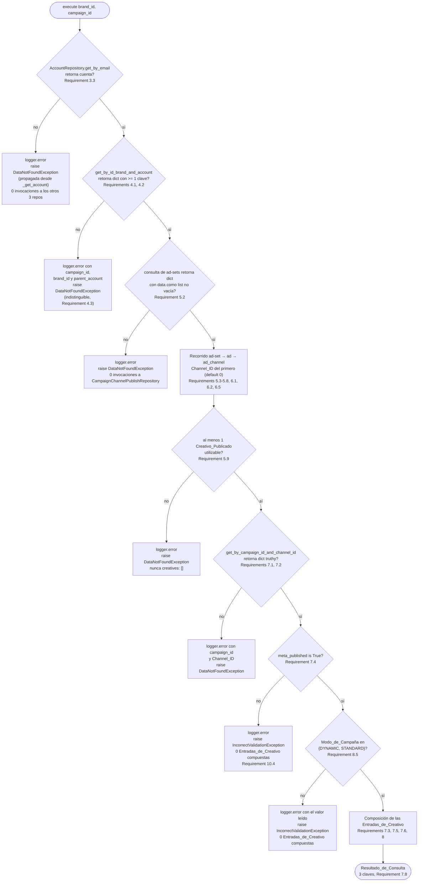

# Design Document: Meta Ads Get Launch Campaign Creatives

## Introduction

**Ubicación obligatoria (Requirement 1.1):** este documento reside en `sinergia/.kiro/specs/meta-ads-get-launch-campaign-creatives/design.md` y describe cambios **exclusivamente dentro del árbol `sinergia/`**, la aplicación Flask independiente ubicada en `sinergia/` dentro del monorepo `docker-deploy`, con su propio virtualenv en `sinergia/venv` y sus propios specs/steering en `sinergia/.kiro/`. Los tres archivos afectados son:

| Archivo | Naturaleza del cambio | Región acotada |
|---|---|---|
| `sinergia/app/v2/use_cases/meta_ads.py` | modificado | únicamente el cuerpo de la clase `FacebookGetLaunchCampaignCreativesUseCase`, más la sentencia `import` autorizada por el Requirement 1.6 |
| `sinergia/app/v2/repository/ad_set.py` | modificado | únicamente la adición de un método nuevo a `AdSetRepository`, sin tocar sus cuatro métodos actuales ni su constructor |
| `sinergia/tests/v2/unit/use_cases/test_facebook_get_launch_campaign_creatives.py` | nuevo | archivo completo |

Conteo final exigido por el Requirement 1.2: **2 modificados, 1 nuevo, 0 eliminados/renombrados/movidos**. El Requirement 1.3 exige además que el número de líneas modificadas en `sinergia/app/v2/resources/external.py`, `sinergia/app/v2/async_tasks/celery_tasks.py` y `sinergia/app/v2/use_cases/facebook_validator_service.py` permanezca en 0.

### Problema

La información de los creativos de una campaña Meta Ads publicada se entrega hoy **una sola vez**: como respuesta de `POST /facebook/launch/publish`, construida por `FacebookLaunchCampaignUseCase._build_response()` en `sinergia/app/v2/use_cases/meta_ads.py`. Si el cliente pierde esa respuesta —recarga de página, cierre de sesión, consulta al día siguiente— no existe ninguna vía para recuperarla. En particular, pierde los identificadores de Strapi (`adset_id`, `ad_id`, `adchannel_id`) que él mismo necesita para volver a invocar los endpoints de pre-check y de exportación de assets.

`FacebookGetLaunchCampaignCreativesUseCase` ya existe en el código con el constructor `__init__(self, user_id: str)`, con `_get_account()` y `_get_parent_account()` implementados, y con `execute(self, brand_id: int, campaign_id: int)` cuyo cuerpo es `pass`. No está referenciada por ningún recurso Flask, y seguirá sin estarlo al terminar esta especificación.

### Solución

Implementar `execute()` como una cadena de **cinco validaciones secuenciales** (Cuenta_Padre → Campaña_Objetivo → Ad_Sets_Seleccionados → Campaign_Setup → estado de publicación) seguida de una **proyección en memoria** de los Creativos_Publicados ya persistidos por el flujo de pre-check en el atributo `channel_creative` de cada `ad-channels`. El Resultado_de_Consulta tiene exactamente las mismas tres claves (`campaign`, `creatives`, `meta_url`) y las mismas 31 claves por creativo que produce hoy el lanzamiento, de modo que el código de cliente existente se reutiliza sin cambios.

El Caso_de_Uso es **de solo lectura** y **no toca la red externa**: 4 consultas de lectura a Strapi, 0 peticiones a la Graph API, 0 descargas de binarios, 0 accesos a Redis, 0 escrituras en Strapi.

Toda la lógica nueva vive en `FacebookGetLaunchCampaignCreativesUseCase`, distribuida entre `execute()` y métodos privados aditivos de la misma clase, sin introducir clases nuevas en `sinergia/app/v2/use_cases/meta_ads.py` (NFR *Code Architecture and Modularity*). El acceso a datos ocurre exclusivamente a través de los repositorios de `sinergia/app/v2/repository/`; el Caso_de_Uso no construye diccionarios de parámetros de Strapi ni invoca `StrapiClient` directamente.

### Decisiones ya acordadas y reflejadas en este diseño

1. **Sin token de Meta** (Requirements 2.7, 2.8). El Caso_de_Uso no consulta `facebook_access_token:{user_id}`, no define ni invoca `_get_decoded_access_token()` y por tanto `NotAccessException` no es alcanzable por ninguna ruta de `execute()`.
2. **Cuenta no encontrada** (Requirement 3.3). Se conserva la `DataNotFoundException` que ya lanza `_get_account()`, sin modificar ese método ni `_get_parent_account()`.
3. **`AdSetRepository` en alcance** (Requirement 9). Cambio estrictamente aditivo: un método nuevo, cuatro métodos actuales intactos.
4. **Channel_ID desde `channel_ref`** (Requirement 6). Se replica el patrón de lectura de `FacebookSavePreCheckBaseUseCase._set_channel_id`, partiendo únicamente de `brand_id` y `campaign_id`.
5. **Identificadores de Strapi expuestos** (Requirement 8.6), 0 claves nuevas para identificadores de Meta (Requirement 8.7).
6. **Enlaces por ad-set fuera de alcance** (Requirement 7.7 y sección `## Exclusiones` de este documento), y con ellos 0 lecturas de `meta_resources`.

### Consecuencia de orden derivada de la decisión 4

El único método disponible para resolver el Campaign_Setup es `CampaignChannelPublishRepository.get_by_campaign_id_and_channel_id(campaign_id, channel_id)`, que exige el Channel_ID como segundo argumento. Como el Channel_ID se lee del `channel_ref` del Ad_Channel_Seleccionado, la consulta de Ad_Sets es **necesariamente anterior** a la resolución del Campaign_Setup. La cadena normativa es, por tanto: Cuenta_Padre → Campaña_Objetivo → Ad_Sets_Seleccionados (que produce el Channel_ID) → Campaign_Setup → estado de publicación (Requirement 10.1).

---

## Overview

`FacebookGetLaunchCampaignCreativesUseCase.execute(brand_id, campaign_id)` ejecuta, en este orden estricto y sin retroceso (Requirement 10.1):

1. **Cuenta_Padre** (Requirement 3). `_get_parent_account()`, ya existente y preservado sin cambios, como **primera operación del cuerpo de `execute()`**. Falla → `DataNotFoundException` propagada desde `_get_account()`.
2. **Campaña_Objetivo** (Requirement 4). `CampaignRepository.get_by_id_brand_and_account(campaign_id, brand_id, parent_account)`, una única invocación. El registro se considera resuelto solo si es una instancia de `dict` con al menos una clave. Falla → `DataNotFoundException` indistinguible para los tres motivos posibles (campaña inexistente, otra marca, otra cuenta).
3. **Ad_Sets_Seleccionados y Channel_ID** (Requirements 5 y 6). Una única consulta al método nuevo de `AdSetRepository`, seguida de un recorrido en memoria de tres niveles (ad-set → ad → ad-channel) que (a) selecciona el primer ad-channel con `selected` verdadero de cada ad, (b) resuelve el Channel_ID del **primer** Ad_Channel_Seleccionado del recorrido, y (c) acumula los Creativos_Publicados utilizables. Consulta sin resultados o 0 creativos utilizables → `DataNotFoundException`.
4. **Campaign_Setup** (Requirement 7.1, 7.2). `CampaignChannelPublishRepository.get_by_campaign_id_and_channel_id(campaign_id, channel_id)`, emitida **también** cuando el Channel_ID conserva el valor por defecto `0`. Falla → `DataNotFoundException`.
5. **Estado de publicación** (Requirement 7.4). `meta_published is True`, comparación por identidad. Falla → `IncorrectValidationException`.
6. **Modo_de_Campaña** (Requirement 8.5). Validado **una sola vez**, después de la etapa 5 (Requirement 10.5) y **antes** de componer cualquier Entrada_de_Creativo. No es `DYNAMIC` ni `STANDARD` → `IncorrectValidationException` con 0 entradas compuestas.
7. **Composición del Resultado_de_Consulta** (Requirements 7.3, 7.5, 7.6, 7.8, 8). Una Entrada_de_Creativo de 31 claves por Creativo_Publicado utilizable, con `idx` igual a su índice de base cero, más el diccionario `campaign` de seis claves y la cadena `meta_url`.

### Frontera de errores: abortar vs. degradar

Este es el eje conceptual del diseño y conviene fijarlo antes de leer el resto:

- **Las seis validaciones de las etapas 1-6 abortan.** La primera que falla lanza su excepción, ninguna validación posterior se evalúa, ninguna consulta posterior a Strapi se emite y ninguna Entrada_de_Creativo se compone. No existe ningún `try`/`except` envolvente (Requirement 10.7).
- **Las estructuras degradadas del recorrido no abortan.** Un ad sin ad-channel seleccionado (Requirement 5.4), un `channel_creative` ausente o no-`dict` (Requirement 5.5), una lista `ads` ausente o vacía dentro del Creativo_Publicado (Requirement 5.6) y cualquier nivel intermedio ausente, `None` o de tipo inesperado (Requirement 5.7) producen la **omisión de ese elemento** y la continuación del recorrido, con `logger.warning` donde el criterio lo exige y sin `AttributeError`, `TypeError` ni `KeyError`.
- **La degradación total sí aborta.** Si tras el recorrido completo el número de Creativos_Publicados utilizables es 0, se lanza `DataNotFoundException` (Requirement 5.9). Nunca se retorna un Resultado_de_Consulta con `creatives` vacía.
- **Una discrepancia de Channel_ID no aborta.** Un Ad_Channel_Seleccionado posterior al primero con un `channel_ref.data.id` distinto se registra con `logger.warning` y se conserva el Channel_ID del primero (Requirement 6.5).

### Interpretación normativa del Requirement 5.9

El Requirement 5.9 exige lanzar `DataNotFoundException` cuando "el número de Entradas_de_Creativo obtenidas es 0" **al terminar el recorrido** del Requirement 5.3, es decir en la etapa 3. El Requirement 10.4 exige, simultáneamente, que una campaña no publicada produzca `IncorrectValidationException` con **0 Entradas_de_Creativo compuestas**, es decir que ninguna entrada exista antes de la etapa 5.

Ambos se satisfacen separando **recolección** de **composición**:

- La etapa 3 recolecta los **Creativos_Publicados utilizables** (los diccionarios `channel_creative` que superaron los criterios 5.5 y 5.6, junto con su `adchannel_id`), y es ese contador el que el Requirement 5.9 evalúa.
- La composición de las Entradas_de_Creativo ocurre en la etapa 7, después de las etapas 5 y 6.

La equivalencia entre ambos contadores es una invariante del diseño —cada Creativo_Publicado utilizable produce exactamente una Entrada_de_Creativo, y ninguna entrada se produce sin un Creativo_Publicado utilizable— y queda fijada como Property 2 y verificada por el Requirement 11.19.

---

## Architecture

### Ubicación en capas

```
sinergia/app/v2/resources/external.py      ← FUERA DE ALCANCE (0 líneas modificadas, Requirement 1.3)
          │
          ▼
sinergia/app/v2/use_cases/meta_ads.py      ← FacebookGetLaunchCampaignCreativesUseCase (cuerpo nuevo)
          │
          ▼
sinergia/app/v2/repository/                ← AccountRepository, CampaignRepository,
                                             AdSetRepository (+1 método), CampaignChannelPublishRepository
          │
          ▼
sinergia/app/tools/strapi.py               ← StrapiClient (consumido tal como está)
```

El Caso_de_Uso vive en la capa de servicio y depende solo de repositorios, conforme a `sinergia/.kiro/steering/structure.md`. La construcción de los diccionarios de parámetros de consulta de Strapi vive exclusivamente en `sinergia/app/v2/repository/ad_set.py`.

### Flujo completo (diagrama de secuencia)

```mermaid
sequenceDiagram
    autonumber
    participant CL as Llamador de la capa de servicio<br/>sin recurso Flask: fuera de alcance
    participant U as FacebookGetLaunchCampaignCreativesUseCase<br/>(sinergia/app/v2/use_cases/meta_ads.py)
    participant AR as AccountRepository<br/>(accounts)
    participant CR as CampaignRepository<br/>(campaigns)
    participant ASR as AdSetRepository<br/>(ad-sets)
    participant CPR as CampaignChannelPublishRepository<br/>(campaign-channel-publishes)

    CL->>U: FacebookGetLaunchCampaignCreativesUseCase(user_id).execute(brand_id, campaign_id)

    Note over U: Etapa 1 — Cuenta_Padre (Requirement 3.1)
    U->>AR: get_by_email(self.user_id)
    AR-->>U: account | None
    U->>U: parent_account = attributes.parent_account.data.id<br/>o account.id (Requirements 3.4, 3.5)

    Note over U: Etapa 2 — Campaña_Objetivo (Requirement 4.1)
    U->>CR: get_by_id_brand_and_account(campaign_id, brand_id, parent_account)
    CR-->>U: campaign (solo se lee attributes.name, Requirement 4.5)

    Note over U: Etapa 3 — Ad_Sets + Channel_ID (Requirements 5.1, 6.1)
    U->>ASR: get_by_campaign_and_brand_with_selected_ad_channels(campaign_id, brand_id)
    ASR-->>U: {'data': [ad-set, ...]} con ads, ad_channels y channel_ref poblados
    loop por cada ad-set → ad → primer ad_channel con selected verdadero
        U->>U: channel_id (solo del primero; warning si discrepa, Requirement 6.5)
        U->>U: acumular channel_creative utilizable<br/>(warning y omisión si degradado, Requirements 5.5, 5.6)
    end
    U->>U: si 0 creativos utilizables → DataNotFoundException (Requirement 5.9)

    Note over U: Etapa 4 — Campaign_Setup (Requirement 7.1)
    U->>CPR: get_by_campaign_id_and_channel_id(campaign_id, channel_id)
    CPR-->>U: campaign_setup

    Note over U: Etapa 5 — meta_published is True (Requirement 7.4)
    Note over U: Etapa 6 — Modo_de_Campaña reconocido (Requirements 8.5, 10.5)
    Note over U: Etapa 7 — composición en memoria (Requirements 7.3, 7.5, 7.6, 8)
    U-->>CL: {'campaign': {...6 claves}, 'creatives': [...31 claves], 'meta_url': '...'}
```

**Total de consultas de lectura a Strapi por invocación exitosa: 4** (una a `accounts`, una a `campaigns`, una a `ad-sets`, una a `campaign-channel-publishes`), conforme al Requirement 10.6. **0** consultas a `brands` (Requirement 4.6), a `ads`, a `ad-channels` y a `channel-v2s` (Requirements 5.10, 6.3). **0** escrituras.

### Cadena de validaciones (diagrama de flujo con la excepción de cada rama)



Tres precedencias son normativas:

- **V4 antes de V5** (Requirement 10.2): una campaña sin creativos utilizables produce `DataNotFoundException` con 0 invocaciones a `CampaignChannelPublishRepository`.
- **V5 antes de V6** (Requirement 10.3): un Campaign_Setup inexistente produce exactamente una `DataNotFoundException`, y la evaluación de `meta_published` no se ejecuta.
- **V6 antes de V7** (Requirement 10.5): un Campaign_Setup no publicado **y** con un Modo_de_Campaña no reconocido produce la `IncorrectValidationException` del estado de publicación, no la del Modo_de_Campaña.

---

## Components and Interfaces

### Imports requeridos

La cabecera de `sinergia/app/v2/use_cases/meta_ads.py` recibe **una** adición, acotada al bloque de imports existente al inicio del archivo, antes de la primera definición de clase, autorizada por el Requirement 1.6:

```python
from app.v2.repository.ad_set import AdSetRepository
```

Se inserta junto a las cuatro sentencias de repositorio ya presentes (`ad_channel`, `campaign_channel_publish`, `campaign`, `account`), replicando su forma. Verificación contra la cabecera real del archivo:

| Necesidad | Estado en la cabecera actual | Acción |
|---|---|---|
| `AdSetRepository` | **ausente** | **se añade** la sentencia `from app.v2.repository.ad_set import AdSetRepository` |
| `CampaignRepository` | `from app.v2.repository.campaign import CampaignRepository` ya presente | ninguna |
| `CampaignChannelPublishRepository` | ya presente | ninguna |
| `AccountRepository` | ya presente | ninguna |
| `DataNotFoundException`, `IncorrectValidationException` | ambas ya presentes en el `from app.exceptions.base import ...` existente | ninguna |
| `CreativeType` | ya presente en el `from app.v2.use_cases.facebook_validator_service import ...` existente | ninguna |
| `List`, `Dict`, `Any`, `Optional`, `Tuple` | `from typing import List, TypedDict, Any, Dict, Optional, Set, Tuple` ya presente | ninguna: **no** se modifica la línea de `typing` |
| `logger` | ya definido a nivel de módulo | ninguna |

El diseño está construido deliberadamente para **no requerir ningún nombre nuevo de `typing`**: las anotaciones usan solo `Any`, `Dict`, `List`, `Optional` y `Tuple`, los cinco ya importados. La única alternativa que habría exigido `Callable` (despachar el modo devolviendo el método constructor) se descarta en la decisión D-6.

En `sinergia/app/v2/repository/ad_set.py` no se requiere ningún import nuevo: el método nuevo solo construye un diccionario de parámetros y usa el `self.get` heredado de `StrapiClient`.

El proyecto corre **Python 3.8** (`sinergia/.kiro/steering/tech.md`), motivo por el cual las anotaciones usan los genéricos de `typing` (`Dict[str, Any]`, `Tuple[...]`) y no los genéricos incorporados subscritos.

### Firmas de los métodos del Caso_de_Uso

Todos los métodos marcados como nuevos son **aditivos** dentro de `FacebookGetLaunchCampaignCreativesUseCase`. No se introduce ninguna clase nueva en `sinergia/app/v2/use_cases/meta_ads.py`, y la clase **conserva su declaración actual sin clase base** (`class FacebookGetLaunchCampaignCreativesUseCase():`), conforme a la sección `## Out of Scope` de `requirements.md`.

```python
class FacebookGetLaunchCampaignCreativesUseCase():

    # --- Constantes de clase (aditivas) ---
    _CHANNEL_NAME = 'Meta'
    _META_CAMPAIGN_URL_TEMPLATE = (
        'https://adsmanager.facebook.com/adsmanager/manager/campaigns/edit'
        '?act={meta_account_id}&selected_campaign_ids={meta_campaign_id}'
    )
    _SUPPORTED_CAMPAIGN_MODES = (CreativeType.DYNAMIC.value, CreativeType.STANDARD.value)

    # --- Constructor: se amplía con los tres repositorios que faltan ---
    def __init__(self, user_id: str):
        """Requirements 2.1-2.4: un único parámetro posicional; cinco
        asignaciones y nada más; 0 consultas a Strapi, 0 accesos a Redis y
        0 peticiones HTTP durante la construcción; user_id se asigna sin
        transformarlo y sin validarlo."""

    # --- Ya existentes; se preservan sin cambios (Requirement 3.2) ---
    def _get_account(self): ...
    def _get_parent_account(self): ...

    # --- Nuevos, aditivos ---
    def _get_campaign(self, campaign_id: Any, brand_id: Any, parent_account: Any) -> Dict[str, Any]:
        """Requirement 4: una única invocación de
        self.campaign_repository.get_by_id_brand_and_account con los tres
        argumentos en orden posicional. Considera la campaña resuelta solo si
        el valor retornado es una instancia de dict con al menos una clave
        (Requirement 4.1). Registra con logger.error los tres valores
        empleados y lanza DataNotFoundException con un mensaje indistinguible
        para los tres motivos posibles (Requirements 4.2, 4.3)."""

    @staticmethod
    def _as_list(node: Any, *keys: str) -> List[Any]:
        """Requirement 5.7: recorre una ruta de claves anidadas y retorna la
        lista encontrada, o [] en cuanto un nivel está ausente, es None o no
        tiene el tipo esperado. Nunca lanza AttributeError, TypeError ni
        KeyError. Es el equivalente, para colecciones, de lo que
        _resolve_channel_id es para el Channel_ID."""

    @staticmethod
    def _resolve_channel_id(ad_channel: Dict[str, Any]) -> int:
        """Requirements 6.1, 6.2: lee attributes.channel_ref.data.id del
        Ad_Channel_Seleccionado, replicando el patrón del método ya existente
        FacebookSavePreCheckBaseUseCase._set_channel_id, con default 0 en
        cualquier nivel ausente, None o no-dict, y sin lanzar excepción."""

    @staticmethod
    def _select_ad_channel(ad: Dict[str, Any]) -> Optional[Dict[str, Any]]:
        """Requirement 5.3: retorna el primer elemento de
        attributes.ad_channels.data cuyo attributes.selected sea evaluado como
        verdadero, aplicando el mismo criterio que la línea
        `next((ch for ch in ad_channels_data if ch['attributes'].get("selected")), None)`
        de MetaAdsPayloadBuilder.build_asset_feed_spec, y None cuando no existe
        ninguno (Requirement 5.4). Un elemento sin 'attributes' o con un
        'attributes' no-dict se trata como no seleccionado, sin lanzar
        (Requirement 5.7)."""

    def _collect_published_creatives(
        self, campaign_id: Any, brand_id: Any,
    ) -> Tuple[List[Dict[str, Any]], int]:
        """Requirements 5 y 6: una única invocación del método nuevo del
        Repositorio_de_Ad_Sets (Requirement 5.1) y un recorrido de tres
        niveles de solo lectura. Retorna una tupla de dos elementos:

          [0] List[Dict[str, Any]] — descriptores de los Creativos_Publicados
              utilizables, en el orden del Requirement 7.5. Cada descriptor
              tiene la forma {'creative': dict, 'adchannel_id': Any}.
          [1] int — el Channel_ID del PRIMER Ad_Channel_Seleccionado del
              recorrido, o 0 (Requirements 6.1, 6.2, 6.4).

        Lanza DataNotFoundException si la consulta no retorna resultados
        (Requirement 5.2) o si el número de descriptores es 0
        (Requirement 5.9). Omite con logger.warning, sin lanzar, los ads sin
        ad-channel seleccionado (5.4), los channel_creative degradados (5.5) y
        los Creativos_Publicados con 'ads' inutilizable (5.6)."""

    def _get_campaign_setup(self, campaign_id: Any, channel_id: int) -> Dict[str, Any]:
        """Requirements 7.1, 7.2: una única invocación de
        self.campaign_channel_publish_repository.get_by_campaign_id_and_channel_id
        con campaign_id y channel_id en orden posicional, emitida también
        cuando channel_id conserva el valor por defecto 0. Registra con
        logger.error ambos valores y lanza DataNotFoundException si el valor
        retornado es falsy o no es una instancia de dict."""

    def _validate_published(self, campaign_setup: Dict[str, Any]) -> None:
        """Requirement 7.4: compara meta_published contra True POR IDENTIDAD,
        de modo que False, None, 1, 'True', 'true' y la ausencia del atributo
        lancen IncorrectValidationException tras logger.error. Etapa 5 de la
        cadena: se evalúa después de la etapa 4 (Requirement 10.3) y antes de
        componer cualquier Entrada_de_Creativo (Requirement 10.4)."""

    def _validate_campaign_mode(self, campaign_setup: Dict[str, Any]) -> str:
        """Requirements 8.5, 10.5: lee meta_campaign_mode del Campaign_Setup y
        retorna su valor si es igual a CreativeType.DYNAMIC.value o a
        CreativeType.STANDARD.value; en cualquier otro caso registra el valor
        leído con logger.error y lanza IncorrectValidationException. Se invoca
        UNA sola vez, después de _validate_published y antes del bucle de
        composición, de modo que un modo no reconocido produzca 0
        Entradas_de_Creativo compuestas."""

    def _build_dynamic_creative_published(self, idx: int, descriptor: Dict[str, Any]) -> Dict[str, Any]:
        """Requirement 8.3: contraparte de la rama DYNAMIC de
        FacebookLaunchCampaignUseCase._build_response(), con las mismas rutas,
        los mismos valores por defecto y las mismas transformaciones. Retorna
        las 31 claves del Requirement 8.1 en el orden allí fijado."""

    def _build_standard_creative_published(self, idx: int, descriptor: Dict[str, Any]) -> Dict[str, Any]:
        """Requirement 8.4: contraparte del método ya existente
        FacebookLaunchCampaignUseCase._build_standard_creative_published(),
        con las mismas rutas, los mismos valores por defecto y las mismas
        transformaciones. Retorna las mismas 31 claves en el mismo orden."""

    def _build_creatives(self, descriptors: List[Dict[str, Any]], campaign_mode: str) -> List[Dict[str, Any]]:
        """Requirements 7.5, 8.2: despacha por el Modo_de_Campaña ya validado
        —y NO por la presencia de asset_feed_spec u object_story_spec— y
        asigna a idx el índice de base cero de cada entrada dentro de la lista
        final."""

    def _build_result(
        self,
        campaign: Dict[str, Any],
        campaign_setup: Dict[str, Any],
        creatives: List[Dict[str, Any]],
    ) -> Dict[str, Any]:
        """Requirements 7.3, 7.6, 7.8: construye el diccionario campaign de
        exactamente seis claves en el orden fijado, la cadena meta_url, y
        retorna el Resultado_de_Consulta de exactamente tres claves."""

    def execute(self, brand_id: int, campaign_id: int) -> Dict[str, Any]:
        """Requirement 2.5: exactamente dos parámetros posicionales en ese
        orden. Orquesta los métodos anteriores en el orden del
        Requirement 10.1 y retorna el Resultado_de_Consulta sin envolverlo en
        una tupla y sin código de estado HTTP (Requirement 7.9)."""
```

### Constructor (Requirement 2)

```python
def __init__(self, user_id: str):
    self.user_id = user_id
    self.account_repository = AccountRepository()
    self.campaign_repository = CampaignRepository()
    self.ad_set_repository = AdSetRepository()
    self.campaign_channel_publish_repository = CampaignChannelPublishRepository()
```

Exactamente cinco asignaciones y nada más (Requirement 2.3). `self.account_repository` ya existe hoy; las tres restantes son aditivas. No hay validación de `user_id` (Requirement 2.4): un `user_id` `None` o vacío completa la construcción y se manifiesta como la `DataNotFoundException` del Requirement 3.3 al resolver la cuenta. Los constructores de los cuatro repositorios solo leen configuración y arman cabeceras (`StrapiClient.__init__` en `sinergia/app/tools/strapi.py`), por lo que se cumplen las tres cuotas de 0 del Requirement 2.3.

Nótese que **no** se instancian `AdChannelRepository` ni `AdRepository` (sección `## Out of Scope` de `requirements.md`): los Ad_Channels llegan poblados por la consulta única de `AdSetRepository`.

### Cuerpo de `execute()` (orquestación)

```python
def execute(self, brand_id: int, campaign_id: int):
    # Etapa 1 — Requirement 3.1: primera operación del cuerpo.
    parent_account = self._get_parent_account()

    # Etapa 2 — Requirement 4.1. brand_id y campaign_id se pasan tal como
    # fueron recibidos, sin conversión de tipo ni normalización (Req. 2.6).
    campaign = self._get_campaign(campaign_id, brand_id, parent_account)

    # Etapa 3 — Requirements 5.1, 5.9, 6.1: una consulta a ad-sets, el
    # recorrido de solo lectura y el Channel_ID del primer ad-channel
    # seleccionado.
    descriptors, channel_id = self._collect_published_creatives(campaign_id, brand_id)

    # Etapa 4 — Requirement 7.1: emitida también con channel_id == 0.
    campaign_setup = self._get_campaign_setup(campaign_id, channel_id)

    # Etapa 5 — Requirement 7.4, antes de componer cualquier entrada.
    self._validate_published(campaign_setup)

    # Etapa 6 — Requirements 8.5, 10.5: una sola validación del modo,
    # después de la etapa 5 y antes del bucle de composición.
    campaign_mode = self._validate_campaign_mode(campaign_setup)

    # Etapa 7 — composición en memoria, 0 consultas adicionales.
    creatives = self._build_creatives(descriptors, campaign_mode)

    return self._build_result(campaign, campaign_setup, creatives)
```

Ocho sentencias, ninguna envuelta en `try`/`except` (Requirement 10.7). El orden textual **es** la garantía de secuencia del Requirement 10.1, y cada etapa consume solo valores ya resueltos por las anteriores.

### Recorrido de los Ad_Sets (Requirements 5.3-5.9, 6.1, 6.2, 6.5)

```python
def _collect_published_creatives(self, campaign_id, brand_id):
    response = self.ad_set_repository.get_by_campaign_and_brand_with_selected_ad_channels(
        campaign_id, brand_id
    )

    # Requirement 5.2: None, no-dict, 'data' ausente, no-list o list vacía.
    ad_sets = response.get('data') if isinstance(response, dict) else None
    if not isinstance(ad_sets, list) or not ad_sets:
        logger.error(
            f"Ad sets not found for campaign_id: {campaign_id} and brand_id: {brand_id}"
        )
        raise DataNotFoundException('Published creatives not found')

    descriptors = []
    channel_id = 0
    channel_id_resolved = False

    for ad_set in ad_sets:
        # Requirement 5.7: attributes / ads / ads.data degradados → [].
        for ad in self._as_list(ad_set, 'attributes', 'ads', 'data'):
            ad_channel = self._select_ad_channel(ad)
            if ad_channel is None:
                # Requirement 5.4: se omite el ad, sin excepción y sin log.
                continue

            # Requirements 6.1, 6.4, 6.5: el Channel_ID se fija con el
            # PRIMER Ad_Channel_Seleccionado del recorrido; los posteriores
            # solo pueden producir un warning de discrepancia.
            current_channel_id = self._resolve_channel_id(ad_channel)
            if not channel_id_resolved:
                channel_id = current_channel_id
                channel_id_resolved = True
            elif current_channel_id != channel_id:
                logger.warning(
                    f"Channel id mismatch: keeping {channel_id}, "
                    f"found {current_channel_id}"
                )

            attributes = ad_channel.get('attributes') if isinstance(ad_channel, dict) else None
            creative = attributes.get('channel_creative') if isinstance(attributes, dict) else None

            # Requirement 5.5: channel_creative ausente, None o no-dict con
            # al menos una clave.
            if not isinstance(creative, dict) or not creative:
                logger.warning(
                    f"Unusable channel_creative for ad_channel "
                    f"{ad_channel.get('id') if isinstance(ad_channel, dict) else None}"
                )
                continue

            # Requirement 5.6: 'ads' ausente, no-list o list vacía.
            creative_ads = creative.get('ads')
            if not isinstance(creative_ads, list) or not creative_ads:
                logger.warning(
                    f"Published creative without ads for ad_channel "
                    f"{ad_channel.get('id')}"
                )
                continue

            descriptors.append({'creative': creative, 'adchannel_id': ad_channel.get('id')})

    # Requirement 5.9: nunca se retorna creatives vacía.
    if not descriptors:
        logger.error(
            f"No usable published creatives for campaign_id: {campaign_id} "
            f"and brand_id: {brand_id}"
        )
        raise DataNotFoundException('Published creatives not found')

    return descriptors, channel_id
```

Cuatro notas de diseño sobre este recorrido:

1. **Es de solo lectura** (Requirement 5.8). Ninguna sentencia asigna sobre `ad_set`, `ad`, `ad_channel` ni `creative`. `descriptors` guarda una **referencia** al diccionario `channel_creative`, no una copia, y las dos funciones de composición solo leen de él, de modo que su valor queda idéntico al almacenado. El Requirement 11.23 lo verifica comparando el fixture con su valor inicial tras la ejecución.
2. **El `adchannel_id` del descriptor no es el que va a la Entrada_de_Creativo.** El Requirement 8.6 fija que `adchannel_id` se lee del propio Creativo_Publicado (`object_story_spec.ad_channel_id` en `STANDARD`, `asset_feed_spec.ad_channel_id` en `DYNAMIC`, default `0`), no del `id` del registro `ad-channels`. El `adchannel_id` del descriptor se conserva únicamente para los mensajes de registro y para facilitar el diagnóstico; su presencia no altera ninguna clave del resultado. En la práctica coinciden, porque `MetaAdsPayloadBuilder.build_asset_feed_spec` asigna `asset_feed_spec.ad_channel_id = channel.get('id')`.
3. **El Channel_ID se fija con una bandera, no con `if not channel_id`.** Un primer Ad_Channel_Seleccionado con `channel_ref` degradado resuelve legítimamente `0` (Requirement 6.2), y ese `0` debe **conservarse** para que el fallo se manifieste como la `DataNotFoundException` del Requirement 7.2. Usar `if not channel_id` haría que un segundo ad-channel sobrescribiera ese `0`, violando el Requirement 6.4.
4. **El filtro de la consulta no sustituye al criterio en memoria** (Requirement 9.7). El filtro `filters[ads][ad_channels][selected][$eq]=true` restringe **qué ad-sets** se retornan, no **qué ad-channels** se pueblan dentro de cada ad; un ad-channel con `selected` falso llega igualmente en la respuesta y queda excluido por `_select_ad_channel`.

### Método nuevo de `AdSetRepository` (Requirement 9)

Se añade a `sinergia/app/v2/repository/ad_set.py`, **después** de los cuatro métodos actuales, sin modificar ninguno de ellos, ni el atributo `content_type` (valor `ad-sets`), ni el constructor (Requirement 9.6).

```python
    def get_by_campaign_and_brand_with_selected_ad_channels(
        self, campaign_id: int, brand_id: int,
    ) -> Optional[Dict[str, Any]]:
        """Get the ad sets of a campaign that have at least one selected ad channel.

        Returns the complete Strapi response, preserving its 'data' key as the
        list of ad-set records, or None when the response is falsy or its
        'data' key is absent or empty.
        """
        params = {
            'filters[funnel_flow_ref][campaign_ref][id][$eq]': campaign_id,
            'filters[funnel_flow_ref][campaign_ref][brand_ref][id][$eq]': brand_id,
            'filters[ads][ad_channels][selected][$eq]': 'true',
            'populate': ['ads', 'ads.ad_channels', 'ads.ad_channels.channel_ref'],
        }

        response = self.get(self.content_type, params)

        if not response or not response.get('data') or len(response.get('data')) == 0:
            return None

        return response
```

Seis decisiones sobre este método, cada una trazada:

| Aspecto | Decisión | Justificación |
|---|---|---|
| Nombre | `get_by_campaign_and_brand_with_selected_ad_channels` | Replica la gramática de los métodos hermanos (`get_by_id_and_campaign_and_brand`, `get_by_id_with_ads`) y declara en el propio nombre las dos dimensiones del filtro y la condición de selección |
| Parámetros | `campaign_id`, `brand_id`, posicionales, en ese orden, con anotaciones explícitas | Requirements 9.1, 5.1 y `sinergia/.kiro/steering/tech.md` |
| Filtros | Las tres claves literales del Requirement 9.2 | Replica la convención de `get_by_id_and_campaign_and_brand`, que ya usa `filters[funnel_flow_ref][campaign_ref][...]` |
| Valor del filtro `selected` | La **cadena** `'true'`, no el booleano `True` | `requests` serializa `True` como la cadena `'True'` (con mayúscula), que el analizador de consultas de Strapi no coacciona a booleano. La cadena `'true'` es la representación que Strapi espera, y es literalmente el valor que exige el Requirement 9.2 |
| Populate | Lista de tres rutas: `['ads', 'ads.ad_channels', 'ads.ad_channels.channel_ref']` | Requirement 9.3. Se usa la **forma de lista** porque es la convención de esta misma clase (`get_by_id` ya pasa `params['populate'] = ['funnel_flow_ref.campaign_ref.brand_ref', ...]`, rutas profundas en lista, en producción). La ruta intermedia `ads.ad_channels` se declara de forma explícita aunque `ads.ad_channels.channel_ref` la implique, para que las tres relaciones del Requirement 9.3 estén presentes de forma literal. Es un superconjunto del patrón ya probado `["ads", "ads.ad_channels.channel_ref"]` de `MetaAdsPayloadBuilder._get_ad_sets` |
| Retorno | La **respuesta completa**, no `response['data'][0]` | Requirement 9.4: el Caso_de_Uso recorre **todos** los ad-sets de la campaña, no uno. Es la única diferencia de forma respecto de los cuatro métodos actuales, y es deliberada |
| Retorno degradado | `None` | Requirement 9.5, con la misma guarda de tres condiciones (`not response`, `not response.get('data')`, `len(...) == 0`) que ya usan los tres métodos de lectura de la clase |

`channel_creative` y `selected` son **atributos planos** de `ad-channels`, no relaciones, por lo que llegan en la respuesta por el simple hecho de poblar `ads.ad_channels`. Esto no es una inferencia: lo declara el propio esquema de Strapi del tipo de contenido, `strapi-n8n/src/api/ad-channel/content-types/ad-channel/schema.json` —archivo que **queda expresamente fuera del alcance de esta especificación** conforme al Requirement 1.8, y que aquí solo se lee como evidencia—, donde `channel_creative` está declarado como `{"type": "json"}` y `selected` como `{"type": "boolean", "default": false}`. Ambos son escalares y Strapi los serializa siempre dentro de `attributes`, sin necesidad de declararlos en el `populate`. La única relación que sí exige ruta de populate es `channel_ref`, declarada en ese mismo esquema como `{"type": "relation", "relation": "oneToOne", "target": "api::channel-v2.channel-v2"}`, y es exactamente la que el Requirement 9.3 incluye como `ads.ad_channels.channel_ref`.

El uso en producción lo corrobora: `MetaAdsPayloadBuilder.build_asset_feed_spec` lee `channel['attributes'].get('channel_attributes')`, `ch['attributes'].get("selected")` y `channel.get('attributes', {}).get('channel_ref', {}).get('data', {}).get('id', 0)` sobre el resultado de `_get_ad_sets`, cuyo populate es exactamente `["ads", "ads.ad_channels.channel_ref"]`.

**`Optional` y `Dict` en la anotación de retorno.** `sinergia/app/v2/repository/ad_set.py` no importa hoy nada de `typing`. La anotación `-> Optional[Dict[str, Any]]` exige añadir `from typing import Any, Dict, Optional` a la cabecera de ese archivo. Esa adición está dentro del alcance del Requirement 1.2 (es el mismo archivo, ya contado como modificado) y es exigida por el Requirement 9.1 junto con `sinergia/.kiro/steering/tech.md`, que pide anotaciones explícitas. No altera ninguno de los cuatro métodos actuales ni el conteo de archivos.

---

## Data Models

### Consumido: registro `accounts` (Requirements 3.4, 3.5)

```python
{
    'id': 7,
    'attributes': {
        'email': 'user@example.com',
        'parent_account': {'data': {'id': 3, 'attributes': {...}}},  # opcional
    },
}
```

`_get_parent_account()`, ya existente y preservado, retorna `attributes.parent_account.data.id` cuando ese nodo está presente, y `account['id']` en caso contrario.

### Consumido: registro `campaigns` (Requirement 4.5)

```python
{
    'id': 41,
    'attributes': {'name': 'Campaña Primavera', ...},
}
```

**Único atributo leído:** `attributes.name`, para `campaign.name` del Resultado_de_Consulta. Ningún otro atributo se lee, y `brand_id` se consume exclusivamente como argumento de filtro (Requirement 4.6, 0 consultas a `brands`).

### Consumido: respuesta de la consulta de `ad-sets` (Requirements 5.3, 9.3, 9.4)

```python
{
    'data': [
        {
            'id': 120,
            'attributes': {
                'name': 'Ad Set A',
                'ads': {
                    'data': [
                        {
                            'id': 501,
                            'attributes': {
                                'name': 'Ad 1',
                                'ad_channels': {
                                    'data': [
                                        {
                                            'id': 9001,
                                            'attributes': {
                                                'selected': True,
                                                'channel_ref': {'data': {'id': 2}},
                                                'channel_creative': { ... },   # el Creativo_Publicado
                                            },
                                        },
                                        # ... ad-channels con selected falso también llegan
                                    ],
                                },
                            },
                        },
                    ],
                },
            },
        },
    ],
    'meta': { ... },   # presente pero no leído
}
```

Las cinco estructuras intermedias que el Requirement 5.7 declara degradables son `attributes`, `ads`, `ads.data`, `ad_channels` y `ad_channels.data`. Las tres claves leídas de cada ad-channel son `attributes.selected`, `attributes.channel_ref.data.id` y `attributes.channel_creative`, más `id` para los mensajes de registro.

### Consumido: Creativo_Publicado (`channel_creative`)

Persistido por `FacebookGeneratePreCheckCreativeUseCase._save_creative_to_publish` y actualizado por los `FacebookSavePreCheck*UseCase`. Tiene forma de ad-set, con una lista `ads` de **exactamente un elemento** en ambos modos:

```python
{
    'id': 120,                      # adset_id de Strapi
    'name': 'Ad Set A',
    'daily_budget': 15,
    'targeting': { ... },           # presente pero NO leído por este Caso_de_Uso
    'proposal_locations': [ ... ],
    'ads': [
        {
            'id': 501,              # ad_id de Strapi
            'name': 'Ad 1',
            'adCreative': {
                'name': '...',
                # rama DYNAMIC
                'asset_feed_spec': {
                    'ad_channel_id': 9001,
                    'images': [{'url': ..., 'valid': ..., 'error': ...}, ...],
                    'bodies': [{'text': ..., 'valid_length': ...}, ...],
                    'titles': [...], 'descriptions': [...],
                    'call_to_action_types': [{'value': ..., 'valid': ...}, ...],
                    'link_urls': [{'website_url': '...'}],
                    'images_valid_amount': True, 'titles_valid_amount': True,
                    'bodies_valid_amount': True, 'descriptions_valid_amount': True,
                    'call_to_action_types_valid_amount': True,
                    'images_max_amount': 10, 'titles_max_amount': 5,
                    'bodies_max_amount': 5, 'descriptions_max_amount': 5,
                    'call_to_action_types_max_amount': 5,
                    'unique_titles': True, 'unique_bodies': True, 'unique_descriptions': True,
                    'daily_budget_valid': True, 'min_daily_budget': 10,
                    'link_url_valid': True, 'locations': [...], 'locations_valid': True,
                },
                # rama STANDARD
                'object_story_spec': {
                    'ad_channel_id': 9001,
                    'page_id': '...',
                    'link_data': {
                        'name': 'Titular', 'title_valid': True,
                        'message': 'Cuerpo', 'body_valid': True,
                        'description': 'Descripción', 'description_valid': True,
                        'image_url': 'https://...', 'image_valid': True, 'image_error': None,
                        'link': 'https://...', 'link_url_valid': True,
                        'call_to_action': {'type': {'value': 'SHOP_NOW', 'valid': True}},
                    },
                    'daily_budget_valid': True, 'min_daily_budget': 10,
                    'locations': [...], 'locations_valid': True,
                },
            },
        },
    ],
}
```

Los valores de las claves `*_valid`, `*_valid_amount`, `*_max_amount`, `unique_*` y `min_daily_budget` se entregan **tal como el flujo de pre-check los persistió**: 0 invocaciones a `MetaAdsValidator` y a `MetaAdsPayloadBuilder` (Requirement 8.9).

### Consumido: registro `campaign-channel-publishes` (Campaign_Setup)

Seis atributos leídos, y solo seis:

| Atributo | Uso |
|---|---|
| `meta_published` | Requirement 7.4: comparación por identidad contra `True` |
| `meta_campaign_mode` | Requirements 8.2, 8.5: despacho de rama y validación del modo; clave `campaign.mode` |
| `meta_campaign_objective` | clave `campaign.objective` |
| `meta_optimization_goal` | clave `campaign.optimization_goal` |
| `meta_account_id` | interpolación de `meta_url` |
| `meta_campaign_id` | interpolación de `meta_url` |

**`meta_resources` no se lee** (Requirement 7.7 y sección `## Exclusiones`).

### Producido: Resultado_de_Consulta (Requirements 7.3, 7.6, 7.8, 7.9)

```python
{
    'campaign': {
        'name': campaign['attributes']['name'],                       # Campaña_Objetivo
        'channel_name': 'Meta',                                       # literal
        'creatives_no': len(creatives),
        'objective': setup['attributes']['meta_campaign_objective'],
        'optimization_goal': setup['attributes']['meta_optimization_goal'],
        'mode': setup['attributes']['meta_campaign_mode'],
    },
    'creatives': [ { ...31 claves... }, ... ],
    'meta_url': 'https://adsmanager.facebook.com/adsmanager/manager/campaigns/edit'
                '?act={meta_account_id}&selected_campaign_ids={meta_campaign_id}',
}
```

Exactamente tres claves, sin claves de depuración, de paginación ni de estado (Requirement 7.8). Retornado como único valor, sin tupla y sin código HTTP (Requirement 7.9).

**Diferencia normativa respecto de `FacebookLaunchCampaignUseCase._build_response()` en `meta_url`.** El lanzamiento interpola `campaign_id`, que en ese contexto es el identificador **de Meta** recién creado, y `self.ad_account_id`, leído del Campaign_Setup. Aquí ambos valores se leen del Campaign_Setup ya persistido: `meta_campaign_id` (que el lanzamiento guardó mediante `_update_campaign_setup`) y `meta_account_id`. El resultado es la **misma URL** para la misma campaña, obtenida por una vía distinta, que es exactamente lo que exige el Requirement 7.6.

### Producido: Entrada_de_Creativo — rama DYNAMIC (Requirements 8.1, 8.3)

Con `c` = Creativo_Publicado, `a` = `c['ads'][0]`, `afs` = `a['adCreative']['asset_feed_spec']`:

| # | Clave | Origen | Valor por defecto |
|---|---|---|---|
| 1 | `idx` | índice de base cero en `creatives` | — |
| 2 | `name` | `c.name` | `None` |
| 3 | `adset_id` | `c.id` | `None` |
| 4 | `ad_id` | `a.id` | `None` |
| 5 | `adchannel_id` | `afs.ad_channel_id` | `0` |
| 6 | `daily_budget` | `c.daily_budget` | `None` |
| 7 | `images` | `[{'url': i.url, 'valid': i.valid, 'error': i.error} for i in afs.images]` | `[]` |
| 8 | `bodies` | `afs.bodies` | `[]` |
| 9 | `titles` | `afs.titles` | `[]` |
| 10 | `descriptions` | `afs.descriptions` | `[]` |
| 11 | `call_to_action_types` | `afs.call_to_action_types` | `[]` |
| 12 | `images_valid_amount` | `afs.images_valid_amount` | `False` |
| 13 | `titles_valid_amount` | `afs.titles_valid_amount` | `False` |
| 14 | `bodies_valid_amount` | `afs.bodies_valid_amount` | `False` |
| 15 | `descriptions_valid_amount` | `afs.descriptions_valid_amount` | `False` |
| 16 | `call_to_action_types_valid_amount` | `afs.call_to_action_types_valid_amount` | `False` |
| 17 | `images_max_amount` | `afs.images_max_amount` | `0` |
| 18 | `titles_max_amount` | `afs.titles_max_amount` | `0` |
| 19 | `bodies_max_amount` | `afs.bodies_max_amount` | `0` |
| 20 | `descriptions_max_amount` | `afs.descriptions_max_amount` | `0` |
| 21 | `call_to_action_types_max_amount` | `afs.call_to_action_types_max_amount` | `0` |
| 22 | `unique_titles` | `afs.unique_titles` | `False` |
| 23 | `unique_bodies` | `afs.unique_bodies` | `False` |
| 24 | `unique_descriptions` | `afs.unique_descriptions` | `False` |
| 25 | `daily_budget_valid` | `afs.daily_budget_valid` | `False` |
| 26 | `min_daily_budget` | `afs.min_daily_budget` | `0` |
| 27 | `proposal_url` | `','.join(u.get('website_url', '') for u in afs.link_urls)` | `''` (unión de `[]`) |
| 28 | `proposal_url_valid` | `afs.link_url_valid` | `False` |
| 29 | `proposal_locations` | `c.proposal_locations` | `[]` |
| 30 | `locations` | `afs.locations` | `[]` |
| 31 | `locations_valid` | `afs.locations_valid` | `False` |

Dos observaciones de fidelidad respecto de la rama `DYNAMIC` de `_build_response()`:

- La clave `proposal_url_valid` se lee de `link_url_valid` (no de `proposal_url_valid`): es la asimetría de nombres que el lanzamiento ya tiene y que se replica literalmente.
- La clave `promoted_object_valid`, presente en `FacebookGeneratePreCheckCreativeUseCase._build_dynamic_creative_entry`, **no** forma parte de las 31 claves, porque `_build_response()` no la produce. El Requirement 8.1 fija como referencia normativa `_build_response()`, no el constructor del pre-check.

### Producido: Entrada_de_Creativo — rama STANDARD (Requirements 8.1, 8.4)

Con `c` = Creativo_Publicado, `a` = `c['ads'][0]`, `oss` = `a['adCreative']['object_story_spec']`, `ld` = `oss['link_data']`, `cta` = `ld['call_to_action']`, y los tres alias `title_valid = ld.title_valid|False`, `body_valid = ld.body_valid|False`, `description_valid = ld.description_valid|False`:

| # | Clave | Origen | Valor por defecto |
|---|---|---|---|
| 1 | `idx` | índice de base cero en `creatives` | — |
| 2 | `name` | `c.name` | `None` |
| 3 | `adset_id` | `c.id` | `None` |
| 4 | `ad_id` | `a.id` | `None` |
| 5 | `adchannel_id` | `oss.ad_channel_id` | `0` |
| 6 | `daily_budget` | `c.daily_budget` | `None` |
| 7 | `images` | `[{'url': ld.image_url, 'valid': ld.image_valid, 'error': ld.image_error}]` si `ld.image_url` | `[]` |
| 8 | `bodies` | `[{'text': ld.message, 'valid_length': body_valid}]` si `ld.message` | `[]` |
| 9 | `titles` | `[{'text': ld.name, 'valid_length': title_valid}]` si `ld.name` | `[]` |
| 10 | `descriptions` | `[{'text': ld.description, 'valid_length': description_valid}]` si `ld.description` | `[]` |
| 11 | `call_to_action_types` | `[cta.type]` si `cta` | `[]` |
| 12 | `images_valid_amount` | `ld.image_valid` | `False` |
| 13 | `titles_valid_amount` | `title_valid` | `False` |
| 14 | `bodies_valid_amount` | `body_valid` | `False` |
| 15 | `descriptions_valid_amount` | `description_valid` | `False` |
| 16 | `call_to_action_types_valid_amount` | `cta.type.valid` si `cta` | `False` |
| 17 | `images_max_amount` | literal | `1` |
| 18 | `titles_max_amount` | literal | `1` |
| 19 | `bodies_max_amount` | literal | `1` |
| 20 | `descriptions_max_amount` | literal | `1` |
| 21 | `call_to_action_types_max_amount` | literal | `1` |
| 22 | `unique_titles` | `title_valid` (reutilizado) | `False` |
| 23 | `unique_bodies` | `body_valid` (reutilizado) | `False` |
| 24 | `unique_descriptions` | `description_valid` (reutilizado) | `False` |
| 25 | `daily_budget_valid` | `oss.daily_budget_valid` | `False` |
| 26 | `min_daily_budget` | `oss.min_daily_budget` | `0` |
| 27 | `proposal_url` | `ld.link or ''` | `''` |
| 28 | `proposal_url_valid` | `ld.link_url_valid` | `False` |
| 29 | `proposal_locations` | `c.proposal_locations` | `[]` |
| 30 | `locations` | `oss.locations` | `[]` |
| 31 | `locations_valid` | `oss.locations_valid` | `False` |

Las cinco claves `*_max_amount` fijadas al literal `1` y la reutilización de `title_valid`/`body_valid`/`description_valid` como `unique_*` son exactamente lo que hace `_build_standard_creative_published()` y lo que el Requirement 8.4 exige replicar.

El **conjunto** y el **orden** de las 31 claves son idénticos en ambas ramas (Requirement 8.1), invariante que la Property 1 fija y que los Requirements 11.5 y 11.6 verifican por comparación exacta de conjuntos.

### Descriptor interno de Creativo_Publicado utilizable

Estructura privada, no expuesta en el resultado:

```python
{'creative': Dict[str, Any], 'adchannel_id': Any}
```

`creative` es una **referencia** al diccionario `channel_creative` del registro leído, nunca una copia ni una estructura derivada; `adchannel_id` es el `id` del registro `ad-channels` y se usa solo para los mensajes de registro (ver nota 2 del recorrido).

---

## Decisión: ¿auxiliar compartido o duplicación acotada?

El NFR *Code Architecture and Modularity* de `requirements.md` exige evaluar la extracción de la composición de la Entrada_de_Creativo a un auxiliar compartido con `FacebookLaunchCampaignUseCase` y **documentar la decisión adoptada en `design.md`**. Esta es esa decisión.

### Alternativas evaluadas

| # | Alternativa | Veredicto | Motivo |
|---|---|---|---|
| A | Extraer la composición a una función de módulo (o a un `@staticmethod` compartido) e invocarla desde ambas clases | **Descartada** | Exige modificar `FacebookLaunchCampaignUseCase._build_response()` y `_build_standard_creative_published()`, prohibido por el Requirement 1.5 y por la sección `## Out of Scope` de `requirements.md` |
| B | Heredar de `FacebookLaunchCampaignUseCase` y reutilizar `_build_response()` | **Descartada** | La sección `## Out of Scope` es explícita: "no se reutiliza por herencia ninguna de esas clases: `FacebookGetLaunchCampaignCreativesUseCase` conserva su declaración actual sin clase base". Además el constructor de esa clase exige `(user_id, data)`, lee `os.getenv` e instancia tres repositorios, incompatible con las cinco asignaciones exactas del Requirement 2.2 |
| C | Delegar: instanciar `FacebookLaunchCampaignUseCase` dentro de `execute()`, fijarle los cuatro atributos que `_build_response()` lee y llamarlo | **Descartada** | Tres razones independientes. (1) Viola el Requirement 2.2: introduciría tres instancias de repositorio adicionales fuera de las cuatro permitidas. (2) Acopla a los atributos privados de otra clase (`campaign_mode`, `campaign_objective`, `campaign_optimization_goal`, `ad_account_id`), de modo que un cambio interno del lanzamiento rompería la consulta en silencio. (3) **Volvería vacuo el Requirement 11.7**, que exige comparar la salida de este Caso_de_Uso con la de `_build_response()` para el mismo fixture: si la salida *es* la de `_build_response()`, la comparación no verifica nada |
| D | **Duplicar** la composición en dos métodos privados de la clase nueva, como deuda técnica declarada | **ADOPTADA** | Es la única alternativa compatible con los Requirements 1.5, 2.2 y con la prohibición de herencia, y la única que deja el Requirement 11.7 con contenido verificable |

### Deuda técnica aceptada y su contención

Se acepta explícitamente la duplicación, acotada a los dos métodos privados `_build_dynamic_creative_published` y `_build_standard_creative_published` de `FacebookGetLaunchCampaignCreativesUseCase`, conforme al NFR, que la autoriza en esos términos exactos. La duplicación tiene un coste real: **dos implementaciones de las 31 claves que pueden divergir**.

Ese coste queda contenido por tres mecanismos, no por buena voluntad:

1. **Prueba de caracterización cruzada obligatoria** (Requirement 11.7 y Property 3). La suite compara, para el mismo fixture de Creativo_Publicado, la Entrada_de_Creativo producida por este Caso_de_Uso con la producida por `FacebookLaunchCampaignUseCase._build_response()`, por igualdad exacta de diccionarios, una vez en `DYNAMIC` y una vez en `STANDARD`. Cualquier divergencia futura en **cualquiera** de las dos implementaciones rompe esa prueba. La comparación se ejecuta sin instanciar dependencias reales del lanzamiento, construyendo la instancia con dobles y asignando directamente `campaign_mode`, `campaign_objective`, `campaign_optimization_goal` y `ad_account_id` (NFR *Testability*).
2. **Conjunto de claves congelado** (Property 1). Una constante de prueba con las 31 claves en orden, comparada por igualdad exacta en ambas ramas y en todos los fixtures degradados.
3. **Deuda registrada para amortización**. Cuando el alcance permita modificar `FacebookLaunchCampaignUseCase` —en una especificación posterior— la alternativa A es la salida natural: extraer los dos constructores a auxiliares de módulo y hacer que ambas clases los invoquen. La prueba del Requirement 11.7 seguiría pasando de forma trivial, lo que señala que el refactor está completo.

### Divergencias deliberadas respecto del lanzamiento

La duplicación no es literal en tres puntos, todos exigidos o autorizados por `requirements.md`:

| Punto | Lanzamiento | Consulta | Requisito |
|---|---|---|---|
| Modo no reconocido | el `else` de `_build_response()` lo trata como `DYNAMIC` | lanza `IncorrectValidationException` | Requirement 8.5 |
| Fuente de `meta_url` | `campaign_id` de Meta recién creado y `self.ad_account_id` | `meta_campaign_id` y `meta_account_id` del Campaign_Setup | Requirement 7.6 |
| Totalidad de los accesos | `ads_published.get('adCreative')` y `.get('asset_feed_spec', {})` lanzan si el valor es `None` | se normalizan con `or {}` | Ver decisión D-4 |

---

## Correctness Properties

*Una propiedad es una característica o comportamiento que debe cumplirse en todas las ejecuciones válidas del sistema: esencialmente, un enunciado formal sobre lo que el sistema debe hacer. Las propiedades sirven de puente entre la especificación legible por humanos y las garantías de corrección verificables por máquina.*

**Carácter no obligatorio de las pruebas basadas en propiedades.** Conforme a la sección *Property-Based Tests* de `requirements.md`, esta especificación **no exige** un conjunto de propiedades con Hypothesis. El comportamiento es de orquestación y de proyección de datos ya almacenados: una cadena secuencial de cinco validaciones, un recorrido de tres niveles con un filtro, y una transformación de diccionario a diccionario sin cálculo aritmético ni codificación de formato. Todo ello es verificable por ejemplo concreto y por matriz parametrizada, que es lo que el Requirement 11 exige literalmente. Las nueve propiedades siguientes cumplen dos funciones:

1. **Documentar las invariantes observables** que la implementación debe preservar, de modo que quien lea el código sepa qué no puede romper.
2. **Ofrecer un catálogo opcional**: `hypothesis==6.112.2` ya está declarado en `sinergia/requirements-test.txt` y estas propiedades son directamente implementables. Cada una indica su **cobertura mínima obligatoria** por ejemplo o matriz, que **sí** es exigida por el Requirement 11.

Son el resultado del análisis de testabilidad de los criterios y de una reflexión de consolidación que eliminó las redundancias (por ejemplo, las tres propiedades candidatas de los Requirements 8.3, 8.4 y 8.8 se consolidan en una única propiedad de modelo contra `_build_response()`, cuya igualdad exacta de diccionarios implica la coincidencia de rutas, transformaciones y valores por defecto de cada una de las 31 claves).

Si se implementan, cada prueba usa `@settings(max_examples=100, deadline=None)` como mínimo y su docstring declara literalmente `Feature: meta-ads-get-launch-campaign-creatives, Property N: <enunciado>`, siguiendo el patrón ya presente en `sinergia/tests/v2/unit/use_cases/test_facebook_save_pre_check_images.py`.

### Property 1: El contrato de claves es invariante frente a la rama y frente a la degradación

*Para todo* Creativo_Publicado utilizable, con cualquier grado de degradación de sus claves internas (cualquier subconjunto de `adCreative`, `asset_feed_spec`, `object_story_spec`, `link_data`, `call_to_action` y de sus claves hoja ausente o con valor `None`), y *para todo* Modo_de_Campaña en `{CreativeType.DYNAMIC.value, CreativeType.STANDARD.value}`, la Entrada_de_Creativo producida tiene como lista de claves **exactamente** las 31 claves del Requirement 8.1, en ese orden; y en particular 0 claves cuyo nombre contenga la subcadena `meta_`.

**Validates: Requirements 8.1, 8.7, 5.7, 8.8**

*Cobertura mínima obligatoria:* Requirements 11.5, 11.6, 11.13 y 11.17.

### Property 2: Cardinalidad, orden e indexación de la lista `creatives`

*Para todo* árbol de Ad_Sets_de_Consulta con un número arbitrario de ad-sets, de ads por ad-set y de ad-channels por ad, con banderas `selected` arbitrarias y con `channel_creative` en cualquier grado de degradación, el número de Entradas_de_Creativo es **exactamente igual** al número de ads que tienen al menos un ad-channel con `selected` evaluado como verdadero **y** cuyo primer ad-channel seleccionado tiene un `channel_creative` que es un `dict` con al menos una clave **y** cuya clave `ads` es una `list` no vacía; el orden de las entradas es el de aparición de los ad-sets en `data` y, dentro de cada ad-set, el de aparición de los ads en `attributes.ads.data`; y `creatives[i]['idx'] == i` para todo `i`.

**Validates: Requirements 5.3, 5.4, 5.5, 5.6, 7.5**

*Cobertura mínima obligatoria:* Requirements 11.5, 11.11, 11.12, 11.17 y 11.19.

### Property 3: Equivalencia de modelo con el constructor de respuesta del lanzamiento

*Para todo* Creativo_Publicado y *para todo* Modo_de_Campaña en `{DYNAMIC, STANDARD}`, la Entrada_de_Creativo producida por este Caso_de_Uso es **igual por comparación exacta de diccionarios** a la que produce `FacebookLaunchCampaignUseCase._build_response()` para el mismo Creativo_Publicado, el mismo modo y el mismo índice, incluidos los valores por defecto de toda clave ausente o `None` y el tipo de cada valor. Esto se cumple para cualquier fixture sobre el cual el método de referencia no lance.

Es la propiedad que amortigua la deuda técnica de la decisión D adoptada más arriba: es lo único que impide que las dos implementaciones de las 31 claves divergan en silencio.

**Validates: Requirements 8.3, 8.4, 8.8**

*Cobertura mínima obligatoria:* Requirement 11.7 (una ejecución en `DYNAMIC` y una en `STANDARD`).

### Property 4: El despacho depende del modo, no de la especificación presente

*Para todo* Creativo_Publicado que contenga **simultáneamente** `asset_feed_spec` y `object_story_spec` con valores distinguibles, la Entrada_de_Creativo se compone leyendo la especificación que corresponde al Modo_de_Campaña del Campaign_Setup, y nunca la otra: con modo `DYNAMIC` los valores provienen de `asset_feed_spec`, con modo `STANDARD` provienen de `object_story_spec`, con independencia de cuál de las dos esté presente o ausente.

**Validates: Requirements 8.2**

*Cobertura mínima obligatoria:* Requirements 11.5, 11.6 y 11.7.

### Property 5: El Channel_ID es el del primer ad-channel seleccionado, total y de uso único

*Para toda* secuencia de Ad_Channels_Seleccionados del recorrido, con valores de `attributes.channel_ref.data.id` arbitrarios y con cualquiera de los cuatro niveles `attributes`, `channel_ref`, `data`, `id` ausente, `None` o de tipo distinto de `dict`, la resolución del Channel_ID produce un valor sin lanzar excepción; ese valor es el derivado del **primer** Ad_Channel_Seleccionado (y es `0` cuando cualquiera de sus niveles está degradado, **incluso si** un ad-channel posterior declara un valor válido); y `get_by_campaign_id_and_channel_id` se invoca **exactamente una vez**, con ese valor como segundo argumento, incluida la invocación con el valor `0`.

**Validates: Requirements 6.1, 6.2, 6.4, 6.5, 7.1**

*Cobertura mínima obligatoria:* Requirements 11.10 y 11.19.

### Property 6: Contrato total del Resultado_de_Consulta

*Para todo* fixture que complete las seis validaciones, el Resultado_de_Consulta es una instancia de `dict` cuyo conjunto de claves es **exactamente** `{'campaign', 'creatives', 'meta_url'}`; `campaign` es un `dict` cuyo conjunto de claves es exactamente `{'name', 'channel_name', 'creatives_no', 'objective', 'optimization_goal', 'mode'}`, con `channel_name` igual a la cadena `'Meta'`, `creatives_no` igual a `len(result['creatives'])` y los tres restantes iguales a `attributes.name` de la Campaña_Objetivo y a `meta_campaign_objective`, `meta_optimization_goal` y `meta_campaign_mode` del Campaign_Setup; `meta_url` es exactamente la plantilla `https://adsmanager.facebook.com/adsmanager/manager/campaigns/edit?act={meta_account_id}&selected_campaign_ids={meta_campaign_id}` interpolada con esos dos atributos; y `result` no es una tupla.

**Validates: Requirements 7.3, 7.6, 7.8, 7.9, 4.5**

*Cobertura mínima obligatoria:* Requirements 11.5, 11.8 y 11.9.

### Property 7: Paso transparente de los identificadores

*Para todo* par `(brand_id, campaign_id)` de tipos y valores arbitrarios (`int`, `str`, enteros grandes), los valores llegan a los repositorios **sin conversión de tipo y sin normalización**: `get_by_id_brand_and_account` recibe `(campaign_id, brand_id, parent_account)`, el método nuevo de `AdSetRepository` recibe `(campaign_id, brand_id)` y `get_by_campaign_id_and_channel_id` recibe `(campaign_id, channel_id)`, con el mismo valor y el mismo tipo que llegaron a `execute()`; y el identificador del usuario proviene siempre de `self.user_id`.

**Validates: Requirements 2.6, 4.1, 5.1, 7.1**

*Cobertura mínima obligatoria:* Requirement 11.19.

### Property 8: La primera etapa incumplida determina la excepción y detiene el flujo

*Para todo* par de fallos inyectados simultáneamente en dos etapas distintas de la cadena (cuenta, campaña, ad-sets, 0 creativos utilizables, Campaign_Setup, `meta_published`, Modo_de_Campaña), `execute()` lanza la excepción correspondiente a la etapa **más temprana** según el orden del Requirement 10.1, los dobles de los repositorios de las etapas posteriores registran **0 invocaciones**, y `execute()` **no retorna ningún valor**: ninguna excepción de pre-validación puede convertirse en un Resultado_de_Consulta exitoso. Adicionalmente, cuando la excepción proviene de las etapas 5 o 6, el número de Entradas_de_Creativo compuestas es 0.

**Validates: Requirements 10.1, 10.2, 10.3, 10.4, 10.5, 10.7, 3.3, 4.2, 5.2, 5.9, 7.2, 7.4, 8.5**

*Cobertura mínima obligatoria:* Requirements 11.14, 11.15, 11.16 y 11.18.

### Property 9: Inmutabilidad total y ausencia de efectos

*Para todo* fixture, tras una invocación de `execute()` —tanto exitosa como abortada por cualquiera de las seis excepciones— todos los diccionarios y listas de la respuesta de la consulta de `ad-sets`, y en particular cada `channel_creative`, son **iguales por comparación exacta** a su valor inmediatamente anterior a la invocación; los dobles de los cuatro repositorios registran 0 invocaciones de `update`, `create`, `put`, `post` y `delete`; y el número de invocaciones de `requests`, de `redis_client` y de `MetaAdsValidator`/`MetaAdsPayloadBuilder` es 0.

**Validates: Requirements 5.8, 2.7, 2.8, 8.9, 7.7**

*Cobertura mínima obligatoria:* Requirements 11.3 y 11.23.

---

## Error Handling

### Tabla de condiciones de fallo

Las siete primeras filas **abortan** el flujo. Las restantes producen **omisión de un elemento** o un valor por defecto, y el flujo continúa.

| # | Condición | Excepción | Log | Efecto sobre el flujo | Requirement |
|---|---|---|---|---|---|
| 1 | `AccountRepository.get_by_email(self.user_id)` retorna un valor falsy | `DataNotFoundException` (propagada desde `_get_account()`, sin modificarlo) | `logger.error` con el `user_id`, ya emitido por el método existente | **Aborta.** 0 invocaciones a `CampaignRepository`, `AdSetRepository` y `CampaignChannelPublishRepository` | 3.3, 10.2 |
| 2 | `get_by_id_brand_and_account` retorna `None`, un no-`dict` o un `dict` sin claves | `DataNotFoundException`, mensaje **indistinguible** para los tres motivos | `logger.error` con `campaign_id`, `brand_id` y Cuenta_Padre | **Aborta.** 0 invocaciones a `AdSetRepository` y `CampaignChannelPublishRepository` | 4.2, 4.3, 10.2 |
| 3 | La consulta de `ad-sets` retorna `None`, un no-`dict`, o un `dict` cuya `data` está ausente, no es `list` o es `list` vacía | `DataNotFoundException` | `logger.error` con `campaign_id` y `brand_id` | **Aborta.** 0 invocaciones a `CampaignChannelPublishRepository`, no se resuelve el Campaign_Setup | 5.2, 10.2 |
| 4 | Tras el recorrido completo, 0 Creativos_Publicados utilizables | `DataNotFoundException` | `logger.error` con `campaign_id` y `brand_id` | **Aborta.** 0 invocaciones a `CampaignChannelPublishRepository`. **Nunca** se retorna `creatives: []` | 5.9, 10.2 |
| 5 | `get_by_campaign_id_and_channel_id` retorna un valor falsy o un no-`dict` | `DataNotFoundException` | `logger.error` con `campaign_id` y Channel_ID | **Aborta.** No se evalúa `meta_published`, 0 Entradas_de_Creativo compuestas. **Se evalúa antes que 6** | 7.2, 10.3 |
| 6 | `meta_published` no es idénticamente `True` (incluidos `False`, `None`, `1`, `'True'`, `'true'` y la ausencia del atributo) | `IncorrectValidationException` | `logger.error` con `campaign_id` | **Aborta.** No se valida el Modo_de_Campaña, 0 Entradas_de_Creativo compuestas. **Se evalúa antes que 7** | 7.4, 10.4, 10.5 |
| 7 | Modo_de_Campaña distinto de `CreativeType.DYNAMIC.value` y de `CreativeType.STANDARD.value` | `IncorrectValidationException` | `logger.error` con el valor leído | **Aborta.** 0 Entradas_de_Creativo compuestas | 8.5, 10.5 |
| 8 | Un ad sin ningún ad-channel con `selected` evaluado como verdadero | ninguna | ninguno (el criterio no lo exige) | **Continúa.** Se omite ese ad; los restantes se procesan | 5.4 |
| 9 | `channel_creative` ausente, `None`, o no-`dict` con al menos una clave | ninguna | `logger.warning` con el `id` del Ad_Channel_Seleccionado | **Continúa.** Se omite ese ad-channel | 5.5 |
| 10 | Creativo_Publicado con `ads` ausente, no-`list` o `list` vacía | ninguna | `logger.warning` | **Continúa.** Se omite ese Creativo_Publicado | 5.6 |
| 11 | `attributes`, `ads`, `ads.data`, `ad_channels` o `ad_channels.data` ausente, `None` o de tipo inesperado | ninguna | ninguno | **Continúa.** Se trata como colección vacía; sin `AttributeError`, `TypeError` ni `KeyError` | 5.7 |
| 12 | Un elemento de `ad_channels.data` sin `attributes` o con `attributes` no-`dict` | ninguna | ninguno | **Continúa.** Se trata como no seleccionado | 5.7, 11.17 |
| 13 | Cualquier nivel de `attributes.channel_ref.data.id` ausente, `None` o no-`dict` | ninguna | ninguno | **Continúa** con Channel_ID `0`; el fallo se manifiesta, si procede, como la fila 5 | 6.2 |
| 14 | Un Ad_Channel_Seleccionado posterior al primero declara un `channel_ref.data.id` distinto | ninguna | `logger.warning` con **ambos** valores | **Continúa.** Se conserva el Channel_ID del primero | 6.5 |
| 15 | Una clave leída del Creativo_Publicado ausente o `None` | ninguna | ninguno | **Continúa** con el mismo valor por defecto que aplica el lanzamiento (`False`, `0`, `[]`, `''`) | 8.8 |

### Notas de manejo de errores

- **No existe ningún `try`/`except` envolvente en `execute()`** (Requirement 10.7). Las siete excepciones de las filas 1-7 se propagan al llamador. El diseño no contiene **ningún** bloque `try`/`except`: la totalidad de la defensa contra estructuras degradadas se implementa con comprobaciones `isinstance` y accesos `.get()` con default, no con captura de excepciones. Esto es deliberado: un `except Exception` en el recorrido podría enmascarar un error de programación como si fuera una estructura degradada.
- **La fila 2 es indistinguible por diseño, no por descuido.** La indistinguibilidad ya está garantizada a nivel de repositorio: `CampaignRepository.get_by_id_brand_and_account` aplica los tres filtros en una única consulta y retorna `None` en todos los casos, sin informar cuál falló. El Caso_de_Uso solo debe **evitar introducir** una distinción que hoy no existe —por ejemplo, una segunda consulta por `campaign_id` a secas para diferenciar los motivos—, y este diseño no la introduce (Requirement 4.4: 0 consultas adicionales a `campaigns`).
- **`logger.warning` vs. `logger.error`.** El diseño respeta literalmente el nivel que cada criterio exige: `error` para las siete condiciones que abortan; `warning` para las filas 9, 10 y 14, que son las tres únicas en las que un criterio pide registro sin excepción. Las filas 8, 11, 12, 13 y 15 no registran nada, porque ningún criterio lo exige y hacerlo produciría ruido proporcional al tamaño del árbol.
- **Ningún mensaje de registro contiene credenciales ni URLs firmadas** (NFR *Security*). Los valores interpolados se limitan a `campaign_id`, `brand_id`, Cuenta_Padre, Channel_ID, `id` de `ad-channels` y nombres de atributo. El Caso_de_Uso no lee el token de Meta en ninguna ruta (Requirement 2.7), por lo que es estructuralmente imposible que un token aparezca en el resultado o en un log.
- **`NotAccessException` no es alcanzable** (Requirement 2.8). No aparece en esta tabla porque ninguna ruta de `execute()` puede lanzarla: no hay acceso a Redis y no se define `_get_decoded_access_token()`.

---

## Testing Strategy

### Enfoque dual

- **Pruebas por ejemplo y por matriz parametrizada (obligatorias):** cubren la totalidad de los 23 criterios del Requirement 11. Son el mecanismo principal, porque el comportamiento es de orquestación y de proyección determinista sobre estructuras concretas.
- **Pruebas basadas en propiedades (opcionales):** las nueve propiedades de la sección anterior son implementables con `hypothesis==6.112.2`, ya declarado en `sinergia/requirements-test.txt`. Si se añaden, cada una usa `@settings(max_examples=100, deadline=None)` como mínimo y declara su etiqueta `Feature: meta-ads-get-launch-campaign-creatives, Property N: ...`. **No son un requisito de esta especificación.**

### Ubicación

Archivo único, nuevo (Requirements 1.4, 11.1):

```
sinergia/tests/v2/unit/use_cases/test_facebook_get_launch_campaign_creatives.py
```

Respeta la convención de `sinergia/.kiro/steering/structure.md` (`tests/v2/unit/use_cases/` para las pruebas unitarias de la capa de servicio). Nótese que `sinergia/tests/conftest.py` **no existe** hoy, pese a estar mencionado en `structure.md`: las suites hermanas de ese directorio funcionan como pruebas unitarias puras, sin contexto de aplicación Flask, y esta hará lo mismo. Si durante la implementación se descubriera que alguna excepción requiere contexto Flask, la implementación **debe detenerse y reportarlo** (Requirement 1.9) en lugar de crear un `conftest.py`, porque eso excedería el único archivo nuevo del Requirement 1.2. La evidencia disponible indica que no ocurrirá: las dos excepciones que este diseño lanza (`DataNotFoundException`, `IncorrectValidationException`) se construyen siempre con un argumento de texto explícito, y `SinergiaException.__init__` solo invoca `gettext` cuando el texto es `None`.

### Puntos de parcheo de las cuatro dependencias (Requirement 11.2)

Los puntos de parcheo son los del **espacio de nombres desde el cual el Caso_de_Uso resuelve cada dependencia**, exactamente el mismo mecanismo (`unittest.mock.patch` sobre la ruta de import del módulo consumidor) que usan las suites hermanas:

| # | Dependencia | Punto de parcheo | Momento de resolución |
|---|---|---|---|
| 1 | `AccountRepository` | `app.v2.use_cases.meta_ads.AccountRepository` | constructor (`__init__`) |
| 2 | `CampaignRepository` | `app.v2.use_cases.meta_ads.CampaignRepository` | constructor (`__init__`) |
| 3 | `AdSetRepository` | `app.v2.use_cases.meta_ads.AdSetRepository` | constructor (`__init__`) |
| 4 | `CampaignChannelPublishRepository` | `app.v2.use_cases.meta_ads.CampaignChannelPublishRepository` | constructor (`__init__`) |

Los cuatro se parchean **antes de construir el Caso_de_Uso**, porque se instancian en `__init__`; de ahí que la fábrica de instancias sea una fixture y no un simple valor.

**No se parchea ningún cliente HTTP** (Requirement 11.3), porque el Caso_de_Uso no realiza peticiones HTTP externas. Tampoco se parchea `redis_client`, por la misma razón. En su lugar, la garantía se refuerza con dos mecanismos:

- Una fixture local `deny_network(monkeypatch)` con `autouse=True` a nivel de función, que sustituye `requests.sessions.Session.request` por una función que lanza `AssertionError`, replicando el mecanismo ya presente en `sinergia/tests/v2/unit/use_cases/test_facebook_save_pre_check_images.py`. Vive en el propio archivo de pruebas, no en un `conftest.py`.
- Un caso de prueba explícito que parchea `app.v2.use_cases.meta_ads.requests` con un espía y comprueba **0 invocaciones** durante un flujo principal (Requirement 11.3).

Para el caso de prueba del repositorio (Requirement 11.21) se parchea el método `get` heredado de `StrapiClient` sobre una instancia **real** de `AdSetRepository`, de modo que se ejercite el método nuevo de verdad y no un doble de sí mismo.

### Estructura del archivo de pruebas

```
sinergia/tests/v2/unit/use_cases/test_facebook_get_launch_campaign_creatives.py
├── docstring de módulo (target bajo prueba + criterios cubiertos)
├── imports (contextlib, copy, unittest.mock, pytest, requests,
│            excepciones, CreativeType, FacebookGetLaunchCampaignCreativesUseCase,
│            FacebookLaunchCampaignUseCase, AdSetRepository)
├── _AbsentSentinel / ABSENT          ← distingue "clave omitida" de "clave presente con None"
├── CREATIVE_ENTRY_KEYS               ← tupla congelada de las 31 claves, en orden
├── Funciones constructoras (Requirement 11.4)
├── deny_network (fixture autouse)
├── patched_use_case (context manager que parchea los 4 repositorios y construye la instancia)
├── class TestConstructor                    → 11.2 (cuatro repos), 2.1-2.4
├── class TestMainFlowDynamic                → 11.5, 11.19, 11.23
├── class TestMainFlowStandard               → 11.6
├── class TestParityWithLaunchUseCase        → 11.7
├── class TestCampaignBlock                  → 11.8
├── class TestMetaUrl                        → 11.9
├── class TestChannelIdResolution            → 11.10
├── class TestAdChannelSelection             → 11.11, 11.12
├── class TestStrapiIdentifiers              → 11.13
├── class TestFailureScenarios               → 11.14, 11.15
├── class TestValidationOrder                → 11.16
├── class TestDegradedStructures             → 11.17, 11.18
├── class TestNoExternalTraffic              → 11.3
└── class TestAdSetRepositoryQuery           → 11.21
```

### Funciones constructoras (Requirement 11.4)

Todas retornan **en cada invocación un diccionario nuevo con listas nuevas**, sin argumentos por defecto mutables, de modo que ningún caso comparta estado con otro y el resultado sea independiente del orden de ejecución de la suite. Se replica el patrón de las suites hermanas, incluido el sentinel privado `ABSENT`, imprescindible porque los Requirements 5.5, 5.6, 5.7, 6.2 y 7.4 distinguen formalmente "clave ausente" de "clave presente con valor `None`".

| Constructora | Propósito | Parámetros relevantes |
|---|---|---|
| `make_account(parent_account_id=ABSENT, account_id=1)` | cuenta con o sin `parent_account.data.id` | Requirements 3.4, 3.5 |
| `make_campaign(campaign_id=41, name='Campaña Primavera')` | registro `campaigns` mínimo | Requirement 4.5: deliberadamente sin otros atributos |
| `make_dynamic_creative(**overrides)` | `channel_creative` en modo `DYNAMIC` | soporta `ABSENT` en `adCreative`, `asset_feed_spec`, `ads` y en cada clave hoja |
| `make_standard_creative(**overrides)` | `channel_creative` en modo `STANDARD` | ídem con `object_story_spec`, `link_data`, `call_to_action` |
| `make_ad_channel(ad_channel_id=9001, selected=True, channel_ref_id=2, channel_creative=None)` | un elemento de `ad_channels.data` | `attributes` degradable a `ABSENT`; `channel_ref` degradable a cualquier nivel |
| `make_ad(ad_id=501, ad_channels=None)` | un elemento de `ads.data` | `ad_channels`/`data` degradables a `ABSENT` |
| `make_ad_set(ad_set_id=120, ads=None)` | un elemento de `data` | `ads`/`data` degradables a `ABSENT` |
| `make_ad_sets_response(ad_sets=None)` | respuesta completa de la consulta de `ad-sets` | permite `None`, `{}`, `{'data': []}` para el Requirement 5.2 |
| `make_campaign_setup(**overrides)` | registro `campaign-channel-publishes` | `meta_published` soporta `ABSENT` y los cinco valores del Requirement 11.15; incluye `meta_resources` para acreditar que no se lee |

### Mapeo de los 23 criterios del Requirement 11 a grupos de casos de prueba

| Criterio | Clase de prueba | Contenido esencial |
|---|---|---|
| 11.1 | — | satisfecho por la ruta del archivo |
| 11.2 | `TestConstructor` | los cuatro atributos son instancias de los dobles; 0 peticiones reales |
| 11.3 | `TestNoExternalTraffic` | `requests` parcheado con espía, 0 invocaciones; `deny_network` activa |
| 11.4 | todas | acreditado por construcción de las constructoras |
| 11.5 | `TestMainFlowDynamic` | dos ad-sets, un ad-channel seleccionado por ad; `set(result) == {'campaign','creatives','meta_url'}`; `len(creatives)`; `set(entry) == set(CREATIVE_ENTRY_KEYS)` |
| 11.6 | `TestMainFlowStandard` | mismas 31 claves; `titles`/`bodies`/`descriptions` de a lo sumo un elemento con `text` y `valid_length` |
| 11.7 | `TestParityWithLaunchUseCase` | igualdad exacta de diccionarios contra `_build_response()`, una vez por modo; instancia del lanzamiento con dobles y los cuatro atributos asignados directamente |
| 11.8 | `TestCampaignBlock` | igualdad exacta del diccionario `campaign` de seis claves |
| 11.9 | `TestMetaUrl` | igualdad exacta de la cadena; `'adsets/edit' not in meta_url` |
| 11.10 | `TestChannelIdResolution` | segundo argumento igual a `channel_ref.data.id`; caso degradado con argumento `0` |
| 11.11 | `TestAdChannelSelection` | dos ad-channels (uno `selected` falso): 1 entrada, `adchannel_id` del seleccionado |
| 11.12 | `TestAdChannelSelection` | ad sin seleccionado junto a otro con uno: 1 entrada, sin excepción |
| 11.13 | `TestStrapiIdentifiers` | `adset_id`/`ad_id`/`adchannel_id` del fixture; 0 claves con `'meta_'` |
| 11.14 | `TestFailureScenarios` | seis casos, uno por escenario; **solo** el tipo de excepción, sin comparar mensaje |
| 11.15 | `TestFailureScenarios` | matriz de `[False, None, 1, 'True', 'true', ABSENT]` → `IncorrectValidationException` |
| 11.16 | `TestValidationOrder` | tres casos con `assert_not_called` sobre los dobles posteriores |
| 11.17 | `TestDegradedStructures` | cinco casos degradados; ausencia de `AttributeError`/`TypeError`/`KeyError`; número de entradas esperado |
| 11.18 | `TestDegradedStructures` | todos los `channel_creative` degradados → `DataNotFoundException`, nunca `creatives: []` |
| 11.19 | `TestMainFlowDynamic` | `assert_called_once_with` en los cuatro dobles; `idx == índice` |
| 11.20 | — | comando de validación (abajo) |
| 11.21 | `TestAdSetRepositoryQuery` | instancia real de `AdSetRepository` con `get` parcheado; tres filtros, claves de populate, y `None` para respuesta sin `data` o con `data` vacía |
| 11.22 | todas | al menos un caso por criterio; 0 `skip`, 0 `xfail` |
| 11.23 | `TestMainFlowDynamic` | 0 invocaciones de `update`/`create`/`put`/`post`/`delete`; `channel_creative` igual a su copia profunda inicial |

### Comando de validación (Requirement 11.20)

```bash
# Directorio de trabajo: sinergia/
# Objetivo: sinergia/tests/v2/unit/use_cases/test_facebook_get_launch_campaign_creatives.py
./venv/bin/python -m pytest -q -ra tests/v2/unit/use_cases/test_facebook_get_launch_campaign_creatives.py
```

Modo no interactivo y sin watch. Tras la implementación debe reportar **0 `failed`, 0 `skipped`, 0 errores de colección**, y un número de `passed` igual al total recolectado. La ruta del argumento se expresa relativa al directorio de trabajo declarado, excepción admitida por el Requirement 1.7.

Adicionalmente, como red de seguridad de la no-regresión exigida por el Requirement 1.5:

```bash
# Directorio de trabajo: sinergia/
# Objetivo: sinergia/tests/v2/unit/use_cases/
./venv/bin/python -m pytest -q -ra tests/v2/unit/use_cases/
```

### Lo que esta suite no cubre

- **La exposición HTTP.** No hay recurso Flask, ruta, modelo de payload ni decoradores de autorización que probar: `sinergia/app/v2/resources/external.py` queda fuera de alcance y el Caso_de_Uso no es alcanzable por ninguna ruta HTTP al terminar esta especificación.
- **El transporte de Strapi.** Tiempos límite, reintentos y reutilización de conexiones se consumen tal como están; los repositorios se sustituyen por dobles.
- **Los productores del estado leído.** `FacebookGeneratePreCheckCreativeUseCase` y los `FacebookSavePreCheck*UseCase` tienen sus propias suites; esta consume su salida como fixture, no verifica su generación.

---

## Decisiones de diseño y alternativas descartadas

### D-1. Una consulta a `ad-sets` con populate profundo, no N consultas a `ad-channels`

La alternativa evidente —consultar `ad-channels` con `AdChannelRepository.get_by_campaign_and_ad_channel_id` una vez por creativo, como hace `FacebookLaunchCampaignUseCase.execute()`— se descarta porque el lanzamiento **recibe del cliente** la lista de creativos a publicar, mientras que la consulta debe **descubrirla**. Sin lista de entrada no hay forma de saber qué `adchannel_id` consultar sin antes recorrer los ad-sets. Una consulta única con populate profundo resuelve el descubrimiento y la lectura en una sola ida y vuelta, y es lo que fija el Requirement 5.10 (1 consulta a `ad-sets`, 0 a `ads`, `ad-channels` y `channel-v2s`). El patrón está probado en producción por `MetaAdsPayloadBuilder._get_ad_sets`.

### D-2. El filtro de `selected` va en la consulta **y** en memoria

Podría parecer redundante. No lo es: el filtro de Strapi `filters[ads][ad_channels][selected][$eq]=true` es un filtro **de selección de ad-sets** (retorna los ad-sets que tienen al menos un ad con al menos un ad-channel seleccionado), no un filtro **de población de relaciones**. Los ad-channels no seleccionados llegan igualmente dentro de cada ad. El Requirement 9.7 lo dice de forma explícita, y el Requirement 11.11 lo verifica con un fixture de dos ad-channels.

El filtro de la consulta sigue siendo valioso: reduce el volumen transferido descartando los ad-sets completamente irrelevantes.

### D-3. El Channel_ID se fija con una bandera, no con `if not channel_id`

Un primer Ad_Channel_Seleccionado con `channel_ref` degradado resuelve legítimamente `0` (Requirement 6.2), y ese `0` debe **conservarse** para que el fallo se manifieste como la `DataNotFoundException` del Requirement 7.2. La forma idiomática `if not channel_id: channel_id = ...` permitiría que un ad-channel posterior sobrescribiera ese `0`, violando el Requirement 6.4 ("un único Channel_ID por invocación, correspondiente al primer Ad_Channel_Seleccionado"). La bandera `channel_id_resolved` es la única forma correcta.

### D-4. Los accesos a `adCreative` y a las especificaciones se normalizan con `or {}`

La rama `DYNAMIC` de `_build_response()` usa `ads_published.get('adCreative')` sin normalizar y `ad_creative.get('asset_feed_spec', {})`, de modo que un `adCreative` con valor `None` o un `asset_feed_spec` con valor `None` producen `AttributeError`. Este diseño normaliza ambos con `or {}`, igual que ya hace `_build_standard_creative_published()` en sus cuatro niveles.

**Es una ampliación estricta, no una divergencia observable.** Para cualquier fixture sobre el que el lanzamiento produzca un valor, la normalización produce exactamente el mismo valor: `.get(k, {})` y `.get(k) or {}` coinciden cuando el valor es un `dict` o la clave está ausente, y difieren solo cuando el valor es falsy, caso en el que el lanzamiento **lanza**. Por tanto no compromete el Requirement 11.7 ni la Property 3, cuya igualdad solo es observable donde el modelo de referencia no lanza.

Se adopta porque el espíritu de los Requirements 5.5, 5.6 y 5.7 es que un creativo degradado **se omita o se degrade**, nunca que tumbe la consulta completa de una campaña con decenas de creativos sanos. Si el mantenedor prefiriera la paridad literal, la reversión es de dos expresiones.

### D-5. `_validate_campaign_mode` se invoca una vez, antes del bucle

Despachar dentro del bucle y lanzar al encontrar el primer modo desconocido sería funcionalmente equivalente en el resultado observable, pero dejaría entradas parcialmente compuestas antes de la excepción, contradiciendo el Requirement 10.4 ("0 Entradas_de_Creativo compuestas"). Validar una vez antes del bucle garantiza esa cuota de 0 y elimina una comparación por iteración.

### D-6. El despacho no devuelve un método (`Callable`)

La forma más elegante sería que la validación del modo devolviera el método constructor correspondiente (`Callable[[int, Dict[str, Any]], Dict[str, Any]]`). Se descarta porque exigiría añadir `Callable` a la línea de `typing` de `sinergia/app/v2/use_cases/meta_ads.py`, y el diseño prefiere dejar esa línea intacta: la única modificación de la cabecera es la sentencia `import` de `AdSetRepository` autorizada por el Requirement 1.6. `_validate_campaign_mode` devuelve la cadena del modo y `_build_creatives` despacha con un `if`/`else` de dos ramas, seguro porque el modo ya fue validado.

### D-7. El descriptor interno conserva una referencia, no una copia

`descriptors` guarda una referencia al diccionario `channel_creative` leído. No se hace `copy.deepcopy` por dos razones: sería trabajo puro sin beneficio, porque la composición solo lee; y una copia **ocultaría** una escritura accidental en lugar de exponerla, dejando sin contenido la comprobación del Requirement 11.23. La inmutabilidad se garantiza por construcción (ninguna sentencia asigna) y se verifica en la prueba, no se simula con una copia defensiva.

### D-8. Ejecución síncrona, no delegada a Celery

La consulta hace 4 lecturas a Strapi y una proyección en memoria, sin descargas ni llamadas a la Graph API. No hay ninguna operación de larga duración que justifique una tarea asíncrona, y `sinergia/app/v2/async_tasks/celery_tasks.py` debe permanecer con 0 líneas modificadas (Requirement 1.3).

### D-9. Decisiones menores, registradas para trazabilidad

- **Nombre del método del repositorio**: `get_by_campaign_and_brand_with_selected_ad_channels`, por consistencia gramatical con `get_by_id_and_campaign_and_brand` y `get_by_id_with_ads` de la misma clase.
- **Valor del filtro `selected`**: la cadena `'true'`, no el booleano `True`, porque `requests` serializa `True` como `'True'` (ver la tabla del método nuevo).
- **Forma del `populate`**: lista de rutas, no cadena unida por comas, por consistencia con `AdSetRepository.get_by_id`, que ya usa rutas profundas en lista en producción.
- **`_as_list` como `@staticmethod`**: no usa `self`; declararlo estático documenta que es una utilidad pura y lo hace directamente testeable.
- **El literal `'Meta'` como constante de clase** `_CHANNEL_NAME`: el Requirement 7.3 lo fija como cadena literal; extraerlo a constante evita que una futura reutilización lo escriba de otra forma.

---

## Exclusiones

Reafirmación de lo que esta especificación **no** hace, alineada con la sección `## Out of Scope` de `requirements.md`:

- **Enlaces web por ad-set.** Las URLs de la forma `https://adsmanager.facebook.com/adsmanager/manager/adsets/edit?act={meta_account_id}&selected_campaign_ids={meta_campaign_id}&selected_adset_ids={meta_adset_id}` **no se construyen**, y el atributo `meta_resources` del Campaign_Setup **no se lee** (Requirement 7.7). Motivo: hoy no existe correlación confiable entre `meta_resources` y los creativos/ad-sets de Strapi, porque `meta_resources` almacena una lista posicional de `{'adset_id': ..., 'ads': [{'ad_id': ...}]}` cuyo orden no está ligado a ningún identificador de Strapi. **Diferido a una especificación posterior**, una vez corregida esa correlación. Ninguna clave del Resultado_de_Consulta contiene una URL con `adsets/edit` (verificado por el Requirement 11.9).
- **`sinergia/app/v2/resources/external.py`.** Ruta, modelo de payload, decoradores de autorización y forma de la respuesta HTTP quedan fuera de alcance, con 0 líneas modificadas (Requirement 1.3). El Caso_de_Uso sigue sin estar referenciado por ningún recurso Flask al terminar la implementación, y por tanto **no queda alcanzable por ninguna ruta HTTP**.
- **`sinergia/app/v2/async_tasks/celery_tasks.py`.** 0 líneas modificadas; la consulta es síncrona (decisión D-8).
- **`sinergia/app/v2/use_cases/facebook_validator_service.py`.** 0 líneas modificadas; `CreativeType`, `MetaAdsValidator` y `MetaAdsPayloadBuilder` se consumen o se citan como referencia, no se alteran. `MetaAdsValidator` y `MetaAdsPayloadBuilder` además **no se invocan** (Requirement 8.9).
- **Peticiones HTTP externas.** 0 peticiones a la Graph API, 0 descargas de binarios desde `visual_url` o cualquier otra URL, 0 subidas de imágenes, 0 validaciones de dimensiones, 0 binarios abiertos con `PIL` (Requirement 2.7).
- **Accesos a Redis.** 0 lecturas de `facebook_access_token:{user_id}`; `_get_decoded_access_token()` no se define ni se invoca, y `NotAccessException` es inalcanzable (Requirements 2.7, 2.8).
- **Escritura en Strapi.** Solo lectura sobre `accounts`, `campaigns`, `ad-sets`, `ads`, `ad-channels` y `campaign-channel-publishes`. Ningún registro se crea, actualiza ni elimina; en particular `channel_creative` no se modifica (Requirement 5.8).
- **Recálculo o revalidación de los creativos.** Los valores de las claves `*_valid`, `*_valid_amount`, `*_max_amount`, `unique_*` y `min_daily_budget` se entregan tal como el pre-check los persistió (Requirement 8.9).
- **Modificación de `FacebookLaunchCampaignUseCase`, `FacebookGeneratePreCheckCreativeUseCase`, `FacebookSavePreCheck*UseCase`, `FacebookExportAssetsPostLaunchCampaignUseCase`, `MetaAdsPayloadBuilder` y `MetaAdsValidator`.** Se usan como referencia de patrones y como productores del estado leído. No se hereda de ninguna: la clase conserva su declaración sin clase base.
- **Modificación de los demás repositorios.** `AccountRepository`, `CampaignRepository`, `CampaignChannelPublishRepository`, `AdChannelRepository`, `ChannelRepository` y el resto de `sinergia/app/v2/repository/` se consumen tal como están; `AdChannelRepository` y `AdRepository` **no se instancian**.
- **Campañas no publicadas, multicanal, paginación, ordenación configurable y filtrado.** Una campaña con `meta_published` distinto de `True` se rechaza (Requirement 7.4); cada invocación resuelve un único Channel_ID y un único Campaign_Setup; el resultado incluye todos los Creativos_Publicados en el orden del Requirement 7.5, sin parámetros de página, tamaño, orden ni filtro.

---

## Open Questions

### OQ-1. El Requirement 5.9 cuenta "Entradas_de_Creativo" en una etapa en la que aún no pueden existir — RESUELTA por interpretación

El Requirement 5.9 exige lanzar `DataNotFoundException` cuando el número de Entradas_de_Creativo tras el recorrido es 0 (etapa 3), mientras el Requirement 10.4 exige 0 Entradas_de_Creativo compuestas cuando la etapa 5 falla. Ambos se satisfacen contando **Creativos_Publicados utilizables** en la etapa 3 y componiendo las entradas en la etapa 7. La equivalencia de ambos contadores es una invariante del diseño (Property 2). Ver la sección *Interpretación normativa del Requirement 5.9* del Overview. **No requiere decisión del mantenedor**, pero se registra por ser la única lectura no literal de un criterio.

### OQ-2. `adchannel_id` del descriptor vs. `adchannel_id` de la Entrada_de_Creativo — CONFIRMADA sin cambio

El Requirement 8.6 fija que `adchannel_id` se lee del Creativo_Publicado (`object_story_spec.ad_channel_id` / `asset_feed_spec.ad_channel_id`, default `0`), no del `id` del registro `ad-channels`. En la práctica coinciden, porque `MetaAdsPayloadBuilder.build_asset_feed_spec` asigna `asset_feed_spec.ad_channel_id = channel.get('id')`. El diseño respeta el criterio literal y usa el `id` del registro solo para los mensajes de registro. Si en algún dato de producción divergieran, el valor expuesto es el del creativo, que es el que el cliente necesita para volver a invocar los endpoints de pre-check.

### OQ-3. Verificación de la respuesta real de Strapi al populate de tres niveles — RESUELTA / CONFIRMADA POR EL ESQUEMA

El diseño asume que `populate = ['ads', 'ads.ad_channels', 'ads.ad_channels.channel_ref']` sobre `ad-sets` devuelve `channel_creative` y `selected` dentro del `attributes` de cada `ad-channels`. **Queda confirmado por el esquema del tipo de contenido**, `strapi-n8n/src/api/ad-channel/content-types/ad-channel/schema.json` —archivo que **queda expresamente fuera del alcance de esta especificación** conforme al Requirement 1.8, y que aquí solo se cita como evidencia—: `channel_creative` está declarado como `{"type": "json"}` y `selected` como `{"type": "boolean", "default": false}`. Ambos son **atributos planos**, no relaciones, de modo que Strapi los serializa dentro de `attributes` por el solo hecho de poblar `ads.ad_channels`, y **no requieren ninguna ruta adicional en el `populate`**.

En el mismo esquema, la única de las tres claves leídas de cada ad-channel que sí es una relación es `channel_ref` (`{"type": "relation", "relation": "oneToOne", "target": "api::channel-v2.channel-v2"}`), y su ruta ya está declarada de forma explícita como `ads.ad_channels.channel_ref` por el Requirement 9.3. El populate del método nuevo del repositorio queda, por tanto, **completo y sin cambios**.

El uso en producción lo corrobora de forma independiente: `MetaAdsPayloadBuilder.build_asset_feed_spec` lee exactamente esos campos sobre el resultado de `_get_ad_sets`, cuyo populate es `["ads", "ads.ad_channels.channel_ref"]`.

### OQ-4. Tres `logger.warning` por creativo degradado pueden generar ruido en campañas grandes — ACEPTADA

Los Requirements 5.5 y 5.6 exigen `logger.warning` por cada Ad_Channel_Seleccionado degradado. En una campaña con muchos creativos sin pre-check completado, eso produce un warning por creativo. Se acepta el ruido porque el criterio es explícito y porque la alternativa (un único warning agregado al final del recorrido) perdería el `id` del ad-channel concreto, que es justamente el dato de diagnóstico que el criterio pide. Las filas 8, 11, 12 y 13 de la tabla de errores, en las que ningún criterio exige registro, **no** registran, precisamente para acotar el volumen.
