# Implementation Plan: Meta Ads Get Launch Campaign Creatives

## Introduction

**Ubicación obligatoria (Requirements 1.1, 1.7):** este documento reside en `sinergia/.kiro/specs/meta-ads-get-launch-campaign-creatives/tasks.md` y describe cambios **exclusivamente dentro del árbol `sinergia/`**, la aplicación Flask independiente ubicada en `sinergia/` dentro del monorepo `docker-deploy`, con su propio virtualenv en `sinergia/venv` y sus propios specs/steering en `sinergia/.kiro/`. Toda ruta de archivo del proyecto mencionada en las tareas siguientes se expresa con el segmento `sinergia/` explícito; ninguna ruta es relativa a la raíz del monorepo `docker-deploy`. Única excepción, amparada expresamente por el Requirement 1.7: los argumentos de línea de comandos de `pytest` de la tarea 14, que son relativos al directorio de trabajo `sinergia/`; cada bloque de comando declara en un comentario su directorio de trabajo y la ruta completa del objetivo con el segmento `sinergia/`.

## Overview

Este plan implementa el Caso_de_Uso de solo lectura que devuelve los creativos ya publicados de una campaña de Meta Ads: `FacebookGetLaunchCampaignCreativesUseCase.execute()` en `sinergia/app/v2/use_cases/meta_ads.py` más la consulta aditiva que lo alimenta en `AdSetRepository`, siguiendo el diseño aprobado en `design.md`.

El alcance es de **exactamente 3 archivos** (2 modificados, 1 nuevo): `sinergia/app/v2/repository/ad_set.py`, `sinergia/app/v2/use_cases/meta_ads.py` y el archivo de pruebas nuevo `sinergia/tests/v2/unit/use_cases/test_facebook_get_launch_campaign_creatives.py`. Cualquier cambio que caiga fuera de esos tres archivos activa el protocolo de desviación descrito más abajo.

Las tareas 1-12 avanzan de forma **incremental y test-driven**, por etapas de la cadena normativa del Requirement 10.1: andamiaje de pruebas, repositorio, cabecera y constructor, auxiliares defensivos, resolución de la campaña, recolección de creativos, Campaign_Setup y Modo_de_Campaña, composición de las Entradas_de_Creativo y del Resultado_de_Consulta, y finalmente `execute()` con las pruebas de extremo a extremo. Tres **checkpoints** (tareas 7, 11 y 13) cierran cada bloque con la suite en verde, y la tarea 14 ejecuta la **validación final automatizada** junto con la auditoría de alcance de los 3 archivos. La tarea 15 (pruebas basadas en propiedades) es opcional.

### Objetivo del plan

Implementar `FacebookGetLaunchCampaignCreativesUseCase.execute()` (hoy un `pass`) en `sinergia/app/v2/use_cases/meta_ads.py` y extender `AdSetRepository` en `sinergia/app/v2/repository/ad_set.py` con una consulta aditiva, siguiendo el diseño aprobado en `sinergia/.kiro/specs/meta-ads-get-launch-campaign-creatives/design.md`.

El Caso_de_Uso es **de solo lectura**: cuatro consultas de lectura a Strapi (`accounts`, `campaigns`, `ad-sets`, `campaign-channel-publishes`), 0 peticiones a la Graph API, 0 accesos a Redis, 0 escrituras. Retorna el Resultado_de_Consulta de tres claves (`campaign`, `creatives`, `meta_url`) con las mismas 31 claves por creativo que produce hoy `FacebookLaunchCampaignUseCase._build_response()`.

El lenguaje de implementación es **Python 3.8**, el del proyecto (`sinergia/.kiro/steering/tech.md`): el diseño no usa pseudocódigo, de modo que no hay elección de lenguaje pendiente. Las anotaciones usan los genéricos de `typing` (`Dict[str, Any]`, `Tuple[...]`) y no los builtins subscritos.

### Alcance: exactamente 3 archivos (Requirement 1.2)

| Archivo | Naturaleza | Región acotada |
|---|---|---|
| `sinergia/app/v2/repository/ad_set.py` | modificado | la sentencia `from typing import Any, Dict, Optional` añadida a la cabecera y un método nuevo al final de `AdSetRepository`; 0 líneas modificadas en `get_by_id`, `get_by_id_with_ads`, `update`, `get_by_id_and_campaign_and_brand`, en el atributo `content_type` y en el constructor |
| `sinergia/app/v2/use_cases/meta_ads.py` | modificado | el cuerpo de la clase `FacebookGetLaunchCampaignCreativesUseCase`, más la sentencia `from app.v2.repository.ad_set import AdSetRepository` añadida al bloque de imports de la cabecera, autorizada por el Requirement 1.6 |
| `sinergia/tests/v2/unit/use_cases/test_facebook_get_launch_campaign_creatives.py` | nuevo | archivo completo |

Conteo final exigido: **2 archivos modificados, 1 nuevo, 0 eliminados/renombrados/movidos**.

**La línea de `typing` de `sinergia/app/v2/use_cases/meta_ads.py` no se toca.** Verificado contra el archivo real: la cabecera ya declara `from typing import List, TypedDict, Any, Dict, Optional, Set, Tuple`, que cubre los cinco nombres que este diseño necesita (`Any`, `Dict`, `List`, `Optional`, `Tuple`). La **única** modificación de la cabecera es el `import` de `AdSetRepository`. La decisión D-6 de `design.md` evita deliberadamente necesitar `Callable`.

**Protocolo de desviación de alcance (Requirement 1.9).** Si al ejecutar cualquier tarea se determina que el cambio necesario afecta a un archivo distinto de esos tres, la implementación **debe abstenerse de aplicarlo**, dejar los tres archivos en su estado previo a ese cambio y reportar al mantenedor una indicación de desviación que identifique el archivo afectado y el motivo. En particular: no se crea `sinergia/tests/conftest.py` (hoy inexistente) aunque alguna prueba pareciera requerir contexto Flask; ese escenario activa el protocolo. `sinergia/app/v2/resources/external.py`, `sinergia/app/v2/async_tasks/celery_tasks.py` y `sinergia/app/v2/use_cases/facebook_validator_service.py` deben quedar con 0 líneas modificadas (Requirement 1.3).

### Orden del plan

El orden es **incremental y test-driven**: cada bloque de lógica productiva queda cubierto por sus pruebas antes de pasar al siguiente, de modo que el plan sea validable en cada paso y no solo al final. Los métodos privados se prueban por invocación directa mientras `execute()` todavía no existe; los escenarios que requieren la orquestación completa (flujo principal, paridad con el lanzamiento, cortocircuitos, estructuras degradadas y contrato del resultado) se agrupan en la tarea 12, después de implementar `execute()`.

La cadena normativa que el plan construye por etapas es la del Requirement 10.1: Cuenta_Padre → Campaña_Objetivo → Ad_Sets_Seleccionados (que produce el Channel_ID) → Campaign_Setup → estado de publicación → Modo_de_Campaña → composición.

### Obligatorio vs. opcional

Las sub-tareas de prueba de las tareas 1-14 son de **implementación obligatoria** y por tanto **no** llevan el postfijo `*`: el Requirement 11 enumera esos escenarios como criterios de aceptación normativos de esta especificación, no como cobertura opcional de MVP.

Las sub-tareas de la **tarea 15 son OPCIONALES** y llevan el postfijo `*`: conforme a la sección *Property-Based Tests* de `requirements.md` y a la sección *Correctness Properties* de `design.md`, esta especificación **no exige** pruebas basadas en propiedades con Hypothesis. Pueden omitirse sin incumplir ningún criterio de aceptación.

## Tasks

- [x] 1. Crear el andamiaje del archivo de pruebas
  - [x] 1.1 Crear `sinergia/tests/v2/unit/use_cases/test_facebook_get_launch_campaign_creatives.py` con el docstring de módulo (objetivo bajo prueba y criterios cubiertos), los imports (`copy`, `contextlib`, `unittest.mock.patch`/`MagicMock`, `pytest`, `requests`, `DataNotFoundException` e `IncorrectValidationException` de `app.exceptions.base`, `CreativeType`, `FacebookGetLaunchCampaignCreativesUseCase`, `FacebookLaunchCampaignUseCase` y `AdSetRepository`), el sentinel privado `ABSENT` (clase `_AbsentSentinel` con `__repr__`), la tupla congelada `CREATIVE_ENTRY_KEYS` con las 31 claves del Requirement 8.1 **en orden**, y las nueve funciones constructoras de la tabla de `design.md`: `make_account`, `make_campaign`, `make_dynamic_creative`, `make_standard_creative`, `make_ad_channel`, `make_ad`, `make_ad_set`, `make_ad_sets_response` y `make_campaign_setup`
    - Cada constructora retorna **en cada invocación** un diccionario nuevo con listas nuevas, sin argumentos por defecto mutables, replicando el patrón de `sinergia/tests/v2/unit/use_cases/test_facebook_save_pre_check_images.py`
    - El sentinel `ABSENT` debe permitir distinguir "clave omitida" de "clave presente con valor `None`", distinción imprescindible para los Requirements 5.5, 5.6, 5.7, 6.2 y 7.4
    - `make_ad_channel` debe permitir degradar `attributes` a `ABSENT`, degradar cualquiera de los cuatro niveles de `attributes.channel_ref.data.id`, fijar `selected` a cualquier valor (incluidos los falsy) e inyectar un `channel_creative` arbitrario o ausente
    - `make_ad` y `make_ad_set` deben permitir degradar `attributes`, `ads`, `ads.data`, `ad_channels` y `ad_channels.data` a `ABSENT`, a `None` y a un tipo inesperado (Requirement 5.7)
    - `make_ad_sets_response` debe permitir retornar `None`, un no-`dict`, `{}`, `{'data': []}` y `{'data': <no-list>}` para el Requirement 5.2
    - `make_campaign_setup` debe incluir los seis atributos leídos (`meta_published`, `meta_campaign_mode`, `meta_campaign_objective`, `meta_optimization_goal`, `meta_account_id`, `meta_campaign_id`) **y además** `meta_resources`, cuya presencia en el fixture acredita que el Caso_de_Uso no lo lee (Requirement 7.7); `meta_published` debe soportar `ABSENT` y los cinco valores del Requirement 11.15
    - `make_campaign` se construye deliberadamente con `attributes.name` y sin otros atributos, para que el Requirement 4.5 sea verificable
    - Añadir la clase `TestBuildersIndependence`: dos invocaciones de cada constructora producen objetos distintos y mutar una no afecta a la otra
    - _Requirements: 11.1, 11.4_
  - [x] 1.2 Añadir al mismo archivo las fixtures y helpers compartidos: la fixture `deny_network(monkeypatch)` con `autouse=True` a nivel de función, que sustituye `requests.sessions.Session.request` por una función que lanza `AssertionError`; el context manager `patched_use_case(...)` que parchea `app.v2.use_cases.meta_ads.AccountRepository`, `app.v2.use_cases.meta_ads.CampaignRepository`, `app.v2.use_cases.meta_ads.AdSetRepository` y `app.v2.use_cases.meta_ads.CampaignChannelPublishRepository` **antes** de construir el Caso_de_Uso y cede la instancia junto a los cuatro dobles; y el helper `assert_exception_type(exc_info, expected_type)` que verifica **solo** el tipo y nunca el texto del mensaje
    - Los cuatro puntos de parcheo son los de la tabla de `design.md`: el espacio de nombres del módulo consumidor, no el de definición del repositorio. Se parchean antes de construir la instancia porque los cuatro repositorios se instancian en `__init__`
    - `patched_use_case` debe aceptar los valores de retorno de los cuatro dobles (cuenta, campaña, respuesta de ad-sets, campaign-setup) para que cada caso de prueba configure su escenario sin repetir el andamiaje
    - **No se parchea ningún cliente HTTP ni `redis_client`** (Requirement 11.3): el Caso_de_Uso no realiza peticiones HTTP externas ni accede a Redis. `deny_network` es la red de seguridad que lo acredita en todas las pruebas
    - Añadir el helper `entry_keys_in_order(entry)` que retorna `tuple(entry.keys())`, para que las aserciones de las tareas 12.2 y 12.3 comparen conjunto **y** orden contra `CREATIVE_ENTRY_KEYS`
    - _Requirements: 11.2, 11.3, 11.4_

- [x] 2. Añadir el método nuevo al Repositorio_de_Ad_Sets
  - [x] 2.1 Añadir a `sinergia/app/v2/repository/ad_set.py` la sentencia `from typing import Any, Dict, Optional` en la cabecera y el método `get_by_campaign_and_brand_with_selected_ad_channels(self, campaign_id: int, brand_id: int) -> Optional[Dict[str, Any]]` **después** de los cuatro métodos actuales de `AdSetRepository`
    - Los tres filtros literales del Requirement 9.2: `filters[funnel_flow_ref][campaign_ref][id][$eq]` con `campaign_id`, `filters[funnel_flow_ref][campaign_ref][brand_ref][id][$eq]` con `brand_id` y `filters[ads][ad_channels][selected][$eq]` con la **cadena** `'true'`
    - El valor del filtro `selected` es la cadena `'true'` y **no** el booleano `True`, porque `requests` serializa `True` como `'True'` con mayúscula, que el analizador de consultas de Strapi no coacciona a booleano
    - `populate` como **lista** de tres rutas: `['ads', 'ads.ad_channels', 'ads.ad_channels.channel_ref']`, por consistencia con `get_by_id`, que ya pasa rutas profundas en lista. La ruta intermedia `ads.ad_channels` se declara de forma explícita aunque la tercera la implique, para que las tres relaciones del Requirement 9.3 estén presentes literalmente
    - Retornar la **respuesta completa** conservando su clave `data` como lista de registros `ad-sets`, no `response['data'][0]`: es la única diferencia de forma respecto de los cuatro métodos actuales y es deliberada, porque el Caso_de_Uso recorre todos los ad-sets de la campaña
    - Retornar `None` con la misma guarda de tres condiciones (`not response`, `not response.get('data')`, `len(...) == 0`) que ya usan los tres métodos de lectura de la clase
    - Cambio **estrictamente aditivo**: 0 líneas modificadas en `get_by_id`, `get_by_id_with_ads`, `update`, `get_by_id_and_campaign_and_brand`, en `content_type` y en el constructor
    - _Requirements: 1.2, 9.1, 9.2, 9.3, 9.4, 9.5, 9.6_
  - [x] 2.2 Añadir a `sinergia/tests/v2/unit/use_cases/test_facebook_get_launch_campaign_creatives.py` la clase `TestAdSetRepositoryQuery`, que prueba el método **real** sobre una instancia real de `AdSetRepository` con el método `get` heredado de `StrapiClient` sustituido por un doble y 0 peticiones de red
    - Verificar que el diccionario `params` recibido por el doble contiene las tres claves de filtro del Requirement 9.2 con los valores recibidos como argumentos, y la clave `populate` con las tres rutas del Requirement 9.3
    - Verificar que el primer argumento posicional del doble es `self.content_type` con valor `ad-sets`
    - Verificar que una respuesta con `data` no vacía se retorna **completa** (igualdad exacta con el valor del doble, conservando también la clave `meta`)
    - Verificar que `None`, `{}`, `{'data': None}` y `{'data': []}` producen `None` (Requirement 9.5)
    - Verificar la no regresión de los cuatro métodos actuales: cada uno sigue retornando `response['data'][0]` y `None` en los mismos escenarios
    - _Requirements: 9.1, 9.2, 9.3, 9.4, 9.5, 9.6, 11.21_

- [x] 3. Preparar la cabecera y el constructor del Caso_de_Uso
  - [x] 3.1 En `sinergia/app/v2/use_cases/meta_ads.py`, añadir al bloque de imports existente al inicio del archivo la sentencia `from app.v2.repository.ad_set import AdSetRepository`, junto a las cuatro sentencias de repositorio ya presentes; y ampliar `FacebookGetLaunchCampaignCreativesUseCase` con sus tres constantes de clase y con las tres asignaciones de repositorio que faltan en `__init__`
    - Constantes de clase: `_CHANNEL_NAME = 'Meta'`, `_META_CAMPAIGN_URL_TEMPLATE` con la plantilla del Requirement 7.6 y `_SUPPORTED_CAMPAIGN_MODES = (CreativeType.DYNAMIC.value, CreativeType.STANDARD.value)`
    - `__init__` queda con **exactamente cinco asignaciones y nada más**: `self.user_id` sin transformar, `self.account_repository` (ya presente), y las tres nuevas `self.campaign_repository`, `self.ad_set_repository` y `self.campaign_channel_publish_repository`
    - Conservar la firma `__init__(self, user_id: str)` con un único parámetro posicional y sin parámetros opcionales, y la declaración de clase **sin clase base** (`class FacebookGetLaunchCampaignCreativesUseCase():`)
    - 0 validaciones de `user_id`, 0 consultas a Strapi, 0 accesos a Redis y 0 peticiones HTTP durante la construcción
    - **No** instanciar `AdChannelRepository` ni `AdRepository`: los Ad_Channels llegan poblados por la consulta única del Requirement 5.1
    - **No** modificar la sentencia `from typing import ...`: ya declara los cinco nombres que este diseño necesita. **No** añadir ningún otro `import`. Preservar sin cambios las demás clases y funciones del archivo (Requirement 1.5)
    - Preservar sin cambios `_get_account()` y `_get_parent_account()` (Requirement 3.2)
    - _Requirements: 1.2, 1.5, 1.6, 2.1, 2.2, 2.3, 2.4, 3.2_
  - [x] 3.2 Añadir la clase `TestConstructor` al archivo de pruebas, usando el context manager `patched_use_case` de la tarea 1.2
    - Verificar que los cuatro atributos de repositorio son instancias de los dobles correspondientes, que `vars(use_case)` tiene exactamente las cinco claves esperadas, y que `self.user_id` es el valor recibido sin transformar
    - Verificar que los cuatro dobles registran **cero invocaciones** tras la construcción: 0 consultas a Strapi, 0 accesos a Redis, 0 peticiones HTTP
    - Verificar que `user_id=None` y `user_id=''` construyen sin validar y sin lanzar
    - Verificar que el Caso_de_Uso **no define** `_get_decoded_access_token` (`hasattr(...) is False`), de modo que `NotAccessException` sea inalcanzable (Requirement 2.8)
    - _Requirements: 2.1, 2.2, 2.3, 2.4, 2.8, 11.2_

- [x] 4. Implementar y probar los auxiliares defensivos de lectura
  - [x] 4.1 Implementar en `FacebookGetLaunchCampaignCreativesUseCase` (`sinergia/app/v2/use_cases/meta_ads.py`) los tres `staticmethod` de lectura tolerante: `_as_list(node, *keys) -> List[Any]`, `_resolve_channel_id(ad_channel) -> int` y `_select_ad_channel(ad) -> Optional[Dict[str, Any]]`
    - `_as_list` recorre una ruta de claves anidadas y retorna la lista encontrada, o `[]` en cuanto un nivel está ausente, es `None` o no tiene el tipo esperado; nunca lanza `AttributeError`, `TypeError` ni `KeyError` (Requirement 5.7)
    - `_resolve_channel_id` lee `attributes.channel_ref.data.id` replicando el patrón del método ya existente `FacebookSavePreCheckBaseUseCase._set_channel_id`, con default `0` en cualquier nivel ausente, `None` o no-`dict`, y sin lanzar (Requirements 6.1, 6.2)
    - `_select_ad_channel` retorna el primer elemento de `attributes.ad_channels.data` cuyo `attributes.selected` sea evaluado como verdadero, aplicando el mismo criterio que la línea `next((ch for ch in ad_channels_data if ch['attributes'].get("selected")), None)` de `MetaAdsPayloadBuilder.build_asset_feed_spec`, y `None` cuando no existe ninguno; un elemento sin `attributes` o con un `attributes` no-`dict` se trata como no seleccionado, sin lanzar (Requirements 5.3, 5.4, 5.7)
    - Los tres se declaran `@staticmethod` porque no usan `self`: documenta que son utilidades puras y las hace directamente testeables
    - Anotaciones de tipo explícitas con los genéricos de `typing` ya importados, conforme a `sinergia/.kiro/steering/tech.md`
    - _Requirements: 5.3, 5.4, 5.7, 6.1, 6.2_
  - [x] 4.2 Añadir las clases `TestAsList`, `TestChannelIdResolutionUnit` y `TestAdChannelSelectionUnit`, invocando los tres `staticmethod` directamente
    - `TestAsList`: ruta completa retorna la lista; matriz de los niveles ausente / `None` / no-`dict` / valor final no-`list`, todos retornando `[]` sin excepción
    - `TestChannelIdResolutionUnit`: camino completo retorna el `id` declarado; matriz de los cuatro niveles (`attributes`, `channel_ref`, `data`, `id`) ausentes, `None` y no-`dict`, todos retornando `0` sin excepción
    - `TestAdChannelSelectionUnit`: primer elemento con `selected` verdadero cuando hay varios; `None` cuando ninguno lo tiene; elemento sin `attributes` o con `attributes` no-`dict` tratado como no seleccionado; matriz de valores falsy de `selected` (`False`, `None`, `0`, `''`, ausente) que no seleccionan
    - _Requirements: 5.3, 5.4, 5.7, 6.1, 6.2_

- [x] 5. Implementar y probar la resolución de la Campaña_Objetivo
  - [x] 5.1 Implementar `_get_campaign(self, campaign_id: Any, brand_id: Any, parent_account: Any) -> Dict[str, Any]` en `sinergia/app/v2/use_cases/meta_ads.py`: una única invocación de `self.campaign_repository.get_by_id_brand_and_account(campaign_id, brand_id, parent_account)` con los tres argumentos en orden posicional y sin transformarlos; considerar la campaña resuelta solo si el valor retornado es una instancia de `dict` con al menos una clave; en caso contrario `logger.error` con los tres valores empleados y `DataNotFoundException` con un mensaje **indistinguible** para los tres motivos posibles
    - Usar la instancia `self.campaign_repository` creada por el constructor, sin instanciar un repositorio nuevo y sin ninguna consulta adicional al tipo de contenido `campaigns` (Requirement 4.4)
    - **No** introducir ninguna consulta diferenciadora por `campaign_id` a secas: la indistinguibilidad ya está garantizada a nivel de repositorio y el Caso_de_Uso solo debe evitar romperla (Requirements 4.3, 4.4)
    - 0 consultas al tipo de contenido `brands`: `brand_id` se consume exclusivamente como argumento de filtro (Requirement 4.6)
    - _Requirements: 4.1, 4.2, 4.3, 4.4, 4.6_
  - [x] 5.2 Añadir la clase `TestCampaignResolution`, invocando `_get_campaign` directamente sobre la instancia construida por `patched_use_case`
    - `assert_called_once_with` de los tres argumentos posicionales tal como llegan, sin conversión de tipo, incluida una variante con `campaign_id` y `brand_id` de tipo `str` (Requirements 2.6, 11.19)
    - Los tres escenarios de fallo (`None`, no-`dict`, `dict` sin claves) lanzan `DataNotFoundException`, verificando que el mensaje es **idéntico entre los tres**
    - Una campaña degenerada `{'id': 1}` resuelve sin excepción
    - Un registro con `attributes.name` resuelve y **no** se leen otros atributos: verificar con un `dict` instrumentado que registre las claves consultadas del nodo `attributes`
    - _Requirements: 4.1, 4.2, 4.3, 4.4, 4.5, 4.6_

- [x] 6. Implementar y probar la recolección de los Creativos_Publicados
  - [x] 6.1 Implementar `_collect_published_creatives(self, campaign_id: Any, brand_id: Any) -> Tuple[List[Dict[str, Any]], int]` en `sinergia/app/v2/use_cases/meta_ads.py`, conforme al bloque de código de la sección *Recorrido de los Ad_Sets* de `design.md`
    - Una única invocación del método nuevo del Repositorio_de_Ad_Sets con `campaign_id` y `brand_id` tal como llegaron (Requirement 5.1); `logger.error` y `DataNotFoundException` si la respuesta es `None`, no-`dict`, o un `dict` cuya `data` está ausente, no es `list` o es `list` vacía (Requirement 5.2)
    - Recorrido de tres niveles (ad-set → ad → ad-channel) usando `_as_list` y `_select_ad_channel`; un ad sin ad-channel seleccionado se omite **sin excepción y sin log** (Requirement 5.4)
    - El Channel_ID se fija con la bandera `channel_id_resolved`, **nunca** con `if not channel_id`: un primer Ad_Channel_Seleccionado con `channel_ref` degradado resuelve legítimamente `0` y ese `0` debe conservarse (decisión D-3, Requirements 6.2, 6.4). Un Ad_Channel_Seleccionado posterior con un valor distinto produce `logger.warning` con **ambos** valores y conserva el primero (Requirement 6.5)
    - `channel_creative` ausente, `None` o no-`dict` con al menos una clave: `logger.warning` con el `id` del Ad_Channel_Seleccionado, omisión de ese ad-channel y continuación (Requirement 5.5)
    - Creativo_Publicado con `ads` ausente, no-`list` o `list` vacía: `logger.warning`, omisión y continuación (Requirement 5.6)
    - Acumular descriptores de la forma `{'creative': <referencia al dict channel_creative>, 'adchannel_id': ad_channel.get('id')}`, en el orden del Requirement 7.5; el `adchannel_id` del descriptor se usa **solo para los mensajes de registro**, nunca como valor de la clave `adchannel_id` de la Entrada_de_Creativo (Requirement 8.6, OQ-2)
    - **Referencia, no copia** (decisión D-7): no hacer `copy.deepcopy`, para que una escritura accidental quede expuesta por la prueba del Requirement 11.23 en lugar de oculta
    - Recorrido de **solo lectura**: ninguna sentencia asigna sobre `ad_set`, `ad`, `ad_channel` ni `creative` (Requirement 5.8)
    - Si tras el recorrido completo el número de descriptores es 0: `logger.error` y `DataNotFoundException`, sin retornar nunca `creatives` vacía (Requirement 5.9)
    - **Sin ningún bloque `try`/`except`**: la defensa contra estructuras degradadas se implementa con `isinstance` y `.get()` con default, para que un error de programación no quede enmascarado como estructura degradada (Requirement 10.7)
    - 1 consulta a `ad-sets` y 0 consultas a `ads`, `ad-channels` y `channel-v2s`; 0 instancias de `ChannelRepository` (Requirements 5.10, 6.3)
    - _Requirements: 5.1, 5.2, 5.3, 5.4, 5.5, 5.6, 5.7, 5.8, 5.9, 5.10, 6.1, 6.2, 6.3, 6.4, 6.5, 10.7_
  - [x] 6.2 Añadir la clase `TestPublishedCreativesCollection`, invocando `_collect_published_creatives` directamente
    - `assert_called_once_with(campaign_id, brand_id)` sobre el doble de `AdSetRepository`, sin conversión de tipo
    - Matriz de respuestas inválidas (`None`, no-`dict`, `{}`, `{'data': None}`, `{'data': []}`, `{'data': <no-list>}`) → `DataNotFoundException` (Requirement 5.2)
    - Orden y cardinalidad: dos ad-sets con dos ads cada uno producen cuatro descriptores en el orden de aparición de los ad-sets y, dentro de cada uno, de los ads
    - Channel_ID: valor del primer Ad_Channel_Seleccionado; `0` cuando ese primero está degradado **incluso si** un posterior declara un valor válido; `logger.warning` de discrepancia cuando un posterior difiere, sin alterar el valor retornado
    - Degradación: `channel_creative` ausente / `None` / no-`dict` / `dict` vacío; `ads` ausente / no-`list` / `list` vacía; `attributes`, `ads`, `ads.data`, `ad_channels` y `ad_channels.data` ausentes, `None` y de tipo inesperado; un elemento de `ad_channels.data` sin `attributes`. En todos: sin `AttributeError`, `TypeError` ni `KeyError`, y número de descriptores esperado
    - Cero descriptores tras el recorrido → `DataNotFoundException` (Requirement 5.9)
    - Inmutabilidad: comparar la respuesta completa del fixture contra su `copy.deepcopy` inicial tras la invocación (Requirement 5.8)
    - _Requirements: 5.1, 5.2, 5.3, 5.4, 5.5, 5.6, 5.7, 5.8, 5.9, 6.1, 6.2, 6.4, 6.5_

- [x] 7. Checkpoint - recolección y auxiliares defensivos completos
  - Ensure all tests pass, ask the user if questions arise.

- [x] 8. Implementar y probar el Campaign_Setup, el estado de publicación y el Modo_de_Campaña
  - [x] 8.1 Implementar en `sinergia/app/v2/use_cases/meta_ads.py` los tres métodos de la etapa de Campaign_Setup: `_get_campaign_setup(self, campaign_id: Any, channel_id: int) -> Dict[str, Any]`, `_validate_published(self, campaign_setup: Dict[str, Any]) -> None` y `_validate_campaign_mode(self, campaign_setup: Dict[str, Any]) -> str`
    - `_get_campaign_setup`: una única invocación de `self.campaign_channel_publish_repository.get_by_campaign_id_and_channel_id(campaign_id, channel_id)` con ambos valores en orden posicional, emitida **también** cuando `channel_id` conserva el default `0`; `logger.error` con ambos valores y `DataNotFoundException` si el retorno es falsy o no es `dict` (Requirements 7.1, 7.2)
    - `_validate_published`: comparación de `meta_published` contra `True` **por identidad**, de modo que `False`, `None`, `1`, `'True'`, `'true'` y la ausencia del atributo lancen `IncorrectValidationException` tras `logger.error` (Requirement 7.4)
    - `_validate_campaign_mode`: lee `meta_campaign_mode` y retorna su valor si pertenece a `_SUPPORTED_CAMPAIGN_MODES`; en cualquier otro caso `logger.error` con el valor leído e `IncorrectValidationException` (Requirement 8.5). Retorna la **cadena** del modo y no un `Callable`, para no necesitar `Callable` en la línea de `typing` (decisión D-6)
    - Leer los seis atributos del Campaign_Setup con `.get('attributes', {})`, y **ninguno más**: 0 lecturas de `meta_resources` (Requirement 7.7)
    - Ningún mensaje de registro interpola credenciales ni URLs firmadas: solo `campaign_id`, Channel_ID y el valor del modo
    - _Requirements: 7.1, 7.2, 7.4, 7.7, 8.5_
  - [x] 8.2 Añadir la clase `TestCampaignSetupStage`, invocando los tres métodos directamente
    - `assert_called_once_with(campaign_id, channel_id)`, incluida la variante con `channel_id == 0` (Requirement 7.1)
    - Matriz de retornos falsy y no-`dict` del repositorio → `DataNotFoundException`; `attributes` ausente no lanza en la consulta y se manifiesta en la validación posterior
    - Matriz de valores rechazados de `meta_published` (`ABSENT`, `None`, `False`, `1`, `'True'`, `'true'`) → `IncorrectValidationException`; `True` no lanza (Requirement 7.4)
    - Matriz de valores rechazados de `meta_campaign_mode` (`ABSENT`, `None`, `''`, `'standard'`, `' STANDARD '`, `'OTRO'`) → `IncorrectValidationException`; `CreativeType.DYNAMIC.value` y `CreativeType.STANDARD.value` retornan su propio valor (Requirement 8.5)
    - Verificar con un `dict` instrumentado que `meta_resources` **no** se lee, aunque el fixture lo incluya (Requirement 7.7)
    - _Requirements: 7.1, 7.2, 7.4, 7.7, 8.5_

- [x] 9. Implementar y probar la composición de las Entradas_de_Creativo
  - [x] 9.1 Implementar en `sinergia/app/v2/use_cases/meta_ads.py` los tres métodos de composición: `_build_dynamic_creative_published(self, idx, descriptor)`, `_build_standard_creative_published(self, idx, descriptor)` y `_build_creatives(self, descriptors, campaign_mode)`
    - Las dos primeras replican, clave por clave y default por default, las dos tablas de 31 filas de la sección *Data Models* de `design.md`, contrapartes respectivas de la rama `DYNAMIC` de `FacebookLaunchCampaignUseCase._build_response()` y del método ya existente `FacebookLaunchCampaignUseCase._build_standard_creative_published()`
    - Las 31 claves se insertan en el **orden** del Requirement 8.1, idéntico en ambas ramas
    - Fidelidad exigida en la rama `DYNAMIC`: `proposal_url_valid` se lee de `link_url_valid` (asimetría de nombres que el lanzamiento ya tiene); `proposal_url` es la unión por `,` de los `website_url` de `link_urls`; `images` se compone como lista de diccionarios de claves `url`, `valid` y `error`; la clave `promoted_object_valid` **no** forma parte del conjunto, porque `_build_response()` no la produce
    - Fidelidad exigida en la rama `STANDARD`: las cinco claves `*_max_amount` fijadas al literal `1`; `title_valid`/`body_valid`/`description_valid` reutilizados como `unique_titles`/`unique_bodies`/`unique_descriptions`; `titles`, `bodies` y `descriptions` como listas de a lo sumo un diccionario de claves `text` y `valid_length`
    - `adchannel_id` se lee de `asset_feed_spec.ad_channel_id` en `DYNAMIC` y de `object_story_spec.ad_channel_id` en `STANDARD`, con default `0`; **nunca** del `adchannel_id` del descriptor (Requirement 8.6, OQ-2)
    - Normalizar `adCreative` y las dos especificaciones con `or {}` en ambas ramas (decisión D-4): es una ampliación estricta respecto del lanzamiento, no una divergencia observable, y no compromete la paridad de la tarea 12.4
    - `_build_creatives` despacha por el Modo_de_Campaña **ya validado** y **no** por la presencia de `asset_feed_spec` u `object_story_spec` (Requirement 8.2), con un `if`/`else` de dos ramas, y asigna a `idx` el índice de base cero de cada entrada dentro de la lista final (Requirement 7.5)
    - 0 invocaciones a `MetaAdsValidator` y a `MetaAdsPayloadBuilder`: los valores `*_valid`, `*_valid_amount`, `*_max_amount`, `unique_*` y `min_daily_budget` se entregan tal como el pre-check los persistió (Requirement 8.9)
    - 0 claves nuevas para identificadores de Meta: ninguna clave cuyo nombre contenga `meta_` (Requirement 8.7)
    - _Requirements: 7.5, 8.1, 8.2, 8.3, 8.4, 8.6, 8.7, 8.8, 8.9_
  - [x] 9.2 Añadir las clases `TestDynamicCreativeEntry`, `TestStandardCreativeEntry` y `TestCreativesDispatch`, invocando los tres métodos directamente
    - En ambas ramas: `entry_keys_in_order(entry) == CREATIVE_ENTRY_KEYS`, es decir conjunto **y** orden exactos de las 31 claves, y 0 claves cuyo nombre contenga `meta_`
    - Matriz de degradación por clave: para cada nivel (`adCreative`, `asset_feed_spec`, `object_story_spec`, `link_data`, `call_to_action`) y para cada clave hoja, con los valores `ABSENT` y `None`, la entrada conserva las 31 claves y aplica el default del Requirement 8.8 (`False`, `0`, `[]`, `''`) sin lanzar
    - Rama `DYNAMIC`: `proposal_url` como unión por `,` de varios `website_url`, y `''` cuando `link_urls` está ausente o vacía; `images` con las tres claves `url`/`valid`/`error`; `proposal_url_valid` tomado de `link_url_valid`
    - Rama `STANDARD`: las cinco claves `*_max_amount` iguales a `1`; `unique_*` iguales a los tres `*_valid`; `titles`/`bodies`/`descriptions` vacías cuando el texto correspondiente es falsy y de un solo elemento cuando está presente
    - `TestCreativesDispatch`: un Creativo_Publicado con `asset_feed_spec` **y** `object_story_spec` con valores distinguibles produce, según el modo, los valores de la especificación correspondiente y nunca los de la otra (Requirement 8.2); `idx` igual al índice de base cero de cada entrada
    - _Requirements: 7.5, 8.1, 8.2, 8.3, 8.4, 8.6, 8.7, 8.8, 8.9_

- [x] 10. Implementar y probar la composición del Resultado_de_Consulta
  - [x] 10.1 Implementar `_build_result(self, campaign, campaign_setup, creatives) -> Dict[str, Any]` en `sinergia/app/v2/use_cases/meta_ads.py`
    - El diccionario `campaign` con **exactamente seis claves** en el orden del Requirement 7.3: `name` de `campaign.attributes.name`, `channel_name` con la constante `_CHANNEL_NAME` (`'Meta'`), `creatives_no` con `len(creatives)`, y `objective`, `optimization_goal` y `mode` de `meta_campaign_objective`, `meta_optimization_goal` y `meta_campaign_mode` del Campaign_Setup
    - `meta_url` interpolando `_META_CAMPAIGN_URL_TEMPLATE` con `meta_account_id` y `meta_campaign_id` del Campaign_Setup, ambos leídos del registro ya persistido y no de valores recién creados (Requirement 7.6)
    - Retornar un diccionario de **exactamente tres claves** (`campaign`, `creatives`, `meta_url`), sin claves de depuración, de paginación ni de estado (Requirement 7.8), como único valor de retorno, sin tupla y sin código HTTP (Requirement 7.9)
    - 0 claves con una URL de la forma `.../adsmanager/manager/adsets/edit?...` y 0 lecturas de `meta_resources` (Requirement 7.7)
    - _Requirements: 7.3, 7.6, 7.7, 7.8, 7.9, 4.5_
  - [x] 10.2 Añadir la clase `TestResultComposition`, invocando `_build_result` directamente
    - Igualdad exacta del diccionario `campaign` de seis claves contra el valor esperado derivado del fixture, con `channel_name == 'Meta'` y `creatives_no == len(creatives)`
    - Igualdad exacta de la cadena `meta_url` contra la URL construida con el `meta_account_id` y el `meta_campaign_id` del fixture, y `'adsets/edit' not in meta_url`
    - `set(result) == {'campaign', 'creatives', 'meta_url'}` y `not isinstance(result, tuple)`
    - _Requirements: 4.5, 7.3, 7.6, 7.7, 7.8, 7.9_

- [x] 11. Checkpoint - métodos privados completos y probados por invocación directa
  - Ensure all tests pass, ask the user if questions arise.

- [x] 12. Implementar `execute()` y las pruebas de extremo a extremo
  - [x] 12.1 Implementar `execute(self, brand_id: int, campaign_id: int) -> Dict[str, Any]` en `sinergia/app/v2/use_cases/meta_ads.py` con las **ocho sentencias** del bloque de código de la sección *Cuerpo de `execute()`* de `design.md`, en ese orden textual: `_get_parent_account()`, `_get_campaign(...)`, `_collect_published_creatives(...)`, `_get_campaign_setup(...)`, `_validate_published(...)`, `_validate_campaign_mode(...)`, `_build_creatives(...)` y `return self._build_result(...)`
    - `_get_parent_account()` es la **primera operación del cuerpo**, antes de cualquier otra consulta (Requirement 3.1)
    - `brand_id` y `campaign_id` se pasan tal como fueron recibidos, sin conversión de tipo ni normalización (Requirement 2.6); el identificador del usuario proviene siempre de `self.user_id`
    - `_validate_campaign_mode` se invoca **una sola vez**, después de `_validate_published` y **antes** del bucle de composición, de modo que un modo no reconocido produzca 0 Entradas_de_Creativo compuestas (decisión D-5, Requirements 10.4, 10.5)
    - El orden textual **es** la garantía de secuencia del Requirement 10.1; cada etapa consume solo valores ya resueltos por las anteriores
    - **Sin ningún bloque `try`/`except`** que envuelva la cadena (Requirement 10.7): las seis excepciones se propagan al llamador
    - 4 consultas de lectura a Strapi por invocación exitosa y 0 escrituras (Requirement 10.6)
    - **No** referenciar el Caso_de_Uso desde ningún recurso Flask: `sinergia/app/v2/resources/external.py` queda con 0 líneas modificadas (Requirements 1.3, 7.9)
    - _Requirements: 2.5, 2.6, 3.1, 7.9, 10.1, 10.4, 10.5, 10.6, 10.7_
  - [x] 12.2 Añadir la clase `TestMainFlowDynamic` con un fixture de **dos Ad_Sets_de_Consulta** y un Ad_Channel_Seleccionado por Ad, en modo `DYNAMIC`
    - `set(result) == {'campaign', 'creatives', 'meta_url'}`; `len(result['creatives'])` igual al número esperado; `entry_keys_in_order(entry) == CREATIVE_ENTRY_KEYS` para cada entrada
    - `assert_called_once_with` en los cuatro dobles de repositorio con los argumentos derivados del fixture: `get_by_email(self.user_id)`, `get_by_id_brand_and_account(campaign_id, brand_id, parent_account)`, `get_by_campaign_and_brand_with_selected_ad_channels(campaign_id, brand_id)` y `get_by_campaign_id_and_channel_id(campaign_id, channel_id)` (Requirements 10.6, 11.19)
    - `creatives[i]['idx'] == i` para todo `i` (Requirement 7.5)
    - Cero invocaciones de escritura (`update`, `create`, `put`, `post`, `delete`) en los cuatro dobles, y cada `channel_creative` del fixture igual por comparación exacta a su `copy.deepcopy` inicial tras la ejecución (Requirements 5.8, 11.23)
    - Una variante con la cuenta **sin** el nodo `attributes.parent_account.data`, verificando que la Cuenta_Padre usada es el `id` propio (Requirements 3.4, 3.5)
    - _Requirements: 3.4, 3.5, 5.8, 7.5, 7.8, 8.1, 10.6, 11.5, 11.19, 11.23_
  - [x] 12.3 Añadir la clase `TestMainFlowStandard` con el mismo fixture en modo `STANDARD`
    - `entry_keys_in_order(entry) == CREATIVE_ENTRY_KEYS`: el mismo conjunto y el mismo orden de 31 claves que la rama `DYNAMIC`
    - `titles`, `bodies` y `descriptions` son listas de **a lo sumo un elemento** con exactamente las claves `text` y `valid_length` (Requirement 8.4)
    - _Requirements: 8.1, 8.4, 11.6_
  - [x] 12.4 Añadir la clase `TestParityWithLaunchUseCase`: para un mismo fixture de Creativo_Publicado, la Entrada_de_Creativo producida por el Caso_de_Uso es igual **por comparación exacta de diccionarios** a la producida por `FacebookLaunchCampaignUseCase._build_response()` para el mismo modo y el mismo índice, una vez en `DYNAMIC` y una vez en `STANDARD`
    - La instancia de `FacebookLaunchCampaignUseCase` se construye **sin dependencias reales**, con dobles, asignando directamente los cuatro atributos que `_build_response()` lee: `campaign_mode`, `campaign_objective`, `campaign_optimization_goal` y `ad_account_id` (NFR *Testability*)
    - Es la prueba que contiene la deuda técnica de la duplicación adoptada en la decisión D de `design.md`: cualquier divergencia futura en **cualquiera** de las dos implementaciones de las 31 claves la rompe
    - `FacebookLaunchCampaignUseCase` **no se modifica** en ninguna línea (Requirement 1.5)
    - _Requirements: 8.3, 8.4, 8.8, 11.7_
  - [x] 12.5 Añadir las clases `TestCampaignBlock` y `TestMetaUrl`, ahora sobre el resultado completo de `execute()`
    - `TestCampaignBlock`: igualdad exacta del diccionario `campaign` de seis claves, con `channel_name == 'Meta'`, `creatives_no == len(result['creatives'])` y los tres restantes iguales a `attributes.name` de la Campaña_Objetivo y a los tres atributos del Campaign_Setup del fixture
    - `TestMetaUrl`: igualdad exacta de cadenas contra la URL del Requirement 7.6 construida con el `meta_account_id` y el `meta_campaign_id` del fixture, y `'adsets/edit' not in result['meta_url']`
    - _Requirements: 4.5, 7.3, 7.6, 7.7, 11.8, 11.9_
  - [x] 12.6 Añadir las clases `TestChannelIdResolution` y `TestAdChannelSelection`
    - `TestChannelIdResolution`: el segundo argumento recibido por el doble de `get_by_campaign_id_and_channel_id` es igual al `channel_ref.data.id` del **primer** Ad_Channel_Seleccionado del fixture; con ese nodo degradado, el argumento es `0`; con el primero degradado y un posterior válido, el argumento sigue siendo `0`; con un posterior discrepante, se emite `logger.warning` y el argumento es el del primero (Requirements 6.1, 6.2, 6.4, 6.5, 11.10)
    - `TestAdChannelSelection`: un Ad con dos Ad_Channels, uno con `selected` verdadero y otro falso, produce **1** Entrada_de_Creativo cuyo `adchannel_id` corresponde al seleccionado (Requirements 5.3, 9.7, 11.11); un Ad sin ningún Ad_Channel seleccionado junto a otro con uno produce 1 entrada y `execute()` no lanza (Requirements 5.4, 11.12)
    - _Requirements: 5.3, 5.4, 6.1, 6.2, 6.4, 6.5, 9.7, 11.10, 11.11, 11.12_
  - [x] 12.7 Añadir la clase `TestStrapiIdentifiers`: `adset_id`, `ad_id` y `adchannel_id` de cada Entrada_de_Creativo iguales a los identificadores de Strapi declarados en el fixture (`creativo.id`, `creativo.ads[0].id` y el `ad_channel_id` de la especificación correspondiente al modo), y ninguna Entrada_de_Creativo con una clave cuyo nombre incluya la subcadena `meta_`
    - Incluir la variante con el `ad_channel_id` de la especificación ausente, verificando el default `0` (Requirement 8.6)
    - Incluir una variante en la que el `ad_channel_id` de la especificación **difiere** del `id` del registro `ad-channels`, verificando que el valor expuesto es el de la especificación y no el del descriptor (OQ-2)
    - _Requirements: 8.6, 8.7, 11.13_
  - [x] 12.8 Añadir la clase `TestFailureScenarios` con un caso por cada uno de los **seis** escenarios de fallo, verificando **únicamente el tipo** de excepción y nunca el texto del mensaje
    - Cuenta no encontrada → `DataNotFoundException`; campaña no encontrada → `DataNotFoundException`; consulta de ad-sets sin resultados → `DataNotFoundException`; Campaign_Setup no encontrado → `DataNotFoundException`; `meta_published` distinto de `True` → `IncorrectValidationException`; Modo_de_Campaña no reconocido → `IncorrectValidationException`
    - Caso parametrizado de `meta_published` con los valores `False`, `None`, `1`, `'True'`, `'true'` y la ausencia del atributo → `IncorrectValidationException` (Requirements 7.4, 11.15)
    - En los escenarios de las etapas 5 y 6, verificar además que el número de Entradas_de_Creativo compuestas es 0: `execute()` no retorna ningún valor (Requirements 10.4, 10.5)
    - _Requirements: 3.3, 4.2, 5.2, 5.9, 7.2, 7.4, 8.5, 10.4, 10.5, 11.14, 11.15_
  - [x] 12.9 Añadir la clase `TestValidationOrder` con los tres casos de cortocircuito del Requirement 11.16, usando `assert_not_called` sobre los dobles de las etapas posteriores
    - Cuenta fallida → 0 invocaciones en los dobles de `CampaignRepository`, `AdSetRepository` y `CampaignChannelPublishRepository`
    - Campaña fallida → 0 invocaciones en los dobles de `AdSetRepository` y `CampaignChannelPublishRepository`
    - Consulta de ad-sets sin resultados → 0 invocaciones en el doble de `CampaignChannelPublishRepository`
    - Añadir además las tres precedencias normativas: 0 creativos utilizables → `DataNotFoundException` con 0 invocaciones de `CampaignChannelPublishRepository` (Requirement 10.2); Campaign_Setup inexistente → exactamente **una** `DataNotFoundException`, sin evaluar `meta_published` (Requirement 10.3); Campaign_Setup no publicado **y** con modo no reconocido → la `IncorrectValidationException` del estado de publicación, no la del modo (Requirement 10.5)
    - _Requirements: 10.1, 10.2, 10.3, 10.4, 10.5, 11.16_
  - [x] 12.10 Añadir la clase `TestDegradedStructures` con un caso por cada una de las **cinco** estructuras degradadas de los Requirements 5.5, 5.6 y 5.7, ahora a través de `execute()`
    - Los cinco fixtures: `channel_creative` ausente o no-`dict`; `ads` ausente o vacía dentro del Creativo_Publicado; `attributes.ads.data` ausente; `ad_channels.data` ausente; y un elemento de `ad_channels.data` sin `attributes`
    - En cada uno: `execute()` no lanza `AttributeError`, `TypeError` ni `KeyError`, y el número de Entradas_de_Creativo es el esperado para ese fixture degradado (Requirement 11.17)
    - Caso adicional con **todos** los `channel_creative` degradados: `execute()` lanza `DataNotFoundException` y no retorna un Resultado_de_Consulta con `creatives` vacía (Requirements 5.9, 11.18)
    - _Requirements: 5.5, 5.6, 5.7, 5.9, 11.17, 11.18_
  - [x] 12.11 Añadir la clase `TestNoExternalTraffic` y la clase de auto-auditoría `TestSuiteSelfAudit`
    - `TestNoExternalTraffic`: parchear `app.v2.use_cases.meta_ads.requests` con un espía y verificar **0 invocaciones** durante un flujo principal completo; verificar que la fixture `deny_network` está activa y que 0 pruebas de la suite abren una conexión real; verificar que el Caso_de_Uso no accede a `redis_client` durante `execute()` (Requirements 2.7, 2.8, 11.3)
    - `TestSuiteSelfAudit`: verificar que existe al menos un caso de prueba por cada uno de los **23** criterios del Requirement 11, y que el número de pruebas marcadas como omitidas (`skip`) o como fallo esperado (`xfail`) es **0** (Requirement 11.22)
    - _Requirements: 2.7, 2.8, 11.3, 11.22_

- [x] 13. Checkpoint - suite unitaria completa y verde
  - Ensure all tests pass, ask the user if questions arise.

- [x] 14. Validación final automatizada y auditoría de alcance
  - [x] 14.1 Ejecutar la recolección y la suite nueva, corrigiendo cualquier `failed`, `skipped` o error de recopilación hasta obtener cero en las tres categorías y un número de `passed` igual al total recolectado
    ```bash
    # Directorio de trabajo: sinergia/
    # Objetivo: sinergia/tests/v2/unit/use_cases/test_facebook_get_launch_campaign_creatives.py
    ./venv/bin/python -m pytest --collect-only -q tests/v2/unit/use_cases/test_facebook_get_launch_campaign_creatives.py
    ./venv/bin/python -m pytest -q -ra tests/v2/unit/use_cases/test_facebook_get_launch_campaign_creatives.py
    ```
    - Cero pruebas marcadas como omitidas (`skip`) o como fallo esperado (`xfail`)
    - Si alguna prueba requiriera contexto de aplicación Flask, **detener la implementación y reportarlo** en lugar de crear `sinergia/tests/conftest.py`: ese archivo excedería el único archivo nuevo del Requirement 1.2 y activa el protocolo del Requirement 1.9
    - _Requirements: 11.20, 11.22_
  - [x] 14.2 Verificar la no regresión y auditar el alcance: ejecutar la suite completa de la capa de servicio confirmando que ninguna prueba preexistente cambia de resultado, y auditar el diff con `git status`/`git diff`
    ```bash
    # Directorio de trabajo: sinergia/
    # Objetivo: sinergia/tests/v2/unit/use_cases/
    ./venv/bin/python -m pytest -q -ra tests/v2/unit/use_cases/
    ```
    - El conteo total del cambio es de **2 archivos modificados y 1 nuevo**, con 0 eliminados, 0 renombrados y 0 movidos (Requirement 1.2)
    - El diff de `sinergia/app/v2/use_cases/meta_ads.py` muestra, fuera del cuerpo de la clase `FacebookGetLaunchCampaignCreativesUseCase`, **exactamente una** línea añadida en el bloque de imports: `from app.v2.repository.ad_set import AdSetRepository`. La sentencia `from typing import ...` queda **sin modificar**, y 0 líneas alteradas en las demás clases y funciones del archivo (Requirements 1.5, 1.6)
    - El diff de `sinergia/app/v2/repository/ad_set.py` queda acotado a la sentencia `from typing import Any, Dict, Optional` de la cabecera y al método `get_by_campaign_and_brand_with_selected_ad_channels`, con 0 líneas modificadas en los cuatro métodos actuales, en `content_type` y en el constructor (Requirements 1.5, 9.6)
    - El número de líneas modificadas en `sinergia/app/v2/resources/external.py`, `sinergia/app/v2/async_tasks/celery_tasks.py` y `sinergia/app/v2/use_cases/facebook_validator_service.py` permanece en **0** (Requirement 1.3)
    - El Caso_de_Uso sigue **sin estar referenciado** por ningún recurso Flask y por tanto no queda alcanzable por ninguna ruta HTTP
    - Auditar que existe al menos un caso de prueba por cada uno de los **23** criterios del Requirement 11, y que `sinergia/tests/v2/unit/use_cases/test_facebook_get_launch_campaign_creatives.py` es el **único** archivo nuevo (Requirements 1.4, 11.1, 11.22)
    - _Requirements: 1.2, 1.3, 1.4, 1.5, 1.6, 9.6, 11.1, 11.20, 11.22_

- [ ] 15. Pruebas basadas en propiedades — **OPCIONALES**
  - [ ]* 15.1 Implementar con `hypothesis==6.112.2` (ya declarado en `sinergia/requirements-test.txt`) las Properties 1-5 de `design.md` en `sinergia/tests/v2/unit/use_cases/test_facebook_get_launch_campaign_creatives.py`, cada una con `@settings(max_examples=100, deadline=None)` y un docstring que declare literalmente `Feature: meta-ads-get-launch-campaign-creatives, Property N: <enunciado>`, siguiendo el patrón ya presente en `sinergia/tests/v2/unit/use_cases/test_facebook_save_pre_check_images.py`
    - **Property 1: El contrato de claves es invariante frente a la rama y frente a la degradación**
    - **Property 2: Cardinalidad, orden e indexación de la lista `creatives`**
    - **Property 3: Equivalencia de modelo con el constructor de respuesta del lanzamiento**
    - **Property 4: El despacho depende del modo, no de la especificación presente**
    - **Property 5: El Channel_ID es el del primer ad-channel seleccionado, total y de uso único**
    - **Validates: Requirements 5.3, 5.4, 5.5, 5.6, 5.7, 6.1, 6.2, 6.4, 6.5, 7.1, 7.5, 8.1, 8.2, 8.3, 8.4, 8.7, 8.8**
  - [ ]* 15.2 Implementar, con las mismas convenciones, las Properties 6-9 de `design.md`
    - **Property 6: Contrato total del Resultado_de_Consulta**
    - **Property 7: Paso transparente de los identificadores**
    - **Property 8: La primera etapa incumplida determina la excepción y detiene el flujo**
    - **Property 9: Inmutabilidad total y ausencia de efectos**
    - **Validates: Requirements 2.6, 2.7, 2.8, 3.3, 4.1, 4.2, 4.5, 5.1, 5.2, 5.8, 5.9, 7.1, 7.2, 7.3, 7.4, 7.6, 7.7, 7.8, 7.9, 8.5, 8.9, 10.1, 10.2, 10.3, 10.4, 10.5, 10.7**

## Notes

- Las tareas marcadas con `*` (15.1 y 15.2) son **opcionales** y pueden omitirse sin incumplir ningún criterio de aceptación: `requirements.md` y `design.md` establecen explícitamente que las pruebas basadas en propiedades no son un requisito de esta especificación. Todas las demás sub-tareas de prueba son **obligatorias**, porque el Requirement 11 las enumera como criterios de aceptación normativos.
- Las tareas productivas son 2.1 (que escribe en `sinergia/app/v2/repository/ad_set.py`) y 3.1, 4.1, 5.1, 6.1, 8.1, 9.1, 10.1 y 12.1 (que escriben en `sinergia/app/v2/use_cases/meta_ads.py`, dentro de la clase `FacebookGetLaunchCampaignCreativesUseCase` salvo el único `import` de cabecera que añade la tarea 3.1).
- Todas las tareas de prueba (1.1, 1.2, 2.2, 3.2, 4.2, 5.2, 6.2, 8.2, 9.2, 10.2, 12.2-12.11, 15.1, 15.2) escriben en el mismo archivo nuevo `sinergia/tests/v2/unit/use_cases/test_facebook_get_launch_campaign_creatives.py`; por eso ninguna comparte oleada con otra en el grafo de dependencias.
- La única oleada con paralelismo es la 2: la tarea 2.1 escribe en `sinergia/app/v2/repository/ad_set.py` y la 3.1 en `sinergia/app/v2/use_cases/meta_ads.py`, archivos distintos. El `import` que añade la tarea 3.1 resuelve el módulo, no el método nuevo, de modo que no hay dependencia de orden entre ambas.
- El andamiaje de pruebas (tarea 1) precede a todo lo demás porque las constructoras, el sentinel `ABSENT`, la tupla `CREATIVE_ENTRY_KEYS` y el context manager `patched_use_case` son prerrequisito de cualquier prueba posterior. A diferencia de la spec hermana, aquí el Caso_de_Uso **sí** se puede construir desde el principio: su `__init__` actual es válido, solo le faltan tres asignaciones.
- Los checkpoints (tareas 7, 11 y 13) son puntos de sincronización, no tareas de código: por eso no aparecen en el Task Dependency Graph.
- La interpretación normativa del Requirement 5.9 (OQ-1 de `design.md`, RESUELTA) está materializada en el reparto de tareas: la tarea 6.1 cuenta **Creativos_Publicados utilizables** y lanza allí; la tarea 9.1 compone las Entradas_de_Creativo después de las validaciones de las tareas 8.1 y 12.1. Ninguna entrada existe antes de la etapa 5, que es lo que exige el Requirement 10.4.
- La decisión D-4 de `design.md` (normalizar `adCreative` y las especificaciones con `or {}`) es una **ampliación estricta** del comportamiento del lanzamiento, no una divergencia observable: no compromete la paridad que verifica la tarea 12.4, porque la igualdad solo es observable donde el método de referencia no lanza. Si el mantenedor prefiriera la paridad literal, la reversión es de dos expresiones en la tarea 9.1.
- Los enlaces web por ad-set y la lectura de `meta_resources` **no tienen ninguna tarea** en este plan: están fuera de alcance conforme al Requirement 7.7 y a la sección `## Out of Scope` de `requirements.md`. La tarea 8.2 verifica activamente que `meta_resources` no se lee, aunque el fixture lo incluya.
- Ninguna tarea de este plan escribe en Strapi, accede a Redis, llama a la Graph API de Meta, descarga binarios, expone el Caso_de_Uso por HTTP ni modifica `sinergia/app/v2/resources/external.py`, `sinergia/app/v2/async_tasks/celery_tasks.py` o `sinergia/app/v2/use_cases/facebook_validator_service.py`. Cualquier necesidad de tocar un cuarto archivo activa el protocolo del Requirement 1.9.

## Task Dependency Graph

```json
{
  "waves": [
    { "id": 0, "tasks": ["1.1"] },
    { "id": 1, "tasks": ["1.2"] },
    { "id": 2, "tasks": ["2.1", "3.1"] },
    { "id": 3, "tasks": ["2.2"] },
    { "id": 4, "tasks": ["3.2"] },
    { "id": 5, "tasks": ["4.1"] },
    { "id": 6, "tasks": ["4.2"] },
    { "id": 7, "tasks": ["5.1"] },
    { "id": 8, "tasks": ["5.2"] },
    { "id": 9, "tasks": ["6.1"] },
    { "id": 10, "tasks": ["6.2"] },
    { "id": 11, "tasks": ["8.1"] },
    { "id": 12, "tasks": ["8.2"] },
    { "id": 13, "tasks": ["9.1"] },
    { "id": 14, "tasks": ["9.2"] },
    { "id": 15, "tasks": ["10.1"] },
    { "id": 16, "tasks": ["10.2"] },
    { "id": 17, "tasks": ["12.1"] },
    { "id": 18, "tasks": ["12.2"] },
    { "id": 19, "tasks": ["12.3"] },
    { "id": 20, "tasks": ["12.4"] },
    { "id": 21, "tasks": ["12.5"] },
    { "id": 22, "tasks": ["12.6"] },
    { "id": 23, "tasks": ["12.7"] },
    { "id": 24, "tasks": ["12.8"] },
    { "id": 25, "tasks": ["12.9"] },
    { "id": 26, "tasks": ["12.10"] },
    { "id": 27, "tasks": ["12.11"] },
    { "id": 28, "tasks": ["14.1"] },
    { "id": 29, "tasks": ["14.2"] },
    { "id": 30, "tasks": ["15.1"] },
    { "id": 31, "tasks": ["15.2"] }
  ]
}
```

Visualización del mismo grafo. Las tareas dentro de una misma caja son paralelizables; el resto es secuencial porque cada par productivo/prueba escribe en el mismo archivo (`sinergia/app/v2/use_cases/meta_ads.py` o el archivo de pruebas nuevo) y no puede compartir oleada.

```mermaid
flowchart TD
    T11["1.1 Sentinel ABSENT, CREATIVE_ENTRY_KEYS<br/>y 9 constructoras"] --> T12["1.2 deny_network, patched_use_case<br/>y helpers de aserción"]
    T12 --> PAR["Oleada 2 paralelizable"]
    PAR --> T21["2.1 PROD: método nuevo de<br/>AdSetRepository (ad_set.py)"]
    PAR --> T31["3.1 PROD: import AdSetRepository,<br/>constantes y constructor"]
    T21 --> T22["2.2 TEST: TestAdSetRepositoryQuery<br/>filtros, populate y None"]
    T22 --> T32["3.2 TEST: TestConstructor<br/>5 asignaciones, 0 efectos"]
    T31 --> T32
    T32 --> T41["4.1 PROD: _as_list, _resolve_channel_id,<br/>_select_ad_channel"]
    T41 --> T42["4.2 TEST: auxiliares defensivos"]
    T42 --> T51["5.1 PROD: _get_campaign"]
    T51 --> T52["5.2 TEST: TestCampaignResolution"]
    T52 --> T61["6.1 PROD: _collect_published_creatives"]
    T61 --> T62["6.2 TEST: recorrido, Channel_ID,<br/>degradación e inmutabilidad"]
    T62 --> CP1{{"Checkpoint 7<br/>recolección completa"}}
    CP1 --> T81["8.1 PROD: _get_campaign_setup,<br/>_validate_published, _validate_campaign_mode"]
    T81 --> T82["8.2 TEST: TestCampaignSetupStage"]
    T82 --> T91["9.1 PROD: constructores DYNAMIC,<br/>STANDARD y _build_creatives"]
    T91 --> T92["9.2 TEST: 31 claves, defaults<br/>y despacho por modo"]
    T92 --> TA1["10.1 PROD: _build_result"]
    TA1 --> TA2["10.2 TEST: TestResultComposition"]
    TA2 --> CP2{{"Checkpoint 11<br/>métodos privados completos"}}
    CP2 --> TC1["12.1 PROD: execute()<br/>8 sentencias, sin try/except"]
    TC1 --> TC2["12.2 TEST: TestMainFlowDynamic<br/>11.5, 11.19, 11.23"]
    TC2 --> TC3["12.3 TEST: TestMainFlowStandard<br/>11.6"]
    TC3 --> TC4["12.4 TEST: paridad con<br/>_build_response() 11.7"]
    TC4 --> TC5["12.5 TEST: bloque campaign<br/>y meta_url 11.8, 11.9"]
    TC5 --> TC6["12.6 TEST: Channel_ID y selección<br/>11.10, 11.11, 11.12"]
    TC6 --> TC7["12.7 TEST: identificadores de Strapi<br/>11.13"]
    TC7 --> TC8["12.8 TEST: 6 fallos + matriz<br/>meta_published 11.14, 11.15"]
    TC8 --> TC9["12.9 TEST: orden y cortocircuitos<br/>11.16"]
    TC9 --> TC10["12.10 TEST: 5 estructuras degradadas<br/>11.17, 11.18"]
    TC10 --> TC11["12.11 TEST: 0 tráfico externo<br/>y auto-auditoría 11.3, 11.22"]
    TC11 --> CP3{{"Checkpoint 13<br/>suite unitaria verde"}}
    CP3 --> TE1["14.1 pytest suite nueva<br/>0 failed, 0 skipped"]
    TE1 --> TE2["14.2 pytest no-regresión<br/>+ auditoría de alcance"]
    TE2 --> TG1["15.1* OPCIONAL: Properties 1-5"]
    TG1 --> TG2["15.2* OPCIONAL: Properties 6-9"]
```


