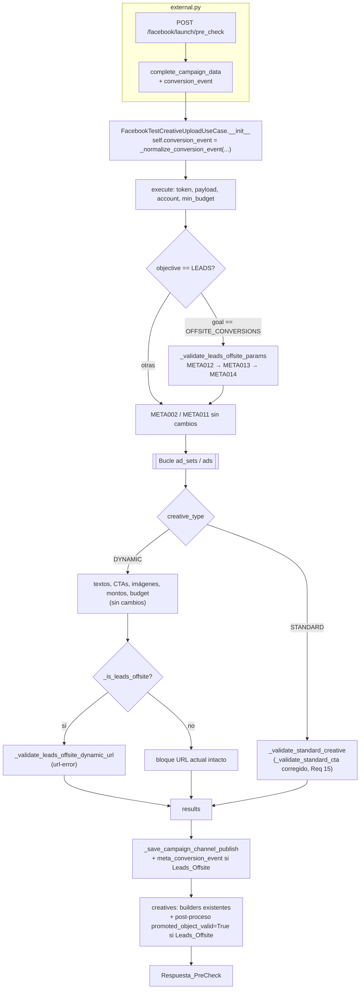
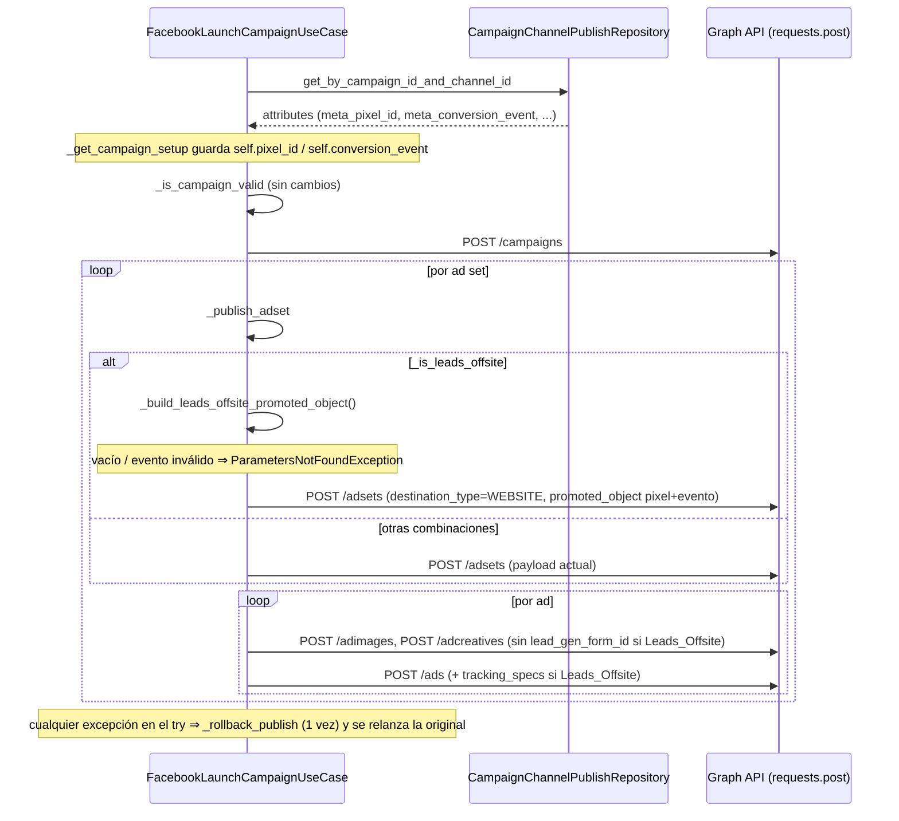

# Design Document: Meta Ads Leads Offsite Conversions

## Overview

Habilita la combinación `OUTCOME_LEADS` + `OFFSITE_CONVERSIONS` (Combinación_Leads_Offsite) en PreCheck, Save PreCheck y Launch, para `DYNAMIC` y `STANDARD`, y corrige de forma global la anotación del CTA en la Rama_STANDARD del PreCheck (Requirement 15).

El diseño se apoya en tres ideas:

1. **Fuente única de verdad en el Servicio_Validador.** Agregar el miembro `OFFSITE_CONVERSIONS` a `LeadsOptimizationGoal` hace que `OBJECTIVE_TO_GOALS`, `validate_optimization_goal_for_objective` y `get_allowed_ctas_for_goal` acepten la combinación sin tocar su código. Con la nueva entrada en `LEADS_GOAL_ALLOWED_CTAS`, los flujos genéricos (bucle de CTAs DYNAMIC, `valid_ctas`, `FacebookSavePreCheckCTAsUseCase`) funcionan sin cambios.
2. **Ramas aisladas por un único predicado.** Todo comportamiento nuevo se activa con la función de módulo `_is_leads_offsite(objective, optimization_goal)`. Para Otras_Combinaciones el código existente se ejecuta tal cual (Requirement 13).
3. **Validar temprano, construir tarde.** El PreCheck valida `pixel_id` + `conversion_event` antes del bucle de ads (`META012`–`META014`) y persiste ambos en Campaign_Setup. El Launch re-valida desde Campaign_Setup y construye recién ahí `promoted_object` y `tracking_specs`.

Hallazgos del código que condicionan el diseño:

- `_build_standard_creative_entry` emite `promoted_object_valid: False` fijo y solo admite la guarda mínima de CTA no-dict (Req 15.8). Para Req 8.2, `execute()` sobrescribe ese valor en un post-proceso solo para Combinación_Leads_Offsite.
- `_build_standard_creative_entry` (~líneas 1596 y 1601 de `meta_ads.py`) y los constructores STANDARD análogos (~2667/2672 y ~3721/3726) llaman `call_to_action.get('type', {})`. Con un `link_data.call_to_action` truthy no-dict (`'LEARN_MORE'`, `1`, `['SIGN_UP']`), `_validate_standard_cta` registra correctamente un `cta-error` (Req 15.5) y deja el valor tal cual, pero el builder lanza `AttributeError` y `execute()` no retorna Respuesta_PreCheck (rompe Req 5.3/8.2). Lo encontró la prueba de Property 8 (contraejemplo: un ad set STANDARD con 2 ads, el segundo con `call_to_action='LEARN_MORE'`). Corrección (Req 15.8, 15.11): en esos constructores se agrega solo `if not isinstance(call_to_action, dict): call_to_action = {}` antes de leer `type`, de modo que el elemento retorna `call_to_action_types = []` y `call_to_action_types_valid_amount = False`.
- El bloque de URL DYNAMIC actual (`','.join([u.get('website_url') ...])`) lanza `TypeError` con `website_url = None`, y lo captura con el slug `assets-budget-error`. Ese bloque queda intacto para Otras_Combinaciones (Req 7.6) y se sustituye por un helper propio en Combinación_Leads_Offsite.
- `_build_object_story_spec` del Launch inyecta `lead_gen_form_id` en el CTA para cualquier `OUTCOME_LEADS` con formulario. Requiere una guarda para cumplir Req 12.5.
- `MetaAdsPayloadBuilder` fija `billing_event = 'IMPRESSIONS'` para toda combinación, así que Req 9.5 se cumple sin cambios en el builder.
- `ParametersNotFoundException` (`PAR001`) lanzada dentro de `_publish_adset` cae en el `try/except` de `execute()`, que ya invoca `_rollback_publish` una vez y relanza la excepción original (no tiene `text` dict, así que `_is_meta_auth_error` la clasifica como no-auth). Req 11.6 no necesita cambios en el rollback.
- Los códigos `META012`, `META013` y `META014` están libres: hoy solo se usan `META001`–`META011` y `META31`.
- Casos_Save_PreCheck no necesitan cambios productivos: son agnósticos de la combinación y leen objective/goal del Campaign_Setup.

## Architecture





### Lo que NO cambia

- `FacebookSavePreCheck*UseCase` (incluidos `_validate_ctas`, `_validate_ctas_standard` y `_build_response`).
- `_build_standard_creative_entry` y los constructores STANDARD análogos de `meta_ads.py`, salvo la guarda `if not isinstance(call_to_action, dict): call_to_action = {}` antes de leer `type` (Req 15.8, 15.11). La misma guarda (más la de `type` no-dict) se agrega en el seguimiento a `FacebookGetLaunchCampaignCreativesUseCase._build_standard_creative_published` (sección 9, Req 16.1–16.3).
- `_build_dynamic_creative_entry`, salvo el cálculo de `proposal_url` sin valores `None` del seguimiento (sección 9, Req 16.4–16.5).
- `_is_campaign_valid`, `_rollback_publish`, `_build_asset_feed_spec`.
- `validate_promoted_object`, `SALES_GOAL_ALLOWED_CTAS`, `AWARENESS_GOAL_ALLOWED_CTAS`, `SALES_ALLOWED_CUSTOM_EVENTS`, `META_ODAX_CTA_MAPPING`.
- Ramas `SALES`, `LEAD_GENERATION` y `CONVERSATIONS` de `_publish_adset`.
- `FacebookTestCreativeUploadUseCase.execute()` y `FacebookPublishCampaignUseCase`.

## Components and Interfaces

### 1. `app/v2/use_cases/facebook_validator_service.py` (Requirement 1)

```python
class LeadsOptimizationGoal(Enum):
    LEAD_GENERATION = "LEAD_GENERATION"
    QUALITY_LEAD = "QUALITY_LEAD"
    CONVERSATIONS = "CONVERSATIONS"
    OFFSITE_CONVERSIONS = "OFFSITE_CONVERSIONS"   # nuevo

LEADS_GOAL_ALLOWED_CTAS = {
    ...,  # 3 entradas existentes sin cambios
    LeadsOptimizationGoal.OFFSITE_CONVERSIONS.value: {
        "LEARN_MORE", "SIGN_UP", "SUBSCRIBE", "ORDER_NOW", "SHOP_NOW", "APPLY_NOW",
        "BOOK_NOW", "CONTACT_US", "GET_OFFER", "GET_QUOTE", "DOWNLOAD", "SEE_MENU",
        "SEE_DETAILS", "GET_SHOWTIMES", "REQUEST_TIME", "BUY_TICKETS", "LISTEN_NOW",
        "PLAY_GAME", "WATCH_MORE", "NO_BUTTON",
    },
}

# Eventos_Conversion_Leads
LEADS_ALLOWED_CONVERSION_EVENTS: Set[str] = {
    "COMPLETE_REGISTRATION", "LEAD", "CONTACT", "SUBMIT_APPLICATION",
    "SCHEDULE", "SUBSCRIBE", "START_TRIAL",
}
```

- `MetaAdsValidator.VALID_CTA_VALUES`: se agregan `"SEE_MENU"` y `"SEE_DETAILS"`. Los otros 18 CTAs de la lista ya están presentes.
- `OBJECTIVE_TO_GOALS` se deriva del enum, así que incluye `OFFSITE_CONVERSIONS` para `OUTCOME_LEADS` sin editarlo (Req 1.4).
- `validate_cta_for_goal` no cambia. Su normalización y sus mensajes ya cumplen Req 1.5–1.7.

### 2. `app/v2/resources/external.py` (Requirement 3.1–3.3)

- `GeneratePreCheckCampaignLaunchStruct`: `'conversion_event': fields.String()` (opcional), junto a `pixel_id`.
- `FacebookResourceCampaignLaunchPreCheckGenerate.post`: `complete_campaign_data['conversion_event'] = payload.get('conversion_event')`, sin transformar. Las demás claves no cambian.

### 3. `app/v2/use_cases/meta_ads.py`: módulo

```python
from app.v2.use_cases.facebook_validator_service import (..., LEADS_ALLOWED_CONVERSION_EVENTS)

class CampaignDataDict(TypedDict, total=False):
    ...
    conversion_event: Optional[str]   # nuevo (Req 3.4)

def _is_leads_offsite(objective: Optional[str], optimization_goal: Optional[str]) -> bool:
    return (objective == CampaignObjective.LEADS.value
            and optimization_goal == LeadsOptimizationGoal.OFFSITE_CONVERSIONS.value)

def _normalize_conversion_event(value: Any) -> Optional[str]:
    """strip()+upper() si es str con contenido; None en cualquier otro caso. Nunca lanza."""
    if not isinstance(value, str) or not value.strip():
        return None
    return value.strip().upper()

def _is_blank(value: Any) -> bool:
    """None, '' o solo espacios ⇒ True (Req 4.1, 11.1)."""
    return value is None or (isinstance(value, str) and not value.strip())
```

Se definen como funciones de módulo (igual que `_get_meta_currency_offset`) porque las usan dos jerarquías sin base común: `FacebookTestCreativeUploadUseCase` y `FacebookLaunchCampaignUseCase`.

### 4. `FacebookTestCreativeUploadUseCase.__init__` (Requirement 3.5–3.7)

Una línea nueva, con la misma guarda que `pixel_id`:

```python
self.conversion_event = _normalize_conversion_event(
    complete_campaign_data.get('conversion_event') if complete_campaign_data else None
)
```

`complete_campaign_data=None` sigue lanzando `AttributeError` en `ad_account_id`, antes de llegar a esta línea, como espera la prueba de caracterización. Los Casos_Save_PreCheck construyen con `{}`, por lo que obtienen `conversion_event = None`.

### 5. `FacebookGeneratePreCheckCreativeUseCase`

#### 5.1 `_STANDARD_SUPPORTED_COMBINATIONS` (Req 5.1)

Se agrega `(CampaignObjective.LEADS.value, LeadsOptimizationGoal.OFFSITE_CONVERSIONS.value)`. El guard `META011` no cambia (Req 5.4, 5.5).

#### 5.2 `_validate_leads_offsite_params()` (Requirement 4)

```python
def _validate_leads_offsite_params(self) -> None:
    combo = "OUTCOME_LEADS/OFFSITE_CONVERSIONS"
    if _is_blank(self.pixel_id):
        raise MetaException("META012", f"pixel_id is required for {combo}")
    if self.conversion_event is None:
        raise MetaException("META013", f"conversion_event is required for {combo}")
    if self.conversion_event not in LEADS_ALLOWED_CONVERSION_EVENTS:
        allowed = ", ".join(sorted(LEADS_ALLOWED_CONVERSION_EVENTS))
        raise MetaException(
            "META014",
            f"conversion_event '{self.conversion_event}' is not allowed for {combo}. Allowed values: {allowed}",
        )
```

Punto de inserción en `execute()`: dentro del bloque existente `if self.objective == CampaignObjective.LEADS.value:`, después de las guardas de `LEAD_GENERATION` y `CONVERSATIONS`:

```python
if self.optimization_goal == LeadsOptimizationGoal.OFFSITE_CONVERSIONS.value:
    self._validate_leads_offsite_params()
```

Este punto está antes de `META002`/`META011`, del bucle (sin descargas de imágenes) y de `_save_campaign_channel_publish`, y vale para ambas ramas (Req 4.4–4.5, 9.6). Para Otras_Combinaciones no se evalúa (Req 4.7). El mensaje de `META014` muestra el valor ya normalizado.

#### 5.3 `_validate_standard_cta` corregido (Requirement 15, global)

```python
def _validate_standard_cta(self, link_data, current_ad_errors):
    cta = link_data.get('call_to_action')
    if not cta:
        return                                            # 15.4 sin cambios
    if not isinstance(cta, dict):
        current_ad_errors.append({'slug': 'cta-error',
                                  'message': "call_to_action debe ser un diccionario."})
        return                                            # 15.5 sin cambios

    cta_type = cta.get('type')
    if not isinstance(cta_type, dict):                    # 15.3: ausente, None, str, list...
        cta_text = cta_type                               # None si estaba ausente
        cta['type'] = {'value': cta_text, 'valid': False}
        valid = False
    else:                                                 # 15.1
        cta_text = cta_type.get('value')
        valid = MetaAdsValidator.validate_cta_for_goal(
            cta_text=cta_text, objective=self.objective, goal=self.optimization_goal, throw=False,
        )
        cta_type['valid'] = valid                         # sobrescribe el valid del input

    cta['valid'] = valid                                  # 15.2 espejo en la raíz
    if not valid:                                         # 15.6 exactamente 1 cta-error
        current_ad_errors.append({
            'slug': 'cta-error',
            'message': f"CTA '{cta_text}' no permitido para el objetivo/optimización actuales.",
        })
```

- La llamada a `validate_cta_for_goal` mantiene los mismos argumentos con nombre, que es lo que verifican con `assert_called_once_with(...)` los tests existentes de `TestStandardCtaValidation`.
- Cuando `type` no es un dict, no se invoca `validate_cta_for_goal`. Hoy, si `type` está ausente se invoca con `None` y retorna `False`, así que el resultado observable no cambia; con `type` no-dict el código actual lanzaba `AttributeError`.
- `_build_standard_creative_entry` sigue leyendo `call_to_action['type']['valid']`, que ahora contiene el valor real (Req 15.7). El único cambio en ese builder y en los constructores STANDARD análogos que usan `call_to_action.get('type', ...)` es la guarda previa `if not isinstance(call_to_action, dict): call_to_action = {}`: el caso truthy no-dict (Req 15.5) registra el `cta-error` en `_validate_standard_cta` y el builder retorna `call_to_action_types = []` y `call_to_action_types_valid_amount = False` en lugar de lanzar `AttributeError` (Req 15.8, 15.11).
- Req 6.3–6.6 para Combinación_Leads_Offsite son este mismo método aplicado a los CTAs de la combinación.

#### 5.4 `_validate_leads_offsite_dynamic_url(asset_feed, current_ad_errors)` (Requirement 7.1–7.4)

```python
def _validate_leads_offsite_dynamic_url(self, asset_feed, current_ad_errors):
    entries = [u for u in (asset_feed.get('link_urls') or []) if isinstance(u, dict)]
    for entry in entries:
        if 'website_url' in entry and entry['website_url'] is None:
            entry['website_url'] = ''   # evita TypeError en _build_dynamic_creative_entry
    urls = [e['website_url'] for e in entries if e.get('website_url')]

    if not urls:
        asset_feed['link_url_valid'] = False
        current_ad_errors.append({'slug': 'url-error',
                                  'message': "URL de destino ausente para el creativo DYNAMIC."})
        return

    joined = ','.join(urls)
    valid = MetaAdsValidator.is_valid_link_url(joined)
    asset_feed['link_url_valid'] = valid
    if not valid:
        current_ad_errors.append({'slug': 'url-error',
                                  'message': f"URL '{joined}' no tiene un formato válido."})
```

Punto de inserción en el bucle DYNAMIC: el bloque `try` de URL actual queda dentro de un `else`.

```python
if _is_leads_offsite(self.objective, self.optimization_goal):
    self._validate_leads_offsite_dynamic_url(asset_feed, current_ad_errors)
else:
    try:  # bloque URL actual, sin cambios (Req 7.6)
        ...
```

Decisiones de diseño:
- Solo se unen los `website_url` no vacíos. Así, "exactamente 1 URL" (Req 7.1) no se rompe por entradas vacías sobrantes.
- `website_url = None` se normaliza a `''` en la propia entrada. Sin esto, `_build_dynamic_creative_entry` lanzaría `TypeError` al calcular `proposal_url`. El cambio solo aplica a Combinación_Leads_Offsite. Para Otras_Combinaciones el mismo `TypeError` se corrige en `_build_dynamic_creative_entry` en el seguimiento (sección 9.2, Req 16.4–16.5); para Leads_Offsite la normalización ya lo evita.
- El `url-error` deja el ad como `Failed` en `results`. El `continue` existente conserva las demás anotaciones (Req 7.4).

La Rama_STANDARD usa sin cambios el `_validate_standard_url` existente (Req 7.5).

#### 5.5 `promoted_object_valid` (Requirement 8)

- DYNAMIC: el bucle ya hace `asset_feed['promoted_object_valid'] = True` y solo la rama `SALES` llama a `validate_promoted_object`. Para `OUTCOME_LEADS` ese valor nunca se recalcula (Req 8.4).
- Post-proceso en `execute()`, dentro del bucle existente que renumera `idx`, para ambas ramas:

```python
leads_offsite = _is_leads_offsite(self.objective, self.optimization_goal)
for idx, item in enumerate(creatives):
    item['idx'] = idx
    if leads_offsite:
        item['promoted_object_valid'] = True   # Req 8.1–8.3: depende solo de pixel+evento
```

Llegar a este punto implica que `_validate_leads_offsite_params` pasó, por lo que `True` es exacto. Para Otras_Combinaciones no se toca nada (Req 8.6: DYNAMIC conserva la lógica SALES y STANDARD sigue en `False`).

#### 5.6 Persistencia en Campaign_Setup (Requirement 9)

En la construcción existente de `campaign_channel_publish`, después de `meta_pixel_id`:

```python
if _is_leads_offsite(self.objective, self.optimization_goal):
    campaign_channel_publish['meta_conversion_event'] = self.conversion_event
```

- Se llama una sola vez, después del bucle, aunque haya ads `Failed` (Req 9.1). El resto de claves y condiciones no cambian (Req 9.4).
- `meta_pixel_id` ya se incluye cuando es truthy, y siempre lo es aquí tras pasar `META012` (Req 9.2).
- `meta_billing_event` toma `self.billing_event`, que `MetaAdsPayloadBuilder` fija en `'IMPRESSIONS'` (Req 9.5).
- Para Otras_Combinaciones `meta_conversion_event` nunca se agrega (Req 9.3, 13.4).

#### 5.7 Sin cambios

El bucle de CTAs DYNAMIC (`validate_cta_for_goal(..., throw=False)` nunca lanza y retorna `False` para `None` o `''`, lo que cubre Req 6.1–6.2) y `valid_ctas` (`get_allowed_ctas_for_goal` retorna los 20 CTAs, Req 6.7).

### 6. `FacebookGetCampaignObjectiveUseCase` (Requirement 2)

Se agrega un tercer elemento a `leads['goals']`, al final de la lista:

```python
{'id': LeadsOptimizationGoal.OFFSITE_CONVERSIONS.value, 'billing_event': 'IMPRESSIONS'}
```

Lo demás no cambia. No hay I/O, porque el bloque de Redis está comentado.

### 7. Casos_Save_PreCheck (Requirement 10)

No hay cambios productivos. `FacebookSavePreCheckCTAsUseCase._validate_ctas` y `_validate_ctas_standard` usan `validate_cta_for_goal` con objective/goal del Campaign_Setup, y ya resuelven la nueva entrada de `LEADS_GOAL_ALLOWED_CTAS`. Los otros cinco casos no ramifican por objective/goal, así que su comportamiento es idéntico al de `LEAD_GENERATION` (Req 10.5). Ninguno escribe `promoted_object_valid` (Req 10.7). La cobertura de Req 10 se hace con pruebas.

### 8. `FacebookLaunchCampaignUseCase`

#### 8.1 Estado y lectura del Campaign_Setup (Req 11.1)

- `__init__`: `self.pixel_id = None`, `self.conversion_event = None`.
- `_get_campaign_setup`: `attrs = campaign_setup.get('attributes', {})`, más:
  - `self.pixel_id = attrs.get('meta_pixel_id')`
  - `self.conversion_event = attrs.get('meta_conversion_event')`

Los valores se guardan sin transformar. La comprobación de vacío se hace con `_is_blank`.

#### 8.2 Helpers nuevos

```python
def _build_leads_offsite_promoted_object(self) -> Dict[str, str]:
    """Req 11.3, 11.5, 11.9. Lanza ParametersNotFoundException antes de cualquier POST del ad set."""
    if _is_blank(self.pixel_id):
        raise ParametersNotFoundException("meta_pixel_id is required in Campaign Setup for OUTCOME_LEADS/OFFSITE_CONVERSIONS")
    if _is_blank(self.conversion_event):
        raise ParametersNotFoundException("meta_conversion_event is required in Campaign Setup for OUTCOME_LEADS/OFFSITE_CONVERSIONS")
    if self.conversion_event not in LEADS_ALLOWED_CONVERSION_EVENTS:
        raise ParametersNotFoundException(f"meta_conversion_event '{self.conversion_event}' is not a valid conversion event for OUTCOME_LEADS/OFFSITE_CONVERSIONS")
    return {"pixel_id": self.pixel_id, "custom_event_type": self.conversion_event}

def _build_leads_offsite_tracking_specs(self) -> List[Dict[str, List[str]]]:
    """Req 12.1."""
    return [{"action.type": ["offsite_conversion"], "dataset": [self.pixel_id]}]
```

La comparación contra Eventos_Conversion_Leads es exacta. El PreCheck ya persiste el valor normalizado, y un valor editado a mano en Strapi con minúsculas o espacios se rechaza (decisión 9 del requirements).

#### 8.3 `_publish_adset` (Requirement 11)

Dentro del `if self.campaign_objective == CampaignObjective.LEADS.value:` existente:

```python
if _is_leads_offsite(self.campaign_objective, self.campaign_optimization_goal):
    payload["promoted_object"] = self._build_leads_offsite_promoted_object()
    payload["destination_type"] = "WEBSITE"
    payload["optimization_goal"] = LeadsOptimizationGoal.OFFSITE_CONVERSIONS.value
    payload["billing_event"] = "IMPRESSIONS"
else:
    # código actual sin cambios: page_id, CONVERSATIONS (WHATSAPP + targeting), LEAD_GENERATION (ON_AD)
```

- `promoted_object` ignora `adset['promoted_object']` y nunca incluye `page_id` (Req 11.3).
- `optimization_goal` y `billing_event` se fijan explícitamente en lugar de heredarse del `channel_creative`, para que Req 11.4 sea determinista.
- La rama `SALES` no cambia (Req 11.11, 13.2).

#### 8.4 `_publish_ad` (Requirement 12.1–12.4, 12.6)

```python
if _is_leads_offsite(self.campaign_objective, self.campaign_optimization_goal):
    payload["tracking_specs"] = self._build_leads_offsite_tracking_specs()
```

Las claves existentes no cambian. Como `_publish_adset` siempre se ejecuta antes que cualquier `_publish_ad`, una `ParametersNotFoundException` impide enviar cualquier Payload_Ad (Req 12.6).

#### 8.5 `_build_object_story_spec` (Requirement 12.5)

Se agrega una guarda a la condición existente:

```python
if self.campaign_objective == CampaignObjective.LEADS.value and lead_gen_form_id \
        and not _is_leads_offsite(self.campaign_objective, self.campaign_optimization_goal):
```

El `elif ... == 'CONVERSATIONS'` no aplica a esta combinación, así que el CTA conserva `type` y `value` de entrada. `_build_asset_feed_spec` no necesita cambios, porque solo ramifica por `LEAD_GENERATION` y `CONVERSATIONS`.

#### 8.6 Rollback (Req 11.6)

No hay cambios. La excepción se lanza dentro del `try` de `execute()`, después de `_publish_campaign`. `_rollback_publish(meta_campaign_id, created_ad_creative_ids, ...)` se ejecuta una vez y se relanza `e`.

### 9. Seguimiento (Requirement 16)

Tres problemas detectados durante la ejecución de las tareas, con correcciones mínimas y sin otros cambios en los métodos afectados.

#### 9.1 A: CTA no-dict en `FacebookGetLaunchCampaignCreativesUseCase` (Req 16.1–16.3)

- Ubicación: `_build_standard_creative_published` (~líneas 5227/5228 de `meta_ads.py`).
- Bug: `call_to_action = link_data.get('call_to_action') or {}` seguido de `call_to_action_type = call_to_action.get('type') or {}`. Un `call_to_action` truthy no-dict (`'LEARN_MORE'`, `1`, `['SIGN_UP']`) o un `type` truthy no-dict lanza `AttributeError`. Es la misma clase de bug que Req 15.8/15.11 (tarea 7.6) corrigió en los otros tres constructores STANDARD.
- Corrección:

```python
call_to_action = link_data.get('call_to_action') or {}
if not isinstance(call_to_action, dict):
    call_to_action = {}
call_to_action_type = call_to_action.get('type') or {}
if not isinstance(call_to_action_type, dict):
    call_to_action_type = {}
```

- Impacto: con `call_to_action` no-dict el elemento sale con `call_to_action_types = []` y `call_to_action_types_valid_amount = False` (los valores por defecto existentes para CTA ausente). Con `type` no-dict sale `call_to_action_types = [{}]` y `call_to_action_types_valid_amount = False`, porque el constructor emite `[call_to_action_type] if call_to_action else []`. Las 31 claves y los casos dict no cambian.

#### 9.2 B: `TypeError` con `website_url = None` en `_build_dynamic_creative_entry` (Req 16.4–16.5)

- Ubicación: `FacebookGeneratePreCheckCreativeUseCase._build_dynamic_creative_entry` (~línea 1553, clave `proposal_url`).
- Bug: para Otras_Combinaciones en Rama_DYNAMIC, el bloque de URL existente registra `assets-budget-error` cuando `website_url` es `None` (`','.join` sobre `None`), y luego `_build_dynamic_creative_entry` repite el `','.join(...)` sobre el mismo `None` y lanza `TypeError`, así que `execute()` falla. Era preexistente y Req 13.1 obligaba a conservarlo.
- Corrección:

```python
'proposal_url': ','.join([
    u.get('website_url', '')
    for u in ad_creative.get('asset_feed_spec', {}).get('link_urls', [])
    if u.get('website_url', '') is not None
]),
```

- Decisión: se omiten solo los valores `None`. Los strings (incluido `''`) se unen igual que antes, así que `proposal_url` no cambia para ninguna entrada que antes no fallaba (Req 16.4). Omitir también `''` alteraría `proposal_url` en casos que hoy funcionan, fuera de la excepción a Req 13.1.
- Impacto: el bloque de URL y su slug `assets-budget-error` para Otras_Combinaciones no cambian; tampoco hay `url-error` (Req 7.6) ni se asigna `link_url_valid`. `execute()` retorna Respuesta_PreCheck con status 200. Leads_Offsite no se ve afectado, porque `_validate_leads_offsite_dynamic_url` ya normaliza `None` a `''`. Es una excepción explícita a Req 13.1 (Req 16.5).

#### 9.3 C: docstrings obsoletos "4 STANDARD combinations" (Req 16.6)

- Ubicación: `tests/v2/unit/use_cases/test_facebook_generate_pre_check_creative.py`, docstrings de `make_standard_link_data_full` y de `TestStandardCombinationSuccessScenarios.test_full_success_scenario_yields_ok_1_and_all_seven_success_annotations_true`.
- Bug: dicen que hay 4 `STANDARD_SUPPORTED_COMBINATIONS`; ahora son 5, incluida (`OUTCOME_LEADS`, `OFFSITE_CONVERSIONS`).
- Corrección: solo texto. Cambiar 4 por 5 y agregar `LEADS_GOAL_ALLOWED_CTAS[OFFSITE_CONVERSIONS]` a la lista de allow-lists que contienen `"LEARN_MORE"` (lo contiene, porque pertenece a CTAs_Leads_Offsite). Sin tocar aserciones.

## Data Models

### Body del PreCheck (entrada, campos planos relevantes)

| Campo | Tipo | Requerido | Nota |
|---|---|---|---|
| `pixel_id` | `String` | no (sí para Leads_Offsite, validado en el use case) | sin cambios |
| `conversion_event` | `String` | no (sí para Leads_Offsite) | nuevo; se normaliza con `strip().upper()` |

### `complete_campaign_data` / `CampaignDataDict`

Las claves actuales más `conversion_event: Optional[str]` (valor crudo del body o `None`).

### Campaign_Setup (`campaign-channel-publishes.attributes`) escrito por el PreCheck

| Clave | Leads_Offsite | Otras_Combinaciones |
|---|---|---|
| `meta_campaign_objective` | `"OUTCOME_LEADS"` | sin cambios |
| `meta_optimization_goal` | `"OFFSITE_CONVERSIONS"` | sin cambios |
| `meta_billing_event` | `"IMPRESSIONS"` | sin cambios |
| `meta_campaign_mode`, `meta_account_id`, `meta_page_id` | sin cambios | sin cambios |
| `meta_lead_form_id`, `meta_whatsapp_id` | solo si truthy | solo si truthy |
| `meta_pixel_id` | siempre (Pixel_Id crudo) | solo si truthy |
| `meta_conversion_event` | siempre (normalizado) | **nunca** |

El campo `meta_conversion_event` lo crea manualmente el equipo en Strapi (fuera de alcance).

### Payload_AdSet (Leads_Offsite)

```json
{
  "name": "...", "campaign_id": "...", "daily_budget": 0,
  "billing_event": "IMPRESSIONS",
  "optimization_goal": "OFFSITE_CONVERSIONS",
  "bid_strategy": "LOWEST_COST_WITHOUT_CAP",
  "is_dynamic_creative": true, "has_dynamic_creative": true,
  "targeting": {"...": "...", "targeting_automation": {"advantage_audience": 0}},
  "start_time": "...", "end_time": "...", "status": "PAUSED", "access_token": "...",
  "destination_type": "WEBSITE",
  "promoted_object": {"pixel_id": "<meta_pixel_id>", "custom_event_type": "<meta_conversion_event>"}
}
```

### Payload_Ad (Leads_Offsite)

```json
{
  "name": "...", "adset_id": "...", "creative": {"creative_id": "..."},
  "status": "PAUSED", "access_token": "...",
  "tracking_specs": [{"action.type": ["offsite_conversion"], "dataset": ["<meta_pixel_id>"]}]
}
```

### `call_to_action` STANDARD tras el PreCheck (todas las combinaciones, Req 15)

| Entrada `link_data.call_to_action` | Salida | `cta-error` |
|---|---|---|
| falsy (`None`, `{}`, `""`, ausente) | sin cambios | no |
| no-dict truthy (`"LEARN_MORE"`, `[...]`) | sin cambios | sí (formato) |
| `{'type': {'value': v, ...}}` | `type.valid = r`, `valid = r`, con `r = validate_cta_for_goal(v)` | sí si `r` es `False` |
| `{'type': <no-dict o ausente>, ...}` | `type = {'value': <type original o None>, 'valid': False}`, `valid = False` | sí |

## Correctness Properties

*A property is a characteristic or behavior that should hold true across all valid executions of a system-essentially, a formal statement about what the system should do. Properties serve as the bridge between human-readable specifications and machine-verifiable correctness guarantees.*

La reflexión posterior al prework consolidó criterios redundantes. Por ejemplo, 4.1–4.6 + 8.5 + 9.6 quedan en un único modelo de referencia (Property 3), y 15.1–15.3 + 15.6 + 6.3–6.4 en la Property 9. Los criterios estáticos (constantes, catálogo, combinaciones soportadas) y los de regresión puntual quedan como pruebas de ejemplo.

### Property 1: Validación de CTA para Combinación_Leads_Offsite

*Para todo* valor `c` (string arbitrario, variantes de mayúsculas, espacios y `_`↔` ` de los 20 CTAs_Leads_Offsite, strings solo de espacios y `None`), `validate_cta_for_goal(c, "OUTCOME_LEADS", "OFFSITE_CONVERSIONS", throw=False)` retorna `True` si y solo si `_normalize_cta(c)` pertenece a CTAs_Leads_Offsite. Con `throw=True`, cuando el resultado es `False` lanza `ValueError` con `"CTA is required but was empty"` si la normalización es vacía, o con `"CTA '<normalizado>' not allowed for objective 'OUTCOME_LEADS' and goal 'OFFSITE_CONVERSIONS'"` en otro caso.

**Validates: Requirements 1.5, 1.6, 1.7**

### Property 2: Normalización de Conversion_Event en la construcción

*Para todo* valor `v` de `complete_campaign_data['conversion_event']` (ausente, `None`, no-str, string vacío, solo espacios o con contenido) y *para todo* par (objective, optimization_goal), construir Caso_PreCheck no lanza excepción y deja `conversion_event == v.strip().upper()` cuando `v` es `str` con algún carácter no blanco, y `None` en cualquier otro caso.

**Validates: Requirements 3.5, 3.6, 3.7**

### Property 3: Validaciones obligatorias del PreCheck como modelo de referencia

*Para todo* `pixel_id` (`None`, `""`, solo espacios o string no vacío), *para todo* `conversion_event` crudo (ausente, `None`, blanco, variante de un evento permitido, `PURCHASE` o texto arbitrario) y *para toda* rama (`DYNAMIC`, `STANDARD`) de Combinación_Leads_Offsite, `execute()` lanza exactamente el código `expected(pixel, event)` del modelo de referencia: `META012` si el píxel es blanco; si no, `META013` si el evento normalizado es `None`; si no, `META014` si no pertenece a Eventos_Conversion_Leads; si no, ninguno. Cuando hay excepción, `save_or_update`, `ad_channel_repository.update` y `validate_images_precheck` no se invocan. Para `META014`, el mensaje contiene el valor y los 7 eventos permitidos.

**Validates: Requirements 4.1, 4.2, 4.3, 4.4, 4.5, 4.6, 8.5, 9.6**

### Property 4: `conversion_event` es inerte para Otras_Combinaciones

*Para toda* combinación de Otras_Combinaciones soportada por la rama elegida y *para todo* `conversion_event` (incluidos valores fuera de Eventos_Conversion_Leads), `execute()` no lanza `META012`, `META013` ni `META014`. Los datos pasados a `save_or_update` no contienen `meta_conversion_event`. La Respuesta_PreCheck y los datos persistidos son iguales a los de la misma ejecución sin `conversion_event`.

**Validates: Requirements 4.7, 9.3, 13.4**

### Property 5: URL DYNAMIC de Combinación_Leads_Offsite

*Para toda* lista `link_urls` (0 a 3 entradas con `website_url` ausente, `None`, `""`, URL válida o texto arbitrario), `_validate_leads_offsite_dynamic_url` deja `link_url_valid == ref(link_urls)`, donde `ref` es `True` si y solo si hay exactamente una URL no vacía y cumple `URL_PATTERN`. Además, agrega exactamente un error `url-error` cuando `link_url_valid` es `False` y ninguno cuando es `True`, y no invoca `is_valid_link_url` cuando no hay ninguna URL no vacía.

**Validates: Requirements 7.1, 7.2, 7.3**

### Property 6: Otras_Combinaciones DYNAMIC nunca registran `url-error`

*Para toda* combinación DYNAMIC de Otras_Combinaciones y *para toda* lista `link_urls` con `website_url` de tipo string, el ad procesado no registra errores con slug `url-error` y `link_url_valid` es igual a `is_valid_link_url(','.join(website_urls))`, como en la implementación previa.

**Validates: Requirements 7.6**

### Property 7: Anotación de CTAs DYNAMIC en el PreCheck

*Para toda* lista de CTAs DYNAMIC (con `value` permitido, no permitido, ausente, `None` o vacío) de un ad de Combinación_Leads_Offsite, tras `execute()` cada elemento tiene `valid == (_normalize_cta(value) ∈ CTAs_Leads_Offsite)` y su `value` original intacto, sin excepción.

**Validates: Requirements 6.1, 6.2**

### Property 8: Invariantes de la Respuesta_PreCheck exitosa

*Para toda* rama, *para toda* estructura de 1 a 3 ad sets con 1 a 3 ads (STANDARD) o con 1 ad por ad set (DYNAMIC), y *para toda* mezcla de validez por-ad (URL o CTA inválidos incluidos, y en STANDARD también `call_to_action` truthy no-dict como `'LEARN_MORE'`, `1` o `['SIGN_UP']`), una ejecución de Combinación_Leads_Offsite con píxel y evento válidos cumple: retorna las claves `campaign`, `creatives`, `valid_ctas` y `account_config`; `len(creatives)` es igual al número total de ads; cada `creatives[i]['promoted_object_valid'] is True`; `set(valid_ctas) == CTAs_Leads_Offsite` con `len == 20`; y `validate_promoted_object` nunca se invoca. Además, `execute()` no lanza excepción y cada ad STANDARD con `call_to_action` truthy no-dict tiene exactamente un `cta-error`, `call_to_action_types == []` y `call_to_action_types_valid_amount is False`. Req 15.11 se valida también con pruebas unitarias parametrizadas sobre Leads_Offsite y al menos una Otra_Combinación (tarea 7.6).

**Validates: Requirements 5.3, 6.7, 8.1, 8.2, 8.3, 8.4, 15.11**

### Property 9: Persistencia en Campaign_Setup para Combinación_Leads_Offsite

*Para todo* `pixel_id` no blanco, *para toda* variante (mayúsculas o espacios) de un evento de Eventos_Conversion_Leads y *para todo* patrón de ads fallidos, `save_or_update` se invoca exactamente una vez con el filtro `(campaign_id, channel_id)`. Los datos contienen `meta_pixel_id == pixel_id` sin transformar, `meta_conversion_event == evento.strip().upper()` y `meta_billing_event == "IMPRESSIONS"`.

**Validates: Requirements 9.1, 9.2, 9.5**

### Property 10: Anotación corregida del CTA STANDARD (global)

*Para toda* combinación de `_STANDARD_SUPPORTED_COMBINATIONS`, *para todo* `call_to_action` dict no vacío cuyo `type` es un dict (con `value` permitido, no permitido o `None`, y `valid` de entrada ausente, `True`, `False` u otro) o es ausente o no-dict (`None`, str, int, list), `_validate_standard_cta` deja:

- `type.valid == validate_cta_for_goal(value, objective, goal, throw=False)` en el caso dict, con `value` intacto;
- `type == {'value': <original o None>, 'valid': False}` en el caso no-dict;
- `call_to_action['valid'] == call_to_action['type']['valid']`;
- exactamente un `cta-error` si el valor es `False`, que menciona el CTA rechazado, y ninguno si es `True`.

Ningún caso propaga excepciones.

**Validates: Requirements 6.3, 6.4, 15.1, 15.2, 15.3, 15.6**

### Property 11: `call_to_action_types_valid_amount` refleja la validación real

*Para toda* combinación de `_STANDARD_SUPPORTED_COMBINATIONS`, *para todo* CTA (permitido o no según `get_allowed_ctas_for_goal`) y *para todo* `type.valid` de entrada (ausente, `True` o `False`), el elemento de `creatives` producido por `execute()` en STANDARD tiene `call_to_action_types_valid_amount` igual a la pertenencia real del CTA a los permitidos de la combinación, con independencia del valor de entrada.

**Validates: Requirements 15.7, 13.7**

### Property 12: Save PreCheck de CTAs para Combinación_Leads_Offsite

*Para toda* lista de CTAs (0 a N, valores arbitrarios), `FacebookSavePreCheckCTAsUseCase` con Campaign_Setup de Combinación_Leads_Offsite cumple:

- en DYNAMIC, conserva longitud y orden, anota `valid == (_normalize_cta(value) ∈ CTAs_Leads_Offsite)` y asigna `call_to_action_types_valid_amount == is_valid_ctas_amount(lista)`;
- en STANDARD con exactamente un CTA, escribe `link_data.call_to_action == {'type': {'value': cta, 'valid': <pertenencia>}}`.

En ambos casos invoca `_save_creative_to_publish` exactamente una vez.

**Validates: Requirements 10.1, 10.2, 10.3, 10.6**

### Property 13: Payload_AdSet de Combinación_Leads_Offsite

*Para todo* `meta_pixel_id` y `meta_conversion_event` del Campaign_Setup (blancos, fuera de Eventos_Conversion_Leads o válidos), *para todo* `promoted_object` ruidoso en el `channel_creative` del ad set y *para toda* rama, `_publish_adset` cumple una de dos:

- si el píxel o el evento son blancos o el evento no pertenece a Eventos_Conversion_Leads, lanza `ParametersNotFoundException` y `requests.post` no se invoca;
- en otro caso, envía un único POST cuyo payload tiene `destination_type == "WEBSITE"`, `optimization_goal == "OFFSITE_CONVERSIONS"`, `billing_event == "IMPRESSIONS"` y `promoted_object == {"pixel_id": pixel, "custom_event_type": evento}` exactamente.

**Validates: Requirements 11.1, 11.2, 11.3, 11.4, 11.5, 11.7, 11.9**

### Property 14: `tracking_specs` en Payload_Ad solo para Combinación_Leads_Offsite

*Para toda* combinación (objective, optimization_goal) y *para todo* `meta_pixel_id` no blanco, el payload de `_publish_ad` conserva `name`, `adset_id`, `creative`, `status` y `access_token` con sus valores actuales. Contiene `tracking_specs == [{"action.type": ["offsite_conversion"], "dataset": [pixel]}]` si y solo si la combinación es Combinación_Leads_Offsite, y no contiene la clave en otro caso.

**Validates: Requirements 12.1, 12.2, 12.4**

### Property 15: El creativo de Combinación_Leads_Offsite no se convierte en lead form

*Para todo* `lead_gen_form_id` (`None` o string) y *para todo* `link_data` o `asset_feed_spec` con CTA y `link` arbitrarios, con Combinación_Leads_Offsite se cumple:

- `_build_object_story_spec` produce `link_data.link` igual al de entrada y `call_to_action == {'type': <type.value de entrada>, 'value': <value de entrada o {}>}`, sin `lead_gen_form_id` ni `app_destination`;
- `_build_asset_feed_spec` no agrega `call_to_actions`.

**Validates: Requirements 12.5**

## Error Handling

| Situación | Dónde | Resultado | Efectos |
|---|---|---|---|
| Leads_Offsite, `pixel_id` blanco | `Caso_PreCheck._validate_leads_offsite_params` | `MetaException("META012", ...)` | no hay bucle ni persistencia (Campaign_Setup y `ad-channels` intactos) |
| Leads_Offsite, `conversion_event` `None` tras normalizar | ídem | `MetaException("META013", ...)` | ídem |
| Leads_Offsite, evento fuera de Eventos_Conversion_Leads | ídem | `MetaException("META014", "...'<valor>'... Allowed values: <7>")` | ídem |
| Leads_Offsite DYNAMIC, URL ausente o inválida | `_validate_leads_offsite_dynamic_url` | error por-ad `url-error`, ad `Failed` en `results` | se persiste y se responde normalmente, con `proposal_url_valid = False` |
| STANDARD (global), CTA no permitido o `type` no-dict | `_validate_standard_cta` | error por-ad `cta-error`, `type.valid = valid = False` | sin excepción; la compuerta del Launch bloqueará |
| STANDARD (global), `call_to_action` truthy no-dict | `_validate_standard_cta` + guarda en `_build_standard_creative_entry` y constructores análogos | error por-ad `cta-error` (Req 15.5); elemento con `call_to_action_types = []` y `call_to_action_types_valid_amount = False` | sin excepción; `execute()` retorna Respuesta_PreCheck (Req 15.11) |
| Consulta de creativos publicados STANDARD, `call_to_action` o `type` truthy no-dict | guarda en `FacebookGetLaunchCampaignCreativesUseCase._build_standard_creative_published` | elemento con `call_to_action_types_valid_amount = False` (`call_to_action_types = []` o `[{}]`) | sin excepción (Req 16.1–16.2) |
| Otras_Combinaciones DYNAMIC, `website_url = None` | bloque de URL existente + `_build_dynamic_creative_entry` | error por-ad `assets-budget-error` (sin cambios); `proposal_url` sin `None` | sin `TypeError`; `execute()` retorna status 200 (Req 16.4–16.5) |
| Launch Leads_Offsite, `meta_pixel_id`/`meta_conversion_event` blanco o evento inválido | `_build_leads_offsite_promoted_object` (dentro de `_publish_adset`) | `ParametersNotFoundException` (`PAR001`) | `_rollback_publish` 1 vez (borra la campaña ya creada); no hay POST de ad set ni de ads; se relanza la excepción original |

Notas:
- Las `MetaException` del PreCheck se lanzan antes de `META002`/`META011`. Para esta combinación esos dos guards nunca fallarían, así que no hay ambigüedad de precedencia.
- La `ParametersNotFoundException` del Launch no tiene `text` dict, por lo que `_is_meta_auth_error` retorna `False` y no se convierte en `META31`.
- `ParametersNotFoundException` se usa para los dos casos del Launch (faltante e inválido) por consistencia con la rama SALES, que ya envuelve los errores de `validate_promoted_object` en esa excepción.

## Testing Strategy

### Enfoque

Hay dos tipos de pruebas complementarias:
- Pruebas de ejemplo (pytest + pytest-mock) para constantes, catálogo, regresiones puntuales, rollback y casos felices.
- Pruebas de propiedades con **hypothesis** (`hypothesis==6.112.2`, ya instalada en `sinergia/venv` y usada en la suite) para las 15 propiedades.

PBT aplica porque la lógica es pura o se puede aislar con mocks (normalización, membresía, construcción de payloads). La capa de I/O (Strapi, Redis, Graph API) siempre se mockea.

Configuración de cada prueba de propiedad:
- `@settings(max_examples=100, deadline=None, suppress_health_check=[HealthCheck.function_scoped_fixture])`, igual que en la suite existente.
- Una prueba por propiedad, con el comentario de trazabilidad `# Feature: meta-ads-leads-offsite-conversions, Property <n>: <texto>`.

Comando: `venv/bin/python -m pytest tests/v2/unit/use_cases/ -q`, ejecutado desde `sinergia/`, sin red.

### Archivos

Todos los archivos están bajo `sinergia/tests/v2/unit/use_cases/`. Solo se agregan clases nuevas, salvo las excepciones listadas más abajo.

| Archivo | Clases nuevas | Cubre |
|---|---|---|
| `test_facebook_validator_leads_offsite_conversions.py` (nuevo) | `TestLeadsOffsiteConstants`, `TestLeadsOffsiteCtaValidation` | Req 1 (ejemplos + Property 1; parametrizado de los 20 CTAs y de `CALL_NOW`/`WHATSAPP_MESSAGE`, Req 14.7) |
| `test_facebook_get_campaign_objective.py` (nuevo) | `TestCampaignObjectiveCatalog` | Req 2, 13.6, 14.13 (catálogo literal previo + elemento nuevo; `requests`/`redis_client` parcheados para fallar) |
| `test_facebook_generate_pre_check_creative.py` | `TestLeadsOffsiteConversionEventNormalization`, `TestLeadsOffsiteMandatoryParams`, `TestLeadsOffsiteOtherCombinationsIgnoreEvent`, `TestLeadsOffsiteDynamicUrl`, `TestLeadsOffsiteDynamicCtas`, `TestLeadsOffsitePreCheckSuccess`, `TestLeadsOffsitePersistence`, `TestStandardCtaAnnotationFix` | Req 3–9, 13.4, 14.4–14.6, 14.8, 14.14, 14.16–14.20; Properties 2–11 |
| `test_facebook_save_pre_check_{images,texts,ctas,budget,proposal_url,locations}.py` | `TestLeadsOffsiteSave<Caso>` en cada archivo | Req 10, 14.9 (12 casos felices), 10.5 (diferencial vs `LEAD_GENERATION`), 10.8 (`LEAD_GENERATION` y `SALES/OFFSITE_CONVERSIONS`); Property 12 en `_ctas` |
| `test_facebook_launch_campaign.py` | `TestLeadsOffsiteAdsetPayload`, `TestLeadsOffsiteAdPayload`, `TestLeadsOffsiteCreativeBuilders`, `TestLeadsOffsiteLaunchRollback`, `TestLaunchPayloadRegression` | Req 11, 12, 13.2, 14.10–14.12; Properties 13–15 |
| `test_facebook_get_launch_campaign_creatives.py` (seguimiento) | casos nuevos parametrizados en una clase nueva (p. ej. `TestStandardCreativeEntryNonDictCta`) | Req 16.1–16.3 |

### Dobles de prueba

Se reutilizan los fixtures y builders de cada archivo sin modificarlos, salvo la excepción de más abajo.

- PreCheck: `use_case_factory`, `patch_execute_dependencies()` (redis, `MetaAdsPayloadBuilder`, `FacebookGetAdAccountDetailsUseCase`, `FacebookMinimumBudgetUseCase`), `make_*` y `make_standard_cta`. `MetaAdsValidator.validate_images_precheck` se parchea (con `side_effect` que marca `valid=True` o como espía) porque hace `requests.get`. El fixture autouse `_deny_real_network_requests` sigue activo. Para Req 9.5, `deps.MetaAdsPayloadBuilder.return_value.get_billing_event.return_value = "IMPRESSIONS"`.
- Save PreCheck: `use_case_factory` y `make_campaign_setup(meta_campaign_objective="OUTCOME_LEADS", meta_optimization_goal="OFFSITE_CONVERSIONS", ...)` vía overrides, más `patch_redis_client()`. En Budget se parchean `_get_account_details` y `_get_minimum_budget`, y en Images el fetch de imagen.
- Launch:
  - Las pruebas de payload invocan `_publish_adset` y `_publish_ad` reales sobre una instancia de `use_case_factory`, con `campaign_setup`, `pixel_id`, `conversion_event`, `campaign_objective`, `campaign_optimization_goal` y `campaign_mode` asignados. `_get_account_details` se parchea y `app.v2.use_cases.meta_ads.requests.post` se parchea con un `MagicMock` que retorna `status_code=200` y `json()={"id": ...}`. Los payloads se capturan desde `call_args.kwargs['json']`.
  - Las pruebas de rollback (Req 14.11) usan `launch_scenario` con `side_effects={"_publish_adset": <bound real>}` para dejar `_publish_adset` real mientras `_publish_campaign`, `_publish_ad` y `_delete_object` siguen siendo dobles. Verifican que `_rollback_publish` (espía con `wraps`) se llama una vez, que `_publish_ad` no se llama y que la excepción es `ParametersNotFoundException`. `make_campaign_setup` recibe `attributes` sobrescritos (`meta_campaign_objective`, `meta_optimization_goal`, `meta_pixel_id`, `meta_conversion_event`).
  - La regresión de Req 14.12 compara el `promoted_object` y la ausencia de `tracking_specs` contra literales esperados derivados del código previo: `{"page_id": ...}` para `LEAD_GENERATION` y `{"pixel_id": ..., "custom_event_type": "PURCHASE"}` para SALES.

### Generadores hypothesis principales

- `cta_variants(cta)`: alterna mayúsculas y minúsculas por carácter, agrega padding de espacios y reemplaza `_` por ` ` (Property 1).
- `raw_conversion_events()`: `none() | just("") | whitespace | variantes de permitidos | just("PURCHASE") | text() | integers() | lists()` (Properties 2–4).
- `pixel_ids()`: `none() | just("") | whitespace | text(min_size=1).filter(str.strip)`.
- `link_urls_lists()`: listas de 0 a 3 dicts con `website_url ∈ {ausente, None, "", "https://ej.com/x", text()}` (Properties 5–6).
- `standard_cta_shapes(combo)`: `type` dict con `value` tomado de `get_allowed_ctas_for_goal(*combo)`, del complemento o `None`, y `valid` de entrada en `{ausente, True, False, "x"}`; o `type` ausente, `None`, str, int o list (Properties 10–11).

### Actualizaciones permitidas de pruebas existentes (Requirement 13.8 + decisión del usuario)

En `test_facebook_generate_pre_check_creative.py`:

1. **Docstrings de herencia de `type.valid`** (solo texto, sin tocar aserciones):
   - `make_standard_link_data_full`: el párrafo "The inner `valid=True` is pre-loaded on purpose ... never writes `type['valid']` ... inherits it straight from the input".
   - `make_standard_cta`: el párrafo "Note that `_validate_standard_cta` writes its own annotation at the ROOT ... never inside `type`; the two annotations are independent".
   - `TestStandardCtaValidation` (docstring de clase): la pseudo-implementación de `_validate_standard_cta` y el párrafo "at its ROOT -- `cta['valid']`, never inside `type`, so it is independent of any `type['valid']`...". Se reescriben para describir que el método escribe el mismo booleano en `type.valid` y en la raíz.
   - `TestStandardCombinationSuccessScenarios.test_full_success_scenario_yields_ok_1_and_all_seven_success_annotations_true`: el párrafo "(inherited from the input CTA, pre-loaded by `make_standard_cta(..., valid=True)`) and not from the root-level annotation" pasa a "escrito por `_validate_standard_cta` (Req 15)". La aserción `call_to_action_types_valid_amount is True` se conserva y sigue pasando, porque `LEARN_MORE`/`WHATSAPP_MESSAGE` son CTAs permitidos.

   Revisión del código: ninguna aserción existente falla con la corrección. Las pruebas de `TestStandardCtaValidation` verifican `call_to_action['valid']` (raíz), que se sigue escribiendo, y `assert_called_once_with(cta_text=..., objective=..., goal=..., throw=False)`, que se conserva. `TestStandardCreativesEntry` invoca directamente el builder, cuyo comportamiento con `call_to_action` dict no cambia (la guarda de Req 15.8 solo afecta al caso no-dict).
2. **Default inerte en `make_campaign_data_dict`** (decisión del usuario, opción A): se agrega `"conversion_event": "LEAD"` al dict por defecto de esa función de módulo. Motivo: `STANDARD_SUPPORTED_COMBINATIONS` del archivo de prueba se deriva de `_STANDARD_SUPPORTED_COMBINATIONS`, así que `test_supported_combination_does_not_raise_meta011` y `test_full_success_scenario_...` ganan automáticamente el caso Combinación_Leads_Offsite. Sus helpers ya ponen `pixel_id="pixel-1"` y, sin evento, lanzarían `META013`. El valor es inerte para Otras_Combinaciones (Req 13.4: no se valida ni se persiste), por lo que ninguna otra prueba cambia de resultado. Las pruebas nuevas de "evento ausente" lo eliminan o sobrescriben explícitamente (`del data["conversion_event"]`, `conversion_event=None` o `""`).

3. **Seguimiento (Requirement 16)**:
   - La prueba `TestOtherCombinationsPreCheckRegression.test_dynamic_website_url_none_keeps_assets_budget_error_slug` (agregada por la tarea 11.2 de esta especificación) deja de afirmar `isinstance(outcome, TypeError)` y pasa a verificar status 200, exactamente un `assets-budget-error`, ningún `url-error`, `link_url_valid` sin asignar y `proposal_url` sin `None` (Req 16.5).
   - Los docstrings de `make_standard_link_data_full` y `test_full_success_scenario_yields_ok_1_and_all_seven_success_annotations_true` pasan de 4 a 5 combinaciones y agregan `LEADS_GOAL_ALLOWED_CTAS[OFFSITE_CONVERSIONS]` (Req 16.6, solo texto).

### Pruebas del seguimiento (Requirement 16)

Pruebas unitarias de ejemplo, sin propiedades nuevas:
- A: parametrizadas sobre `call_to_action` en `'LEARN_MORE'`, `1`, `['SIGN_UP']` (→ `call_to_action_types == []`, `call_to_action_types_valid_amount is False`) y `{'type': 'LEARN_MORE'}` (→ `[{}]`, `False`), invocando `_build_standard_creative_published` sin excepción, en `test_facebook_get_launch_campaign_creatives.py`.
- B: `execute()` DYNAMIC para cada Otra_Combinación con `link_urls=[{"website_url": None}]` y con una mezcla `None` + URL válida, verificando `proposal_url` (`''` y la URL sola, respectivamente) y el resto del criterio 16.5.
- La Property 6 no se amplía: sigue limitada a `website_url` de tipo string, cuyo comportamiento no cambia; el caso `None` queda cubierto por las pruebas de ejemplo de B.

La estrategia `unsupported_objective_optimization_pairs` filtra contra la misma constante, así que excluye automáticamente el nuevo par soportado y no necesita cambios.

### Cobertura por requirement (resumen)

| Req | Tipo |
|---|---|
| 1 | ejemplos (1.1–1.4, 1.8, 1.9) + Property 1 |
| 2 | ejemplos (catálogo literal, 4 objetivos, orden, sin I/O) |
| 3 | Property 2 + ejemplo `__annotations__` (3.4); 3.1–3.3 se verifican por revisión, porque Req 14.1 limita las pruebas a `use_cases/` |
| 4 | Properties 3–4 + ejemplos parametrizados de Req 14.5 (omitido/`None`/`""` × DYNAMIC/STANDARD) y 14.6 (7 eventos, `"  lead "`, `PURCHASE`, `FOO`) |
| 5 | ejemplos (5 tuplas, sin `META011`/`META002`) + Property 8 |
| 6 | Properties 7, 8, 10 + ejemplos 6.5/6.6 (existentes) |
| 7 | Properties 5–6 + ejemplo de ejecución con 2 ads (7.4, 14.8) |
| 8 | Property 8 + ejemplo de regresión STANDARD `False` para otras combinaciones |
| 9 | Properties 3, 4, 9 + ejemplo de claves preexistentes (9.4) |
| 10 | Property 12 + 12 casos felices + diferenciales vs `LEAD_GENERATION` |
| 11 | Property 13 + ejemplos 11.6 (rollback), 11.8, 11.10, 11.11 |
| 12 | Properties 14–15 + ejemplo de 2 ads (12.3) y sin Payload_Ad (12.6) |
| 13 | suite existente en verde + regresiones de 14.12 + Property 4 |
| 15 | Properties 8, 10–11 + ejemplos parametrizados de 14.16–14.20 sobre las 5 combinaciones + ejemplos parametrizados de 15.11 (`'LEARN_MORE'`, `1`, `['SIGN_UP']`) |
| 16 | ejemplos parametrizados (A en `test_facebook_get_launch_campaign_creatives.py`; B con `execute()` DYNAMIC y actualización de la prueba de 11.2); C se verifica por revisión (solo docstrings) |
