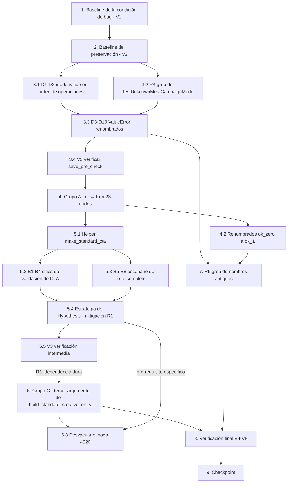

# Implementation Plan

## Overview

Todos los comandos se ejecutan desde el directorio `sinergia/` con `venv/bin/python -m pytest`.
Ninguna tarea modifica archivos bajo `sinergia/app/`, ni `bugfix.md`, `design.md` o `.config.kiro`.

## Task Dependency Graph



```json
{
  "waves": [
    { "id": 0, "tasks": ["1"] },
    { "id": 1, "tasks": ["2"] },
    { "id": 2, "tasks": ["3.1"] },
    { "id": 3, "tasks": ["3.2"] },
    { "id": 4, "tasks": ["3.3"] },
    { "id": 5, "tasks": ["3.4"] },
    { "id": 6, "tasks": ["4.1"] },
    { "id": 7, "tasks": ["4.2"] },
    { "id": 8, "tasks": ["4.3"] },
    { "id": 9, "tasks": ["4.4"] },
    { "id": 10, "tasks": ["5.1"] },
    { "id": 11, "tasks": ["5.2"] },
    { "id": 12, "tasks": ["5.3"] },
    { "id": 13, "tasks": ["5.4"] },
    { "id": 14, "tasks": ["5.5"] },
    { "id": 15, "tasks": ["6.1"] },
    { "id": 16, "tasks": ["6.2"] },
    { "id": 17, "tasks": ["6.3"] },
    { "id": 18, "tasks": ["6.4"] },
    { "id": 19, "tasks": ["7"] },
    { "id": 20, "tasks": ["8.1"] },
    { "id": 21, "tasks": ["8.2"] },
    { "id": 22, "tasks": ["8.3"] },
    { "id": 23, "tasks": ["8.4"] },
    { "id": 24, "tasks": ["8.5"] },
    { "id": 25, "tasks": ["8.6"] },
    { "id": 26, "tasks": ["9"] }
  ]
}
```

## Tasks

- [x] 1. Capturar el baseline de la condición de bug sobre el código sin arreglar (V1)
  - **Property 1: Bug Condition** - Los 44 nodos desalineados fallan contra un código productivo correcto
  - **CRÍTICO**: esta captura debe ejecutarse ANTES de editar una sola línea de prueba; sin baseline
    no hay forma de demostrar la preservación nodo por nodo, y recapturarlo después ya no sirve
  - **DO NOT attempt to fix the test or the code when it fails**: los 44 fallos son el contraejemplo
  - **GOAL**: dejar registrado, nodo por nodo, el contraejemplo exhaustivo de `isBugCondition`
  - **Enfoque**: el dominio de la propiedad es el conjunto FINITO y enumerable de nodos de pytest de
    los tres archivos objetivo, así que la comprobación es exhaustiva por ejecución directa, no
    muestreada (design: Testing Strategy → Preservation Checking)
  - Ejecutar:
    ```
    venv/bin/python -m pytest \
      tests/v2/unit/use_cases/test_facebook_generate_pre_check_creative.py \
      tests/v2/unit/use_cases/test_facebook_save_pre_check_images.py \
      tests/v2/unit/use_cases/test_facebook_save_pre_check_texts.py \
      -q --no-header -rA --tb=no > /tmp/baseline-target.txt
    ```
  - **EXPECTED OUTCOME**: el archivo registra `44 failed, 283 passed` y contiene una línea
    `PASSED`/`FAILED` por nodo en el *short test summary info*
  - Confirmar que los contraejemplos documentados en el diseño aparecen en el reporte:
    `AssertionError: assert 1 == 0` (23 nodos del Grupo A), `AttributeError: 'str' object has no
    attribute 'get'` desde `meta_ads.py:1360` (8 nodos del Grupo B), `AssertionError` de comparación
    de diccionario y `assert 0 == None` / `assert 0 == 42` (3 nodos del Grupo C),
    `ValueError: <valor> is not a valid CreativeType` desde `meta_ads.py:2493` (10 nodos del Grupo D)
  - Guardar el archivo en `/tmp` (fuera del repositorio) para no introducir artefactos nuevos
  - Marcar la tarea completa cuando el reporte esté capturado y los 44 fallos estén clasificados por grupo
  - _Requirements: 1.1, 1.2, 1.3, 1.4, 1.5, 1.6, 1.7, 1.8_

- [x] 2. Capturar el baseline de preservación de la suite completa y del estado de `app/` (V2)
  - **Property 2: Preservation** - Todo nodo alineado conserva su resultado
  - **IMPORTANTE**: metodología observación-primero. Se observa el `outcome` real de cada nodo sobre
    el código SIN arreglar; ese conjunto `(nodeid, outcome)` es el insumo de la comparación
    diferencial de la tarea 8.3
  - Ejecutar:
    ```
    venv/bin/python -m pytest -q --no-header -rA --tb=no > /tmp/baseline-full.txt
    ```
  - **EXPECTED OUTCOME**: el archivo registra `44 failed, 1632 passed` (los 1632 PASSED son el
    baseline a preservar)
  - Capturar también el recuento de nodos recolectados de los tres archivos objetivo, insumo de V7:
    ```
    venv/bin/python -m pytest \
      tests/v2/unit/use_cases/test_facebook_generate_pre_check_creative.py \
      tests/v2/unit/use_cases/test_facebook_save_pre_check_images.py \
      tests/v2/unit/use_cases/test_facebook_save_pre_check_texts.py --collect-only -q | tail -1 \
      > /tmp/baseline-collected.txt
    ```
  - **EXPECTED OUTCOME**: 327 nodos recolectados
  - Capturar el estado de `app/` para poder comparar en V5:
    ```
    git diff --stat -- app/ > /tmp/baseline-app-diff.txt
    git status --porcelain -- app/ > /tmp/baseline-app-status.txt
    ```
  - **EXPECTED OUTCOME**: `git diff --stat -- app/` vacío; `git status --porcelain -- app/` con
    únicamente el no rastreado preexistente `app/v2/resources/audience.py`, ajeno a este bugfix
  - Registrar la duración reportada de los tres archivos objetivo (baseline medido: 74,99 s), insumo
    de la condición de preservación 3.8
  - Marcar la tarea completa cuando los cuatro artefactos de baseline estén capturados
  - _Requirements: 3.1, 3.2, 3.3, 3.4, 3.5, 3.6, 3.7, 3.8_

- [x] 3. Grupo D — Conversión estricta de `meta_campaign_mode` (10 nodos, 2 archivos)

  Primero porque está completamente desacoplado de A, B y C: vive en archivos distintos, no comparte
  helpers y su verificación es rápida (design: Orden de ejecución recomendado, paso 2).

  - [x] 3.1 D1–D2: neutralizar la rama de validación con un modo válido en los dos casos de orden de operaciones
    - `tests/v2/unit/use_cases/test_facebook_save_pre_check_images.py`:
      `TestExecuteOrchestration` (clase 1178) → `test_execute_calls_operations_in_exact_order` (1190),
      sitio 1220: `make_campaign_setup(meta_campaign_mode=None)` → `make_campaign_setup()`
    - `tests/v2/unit/use_cases/test_facebook_save_pre_check_texts.py`:
      `TestExecuteOrchestrationAndShortCircuit` (clase 1222) →
      `test_execute_calls_operations_in_exact_order` (1234), sitio 1265: el mismo cambio
    - `make_campaign_setup()` ya tiene `meta_campaign_mode="DYNAMIC"` por defecto (imágenes 136,
      textos 121), así que el cambio es literalmente quitar el argumento
    - El no-op de la rama de validación ahora proviene de un `asset_feed` genuinamente AUSENTE:
      `make_creative()` construye `ads=[make_ad()]` y `make_ad()` deja `adCreative` ausente
      (centinela `ABSENT`), por lo que `creative.get('ads', [])[0].get('adCreative', {})` es `{}` y
      tanto `asset_feed` como `story_spec` son `None`; la guarda
      `if mode == CreativeType.DYNAMIC.value and asset_feed:` no entra y el `elif` STANDARD tampoco
    - NO tocar `expected_call_order`: `_set_creative_type` no está atado al manager y no aparece en
      `manager.mock_calls`. La secuencia sigue siendo `_get_decoded_access_token`, `_get_ad_channel`,
      `_set_channel_id`, `_get_campaign_setup`, `_save_creative_to_publish`, `_build_response`
    - Conservar intactas `mock_save_creative_to_publish.assert_called_once_with(creative)`,
      `mock_build_response.assert_called_once_with(creative)` y `assert result is build_response_result`
    - Actualizar los docstrings de caso (imágenes 1211, textos 1256) que afirman que el no-op viene
      de `make_campaign_setup(meta_campaign_mode=None)`: el nuevo texto debe explicitar que el no-op
      proviene de un `asset_feed` ausente bajo un modo válido, porque `make_ad()` omite `adCreative`
    - NO parchear `MetaAdsValidator` ni `_validate_images_standard`/`_validate_images_dynamic`
      (alternativas descartadas en el diseño)
    - _Bug_Condition: `assumesUnknownModeTolerance(X)` — `_set_creative_type` (`app/v2/use_cases/meta_ads.py:2492`) aborta con `ValueError` antes de registrar las llamadas del manager_
    - _Expected_Behavior: `expectedBehavior(result)` — ambos nodos `PASSED` con la secuencia exacta sobre `manager.mock_calls`_
    - _Preservation: los demás casos de `TestExecuteOrchestration` / `TestExecuteOrchestrationAndShortCircuit` (token faltante, `DataNotFoundException`, identidad del `creative`) comparten `make_campaign_setup`, cuyo default NO cambia (condición 3.4)_
    - _Requirements: 1.8, 2.8, 2.10_

  - [x] 3.2 R4: verificar que `TestUnknownMetaCampaignMode` no se referencia desde ningún otro punto
    - Ejecutar `grep -rn "TestUnknownMetaCampaignMode" tests/`
    - **EXPECTED OUTCOME**: exactamente dos apariciones, las dos definiciones de clase
      (imágenes 2123, textos 3455). Cualquier aparición adicional debe resolverse ANTES de renombrar
    - Mitigación del riesgo R4 (renombrados que rompen referencias)
    - _Requirements: 2.9_

  - [x] 3.3 D3–D10: reescribir las 8 pruebas de `TestUnknownMetaCampaignMode` para aseverar el `ValueError`
    - Archivos y cuerpos afectados: `test_facebook_save_pre_check_images.py` clase 2123, caso 2158
      (cuerpo 2158–2237, `parametrize` 2145–2156, 4 nodos) y
      `test_facebook_save_pre_check_texts.py` clase 3455, caso 3498 (cuerpo 3498–3604,
      `parametrize` 3481–3497, 4 nodos)
    - **Construcción de la entrada: sin cambios.** Conservar el `asset_feed` y el `story_spec` truthy
      simultáneos, el `titles` preexistente distinto de `self.titles` (textos), los snapshots
      `dict(asset_feed)` / `dict(object_story_spec)` y la construcción manual
      `campaign_setup = {"attributes": {}}` del escenario de clave ausente
    - Invocación: `result = use_case.execute()` → `with pytest.raises(ValueError) as exc_info:
      use_case.execute()`; eliminar la variable `result` y `assert result is build_response_result`;
      eliminar `mock_build_response.return_value` para no sugerir que `_build_response` se alcanza
    - Añadir el mensaje esperado como tercer elemento de cada tupla / `pytest.param` y aseverarlo con
      `assert str(exc_info.value) == "<mensaje>"`. Mensajes verificados (Python 3.8):
      `""` → `"'' is not a valid CreativeType"`; `None` → `"None is not a valid CreativeType"`;
      `"SOME_OTHER_MODE"` → `"'SOME_OTHER_MODE' is not a valid CreativeType"`; clave ausente → el
      mismo mensaje que `None`
    - Conservar tal cual las aserciones de no-invocación de validadores:
      `mock_validate_images_dynamic.assert_not_called()` y
      `mock_validate_images_standard.assert_not_called()` (imágenes);
      `assert_no_text_validator_calls(mock_is_unique_texts, mock_is_valid_length,
      mock_is_valid_texts_amount)` (textos)
    - Añadir `mock_save_creative_to_publish.assert_not_called()`,
      `mock_build_response.assert_not_called()` y
      `mock_ad_channel_repo_instance.update.assert_not_called()` (esta última es la que la cláusula
      2.7 nombra explícitamente; mantener ambas da la garantía más fuerte)
    - Conservar sin cambios las aserciones de no-mutación (`asset_feed == asset_feed_before`,
      `story_spec == story_spec_before` en imágenes; los dos `== *_snapshot` en textos)
    - Añadir `assert use_case.creative_type == ""`: `CreativeType(...)` lanza antes de la asignación,
      así que el valor del constructor se conserva y el fallo no deja estado intermedio
    - Renombrados (tabla del diseño, idénticos en ambos archivos para mantener la simetría):
      `class TestUnknownMetaCampaignMode` → `class TestUnsupportedMetaCampaignModeRaisesValueError`;
      caso de imágenes `test_execute_invokes_neither_branch_and_continues_without_mutation` →
      `test_execute_propagates_value_error_before_invoking_either_branch_or_mutating`;
      caso de textos `test_no_validator_calls_and_no_mutation_regardless_of_truthy_asset_feed_and_story_spec` →
      `test_execute_propagates_value_error_with_no_validator_calls_and_no_mutation_regardless_of_truthy_asset_feed_and_story_spec`
    - Reescribir los docstrings de clase (imágenes 2123–2145, textos 3455–3479), que hoy describen el
      mecanismo obsoleto («ambas comparaciones `elif` fallan, así que ningún cuerpo se ejecuta»): el
      texto nuevo debe girar en torno a `_set_creative_type` y su conversión estricta, señalando que
      el aborto ocurre ANTES de que las comparaciones `== CreativeType.DYNAMIC.value` /
      `== CreativeType.STANDARD.value` lleguen a evaluarse, y que por eso la truthiness simultánea de
      `asset_feed`/`story_spec` sigue siendo relevante como control de que nada corrió
    - Añadir `ids=` explícitos al `parametrize` de imágenes (2145–2156) en ESTE mismo cambio, nunca
      después: hoy produce IDs ruidosos del tipo
      `[meta_campaign_mode_empty_string-campaign_setup_kwargs0]`. Los cuatro nodos están dentro de los
      44, así que el cambio de IDs no puede romper ninguna preservación
    - _Bug_Condition: `assumesUnknownModeTolerance(X)` — `CreativeType(campaign_setup.get('attributes', {}).get('meta_campaign_mode')).value` (`meta_ads.py:2493`) lanza `ValueError` para todo valor fuera de `{"STANDARD", "DYNAMIC"}`_
    - _Expected_Behavior: `expectedBehavior(result)` — los 8 nodos `PASSED` aseverando la excepción, la no-invocación de validadores, de `ad_channel_repository.update` y de `_build_response`, y la no-mutación de `asset_feed_spec` / `object_story_spec`_
    - _Preservation: los demás casos de ambos archivos quedan inafectados; no se toca ningún builder compartido (condiciones 3.2, 3.4)_
    - _Requirements: 1.7, 2.7, 2.9, 2.10_

  - [x] 3.4 V3: verificar los dos archivos de `save_pre_check`
    - `venv/bin/python -m pytest tests/v2/unit/use_cases/test_facebook_save_pre_check_images.py -q --no-header`
    - `venv/bin/python -m pytest tests/v2/unit/use_cases/test_facebook_save_pre_check_texts.py -q --no-header`
    - **EXPECTED OUTCOME**: `0 failed` en ambos archivos y ningún fallo nuevo respecto del baseline
    - Revisar en el diff que ninguna definición de builder compartido aparezca modificada
    - Si algún nodo previamente en `PASSED` vuelca, detenerse y atribuir el fallo a este grupo antes
      de continuar
    - _Requirements: 2.11, 3.1, 3.2, 3.4_

- [x] 4. Grupo A — `execute()` devuelve `ok=1` incondicionalmente (23 nodos, 1 archivo)

  Archivo único: `tests/v2/unit/use_cases/test_facebook_generate_pre_check_creative.py`. El más
  voluminoso pero el más mecánico: no toca helpers ni firmas, así que no puede interactuar con B ni C.
  Hacerlo antes reduce el ruido del diff en los pasos siguientes.

  - [x] 4.1 Cambiar las 15 aserciones `result["ok"] == 0` a `result["ok"] == 1`
    - Sitios exactos (los únicos del archivo con `assert result["ok"] == 0`): líneas 1462, 1612,
      1711, 1902, 1965, 2069, 2133, 2186, 2255, 2400 (18 nodos, cláusula 1.1) y 4684, 4842, 4992,
      5018, 5917 (5 nodos, cláusula 1.2)
    - Nada más cambia: las aserciones sobre anotaciones presentes, ausentes o removidas del creativo,
      sobre `status_code == 200`, sobre `data["creatives"]` y sobre el reindexado de `idx` quedan
      intactas
    - Conservar sin cambios `assert isolated_result["ok"] == 1` en la línea 1555 (riesgo R6: queda
      como redundancia consciente, no se elimina)
    - _Bug_Condition: `expectsOkZero(X)` — `app/v2/use_cases/meta_ads.py:1980` contiene `"ok": 1, # if has_errors else 1`; `has_errors` se sigue calculando en 1917 pero ya no influye en la respuesta_
    - _Expected_Behavior: `expectedBehavior(result)` — los 23 nodos `PASSED` aseverando `ok == 1`_
    - _Preservation: los 15 nodos del mismo archivo que ya aseveran `ok == 1` (líneas 1555, 2454, 4466, 4633, 4656, 4758, 4966, 5387, 5461, 5526, 5582, 5658, 5779, 5964) no se tocan y deben seguir pasando (condición 3.2)_
    - _Requirements: 1.1, 1.2, 2.1, 2.2_

  - [x] 4.2 Aplicar los 10 renombrados de casos según la tabla del diseño
    - Criterio: sustituir el fragmento `ok_zero` por `ok_1`, alineándose con la convención ya presente
      en el archivo (`test_full_success_scenario_yields_ok_1_and_...`, línea 4447). Cuando el nombre
      expresaba un contraste que deja de existir (`..._but_yields_ok_zero`), la conjunción adversativa
      `but` pasa a `and`
    - 1412 → `test_ad_without_creative_as_non_first_ad_yields_ok_1_without_invoking_validator`
    - 1665 → `test_missing_creative_as_ads_zero_empty_dict_does_not_raise_and_yields_ok_1`
    - 1858 → `test_is_unique_texts_raising_removes_only_the_corresponding_unique_key_and_yields_ok_1`
    - 1913 → `test_is_valid_length_raising_still_leaves_the_unique_key_present_and_yields_ok_1`
    - 2110 → `test_validate_images_precheck_raising_yields_ok_1`
    - 2165 → `test_is_valid_amount_raising_yields_ok_1`
    - 4658 → `test_object_story_spec_as_string_raises_type_error_inside_creation_block_and_yields_ok_1`
    - 4968 → `test_all_failed_results_yield_ok_1_and_status_200`
    - 4994 → `test_mixed_created_and_failed_results_yield_ok_1_and_status_200`
    - 5832 → `test_multiple_ad_sets_with_valid_and_invalid_ads_process_independently_yield_ok_1`
    - NO renombrar los casos 1485, 2023, 2224, 2291, 4768 (nombres ya neutrales)
    - NO renombrar ninguna clase del Grupo A: ninguna afirma nada sobre el valor de `ok` en su nombre,
      y `TestStandardCreativesEntry` se referencia por nombre de clase desde la línea 6095 (riesgo R4)
    - _Bug_Condition: `expectsOkZero(X)` — los identificadores contradicen el comportamiento aseverado_
    - _Expected_Behavior: ningún identificador que contenga `ok_zero` asevera `ok == 1`_
    - _Preservation: los `ids=` de `parametrize` son literales y no derivan de los nombres de caso, por lo que los IDs de nodo de los 23 se mantienen estables (riesgo R4)_
    - _Requirements: 2.9_

  - [x] 4.3 Actualizar los tres focos de docstring del Grupo A
    - **Línea 4859**, docstring de clase de `TestExecuteAggregationAndStatus`: contiene la copia
      literal desfasada `"ok": 0 if has_errors else 1,`. Reemplazarla por el código vigente
      (`"ok": 1, # if has_errors else 1`) y reescribir el párrafo introductorio para que deje de
      describir la agregación como algo que determina `ok`. La clase sigue siendo válida: `results` sí
      se agrega y el `status_code` sí se asevera
    - **Línea 1680**, docstring de `test_missing_creative_as_ads_zero_empty_dict_...`: conservar la
      parte factual (la entrada `Failed` sí se registra en `results`) y eliminar la inferencia de que
      eso produzca `ok=0`
    - **Líneas 1497–1502 y 1605–1607**, docstring y comentarios de
      `test_iteration_continues_to_next_ad_after_missing_creative`: reescribir el texto que justificaba
      la comprobación de aislamiento de la línea 1555 para apoyarse en la evidencia que sigue siendo
      válida (`asset_feed_after["unique_titles"] is True`, `mock_is_unique_texts.call_count == 6`), que
      es la prueba real de que `continue` no interrumpe el bucle. Documentar la comprobación de
      aislamiento como redundancia consciente, no como defecto (riesgo R6)
    - _Requirements: 2.10_

  - [x] 4.4 V3: verificar el archivo de `generate_pre_check_creative` tras el Grupo A
    - `venv/bin/python -m pytest tests/v2/unit/use_cases/test_facebook_generate_pre_check_creative.py -q --no-header`
    - **EXPECTED OUTCOME**: los 23 nodos del Grupo A pasan; los 11 fallos restantes del archivo son
      exactamente los 8 del Grupo B y los 3 del Grupo C, ningún fallo nuevo
    - Si algún nodo previamente en `PASSED` vuelca, detenerse y atribuir el fallo a este grupo
    - _Requirements: 2.11, 3.1, 3.2_

- [x] 5. Grupo B — Migración del `call_to_action` a la forma anidada (8 nodos + el sitio acoplado 437)

  Archivo único: `tests/v2/unit/use_cases/test_facebook_generate_pre_check_creative.py`. **Debe ir
  antes del Grupo C** (riesgo R1). Forma destino: `{'type': {'value': <cta_text>, 'valid': <bool>}}`,
  idéntica a la que escribe `_validate_ctas_standard` (`meta_ads.py:2766`).

  - [x] 5.1 Definir el helper de módulo `make_standard_cta`
    - Ubicación: junto a `make_standard_link_data_full`, tras la línea 296
    - Firma: `make_standard_cta(value, valid=ABSENT)`; construye
      `{'type': {'value': <value>, 'valid': <valid>}}` y omite la clave `valid` cuando es el centinela
      `ABSENT`, de modo que sirve tanto para entradas previas a la validación como ya anotadas
    - Docstring: documentar que la forma canónica la produce
      `FacebookSavePreCheckCTAsUseCase._validate_ctas_standard` y que la leen `_validate_standard_cta`
      (`['type']['value']`, línea 1360) y `_build_standard_creative_entry` (`['type']['valid']`,
      línea 1478)
    - **NO modificar `make_link_data`** (línea 117) ni su default `call_to_action=None`: decenas de
      nodos lo consumen, incluidos los que caracterizan CTA ausente/falsy (3804) y no-`dict` (3850).
      Las dos alternativas de cambiar el default o añadirle un parámetro fueron RECHAZADAS en el
      diseño (riesgo R2)
    - _Requirements: 2.3, 2.4, 3.4_

  - [x] 5.2 B1–B4: migrar los cuatro sitios de `_validate_standard_cta` / `_validate_standard_creative`
    - B1, `TestStandardCtaValidation::test_property_annotation_mirrors_validate_cta_for_goal_result`
      (3701), sitio 3720: `call_to_action={"type": cta_text}` → `make_standard_cta(cta_text)`.
      Conservar `mock_validate_cta_for_goal.assert_called_once_with(cta_text=cta_text, ...)`
      (`_validate_standard_cta` extrae `['type']['value']`, que sigue siendo `cta_text`), conservar
      `link_data["call_to_action"]["valid"] == valid` (la anotación se escribe en la RAÍZ del CTA,
      línea 1364, no dentro de `type`) y conservar `cta_text=st.text(min_size=1)` y `valid=st.booleans()`
    - B2, `test_cta_valid_scenario` (3737), sitio 3750 y B3, `test_cta_invalid_scenario` (3763), sitio
      3777: `{"type": "LEARN_MORE"}` → `make_standard_cta("LEARN_MORE")`, aserciones intactas
    - B4, `TestStandardAnnotationContract::test_property_combined_annotation_contract_holds_independently_per_field`
      (4052) vía el helper `_run_full_standard_validation`, sitio 4015: el mismo cambio. Conservar la
      aserción `link_data["call_to_action"]["valid"] == cta_valid` (4099) y las 7 estrategias
      booleanas independientes
    - **NO tocar** los escenarios de CTA falsy (3804: `None`, `{}`, `False`, `""`, `ABSENT`) ni de CTA
      truthy no-`dict` (3850): caracterizan los retornos anticipados de `_validate_standard_cta`
      (`if not cta:` en 1350, `if not isinstance(cta, dict):` en 1353) y son independientes de la
      forma de `type`
    - Actualizar el docstring de `TestStandardCtaValidation` (copia desfasada
      `cta_text = cta.get('type')` sin el `.get('value')` en la línea 3628)
    - _Bug_Condition: `buildsFlatCallToActionType(X)` — `_validate_standard_cta` (`meta_ads.py:1360`) evalúa `cta.get('type', {}).get('value')` y la forma plana lanza `AttributeError: 'str' object has no attribute 'get'`_
    - _Expected_Behavior: `expectedBehavior(result)` — los 4 nodos `PASSED` con el CTA anidado y la validez aseverada en `call_to_action['valid']`_
    - _Preservation: `make_link_data` sin cambios; los 6 nodos de CTA falsy y el de CTA no-`dict` siguen pasando (condiciones 3.2, 3.4)_
    - _Requirements: 1.3, 2.3, 2.10_

  - [x] 5.3 B5–B8: migrar los dos sitios del escenario de éxito completo y añadir la aserción nueva
    - `make_standard_link_data_full` (292): `call_to_action={"type": "LEARN_MORE"}` →
      `make_standard_cta("LEARN_MORE", valid=True)`. El helper tiene consumidor único
      (`TestStandardCombinationSuccessScenarios`, invocación real en 4390), verificable por grep
    - `_run_success_scenario` (4341), sitio 4381: `{"type": "WHATSAPP_MESSAGE"}` →
      `make_standard_cta("WHATSAPP_MESSAGE", valid=True)`
    - El `valid=True` precargado DENTRO de `type` es necesario porque `_validate_standard_cta` anota en
      la raíz del CTA y no escribe `type.valid`; `_build_standard_creative_entry` (1478) lo hereda de
      la entrada, tal como la deja el pre-check de CTAs en el flujo real
    - Conservar las siete aserciones de éxito existentes (4468–4474) SIN cambios; la séptima asevera
      `link_data["call_to_action"]["valid"] is True`, que se escribe en la raíz
    - AÑADIR como aserción **nueva** (nunca como reemplazo de ninguna de las siete):
      `result["data"]["creatives"][0]["call_to_action_types_valid_amount"] is True`
    - Actualizar el docstring de `make_standard_link_data_full` (266–296) para describir la forma anidada
    - NO añadir ni quitar parametrizaciones: siguen siendo exactamente `awareness-reach`,
      `leads-conversations`, `leads-lead-generation`, `sales-offsite-conversions` (condición 3.7)
    - _Bug_Condition: `buildsFlatCallToActionType(X)` — los 4 nodos recorren `execute()` completo y fallan con `AttributeError` antes de evaluar cualquiera de las siete anotaciones de éxito_
    - _Expected_Behavior: `expectedBehavior(result)` — los 4 nodos `PASSED` con `ok == 1`, las siete anotaciones en `True` y `call_to_action_types_valid_amount` leído desde `call_to_action['type']['valid']`_
    - _Preservation: `make_standard_link_data_full` tiene consumidor único; las cuatro parametrizaciones se conservan (condiciones 3.2, 3.7)_
    - _Requirements: 1.4, 2.4, 2.10_

  - [x] 5.4 Migrar el sitio acoplado 437 de la estrategia de Hypothesis (mitigación de R1)
    - `_STANDARD_LINK_DATA_FIELD_STRATEGIES["call_to_action"]` (línea 437):
      `st.one_of(st.none(), st.fixed_dictionaries({"type": st.text(max_size=20)}))` →
      `st.one_of(st.none(), st.fixed_dictionaries({"type": st.fixed_dictionaries({"value": st.text(max_size=20), "valid": st.booleans()})}))`
    - **OBLIGATORIO antes del Grupo C**: si se corrigiera el tercer argumento del nodo vacuo 4220 sin
      migrar esta estrategia, el nodo empezaría a ejercitar las formas generadas y fallaría con
      `AttributeError`, violando la preservación 3.2
    - Consumidor único: `standard_object_story_spec_shapes` (499), verificable por grep
    - No ampliar `max_examples`: el cambio solo anida un `fixed_dictionaries` (condición 3.8)
    - El nodo 4220 solo asevera el conjunto de claves y el `idx`, invariantes bajo ambas formas, así
      que este cambio es seguro por sí solo (sigue vacuo en este punto)
    - _Requirements: 3.2, 3.4, 3.8_

  - [x] 5.5 V3: verificación intermedia obligatoria antes de pasar al Grupo C
    - Ejecutar las cuatro clases implicadas, no solo los nodos objetivo:
      ```
      venv/bin/python -m pytest tests/v2/unit/use_cases/test_facebook_generate_pre_check_creative.py \
        -q --no-header -k "TestStandardCtaValidation or TestStandardAnnotationContract or TestStandardCombinationSuccessScenarios or TestStandardCreativesEntry"
      ```
    - **EXPECTED OUTCOME**: los 8 nodos del Grupo B pasan y
      `test_property_construction_never_raises_and_always_returns_the_fixed_key_set` (4220) SIGUE
      PASANDO con la estrategia nueva (todavía vacuo, porque el tercer argumento aún no se corrigió)
    - Luego el archivo completo: `venv/bin/python -m pytest tests/v2/unit/use_cases/test_facebook_generate_pre_check_creative.py -q --no-header`
    - **EXPECTED OUTCOME**: solo quedan en rojo los 3 nodos del Grupo C
    - Si el nodo 4220 volcara aquí, detenerse: es el caso de mayor riesgo de preservación del plan
    - _Requirements: 2.11, 3.1, 3.2_

- [x] 6. Grupo C — Corrección del tercer argumento de `_build_standard_creative_entry` (3 nodos + el nodo vacuo 4220)

  Archivo único: `tests/v2/unit/use_cases/test_facebook_generate_pre_check_creative.py`. Último porque
  depende del Grupo B y porque es el cambio con más semántica por línea. La firma vigente es
  `(self, idx, ad_set_to_publish, ad)` (`meta_ads.py:1442`) y el método desciende él mismo con
  `ad.get('adCreative') or {}` (1443).

  - [x] 6.1 C1: corregir `test_object_story_spec_completely_absent_uses_every_documented_default` (4245)
    - Líneas 4276–4278: sustituir la extracción de `ad_creative` y la llamada por
      ```
      ad = ad_set_to_publish["ads"][0]
      assert "object_story_spec" not in ad["adCreative"]

      result = use_case._build_standard_creative_entry(0, ad_set_to_publish, ad)
      ```
      conservando la aserción de precondición, reexpresada sobre `ad["adCreative"]`
    - Expectativa de `name`: `"AdSet-Absent-OSS"` → literal `"AdSet-Absent-OSS - Ad"` (no f-string,
      para que la prueba siga siendo una caracterización y no una tautología). El sufijo es
      `ad.get('name')`, y `make_ad` (151) usa `name="Ad"` por defecto; `_make_ad_set_to_publish`
      (4192) no lo sobreescribe
    - Expectativa de `ad_id`: `"ad-absent-oss"`, el valor ya escrito en la prueba. No cambia
    - El resto del diccionario esperado (30 claves) queda intacto: `adchannel_id: 0`,
      `min_daily_budget: 0`, `proposal_url: ""`, los `*_max_amount: 1`, las colecciones vacías y los
      flags `False` son los mismos defaults, ahora alcanzados por la vía correcta
    - Actualizar el docstring de caso (4249–4266): la afirmación de que `name` viene de
      `ad_set_to_publish` «itself» deja de ser correcta
    - Actualizar el docstring de clase (4115–4145), que embebe una copia desfasada de la firma
      (`..., ad_creative)` en 4117, el cuerpo `ad_creative = ad_creative or {}` y
      `_as_single_item_list(value)` con un solo parámetro en 4125 cuando el real tiene dos).
      Reemplazarla por el código vigente de las líneas 1442–1461, incluida
      `ad_creative = ad.get('adCreative') or {}` y la composición de `name` (riesgo R3)
    - _Bug_Condition: `passesAdCreativeAsThirdArgument(X)` — al recibir un `ad_creative`, `ad.get('adCreative')` devuelve `None`, se sustituye por `{}` y todo el resultado degenera a los defaults_
    - _Expected_Behavior: `expectedBehavior(result)` — nodo `PASSED` con la comparación completa del diccionario, `ad_id == "ad-absent-oss"` y `name == "AdSet-Absent-OSS - Ad"`_
    - _Preservation: `TestStandardCreativesEntry.EXPECTED_KEYS` y `_make_ad_set_to_publish` conservan su semántica; la clase NO se renombra, por lo que la referencia cruzada de la línea 6095 sigue válida (riesgo R4)_
    - _Requirements: 1.5, 2.5, 2.10_

  - [x] 6.2 C2–C3: corregir `test_build_standard_creative_entry_distinguishes_explicit_none_from_absent_key` (6077)
    - Líneas 6098–6102: sustituir la extracción y la llamada por
      ```
      ad = ad_set_to_publish["ads"][0]

      result = use_case._build_standard_creative_entry(0, ad_set_to_publish, ad)
      ```
    - La tabla de `parametrize` (6066–6076) NO cambia: `explicit-none → None`, `absent-key → 0`,
      `positive-integer → 42`. Los `ids=` se conservan, por lo que los tres IDs de nodo permanecen
      estables
    - El nodo `[absent-key]` pasa hoy por degeneración y tras el cambio debe seguir esperando `0`,
      ahora por la razón correcta (`object_story_spec.get('ad_channel_id', 0)` con la clave
      genuinamente ausente)
    - Actualizar el docstring de clase (5975–6014), que contiene la misma copia desfasada de la firma
      en la línea 5991 (riesgo R3)
    - **NO tocar** el caso hermano `test_save_creative_to_publish_distinguishes_explicit_none_from_absent_key`
      (6040, 3 nodos): ejercita `_save_creative_to_publish`, cuya firma no cambió
    - _Bug_Condition: `passesAdCreativeAsThirdArgument(X)` — `object_story_spec` nunca se alcanza y `adchannel_id` cae al default `0` (`assert 0 == None`, `assert 0 == 42`)_
    - _Expected_Behavior: `expectedBehavior(result)` — `adchannel_id` igual a `None` para `explicit-none`, `0` para `absent-key` y `42` para `positive-integer`_
    - _Preservation: los 3 nodos de `test_save_creative_to_publish_distinguishes_explicit_none_from_absent_key` siguen pasando sin cambios (condición 3.2)_
    - _Requirements: 1.6, 2.6, 2.10_

  - [x] 6.3 Desvacuar el nodo de Property 8 corrigiendo su tercer argumento (decisión de R1)
    - `TestStandardCreativesEntry::test_property_construction_never_raises_and_always_returns_the_fixed_key_set`
      (4220), llamada en 4237: pasar `ad` en lugar de `ad_creative`, igual que en 6.1
    - Requiere que la tarea 5.4 esté aplicada: con la estrategia plana el nodo fallaría con
      `AttributeError` al empezar a ejercitar las formas generadas
    - No requiere cambio de aserciones: el nodo asevera el conjunto de claves y el `idx`
    - Si tras la migración de la estrategia el nodo fallara por una causa distinta de la forma del
      CTA, aplica la cláusula 2.13: se escala al usuario en lugar de marcarlo `xfail` o revertir el
      argumento a `ad_creative`
    - _Requirements: 2.13, 3.2_

  - [x] 6.4 V3: verificar las dos clases completas del Grupo C
    - ```
      venv/bin/python -m pytest tests/v2/unit/use_cases/test_facebook_generate_pre_check_creative.py \
        -q --no-header -k "TestStandardCreativesEntry or TestExecuteStandardAdChannelIdReading"
      ```
    - **EXPECTED OUTCOME**: `0 failed` en ambas clases completas, no solo en los tres nodos objetivo
    - Luego el archivo completo: **EXPECTED OUTCOME** `0 failed`
    - _Requirements: 2.11, 3.1, 3.2_

- [x] 7. R5: verificar que no quedan referencias residuales a los nombres antiguos
  - Tras aplicar los 14 renombrados (10 casos del Grupo A + 2 clases y 2 casos del Grupo D), hacer
    `grep -rn "<nombre antiguo>" tests/` para cada uno de los 14 nombres
  - **EXPECTED OUTCOME**: cero apariciones residuales, incluidas las referencias cruzadas en
    docstrings (p. ej. la cita de la línea 258 y las referencias a `TestStandardBranchNoOp` y
    `TestDynamicBranchMissingAssetFeed` en los docstrings del Grupo D)
  - Comprobación complementaria: `grep -rn "ok_zero" tests/v2/unit/use_cases/test_facebook_generate_pre_check_creative.py`
    y `grep -rn "TestUnknownMetaCampaignMode" tests/` devuelven cero resultados
  - _Requirements: 2.9, 2.10_

- [x] 8. Verificación final (V4–V8)

  - [x] 8.1 V4 + Property 1: verificar que los 44 nodos desalineados ahora pasan
    - **Property 1: Bug Condition** - Los 44 nodos desalineados pasan sin tocar el código productivo
    - **IMPORTANTE**: re-ejecutar los MISMOS nodos del baseline de la tarea 1; no escribir pruebas nuevas
    - Los tres archivos juntos:
      ```
      venv/bin/python -m pytest \
        tests/v2/unit/use_cases/test_facebook_generate_pre_check_creative.py \
        tests/v2/unit/use_cases/test_facebook_save_pre_check_images.py \
        tests/v2/unit/use_cases/test_facebook_save_pre_check_texts.py -q --no-header
      ```
    - Suite completa: `venv/bin/python -m pytest -q --no-header`
    - **EXPECTED OUTCOME**: `0 failed, 327 passed` en los tres archivos; `0 failed, 1676 passed` en la
      suite completa; duración de los tres archivos en el orden de 75–95 s
    - La comprobación es exhaustiva sobre el conjunto finito de 44 nodos, no muestreada
    - _Requirements: 2.11, 3.8_

  - [x] 8.2 V5: confirmar que el código productivo quedó intacto
    - `git diff --stat -- app/` → **EXPECTED OUTCOME**: salida vacía
    - `git status --porcelain -- app/` → **EXPECTED OUTCOME**: idéntica a `/tmp/baseline-app-status.txt`,
      sin entradas nuevas (el único no rastreado preexistente es `app/v2/resources/audience.py`)
    - _Requirements: 2.12_

  - [x] 8.3 V6 + Property 2: comparación diferencial nodo por nodo contra el baseline
    - **Property 2: Preservation** - Todo nodo alineado conserva su resultado
    - **IMPORTANTE**: comparar contra los MISMOS baselines capturados en las tareas 1 y 2; no
      recapturarlos
    - Regenerar los reportes `-rA` de los tres archivos y de la suite completa y compararlos contra
      `/tmp/baseline-target.txt` y `/tmp/baseline-full.txt` como conjuntos `(nodeid, outcome)`
    - **EXPECTED OUTCOME**: el conjunto de diferencias es EXACTAMENTE los 44 nodos (con sus nombres
      nuevos donde se renombraron), todos pasando de `FAILED` a `PASSED`. Ningún nodo pasa de `PASSED`
      a otro estado
    - Revisar explícitamente los cinco casos de mayor riesgo del diseño: el nodo 4220 (Property 8),
      `test_cta_absent_scenario` (5 nodos) y `test_cta_non_dict_scenario` (3850),
      `test_save_creative_to_publish_distinguishes_explicit_none_from_absent_key` (3 nodos), los 15
      nodos que ya aseveraban `ok == 1`, y los demás casos de
      `TestExecuteOrchestration` / `TestExecuteOrchestrationAndShortCircuit`
    - Filtrar además por los nodos de la rama DYNAMIC (`TestExecuteDynamicBranch`,
      `TestValidateImagesDynamic`, `TestDynamicBranch*`,
      `TestStandardSpecDoesNotRegressDynamicBranch`) y confirmar que conservan su `outcome`
    - _Requirements: 3.1, 3.2, 3.3, 3.5, 3.6_

  - [x] 8.4 V7: descartar `skipped`/`xfail` encubiertos y pérdida de nodos
    - La línea de resumen no contiene `skipped`, `xfailed`, `xpassed` ni `error`
    - ```
      venv/bin/python -m pytest \
        tests/v2/unit/use_cases/test_facebook_generate_pre_check_creative.py \
        tests/v2/unit/use_cases/test_facebook_save_pre_check_images.py \
        tests/v2/unit/use_cases/test_facebook_save_pre_check_texts.py --collect-only -q | tail -1
      ```
    - **EXPECTED OUTCOME**: 327 nodos recolectados, igual que `/tmp/baseline-collected.txt`. Descarta
      también que un nombre duplicado tras un renombrado haya hecho que un caso sombree a otro dentro
      de la misma clase (riesgo R4)
    - Confirmar que los cuatro IDs `[awareness-reach]`, `[leads-conversations]`,
      `[leads-lead-generation]`, `[sales-offsite-conversions]` siguen apareciendo, ni uno más ni uno
      menos (condición 3.7)
    - Mitigación del riesgo R7: el conteo agregado de V4 no es suficiente por sí solo
    - _Requirements: 2.11, 2.13, 3.7_

  - [x] 8.5 V8: revisar el diff de builders y fixtures compartidos
    - `git diff` NO muestra cambios en las definiciones de `make_link_data`, `make_object_story_spec`,
      `make_ad`, `make_ad_set`, `make_ad_creative`, `make_campaign_setup`, `make_creative`,
      `make_ad_channel`, `use_case_factory`, `patch_redis_client` ni `_AbsentSentinel`/`ABSENT`
    - Los únicos helpers que pueden aparecer modificados son `make_standard_link_data_full`
      (consumidor único) y `_STANDARD_LINK_DATA_FIELD_STRATEGIES` (consumidor único), más el helper
      NUEVO `make_standard_cta`
    - La fixture `_deny_real_network_requests` (`autouse`, línea 661) permanece intacta; ningún
      cambio añade ni quita patches de red
    - Confirmar que el diff se limita a los tres archivos de prueba objetivo
    - Mitigación del riesgo R2
    - _Requirements: 3.4, 3.5_

  - [x] 8.6 Revisión final de docstrings en el diff
    - Los docstrings no se verifican automáticamente, así que deben revisarse en el diff
    - Confirmar que las seis copias literales desfasadas quedaron actualizadas: 4859
      (`"ok": 0 if has_errors else 1`), 4117 y 5991 (firma antigua de
      `_build_standard_creative_entry`), 4125 (`_as_single_item_list(value)` con un solo parámetro),
      3628 (`cta_text = cta.get('type')` sin `.get('value')`) y los docstrings de clase de los dos
      `TestUnknownMetaCampaignMode`
    - Confirmar que los tres docstrings de caso que documentaban atajos obsoletos quedaron reescritos:
      1211, 1256 y 1497
    - Mitigación del riesgo R3
    - _Requirements: 2.10_

- [x] 9. Checkpoint - Ensure all tests pass
  - Ensure all tests pass, ask the user if questions arise.
  - Criterios de cierre: `0 failed, 327 passed` en los tres archivos objetivo; `0 failed, 1676 passed`
    en la suite completa; `git diff --stat -- app/` vacío; V6 con exactamente 44 diferencias, todas de
    `FAILED` a `PASSED`; 327 nodos recolectados; sin `skipped`/`xfailed`/`xpassed`/`error`
  - Si algo no cuadra, escalar al usuario en lugar de relajar aserciones (cláusula 2.13)

## Notes

**Reglas operativas vigentes durante todo el plan:**

- Si un nodo de los 283 preservados en los archivos objetivo (o de los 1632 de la suite completa)
  vuelca a `failed`, `error`, `skipped` o `xfail`, se DETIENE el trabajo y se atribuye el fallo al
  grupo en curso antes de continuar. No se acumulan cambios sobre una regresión sin explicar.
- Si una aserción obsoleta resulta imposible de realinear sin tocar `sinergia/app/`, se escala al
  usuario como ambigüedad de alcance no resuelta. Está PROHIBIDO usar `xfail`, `skip` o eliminar el
  caso (cláusula 2.13).
- Orden obligatorio: baseline → Grupo D → Grupo A → Grupo B → Grupo C → verificación final. El
  Grupo B va antes del Grupo C por el riesgo R1 (nodo vacuo de la línea 4220).

**Artefactos de baseline** (todos fuera del repositorio, en `/tmp`, para no introducir archivos nuevos):

- `/tmp/baseline-target.txt` — reporte `-rA` de los tres archivos objetivo (tarea 1)
- `/tmp/baseline-full.txt` — reporte `-rA` de la suite completa (tarea 2)
- `/tmp/baseline-collected.txt` — recuento de nodos recolectados, insumo de V7 (tarea 2)
- `/tmp/baseline-app-diff.txt` y `/tmp/baseline-app-status.txt` — estado de `app/`, insumo de V5 (tarea 2)

**Referencias cruzadas a los riesgos del diseño:**

- R1 (nodo vacuo de la línea 4220): tareas 5.4, 5.5, 6.3
- R2 (builders compartidos): tareas 5.1, 8.5
- R3 (docstrings con copias literales desfasadas): tareas 4.3, 6.1, 6.2, 8.6
- R4 (renombrados que rompen referencias): tareas 3.2, 3.3, 4.2, 6.1, 8.4
- R5 (referencias residuales a nombres antiguos): tarea 7
- R6 (comprobación de aislamiento de la línea 1555 como redundancia consciente): tareas 4.1, 4.3
- R7 (el conteo agregado no basta para descartar pérdida de nodos): tarea 8.4

**Razón de la secuencialidad total de las olas:**

- Las tareas de los grupos A, B y C editan todas el mismo archivo
  (`test_facebook_generate_pre_check_creative.py`) y las del grupo D editan los dos archivos de
  `save_pre_check`, así que el grafo de olas evita deliberadamente escrituras concurrentes sobre el
  mismo archivo; además el diseño impone un orden duro (baseline antes de todo, y el Grupo B antes del
  Grupo C por el riesgo R1).
