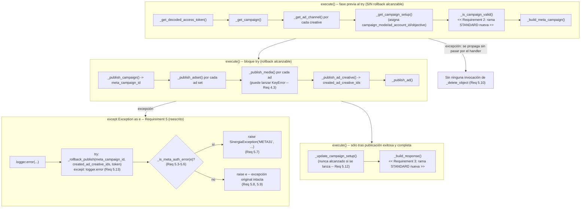
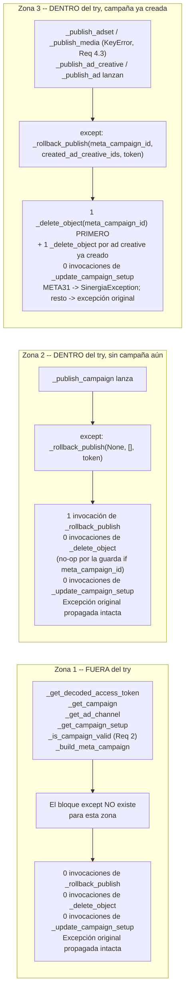

# Design Document: Meta Ads Standard Launch Campaign

**Ubicación obligatoria (Requirement 1.1):** este documento reside en `sinergia/.kiro/specs/meta-ads-standard-launch-campaign/design.md` y describe cambios exclusivamente dentro del árbol `sinergia/`. El único archivo productivo a modificar es `sinergia/app/v2/use_cases/meta_ads.py`, y dentro de él exclusivamente el cuerpo de la clase `FacebookLaunchCampaignUseCase` (que comienza en la línea 2962 de ese archivo), en tres de sus métodos: `_is_campaign_valid` (línea 3374), `_build_response` (línea 3417) y el bloque `except` de `execute()` (líneas 3561-3568). El único archivo de pruebas es el archivo nuevo `sinergia/tests/v2/unit/use_cases/test_facebook_launch_campaign.py`. Conforme al Requirement 1.4, toda ruta mencionada en este documento se expresa como ruta que incluye expresamente el segmento `sinergia/`, sin rutas ambiguas relativas a la raíz del monorepo `docker-deploy`.

**Excepción declarada (Requirement 1.5):** la invocación síncrona comentada de `FacebookLaunchCampaignUseCase` dentro del método `post()` de `FacebookResourceCampaignLaunchPublish` en `sinergia/app/v2/resources/external.py` se referencia únicamente como contexto de llamada; `external.py` **no** se modifica como parte de esta implementación.

## Overview

Esta especificación cierra las tres brechas de paridad STANDARD/DYNAMIC del paso de **lanzamiento real** hacia la Graph API de Meta, todas dentro de `FacebookLaunchCampaignUseCase` (`sinergia/app/v2/use_cases/meta_ads.py`):

1. **Gate de validez (Requirement 2).** Hoy `_is_campaign_valid` inspecciona únicamente los campos de anotación de `asset_feed_spec` (propios de DYNAMIC) y despacha cualquier otro modo por su rama `else: valid = True`, sin inspeccionar nada. Se añade una rama STANDARD que evalúa el checklist de 8 condiciones del Requirement 2.1 sobre `Object_Story_Spec`/`Link_Data`, con semántica de "todo o nada" y sustitución por `{}` de cualquier diccionario ausente o inválido de la cadena, de modo que nunca lance (Requirement 2.5).
2. **Respuesta de lanzamiento (Requirement 3).** Hoy `_build_response` lee exclusivamente `ad_creative.get('asset_feed_spec', {})`, por lo que un `Ad_Creative` STANDARD (que no tiene `asset_feed_spec`) produce una entrada con casi todos sus campos en su valor por defecto. Se añade una rama STANDARD que toma los valores de `Object_Story_Spec`/`Link_Data` emitiendo exactamente el mismo conjunto fijo de 31 claves (Requirement 3.2), reutilizando el mapeo fuente→campo ya fijado por las especificaciones hermanas.
3. **Ruta de invocación del rollback (Requirement 5).** El bloque `except` de `execute()` tiene tres defectos verificados contra el código fuente actual, detallados en el Componente 3. Se endurece la clasificación de la excepción y las rutas de invocación del `_rollback_publish` **ya existente**, sin crear ninguna rutina de rollback nueva.

Ninguna de las tres áreas introduce validación de negocio nueva ni llamadas nuevas a `MetaAdsValidator`: el gate consume exclusivamente los campos ya anotados por el flujo de pre-check (`Contrato_de_Anotación_STANDARD`), y la respuesta consume exclusivamente datos ya cargados en memoria (Requirements 2.6 y la sección Performance de `requirements.md`).

### Relación con las especificaciones hermanas

El `Contrato_de_Anotación_STANDARD` que este diseño **lee** (nunca escribe) ya está implementado y en producción por tres especificaciones hermanas de pre-check, todas bajo `sinergia/.kiro/specs/`: `meta-ads-standard-precheck-validation`, `meta-ads-standard-save-precheck-images` y `meta-ads-standard-save-precheck-texts-ctas-budget-proposal-url-locations`. Esta especificación es el paso posterior: toma los `Ad_Channel` ya validados/guardados por ellas y publica.

En particular, el mapeo fuente→campo de la rama STANDARD del Componente 2 se alinea, campo por campo, con los dos constructores STANDARD ya existentes en `sinergia/app/v2/use_cases/meta_ads.py`:

- `FacebookGeneratePreCheckCreativeUseCase._build_standard_creative_entry` (línea 1431).
- La rama STANDARD de `FacebookSavePreCheckBaseUseCase._build_response` (línea 2477).

Ambos fueron leídos directamente del código fuente (no sólo de sus documentos de diseño) para fijar este mapeo. Las dos divergencias deliberadas respecto de `_build_standard_creative_entry` están documentadas y justificadas en el Componente 2.

## Architecture



### Principio de aislamiento (Requirement 1.2, sección Code Architecture and Modularity)

Toda la lógica nueva vive dentro de los tres métodos ya existentes de `FacebookLaunchCampaignUseCase` enumerados arriba, más **un único** método privado nuevo, puro y aditivo (`_is_meta_auth_error`, ver Componente 3), definido en esa misma clase y sin lógica de eliminación HTTP propia. Ninguna otra clase ni función de `sinergia/app/v2/use_cases/meta_ads.py` se modifica.

### Lo que NO cambia (declaración explícita)

Se preservan **sin ninguna modificación de código ni de comportamiento**:

| Artefacto | Ubicación | Motivo |
|---|---|---|
| `_publish_media` | `sinergia/app/v2/use_cases/meta_ads.py` | Requirement 4.1, 4.2, 4.3: el comportamiento actual (incluida la posible `KeyError`) ya satisface los criterios; esta especificación **no** introduce ninguna guarda nueva aquí |
| `_build_object_story_spec`, `_build_asset_feed_spec` | idem | Requirement 4.4: ya construyen el payload de forma agnóstica al tipo de creativo |
| `_publish_campaign`, `_publish_adset`, `_publish_ad_creative`, `_publish_ad` | idem | Ya funcionales para ambos modos; sólo se consumen sus excepciones |
| `_upload_image` | idem | Requirement 4.1: su contrato de retorno (`hash` o `None`) se preserva |
| `_rollback_publish`, `_delete_object` | idem | Requirement 5.1, 5.2: se preservan literalmente, incluido el orden de eliminación y el registro por objeto |
| `_update_campaign_setup` | idem | Requirement 5.12: sólo cambia *cuándo* se alcanza (nunca), no su cuerpo |
| Rama DYNAMIC de `_is_campaign_valid` | idem | Requirement 2.4 |
| Rama DYNAMIC de `_build_response` | idem | Requirement 3.4 |
| `meta_url` y estructura de nivel superior de la Respuesta_de_Lanzamiento | idem | Requirement 3.5 |
| `MetaAdsValidator`, `MetaAdsPayloadBuilder` | `sinergia/app/v2/use_cases/facebook_validator_service.py` | Requirement 2.6 y Out of Scope: ninguna validación de negocio nueva |
| Las 8 clases de pre-check y `FacebookPublishCampaignUseCase` | `sinergia/app/v2/use_cases/meta_ads.py` | Out of Scope: se reutilizan como referencia y como fuente de datos |
| `FacebookResourceCampaignLaunchPublish` | `sinergia/app/v2/resources/external.py` | Out of Scope + Requirement 1.5 |
| `launch_facebook_campaign` (tarea Celery) | `sinergia/app/v2/async_tasks/celery_tasks.py` | Out of Scope |

Y se respeta la sección **Out of Scope** de `requirements.md` en su totalidad: no se agrega ninguna guarda de idempotencia sobre `campaign_setup.meta_published`, ningún seguimiento de estado por `ad_channel`/creative en Strapi, ninguna eliminación de las imágenes ya subidas a la biblioteca de la cuenta publicitaria durante el Rollback_de_Lanzamiento, y ninguna validación de negocio nueva.

## Components and Interfaces

### 1. `_is_campaign_valid` -- rama STANDARD (Requirement 2)

El método conserva íntegramente su forma actual (guarda de `creatives_to_publish` vacío, guarda de `ads` vacío, guarda de `adCreative` ausente, e `if self.campaign_mode == CreativeType.DYNAMIC.value:` con su bloque de 11 condiciones). El único cambio es que la rama `else: valid = True` se convierte en un `elif` explícito para STANDARD, conservando el `else` final para cualquier otro modo:

```python
            for ad in adset.get('ads'):
                if not ad.get('adCreative'):
                    logger.error("El anuncio no tiene adCreative")
                    return False

                if self.campaign_mode == CreativeType.DYNAMIC.value:
                    # ... bloque existente, sin cambios (Requirement 2.4) ...

                elif self.campaign_mode == CreativeType.STANDARD.value:
                    # Requirement 2.5: cada eslabón de la cadena
                    # object_story_spec -> link_data -> call_to_action se
                    # sustituye por {} cuando está ausente, es None, o no es
                    # un dict, de modo que las 8 lecturas siguientes nunca
                    # lancen. `or {}` cubre ausente y None; el isinstance
                    # cubre el caso "presente con un tipo distinto a dict".
                    object_story_spec = ad.get('adCreative', {}).get('object_story_spec') or {}
                    if not isinstance(object_story_spec, dict):
                        object_story_spec = {}

                    link_data = object_story_spec.get('link_data') or {}
                    if not isinstance(link_data, dict):
                        link_data = {}

                    call_to_action = link_data.get('call_to_action') or {}
                    if not isinstance(call_to_action, dict):
                        call_to_action = {}

                    cta_type = call_to_action.get('type') or {}
                    if not isinstance(cta_type, dict):
                        cta_type = {}

                    # Requirement 2.1: las 8 condiciones, todas con
                    # comparación estricta `is not True`, de modo que un
                    # campo ausente, None, False, o truthy-no-booleano
                    # (p. ej. la cadena "true") cuente como no válido.
                    # Requirement 2.6: se leen exclusivamente los campos ya
                    # anotados por el flujo de pre-check; ninguna llamada a
                    # MetaAdsValidator ni validación de negocio nueva.
                    if link_data.get('title_valid') is not True or \
                        link_data.get('body_valid') is not True or \
                        link_data.get('description_valid') is not True or \
                        link_data.get('image_valid') is not True or \
                        link_data.get('link_url_valid') is not True or \
                        object_story_spec.get('daily_budget_valid') is not True or \
                        object_story_spec.get('locations_valid') is not True or \
                        cta_type.get('valid') is not True:
                        # Requirement 2.2: "todo o nada" -- un solo ad
                        # inválido invalida el conjunto completo, igual que
                        # ya hace hoy la Rama_DYNAMIC.
                        logger.error("El adCreative STANDARD no tiene todos los campos validados")
                        return False

                else:
                    valid = True

        return valid
```

Notas de diseño:

- **Por qué `elif` + `else` en lugar de reemplazar el `else`:** preservar el `else: valid = True` final mantiene byte a byte el comportamiento actual para cualquier `campaign_mode` que no sea ni `DYNAMIC` ni `STANDARD` (`None`, cadena vacía, o un valor no reconocido). Esta especificación no define comportamiento nuevo para esos modos y no debe alterarlos.
- **Por qué `is not True` y no `not ...`:** el Requirement 2.1 exige literalmente `... is True` como condición de Ad_Lanzable. La comparación estricta trata de forma idéntica los tres casos que el Requirement 2.2 enumera (ausente, `None`, `False`) y además rechaza un valor truthy no booleano, que nunca debería producir el pre-check pero que un `not ...` aceptaría silenciosamente. Nótese que esto es deliberadamente **más estricto** que la Rama_DYNAMIC (que usa `not asset_feed_spec.get(...)`); la asimetría es intencional y no afecta a DYNAMIC, cuyo bloque no se toca.
- **Ruta de la anotación del CTA:** `link_data['call_to_action']['type']['valid']`. Esta es la forma exacta que fija el `Contrato_de_Anotación_STANDARD` (`{'type': {'value': ..., 'valid': ...}}`, producida por `FacebookSavePreCheckCTAsUseCase`) y la que consumen los dos constructores STANDARD ya existentes vía `call_to_action.get('type', {}).get('valid', False)`. El Requirement 2.1 la expresa como `link_data.get('call_to_action', {}).get('type', {}).get('valid') is True`.
- **`adCreative` u `object_story_spec` ausentes (Requirement 2.5):** el `adCreative` ausente/falsy ya lo intercepta la guarda `if not ad.get('adCreative'):` preexistente, que retorna `False` antes del dispatch por modo. El `object_story_spec` ausente se normaliza a `{}`, con lo cual las 8 condiciones fallan y el ad se trata como no-Ad_Lanzable, sin excepción.
- **Comportamiento en `execute()` (Requirement 2.3):** sin cambios. El bloque ya existente `if not is_ready: logger.error(...); raise IncorrectValidationException("The campaign is not ready to launch.")` se ejecuta antes del `try`, por lo que ningún objeto se publica en Meta y ninguna ruta de rollback es alcanzable (ver Componente 3 y el diagrama de flujo de fallos).

### 2. `_build_response` -- rama STANDARD (Requirement 3)

`_build_response(self, campaign_id, campaign_data, data)` conserva su firma, su diccionario `campaign` de nivel superior, su `meta_url` y su estructura de retorno (Requirement 3.5). El cambio se localiza dentro del bucle `for i, ad_set_published in enumerate(data):`, que sigue iterando **una única vez por Ad_Set_a_Publicar** y tomando `ad_set_published.get('ads')[0]` (Requirement 3.1):

```python
        creatives = []
        for i, ad_set_published in enumerate(data):
            ads_published = ad_set_published.get('ads')[0]

            if self.campaign_mode == CreativeType.STANDARD.value:
                creative_published = self._build_standard_creative_published(i, ad_set_published, ads_published)
            else:
                # Rama DYNAMIC: cuerpo actual, verbatim, sin un solo
                # carácter modificado (Requirement 3.4). Incluye su
                # `ad_creative = ads_published.get('adCreative')` sin
                # normalizar, preservando su comportamiento actual.
                ad_creative = ads_published.get('adCreative')
                creative_published = {
                    'idx': i,
                    # ... resto del diccionario actual, sin cambios ...
                }

            creatives.append(creative_published)
```

Y el nuevo constructor privado, aditivo, en la misma clase:

```python
    def _build_standard_creative_published(self, idx, ad_set_published, ads_published):
        # Requirement 3.3: ningún acceso puede lanzar. `or {}` normaliza
        # tanto la clave ausente como el valor None explícito, en los cuatro
        # niveles de la cadena.
        ad_creative = ads_published.get('adCreative') or {}
        object_story_spec = ad_creative.get('object_story_spec') or {}
        link_data = object_story_spec.get('link_data') or {}
        call_to_action = link_data.get('call_to_action') or {}

        image_url = link_data.get('image_url')
        images = [{
            'url': image_url,
            'valid': link_data.get('image_valid', False),
            'error': link_data.get('image_error'),
        }] if image_url else []

        def _as_single_item_list(value, valid_length):
            return [{'text': value, 'valid_length': valid_length}] if value else []

        title_valid = link_data.get('title_valid', False)
        body_valid = link_data.get('body_valid', False)
        description_valid = link_data.get('description_valid', False)

        # Requirement 3.2: exactamente el mismo conjunto fijo de 31 claves
        # que produce la entrada DYNAMIC, en el mismo orden.
        return {
            'idx': idx,
            'name': ad_set_published.get('name'),
            'adset_id': ad_set_published.get('id'),
            'ad_id': ads_published.get('id'),
            'adchannel_id': object_story_spec.get('ad_channel_id', 0),
            'daily_budget': ad_set_published.get('daily_budget'),
            'images': images,
            'bodies': _as_single_item_list(link_data.get('message'), body_valid),
            'titles': _as_single_item_list(link_data.get('name'), title_valid),
            'descriptions': _as_single_item_list(link_data.get('description'), description_valid),
            'call_to_action_types': [call_to_action.get('type', {})] if call_to_action else [],
            'images_valid_amount': link_data.get('image_valid', False),
            'titles_valid_amount': title_valid,
            'bodies_valid_amount': body_valid,
            'descriptions_valid_amount': description_valid,
            'call_to_action_types_valid_amount': call_to_action.get('type', {}).get('valid', False) if call_to_action else False,
            'images_max_amount': 1,
            'titles_max_amount': 1,
            'bodies_max_amount': 1,
            'descriptions_max_amount': 1,
            'call_to_action_types_max_amount': 1,
            'unique_titles': title_valid,
            'unique_bodies': body_valid,
            'unique_descriptions': description_valid,
            'daily_budget_valid': object_story_spec.get('daily_budget_valid', False),
            'min_daily_budget': object_story_spec.get('min_daily_budget', 0),
            'proposal_url': link_data.get('link') or '',
            'proposal_url_valid': link_data.get('link_url_valid', False),
            'proposal_locations': ad_set_published.get('proposal_locations', []),
            'locations': object_story_spec.get('locations', []),
            'locations_valid': object_story_spec.get('locations_valid', False),
        }
```

Notas de diseño:

- **Extracción de un método privado en lugar de un bloque inline.** El cuerpo son 31 asignaciones; mantenerlo inline dentro de un bucle que ya contiene el diccionario DYNAMIC de 31 asignaciones produciría un método de ~80 líneas con dos diccionarios hermanos. La extracción replica exactamente la decisión ya tomada por `FacebookGeneratePreCheckCreativeUseCase`, que tiene su propio `_build_standard_creative_entry` como método privado. El nombre elegido es `_build_standard_creative_published`, alineado con el vocabulario de esta clase (`Creative_Publicado`, variable local `creative_published`) y sin colisionar con el `_build_standard_creative_entry` heredado por otras jerarquías.
- **Despacho por `self.campaign_mode`, no por presencia de `asset_feed_spec`.** El Requirement 3.1 lo condiciona literalmente a `WHILE self.campaign_mode es CreativeType.STANDARD.value`. Esto difiere de `FacebookSavePreCheckBaseUseCase._build_response`, que despacha por `if object_story_spec or not asset_feed_spec:` porque allí `campaign_mode` no siempre está disponible en el momento de construir la respuesta. Aquí `self.campaign_mode` ya fue asignado por `_get_campaign_setup()` mucho antes, y despachar por él es más directo y más fiel al requisito.
- **Normalización de `ad_creative` sólo dentro de la rama STANDARD (asimetría deliberada).** La rama DYNAMIC conserva su `ad_creative = ads_published.get('adCreative')` sin `or {}`, es decir, sigue propagando `AttributeError` para un `adCreative` explícitamente `None`, exactamente como hoy. Normalizar en una línea compartida por ambas ramas cambiaría el comportamiento de DYNAMIC, lo cual el Requirement 3.4 prohíbe. La asimetría es intencional y equivale a la que ya documentó `sinergia/.kiro/specs/meta-ads-standard-precheck-validation/design.md` para el mismo par de ramas: el Requirement 3.3 exige explícitamente que STANDARD nunca lance, y el Requirement 3.4 exige que DYNAMIC no cambie.
- **Dos divergencias deliberadas respecto de `_build_standard_creative_entry` (línea 1431 de `sinergia/app/v2/use_cases/meta_ads.py`):**
  1. **`name`**: aquí es `ad_set_published.get('name')`, no el compuesto `f"{ad_set.get('name')} - {ad.get('name')}"`. Motivo: `_build_standard_creative_entry` se invoca en un bucle **por ad** (`for item in ad_set_to_publish.get('ads', [])`), donde el nombre compuesto desambigua varias entradas del mismo ad set; aquí el Requirement 3.1 fija una única entrada **por ad set** desde `ads[0]`, y tanto la rama DYNAMIC de este mismo método como la rama STANDARD de `FacebookSavePreCheckBaseUseCase._build_response` usan el nombre del ad set a secas. Mantener `ad_set_published.get('name')` es lo que hace que las entradas STANDARD y DYNAMIC de la Respuesta_de_Lanzamiento sean comparables entre sí, que es el objetivo del Requirement 3.2.
  2. **`promoted_object_valid`**: `_build_standard_creative_entry` la emite; aquí **no** se emite, porque no forma parte del conjunto fijo de 31 claves del Requirement 3.2 ni de la entrada DYNAMIC de este método. Añadirla rompería la paridad exacta de claves que el Requirement 3.2 exige y que el Requirement 6.4 verifica.
- **Los cinco `*_max_amount` valen `1`, no `0`.** Es el valor que ya emiten ambos constructores STANDARD hermanos, y es semánticamente correcto: un creativo STANDARD admite exactamente un activo por campo. El Requirement 3.3 reserva los defaults `0`/`''` para las claves *derivadas de un dato ausente*; los cinco `*_max_amount` son constantes de la rama STANDARD, no derivadas de `object_story_spec`, por lo que no caen bajo esa regla. Esto se hace explícito aquí para que la verificación del Requirement 6.5 no lo interprete como una desviación.

#### Mapeo exacto fuente→campo del Creative_Publicado STANDARD (Requirement 3.2, 3.3)

Las 31 claves, en el orden en que se emiten. `osp` = `object_story_spec` normalizado, `ld` = `link_data` normalizado, `cta` = `call_to_action` normalizado.

| # | Clave | Expresión fuente (STANDARD) | Valor cuando el dato está ausente |
|---|---|---|---|
| 1 | `idx` | `idx` (índice de `enumerate`) | n/a (siempre presente) |
| 2 | `name` | `ad_set_published.get('name')` | `None` |
| 3 | `adset_id` | `ad_set_published.get('id')` | `None` |
| 4 | `ad_id` | `ads_published.get('id')` | `None` |
| 5 | `adchannel_id` | `osp.get('ad_channel_id', 0)` | `0` |
| 6 | `daily_budget` | `ad_set_published.get('daily_budget')` | `None` |
| 7 | `images` | `[{'url': ld['image_url'], 'valid': ld.get('image_valid', False), 'error': ld.get('image_error')}]` si `image_url` es truthy | `[]` |
| 8 | `bodies` | `[{'text': ld['message'], 'valid_length': body_valid}]` si `message` es truthy | `[]` |
| 9 | `titles` | `[{'text': ld['name'], 'valid_length': title_valid}]` si `name` es truthy | `[]` |
| 10 | `descriptions` | `[{'text': ld['description'], 'valid_length': description_valid}]` si `description` es truthy | `[]` |
| 11 | `call_to_action_types` | `[cta.get('type', {})]` si `cta` es truthy | `[]` |
| 12 | `images_valid_amount` | `ld.get('image_valid', False)` | `False` |
| 13 | `titles_valid_amount` | `ld.get('title_valid', False)` | `False` |
| 14 | `bodies_valid_amount` | `ld.get('body_valid', False)` | `False` |
| 15 | `descriptions_valid_amount` | `ld.get('description_valid', False)` | `False` |
| 16 | `call_to_action_types_valid_amount` | `cta.get('type', {}).get('valid', False)` si `cta` es truthy | `False` |
| 17 | `images_max_amount` | constante `1` | `1` (constante, ver nota arriba) |
| 18 | `titles_max_amount` | constante `1` | `1` |
| 19 | `bodies_max_amount` | constante `1` | `1` |
| 20 | `descriptions_max_amount` | constante `1` | `1` |
| 21 | `call_to_action_types_max_amount` | constante `1` | `1` |
| 22 | `unique_titles` | `ld.get('title_valid', False)` (alias, ver nota) | `False` |
| 23 | `unique_bodies` | `ld.get('body_valid', False)` (alias) | `False` |
| 24 | `unique_descriptions` | `ld.get('description_valid', False)` (alias) | `False` |
| 25 | `daily_budget_valid` | `osp.get('daily_budget_valid', False)` | `False` |
| 26 | `min_daily_budget` | `osp.get('min_daily_budget', 0)` | `0` |
| 27 | `proposal_url` | `ld.get('link') or ''` | `''` |
| 28 | `proposal_url_valid` | `ld.get('link_url_valid', False)` | `False` |
| 29 | `proposal_locations` | `ad_set_published.get('proposal_locations', [])` | `[]` |
| 30 | `locations` | `osp.get('locations', [])` | `[]` |
| 31 | `locations_valid` | `osp.get('locations_valid', False)` | `False` |

**Nota — `unique_*` (claves 22-24):** un creativo STANDARD tiene a lo sumo un valor por campo de texto, de modo que la unicidad es trivialmente satisfecha y ninguna especificación hermana define una anotación `unique_*` independiente para STANDARD. Se emiten como alias de `title_valid`/`body_valid`/`description_valid` para cumplir el conjunto fijo de claves del Requirement 3.2, exactamente como ya lo hacen los dos constructores STANDARD hermanos. No se introduce ninguna validación nueva.

**Nota — `adchannel_id` con valor `None` explícito (clave 5):** cuando `osp` contiene la clave `ad_channel_id` presente con valor `None` (posible según `MetaAdsPayloadBuilder`, ver el Error Handling de `sinergia/.kiro/specs/meta-ads-standard-precheck-validation/design.md`), `.get('ad_channel_id', 0)` devuelve `None`, no `0`: el default de `.get` sólo aplica a claves genuinamente ausentes. Se preserva este comportamiento por consistencia exacta con los constructores hermanos; no se "corrige" unilateralmente en esta especificación.

### 3. Bloque `except` de `execute()` -- endurecimiento de la ruta de rollback (Requirement 5)

#### Los tres defectos del código actual

Código actual (líneas 3561-3568 de `sinergia/app/v2/use_cases/meta_ads.py`):

```python
        except Exception as e:
            logger.error(f"Error publishing campaign: {e}")
            if isinstance(e.text, dict) and (e.text.get('code', 0) == 31 or e.text.get('error_subcode', 0) == 3858385):
                raise SinergiaException('META31', 'Autentica tu cuenta en el administrador de anuncios')
            else:
                self._rollback_publish(meta_campaign_id, created_ad_creative_ids, decoded_access_token)
            raise e
```

1. **Acceso no protegido a `e.text` (Requirements 5.3, 5.4, 5.5).** Sólo las subclases de `SinergiaException` definen `.text` (verificado en `sinergia/app/exceptions/base.py`: `SinergiaException.__init__` asigna `self.text`). Cualquier otra excepción — `KeyError`, `AttributeError`, `TypeError`, o un error de red de `requests` — provoca un `AttributeError` **dentro del propio manejador**, con dos consecuencias graves: enmascara la excepción original y omite por completo la invocación de `_rollback_publish`, dejando objetos huérfanos en Meta. Esta ruta es alcanzable en el flujo real: el Requirement 4.3 documenta que `_publish_media` puede lanzar `KeyError` al acceder a `object_story_spec['link_data']` o a `link_data['image_url']`.
2. **Nivel de anidamiento equivocado en la detección de META31 (Requirement 5.6).** Ante una respuesta con código de estado distinto de 200, los cuatro helpers de publicación hacen `raise RESTClientException(response.json())`, de modo que `.text` contiene la forma **externa** `{'error': {'code': 31, ...}}`. Con esa forma, `e.text.get('code', 0)` devuelve `0` y la rama de autenticación efectivamente nunca se activa en el caso común.
3. **La rama de autenticación omite el rollback (Requirement 5.7).** Cuando sí se activa, lanza `SinergiaException('META31', ...)` sin invocar `_rollback_publish`, dejando la campaña recién creada y sus ad creatives en la cuenta del cliente. Cambio de comportamiento aprobado: ahora el rollback debe ejecutarse **primero**, y sólo después lanzarse `SinergiaException('META31', 'Autentica tu cuenta en el administrador de anuncios')`, con el tipo de excepción y el mensaje visible para el usuario sin alterar.

#### Diseño: helper de clasificación + bloque `except` reescrito

Se introduce **un único** método privado nuevo, puro y aditivo, en `FacebookLaunchCampaignUseCase`:

```python
    @staticmethod
    def _is_meta_auth_error(exception):
        """Clasifica una excepción capturada como error de autenticación de
        Meta (código 31 / subcódigo 3858385), sin poder lanzar nunca.

        Requirement 5.3: acceso seguro al atributo `text` (getattr con
        default None), de modo que la clasificación nunca produzca una
        excepción secundaria.
        Requirement 5.4/5.5: cualquier excepción sin `text`, o con un `text`
        que no sea un dict, se clasifica como NO de autenticación.
        Requirement 5.6: los marcadores se buscan tanto en el propio dict
        `text` (forma plana) como en el dict anidado bajo la clave `error`
        (forma externa producida por `RESTClientException(response.json())`).
        """
        text = getattr(exception, 'text', None)
        if not isinstance(text, dict):
            return False

        candidates = [text]
        nested_error = text.get('error')
        if isinstance(nested_error, dict):
            candidates.append(nested_error)

        for candidate in candidates:
            if candidate.get('code') == 31 or candidate.get('error_subcode') == 3858385:
                return True

        return False
```

Y el bloque `except` reescrito:

```python
        except Exception as e:
            logger.error(f"Error publishing campaign: {e}")

            # Requirements 5.7, 5.8, 5.9: el Rollback_de_Lanzamiento se
            # invoca AHORA de forma incondicional, antes de clasificar la
            # excepción, de modo que tanto la ruta de autenticación como
            # cualquier otra lo ejecuten. Requirement 5.10: cuando
            # `_publish_campaign` falló, `meta_campaign_id` es None y
            # `created_ad_creative_ids` está vacía, con lo cual
            # `_rollback_publish` no llega a invocar `_delete_object` ni una
            # sola vez (su guarda `if meta_campaign_id:` y su bucle vacío lo
            # convierten en un no-op).
            # Requirement 5.13: el try/except acotado protege el *sitio de
            # invocación*, no modifica `_rollback_publish` ni
            # `_delete_object`. Garantiza que un fallo inesperado durante el
            # rollback no enmascare la excepción original de publicación.
            try:
                self._rollback_publish(meta_campaign_id, created_ad_creative_ids, decoded_access_token)
            except Exception as rollback_error:
                logger.error(f"Error during rollback, propagating original exception: {rollback_error}")

            # Requirement 5.7: el tipo de excepción y el mensaje visible
            # para el usuario se mantienen exactamente como hoy.
            if self._is_meta_auth_error(e):
                raise SinergiaException('META31', 'Autentica tu cuenta en el administrador de anuncios')

            # Requirement 5.8/5.9: la excepción original se relanza sin
            # alterar su tipo, su mensaje ni sus atributos.
            raise e
```

Notas de diseño:

- **Por qué se extrae `_is_meta_auth_error` (recomendación explícita).** La sección Code Architecture and Modularity de `requirements.md` permite extraer la clasificación a un helper privado, puro y aditivo `WHERE la clasificación resulte demasiado extensa para el bloque except`. Se recomienda extraerla, por tres motivos concretos: (a) la lógica pasa de una condición de una línea a ~10 líneas con dos niveles de anidamiento y tres comprobaciones de tipo, que inline dominarían visualmente un manejador cuyo propósito principal es orquestar rollback y relanzado; (b) siendo una función pura y estática (`getattr` + comparaciones, sin `self`, sin E/S), es verificable directamente por los tests de los Requirements 6.9 y 6.10 sin necesidad de montar un `execute()` completo, lo que simplifica de forma notable esa parte de la Suite_de_Pruebas; (c) cumple literalmente la restricción de "sin lógica de eliminación HTTP propia" — no toca `requests`, no conoce `_delete_object`, y no introduce ningún método nuevo con efectos secundarios. Es el único método nuevo que esta especificación agrega.
- **Rollback incondicional en lugar de `if/else`.** El Requirement 5.11 exige que el Rollback_de_Lanzamiento se aplique de forma idéntica para STANDARD y DYNAMIC, y los Requirements 5.7/5.8/5.9 lo exigen tanto para la ruta de autenticación como para cualquier otra. Invocarlo una única vez, antes de clasificar, satisface los cuatro criterios con una sola línea y elimina por construcción la posibilidad de una ruta futura que olvide el rollback.
- **`try/except` alrededor de la invocación del rollback: derivado del Requirement 6.12.** `_rollback_publish` no tiene manejo de excepciones propio; sólo `_delete_object` lo tiene (su `try/except Exception` registra el error y retorna con normalidad, que es lo que el Requirement 5.13 describe). El Requirement 6.12 exige un caso de prueba en el que un **doble de prueba** de `_delete_object` lance, verificando que `execute()` propaga la excepción original de publicación y no la del rollback. Con una invocación no protegida, esa excepción del doble atravesaría `_rollback_publish` y escaparía del manejador, enmascarando la original: el criterio sería insatisfacible. El `try/except` acotado en el sitio de invocación resuelve el Requirement 6.12 y refuerza el Requirement 5.13 sin modificar ni `_rollback_publish` ni `_delete_object`, respetando el Requirement 5.1/5.2 (el cambio permanece confinado al bloque `except` de `execute()`, como exige la sección Code Architecture and Modularity).
- **`.get('code')` en lugar de `.get('code', 0)`.** El Requirement 5.6 exige comparar el valor de `code` con `31`; el default `0` era necesario en el código original sólo para evitar comparar `None` y es irrelevante aquí. Se omite por claridad; ningún caso observable cambia (`None == 31` y `0 == 31` son ambos `False`).
- **Requirement 5.12 se satisface estructuralmente.** `_update_campaign_setup` se invoca después del bloque `try/except`, y todas las rutas del manejador terminan lanzando (`SinergiaException` o `raise e`), por lo que nunca se alcanza cuando hay fallo. No requiere ningún cambio.

## Data Models

Esta especificación no introduce ninguna estructura de datos nueva. Consume dos contratos ya establecidos y produce uno ya establecido.

### Consumido: `Contrato_de_Anotación_STANDARD` (entrada del gate y del constructor de respuesta)

Poblado por el flujo de pre-check (especificaciones hermanas), sobre cada `ad['adCreative']['object_story_spec']` de un `Ad_Set_a_Publicar`:

```
object_story_spec
├── ad_channel_id            (escalar; leído por _build_standard_creative_published)
├── daily_budget_valid       (bool; condición 6 del gate)
├── min_daily_budget         (numérico)
├── locations                (lista)
├── locations_valid          (bool; condición 7 del gate)
└── link_data
    ├── name                 (título)          + title_valid        (bool; condición 1)
    ├── message              (cuerpo)          + body_valid         (bool; condición 2)
    ├── description                            + description_valid  (bool; condición 3)
    ├── image_url                              + image_valid        (bool; condición 4)
    │                                          + image_error        (str o None)
    ├── link                 (URL destino)     + link_url_valid     (bool; condición 5)
    └── call_to_action
        └── type
            ├── value        (tipo de CTA)
            └── valid        (bool; condición 8)
```

Las 8 condiciones del Requirement 2.1 son exactamente los 8 campos booleanos marcados arriba. Esta especificación los **lee**; ninguna de las tres áreas de trabajo escribe sobre ellos.

### Consumido: `Ad_Set_a_Publicar` (nivel superior)

Cada elemento de `creatives_to_publish`, construido en `execute()` a partir de `ad_channel['attributes']['channel_creative']`, más los campos que `execute()` le asigna durante la publicación: `campaign_id`, `id` (el `adset_id` devuelto por Meta), y por cada ad su `id`. `_build_response` lee además `name`, `daily_budget` y `proposal_locations`.

### Producido: `Respuesta_de_Lanzamiento`

Sin cambios estructurales (Requirement 3.5): `{'campaign': {...}, 'creatives': [...], 'meta_url': '...'}`. Lo único que cambia es el **contenido** de cada entrada de `creatives` para el caso STANDARD, según la tabla de 31 claves del Componente 2. La clave `creatives_no` sigue siendo `len(data)`, es decir el número de Ad_Set_a_Publicar, consistente con la iteración de una entrada por ad set del Requirement 3.1.

## Error Handling

### Rutas de fallo de `execute()` y alcance del rollback (Requirement 5.10)

Esta es la distinción central alrededor de la cual está escrito el Requirement 5.10. Hay exactamente tres zonas de fallo, con tres comportamientos de rollback distintos:



Puntos clave:

- **Zona 1 (Requirement 5.10, primera mitad).** Todas estas invocaciones ocurren **antes** de `try:` en el cuerpo de `execute()` (verificado contra el código fuente). Su excepción no pasa por el manejador en absoluto, de modo que no hay ninguna posibilidad de invocar `_delete_object`. Esto incluye la `IncorrectValidationException` del gate del Requirement 2.3 y la `NotAccessException` del token.
- **Zona 2 (Requirement 5.10, segunda mitad).** `_publish_campaign` lanza antes de asignar `meta_campaign_id`, que por tanto sigue siendo `None`, y `created_ad_creative_ids` sigue vacía. El manejador **sí** invoca `_rollback_publish`, pero éste no elimina nada: su guarda `if meta_campaign_id:` no se cumple y su bucle sobre `created_ad_creative_ids` no itera. El criterio se satisface literalmente ("sin realizar ninguna invocación de `_delete_object`") sin necesidad de una condición extra en el manejador.
- **Zona 3.** Es la única zona con eliminación real. El orden lo fija `_rollback_publish`, que se preserva sin cambios (Requirement 5.1): primero la campaña (lo cual elimina en cascada sus ad sets y ads en Meta), después cada ad creative individualmente. Aplica de forma idéntica a STANDARD y DYNAMIC (Requirement 5.11), puesto que el manejador no consulta `self.campaign_mode`.

### Excepciones cuya clasificación podría fallar (Requirements 5.3, 5.4, 5.5)

`_is_meta_auth_error` es total por construcción: `getattr(exception, 'text', None)` nunca lanza, el `isinstance(text, dict)` descarta de inmediato todo lo que no sea un diccionario (`None`, cadenas, listas, enteros, o el atributo inexistente), y los `.get` posteriores sólo se ejecutan sobre valores ya confirmados como diccionarios. En consecuencia, ninguna excepción capturada puede producir una excepción secundaria durante la clasificación, que es exactamente el defecto que el Requirement 5.3 corrige.

Caso concreto que hoy falla y tras este diseño funciona: la `KeyError` de `_publish_media` (Requirement 4.3, 5.9). Hoy produce `AttributeError: 'KeyError' object has no attribute 'text'` dentro del manejador, enmascarando el error y omitiendo el rollback. Tras el cambio, `_is_meta_auth_error` devuelve `False`, el rollback se ejecuta, y la `KeyError` original llega intacta al llamador.

### Formas de error de Meta reconocidas (Requirement 5.6)

| Forma de `e.text` | Origen | ¿Autenticación? |
|---|---|---|
| `{'error': {'code': 31, ...}}` | `RESTClientException(response.json())` ante respuesta ≠ 200 | Sí (anidada) |
| `{'error': {'error_subcode': 3858385, ...}}` | idem | Sí (anidada) |
| `{'code': 31, ...}` | `RESTClientException(campaign_data["error"])` ante respuesta 200 con `error` en el cuerpo | Sí (plana) |
| `{'error_subcode': 3858385, ...}` | idem | Sí (plana) |
| `{'error': {'code': 190}}`, `{'code': 100}`, `{}` | Otros errores de Meta | No |
| `'un mensaje de texto'`, `None`, atributo ausente | `SinergiaException` con texto simple; excepciones estándar de Python | No |

### Contención de fallos del propio rollback (Requirement 5.13)

Dos capas, y ninguna modifica los métodos preservados:

1. `_delete_object` (sin cambios) ya envuelve su llamada HTTP en `try/except Exception` y registra el fallo, retornando con normalidad. Es la capa primaria y la que el Requirement 5.13 describe.
2. El `try/except` acotado alrededor de la invocación de `_rollback_publish` en el manejador es defensa adicional en el sitio de invocación, necesaria para que el escenario del Requirement 6.12 (doble de prueba de `_delete_object` que lanza, saltándose la capa 1) siga propagando la excepción original de publicación.

## Correctness Properties

*A property is a characteristic or behavior that should hold true across all valid executions of a system-essentially, a formal statement about what the system should do. Properties serve as the bridge between human-readable specifications and machine-verifiable correctness guarantees.*

La sección **Property-Based Tests** de `requirements.md` ya resuelve que un conjunto de propiedades con Hypothesis **no es un requisito obligatorio** de esta especificación: el comportamiento nuevo es de orquestación (un gate booleano de "todo o nada" sobre un conjunto fijo de 8 campos, una extracción de datos ya validados por las especificaciones hermanas, y una rutina de rollback condicionada por el punto de fallo), con efectos verificables por ejemplo concreto y por las matrices parametrizadas que el Requirement 6 enumera. Las tres propiedades siguientes se documentan aquí **para trazabilidad requisitos↔diseño** y como candidatas **opcionales** a prueba basada en propiedades, siguiendo el mismo tratamiento ya aplicado por las especificaciones hermanas. La cobertura obligatoria de esta especificación se apoya exclusivamente en las pruebas de ejemplo y parametrizadas de la Testing Strategy.

Las tres corresponden a invariantes puras y de bajo coste (funciones en memoria, sin E/S), que es la única razón por la que se consideran candidatas útiles.

### Property 1: El gate STANDARD es exactamente la conjunción de las 8 condiciones

*Para todo* Ad_Set_a_Publicar STANDARD y *para toda* combinación de valores de los 8 campos de anotación del Requirement 2.1 — donde cada campo puede estar ausente, ser `None`, `False`, `True`, o un valor truthy no booleano — `_is_campaign_valid` SHALL retornar `True` si y solo si los 8 campos están presentes con el valor exacto `True` en todos los ads de todos los Ad_Set_a_Publicar, y SHALL retornar `False` en cualquier otro caso, sin lanzar ninguna excepción.

**Validates: Requirements 2.1, 2.2, 2.5**

### Property 2: La construcción del Creative_Publicado STANDARD es total y de clave fija

*Para todo* `Ad_Creative` STANDARD con cualquier subconjunto (incluido el conjunto vacío, `None`, o la ausencia total de `adCreative`) de las claves de `object_story_spec`/`link_data`/`call_to_action`, `_build_standard_creative_published` SHALL retornar un diccionario cuyo conjunto de claves es exactamente el conjunto fijo de 31 claves del Requirement 3.2 — ni una clave más, ni una menos, idéntico al que produce la entrada DYNAMIC — SHALL NOT lanzar ninguna excepción, y SHALL usar para cada clave derivada de un dato ausente el valor por defecto documentado en la tabla de mapeo de este diseño.

**Validates: Requirements 3.2, 3.3**

### Property 3: La clasificación de la excepción es total y nunca produce una excepción secundaria

*Para toda* excepción capturada — con atributo `text` de cualquier tipo (`dict`, `str`, `None`, `list`, numérico, u objeto arbitrario) o sin el atributo `text` en absoluto — `_is_meta_auth_error` SHALL retornar un booleano sin lanzar ninguna excepción, y SHALL retornar `False` para todo `text` que no sea una instancia de `dict`.

**Validates: Requirements 5.3, 5.4, 5.5**

## Testing Strategy

### Enfoque

Pruebas unitarias por ejemplo y parametrizadas, con toda dependencia externa sustituida por dobles de prueba (Requirement 6.16). No se ejercita Strapi, Redis ni la Graph API real de Meta. Las tres propiedades de la sección anterior son opcionales y, si se implementan, lo hacen con Hypothesis (`@settings(max_examples=100, deadline=None)`) invocando directamente los métodos bajo prueba, sin pasar por `execute()`.

### Ubicación y convenciones (Requirement 6.1, 1.3)

Archivo único y nuevo: `sinergia/tests/v2/unit/use_cases/test_facebook_launch_campaign.py`, siguiendo la convención de ubicación de pruebas de `use_cases` de `sinergia/.kiro/steering/structure.md`.

El estilo de fixtures y de parcheo replica el de la suite hermana `sinergia/tests/v2/unit/use_cases/test_facebook_save_pre_check_images.py`, que fue leída para fijar estas convenciones:

- **Sentinel `ABSENT`**: clase privada que permite a un builder distinguir "clave omitida por completo" de "clave presente con valor `None`". Imprescindible para los escenarios de los Requirements 6.5 y 6.15.
- **Builders sin estado compartido**: cada invocación retorna un diccionario nuevo, con listas nuevas, sin argumentos por defecto mutables.
- **`use_case_factory`**: fixture que parchea las clases de repositorio **antes** de construir la instancia y retorna `(use_case, mocks...)`. Para esta clase deben parchearse las **tres** que su constructor instancia: `app.v2.use_cases.meta_ads.AdChannelRepository`, `app.v2.use_cases.meta_ads.CampaignChannelPublishRepository` y `app.v2.use_cases.meta_ads.CampaignRepository`.
- **`patch_redis_client`**: context manager que parchea `app.v2.use_cases.meta_ads.redis_client` y permite configurar `.get.return_value = b"some-access-token"`.
- **`deny_network`**: fixture `autouse=True` a nivel de módulo que reemplaza `requests.sessions.Session.request` por una función que lanza `AssertionError`, como red de seguridad frente a cualquier fuga accidental hacia la Graph API.
- **Aserciones sobre excepciones de `SinergiaException`**: se afirma sobre `exc_info.value.text` y `exc_info.value.code`, **nunca** sobre `str(exc_info.value)`. Motivo verificado en `sinergia/app/exceptions/base.py`: `SinergiaException.__init__` invoca `super().__init__(args)` pasando la tupla `args` en lugar del `text` desempaquetado, de modo que `str(exc)` es siempre el literal `"()"` con independencia del texto.

### Dobles de prueba requeridos (Requirement 6.16)

| Dependencia | Doble | Punto de parcheo |
|---|---|---|
| Graph API de Meta | `MagicMock` sobre `requests` | Para pruebas de método directo no se alcanza; para pruebas de `execute()` se parchean los helpers `_publish_campaign`/`_publish_adset`/`_publish_media`/`_publish_ad_creative`/`_publish_ad` con `patch.object`, evitando construir respuestas HTTP completas |
| `AdChannelRepository` | `MagicMock` vía `use_case_factory` | `app.v2.use_cases.meta_ads.AdChannelRepository` |
| `CampaignChannelPublishRepository` | idem | `app.v2.use_cases.meta_ads.CampaignChannelPublishRepository` |
| `CampaignRepository` | idem | `app.v2.use_cases.meta_ads.CampaignRepository` |
| Token de acceso en Redis | `patch_redis_client` con `.get.return_value = b"..."` | `app.v2.use_cases.meta_ads.redis_client` |
| `_delete_object` | `patch.object`, para contar invocaciones y verificar orden | instancia |
| `_update_campaign_setup` | `patch.object`, para afirmar no invocación | instancia |

Para los escenarios de rollback se parchea `_delete_object` (no `_rollback_publish`), de modo que el `_rollback_publish` **real** se ejercite y su orden de eliminación quede verificado (Requirements 5.1, 6.6c).

### Builders

`make_standard_link_data(**overrides)`, `make_standard_object_story_spec(**overrides)`, `make_ad_creative(...)`, `make_ad(...)`, `make_ad_set_to_publish(...)`, `make_campaign_setup(meta_campaign_mode=...)`, `make_ad_channel(...)`, `make_dynamic_asset_feed_spec(**overrides)`. Un builder de conveniencia `make_fully_valid_standard_ad_set()` produce un Ad_Set_a_Publicar con las 8 condiciones del Requirement 2.1 en `True`, base de la matriz de invalidación individual del Requirement 6.2.

### Cobertura de los 17 criterios del Requirement 6

| Criterio | Clase / caso de prueba | Estrategia |
|---|---|---|
| 6.1 | (archivo) | El archivo nuevo `sinergia/tests/v2/unit/use_cases/test_facebook_launch_campaign.py` |
| 6.2 | `TestIsCampaignValidStandard::test_single_false_condition_invalidates` | Parametrizado por las 8 condiciones; se parte de `make_fully_valid_standard_ad_set()` y se invalida una sola, verificando `False`. Se cubren las 3 variantes de invalidez (ausente / `None` / `False`) |
| 6.3 | `TestIsCampaignValidStandard::test_all_eight_conditions_true_returns_true` | 2 ad sets con todos sus ads válidos, verificando `True` |
| 6.4 | `TestBuildResponseStandard::test_full_object_story_spec_maps_every_field` | `assert set(entry.keys()) == EXPECTED_KEYS` (31 claves) más una aserción de igualdad exacta por cada clave contra el valor de entrada del fixture, sin comparación por subconjunto |
| 6.5 | `TestBuildResponseStandard::test_absent_data_uses_documented_defaults` | Parametrizado en 3 escenarios: (a) `object_story_spec` ausente, (b) `link_data` ausente, (c) `call_to_action` ausente. Sin excepción, conjunto fijo de 31 claves, y defaults de la tabla de mapeo |
| 6.6 | `TestRollbackOnPartialFailure::test_rest_client_exception_after_creatives_triggers_full_rollback` | Doble de `_publish_ad` con `side_effect=RESTClientException({'error': {'code': 100}})`. Verifica (a) 1 llamada con `meta_campaign_id`, (b) 1 llamada por ad creative creado (conteo exacto), (c) orden mediante `mock_delete_object.call_args_list`, (d) `raise e` de la excepción original por identidad, (e) `_update_campaign_setup` no invocado |
| 6.7 | `TestRollbackNotReachable::test_failure_before_campaign_creation` | Parametrizado en dos zonas: fallo fuera del `try` (doble de `_get_campaign_setup` que lanza) y fallo dentro con `meta_campaign_id is None` (doble de `_publish_campaign` que lanza). En ambos: `_delete_object` no invocado, `_update_campaign_setup` no invocado, excepción original relanzada |
| 6.8 | `TestRollbackOnPartialFailure::test_key_error_without_text_attribute` | Doble de `_publish_media` con `side_effect=KeyError('link_data')`. Verifica rollback completo, que la excepción propagada es la `KeyError` original y **no** un `AttributeError`, y que `_update_campaign_setup` no fue invocado |
| 6.9 | `TestMetaAuthErrorClassification::test_nested_code_31_raises_meta31` | `text = {'error': {'code': 31}}`; `execute()` lanza `SinergiaException` con `code == 'META31'` y `text == 'Autentica tu cuenta en el administrador de anuncios'` |
| 6.10 | `TestMetaAuthErrorClassification::test_recognized_forms` | Parametrizado: `{'error': {'error_subcode': 3858385}}` y `{'code': 31}`; ambas activan la clasificación. Se añade un contraejemplo (`{'error': {'code': 190}}`) que no debe activarla |
| 6.11 | `TestMetaAuthErrorClassification::test_rollback_runs_before_meta31` | Para el escenario de 6.9: (a) `_delete_object` invocado con `meta_campaign_id` y con cada ad creative, (b) `_update_campaign_setup` no invocado |
| 6.12 | `TestRollbackOnPartialFailure::test_delete_object_failure_does_not_mask_original` | Doble de `_delete_object` con `side_effect=Exception('rollback boom')`; `execute()` propaga la excepción original de publicación. Este es el criterio que motiva el `try/except` del sitio de invocación (Componente 3) |
| 6.13 | `TestRollbackOnPartialFailure::test_dynamic_mode_rollback_is_identical` | Espejo de 6.6 con `campaign_mode = DYNAMIC`, mismo conjunto de invocaciones de `_delete_object` |
| 6.14 | `TestDynamicNonRegression` | Dos casos: `_is_campaign_valid` con fixture DYNAMIC fijo comparado por igualdad exacta del booleano; `_build_response` con el mismo fixture comparado por igualdad exacta del diccionario completo del Creative_Publicado contra un valor esperado fijo |
| 6.15 | `TestIsCampaignValidStandard::test_malformed_ad_creative_chain` | Parametrizado: `adCreative` ausente, y `adCreative.get('object_story_spec')` ausente. En ambos `False` sin excepción. Se extiende a `link_data`/`call_to_action` `None` y de tipo no-`dict` (Requirement 2.5) |
| 6.16 | (transversal) | `use_case_factory` con las 3 clases de repositorio, `patch_redis_client`, y el fixture autouse `deny_network` |
| 6.17 | (comando) | Ver abajo |

Aserción transversal repetida en todos los escenarios de fallo (6.6, 6.7, 6.8, 6.11, 6.12): `_update_campaign_setup` nunca invocado (Requirement 5.12).

### Comando de validación (Requirement 6.17)

Ejecutado desde `sinergia/`, en modo no interactivo y sin watch:

```bash
./venv/bin/python -m pytest --collect-only -q tests/v2/unit/use_cases/test_facebook_launch_campaign.py
./venv/bin/python -m pytest -q -ra tests/v2/unit/use_cases/test_facebook_launch_campaign.py
```

Además, como verificación de no regresión de las suites hermanas que ejercitan el mismo archivo de producción:

```bash
./venv/bin/python -m pytest -q -ra tests/v2/unit/use_cases/
```

### Criterios de aceptación de la suite

- Cero pruebas `failed`, cero `skipped` y cero errores de colección tras la implementación (Requirement 6.17).
- Cada uno de los 17 criterios del Requirement 6 cubierto por al menos una prueba o parametrización, según la tabla anterior.
- Las 8 condiciones del Requirement 2.1 verificadas individualmente en `False` (8 parametrizaciones como mínimo) y las 8 simultáneamente en `True`.
- Las 31 claves del Requirement 3.2 verificadas por comparación exacta de conjunto de claves y por igualdad campo por campo, sin comparaciones parciales.
- Ninguna prueba preexistente de `sinergia/tests/v2/unit/use_cases/` cambia sus aserciones.
