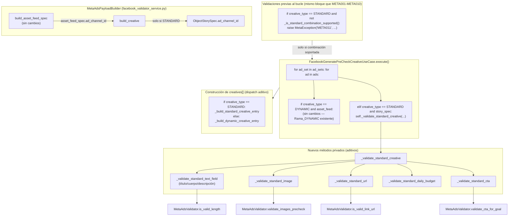

# Design Document: Meta Ads Standard Pre-Check Validation

**Ubicación obligatoria (Requirement 1):** este documento reside en `sinergia/.kiro/specs/meta-ads-standard-precheck-validation/design.md` y describe cambios exclusivamente dentro del árbol `sinergia/`. Los archivos productivos a modificar son `sinergia/app/v2/use_cases/meta_ads.py` (clase `FacebookGeneratePreCheckCreativeUseCase`) y `sinergia/app/v2/use_cases/facebook_validator_service.py` (dataclass `ObjectStorySpec` y clase `MetaAdsPayloadBuilder`, únicamente para la propagación de `ad_channel_id`, conforme a Requirement 11). Los archivos de prueba a crear/ampliar residen en `sinergia/tests/v2/unit/use_cases/`.

## Overview

Este diseño implementa la Rama_STANDARD de `FacebookGeneratePreCheckCreativeUseCase.execute()` (`sinergia/app/v2/use_cases/meta_ads.py`) hasta paridad funcional con la Rama_DYNAMIC ya existente, operando sobre `object_story_spec`/`link_data` (un único candidato por campo) en lugar de `asset_feed_spec` (listas de N candidatos). También propaga `ad_channel_id` hacia `object_story_spec`/`link_data` desde `MetaAdsPayloadBuilder` (`sinergia/app/v2/use_cases/facebook_validator_service.py`), y extiende la construcción de `creatives[]` en la Respuesta_Final para soportar ambos tipos de creativo con el mismo contrato de claves.

Toda la lógica nueva se aísla en métodos privados nuevos, nunca modificando el cuerpo existente de la Rama_DYNAMIC ni de los bloques de agregación/persistencia ya cubiertos por la suite de pruebas existente (Requirement 14). Las 4 Combinaciones_Soportadas (Requirement 2) actúan como precondición de activación de toda la Rama_STANDARD: se verifican una única vez, antes de iterar sobre `ad_sets`/`ads`, en el mismo bloque de `execute()` donde ya se evalúan hoy las validaciones que lanzan `MetaException` con códigos `META001`-`META010`. Si la combinación no es soportada, `execute()` lanza `MetaException(code="META011")` de inmediato, sin ejecutar ninguna de las validaciones de los Requirements 3 a 9 ni entrar al bucle principal (Requirement 13). Esta verificación ya no ocurre dentro de `_validate_standard_creative` ni produce un error controlado por ad: es una excepción que aborta `execute()` completo, análoga en su tratamiento a `META001`-`META010`.

### Decisiones de diseño resueltas en este documento

Estas decisiones cierran los puntos que `requirements.md` dejó abiertos para la fase de diseño. Se detallan en las secciones correspondientes, pero se listan aquí para referencia rápida:

1. **Naming y ubicación exacta de las anotaciones** sobre `object_story_spec`/`link_data`: `title_valid`, `body_valid`, `description_valid`, `image_valid` (+ `image_error` auxiliar) y `link_url_valid` dentro de `link_data`; `daily_budget_valid`/`min_daily_budget` en `object_story_spec` de nivel superior; `valid` dentro del propio diccionario `call_to_action` anidado en `link_data`. Ver [Data Models → Contrato de anotación](#contrato-de-anotación-sobre-object_story_spec-requirement-10).
2. **`ad_channel_id` ausente en `link_data`/`object_story_spec` cuando `link_data` no existía en absoluto**: se trata como diccionario vacío recién creado y se reasigna a `object_story_spec['link_data']`, para que las anotaciones tengan un destino mutable (ver [Components → `_validate_standard_creative`](#2-_validate_standard_creative-orquestador-de-la-rama_standard)).
3. **Excepción explícita a la regla de "siempre anotar True/False"**: `daily_budget_valid` se omite (no se anota) cuando `ad_set.get('daily_budget', 0)` no es comparable con `min_budget` (Requirement 8.2), y la anotación de CTA es imposible de escribir cuando `call_to_action` es truthy pero no es un diccionario (Requirement 9.4). Ambas excepciones están documentadas explícitamente en la tabla de contrato.
4. **`MetaAdsPayloadBuilder.build_asset_feed_spec`/`build_creative`**: se añade un campo `ad_channel_id: Optional[int] = None` a la dataclass `ObjectStorySpec`, poblado en `build_creative` solo cuando `creative_type == STANDARD`, sin tocar la rama `DYNAMIC`.
5. **`creatives[]` para STANDARD**: se extrae un helper `_build_dynamic_creative_entry` (copia literal del código actual, sin cambios de comportamiento) y un helper nuevo `_build_standard_creative_entry`, despachados desde el mismo bucle según `self.creative_type`.
6. **Ubicación de las pruebas de `MetaAdsPayloadBuilder`**: en un archivo nuevo y separado `test_meta_ads_payload_builder_standard_ad_channel_id.py`, no en `test_facebook_generate_pre_check_creative.py`, porque Requirement 1.3 acota ese archivo a los casos de prueba que caracterizan la Rama_STANDARD (definida en el Glossary como el bloque `elif` dentro de `execute()`), mientras que Requirement 11 caracteriza un colaborador distinto (`MetaAdsPayloadBuilder`). Ver [Testing Strategy](#testing-strategy).
7. **Las 9 pruebas existentes de `TestExecuteStandardBranch`** caracterizan la implementación STANDARD actual (previa a esta especificación, con `validate_cta`/`validate_images`/`validate_assets_amount` y sin combinaciones soportadas). Quedan fuera de la protección de no-regresión de Requirement 14 (que solo protege invocaciones sin ads STANDARD) y se **reemplazan por completo**, no se amplían.

## Architecture



`_is_standard_combination_supported` (Componente 1, más abajo) ya no es invocado desde `_validate_standard_creative`: es evaluado una única vez en el bloque de validaciones previas al bucle de `execute()` (el mismo bloque donde hoy se lanzan `META001`, `META002`, `META006`-`META010`). Si la combinación no es soportada, `execute()` lanza `MetaException("META011", ...)` y ni el bucle `for ad_set in ad_sets: for ad in ads:` ni `_validate_standard_creative` llegan a ejecutarse.

### Principio de aislamiento (Requirement 14)

Toda la lógica nueva vive en métodos privados con prefijo `_validate_standard_*`/`_build_standard_*`, invocados desde exactamente dos puntos de inserción aditivos en `execute()`:

1. El cuerpo de la rama `elif self.creative_type == "STANDARD" and story_spec:` (reemplazado en su totalidad — es el código que esta especificación implementa; no está protegido por Requirement 14 porque solo aplica a ads STANDARD).
2. El bucle de construcción de `creatives[]`, donde se inserta un `if/else` de despacho antes del cuerpo existente, y el cuerpo existente se mueve verbatim a `_build_dynamic_creative_entry` sin reescritura (Requirement 12.1).

Ningún carácter de la rama `if self.creative_type == "DYNAMIC" and asset_feed:` ni de los bloques de agregación (`has_errors`/`ok`), persistencia (`_save_campaign_channel_publish`) o creación (dry-run) se modifica. `_save_creative_to_publish` se modifica de forma aditiva y explícitamente condicionada por `self.creative_type` (ver Requirement 11.4), preservando byte a byte la rama `else` para cualquier `creative_type` distinto de `STANDARD`.

## Components and Interfaces

### 1. Combinaciones soportadas (Requirement 2, 13)

Nueva constante de clase en `FacebookGeneratePreCheckCreativeUseCase`:

```python
class FacebookGeneratePreCheckCreativeUseCase(FacebookTestCreativeUploadUseCase):
    _STANDARD_SUPPORTED_COMBINATIONS = {
        (CampaignObjective.AWARENESS.value, AwarenessOptimizationGoal.REACH.value),
        (CampaignObjective.LEADS.value, LeadsOptimizationGoal.LEAD_GENERATION.value),
        (CampaignObjective.LEADS.value, LeadsOptimizationGoal.CONVERSATIONS.value),
        (CampaignObjective.SALES.value, SalesOptimizationGoal.OFFSITE_CONVERSIONS.value),
    }

    def _is_standard_combination_supported(self) -> bool:
        return (self.objective, self.optimization_goal) in self._STANDARD_SUPPORTED_COMBINATIONS
```

Todos los símbolos (`CampaignObjective`, `AwarenessOptimizationGoal`, `LeadsOptimizationGoal`, `SalesOptimizationGoal`) ya están importados en `meta_ads.py`; no se requiere ningún import nuevo. `self.objective`/`self.optimization_goal` son `None` cuando están ausentes de `complete_campaign_data`, por lo que `(None, None)` nunca coincide con ninguna tupla del set, satisfaciendo Requirement 2.2 sin manejo especial de `None`.

`_is_standard_combination_supported` se mantiene como predicado puro y auxiliar, pero ya no se invoca desde dentro del bucle de ads ni desde `_validate_standard_creative`. Conforme al Requirement 13 (actualizado), la verificación ocurre una única vez por ejecución de `execute()`, en el mismo bloque donde ya se evalúan hoy las validaciones que lanzan `MetaException` con códigos `META001`-`META010` — es decir, después de calcular `min_budget`/`ad_account_info` y antes de `results = []`/`for ad_set in ad_sets:`:

```python
# En execute(), en el mismo bloque de validaciones previas al bucle donde ya
# están las validaciones META001-META010 (Requirement 13):
if self.creative_type == CreativeType.STANDARD.value and not self._is_standard_combination_supported():
    logger.error(
        f"Unsupported objective/optimization_goal combination for STANDARD: "
        f"{self.objective}/{self.optimization_goal}"
    )
    raise MetaException("META011", f"Unsupported objective/optimization_goal combination for STANDARD creative: {self.objective}/{self.optimization_goal}")
```

Este bloque se inserta como una validación adicional, estrictamente aditiva, junto a las demás validaciones previas al bucle (Requirement 14: no se modifica el orden ni la lógica de las validaciones `META001`-`META010` ya existentes, solo se agrega una más, aplicable únicamente cuando `self.creative_type == CreativeType.STANDARD.value`). El estilo de `logger.error` + `raise MetaException(code, message)` replica literalmente el patrón ya usado por `META002`, `META007`, `META008`, `META009` y `META010` en el código actual de `execute()`.

Si la combinación es soportada (o si `self.creative_type != "STANDARD"`, en cuyo caso esta verificación ni se evalúa), `execute()` continúa normalmente y `_validate_standard_creative` puede asumir, cuando es invocado desde el bucle, que la combinación ya es soportada.

### 2. `_validate_standard_creative` (orquestador de la Rama_STANDARD)

```python
def _validate_standard_creative(self, ad_set, object_story_spec, min_budget, current_ad_errors):
    # Requirement 13: la combinación objetivo/optimización ya fue verificada
    # antes del bucle (ver Componente 1); si no fuera soportada, execute()
    # habría lanzado MetaException("META011", ...) y este método nunca se
    # invocaría. Por tanto, no se repite la verificación aquí.

    # Decisión de diseño: link_data ausente se sustituye por un diccionario
    # vacío recién creado, reasignado a object_story_spec, para que las
    # anotaciones de Requirement 10 tengan siempre un destino mutable
    # (idéntico tratamiento que Requirement 12.3 aplica a object_story_spec
    # ausente al construir creatives[]).
    link_data = object_story_spec.get('link_data')
    if link_data is None:
        link_data = {}
        object_story_spec['link_data'] = link_data

    self._validate_standard_text_field(
        link_data, link_data.get('name'), 'title', 'title_valid', 'title-error', current_ad_errors,
    )
    self._validate_standard_text_field(
        link_data, link_data.get('message'), 'body', 'body_valid', 'body-error', current_ad_errors,
    )
    self._validate_standard_text_field(
        link_data, link_data.get('description'), 'description', 'description_valid', 'description-error', current_ad_errors,
    )
    self._validate_standard_image(link_data, current_ad_errors)
    self._validate_standard_url(link_data, current_ad_errors)
    self._validate_standard_daily_budget(ad_set, object_story_spec, min_budget, current_ad_errors)
    self._validate_standard_cta(link_data, current_ad_errors)
```

Invocado desde `execute()` reemplazando el cuerpo actual de la rama STANDARD:

```python
elif self.creative_type == "STANDARD" and story_spec:
    self._validate_standard_creative(ad_set, story_spec, min_budget, current_ad_errors)
```

`ad_set` y `min_budget` ya están en alcance en ese punto de `execute()` (el primero por ser la variable del bucle exterior, el segundo por ser calculado una sola vez antes del bucle mediante `self._get_minimum_budget(ad_account_info)`, reutilizado sin cambios — Requirement 8.3). El guard externo `and story_spec:` se preserva sin cambios: un ad STANDARD sin `object_story_spec` en absoluto no entra a esta rama (no hay estructura donde anotar nada) y avanza directo al bloque de creación, igual que hoy.

### 3. `_standard_candidate_values` (implementación de Valor_Candidato)

```python
@staticmethod
def _standard_candidate_values(value):
    if isinstance(value, list):
        return value
    return [value] if value else []
```

Función pura, sin efectos secundarios, usada por las tres validaciones de texto y por la de imagen. Implementa literalmente la definición de **Valor_Candidato** del Glossary de `requirements.md`.

### 4. `_validate_standard_text_field` (Requirements 3, 4, 5 — título/cuerpo/descripción)

```python
def _validate_standard_text_field(self, link_data, raw_value, field_name, annotation_key, error_slug, current_ad_errors):
    candidates = self._standard_candidate_values(raw_value)

    if len(candidates) != 1:
        link_data[annotation_key] = False
        current_ad_errors.append({
            'slug': error_slug,
            'message': f"{field_name.capitalize()} debe tener exactamente 1 valor, encontrados: {len(candidates)}",
        })
        return

    text_items = [{'text': candidates[0]}]
    MetaAdsValidator.is_valid_length(field_name, text_items)
    valid = text_items[0].get('valid_length', False)
    link_data[annotation_key] = valid

    if not valid:
        current_ad_errors.append({
            'slug': error_slug,
            'message': f"{field_name.capitalize()} '{candidates[0]}' no cumple la longitud requerida.",
        })
```

Una sola función parametrizada por `field_name`/`annotation_key`/`error_slug` cubre título (`'title'`/`'title_valid'`/`'title-error'`), cuerpo (`'body'`/`'body_valid'`/`'body-error'`) y descripción (`'description'`/`'description_valid'`/`'description-error'`), reutilizando `MetaAdsValidator.is_valid_length` (que ya resuelve el máximo de caracteres vía `TEXT_ASSET_MAX_LENGTH`, sin duplicar esos límites en `meta_ads.py`). Nótese que `link_data[annotation_key] = False` se asigna **antes** de agregar el error en el caso de cantidad inválida, satisfaciendo Requirement 10.2 (el campo siempre se anota, éxito o fallo).

### 5. `_validate_standard_image` (Requirement 6)

```python
def _validate_standard_image(self, link_data, current_ad_errors):
    candidates = self._standard_candidate_values(link_data.get('image_url'))

    if len(candidates) != 1:
        link_data['image_valid'] = False
        current_ad_errors.append({
            'slug': 'image-error',
            'message': f"Imagen debe tener exactamente 1 valor, encontrados: {len(candidates)}",
        })
        return

    images = [{'url': candidates[0]}]
    MetaAdsValidator.validate_images_precheck(images)
    valid = images[0].get('valid', False)
    error = images[0].get('error')

    link_data['image_valid'] = valid
    link_data['image_error'] = error

    if not valid:
        current_ad_errors.append({
            'slug': 'image-error',
            'message': f"Imagen inválida: {error}",
        })
```

Reutiliza `MetaAdsValidator.validate_images_precheck` exactamente como lo hace DYNAMIC, pero sobre una lista sintética de un único elemento `[{'url': ...}]` en lugar de la lista completa de `asset_feed['images']` (Requirement 6.6/6.7: ninguna ruta de descarga/validación adicional). `link_data['image_error']` es un campo auxiliar no booleano (mensaje de error), presente únicamente cuando `validate_images_precheck` fue invocado (es decir, cuando había exactamente 1 candidato); se usa también en la construcción de `creatives[]` (Requirement 12.4).

### 6. `_validate_standard_url` (Requirement 7)

```python
def _validate_standard_url(self, link_data, current_ad_errors):
    url = link_data.get('link')

    if not url:
        current_ad_errors.append({
            'slug': 'url-error',
            'message': "URL de destino ausente para el creativo STANDARD.",
        })
        return

    valid = MetaAdsValidator.is_valid_link_url(url)
    link_data['link_url_valid'] = valid

    if not valid:
        current_ad_errors.append({
            'slug': 'url-error',
            'message': f"URL '{url}' no tiene un formato válido.",
        })
```

Usa `is_valid_link_url` (no `is_valid_proposal_url`, conforme a Requirement 7.1) y evita invocarlo con un valor falsy, evitando el `AttributeError` que produce `is_valid_link_url(None)` (Requirement 7.3). Cuando `url` es falsy, `link_url_valid` **no** se anota (a diferencia de las validaciones de texto): el Glosario define URL_STANDARD como mapeado 1:1 desde `Link_Data.link` (un escalar simple, no una colección con Valor_Candidato), por lo que Requirement 7.3 no define un estado "ausente pero anotado en False" — solo exige el error controlado. Este es el mismo patrón de "ausente" que Requirement 10.4 reserva para CTA ausente (Requirement 9.3), aplicado aquí a un segundo caso explícito y acotado. (La combinación no soportada, tras el cambio descrito en Requirement 13, ya no produce un estado "ausente" dentro de esta lógica por-ad: aborta `execute()` completo antes de llegar a procesar cualquier ad, ver Error Handling).

### 7. `_validate_standard_daily_budget` (Requirement 8)

```python
def _validate_standard_daily_budget(self, ad_set, object_story_spec, min_budget, current_ad_errors):
    object_story_spec['min_daily_budget'] = min_budget
    try:
        object_story_spec['daily_budget_valid'] = (ad_set.get('daily_budget', 0) >= min_budget)
    except TypeError:
        current_ad_errors.append({
            'slug': 'daily-budget-error',
            'message': "El presupuesto diario no es comparable con el presupuesto mínimo requerido.",
        })
```

Anota sobre `object_story_spec` (nivel superior, no dentro de `link_data`, porque el presupuesto no proviene de `Link_Data` sino de `ad_set`, igual que en DYNAMIC lo anota sobre `asset_feed` de nivel superior). Se usa `except TypeError` en lugar del `except Exception` genérico de DYNAMIC: `TypeError` es la única excepción real que produce `>=` entre un valor no comparable (p. ej. `None >= 5.0`) y un `float`; acotar la excepción es una decisión deliberada de esta rama nueva (no afecta a DYNAMIC, que conserva su `except Exception` sin cambios). Cuando la comparación lanza, `daily_budget_valid` queda ausente (no se asigna `False`), replicando literalmente Requirement 8.2 — esta es la primera de las dos excepciones documentadas a la regla general "siempre anotar True/False" de Requirement 10.2.

### 8. `_validate_standard_cta` (Requirement 9)

```python
def _validate_standard_cta(self, link_data, current_ad_errors):
    cta = link_data.get('call_to_action')

    if not cta:
        return  # Requirement 9.3: se omite sin error y sin anotación.

    if not isinstance(cta, dict):
        current_ad_errors.append({
            'slug': 'cta-error',
            'message': "call_to_action debe ser un diccionario.",
        })
        return  # Requirement 9.4: no es posible anotar 'valid' sobre un valor no-dict.

    cta_text = cta.get('type')
    valid = MetaAdsValidator.validate_cta_for_goal(
        cta_text=cta_text, objective=self.objective, goal=self.optimization_goal, throw=False,
    )
    cta['valid'] = valid

    if not valid:
        current_ad_errors.append({
            'slug': 'cta-error',
            'message': f"CTA '{cta_text}' no permitido para el objetivo/optimización actuales.",
        })
```

Reemplaza el uso previo de `MetaAdsValidator.validate_cta` por `validate_cta_for_goal` (Requirement 9.1), que además de `objective` considera `optimization_goal`, igual que DYNAMIC. La anotación `cta['valid']` se escribe sobre el propio diccionario `call_to_action` (mismo patrón que DYNAMIC anota `cta['valid']` sobre cada entrada de `call_to_action_types`). El caso `cta` truthy-no-dict (Requirement 9.4) es la segunda excepción documentada a la regla general: no existe ninguna ubicación válida donde anotar `valid` sobre, por ejemplo, un string o una lista, por lo que solo se agrega el error.

### 9. `MetaAdsPayloadBuilder` — propagación de `ad_channel_id` (Requirement 11)

En `facebook_validator_service.py`, se añade un campo a la dataclass existente:

```python
@dataclass
class ObjectStorySpec:
    page_id: str
    link_data: Optional[LinkData] = None
    ad_channel_id: Optional[int] = None  # NUEVO — Requirement 11, solo poblado para STANDARD
```

Y en `MetaAdsPayloadBuilder.build_creative`, se modifica únicamente la rama `elif self.creative_type == CreativeType.STANDARD.value:` (la rama `DYNAMIC` no se toca):

```python
elif self.creative_type == CreativeType.STANDARD.value:
    link_data = LinkData()
    # ... construcción de link_data sin cambios ...

    creative.object_story_spec = ObjectStorySpec(
        page_id=self.selected_page_id,
        link_data=link_data,
        ad_channel_id=asset_feed_spec.ad_channel_id if asset_feed_spec else None,  # NUEVO
    )
```

`asset_feed_spec` ya se calcula al inicio de `build_creative` (línea `asset_feed_spec = self.build_asset_feed_spec(ad)`, común a ambas ramas) y su campo `ad_channel_id` ya se puebla en `build_asset_feed_spec` (`asset_feed_spec.ad_channel_id = channel.get('id')`) sin cambios. Cuando `build_asset_feed_spec` retorna `None` (ausencia de `ad_channels_data`/canal seleccionado), la expresión `asset_feed_spec.ad_channel_id if asset_feed_spec else None` produce `None` sin lanzar excepción (Requirement 11.2). El diff es de una sola línea añadida dentro de la rama STANDARD existente; `build_asset_feed_spec` y la rama DYNAMIC de `build_creative` permanecen sin cambios de código o comportamiento.

### 10. Lectura de `ad_channel_id` en `execute()` (Requirements 11.3, 11.4, 11.5)

`_save_creative_to_publish` se modifica de forma aditiva, condicionada explícitamente por `self.creative_type`:

```python
def _save_creative_to_publish(self, creative):
    ad_creative = creative.get('ads')[0].get('adCreative', {})

    if self.creative_type == CreativeType.STANDARD.value:
        object_story_spec = ad_creative.get('object_story_spec') or {}
        ad_channel_id = object_story_spec.get('ad_channel_id', 0)
    else:
        ad_channel_id = ad_creative.get('asset_feed_spec', {}).get('ad_channel_id', 0)

    data = {'channel_creative': creative}
    self.ad_channel_repository.update(ad_channel_id, data)
```

La rama `else` es textualmente equivalente a la expresión actual (`creative.get('ads')[0].get('adCreative', {}).get('asset_feed_spec', {}).get('ad_channel_id', 0)`, solo reescrita reutilizando la variable local `ad_creative`), y se ejecuta siempre para `creative_type != "STANDARD"`, por lo que ningún ad DYNAMIC (ni ningún `creative_type` de prueba distinto) cambia de comportamiento. La rama `if` es exclusiva de STANDARD y usa `0` como default cuando `ad_channel_id` está ausente del `object_story_spec` (Requirement 11.4).

## Data Models

### Contrato de anotación sobre `object_story_spec` (Requirement 10)

| Validación | Campo | Ubicación exacta | Ausente (no evaluada) cuando | `True` cuando | `False` cuando |
|---|---|---|---|---|---|
| Título (Req 3) | `title_valid` | `object_story_spec['link_data']` | — (siempre se anota) | count==1 y longitud 1-255 | count≠1, o longitud fuera de 1-255 |
| Cuerpo (Req 4) | `body_valid` | `object_story_spec['link_data']` | — (siempre se anota) | count==1 y longitud 1-1024 | count≠1, o longitud fuera de 1-1024 |
| Descripción (Req 5) | `description_valid` | `object_story_spec['link_data']` | — (siempre se anota) | count==1 y longitud 1-255 | count≠1, o longitud fuera de 1-255 |
| Imagen (Req 6) | `image_valid` | `object_story_spec['link_data']` | — (siempre se anota) | count==1 y `validate_images_precheck` → válida | count≠1, o `validate_images_precheck` → inválida |
| Imagen — auxiliar (Req 6.4) | `image_error` (str, no booleano) | `object_story_spec['link_data']` | count≠1 | n/a | n/a (mensaje de `validate_images_precheck`, solo presente cuando se invocó) |
| URL (Req 7) | `link_url_valid` | `object_story_spec['link_data']` | URL ausente/falsy (excepción documentada — Req 7.3) | `is_valid_link_url` → `True` | `is_valid_link_url` → `False` |
| Presupuesto — auxiliar (Req 8) | `min_daily_budget` (numérico, no booleano) | `object_story_spec` (nivel superior) | — (siempre se anota) | n/a | n/a (siempre = `min_budget` cuando se evalúa) |
| Presupuesto (Req 8) | `daily_budget_valid` | `object_story_spec` (nivel superior) | `daily_budget` no comparable / `TypeError` (excepción documentada — Req 8.2) | `daily_budget >= min_budget` | `daily_budget < min_budget` |
| CTA (Req 9) | `valid` | `object_story_spec['link_data']['call_to_action']` (dentro del propio dict de CTA) | `call_to_action` ausente/falsy (Req 9.3), **o** `call_to_action` truthy pero no-dict — no hay dónde anotar (Req 9.4) | `validate_cta_for_goal` → `True` | `validate_cta_for_goal` → `False` |

Este contrato ya no incluye una fila de "Combinación (Req 13)": tras la actualización de los Requirements 2 y 13, una combinación objetivo/optimización no soportada para STANDARD no produce ninguna anotación sobre `object_story_spec` ni ningún error dentro de `current_ad_errors` — hace que `execute()` lance `MetaException(code="META011")` antes de que exista ningún `object_story_spec` en procesamiento, por lo que ninguna de las filas de esta tabla es evaluada en absoluto para esa ejecución (ver Error Handling). Las anotaciones de este contrato SHALL asumirse evaluadas únicamente cuando la combinación ya es soportada (precondición verificada antes del bucle).

Este contrato satisface exactamente los 3 estados observables de Requirement 10.4 para cada validación, documentando de forma explícita las 2 excepciones puntuales donde una anotación queda "ausente" pese a que la combinación es soportada: URL ausente (7.3), presupuesto no comparable (8.2), y el caso adicional de CTA truthy no-dict (9.4) donde no hay una ubicación válida donde anotar. Ninguna de estas excepciones es ambigua: cada una está mapeada 1:1 a un criterio de aceptación explícito de `requirements.md`.

### `CreativeToPublish` para STANDARD (Requirement 12)

Mismo conjunto fijo de claves que ya produce la Rama_DYNAMIC. La tabla siguiente documenta el mapeo exacto fuente → default para STANDARD:

| Clave | Origen para STANDARD | Default cuando falta |
|---|---|---|
| `idx` | índice de iteración | — (siempre presente) |
| `name` / `adset_id` | `ad_set_to_publish.get('name')` / `.get('id')` | `None` |
| `ad_id` | `ad_set_to_publish.get('ads')[0].get('id')` | `None` |
| `adchannel_id` | `object_story_spec.get('ad_channel_id', 0)` | `0` |
| `daily_budget` | `ad_set_to_publish.get('daily_budget')` | `None` |
| `images` | `[{'url': image_url, 'valid': link_data.get('image_valid', False), 'error': link_data.get('image_error')}]` si `image_url` truthy | `[]` |
| `bodies` / `titles` / `descriptions` | `[{'text': valor}]` si el valor de `link_data` (`message`/`name`/`description`) es truthy | `[]` |
| `call_to_action_types` | `[call_to_action]` si `call_to_action` es truthy | `[]` |
| `images_valid_amount` | `link_data.get('image_valid', False)` | `False` |
| `titles_valid_amount` | `link_data.get('title_valid', False)` | `False` |
| `bodies_valid_amount` | `link_data.get('body_valid', False)` | `False` |
| `descriptions_valid_amount` | `link_data.get('description_valid', False)` | `False` |
| `call_to_action_types_valid_amount` | `call_to_action.get('valid', False)` si hay CTA | `False` |
| `unique_titles` / `unique_bodies` / `unique_descriptions` | igual a `title_valid` / `body_valid` / `description_valid` respectivamente (ver nota) | `False` |
| `daily_budget_valid` | `object_story_spec.get('daily_budget_valid', False)` | `False` |
| `min_daily_budget` | `object_story_spec.get('min_daily_budget', 0)` | `0` |
| `proposal_url` | `link_data.get('link') or ''` | `''` |
| `proposal_url_valid` | `link_data.get('link_url_valid', False)` | `False` |
| `proposal_locations` | `ad_set_to_publish.get('proposal_locations', [])` | `[]` |
| `locations` / `locations_valid` | `object_story_spec.get('locations', [])` / `.get('locations_valid', False)` (ver nota) | `[]` / `False` |
| `images_max_amount`, `titles_max_amount`, `bodies_max_amount`, `descriptions_max_amount`, `call_to_action_types_max_amount`, `promoted_object_valid` | *(sin equivalente en STANDARD — Requirement 12.2)* | `0` (los cinco `*_max_amount`) / `False` (`promoted_object_valid`) |

**Nota — `unique_*`:** dado que Título/Cuerpo/Descripción_STANDARD son siempre colecciones de a lo sumo 1 elemento, la unicidad es una propiedad trivialmente satisfecha (no hay dos elementos que puedan repetirse) y Requirements 3-9 no definen una validación de unicidad independiente para STANDARD. Se define `unique_titles = title_valid` (idem `unique_bodies`/`unique_descriptions`) como alias necesario para cumplir el conjunto fijo de claves de Requirement 12.2, sin introducir una validación nueva no pedida por los Requirements 3-9.

**Nota — `locations`/`locations_valid`:** ninguna validación de Requirements 3-9 define una anotación de ubicaciones para STANDARD (la clase `FacebookSavePreCheckLocationsUseCase` que las gestiona para DYNAMIC tiene su rama STANDARD explícitamente fuera de alcance de esta especificación, ver "Out of Scope" de `requirements.md`). El código de extracción SHALL leer estas claves de todas formas (vía `.get(..., default)`) para que, cuando una especificación futura implemente esa rama, `_build_standard_creative_entry` ya las exponga sin requerir otro cambio; dentro del alcance de esta especificación, siempre producirán su valor por defecto.

**Nota — `object_story_spec` ausente:** cuando `ad_creative.get('object_story_spec')` es `None`/ausente, se trata como `{}` para toda esta extracción (Requirement 12.3), y por tanto `link_data` también se trata como `{}` (nunca se lanza `AttributeError`; a diferencia del `AttributeError` ya caracterizado de Requirement 7.3 para la Rama_DYNAMIC con `adCreative` ausente, que no se toca).

### `_build_dynamic_creative_entry` / `_build_standard_creative_entry` — despacho en `execute()`

```python
for i, ad_set_to_publish in enumerate(campaign_data.get('ad_sets')):
    # ... líneas previas sin cambios (lead_gen_form_id, whatsapp_number_id, _save_creative_to_publish) ...

    ads_to_publish = ad_set_to_publish.get('ads')[0]
    ad_creative = ads_to_publish.get('adCreative')

    if self.creative_type == CreativeType.STANDARD.value:
        creative_to_publish = self._build_standard_creative_entry(i, ad_set_to_publish, ad_creative)
    else:
        creative_to_publish = self._build_dynamic_creative_entry(i, ad_set_to_publish, ad_creative)

    creatives.append(creative_to_publish)
```

`_build_dynamic_creative_entry(self, idx, ad_set_to_publish, ad_creative)` contiene exactamente el cuerpo del diccionario `creative_to_publish` que existe hoy en `execute()` (Requirement 12.1: copia literal, sin reescritura, para que la Suite_de_Pruebas de DYNAMIC no observe ningún cambio). `_build_standard_creative_entry(self, idx, ad_set_to_publish, ad_creative)` implementa la tabla anterior:

```python
def _build_standard_creative_entry(self, idx, ad_set_to_publish, ad_creative):
    ad_creative = ad_creative or {}
    object_story_spec = ad_creative.get('object_story_spec') or {}
    link_data = object_story_spec.get('link_data') or {}
    call_to_action = link_data.get('call_to_action') or {}

    image_url = link_data.get('image_url')
    images = [{
        'url': image_url,
        'valid': link_data.get('image_valid', False),
        'error': link_data.get('image_error'),
    }] if image_url else []

    def _as_single_item_list(value):
        return [{'text': value}] if value else []

    title_valid = link_data.get('title_valid', False)
    body_valid = link_data.get('body_valid', False)
    description_valid = link_data.get('description_valid', False)

    return {
        'idx': idx,
        'name': ad_set_to_publish.get('name'),
        'adset_id': ad_set_to_publish.get('id'),
        'ad_id': ad_set_to_publish.get('ads')[0].get('id'),
        'adchannel_id': object_story_spec.get('ad_channel_id', 0),
        'daily_budget': ad_set_to_publish.get('daily_budget'),
        'images': images,
        'bodies': _as_single_item_list(link_data.get('message')),
        'titles': _as_single_item_list(link_data.get('name')),
        'descriptions': _as_single_item_list(link_data.get('description')),
        'call_to_action_types': [call_to_action] if call_to_action else [],
        'images_valid_amount': link_data.get('image_valid', False),
        'titles_valid_amount': title_valid,
        'bodies_valid_amount': body_valid,
        'descriptions_valid_amount': description_valid,
        'call_to_action_types_valid_amount': call_to_action.get('valid', False) if call_to_action else False,
        'images_max_amount': 0,
        'titles_max_amount': 0,
        'bodies_max_amount': 0,
        'descriptions_max_amount': 0,
        'call_to_action_types_max_amount': 0,
        'unique_titles': title_valid,
        'unique_bodies': body_valid,
        'unique_descriptions': description_valid,
        'daily_budget_valid': object_story_spec.get('daily_budget_valid', False),
        'min_daily_budget': object_story_spec.get('min_daily_budget', 0),
        'proposal_url': link_data.get('link') or '',
        'proposal_url_valid': link_data.get('link_url_valid', False),
        'proposal_locations': ad_set_to_publish.get('proposal_locations', []),
        'locations': object_story_spec.get('locations', []),
        'locations_valid': object_story_spec.get('locations_valid', False),
        'promoted_object_valid': False,
    }
```

Esta función nunca lanza una excepción para ningún subconjunto de claves ausentes en `object_story_spec`/`link_data` (Requirement 12.3): todo acceso usa `.get(..., default)` o un `or {}`/`or []` previo.

## Error Handling

- **Precedencia absoluta de Requirement 13 mediante excepción previa al bucle:** la verificación de `_is_standard_combination_supported()` ocurre en `execute()` antes de `results = []`/`for ad_set in ad_sets:`, en el mismo bloque donde ya se evalúan las validaciones que lanzan `META001`-`META010`. Si la combinación no es soportada, `execute()` lanza `MetaException(code="META011")` inmediatamente y se propaga sin ser capturada internamente (idéntico tratamiento a `META001`, `META002`, `META006`-`META010`). Como consecuencia, ninguna de las validaciones de los Requirements 3 a 9 se ejecuta, no se itera sobre `ad_sets`/`ads`, `_validate_standard_creative` nunca es invocado, y ningún `object_story_spec`/`link_data` es mutado. Esto es observable en las pruebas mediante `pytest.raises(MetaException)` (verificando `exc_info.value.code == "META011"`) y aserciones de "no llamado" (`assert_not_called`) sobre `MetaAdsValidator.is_valid_length`/`validate_images_precheck`/`is_valid_link_url`/`validate_cta_for_goal`, así como sobre `_save_campaign_channel_publish`/`_save_creative_to_publish` (que tampoco se alcanzan, al ocurrir después del bucle en `execute()`).
- **Ninguna excepción no controlada nueva dentro de la Rama_STANDARD por-ad:** una vez superada la verificación de combinación (precondición ya validada antes del bucle), cada validación (3-9) captura sus propios casos de falla dentro de su propio cuerpo (guardas `if`/`try-except TypeError` acotado), nunca delega en un `except Exception` amplio nuevo. El único `try/except` de la Rama_STANDARD es el de `_validate_standard_daily_budget` (`TypeError`), deliberadamente más estrecho que el de DYNAMIC.
- **`results`/`Resultado_de_Ad` sigue sin ser observable en la Respuesta_Final:** igual que en DYNAMIC, los slugs (`title-error`, `body-error`, `description-error`, `image-error`, `url-error`, `daily-budget-error`, `cta-error`) solo existen dentro de `current_ad_errors`/`results`, nunca en `data`. Las pruebas deben apoyarse en `ok`, en las mutaciones sobre `link_data`/`object_story_spec`/`cta` (canal de mutación, análogo al de DYNAMIC) y en llamadas a los dobles — nunca en inspeccionar un slug a través del valor de retorno. (La combinación no soportada ya no genera un slug: se verifica mediante `MetaException`, ver el punto anterior.)
- **Riesgo heredado de `AttributeError` en `creatives[]` (Requirement 7.3, ya existente):** `_build_standard_creative_entry` recibe `ad_creative` ya extraído por el bucle existente (`ads_to_publish.get('adCreative')`, sin cambios); si ese valor es `None` (ad sin creativo como `ads[0]`), el propio bucle sigue teniendo el mismo comportamiento previo a esta especificación en la fase previa a invocar el builder de la entrada (ese riesgo ya está caracterizado para DYNAMIC y no cambia): `_build_standard_creative_entry` normaliza `ad_creative = ad_creative or {}` como primera línea, por lo que **no** reintroduce el `AttributeError` para STANDARD — a diferencia de DYNAMIC, donde persiste sin cambios por Requirement 14. Esta asimetría es intencional: Requirement 12.3 exige explícitamente que STANDARD nunca lance una excepción no controlada por ausencia de `object_story_spec`, mientras que Requirement 14 exige que DYNAMIC no cambie.
- **`MetaAdsPayloadBuilder`:** cuando `build_asset_feed_spec` retorna `None`, `build_creative` para STANDARD asigna `ad_channel_id=None` sin excepción (Requirement 11.2); ese `None` se propaga hasta `_build_standard_creative_entry`, donde `object_story_spec.get('ad_channel_id', 0)` con `ad_channel_id=None` presente devuelve `None`, no `0` (el default de `.get` solo aplica a claves *ausentes*, no a valores `None` explícitos). Se documenta esta sutileza y se cubre con una prueba dedicada (ver Testing Strategy); si se detecta que el consumidor (frontend) requiere `0` en lugar de `None`, ese ajuste queda registrado como posible tarea futura de esta misma especificación durante la fase de tasks, no se resuelve unilateralmente en el diseño sin validarlo con una prueba.

## Correctness Properties

*A property is a characteristic or behavior that should hold true across all valid executions of a system-essentially, a formal statement about what the system should do. Properties serve as the bridge between human-readable specifications and machine-verifiable correctness guarantees.*

### Property 1: Excepción única y previa al bucle ante combinación no soportada

*Para toda* combinación `(objective, optimization_goal)` que no pertenezca a `_STANDARD_SUPPORTED_COMBINATIONS` (incluyendo `None`, cadenas vacías, o valores no reconocidos por ningún Enum del dominio), cuando `self.creative_type == CreativeType.STANDARD.value`, invocar `execute()` SHALL lanzar `MetaException` con `code='META011'` antes de que se ejecute cualquier iteración sobre `ad_sets`/`ads` (para cualquier `object_story_spec`/`link_data` arbitrario dentro de `ad_sets`, incluyendo uno completamente vacío o completamente poblado y válido), y por tanto SHALL NOT invocarse ninguno de `MetaAdsValidator.is_valid_length`, `validate_images_precheck`, `is_valid_link_url`, `validate_cta_for_goal`, ni `_save_campaign_channel_publish`/`_save_creative_to_publish`.

**Validates: Requirements 2.2, 13.1, 13.2, 13.4**

### Property 2: Conteo de candidatos distinto de 1 produce error controlado sin excepción

*Para toda* combinación soportada, todo campo de texto/imagen (título, cuerpo, descripción, imagen) y todo valor candidato cuya longitud de Valor_Candidato (según `_standard_candidate_values`) sea distinta de 1 (longitud 0, o cualquier lista de longitud ≥ 2 con contenido arbitrario), la validación correspondiente SHALL anotar el campo booleano asociado como `False`, SHALL agregar exactamente un error a `current_ad_errors`, y SHALL NOT invocar el colaborador de `MetaAdsValidator` asociado a esa validación (`is_valid_length`/`validate_images_precheck`), ni lanzar ninguna excepción no controlada.

**Validates: Requirements 3.2, 3.3, 4.2, 4.3, 5.2, 5.3, 6.2, 6.3**

### Property 3: La validez de longitud de un texto único equivale a `is_valid_length`

*Para toda* cadena de texto arbitraria (incluyendo cadenas vacías, de longitud límite exacta, y que excedan el máximo de 255/1024 caracteres) usada como único Valor_Candidato de título, cuerpo o descripción, el valor anotado en `title_valid`/`body_valid`/`description_valid` SHALL ser idéntico al que produciría invocar directamente `MetaAdsValidator.is_valid_length(tipo, [{'text': cadena}])` y leer `valid_length`, y SHALL agregarse un error a `current_ad_errors` si y solo si ese valor es `False`.

**Validates: Requirements 3.1, 3.4, 3.5, 4.1, 4.4, 4.5, 5.1, 5.4, 5.5**

### Property 4: Espejo (mirroring) del resultado de un colaborador externo hacia la anotación y los errores

*Para todo* valor booleano `resultado` devuelto (simulado mediante un doble de prueba) por `MetaAdsValidator.validate_images_precheck` (vía el campo `valid` de la imagen sintética), `MetaAdsValidator.is_valid_link_url`, o `MetaAdsValidator.validate_cta_for_goal`, cuando la validación correspondiente sí se invoca (imagen con exactamente 1 candidato; URL truthy; CTA truthy y `dict`), la anotación (`image_valid`, `link_url_valid`, o `call_to_action['valid']` respectivamente) SHALL ser exactamente igual a `resultado`, y SHALL agregarse un error a `current_ad_errors` si y solo si `resultado` es `False`. *Adicionalmente*, para todo valor de CTA ausente/falsy, `validate_cta_for_goal` SHALL NOT ser invocado y no SHALL agregarse ningún error; y para todo valor de CTA truthy que no sea un `dict`, `validate_cta_for_goal` SHALL NOT ser invocado y SHALL agregarse exactamente un error.

**Validates: Requirements 6.1, 6.4, 6.5, 7.1, 7.2, 7.3, 7.4, 9.1, 9.2, 9.3, 9.4, 9.5**

### Property 5: Contrato de tres estados observables sobre las anotaciones

*Para toda* combinación de resultado booleano simulado de cada colaborador de `MetaAdsValidator` relevante, y para todo `object_story_spec`/`link_data` arbitrario (incluyendo subconjuntos parciales de sus campos), invocado `_validate_standard_creative` bajo una combinación objetivo/optimización ya soportada (precondición verificada antes del bucle en `execute()`, ver Requirement 13), cada campo de anotación definido en la tabla de contrato de este documento SHALL encontrarse en exactamente uno de tres estados: ausente del diccionario correspondiente, presente con valor `True`, o presente con valor `False` — nunca ausente cuando debería estar presente conforme a la tabla de contrato, ni presente con un valor distinto de un booleano puro para los campos marcados como booleanos en dicha tabla.

**Validates: Requirements 10.1, 10.2, 10.3, 10.4**

### Property 6: Presupuesto diario — comparación numérica válida vs. tipo no comparable

*Para todo* valor numérico (`int` o `float`) de `ad_set['daily_budget']` y todo valor numérico de `min_budget`, `_validate_standard_daily_budget` SHALL anotar `min_daily_budget = min_budget` y `daily_budget_valid` exactamente igual al resultado de `daily_budget >= min_budget`, sin agregar ningún error. *Para todo* valor de `ad_set['daily_budget']` que no sea comparable con `min_budget` mediante `>=` (por ejemplo `None`, una cadena, una lista o un diccionario), `_validate_standard_daily_budget` SHALL anotar igualmente `min_daily_budget = min_budget`, SHALL omitir `daily_budget_valid` del diccionario, SHALL agregar exactamente un error a `current_ad_errors`, y SHALL NOT propagar ninguna excepción fuera de `_validate_standard_daily_budget`.

**Validates: Requirements 8.1, 8.2**

### Property 7: Propagación fiel de `ad_channel_id` desde el builder hasta la lectura en `execute()`

*Para todo* valor de `ad_channel_id` (incluyendo `None`, `0`, y enteros positivos arbitrarios) asignado a un `AssetFeedSpec` sintético dentro de `MetaAdsPayloadBuilder.build_creative` con `creative_type=STANDARD`, el `ObjectStorySpec` resultante SHALL tener `ad_channel_id` idéntico a ese valor (o `None` cuando el `AssetFeedSpec` de origen es `None`), sin lanzar excepción. *Adicionalmente*, para todo `object_story_spec` con o sin la clave `ad_channel_id` presente, `_save_creative_to_publish` (rama STANDARD) y `_build_standard_creative_entry` SHALL leer exactamente ese valor cuando está presente, y SHALL usar `0` como valor por defecto únicamente cuando la clave está genuinamente ausente del diccionario (no cuando está presente con valor `None`).

**Validates: Requirements 11.1, 11.2, 11.3, 11.4, 11.5**

### Property 8: Construcción total (sin excepciones) de `CreativeToPublish` para STANDARD

*Para todo* `object_story_spec` generado aleatoriamente con cualquier subconjunto (incluyendo el conjunto vacío o `None`) de sus claves esperadas (`link_data`, y dentro de este cualquier subconjunto de `name`/`message`/`description`/`image_url`/`link`/`call_to_action`/las anotaciones de Requirement 10, y `ad_channel_id`/`daily_budget_valid`/`min_daily_budget`/`locations`/`locations_valid` de nivel superior), `_build_standard_creative_entry` SHALL retornar un diccionario que contiene exactamente el mismo conjunto fijo de claves que produce `_build_dynamic_creative_entry`, nunca lanzando una excepción, y usando los defaults documentados en la tabla de esta especificación para toda clave ausente.

**Validates: Requirements 12.2, 12.3, 12.4**

## Testing Strategy

### Ubicación de los archivos de prueba (Requirement 1, 15.1)

- `sinergia/tests/v2/unit/use_cases/test_facebook_generate_pre_check_creative.py`: **archivo principal**, ampliado (no relocalizado). Contiene la totalidad de los casos de prueba que caracterizan la Rama_STANDARD (el bloque `elif` dentro de `execute()`), conforme a Requirement 1.3.
- `sinergia/tests/v2/unit/use_cases/test_meta_ads_payload_builder_standard_ad_channel_id.py`: **archivo nuevo y separado**, exclusivamente para Requirement 11 (`MetaAdsPayloadBuilder.build_asset_feed_spec`/`build_creative`). Se separa del archivo principal porque Requirement 11 caracteriza un colaborador distinto (`MetaAdsPayloadBuilder`, en `facebook_validator_service.py`), no la Rama_STANDARD de `FacebookGeneratePreCheckCreativeUseCase.execute()` a la que Requirement 1.3 acota explícitamente el archivo principal; y porque `structure.md` no impone una convención de "un archivo por spec", sino de ubicación por módulo bajo prueba dentro de `tests/v2/unit/use_cases/`. Ambos archivos residen dentro de `sinergia/tests/`, cumpliendo Requirement 1.2.

### Reemplazo de `TestExecuteStandardBranch` (decisión de diseño explícita)

Las 9 pruebas actuales de `TestExecuteStandardBranch` en el archivo principal caracterizan la implementación STANDARD **previa** a esta especificación (combinación fija `OUTCOME_TRAFFIC`/`LINK_CLICKS` no soportada bajo el nuevo diseño, uso de `validate_cta`/`validate_images`/`validate_assets_amount` en lugar de `validate_cta_for_goal`/`validate_images_precheck` de un solo elemento/conteo de candidatos). Requirement 14 protege explícitamente solo las invocaciones **sin ads STANDARD** (Requirement 14.5); por tanto estas 9 pruebas no están protegidas y se **reemplazan en su totalidad** por las nuevas clases listadas abajo, incluido su helper `_run_single_standard_ad` (que se reescribe para aceptar `objective`/`optimization_goal` como parámetros, con un valor por defecto perteneciente a `_STANDARD_SUPPORTED_COMBINATIONS`, por ejemplo `OUTCOME_LEADS`/`LEAD_GENERATION`, en lugar del `OUTCOME_TRAFFIC`/`LINK_CLICKS` heredado de `make_campaign_data_dict()`).

### Builders reutilizados sin cambios

Se reutilizan tal cual, sin modificar su firma ni su comportamiento: `make_campaign_data_dict`, `make_asset_feed_spec` (solo para las pruebas de `MetaAdsPayloadBuilder`), `make_object_story_spec`, `make_link_data`, `make_ad_creative`, `make_ad`, `make_ad_set`, `make_meta_payload`, `make_ad_account_info`, `make_minimum_budget_response`, el sentinel `ABSENT`, la fixture `use_case_factory`, el context manager `patch_execute_dependencies`, y el fixture `_deny_real_network_requests` (autouse). Ninguno de estos requiere cambios porque ya soportan `**overrides` arbitrarios: por ejemplo, `make_link_data(link="https://example.com", call_to_action={"type": "SIGN_UP"})` y `make_object_story_spec(link_data=..., ad_channel_id=123)` ya funcionan sin tocar las funciones (`data.update(overrides)` acepta cualquier clave nueva).

### Builders/parametrizaciones nuevos

- `STANDARD_SUPPORTED_COMBINATIONS`: lista de las 4 tuplas `(objective, optimization_goal)` de Requirement 2, con `ids` legibles (`"awareness-reach"`, `"leads-lead-generation"`, `"leads-conversations"`, `"sales-offsite-conversions"`), usada con `@pytest.mark.parametrize` en los escenarios de éxito por combinación (Requirement 15.2).
- Estrategia Hypothesis `unsupported_objective_optimization_pairs()`: genera pares `(objective, optimization_goal)` excluyendo por construcción las 4 combinaciones soportadas — incluye `None`, cadenas vacías, valores de los Enums existentes fuera de las 4 combinaciones, y cadenas arbitrarias no reconocidas — para la Property 1. Cada par generado se asigna a `self.objective`/`self.optimization_goal` de una instancia construida vía `use_case_factory` con `creative_type=STANDARD`, y se invoca `execute()` completo (con sus dependencias externas mockeadas mediante `patch_execute_dependencies`, igual que el resto de la suite) dentro de un `pytest.raises(MetaException)`, no `_validate_standard_creative` de forma aislada (ese método ya no contiene esta verificación).
- Estrategia Hypothesis `standard_candidate_values_with_wrong_count()`: genera valores cuyo `_standard_candidate_values` tiene longitud 0 (None, `""`, `[]`) o longitud ≥ 2 (listas de 2 a N elementos con contenido arbitrario), para la Property 2.
- Estrategia Hypothesis `arbitrary_text()` (vía `st.text()`, incluyendo cadenas vacías y de longitud hasta 2000+ para cubrir los límites de 255/1024) para la Property 3.
- `_run_single_standard_ad(use_case_factory, object_story_spec, objective=..., optimization_goal=..., min_daily_budget=50)`: helper reescrito (ver arriba) que reemplaza al existente en `TestExecuteStandardBranch`, análogo a `_run_single_dynamic_text_ad` de la Rama_DYNAMIC.
- `make_standard_link_data_full(**overrides)`: builder de conveniencia (nuevo, en el archivo principal) que llama a `make_link_data(name="Título válido", message="Cuerpo válido", description="Descripción válida", image_url="https://example.com/imagen.jpg", link="https://example.com/destino", call_to_action={"type": "LEARN_MORE"}, **overrides)`, para reducir la repetición en los escenarios de éxito por combinación (Requirement 15.2) y en la Property 8.

### Nuevas clases de prueba (archivo principal)

1. `TestStandardCombinationSupport` — Property 1 (Hypothesis), invocando `execute()` completo y verificando `pytest.raises(MetaException)` con `exc_info.value.code == "META011"`, además de aserciones `assert_not_called` sobre los 4 colaboradores de `MetaAdsValidator` y sobre `_save_campaign_channel_publish`/`_save_creative_to_publish` — más 4 ejemplos explícitos (uno por combinación soportada, Requirement 15.2, verificando que `execute()` **no** lanza `MetaException("META011", ...)` para esas combinaciones) + 1 ejemplo con `objective`/`optimization_goal` ambos `None` verificando el mismo `pytest.raises(MetaException)` con `code == "META011"`.
2. `TestStandardTextFieldValidation` — parametrizada por campo (`title`/`body`/`description`), cubre Properties 2 y 3 (Hypothesis) más los ejemplos explícitos de longitud excedida exigidos por Requirement 15.3 y de cantidad 0/≥2 exigidos por Requirement 15.4.
3. `TestStandardImageValidation` — Property 2 (rama imagen) + Property 4 (rama imagen) + ejemplo dedicado de Requirement 15.12 (imagen marcada inválida por `validate_images_precheck`, distinguible del error de cantidad).
4. `TestStandardUrlValidation` — Property 4 (rama URL) + ejemplo dedicado de Requirement 15.5 (URL inválida) + ejemplo de URL ausente.
5. `TestStandardDailyBudgetValidation` — Property 6 + ejemplo dedicado de Requirement 15.13 (`daily_budget=None`).
6. `TestStandardCtaValidation` — Property 4 (rama CTA) + los 3 escenarios de Requirement 15.11 (CTA válido, inválido, ausente) + 1 ejemplo de CTA truthy no-dict.
7. `TestStandardAnnotationContract` — Property 5, orquestada con `MetaAdsValidator` mockeado por completo (los 4 colaboradores), invocando `_validate_standard_creative` directamente bajo una combinación objetivo/optimización siempre soportada (fijada al valor por defecto de `_run_single_standard_ad`, por ejemplo `OUTCOME_LEADS`/`LEAD_GENERATION`) y generando combinaciones aleatorias del resultado True/False por colaborador.
8. `TestStandardCreativesEntry` — Property 8 (Hypothesis, generando `object_story_spec` parcial/total/ausente aleatorio) + ejemplo dedicado de Requirement 15.7.
9. `TestStandardCombinationSuccessScenarios` — los 4 escenarios de éxito completos (Requirement 15.2), usando `make_standard_link_data_full` y verificando `ok=1` junto con las 7 anotaciones de éxito (`title_valid`, `body_valid`, `description_valid`, `image_valid`, `link_url_valid`, `daily_budget_valid`, `call_to_action.valid`) presentes y en `True` simultáneamente.

### Nuevas clases de prueba (archivo `test_meta_ads_payload_builder_standard_ad_channel_id.py`)

10. `TestBuildCreativeStandardAdChannelIdPropagation` — Property 7 (rama builder), parcheando `StrapiClient`/`build_asset_feed_spec` según el patrón ya usado por cualquier prueba existente de `MetaAdsPayloadBuilder` en el proyecto (si existe una suite previa para esa clase, se reutiliza su patrón de aislamiento; si no existe ninguna, se aísla `StrapiClient` directamente vía `patch('app.v2.use_cases.facebook_validator_service.StrapiClient')`, sin acceso real a Strapi).
11. `TestExecuteStandardAdChannelIdReading` (en el archivo principal, junto a `TestExecutePersistenceSideEffects`/`TestExecuteCombinedScenarios` existentes) — Property 7 (rama lectura en `_save_creative_to_publish`/`_build_standard_creative_entry`), verificando el caso límite `ad_channel_id=None` presente explícitamente vs. clave ausente, documentado en Error Handling.

### Aislamiento y red

Sin cambios respecto al diseño de la suite existente: `MetaAdsValidator.validate_images_precheck` se parchea en todo escenario que no necesite ejercitar su lógica real, y los escenarios que sí la ejercitan (Requirement 15.9) evitan URLs reales o parchean la llamada HTTP subyacente. El fixture `_deny_real_network_requests` (ya `autouse=True`) cubre automáticamente cualquier fuga accidental en las pruebas nuevas sin configuración adicional.

### Pruebas basadas en propiedades

- Librería: `hypothesis` (ya fijada en `requirements-test.txt` según el diseño de referencia de la spec hermana `facebook-generate-pre-check-creative-tests`).
- Cada prueba de propiedad usa `@settings(max_examples=100, deadline=None)` como mínimo, y su docstring/comentario declara literalmente `Feature: meta-ads-standard-precheck-validation, Property N: <enunciado>`.
- Las Properties 2 a 6 y 8 se ejercitan invocando directamente los métodos privados nuevos (`_validate_standard_creative` y sus sub-métodos, `_build_standard_creative_entry`) sobre una instancia construida vía `use_case_factory`, sin pasar por `execute()` completo, para mantener la generación de casos rápida y desacoplada de `MetaAdsPayloadBuilder`/Redis/Strapi. La Property 1 (verificación de combinación no soportada) es la única excepción: al haberse movido a `execute()` antes del bucle, SHALL ejercitarse invocando `execute()` completo (con sus dependencias externas mockeadas vía `patch_execute_dependencies`, igual que el resto de la suite) dentro de `pytest.raises(MetaException)`. La Property 7 (rama builder) se ejercita sobre `MetaAdsPayloadBuilder.build_creative` directamente.
- Se complementan con pruebas de ejemplo (`pytest.mark.parametrize`) para los escenarios explícitos exigidos literalmente por Requirement 15 (15.2 a 15.13), que no requieren generación aleatoria porque ya son casos concretos y nombrados.

### Comandos de validación

```bash
./venv/bin/python -m pytest --collect-only -q tests/v2/unit/use_cases/test_facebook_generate_pre_check_creative.py tests/v2/unit/use_cases/test_meta_ads_payload_builder_standard_ad_channel_id.py
./venv/bin/python -m pytest -q -ra tests/v2/unit/use_cases/test_facebook_generate_pre_check_creative.py tests/v2/unit/use_cases/test_meta_ads_payload_builder_standard_ad_channel_id.py
```

Ambos comandos se ejecutan desde `sinergia/`, en modo no interactivo y sin watch, conforme a Requirement 15.10.

### Criterios de aceptación de la suite

- Cero pruebas `failed`, `skipped` o errores de colección tras la implementación (Requirement 15.10).
- Cada criterio de Requirements 2-13 y 15 referenciado en al menos una prueba o parámetro.
- Las 9 pruebas antiguas de `TestExecuteStandardBranch` quedan eliminadas/reemplazadas, no coexisten con las nuevas (para evitar aserciones contradictorias sobre el mismo bloque de código).
- Las clases DYNAMIC/agregación/persistencia/combinados existentes (`TestExecuteDynamicBranch`, `TestExecuteAggregationAndStatus`, `TestExecutePersistenceSideEffects`, `TestExecuteCombinedScenarios`, `TestExecuteCreationBlock`, `TestExecuteMissingCreative`, `TestConstructorAndInheritedState`, `TestGetDecodedAccessToken`, `TestBuildMetaPayload`, `TestGetAccountDetails`, `TestGetMinimumBudget`) continúan pasando sin modificar sus aserciones, salvo el ajuste puntual de Requirement 12.1 si alguna de ellas depende de la forma literal del bucle de `creatives[]` antes de extraerlo a `_build_dynamic_creative_entry`.
