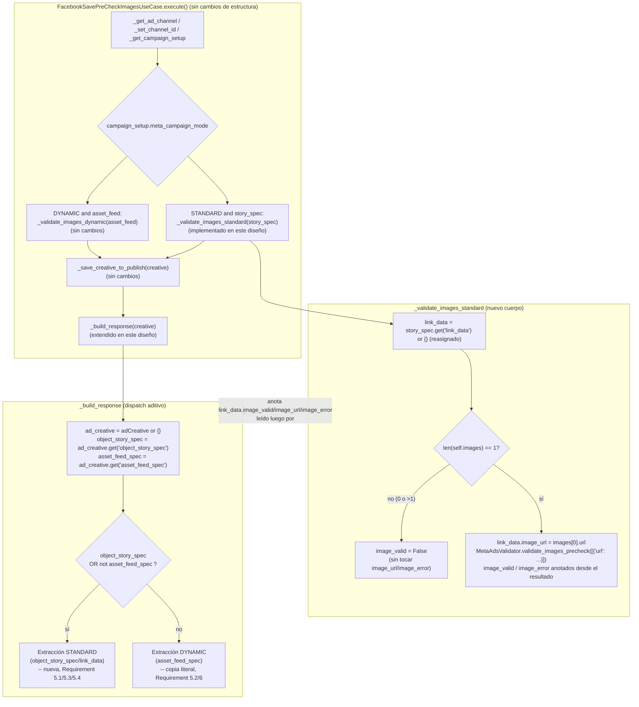

# Design Document: Meta Ads Standard Save Pre-Check Images

**Ubicación obligatoria (Requirement 1):** este documento reside en `sinergia/.kiro/specs/meta-ads-standard-save-precheck-images/design.md` y describe cambios exclusivamente dentro del árbol `sinergia/`. El único archivo productivo a modificar es `sinergia/app/v2/use_cases/meta_ads.py`, exclusivamente dentro de los métodos `FacebookSavePreCheckImagesUseCase._validate_images_standard` y `FacebookSavePreCheckBaseUseCase._build_response`. El archivo de pruebas a ampliar (no a relocalizar) es `sinergia/tests/v2/unit/use_cases/test_facebook_save_pre_check_images.py`. Ningún otro archivo de producción (`sinergia/app/v2/use_cases/facebook_validator_service.py`, `sinergia/app/v2/resources/external.py`, etc.) se modifica.

## Overview

Este diseño implementa la Rama_STANDARD de `FacebookSavePreCheckImagesUseCase._validate_images_standard` (hoy un `pass`) hasta paridad funcional con la Rama_DYNAMIC ya existente (`_validate_images_dynamic`), y extiende `FacebookSavePreCheckBaseUseCase._build_response` (heredado también por `FacebookSavePreCheckTextsUseCase`, `FacebookSavePreCheckCTAsUseCase`, `FacebookSavePreCheckBudgetUseCase`, `FacebookSavePreCheckProposalURLUseCase` y `FacebookSavePreCheckLocationsUseCase`) para que produzca la Respuesta_de_Precheck también para un ad set STANDARD, sin lanzar la excepción no controlada que hoy se propagaría al leer `asset_feed_spec` sobre un `Ad_Creative` que en realidad usa `object_story_spec`.

Ambos cambios son deliberadamente pequeños en superficie (un único candidato de imagen, un único `Ad_Creative` por invocación) porque reutilizan decisiones de diseño ya resueltas y ya implementadas por la especificación hermana `meta-ads-standard-precheck-validation`:

- El naming de las anotaciones (`image_url`, `image_valid`, `image_error` dentro de `link_data`) ya está fijado por el Requirement 10 de esa especificación y ya es producido por `FacebookGeneratePreCheckCreativeUseCase._validate_standard_image` (mismo archivo, clase abuela de `FacebookSavePreCheckImagesUseCase`).
- El mapeo de campos de `_build_standard_creative_entry` (Requirement 12 de esa especificación, ya implementado) es la referencia directa que este diseño adapta a los parámetros propios de `_build_response` (`creative`, `ads_to_publish`), conforme al Requirement 5.3 de `requirements.md`.

Ninguna lógica nueva se introduce en `facebook_validator_service.py`: `MetaAdsValidator.validate_images_precheck` se reutiliza exactamente como ya lo hacen la Rama_DYNAMIC de este mismo caso de uso y la Rama_STANDARD de `FacebookGeneratePreCheckCreativeUseCase`.

## Architecture



`_validate_images_standard` y la rama STANDARD de `_build_response` son colaboradores independientes que comparten el mismo `link_data` mutado in-place dentro de `story_spec`/`object_story_spec` (el mismo diccionario, por identidad): la primera anota, la segunda lee. Ningún otro método existente cambia.

### Principio de aislamiento (Requirement 1.2, 6)

Toda la lógica nueva vive exclusivamente dentro del cuerpo de los dos métodos ya existentes listados arriba:

1. `_validate_images_standard`: se reemplaza en su totalidad el `pass` actual por la implementación de este diseño. No se añaden métodos privados nuevos a la clase (a diferencia de la especificación hermana, que sí introdujo varios `_validate_standard_*` porque cubría 6 validaciones distintas); aquí una sola validación (imagen) cabe íntegra en un único método sin necesidad de descomponerlo.
2. `_build_response`: se antepone un bloque de detección (`ad_creative`/`object_story_spec`/`asset_feed_spec`) y un `if`/`else` de despacho; la rama `else` contiene el cuerpo actual **copiado literalmente, carácter por carácter**, y la rama `if` contiene la construcción nueva. Dos funciones auxiliares puramente locales (`_as_single_item_list`, ver Components) se definen como *closures* dentro del propio cuerpo de `_build_response` -- no como métodos de clase -- para no exceder el alcance de modificación autorizado por Requirement 1.2.

Ningún carácter de `_validate_images_dynamic`, de la construcción/dispatch de `execute()`, ni de ningún otro caso de uso `Save*` se modifica.

## Components and Interfaces

### 1. `_validate_images_standard` (Requirements 2, 3, 4)

```python
def _validate_images_standard(self, story_spec):
    # Requirement 4.1: link_data ausente/None se sustituye por un
    # diccionario vacío recién creado, reasignado a story_spec, para que
    # las anotaciones tengan siempre un destino mutable. Mismo patrón que
    # _validate_standard_creative de la clase abuela.
    link_data = story_spec.get('link_data')
    if link_data is None:
        link_data = {}
        story_spec['link_data'] = link_data

    # Requirement 2: Valor_Candidato de Imágenes_Candidatas es simplemente
    # len(self.images), ya que self.images ya es una lista (asignada en el
    # constructor vía pre_check_data.get('images', [])); a diferencia de los
    # campos de link_data en la especificación hermana, no hace falta
    # _standard_candidate_values aquí.
    if len(self.images) != 1:
        # Requirement 2.2/2.3: 0 o >1 candidatos -> image_valid=False,
        # sin invocar validate_images_precheck, sin tocar image_url/
        # image_error/ningún otro campo previamente anotado de link_data.
        link_data['image_valid'] = False
        return

    # Requirement 4.2: se asigna image_url ANTES de invocar el validador,
    # sobrescribiendo cualquier valor previo. Nótese que no se valida que
    # self.images[0] sea un dict (Out of Scope de requirements.md: se
    # replica deliberadamente la falta de validación defensiva ya existente
    # en _validate_images_dynamic para el mismo escenario).
    image_url = self.images[0].get('url')
    link_data['image_url'] = image_url

    # Requirement 3.1: lista sintética de un único elemento, reutilizando
    # MetaAdsValidator.validate_images_precheck exactamente como lo hace
    # DYNAMIC (Requirement 3.5/3.6: ninguna ruta de descarga/validación
    # adicional). Requirement 3.7: is_valid_images_amount NO se invoca.
    images = [{'url': image_url}]
    MetaAdsValidator.validate_images_precheck(images)

    # Requirement 4.3/4.4: se anota exactamente el resultado. Cuando
    # image_url es falsy, validate_images_precheck hace `continue` antes de
    # su `try/finally`, por lo que `images[0]` nunca recibe las claves
    # 'valid'/'error' -- de modo que `.get('valid', False)`/`.get('error')`
    # ya producen exactamente False/None sin necesidad de un caso especial
    # (Requirement 4.7, ver Error Handling).
    link_data['image_valid'] = images[0].get('valid', False)
    link_data['image_error'] = images[0].get('error')
```

Notas de diseño:

- **Por qué no se reutiliza `_standard_candidate_values`:** esa función (de la clase abuela) normaliza un valor escalar-o-lista arbitrario, porque los campos de `link_data` en la especificación hermana pueden llegar como escalar. Aquí `self.images` **siempre** es una lista (nunca un escalar) porque proviene directamente de `pre_check_data.get('images', [])` en el constructor; el Glossary de `requirements.md` define Valor_Candidato para este caso simplemente como `len(self.images)`. Introducir esa función sería una abstracción no pedida por los requisitos.
- **Mutación in-place (Requirement 4.5):** tanto la reasignación de `link_data` a `story_spec['link_data']` (cuando estaba ausente) como todas las anotaciones (`image_url`, `image_valid`, `image_error`) mutan el mismo diccionario `story_spec` recibido como argumento, nunca una copia -- exactamente el mismo patrón que `_validate_images_dynamic` ya usa sobre `asset_feed`.
- **Ningún manejo especial para `Requirement 2.4`:** dado que la función retorna (`return`) inmediatamente después de anotar `image_valid = False` en el caso de conteo inválido, ningún camino de código posterior puede lanzar una excepción no controlada para ese caso, independientemente de cuán vacío o poblado esté `story_spec`/`link_data` de antemano.

### 2. Dispatch de `_build_response` (Requirement 5.1, 5.2, 6.3)

El cuerpo de `_build_response` se reestructura así, preservando la primera línea (`ads_to_publish = creative.get('ads')[0]`) sin cambios:

```python
def _build_response(self, creative):
    ads_to_publish = creative.get('ads')[0]

    # NUEVO: normalización compartida por ambas ramas. `or {}` convierte
    # tanto la ausencia de la clave 'adCreative' como un valor explícito
    # None en un diccionario vacío, evitando el AttributeError que el
    # código anterior propagaba en ambos casos (ver Error Handling).
    ad_creative = ads_to_publish.get('adCreative') or {}
    object_story_spec = ad_creative.get('object_story_spec')
    asset_feed_spec = ad_creative.get('asset_feed_spec')

    # Requirement 5.1/5.2: object_story_spec truthy tiene prioridad
    # absoluta; si ambos están ausentes/falsy, también se usa la
    # extracción STANDARD (con sus propios defaults). Solo cuando
    # asset_feed_spec es truthy y object_story_spec es falsy se preserva
    # la Rama_DYNAMIC sin cambios.
    if object_story_spec or not asset_feed_spec:
        creative_to_publish = { ... }  # ver Componente 3
    else:
        creative_to_publish = { ... }  # ver Componente 4 (copia literal)

    return creative_to_publish
```

La tabla de verdad completa de las 4 combinaciones posibles (Requirement 5.2, "mutuamente excluyentes... cubren exhaustivamente las cuatro combinaciones") es:

| `object_story_spec` | `asset_feed_spec` | Rama aplicada | Requirement |
|---|---|---|---|
| truthy | truthy | STANDARD (prioridad) | 5.1 |
| truthy | falsy/ausente | STANDARD | 5.1 |
| falsy/ausente | truthy | DYNAMIC (sin cambios) | 5.2 |
| falsy/ausente | falsy/ausente | STANDARD (con todos sus defaults) | 5.1, 5.4 |

### 3. Extracción STANDARD dentro de `_build_response` (Requirement 5.3, 5.4, 5.5)

```python
    object_story_spec = object_story_spec or {}
    link_data = object_story_spec.get('link_data') or {}
    call_to_action = link_data.get('call_to_action') or {}

    # Closure local -- no un método de clase -- para mantenerse dentro del
    # alcance de modificación autorizado (Requirement 1.2). Firma idéntica
    # a la ya usada por _build_standard_creative_entry en
    # FacebookGeneratePreCheckCreativeUseCase (misma clase abuela), para
    # producir el mismo contrato de entrada de texto ({'text', 'valid_length'}).
    def _as_single_item_list(value, valid_flag):
        return [{'text': value, 'valid_length': valid_flag}] if value else []

    image_url = link_data.get('image_url')
    images = [{
        'url': image_url,
        'valid': link_data.get('image_valid', False),
        'error': link_data.get('image_error'),
    }] if image_url else []

    creative_to_publish = {
        'name': creative.get('name'),
        'adset_id': creative.get('id'),
        'ad_id': ads_to_publish.get('id'),
        'adchannel_id': object_story_spec.get('ad_channel_id', 0),
        'daily_budget': creative.get('daily_budget'),
        'images': images,
        'bodies': _as_single_item_list(link_data.get('message'), link_data.get('body_valid', False)),
        'titles': _as_single_item_list(link_data.get('name'), link_data.get('title_valid', False)),
        'descriptions': _as_single_item_list(link_data.get('description'), link_data.get('description_valid', False)),
        'call_to_action_types': [call_to_action.get('type', {})] if call_to_action else [],
        'images_valid_amount': link_data.get('image_valid', False),
        'titles_valid_amount': link_data.get('title_valid', False),
        'bodies_valid_amount': link_data.get('body_valid', False),
        'descriptions_valid_amount': link_data.get('description_valid', False),
        'call_to_action_types_valid_amount': call_to_action.get('type', {}).get('valid', False) if call_to_action else False,
        'images_max_amount': 0,
        'titles_max_amount': 0,
        'bodies_max_amount': 0,
        'descriptions_max_amount': 0,
        'call_to_action_types_max_amount': 0,
        'unique_titles': link_data.get('title_valid', False),
        'unique_bodies': link_data.get('body_valid', False),
        'unique_descriptions': link_data.get('description_valid', False),
        'daily_budget_valid': object_story_spec.get('daily_budget_valid', False),
        'min_daily_budget': object_story_spec.get('min_daily_budget', 0),
        'proposal_url': link_data.get('link') or '',
        'proposal_url_valid': link_data.get('link_url_valid', False),
        'proposal_locations': creative.get('proposal_locations', []),
        'locations': object_story_spec.get('locations', []),
        'locations_valid': object_story_spec.get('locations_valid', False),
    }
```

Esta construcción es una adaptación directa de `_build_standard_creative_entry` (`FacebookGeneratePreCheckCreativeUseCase`, ya implementado) a las variables propias de `_build_response`: `creative` reemplaza a `ad_set_to_publish`, y `ads_to_publish` (ya calculado en la primera línea del método, un único ad) reemplaza al ítem individual del bucle `for item in ad_set_to_publish.get('ads', [])`. La única diferencia deliberada es `name`, que aquí es `creative.get('name')` puro (sin concatenar el nombre del ad), porque `creative` en este caso de uso ya representa un único ad -- exactamente como exige el Requirement 5.3.

### 4. Extracción DYNAMIC dentro de `_build_response` (Requirement 5.2, 6.1, 6.2)

```python
    creative_to_publish = {
        'name': creative.get('name'),
        'adset_id': creative.get('id'),
        'ad_id': ads_to_publish.get('id'),
        'adchannel_id': ad_creative.get('asset_feed_spec', {}).get('ad_channel_id', 0),
        'daily_budget': creative.get('daily_budget'),
        'images': [{'url': i.get('url'), 'valid': i.get('valid'), 'error': i.get('error')} for i in ad_creative.get('asset_feed_spec', {}).get('images', [])],
        'bodies': ad_creative.get('asset_feed_spec', {}).get('bodies', []),
        'titles': ad_creative.get('asset_feed_spec', {}).get('titles', []),
        'descriptions': ad_creative.get('asset_feed_spec', {}).get('descriptions', []),
        'call_to_action_types': ad_creative.get('asset_feed_spec', {}).get('call_to_action_types', []),
        'images_valid_amount': ad_creative.get('asset_feed_spec', {}).get('images_valid_amount', False),
        'titles_valid_amount': ad_creative.get('asset_feed_spec', {}).get('titles_valid_amount', False),
        'bodies_valid_amount': ad_creative.get('asset_feed_spec', {}).get('bodies_valid_amount', False),
        'descriptions_valid_amount': ad_creative.get('asset_feed_spec', {}).get('descriptions_valid_amount', False),
        'call_to_action_types_valid_amount': ad_creative.get('asset_feed_spec', {}).get('call_to_action_types_valid_amount', False),
        'images_max_amount': ad_creative.get('asset_feed_spec', {}).get('images_max_amount', 0),
        'titles_max_amount': ad_creative.get('asset_feed_spec', {}).get('titles_max_amount', 0),
        'bodies_max_amount': ad_creative.get('asset_feed_spec', {}).get('bodies_max_amount', 0),
        'descriptions_max_amount': ad_creative.get('asset_feed_spec', {}).get('descriptions_max_amount', 0),
        'call_to_action_types_max_amount': ad_creative.get('asset_feed_spec', {}).get('call_to_action_types_max_amount', 0),
        'unique_titles': ad_creative.get('asset_feed_spec', {}).get('unique_titles', False),
        'unique_bodies': ad_creative.get('asset_feed_spec', {}).get('unique_bodies', False),
        'unique_descriptions': ad_creative.get('asset_feed_spec', {}).get('unique_descriptions', False),
        'daily_budget_valid': ad_creative.get('asset_feed_spec', {}).get('daily_budget_valid', False),
        'min_daily_budget': ad_creative.get('asset_feed_spec', {}).get('min_daily_budget', 0),
        'proposal_url': ','.join([u.get('website_url', '') for u in ad_creative.get('asset_feed_spec', {}).get('link_urls', [])]),
        'proposal_url_valid': ad_creative.get('asset_feed_spec', {}).get('link_url_valid', False),
        'proposal_locations': creative.get('proposal_locations', []),
        'locations': ad_creative.get('asset_feed_spec', {}).get('locations', []),
        'locations_valid': ad_creative.get('asset_feed_spec', {}).get('locations_valid', False),
    }
```

Idéntico, campo por campo y expresión por expresión, al cuerpo actualmente en producción (incluida la asimetría ya existente `.get('website_url', '')` vs. el resto sin segundo argumento en otras expresiones). La única variable que cambia de "calculada en la línea anterior sin nombre propio" a "ya disponible como `ad_creative`" es la propia extracción de `adCreative`, que **antes de esta especificación** era `ad_creative = ads_to_publish.get('adCreative')` (sin default) y **ahora** es la normalización compartida `ads_to_publish.get('adCreative') or {}` descrita en el Componente 2. Para todo `Ad_Creative` real de un ad DYNAMIC (donde `asset_feed_spec` es siempre un diccionario verdadero no vacío), esta normalización no altera ningún valor observable: `adCreative` nunca es `None`/ausente en ese escenario.

## Data Models

### Contrato de anotación sobre `link_data` (imagen, Requirement 4)

| Campo | Ubicación | Ausente (no evaluado) cuando | `True`/valor cuando | `False`/valor cuando |
|---|---|---|---|---|
| `image_url` | `story_spec['link_data']` | Valor_Candidato ≠ 1 (no se toca) | — (no booleano) | asignado desde `self.images[0].get('url')` únicamente cuando Valor_Candidato == 1 |
| `image_valid` | `story_spec['link_data']` | — (siempre se anota) | Valor_Candidato == 1 y `validate_images_precheck` anota `valid=True` (incluye el caso `url` falsy, que nunca anota `valid`, por lo que `.get('valid', False)` resuelve a `False`, ver Error Handling) | Valor_Candidato ≠ 1, o `validate_images_precheck` anota `valid=False` |
| `image_error` (str, no booleano) | `story_spec['link_data']` | Valor_Candidato ≠ 1 (no se toca; conserva cualquier valor previo) | n/a | n/a (mensaje de `validate_images_precheck`, o `None` cuando `url` es falsy) |

### `CreativeToPublish` para STANDARD vía `_build_response` (Requirement 5.3, 5.4, 5.5)

| Clave | Origen para STANDARD | Default cuando falta |
|---|---|---|
| `name` | `creative.get('name')` | `None` |
| `adset_id` | `creative.get('id')` | `None` |
| `ad_id` | `ads_to_publish.get('id')` | `None` |
| `adchannel_id` | `object_story_spec.get('ad_channel_id', 0)` | `0` |
| `daily_budget` | `creative.get('daily_budget')` | `None` |
| `images` | `[{'url': image_url, 'valid': link_data.get('image_valid', False), 'error': link_data.get('image_error')}]` si `image_url` truthy | `[]` |
| `bodies` / `titles` / `descriptions` | `[{'text': valor, 'valid_length': *_valid}]` si el valor de `link_data` (`message`/`name`/`description`) es truthy | `[]` |
| `call_to_action_types` | `[call_to_action.get('type', {})]` si `call_to_action` es truthy | `[]` |
| `images_valid_amount` | `link_data.get('image_valid', False)` | `False` |
| `titles_valid_amount` | `link_data.get('title_valid', False)` | `False` |
| `bodies_valid_amount` | `link_data.get('body_valid', False)` | `False` |
| `descriptions_valid_amount` | `link_data.get('description_valid', False)` | `False` |
| `call_to_action_types_valid_amount` | `call_to_action.get('type', {}).get('valid', False)` si hay CTA | `False` |
| `unique_titles` / `unique_bodies` / `unique_descriptions` | igual a `title_valid` / `body_valid` / `description_valid` respectivamente (ver nota) | `False` |
| `daily_budget_valid` | `object_story_spec.get('daily_budget_valid', False)` | `False` |
| `min_daily_budget` | `object_story_spec.get('min_daily_budget', 0)` | `0` |
| `proposal_url` | `link_data.get('link') or ''` | `''` |
| `proposal_url_valid` | `link_data.get('link_url_valid', False)` | `False` |
| `proposal_locations` | `creative.get('proposal_locations', [])` | `[]` |
| `locations` / `locations_valid` | `object_story_spec.get('locations', [])` / `.get('locations_valid', False)` (ver nota) | `[]` / `False` |
| `images_max_amount`, `titles_max_amount`, `bodies_max_amount`, `descriptions_max_amount`, `call_to_action_types_max_amount` | *(sin equivalente en STANDARD — Requirement 5.5)* | `0` (los cinco, siempre) |

**Nota -- `unique_*`:** idéntica justificación que en la especificación hermana (Requirement 12, nota "unique_*"): Título/Cuerpo/Descripción_STANDARD son siempre colecciones de a lo sumo 1 elemento, por lo que la unicidad es trivialmente satisfecha y no existe una validación de unicidad independiente para STANDARD en el alcance de esta especificación (ni de la hermana).

**Nota -- `locations`/`locations_valid`:** ninguna especificación implementada hasta ahora anota ubicaciones para un ad STANDARD (`FacebookSavePreCheckLocationsUseCase` tiene su rama STANDARD explícitamente fuera de alcance, ver "Out of Scope" de `requirements.md`). El código de extracción lee estas claves de todas formas, para que una especificación futura las exponga sin requerir otro cambio en `_build_response`; dentro del alcance de esta especificación, siempre producen su valor por defecto.

**Nota -- `object_story_spec`/`link_data` parcial o total ausente (Requirement 5.4):** cuando `object_story_spec` es `None`/está ausente, se trata como `{}` (normalización ya mostrada en el Componente 2/3); cuando `link_data` es `None`/está ausente dentro de un `object_story_spec` presente, también se trata como `{}`. Ambos casos nunca lanzan `AttributeError`: todo acceso posterior usa `.get(..., default)` o un `or {}` previo.

## Error Handling

- **Requirement 2.4 / 4.1 -- `link_data`/`story_spec` vacíos, `None`, ausentes, o sin valor previo de `image_url`:** `_validate_images_standard` nunca lanza una excepción no controlada para ninguna de estas formas de entrada. El único punto donde podría fallar (`story_spec.get('link_data')` sobre un `story_spec` que no sea un diccionario) está fuera de alcance: el guard externo en `execute()` (`elif ... == CreativeType.STANDARD.value and story_spec:`) ya garantiza que `story_spec` es un valor truthy antes de invocar este método, y en la práctica siempre es un diccionario (proviene de `creative['ads'][0]['adCreative']['object_story_spec']`, ya construido por `MetaAdsPayloadBuilder`).
- **Requirement 4.7 -- imagen candidata cuya `url` es `None`/está ausente:** no requiere una rama de código dedicada. `MetaAdsValidator.validate_images_precheck` ejecuta `if not img_url: continue` **antes** de su bloque `try/finally`, por lo que el diccionario de imagen sintético (`{'url': None}` o `{'url': ''}`) nunca recibe las claves `'valid'`/`'error'`. Como consecuencia, `images[0].get('valid', False)` resuelve a `False` y `images[0].get('error')` resuelve a `None` exactamente por el comportamiento por defecto de `.get`, sin necesidad de un `if` adicional ni de capturar ninguna excepción.
- **Requirement 3.6/3.7 -- ninguna ruta de validación adicional:** `_validate_images_standard` invoca únicamente `MetaAdsValidator.validate_images_precheck`; no invoca `is_valid_images_amount` (diseñado para el máximo de 10 imágenes de DYNAMIC, no para la regla de cantidad exacta 1 de STANDARD) ni ninguna función de descarga/validación propia.
- **Requirement 5.1/5.4/7.8 -- `adCreative` ausente, `None`, o con `object_story_spec`/`asset_feed_spec` ambos ausentes/falsy:** `_build_response` ya no propaga `AttributeError` para este caso. Esto es un cambio de comportamiento deliberado respecto al código anterior a esta especificación (que lanzaba `AttributeError: 'NoneType' object has no attribute 'get'` al evaluar `None.get('asset_feed_spec', {})` cuando `adCreative` era explícitamente `None` o estaba ausente), exigido explícitamente por el Requirement 5.1/5.4 y por el escenario de prueba del Requirement 7.8. Este cambio **no** viola el Requirement 6 (no regresión), porque el Requirement 6 protege exclusivamente el comportamiento observable para ads cuyo `asset_feed_spec` es verdadero (ads DYNAMIC reales) -- un `Ad_Creative` completamente vacío/ausente nunca tiene un `asset_feed_spec` verdadero, así que nunca cae bajo esa protección.
  - **Impacto conocido y explícitamente aceptado sobre pruebas existentes (Requirement 1.5):** las dos pruebas ya existentes en `TestBuildResponse` que caracterizan hoy `AttributeError` al invocar `_build_response` directamente con `adCreative=None` o con la clave `adCreative` ausente (`test_build_response_with_explicit_none_ad_creative_raises_attribute_error_directly` y su análoga para la clave ausente) dejan de observar una excepción y deben actualizarse para verificar, en su lugar, que la Respuesta_de_Precheck resultante contiene exactamente los valores por defecto documentados en la tabla de "CreativeToPublish para STANDARD" de este documento. Esta actualización está explícitamente autorizada por el Requirement 1.5 ("salvo los ajustes estrictamente necesarios para acomodar la extensión de `_build_response` descrita en el Requirement 5") y es exactamente el escenario que exige caracterizar el Requirement 7.8.
- **Requirement 5.2/6.1/6.2 -- no regresión de la Rama_DYNAMIC:** para cualquier `Ad_Creative` con `asset_feed_spec` verdadero y `object_story_spec` ausente/falsy (el único shape que produce un ad DYNAMIC real desde `MetaAdsPayloadBuilder`), la normalización `ads_to_publish.get('adCreative') or {}` es un no-op observable (nunca hay un `adCreative` `None`/ausente para un ad DYNAMIC real), y el cuerpo de la rama `else` es una copia literal del código anterior. Ninguna prueba existente de `TestBuildResponse` que ejercite esta forma (`make_asset_feed_spec()` con contenido, i.e. un diccionario verdadero) cambia de resultado.
- **Requirement 5.1 -- ambos `object_story_spec` y `asset_feed_spec` verdaderos simultáneamente:** caso no alcanzable desde el flujo real de `MetaAdsPayloadBuilder.build_creative` (que puebla exactamente uno de los dos según `self.creative_type`), pero cubierto explícitamente por el diseño: la extracción STANDARD tiene prioridad absoluta, sin ambigüedad ni excepción.
- **Fuera de alcance (heredado, sin cambios):** ninguna validación de forma de `self.images[0]` (por ejemplo, que no sea un diccionario) se introduce; si el llamador provee una entrada no-diccionario como único elemento de `self.images`, `self.images[0].get('url')` propaga el mismo `AttributeError` no controlado que ya es característico de la falta de validación defensiva equivalente en `_validate_images_dynamic` (que tampoco valida la forma de cada entrada de `self.images` antes de pasarlas a `validate_images_precheck`).

## Correctness Properties

*A property is a characteristic or behavior that should hold true across all valid executions of a system-essentially, a formal statement about what the system should do. Properties serve as the bridge between human-readable specifications and machine-verifiable correctness guarantees.*

Esta sección documenta, con fines de trazabilidad y de diseño, las propiedades universales que ya se derivan de los criterios de aceptación de los Requirements 2-6 y del comportamiento descrito en los componentes anteriores de este documento. Tal como ya resuelve la sección "Property-Based Tests" de `requirements.md` para esta especificación, ninguna de estas propiedades es un requisito obligatorio de implementar como suite de pruebas basadas en propiedades (Hypothesis u otra librería equivalente): son una extensión de bajo alcance combinatorio de propiedades ya cubiertas por la especificación hermana `meta-ads-standard-precheck-validation`, y la cobertura obligatoria de esta especificación se apoya exclusivamente en las pruebas unitarias de ejemplo descritas en Testing Strategy. Estas propiedades quedan documentadas aquí únicamente para trazabilidad entre requisitos y diseño.

### Property 1: Regla de cardinalidad exacta 1 para Imágenes_Candidatas

*Para toda* lista `self.images` cuyo Valor_Candidato (`len(self.images)`) sea distinto de 1 (longitud 0, o cualquier longitud ≥ 2 con contenido arbitrario), `_validate_images_standard` SHALL anotar `link_data['image_valid']` como `False`, SHALL NOT invocar `MetaAdsValidator.validate_images_precheck`, y SHALL NOT modificar `link_data['image_url']`, `link_data['image_error']` ni ningún otro campo de `link_data` previamente anotado.

**Validates: Requirements 2.2, 2.3, 2.4, 3.2**

### Property 2: Espejo (mirroring) del resultado de `validate_images_precheck`

*Para todo* valor booleano `valid` anotado (simulado mediante un doble de prueba) por `MetaAdsValidator.validate_images_precheck` sobre la única imagen candidata cuando el Valor_Candidato es igual a 1, `link_data['image_valid']` SHALL ser exactamente igual a ese valor y `link_data['image_error']` SHALL ser exactamente igual al valor anotado en el campo `error` de esa imagen. *Adicionalmente*, para toda imagen candidata cuya `url` sea `None` o esté ausente (caso en el que `validate_images_precheck` nunca anota `valid`/`error` sobre ella), `link_data['image_valid']` SHALL resolver a `False` y `link_data['image_error']` SHALL resolver a `None`, sin lanzar una excepción no controlada.

**Validates: Requirements 3.3, 3.4, 4.3, 4.4, 4.7**

### Property 3: Construcción total (sin excepciones) de la Respuesta_de_Precheck para las cuatro combinaciones de `_build_response`

*Para todo* `Ad_Creative` (tratado como diccionario vacío cuando esté ausente o sea `None`) generado con cualquier combinación de presencia/ausencia/veracidad de `object_story_spec` y `asset_feed_spec` -- incluyendo las cuatro combinaciones exhaustivas de la tabla de verdad de este documento -- `_build_response` SHALL retornar, sin lanzar ninguna excepción no controlada, un diccionario que contiene exactamente el mismo conjunto fijo de claves definido en el Glossary, usando los valores por defecto documentados en la tabla de "CreativeToPublish para STANDARD" para toda clave ausente cuando la combinación resuelva hacia la extracción STANDARD.

**Validates: Requirements 5.1, 5.2, 5.4, 5.5**

### Property 4: No regresión de la extracción DYNAMIC en `_build_response`

*Para todo* `Ad_Creative` con `asset_feed_spec` presente y verdadero, y con `object_story_spec` ausente, `None`, o falsy, el diccionario retornado por `_build_response` SHALL ser idéntico, campo por campo, al que produciría el cuerpo de extracción DYNAMIC ya existente antes de esta especificación, y la normalización compartida (`ads_to_publish.get('adCreative') or {}`) introducida por el Componente 2 SHALL ser un no-op observable para todo `Ad_Creative` de esta forma.

**Validates: Requirements 6.1, 6.2, 6.4**

## Testing Strategy

### Por qué no se exigen pruebas basadas en propiedades (PBT)

`requirements.md` ya resuelve esta decisión de diseño en su propia sección "Property-Based Tests": el comportamiento de `_validate_images_standard`/`_build_response` para STANDARD es una extensión de bajo alcance combinatorio (una sola imagen candidata evaluada contra 3 posibilidades de cantidad -- 0, 1, o ≥2 -- y un solo `Ad_Creative` por invocación) de patrones ya cubiertos por propiedades en la especificación hermana `meta-ads-standard-precheck-validation` (Property 2 para el conteo de candidatos, Property 4 para el espejo del resultado de `validate_images_precheck`). Los escenarios explícitos del Requirement 7 (unitarios, con ejemplos concretos) son suficientes para caracterizarlo sin introducir generación aleatoria adicional en este archivo. Este diseño sigue esa decisión ya tomada: no se define ninguna sección de Correctness Properties, y la cobertura se apoya exclusivamente en pruebas unitarias de ejemplo.

### Ubicación y ampliación del archivo de pruebas (Requirement 1.3, 7.1)

Toda la cobertura reside en `sinergia/tests/v2/unit/use_cases/test_facebook_save_pre_check_images.py`, ampliando el archivo ya existente:

- La clase `TestValidateImagesStandard` (que hoy caracteriza el no-op) se **reemplaza por completo** por los escenarios descritos abajo, conforme a la sección "Out of Scope" de `requirements.md` -- esta sustitución no cuenta como violación del Requirement 6 (no regresión), que solo protege la Rama_DYNAMIC y el resto de `execute()`.
- La clase `TestBuildResponse` se **ampliá** con los nuevos escenarios STANDARD descritos abajo, y sus dos pruebas de `AttributeError` para `adCreative=None`/ausente se **actualizan** (no se eliminan como clase, solo se ajustan esas dos aserciones puntuales) conforme a lo ya justificado en Error Handling.
- Todas las demás clases del archivo (`TestConstructorAndInheritedState`, `TestGetAdChannel`, `TestGetCampaignSetup`, `TestSetChannelId`, `TestExecuteOrchestration`, `TestValidateImagesDynamic`, `TestDynamicBranchMissingAssetFeed`, y la clase que cubre `meta_campaign_mode` desconocido) permanecen sin modificar sus aserciones, conforme al Requirement 1.5 y al Requirement 6.5.

### Builders reutilizados sin cambios

`make_pre_check_images_data`, `make_image_entry`, `make_ad_channel`, `make_campaign_setup`, `make_object_story_spec`, `make_ad_creative`, `make_ad`, `make_creative`, `make_asset_feed_spec`, la fixture `use_case_factory`, los context managers `patch_redis_client`/`patch_image_fetch`, y la fixture `deny_network` (autouse) -- ninguno requiere cambios de firma ni de comportamiento.

### Builder nuevo

- `make_link_data(**overrides)`: no existe hoy en este archivo (sí existe, con la misma forma, en `test_facebook_generate_pre_check_creative.py`, de donde se copia/adapta). Construye un diccionario fresco con `name`, `message`, `description`, `image_url`, `link`, `call_to_action` en `None` por defecto, sobre el que `make_object_story_spec(link_data=make_link_data(...))` puede componerse directamente, ya que `make_object_story_spec` ya acepta `**overrides` arbitrarios.

### Escenarios nuevos para `_validate_images_standard` (reemplazando `TestValidateImagesStandard`, Requirement 7.2-7.5, 7.10, 7.11)

1. **Éxito con exactamente 1 candidata válida** (Requirement 7.2): `self.images = [make_image_entry(url=...)]`, imagen simulada válida vía `patch_image_fetch`/bytes de imagen real (reutilizando el helper `_build_valid_test_image_bytes` ya presente en el archivo). Verificar `link_data['image_url']`, `link_data['image_valid'] is True`, `link_data['image_error'] is None`.
2. **1 candidata marcada inválida por el validador** (Requirement 7.3): `patch_image_fetch` simulando una respuesta que hace que `validate_images_precheck` anote `valid=False` (por ejemplo, tamaño de imagen fuera de rango, o `patch_image_fetch(side_effect=requests.exceptions.RequestException(...))`). Verificar `link_data['image_valid'] is False` y `link_data['image_error']` reflejando el mensaje anotado, sin solicitud HTTP real fuera de la ya simulada.
3. **0 candidatas y ≥2 candidatas** (Requirement 7.4), parametrizado: verificar en ambos casos `link_data['image_valid'] is False`, que `MetaAdsValidator.validate_images_precheck` no fue invocado (`assert_not_called`), y que un `image_url` preexistente en `link_data` permanece sin modificar.
4. **`object_story_spec` sin la clave `link_data` en absoluto** (Requirement 7.5): invocar con `story_spec = make_object_story_spec()` sin pasar `link_data` (o `story_spec = {}`), verificar que no se lanza excepción y que, tras la invocación, `story_spec['link_data']` es un diccionario nuevo con `image_valid=False`/`image_error` anotado, consistente con el escenario de 0 candidatas.
5. **Aislamiento de red** (Requirement 7.10): todo escenario que ejercite la validación real usa `patch_image_fetch`/parcheo de `app.v2.use_cases.facebook_validator_service.requests.get`, nunca una solicitud HTTP real; la fixture `deny_network` (ya autouse) cubre cualquier fuga accidental.

### Escenarios nuevos para `_build_response` (ampliando `TestBuildResponse`, Requirement 7.7, 7.8)

6. **`execute()` completo en modo STANDARD, sin parchear `_validate_images_standard`** (Requirement 7.6): reutilizando `make_object_story_spec(link_data=make_link_data(...))` con una imagen candidata válida, verificar que la Respuesta_de_Precheck final contiene exactamente el conjunto de claves del Glossary, con `images` reflejando el resultado de la validación.
7. **`_build_response` invocado directamente con `object_story_spec`/`link_data` parcial o totalmente poblado, incluyendo anotaciones ya presentes de una ejecución previa de `FacebookGeneratePreCheckCreativeUseCase.execute()`** (Requirement 7.7): por ejemplo `title_valid=True`, `body_valid=False`, `daily_budget_valid=True`, `call_to_action={'type': {'value': 'SIGN_UP', 'valid': True}}` ya anotados en `link_data`/`object_story_spec` antes de invocar `_build_response`; verificar que la Respuesta_de_Precheck refleja esos valores conforme a la tabla de mapeo de este documento.
8. **`adCreative` con `object_story_spec` y `asset_feed_spec` ausentes/`None`/`{}` simultáneamente** (Requirement 7.8): verificar que `_build_response` no lanza excepción y produce exactamente los valores por defecto documentados (reemplazando las dos aserciones de `AttributeError` ya existentes, conforme a lo justificado en Error Handling).
9. **No regresión de la Rama_DYNAMIC** (Requirement 7.9): agregar, sin modificar las aserciones de los escenarios DYNAMIC ya existentes, un escenario adicional que confirme que `_validate_images_standard` no es invocado cuando `campaign_setup['attributes']['meta_campaign_mode']` es `"DYNAMIC"` (verificación de invocación, no de `_build_response`).
10. **Criterio de finalización** (Requirement 7.11): ejecutar la suite completa con el intérprete de `sinergia/venv` y verificar cero `failed`, cero `skipped` y cero errores de recopilación.

### Comandos de validación

```bash
./venv/bin/python -m pytest --collect-only -q tests/v2/unit/use_cases/test_facebook_save_pre_check_images.py
./venv/bin/python -m pytest -q -ra tests/v2/unit/use_cases/test_facebook_save_pre_check_images.py
```

Ambos comandos se ejecutan desde `sinergia/`, en modo no interactivo y sin watch, conforme al Requirement 7.11.

### Criterios de aceptación de la suite

- Cero pruebas `failed`, `skipped` o errores de colección tras la implementación.
- Cada criterio de aceptación de los Requirements 2-7 referenciado en al menos una prueba o parametrización.
- La clase `TestValidateImagesStandard` queda reemplazada por completo (no coexiste el no-op con la nueva implementación).
- Las clases DYNAMIC/constructor/orquestación existentes continúan pasando sin modificar sus aserciones, salvo las dos aserciones de `AttributeError` en `TestBuildResponse` explícitamente identificadas arriba, que se ajustan conforme al Requirement 1.5.
