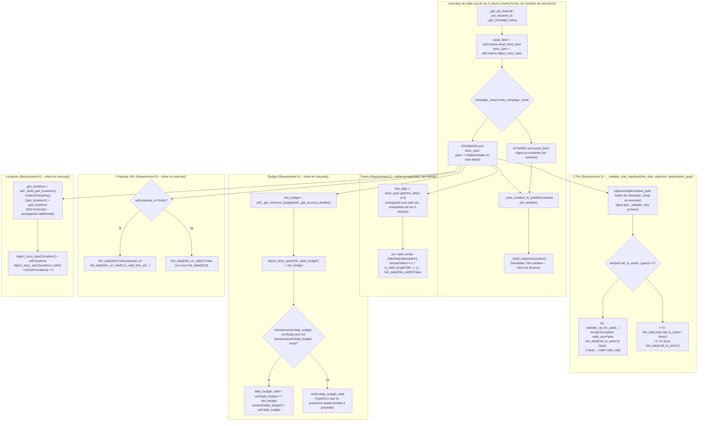

# Design Document: Meta Ads Standard Save Pre-Check Texts/CTAs/Budget/Proposal URL/Locations

**Ubicación obligatoria (Requirement 1):** este documento reside en `sinergia/.kiro/specs/meta-ads-standard-save-precheck-texts-ctas-budget-proposal-url-locations/design.md` y describe cambios exclusivamente dentro del árbol `sinergia/`. El único archivo productivo a modificar es `sinergia/app/v2/use_cases/meta_ads.py`, exclusivamente dentro del método `execute()` (y, para Caso_de_Uso_CTAs, adicionalmente dentro de un método privado nuevo definido en esa misma subclase) de `FacebookSavePreCheckTextsUseCase`, `FacebookSavePreCheckCTAsUseCase`, `FacebookSavePreCheckBudgetUseCase`, `FacebookSavePreCheckProposalURLUseCase` y `FacebookSavePreCheckLocationsUseCase`. Los archivos de pruebas a ampliar/crear son `sinergia/tests/v2/unit/use_cases/test_facebook_save_pre_check_texts.py` (ampliado) y los cuatro archivos nuevos `test_facebook_save_pre_check_ctas.py`, `test_facebook_save_pre_check_budget.py`, `test_facebook_save_pre_check_proposal_url.py`, `test_facebook_save_pre_check_locations.py`. Ningún otro archivo de producción (`sinergia/app/v2/use_cases/facebook_validator_service.py`, `FacebookSavePreCheckBaseUseCase._build_response`, `FacebookSavePreCheckImagesUseCase`, `sinergia/app/v2/resources/external.py`, etc.) se modifica, conforme al Requirement 1.2 y al Requirement 7.2.

## Overview

Este diseño implementa las cinco Ramas_STANDARD (hoy un `pass` sin implementar en cada una) de los métodos `execute()` de Caso_de_Uso_Textos, Caso_de_Uso_CTAs, Caso_de_Uso_Budget, Caso_de_Uso_URL y Caso_de_Uso_Locations, hasta paridad funcional con sus respectivas Ramas_DYNAMIC ya existentes.

A diferencia de las dos especificaciones hermanas anteriores (`meta-ads-standard-precheck-validation`, que introdujo la Rama_STANDARD completa del Caso_de_Uso_Abuelo; y `meta-ads-standard-save-precheck-images`, que hizo lo propio para la sexta clase hermana `FacebookSavePreCheckImagesUseCase` y extendió `_build_response`), esta especificación **no modifica `_build_response`**: las cinco clases ya heredan, sin cambio alguno, un `_build_response` capaz de reflejar correctamente cualquier anotación que este diseño produzca sobre `Object_Story_Spec`/`Link_Data`, siempre que se use exactamente el Contrato_de_Anotación_STANDARD ya fijado (ver Glossary de `requirements.md`). Por esta razón, ningún componente de este diseño introduce un nombre de campo nuevo: cada asignación mapea uno a uno contra un campo que `_build_response` ya lee.

Las cinco Ramas_STANDARD son, individualmente, extensiones de bajo alcance combinatorio (cardinalidad exacta 1 para Textos/CTAs, comparabilidad de tipo para Budget, truthiness para URL, un único `_build_geo_locations()` para Locations) sobre patrones ya resueltos por las dos especificaciones hermanas:

- El patrón "cardinalidad exacta 1 + no tocar el campo cuando la cardinalidad es inválida" ya está fijado por `_validate_images_standard` (`meta-ads-standard-save-precheck-images`, Requirement 2 de esa especificación) y por `_validate_standard_text_field`/`_validate_standard_image` (`FacebookGeneratePreCheckCreativeUseCase`, `meta-ads-standard-precheck-validation`).
- El patrón `try/except TypeError` para presupuestos no comparables ya está fijado por `_validate_standard_daily_budget` (`FacebookGeneratePreCheckCreativeUseCase`).
- El patrón de anotación de CTA (`{'type': {'value': ..., 'valid': ...}}`, omitir cuando ausente, no tocar cuando el valor no es un dict) ya está fijado por `_validate_standard_cta` (`FacebookGeneratePreCheckCreativeUseCase`), aunque aquí el punto de partida es distinto: Caso_de_Uso_CTAs ya tiene su propio `try/except Exception: valid_cta = False` en su Rama_DYNAMIC (`_validate_ctas`), que este diseño reutiliza literalmente en lugar del `isinstance(cta, dict)`-guard del Caso_de_Uso_Abuelo (ver Componente 2).

Ninguna lógica nueva se introduce en `facebook_validator_service.py`: `MetaAdsValidator.is_valid_length`, `.validate_cta_for_goal` y `.is_valid_link_url` se reutilizan exactamente como ya lo hacen sus respectivas Ramas_DYNAMIC.

## Architecture



`_build_response` (heredado, no tocado) lee, después de cualquiera de las cinco ramas de arriba, exactamente los campos que cada una anota: `link_data['name']/['title_valid']`, `['message']/['body_valid']`, `['description']/['description_valid']`, `['call_to_action']`, `['link']/['link_url_valid']`, y `object_story_spec['min_daily_budget']/['daily_budget_valid']/['locations']/['locations_valid']`, más `creative['daily_budget']` de nivel superior -- todos ya parte del Contrato_de_Anotación_STANDARD.

### Principio de aislamiento (Requirement 1.2, 1.3, 7)

Toda la lógica nueva vive dentro del cuerpo del método `execute()` ya existente de cada una de las cinco clases, con una única excepción deliberada:

1. **Textos, Budget, URL y Locations**: la Rama_STANDARD se escribe **inline**, directamente dentro del bloque `elif` de `execute()`, sin introducir ningún método privado nuevo. Justificación (Requirement 1.3, que solo exige la restricción de ubicación "WHERE el diseño decida extraer... a un método privado nuevo"): para estas cuatro clases, la Rama_DYNAMIC correspondiente **ya es inline** dentro de `execute()` (Textos, Budget, URL) o consiste en una única llamada a un método ya existente sin lógica STANDARD adicional que justifique una nueva abstracción (`_build_geo_locations()` para Locations, reutilizado sin cambios). Extraer un método nuevo de una sola llamada, usado una sola vez, no aportaría valor y se alejaría del estilo ya establecido por cada clase. Esto es consistente con la decisión ya razonada por el diseño hermano de Imágenes para `_validate_images_standard` ("una sola validación cabe íntegra... sin necesidad de descomponerlo"), extendida aquí a cuatro clases cuyo propio DYNAMIC tampoco delega en un método dedicado (salvo Locations, que reutiliza `_build_geo_locations()` intacto).
2. **CTAs**: la Rama_DYNAMIC de esta clase **sí** delega en un método privado dedicado (`_validate_ctas`), por lo que, para mantener la simetría estructural ya establecida por la propia clase (y conforme a la opción explícitamente habilitada por el Requirement 1.3), este diseño introduce un método privado nuevo y simétrico: `_validate_ctas_standard(self, link_data, objective, optimization_goal)`, definido dentro de `FacebookSavePreCheckCTAsUseCase` (nunca en `FacebookSavePreCheckBaseUseCase` ni en ninguna superclase), invocado una única vez desde el bloque `elif` de `execute()`.

Ningún carácter de las cinco Ramas_DYNAMIC, de la construcción/dispatch de `execute()` fuera del bloque `elif` reemplazado, de `_build_geo_locations()`, de `_validate_ctas()`, ni de `_build_response`/`facebook_validator_service.py`/`FacebookSavePreCheckImagesUseCase` se modifica.

## Components and Interfaces

### 1. Caso_de_Uso_Textos -- Rama_STANDARD inline en `execute()` (Requirement 2)

```python
elif campaign_setup.get('attributes', {}).get('meta_campaign_mode') == CreativeType.STANDARD.value and story_spec:
    # Requirement 2.5: link_data ausente/None se sustituye por un
    # diccionario vacío recién creado, reasignado UNA SOLA VEZ a
    # story_spec['link_data'], compartido por title/body/description
    # (a diferencia de _validate_images_standard, que anota un único
    # campo, aquí las tres anotaciones comparten el mismo link_data
    # recién creado si hiciera falta).
    link_data = story_spec.get('link_data')
    if link_data is None:
        link_data = {}
        story_spec['link_data'] = link_data

    # Requirement 2.1/2.2/2.3/2.4/2.8: cada campo se valida de forma
    # independiente. TEXT_ASSET_MAX_LENGTH ya define las claves
    # singulares 'title'/'body'/'description' (facebook_validator_service.py),
    # separadas de las claves plurales 'titles'/'bodies'/'descriptions'
    # que usa la Rama_DYNAMIC de esta misma clase.
    for candidates, link_key, valid_key, singular_type in (
        (self.titles, 'name', 'title_valid', 'title'),
        (self.bodies, 'message', 'body_valid', 'body'),
        (self.descriptions, 'description', 'description_valid', 'description'),
    ):
        if len(candidates) != 1:
            # Requirement 2.4: cardinalidad inválida (0, o >1) -> False,
            # sin invocar is_valid_length, sin tocar link_data[link_key]
            # ni ningún otro campo de link_data.
            link_data[valid_key] = False
            continue

        text_item = {'text': candidates[0].get('text')}
        MetaAdsValidator.is_valid_length(singular_type, [text_item])
        valid = text_item.get('valid_length', False)
        link_data[valid_key] = valid

        # Requirement 2.3/2.8: el texto SOLO se anota cuando la validación
        # de longitud resulta exitosa; una longitud inválida no debe
        # sobrescribir link_data[link_key] con el texto inválido.
        if valid:
            link_data[link_key] = candidates[0].get('text')
```

Notas de diseño:

- **Por qué un `for` sobre tuplas en vez de tres bloques repetidos:** los tres campos comparten exactamente la misma forma de validación (cardinalidad exacta 1 + `is_valid_length` + anotación condicional del texto); factorizar en un bucle evita triplicar el mismo cuerpo sin introducir ninguna abstracción nueva fuera del alcance de `execute()` (no es un método, sigue siendo código inline dentro del `elif`). Esto no contradice el Requirement 1.3 (que solo regula la introducción de **métodos privados**, no de estructuras de control locales).
- **`MetaAdsValidator.is_unique_texts`/`.is_valid_texts_amount` deliberadamente no invocados** (Requirement 2.6): ambos están diseñados para las reglas de cantidad de hasta 5 elementos de DYNAMIC.
- **Reemplazo de `TestStandardBranchNoOp`** (Requirement 2.7): la clase de pruebas que hoy caracteriza el `pass` se reemplaza en su totalidad, según se detalla en Testing Strategy.

### 2. Caso_de_Uso_CTAs -- `_validate_ctas_standard` (Requirement 3)

```python
def _validate_ctas_standard(self, link_data, objective, optimization_goal):
    # Requirement 3.4: cardinalidad distinta de 1.
    if len(self.call_to_action_types) == 0:
        # 0 candidatos: se omite/elimina cualquier anotación previa.
        link_data.pop('call_to_action', None)
        return
    if len(self.call_to_action_types) > 1:
        # >1 candidatos: no se toca cualquier valor previo de
        # link_data['call_to_action'] (ni se crea uno nuevo).
        return

    # Requirement 3.2: mismo patrón try/except Exception ya usado por la
    # Rama_DYNAMIC de esta clase (_validate_ctas), en vez del guard
    # isinstance(cta, dict) que usa el Caso_de_Uso_Abuelo -- aquí el
    # candidato es siempre un dict con clave 'value' (Glossary:
    # CTA_Candidato), pero se preserva la robustez ya characterizada por
    # esta clase ante cualquier excepción interna de validate_cta_for_goal.
    cta_value = self.call_to_action_types[0].get('value')
    try:
        valid_cta = MetaAdsValidator.validate_cta_for_goal(
            cta_text=cta_value, objective=objective, goal=optimization_goal, throw=False,
        )
    except Exception:
        valid_cta = False

    # Requirement 3.3: forma exacta ya leída por _build_response vía
    # call_to_action.get('type', {}) / .get('type', {}).get('valid', False).
    link_data['call_to_action'] = {'type': {'value': cta_value, 'valid': valid_cta}}
```

Invocación desde `execute()`:

```python
elif campaign_setup.get('attributes', {}).get('meta_campaign_mode') == CreativeType.STANDARD.value and story_spec:
    # Requirement 3.1: objective/optimization_goal desde campaign_setup,
    # exactamente como ya hace la Rama_DYNAMIC de esta misma clase (NO
    # desde self.objective/self.optimization_goal, siempre None aquí).
    campaign_objective = campaign_setup.get('attributes', {}).get('meta_campaign_objective')
    optimization_goal = campaign_setup.get('attributes', {}).get('meta_optimization_goal')

    # Requirement 3.5: mismo patrón de creación/reasignación de link_data
    # ya usado por Textos/Componente 1.
    link_data = story_spec.get('link_data')
    if link_data is None:
        link_data = {}
        story_spec['link_data'] = link_data

    self._validate_ctas_standard(link_data, campaign_objective, optimization_goal)
```

Nota de diseño: **por qué no se reutiliza `_validate_ctas`** -- esa función espera `asset_feed` (destino DYNAMIC) y una lista completa de `self.call_to_action_types` iterada uno a uno (hasta 5), mientras que STANDARD anota un único `call_to_action` de forma singular sobre `link_data`, con una regla de cardinalidad exacta 1 completamente distinta (Requirement 3.6: `is_valid_ctas_amount` no aplica). Compartir el método habría requerido ramificar internamente su cuerpo, oscureciendo ambas rutas; un método nuevo y pequeño, simétrico en nombre (`_validate_ctas_standard` junto a `_validate_ctas`), es más claro y aun así vive dentro de la subclase autorizada por el Requirement 1.3.

### 3. Caso_de_Uso_Budget -- Rama_STANDARD inline en `execute()` (Requirement 4)

```python
elif campaign_setup.get('attributes', {}).get('meta_campaign_mode') == CreativeType.STANDARD.value and story_spec:
    # Requirement 4.1: mismos dos colaboradores heredados, cada uno
    # invocado exactamente una vez, igual que ya hace la Rama_DYNAMIC de
    # esta misma clase (self.ad_account_id ya fue asignado en execute()
    # antes del bloque try, para ambas ramas).
    ad_account_info = self._get_account_details()
    min_budget = self._get_minimum_budget(ad_account_info)

    # Requirement 4.2: se anota incondicionalmente, sin importar si
    # self.daily_budget resulta comparable.
    story_spec['min_daily_budget'] = min_budget

    # Requirement 4.3/4.4: bool es subtipo de int en Python, así que se
    # excluye explícitamente antes de aceptar el valor como "numérico".
    if isinstance(self.daily_budget, (int, float)) and not isinstance(self.daily_budget, bool):
        story_spec['daily_budget_valid'] = (self.daily_budget >= min_budget)
        creative['daily_budget'] = self.daily_budget
    # else: Requirement 4.4 -- ningún TypeError puede producirse porque la
    # comparación `>=` nunca se evalúa para un self.daily_budget no
    # numérico/bool; daily_budget_valid queda sin anotar, sin excepción.
```

Nota de diseño (Requirement 4.4, "capturando explícitamente el `TypeError` que produciría la comparación"): la forma más clara y equivalente a un `try/except TypeError` es evitar la propia expresión que lo produciría, mediante el `isinstance` guard ya usado como condición del `if`. Ambas formas son observacionalmente idénticas (ninguna anota `daily_budget_valid` ni lanza excepción para un `self.daily_budget` no numérico/bool) y el `isinstance` guard es más legible que envolver la comparación en un `try/except` cuyo `except` nunca haría nada distinto de "no anotar". Se documenta explícitamente aquí para que la intención (Requirement 4.4) quede trazable aunque la implementación no contenga literalmente la palabra clave `except`.

### 4. Caso_de_Uso_URL -- Rama_STANDARD inline en `execute()` (Requirement 5)

```python
elif campaign_setup.get('attributes', {}).get('meta_campaign_mode') == CreativeType.STANDARD.value and story_spec:
    # Requirement 5.3: mismo patrón de creación/reasignación de link_data
    # ya usado por Textos/CTAs.
    link_data = story_spec.get('link_data')
    if link_data is None:
        link_data = {}
        story_spec['link_data'] = link_data

    # Requirement 5.1/5.2: is_valid_link_url (NO is_valid_proposal_url),
    # replicando la decisión ya fijada por el Requirement 7 de
    # meta-ads-standard-precheck-validation. is_valid_link_url(None)
    # lanzaría AttributeError (hace url.split(',')), por lo que la
    # invocación se evita por completo cuando self.proposal_url es falsy.
    if self.proposal_url:
        link_data['link'] = self.proposal_url
        link_data['link_url_valid'] = MetaAdsValidator.is_valid_link_url(self.proposal_url)
    else:
        link_data['link_url_valid'] = False
        # link_data['link'] deliberadamente NO se toca (Requirement 5.2).
```

### 5. Caso_de_Uso_Locations -- Rama_STANDARD inline en `execute()` (Requirement 6)

```python
elif campaign_setup.get('attributes', {}).get('meta_campaign_mode') == CreativeType.STANDARD.value and story_spec:
    # Requirement 6.1: se reutiliza _build_geo_locations() sin duplicar su
    # lógica, exactamente como ya hace la Rama_DYNAMIC de esta misma clase.
    # Requirement 6.4: esta línea NO se envuelve en ningún try/except
    # adicional al try/except Exception as e: raise e ya existente en
    # execute() -- si creative['targeting'] está ausente o no es un dict,
    # la misma excepción no controlada que ya propagaría hoy la
    # Rama_DYNAMIC (KeyError o TypeError, según la forma exacta de
    # 'targeting') se propaga de forma idéntica, ANTES de llegar a
    # las dos asignaciones siguientes.
    geo_locations = self._build_geo_locations()
    creative['targeting']['geo_locations'] = geo_locations

    # Requirement 6.2: únicamente si la línea anterior no lanzó, se
    # anota Object_Story_Spec.locations/locations_valid, en ese orden,
    # replicando el orden relativo ya usado por la Rama_DYNAMIC de esta
    # misma clase (asset_feed['locations'] / ['locations_valid'] después
    # de creative['targeting']['geo_locations']).
    story_spec['locations'] = self.locations
    story_spec['locations_valid'] = len(self.locations) > 0
```

Nota de diseño (Requirement 6.4, "no-catch" deliberado): a diferencia de las otras cuatro Ramas_STANDARD -- que introducen tolerancia nueva a formas de entrada antes no manejadas (cardinalidad, tipo, truthiness) -- esta rama **deliberadamente no añade ninguna protección nueva** alrededor de `creative['targeting']['geo_locations'] = geo_locations`. El Requirement 6.4 exige explícitamente preservar "exactamente el mismo comportamiento que ya tendría la Rama_DYNAMIC... incluyendo la propagación de la misma excepción no controlada"; envolver esa línea en un `try/except` constituiría una divergencia de comportamiento respecto a DYNAMIC, prohibida por ese criterio. Esta es la única de las cinco ramas de este diseño donde "no manejar la excepción" es, en sí mismo, el comportamiento correcto y exigido.

## Data Models

### Contrato de anotación consolidado (Requirement 2-6, `Contrato_de_Anotación_STANDARD`)

Todas las claves listadas abajo ya son leídas por `_build_response` (heredado, sin cambios); ninguna clave nueva se introduce.

| Caso_de_Uso | Ubicación | Campo | Ausente/no tocado cuando | Valor cuando se anota |
|---|---|---|---|---|
| Textos | `story_spec['link_data']` | `name` (título) | Valor_Candidato de `self.titles` ≠ 1, o == 1 pero longitud inválida | texto de `self.titles[0]` cuando Valor_Candidato == 1 y longitud válida |
| Textos | `story_spec['link_data']` | `title_valid` | — (siempre se anota) | `True`/`False` según cardinalidad + `is_valid_length('title', ...)` |
| Textos | `story_spec['link_data']` | `message` (cuerpo) | análogo a `name`, con `self.bodies`/`'body'` | análogo a `name` |
| Textos | `story_spec['link_data']` | `body_valid` | — (siempre se anota) | análogo a `title_valid` |
| Textos | `story_spec['link_data']` | `description` | análogo a `name`, con `self.descriptions`/`'description'` | análogo a `name` |
| Textos | `story_spec['link_data']` | `description_valid` | — (siempre se anota) | análogo a `title_valid` |
| CTAs | `story_spec['link_data']` | `call_to_action` | Valor_Candidato de `self.call_to_action_types` == 0 (eliminado/omitido) o > 1 (no tocado) | `{'type': {'value': cta_value, 'valid': valid_cta}}` cuando Valor_Candidato == 1 |
| Budget | `story_spec` (nivel `Object_Story_Spec`, no `link_data`) | `min_daily_budget` | — (siempre se anota) | `min_budget` calculado vía `_get_account_details()`/`_get_minimum_budget()` |
| Budget | `story_spec` | `daily_budget_valid` | `self.daily_budget` no es `int`/`float`, o es `bool` | `self.daily_budget >= min_budget` |
| Budget | `creative` (nivel superior) | `daily_budget` | igual que `daily_budget_valid` (mismo guard) | `self.daily_budget` |
| URL | `story_spec['link_data']` | `link` | `self.proposal_url` falsy (no tocado) | `self.proposal_url` cuando truthy |
| URL | `story_spec['link_data']` | `link_url_valid` | — (siempre se anota) | `is_valid_link_url(self.proposal_url)` cuando truthy; `False` cuando falsy |
| Locations | `creative['targeting']` | `geo_locations` | nunca (o excepción propagada antes de continuar, Requirement 6.4) | `self._build_geo_locations()` |
| Locations | `story_spec` (nivel `Object_Story_Spec`) | `locations` | — (siempre se anota, salvo excepción previa) | `self.locations` |
| Locations | `story_spec` | `locations_valid` | — (siempre se anota, salvo excepción previa) | `len(self.locations) > 0` |

### Relación con `_build_response` (heredado, fuera de alcance)

`_build_response` ya lee, para su extracción STANDARD (Componente 3 del design.md de `meta-ads-standard-save-precheck-images`, sin cambios): `link_data.get('name')`/`.get('title_valid', False)`, `.get('message')`/`.get('body_valid', False)`, `.get('description')`/`.get('description_valid', False)`, `link_data.get('call_to_action')` (como `call_to_action.get('type', {})`/`.get('type', {}).get('valid', False)`), `object_story_spec.get('daily_budget_valid', False)`/`.get('min_daily_budget', 0)`, `link_data.get('link')`/`.get('link_url_valid', False)`, `object_story_spec.get('locations', [])`/`.get('locations_valid', False)`, y `creative.get('daily_budget')` de nivel superior. Cada fila de la tabla anterior corresponde exactamente a uno de estos accesos: no existe ninguna anotación de este diseño que `_build_response` no lea ya, ni ningún acceso de `_build_response` que quede sin una fuente de anotación tras esta especificación (dentro del alcance de los Requirements 2-6).

## Error Handling

- **Requirement 2.5/3.5/5.3 -- `link_data` ausente/`None`:** Textos, CTAs y URL comparten idénticamente el patrón "leer con `.get('link_data')`, y si es `None`, crear un diccionario vacío y reasignarlo a `story_spec['link_data']`", replicando el mismo tratamiento ya usado por `_validate_images_standard` y por `FacebookGeneratePreCheckCreativeUseCase._validate_standard_creative`. Ninguna de las tres ramas asume que `story_spec` en sí sea un diccionario más allá de lo que ya garantiza el guard externo `elif ... and story_spec:` de `execute()` (mismo razonamiento ya documentado por el diseño hermano de Imágenes).
- **Requirement 4.4 -- `self.daily_budget` no comparable:** ver la nota de diseño del Componente 3. El `isinstance` guard evita por completo la expresión que produciría `TypeError`, en lugar de capturarlo después de que ocurra; el resultado observable (no anotar `daily_budget_valid`, no lanzar excepción) es idéntico a envolver la comparación en `try/except TypeError: pass`.
- **Requirement 4.5 -- `Object_Story_Spec` vacío o sin valores previos:** `story_spec['min_daily_budget']` se asigna directamente (no requiere `.get()` defensivo porque es una asignación, no una lectura); ningún otro campo de `story_spec` se lee antes de escribir en el Componente 3.
- **Requirement 5.2 -- `self.proposal_url` falsy:** se evita explícitamente invocar `MetaAdsValidator.is_valid_link_url(None)`/`is_valid_link_url('')`, que de otro modo propagaría `AttributeError` (`url.split(',')` sobre `None`) o retornaría `False` de forma engañosa para `''` sin la semántica pedida por el criterio (`link` no debe tocarse). El `if self.proposal_url:` guard cubre ambos casos con una sola condición.
- **Requirement 6.4 -- `creative['targeting']` ausente o no-diccionario (no-catch deliberado):** a diferencia de todas las demás ramas de este diseño (que **introducen** tolerancia nueva ante entradas antes no manejadas), esta es la única rama donde el diseño exige **preservar la falta de tolerancia ya existente**. `creative['targeting']['geo_locations'] = geo_locations` se ejecuta sin ningún `try/except` adicional al `try/except Exception as e: raise e` ya existente en `execute()` (que de todos modos relanza la excepción sin alterarla); si `creative` carece de `'targeting'` o su valor no soporta asignación por clave, la misma excepción (`KeyError`, `TypeError`, etc.) que la Rama_DYNAMIC ya propagaría hoy para el mismo `creative` se propaga de forma idéntica, y las asignaciones de `story_spec['locations']`/`['locations_valid']` (Requirement 6.2) nunca se ejecutan en ese caso, por construcción (están después, en el mismo bloque secuencial, sin `try` que las separe).
- **Requirement 3.2 -- excepción interna de `validate_cta_for_goal`:** capturada mediante `try/except Exception: valid_cta = False`, idéntico al patrón ya characterizado por `_validate_ctas` (Rama_DYNAMIC de la misma clase); no se introduce ningún `isinstance(cta, dict)` guard adicional (a diferencia de `_validate_standard_cta` del Caso_de_Uso_Abuelo) porque el CTA_Candidato de este Caso_de_Uso proviene siempre de un diccionario con clave `'value'` (Glossary), y cualquier excepción que igualmente pudiera producirse (por ejemplo, `cta_value` no siendo una cadena) ya queda cubierta por el mismo `try/except Exception`.
- **Requirement 7.2 -- no regresión de `_build_response`, `facebook_validator_service.py`, `MetaAdsPayloadBuilder` y `FacebookSavePreCheckImagesUseCase`:** ninguno de los cuatro es tocado por esta especificación; los cinco componentes de este diseño son estrictamente aditivos dentro del cuerpo de cada `execute()` (y del método privado nuevo de CTAs), sin alterar ninguna firma, importación, ni comportamiento de esos cuatro colaboradores.
- **Requirement 7.1/7.3 -- no regresión de las Ramas_DYNAMIC:** ninguna de las cinco Ramas_DYNAMIC es modificada; los bloques `if ... DYNAMIC.value and asset_feed:` de cada `execute()` permanecen carácter por carácter idénticos. El único cambio estructural común a las cinco clases es el reemplazo del cuerpo del `elif` (antes `pass`), que nunca se alcanza cuando el modo es DYNAMIC.

## Correctness Properties

*A property is a characteristic or behavior that should hold true across all valid executions of a system-essentially, a formal statement about what the system should do. Properties serve as the bridge between human-readable specifications and machine-verifiable correctness guarantees.*

Esta sección documenta, con fines de trazabilidad y de diseño, las propiedades universales que ya se derivan de los criterios de aceptación de los Requirements 2-6 y del comportamiento descrito en los componentes anteriores de este documento. Tal como ya resuelve la sección "Property-Based Tests" de `requirements.md` para esta especificación, ninguna de estas propiedades es un requisito obligatorio de implementar como suite de pruebas basadas en propiedades (Hypothesis u otra librería equivalente): el comportamiento de las cinco Ramas_STANDARD es una extensión directa y de bajo alcance combinatorio (cardinalidad exacta 1, comparabilidad de tipo, o un único ad set) de patrones ya cubiertos por propiedades en las especificaciones hermanas `meta-ads-standard-precheck-validation` y `meta-ads-standard-save-precheck-images`, y la cobertura obligatoria de esta especificación se apoya exclusivamente en las pruebas unitarias de ejemplo descritas en Testing Strategy (Requirement 8). Estas propiedades quedan documentadas aquí únicamente para trazabilidad entre requisitos y diseño.

### Property 1: Regla de cardinalidad exacta 1 para Título/Cuerpo/Descripción_Candidato

*Para toda* lista `self.titles`/`self.bodies`/`self.descriptions` cuyo Valor_Candidato (`len(...)`) sea distinto de 1 (longitud 0, o cualquier longitud ≥ 2 con contenido arbitrario), Caso_de_Uso_Textos SHALL anotar el campo `title_valid`/`body_valid`/`description_valid` correspondiente como `False`, SHALL NOT invocar `MetaAdsValidator.is_valid_length` para ese campo, y SHALL NOT modificar `link_data['name']`/`['message']`/`['description']` ni ningún otro campo de `link_data` previamente anotado para ese campo específico.

**Validates: Requirements 2.2, 2.3, 2.4, 2.8**

### Property 2: Regla de cardinalidad exacta 1 y asimetría omitir-vs-preservar para CTA_Candidato

*Para toda* lista `self.call_to_action_types` cuyo Valor_Candidato sea igual a 1, Caso_de_Uso_CTAs SHALL invocar `MetaAdsValidator.validate_cta_for_goal` exactamente una vez y anotar `link_data['call_to_action']` con la forma `{'type': {'value': ..., 'valid': ...}}` conforme al resultado (o a `valid_cta=False` si dicha invocación lanza una excepción). *Para toda* lista cuyo Valor_Candidato sea 0, Caso_de_Uso_CTAs SHALL NOT invocar `validate_cta_for_goal` y SHALL dejar `link_data['call_to_action']` ausente (eliminándolo si ya existía). *Para toda* lista cuyo Valor_Candidato sea mayor a 1, Caso_de_Uso_CTAs SHALL NOT invocar `validate_cta_for_goal` y SHALL preservar sin modificar cualquier valor previo de `link_data['call_to_action']`.

**Validates: Requirements 3.2, 3.3, 3.4**

### Property 3: Presupuesto diario -- equivalencia del guard de tipo con la comparación numérica

*Para todo* valor de `self.daily_budget` que no sea de tipo `int`/`float`, o que sea de tipo `bool`, Caso_de_Uso_Budget SHALL anotar igualmente `story_spec['min_daily_budget']`, SHALL omitir la anotación de `story_spec['daily_budget_valid']`, y SHALL NOT propagar ninguna excepción no controlada fuera de `execute()`. *Para todo* valor de `self.daily_budget` que sea de tipo `int`/`float` y no sea `bool`, Caso_de_Uso_Budget SHALL anotar `story_spec['daily_budget_valid']` exactamente igual al resultado de `self.daily_budget >= min_budget`, y SHALL anotar `creative['daily_budget']` con ese mismo valor de `self.daily_budget`.

**Validates: Requirements 4.2, 4.3, 4.4**

### Property 4: URL -- guard de veracidad y espejo (mirroring) del resultado del validador

*Para todo* valor de `self.proposal_url` que sea falsy (`None` o cadena vacía), Caso_de_Uso_URL SHALL NOT invocar `MetaAdsValidator.is_valid_link_url`, SHALL anotar `link_data['link_url_valid']` como `False`, y SHALL NOT modificar cualquier valor previo de `link_data['link']`. *Para todo* valor de `self.proposal_url` que sea truthy, Caso_de_Uso_URL SHALL anotar `link_data['link']` con ese valor y `link_data['link_url_valid']` exactamente igual al resultado booleano retornado por `is_valid_link_url`.

**Validates: Requirements 5.1, 5.2**

### Property 5: Locations -- anotación condicionada a la ausencia de excepción previa

*Para todo* `creative`/Ubicaciones_Candidatas (`self.locations`) para el cual la asignación `creative['targeting']['geo_locations'] = self._build_geo_locations()` no lanza una excepción, Caso_de_Uso_Locations SHALL, inmediatamente a continuación, anotar `story_spec['locations']` con `self.locations` y `story_spec['locations_valid']` con el resultado booleano de `len(self.locations) > 0`. *Para todo* `creative` para el cual esa misma asignación sí lanza una excepción (por ejemplo, `creative['targeting']` ausente o no-diccionario), Caso_de_Uso_Locations SHALL propagar dicha excepción sin capturarla, y SHALL NOT anotar `story_spec['locations']` ni `story_spec['locations_valid']`.

**Validates: Requirements 6.1, 6.2, 6.4**

## Testing Strategy

### Por qué no se exigen pruebas basadas en propiedades (PBT)

`requirements.md` ya resuelve esta decisión de diseño en su propia sección "Property-Based Tests": el comportamiento de las cinco Ramas_STANDARD es una extensión directa y de bajo alcance combinatorio (cardinalidad exacta 1, comparabilidad de tipo, o un único ad set) de patrones ya cubiertos por propiedades en las especificaciones hermanas `meta-ads-standard-precheck-validation` y `meta-ads-standard-save-precheck-images`. Los escenarios explícitos del Requirement 8 (unitarios, con ejemplos concretos) son suficientes para caracterizarlo sin introducir generación aleatoria adicional en este diseño. Las cinco Correctness Properties anteriores quedan documentadas únicamente con fines de trazabilidad diseño-requisitos, siguiendo el mismo tratamiento ya aplicado por la especificación hermana `meta-ads-standard-save-precheck-images`; ninguna de ellas se implementa como test basado en propiedades (Hypothesis u otra librería equivalente).

### Ubicación de los archivos de pruebas (Requirement 1.4, 8.1, 8.2)

| Caso_de_Uso | Archivo | Estado |
|---|---|---|
| Textos | `sinergia/tests/v2/unit/use_cases/test_facebook_save_pre_check_texts.py` | ampliado (ya existe) |
| CTAs | `sinergia/tests/v2/unit/use_cases/test_facebook_save_pre_check_ctas.py` | nuevo |
| Budget | `sinergia/tests/v2/unit/use_cases/test_facebook_save_pre_check_budget.py` | nuevo |
| URL | `sinergia/tests/v2/unit/use_cases/test_facebook_save_pre_check_proposal_url.py` | nuevo |
| Locations | `sinergia/tests/v2/unit/use_cases/test_facebook_save_pre_check_locations.py` | nuevo |

### Builders reutilizados/adaptados

Para Textos (Requirement 8.1): se reutilizan sin cambios de firma `make_pre_check_texts_data`, `make_text_entry`, `make_ad_channel`, `make_campaign_setup`, `make_asset_feed_spec`, `make_object_story_spec`, `make_ad_creative`, `make_ad`, `make_creative`, `use_case_factory`, `patch_redis_client`, `patch_text_validators`, `deny_network`. Se añade `make_link_data(**overrides)`, adaptado idénticamente del builder ya introducido por `test_facebook_save_pre_check_images.py` (mismos campos por defecto: `name`, `message`, `description`, `image_url`, `link`, `call_to_action`, todos `None`).

Para CTAs/Budget/URL/Locations (Requirement 8.2): cada archivo nuevo replica el mismo estilo de builders adaptado a sus propios campos -- `make_pre_check_ctas_data`/`make_pre_check_budget_data`/`make_pre_check_proposal_url_data`/`make_pre_check_locations_data` (análogos a `make_pre_check_texts_data`/`make_pre_check_images_data`, con las claves propias de `PreCheckDataDict` que cada clase consume: `call_to_action_types`, `daily_budget`, `proposal_url`, `locations`), más `make_ad_channel`, `make_campaign_setup`, `make_asset_feed_spec`, `make_object_story_spec`, `make_link_data`, `make_ad_creative`, `make_ad`, `make_creative`, `use_case_factory`, `patch_redis_client`, `deny_network`, copiados/adaptados de los archivos hermanos ya existentes.

### Escenarios por Caso_de_Uso (Requirement 8.3-8.9, organizados por archivo, sin escenarios nuevos no enumerados por `requirements.md`)

**Textos** (reemplazando `TestStandardBranchNoOp`):
1. Valor_Candidato == 1 para cada uno de title/body/description, longitud válida: verificar `name`/`message`/`description` y `title_valid`/`body_valid`/`description_valid` anotados (Requirement 2.2, 2.3).
2. Valor_Candidato == 0 y Valor_Candidato > 1 (parametrizado, por campo): verificar `*_valid = False`, sin invocar `is_valid_length`, sin modificar `name`/`message`/`description` (Requirement 2.4).
3. Valor_Candidato == 1 con longitud inválida: verificar `*_valid = False` y que `name`/`message`/`description` NO se sobrescribe (Requirement 2.8).
4. `link_data`/`story_spec` sin la clave relevante, ausente o `None`: verificar ausencia de excepción y creación de un `link_data` nuevo (Requirement 2.5, 8.3.c).
5. `execute()` completo en modo STANDARD sin parchear la lógica interna, verificando que la Respuesta_de_Precheck refleja `titles`/`bodies`/`descriptions` (Requirement 8.3.d).
6. No regresión de Rama_DYNAMIC + no invocación de la lógica STANDARD cuando el modo es DYNAMIC (Requirement 8.4).
7. Aislamiento de red real de `is_valid_length` (no hace peticiones HTTP; `deny_network` ya autouse) (Requirement 8.5).

**CTAs** (`test_facebook_save_pre_check_ctas.py`, nuevo):
1. CTA_Candidato único con `validate_cta_for_goal` resultando `valid=True` (real o con retorno controlado): verificar `link_data['call_to_action']` anotado conforme al Requirement 3.3 (Requirement 8.6).
2. CTA_Candidato único con `valid=False`: misma verificación con `valid=False` (Requirement 8.6).
3. Valor_Candidato distinto de 1 (0 y >1, parametrizado): verificar comportamiento del Requirement 3.4 sin invocar `validate_cta_for_goal` (Requirement 8.6, 3.4).
4. `link_data` sin la clave `call_to_action`, ausente o `None` como contenedor: ausencia de excepción (Requirement 3.5, 8.3.c).
5. `execute()` completo en modo STANDARD, verificando que la Respuesta_de_Precheck refleja `call_to_action_types` (Requirement 8.3.d).
6. No regresión de Rama_DYNAMIC (`_validate_ctas` sigue invocándose igual) + no invocación de `_validate_ctas_standard` cuando el modo es DYNAMIC (Requirement 8.4).

**Budget** (`test_facebook_save_pre_check_budget.py`, nuevo):
1. `self.daily_budget` comparable y suficiente: verificar `daily_budget_valid=True`, `min_daily_budget`, `creative['daily_budget']` (Requirement 8.7).
2. `self.daily_budget` comparable e insuficiente: `daily_budget_valid=False` (Requirement 8.7).
3. `self.daily_budget` no comparable (por ejemplo `None`, o `bool`): verificar que `daily_budget_valid` queda sin anotar, sin excepción, y que `min_daily_budget` sí se anota (Requirement 8.7, 4.4).
4. `Object_Story_Spec` vacío/sin valores previos: ausencia de excepción (Requirement 4.5, 8.3.c).
5. `execute()` completo en modo STANDARD, verificando que la Respuesta_de_Precheck refleja `daily_budget_valid` (Requirement 8.3.d).
6. No regresión de Rama_DYNAMIC + no invocación de la lógica STANDARD en modo DYNAMIC (Requirement 8.4).

**URL** (`test_facebook_save_pre_check_proposal_url.py`, nuevo):
1. URL_Candidata válida: `link`/`link_url_valid=True` (Requirement 8.8).
2. URL_Candidata inválida (formato incorrecto): `link`/`link_url_valid=False` (Requirement 8.8).
3. URL_Candidata ausente/falsy: `link_url_valid=False`, `link` no modificado, sin invocar `is_valid_link_url` (Requirement 8.8, 5.2).
4. `link_data` sin la clave `link`, ausente o `None`: ausencia de excepción (Requirement 5.3, 8.3.c).
5. `execute()` completo en modo STANDARD, verificando que la Respuesta_de_Precheck refleja `proposal_url_valid` (Requirement 8.3.d).
6. No regresión de Rama_DYNAMIC + no invocación de la lógica STANDARD en modo DYNAMIC (Requirement 8.4).

**Locations** (`test_facebook_save_pre_check_locations.py`, nuevo):
1. Al menos una ubicación candidata: `locations_valid=True`, `creative['targeting']['geo_locations']` reflejando `_build_geo_locations()` (Requirement 8.9).
2. Cero ubicaciones candidatas: `locations_valid=False` (Requirement 8.9).
3. `creative` sin la clave `targeting` o con un valor no-diccionario: verificar que se propaga la misma excepción que ya propagaría hoy la Rama_DYNAMIC para ese escenario, y que `story_spec['locations']`/`['locations_valid']` no se anotan (Requirement 6.4, 8.9).
4. `execute()` completo en modo STANDARD, verificando que la Respuesta_de_Precheck refleja `locations`/`locations_valid` (Requirement 8.3.d).
5. No regresión de Rama_DYNAMIC + no invocación de la lógica STANDARD en modo DYNAMIC (Requirement 8.4).

### Comandos de validación

```bash
./venv/bin/python -m pytest --collect-only -q tests/v2/unit/use_cases/test_facebook_save_pre_check_texts.py
./venv/bin/python -m pytest -q -ra tests/v2/unit/use_cases/test_facebook_save_pre_check_texts.py

./venv/bin/python -m pytest --collect-only -q tests/v2/unit/use_cases/test_facebook_save_pre_check_ctas.py
./venv/bin/python -m pytest -q -ra tests/v2/unit/use_cases/test_facebook_save_pre_check_ctas.py

./venv/bin/python -m pytest --collect-only -q tests/v2/unit/use_cases/test_facebook_save_pre_check_budget.py
./venv/bin/python -m pytest -q -ra tests/v2/unit/use_cases/test_facebook_save_pre_check_budget.py

./venv/bin/python -m pytest --collect-only -q tests/v2/unit/use_cases/test_facebook_save_pre_check_proposal_url.py
./venv/bin/python -m pytest -q -ra tests/v2/unit/use_cases/test_facebook_save_pre_check_proposal_url.py

./venv/bin/python -m pytest --collect-only -q tests/v2/unit/use_cases/test_facebook_save_pre_check_locations.py
./venv/bin/python -m pytest -q -ra tests/v2/unit/use_cases/test_facebook_save_pre_check_locations.py
```

Todos los comandos se ejecutan desde `sinergia/`, en modo no interactivo y sin watch, conforme al Requirement 8.10.

### Criterios de aceptación de la suite

- Cero pruebas `failed`, `skipped` o errores de colección tras la implementación, en cada uno de los 5 archivos (Requirement 8.10).
- Cada criterio de aceptación de los Requirements 2-8 referenciado en al menos una prueba o parametrización.
- La clase `TestStandardBranchNoOp` de `test_facebook_save_pre_check_texts.py` queda reemplazada por completo (Requirement 2.7); ninguna otra prueba preexistente de ese archivo cambia sus aserciones (Requirement 1.6).
- Los cuatro archivos nuevos (CTAs/Budget/URL/Locations) cubren, cada uno, tanto su Rama_STANDARD nueva como un escenario de no regresión explícito de su propia Rama_DYNAMIC (Requirement 7.4).
